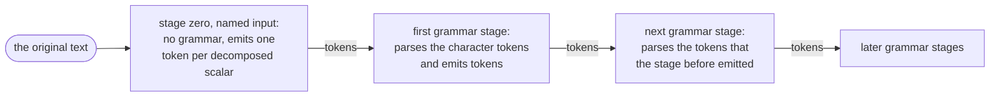
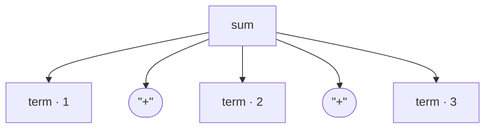
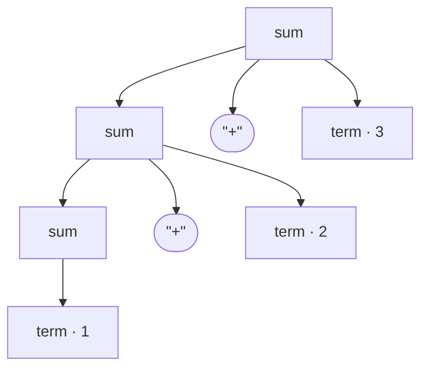
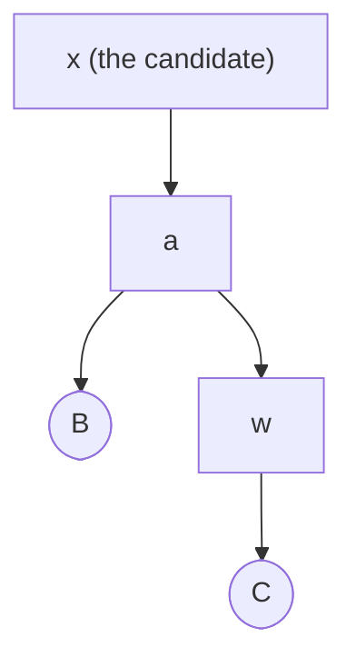

# jbogenbau, the grammar notation

Every grammar in gencmu is a Markdown document. Its fenced `jbogenbau` blocks, read in order, are one grammar, and the prose between the blocks explains it. This document explains jbogenbau, the notation that those blocks use. The grammars only say what they are about, and refer here for the rest. Two grammars written in jbogenbau itself define it: `grammars/gencmu/jbogenbau/lexical.md` and `grammars/gencmu/jbogenbau/syntax.md`.

A jbogenbau grammar is an attribute grammar with EBNF rule bodies. An attribute grammar gives computed values to constituents. A constituent is the text that one rule matches. EBNF (Extended Backus-Naur Form) is a common notation for the bodies of grammar rules.

Rule bodies use an EBNF dialect of the notation's own. "Operators" lists its forms. A token is one unit that a grammar reads or emits. A phoneme is a unit of sound.

A tag is a visible key on a node or token. A rule builds its bag of properties from its children and local expressions.

Conditions over the parts restrict which parses exist. A condition can also ask whether a part parses as another rule. This takes the grammar beyond context-free grammars, whose rules only combine symbols. It goes beyond them in the way that Boolean grammars do. In a Boolean grammar, a rule can also require that the same text matches, or does not match, another rule.

Tokens include characters, phonemes and words. A transducer reads tokens and emits another sequence.

Each rule can also say what its constituents hand to the next grammar. So a grammar is a transducer. A pipeline is an ordered series of these grammars. Each grammar forms one stage. One pipeline document names the stages.



Stage zero supplies character tokens without a grammar. In parse results, wire index zero names the first grammar stage. The origin token table has index minus one. Each grammar stage parses its whole input with its own grammar, starting at the rule `text`. The first grammar stage reads the tokens of stage zero, or tokens that a caller supplies instead. The emitted tokens of each grammar stage are the input of the next. "Values and images" describes stage zero, and "Pipelines" describes how a pipeline document declares the stages.

The examples in this document come mostly from the bundled Lojban grammars. Names such as `KOhA`, `sumti` and `🆓` are rules and tags that those grammars define. The notation gives them no meaning of its own. Where an example depends on Lojban, the text says so.

An ordinary choice is unordered: its alternatives have no priority by position. A ranked choice filters alternatives at one written position before ranking. The steps of the stage directive then rank the remaining complete parses. The sections "Ranked choices" and "Ambiguity" describe filtering and ranking.

## Values and images

Every published token has two strings in its bag. The `value` identifies the token in exact comparisons. The `image` gives its spelling for display. A rule node can lack either string. Any effective entry for either name on a node must be a string. In an ordinary data bag, both names follow the usual key rules.

Stage zero decomposes the text into Unicode Normalization Form D. For example, it emits `e` and U+0301 for `é`. Both strings start as the decomposed scalar. The token's text and source keep the original spelling.

Write `$x'value` to read a node's value. Write `$x.span.tokens!'value.join()` to join the values of its original input tokens. A join of children instead reads their computed values, including omitted defaults and empty strings from erased children. A stage can declare those joins in `$DEFAULTS`.

Notation tokens follow these rules too. The decomposed image of `≇` is `≅` followed by U+0338. Its text retains `≇`.

## Rules

A grammar contains rules, directives and constant definitions. Each statement begins with a keyword after `%`. A rule gives its name, body and clauses.

```jbogenbau
%rule sumti-tail
  [sumti-6 [relative-clauses]] sumti-tail-1 | relative-clauses sumti-tail-1
```

A stage directive can prefer the parses in which a rule's occurrences lie in some way. A step of `%ambiguity-resolution` names the rule in a node pattern, and the stage compares parses by the occurrences that the pattern matches (see "Ambiguity").

```jbogenbau
%ambiguity-resolution leftmost-longest #·r, greedy

%rule text
  r | r "b"

%rule r
  "a" "b" | "a"
```

On `ab`, the stage chooses the parse where `r` spans both tokens. Without the first step, `greedy` leaves the two parses tied.

A Lojban example uses tense words in the syntax grammar of `lojban/cll`. Its first step is `leftmost-longest #·simple-tense-modal`, so only that rule counts, and the directive prefers the leftmost and longest tenses. So `pu va ca gi` groups as `pu va` then `ca gi`. The official Lojban parser gives that grouping. The step ranks complete parses. The official parser's lexer instead groups tokens before syntax parsing.

Outside line comments, line breaks and indentation mean nothing. So a long list of alternatives can put each alternative on a line of its own, and every `|` can also stand first. By convention, authors indent the body by two spaces under the keyword:

```jbogenbau
%rule term-connective
  | joik 🆓
  | jek 🆓
  | ek 🆓
  | VUhU 🆓
```

A rule can give a bag term after an alternative or on the statement header. A term uses `→ {…}`. A statement term requires a leading `|` before the first alternative.

- `%conditions` states what must hold of a reading.
- `%error` or `%warning` supplies one string expression.
- `%suppress-warnings` names warnings to suppress inside the occurrence.
- `%emit` selects the output nodes.
- `%erased` replaces emission and removes the occurrence from counted parts.

Each trailing clause is optional and occurs at most once in this order.

`--` outside a string starts a line comment, which ends at the next line ending or the end of the file.

Line endings are LF, CRLF, and CR. There is no block comment form. Several consecutive comment lines form a comment of several lines.

The reader recognizes strings before comments, so `"a--b"` is one string. Comments discard their contents without escape processing. Backslashes are ordinary characters in comments and strings.

A name cannot contain `--`. So `foo--bar` reads as the name `foo` followed by a comment.

A comment and its newline count as whitespace between a symbol and its test, and before a pattern child list.

## Names and terminals

Names use ASCII letters, digits, hyphens, and underscores, and a rule or stage starts with a lowercase letter. A feature name starts with an ASCII letter of either case, followed by ASCII letters, digits, or hyphens. A rule name can also be one valid emoji scalar, as defined below. A tag starts with a capital or `_`. A tag terminal reads a token carrying that stored tag. For example, `KOhA` reads a token that carries the tag `KOhA`, such as a word that a Lojban lexicon gives that class.

An emoji rule name contains exactly one code point with `Emoji_Presentation` and without `Emoji_Component`. The grammar's Unicode table supplies both properties. Host Unicode data never determines this repertoire. The bundled table pins it to Unicode 15.1.0.

Variation selectors, modifiers, regional-indicator pairs, and ZWJ sequences cannot form names. Adjacent valid emoji scalars form separate name tokens. Emoji names work in template declarations, calls, tests, patterns, and query targets. An emoji rule reference can be a captured symbol, as in `$x:🆓`. A capture binder remains a lowercase name. Other identifier kinds keep their ASCII naming rules.

An emoji name suits a rule that a grammar refers to in many places, because it keeps the bodies short. Many examples below use `🆓`. It is an ordinary rule, defined like any other rule, and tests can follow it like any rule reference. The Lojban syntax grammars define it as `[{free}]`, zero or more free modifiers.

A free modifier is a Lojban word or phrase that can stand almost anywhere, such as a vocative. The constituent of `🆓` is a node of the tree like that of any rule. So the free modifiers in one slot are grouped under it.

`#` introduces patterns, and `@` introduces parameters. `/` separates items and separators inside braces. `^` marks a primary. `~` has no syntax role.

A tag is a capitalized key or a supported engine membership. A terminal or filter tests its presence without reading its value. A class starts and ends with an uppercase ASCII letter.

- A class is a tag such as `KOhA`, `BRIVLA`, or `FOREIGN`.
- A mark is a tag such as `Word`, `Stressed`, or `Run-Initial`.
- An engine tag is a stored property such as `_General_Category_Uppercase_Letter`, `_General_Category_Letter`, or `_White_Space`.

The class and mark examples are tags of the Lojban grammars. `KOhA` names a Lojban word class, and its lowercase `h` stands for an apostrophe.

In a body, a tag name is a terminal. A string literal or string constant reads one ordinary token with that value. `_` consumes any ordinary token.

In an expression, write a key set as `{KOhA, Word}`. Lowercase keys are visible to named reads, copies, splats and `.keys`. Terminal and pattern key tests see only tags.

A scalar value is a Unicode code point outside surrogates. A string escape names one exact scalar. `"a"` and `"‹U+0061›"` have the same terminal identity. `"‹U+0301›"` contains a combining acute accent.

A grammar document also decomposes. Written `"é"` and `"e‹U+0301›"` both contain `e` followed by U+0301. Neither string can match one stage-zero token. A first-stage grammar reads `"e" "‹U+0301›"`.

Escape decoding follows source decomposition, so `"‹U+00E9›"` stays one scalar. Dollar signs and backslashes inside quotes are ordinary characters. Concatenation does not reorder marks. A range endpoint must contain one scalar, so `"à".."ź"` is an error.

A range, `"a".."z"`, reads a token whose value is one scalar within its inclusive endpoints. Each endpoint is a string literal or constant that resolves to one scalar. The range skips surrogates, so `"‹U+D7FF›".."‹U+E000›"` has two possible values. A reversed range is an error. `%rule digit "0".."9"` names a scalar interval. `...` is a chain marker, so `"a"..."z"` is an error.

The configured Unicode tables supply stored stage-zero property tags. The bundled version includes 82 properties. General categories use long canonical names such as `_General_Category_Uppercase_Letter`, `_General_Category_Decimal_Number`, and `_General_Category_Letter`.

Other binary tags accept long or short names, such as `_Alphabetic` or `_Alpha`. Enumerated values accept all-long or all-short forms, such as `_Script_Latin` or `_sc_Latn`. Mixed forms are errors. The input spellings `_Lu` and `_gc_Lu` normalize to `_General_Category_Uppercase_Letter`. The compact input `_L` and short input `_gc_L` normalize to `_General_Category_Letter`.

Script_Extensions is multi-valued: each script in its set supplies a tag such as `_Script_Extensions_Hiragana`. An explicit extension set replaces the UCD default singleton Script value. For text associated with a script, extension membership can be more useful than Script alone.

Even without explicit grammar references, every stage-zero token carries its decomposed scalar's complete available profile. Shared immutable profiles can avoid per-token copies. Later stages only forward or filter stored tags. Changed values and images never regenerate them.

[Engine §1](engine.md#unicode-property-inventory) lists included properties, excluded groups, and exact spelling rules. The reader normalizes aliases before constructing the DOM. Canonical names use long forms for every property, including general categories. Mixed forms such as `_Script_Latn` are errors.

A known property or value missing from the configured table is a load error at its reference. Without scalar assignments, a supported value remains valid but contributes no stage-zero tags. Its terminal can still match a caller token carrying that tag.

The core data remains in `data/unicode/unicode.txt`. The separate pinned `data/unicode/unicode-properties.txt` declares additional support and assignments, with all UCD defaults resolved. A custom properties file replaces bundled support without fallback. A custom core without that companion supports only its five core properties.

Stage zero assigns the emoji properties in every pipeline. ASCII digits, `#`, and `*` carry `_Emoji_Component` in the bundled table.

Case matters. Aliases such as `_Letter`, without a property name, are errors. Engine §1 lists every name and its assignment rule.

A range and an engine tag are terminals in a body. A range tests the value and an engine tag tests stored membership. Each reads one token with one reading. A capture names a matched part, as in `$c:"0".."9"` or `$c:_General_Category_Letter`. A grammar can forward or filter engine tags but never introduce them.

An engine membership can stand in a terminal, filter or pattern. A constructor can copy an existing membership, list it in a mask, or delete it. A grammar cannot create a stored membership from a permission. See [engine key provenance](engine.md#engine-tag-provenance).

Either terminal can take a test. Neither a range nor an engine tag can mark an elidable optional. Emission inserts tokens with `ε` and explicit clauses, never with a range or property literal. Expected terminals and tree leaves use canonical spellings, such as `"a".."z"`.

A string uses straight double quotes, such as `"la"`. It can be a terminal, a condition operand or part of a diagnostic message. Strings accept `‹…›` escapes, and backslashes and dollar signs are plain characters. String terms can join with `++`. [String literals and escapes](#string-literals-and-escapes) defines exact scalars and names.

## Tests

A span is a half-open range between input token boundaries. A reference or terminal can carry one key filter and one value test. The filter comes first, and both must hold.

- `X<A B>` requires both keys. `X<¬A ¬B>` forbids both keys.
- `X<$C>` requires each key in the constant mask. `X<¬$C>` forbids each one.
- `X="s"` compares the occurrence's `value` with `s`. `X≠"s"` requires a different value.

A requirement mask names visible keys or permitted engine tests. An empty mask always passes. Scalar comparisons belong in expressions outside the filter.

A value test accepts a string literal, string constant or parameter that resolves to a string. A rule test in a body or pattern requires a certificate. That proof establishes that its value equals the ordered join of its original input values. A recognition read of a rule's `'value` requires the same proof. The loader reports a failed proof at the read. See [engine value proofs](engine.md#proof-for-a-rule-value).

A test follows one rule reference, call, splice, terminal or symbol parameter. On a splice, the test follows the complete spliced call. A group, optional, repetition or `ε` cannot take a test. A capture wraps the tested symbol. For example, `$l:LA="la"` captures the token read by `LA="la"`. Spaces and comments can separate a symbol from its test.

`_Elided` tests omitted origin. In a body it can appear on a terminal filter or on the head of an elidable optional. `[+T<_Elided>]` accepts omission only. A synthetic restoration candidate and an omitted leaf pass the positive test. A written token fails the test even when its value is empty.

A body filter on a rule reference, call or splice cannot name `_Elided` with either sign. The loader reports the error at the opening angle bracket, even under a disabled gate. A parameter target needs a terminal after substitution. If the argument supplies an invalid target, the loader reports its written position and keeps the filter as context.

In a pattern, a positive origin requirement needs a leaf test, including the wildcard. A rule atom can use the negated requirement and always satisfies it. A positive origin test on a rule atom fails at the mark. Ordinary engine keys can still test a rule's bag.

## Operators

A body uses these operators:

- Juxtaposition is sequence.
- `a | b` is an ordinary choice: `a` or `b`, with no priority by position.
- `a ≻ b` is a ranked choice, with the preferred option first (see "Ranked choices").
- `[x]` is optional.
- `[+T x]` is an elidable optional, whose first item is the terminator `T`. "Elided terminators" below explains the marker.
- `{x}` is one or more of `x`, and `[{x}]` is zero or more. `{x / s}` is one or more of `x` with `s` between each two. "Repetition" below explains braces, and the chains `{... x / s}` and `{x ... / s}`. A chain can also leave out `/ s`, as `{... x}` and `{x ...}`.
- `A & B` reads one or both parts: `A`, `B` or `A B`, but not `B A`. `A & B & C` is any non-empty subsequence in that order. An `&` expression has at most 16 items.
- `( )` groups.
- `ε` is the empty sequence.
- `*name` is a splice, a transparent rule call (see "Splices").

`&` binds tighter than either `|` or `≻`. Parentheses, brackets and braces each delimit what they hold, so they need no precedence.

A terminator is a token that closes a construct. Some languages let a writer elide (leave out) a terminator. In HTML, for example, a paragraph's closing `</p>` can be left out before the next paragraph. An elidable optional marks a terminator that can be elided: `[+KU]`.

In the notation, the terminator is a user tag, such as `KU`, never a string. The optional can hold more after the terminator, as in `[+KU 🆓]`. In Lojban, `KU` is the class of the word `ku`, which can close a description.

The `+` after the bracket marks the optional as elidable, in its place (see "Elided terminators"). A plain optional, `[KU]`, is never elidable.

## Repetition

Braces repeat what they hold. There are two kinds of braces. Flat braces read a list, and the tree shows the list as it stands. Chain braces read the same words, and the tree shows how they group.

- `{x}` is one or more of `x`.
- `{x / s}` is a separated list: `x`, then any number of `s x`. So `{term / CEhE 🆓}` is one or more terms, with `CEhE 🆓` between each two.
- `{... x / s}` is a left chain: `x`, or a left chain, then `s` and `x`.
- `{x ... / s}` is a right chain: `x`, or `x` and `s`, then a right chain.

A chain, like a list, can leave out `/ s`. So `{... selbri-4}` is a left chain of `selbri-4` with nothing between the items.

`[{x}]` is zero or more of `x`: an optional list. The notation has no other way to say "zero or more". ISO 14977, the standard EBNF, reads `{x}` as zero or more. This notation reads it as one or more. So every kind of braces counts its items in the same way, and brackets are the one way to say "or none".

### How braces are written

Braces are one factor, like parentheses and brackets. So an operator outside them treats them as one operand. `{A B} & C` repeats the sequence `A B`, and `[{x}]` makes the whole list optional.

Inside one pair of braces, the item `x` and the separator `s` are each a full choice, as inside parentheses. Each can hold sequences, `&`, `|`, optionals, groups and other flat braces. So `{a | b / c | d}` is items from `a | b`, separated by `c | d`. The separator of `{... simple-tense-modal / jek | joik}` is `jek | joik`. Like a choice in parentheses, each side can begin with `|`. The separator `/` cannot stand first.

A pair of braces has at most one separator `/`, and each side of it holds an expression. So `{}`, `{x /}`, `{/ s}` and `{x / s / t}` are errors of the document. A separator can be `ε`, but an item cannot (below).

The chain marker `...` stands right after `{` for a left chain. It stands after the whole item, before `/` or `}`, for a right chain. So `{a | b ... / s}` is a right chain whose item is `a | b`.

A pair of braces has at most one marker, and the separator has none. So `{... x ...}` and `{x / ... s}` are errors of the document. `...` has no other use. A postfix `x ...` is an error of the document, and so is `"a"..."z"`.

A chain is the whole of its rule. That means two things. First, the chain is the whole expression of its alternative. A chain inside parentheses, brackets, other braces, a capture, a sequence, a choice or `&` is an error of the document.

Second, that alternative is the only alternative of its rule that the gates leave (see "Feature gates"). A warning does not remove an alternative. So a rule with another alternative beside its chain is an error of the grammar for the features that leave both. For those features, gencmu finds the error when it prepares the grammar, as it finds an error of a classifier. A `%extend-rule` of a chain's rule can cause this error.

The chain's alternative can still have gates and tags of its own, and its rule can have clauses. A chain can be optional, or part of a sequence, through a rule. Name the chain as a rule. Then write the rule's name there, as in `[tag]`.

A chain cannot be the entire target of a query. A named rule in a query can contain a chain and expose its root through the forest.

Write the flat list `{x / s}` in the body, or name the chain as a rule and write its name. A right chain whose separator starts with `[+T]` can count other readings than the flat list (see "Elided terminators"). Name that chain as a rule to keep its readings.

An item of braces must read at least one token. An item that can match no tokens is an error of the grammar. gencmu finds it during the preparation of the grammar, as it finds a second alternative beside a chain. So `{[x]}` and `{ε}` are errors, and so is `{r}` where `r` can match no tokens for the features of the parse. The Lojban syntax grammars, for example, define `🆓` as `[{free}]`, so `{🆓}` is an error there.

gencmu decides this from the rules alone, as the gates and stitching leave them. It ignores every test and condition. So a rule `r` whose only alternative is `ε` with a condition that never holds still makes `{r}` an error. An alternative that a gate drops does not count, and one that an `%extend-rule` adds does.

A separator can match no tokens. So `{relative-clause / [joik]}` reads relative clauses with or without `joik` between them. Since an item is never empty, `[{x}]` reads nothing in exactly one way.

### Lists in the tree

A flat list is not a constituent. Its items and its separators are children of the constituent of the rule that writes the braces, in order. So the first rule below gives one `terms-2` node over all its terms and separators. The second gives one `text` node with every `B` between `A` and `C`:

```jbogenbau
%rule terms-2
  {term / CEhE 🆓}

%rule text
  A {B} C
```

A list has no node, so nothing can name it, capture it or test it. The clauses of the rule apply to the whole constituent of the rule, and never to a part of the list. To make a list a constituent of its own, name it as a rule.

### Chains in the tree

Each level of a chain is a constituent of the chain's rule. The chain needs no rule names of its own, because every level is a node of that rule. Take `%rule sum {... term / "+"}`, where `term` reads one digit. It reads `1+2+3` as three `sum` nodes.

The text has no spaces, because each space is a token that the grammar does not read. The outer node holds a `sum` node over `1+2`, then `+` and a `term`. That inner node holds a `sum` node over `1` alone, then `+` and a `term`. With flat braces, `%rule sum {term / "+"}` reads the same text as one `sum` node.

In the diagrams, a box such as `term · 1` is a rule node with the text that it reads. The tree format writes it the same way. A rounded box `"+"` is a leaf that the terminal `"+"` reads. The diagrams leave out the root `text` node above each tree.

The flat rule `%rule sum {term / "+"}` gives this tree:



The left chain `%rule sum {... term / "+"}` gives this tree:



A Lojban example from the syntax grammar of `lojban/cll` is `%rule tag {... tense-modal / joik-jek}`. It reads `ba je ca je pu` as three `tag` nodes in the same way.

The clauses of the rule serve every level, as they serve every alternative:

- A condition on `$` holds of each level. So a condition of a left chain holds of every prefix, and one of a right chain of every suffix. A condition on the whole chain alone belongs to a rule that refers to the chain's rule.
- Each level builds the bag of its rule, including stage defaults where applicable.
- Bare `%emit` selects the outer level. A level with no selection forwards the outputs of its children.

A chain cannot directly hold a capture in its item or separator (see "Captures"). Flat braces inside a chain can bind lists. Other clauses refer to a whole level, `$`.

A right chain is not the same as an optional suffix. In a rule `r`, the body `x [s r]` and the chain `{x ... / s}` read the same words. But the level of one item is `x` alone in the chain, and `x` with an empty optional in the suffix. That makes three differences:

- The suffix can be an elidable optional, `[+T s′ r]`, where `s` is `T s′`. Where that suffix is absent, it leaves an elided node, and `late #·_<_Elided>` counts it. The chain has no optional there, so it elides nothing. So a text can tie, or resolve otherwise, under `late #·_<_Elided>`, and `elision-only` sees a different terminator. A plain suffix, `[s r]`, elides nothing, as the chain does.
- Where `s` starts with `[+T]`, the suffix and chain apply different rules for written-terminator priority (see [Conditions](#conditions)). In the suffix, the marked optional starts the optional's content. In the chain, it follows the item's last symbol, which a query can extend. Engine §4 gives the exact rule. An omission names no separate constituent that it ends.

Where the suffix is plain and `s` does not begin with an elidable optional, the two group the words in the same way. The tags of a level of one item can still differ, as the second difference says.

## Ranked choices

A ranked choice writes its preferred option first: `(a ≻ b ≻ c)`. Each option can contain a sequence. Parentheses delimit a ranked choice inside a larger expression.

A prefix context is recognition state before the group. Only options of the same group in the same prefix context compete ([engine §6.1](engine.md#61-ranked-admission-before-ranking)).

An earlier option removes a lower proof only with the same span, dominating open facts, and a measure no worse in profile order. [Engine §6.1](engine.md#61-ranked-admission-before-ranking) defines that order. Qualification requires its tests and ready conditions to pass. When every capture that a condition reads is bound, that condition is ready. A failing higher option removes nothing.

The parses that survive ranked filtering are admitted.

An earlier option can exclude a later option even when intervening options are absent. The same dominance rule applies. An ordinary choice inside an option gives its branches equal rank. Different spans still compete through the ordinary stage ranking.

```jbogenbau
%rule preferred-operand
  ME 🆓 (sumti ≻ mex) [+MEhU] 🆓 [MOI 🆓]
```

Binding, from strongest to weakest, is factors, sequence, `&`, then choice. At a choice level, the separator is either `|` or `≻`. Mixing them at that level is a reader error. Parentheses start another level.

A ranked choice supplies a seal, an opaque leaf. Outside patterns cannot inspect the selected option through this leaf.

The seal hides no error occurrence from ranking or reports. Diagnostics still belong to their source occurrences inside the chosen option.

| Text | Meaning |
| --- | --- |
| `a b ≻ c d` | Rank the sequence `a b` above `c d`. |
| `(a ≻ b) c` | Rank the child before the common suffix `c`. |
| `a & b ≻ c` | Rank `a & b` above `c`. |
| `a ≻ (b \| c)` | Rank `a` above either lower branch. The lower branches share one rank. |
| `(a \| b) ≻ c` | Either higher branch removes `c` over the same span. |
| `(a ≻ b) \| c` | Keep `c` outside the ranked group. |
| `a ≻ (b ≻ c)` | Give the inner expression its own group and seal. |
| `[a ≻ b]` | Keep the absent optional route outside the ranked group. |
| `{(a ≻ b)}` | Repeat ranked items that must read at least one token. |
| `(ε ≻ a)` | Compare empty options only against other empty options. |

Thus `a | b ≻ c` and `a ≻ b | c` require parentheses. A whole rule body can be `a ≻ b`. Without header clauses, a leading `|` starts the ordinary alternative list.

After header clauses, `|` introduces an ordinary body or one ranked alternative. A rule with header clauses can therefore write `| a ≻ b` without parentheses. Its document object model (DOM) contains the same ranked expression as `a ≻ b`.

Every ranked expression needs at least two operands. `ε` supplies an explicit empty operand. Each operand is a complete `&` expression. `≻` has no operator meaning inside strings, conditions, or tree patterns.

Optionals and repetitions accept ranked content in their expression positions. A repetition separator can contain a ranked group too. Repetition items must still read at least one token. An elidable optional still requires its leading terminal.

Ranked options have no local gates or terms. Gates and terms on the enclosing alternative apply to the whole ranked expression.

A condition inside an option can read its ready captures. A late expression can use a private binding where its option wins. A capture cannot wrap a sequence or ranked choice. A late error does not select a different option.

A derivation is one reading that the grammar builds. Boundary offers record neighbor nodes at a constituent's edges (engine §4.2). Boundary offers use the actual derivation. `followed-by` and `preceded-by` can see nodes inside ranked options and erased constituents.

The whole-parent `$` becomes ready only when its named alternative completes. A final ranked group can reach that point. Any remaining element, including an empty optional, delays that readiness.

A selected option also determines which private captures are absent. A nested group that runs determines absence within that group. If the selection skips the nested group, the enclosing group determines that absence. The loading restrictions use this same group.

Private conditions read captures inside ranked options. A private condition cannot hold `$.preceded-by(S)` when its option can start after the rule starts. This restriction applies to positive and negated atoms. A prefix that can read only an empty sequence keeps the option at the rule's start. The loader examines structural expansions, including disabled alternatives, without evaluating conditions or symbol tests.

The loading error `ranked-choice-boundary` names the condition, the backward atom, and the ranked option. Move the condition into a rule that starts with the ranked group. Alternatively, test the private capture itself, as in `$a.preceded-by(S)`. Forward atoms on `$` and backward atoms without private ranked captures remain legal.

Outside patterns see one seal for the whole ranked choice, even when its completed option is empty. They cannot inspect its names, children, or option. Descendant, first-path, last-path, and sole-child walks stop there.

An action reads one token or closes a constituent. Internal named rules and ready conditions on their captures retain their own pattern views. The seal changes no output tree, omission, action, or captured constituent. An author who needs that hidden structure outside the choice cannot rank that position.

An early reader outside the group needs an identical expression from every active option. The expression must use common input and bindings. A forest reads eligible proofs before ranked admission.

After admission, the steps of the stage directive rank the admitted parses in order (see "Ambiguity").

## Feature gates

A feature is a name that is on or off at each stage of a parse. The pipeline can enable a feature from a selected stage onward (see "Pipelines"). The caller, the program or person that asks for the parse, can turn features on for every stage. The caller can also disable features. If a conditional declaration holds for a disabled feature, the parse gives a `feature-conflict` result (see "Pipelines").

An alternative can begin with gates, which make it depend on features.

A gate, `name?`, keeps the alternative only while the feature is on. `¬name?` keeps it only while the feature is off. All gates of an alternative must hold. A classifier entry can carry gates too.

`?` has no other use in the notation. `!` has no notation role.

When its code is enabled, a warning rule reports by that code (see "Errors and warnings"). Warning controls change no recognition or ranking.

```jbogenbau
%rule tanru-unit-2
  | BRIVLA 🆓
  | cbm? CMEVLA 🆓

%redefine-rule cmavo-token
  | Cmavo<¬Cmavo-Warning>
  | *y-cmavo

%rule y-cmavo
  Cmavo<Cmavo-Warning>
%warning "this word uses a y-final cmavo"
```

One name has one role across the pipeline: a gate, a warning code, or an error code. A warning code must also be a valid feature name. An error code cannot be enabled or disabled.

A pipeline that extends another pipeline can use gates and warnings for different kinds of change. An addition is a text that the base grammar rejects and the pipeline accepts. A warning can mark an addition, so that a reader can learn which additions a text relies on. Among the bundled pipelines, `lojban/experimental` enables `experimental-cgv` by default. When callers need other bundled warnings, they enable those codes.

A change to how the pipeline reads a text of the base cannot be a warning. The change removes the base reading, and a warning changes nothing that the grammar accepts or chooses. So a gate can control such a change, with the base form under `¬name?` beside it. The pipeline can declare the gate as an unconditional default. A caller who wants the base reading can disable that default.

The bundled pipelines do not put every change behind a gate. The bundled Lojban warnings are `y-cmavo` in `lojban/cll` and `experimental-cgv` in `lojban/experimental`. The experimental syntax additions carry no warning. A pipeline also makes a change without a gate where a feature needs a convoluted grammar to keep the change separate. The documents of the pipeline then say so.

## Splices

A splice is one transparent call of a rule. `*foo`, `*🆓`, and `*f(x)` splice an ordinary rule, an emoji rule, and one instance.

The asterisk stands directly before the name. A splice stands wherever a body rule reference or call can stand. It cannot stand in a pattern or supply a stage root.

The call keeps its term, conditions, emission, erasure, diagnostic and suppression. The occurrence table retains the call. Structural patterns see its children in the parent's sequence. The call's close is transparent to `greedy` and `lazy`.

`$x:*foo` binds the working call with its bag, span and working children. A binding at an empty place is still present. A sole-symbol copy can take the call's bag. Bare emission at the splice creates a projection over that call.

A node-to-node comparison rejects a splice capture on either side. The restriction follows that capture through a list or function binding.

The loader rejects a splice whose rule any stage ranking step, pattern, or neighbor target names. It resolves names through pattern constants, choices, template families, and instance keys. A query target does not forbid a splice, because a query parses its target independently.

Spliced and ordinary calls share the rule's same-span cycle key (engine §4). A splice cannot bypass cycle exclusion.

## Errors and warnings

A diagnostic is a named error or warning from a chosen occurrence. A rule can carry `%error` or `%warning`, followed by one string expression. It cannot carry both. A template cannot carry either directive.

```jbogenbau
%rule unmatched-fi
  FI
%error "this fi has no matching opener"
```

The rule's name is its diagnostic code. Errors and warnings share one code namespace. Across the pipeline, a name has exactly one role: gate, warning code, or error code. A warning rule's name must also meet the feature-name rules. For an instance, the loader applies the code-name requirements to its final effective name after stitching (engine §2.3).

The clauses occur in the order listed under [Rules](#rules). An extension owns its own clauses.

A message is a string expression on the reporting occurrence. It can read the occurrence's finished bag, input, source and claim-free fields of legal captures. It cannot use publication, queries, verbatim claims or private ranked bindings, even through a function. A message cannot read an absent capture or a repeated item binding as one node.

An error production must read at least one token. The loader rejects a nullable error production at its definition, even behind a gate or an impossible condition. Its conservative test ignores tests and conditions and treats gated alternatives as present (engine §3.6). Warning productions can be empty because warnings contribute no blame.

The [Eberban recovery convention](../grammars/eberban/refgram/syntax.md#diagnostic-recovery) uses these limits. An empty stage input supplies no token for its own omission error. A missing construct without a consumed opener therefore retains plain rejection. An omission under an elided opener belongs to an enclosing construct that reads a token. Each moved omission error has its own recovery rule and reads the opener token alone, rather than the opener production. Its span is that token.

In that convention, a moved guard uses `$.following-tokens` after the opener, never `$.onward`. The grammar closing section lists the sites and whole-unclosed-construct exceptions.

A chosen occurrence raises its diagnostic in its own stage. Spliced calls retain their spans, and each chain level counts separately. Failing conditions create no occurrence. The stage evaluates messages once after choice, before emission.

A live enabled diagnostic evaluates its message after choice. An expression failure gives a `grammar` result with the completed verdict and eligible diagnostic prefix. The failed stage publishes no output and runs no reconstruction. See [Deferred reports](engine.md#121-deferred-reports).

A diagnostic travels on one emitted token to later stages. Its message and coordinates remain those of its raising stage. An erased carrier drops it. A stage that emits no tokens retains its diagnostics at stage level. The reporting stage is the caller's `until` stage, or the pipeline's last stage.

The reporting stage collects pending stage-level diagnostics first, then its chosen derivation in preorder. A parent precedes its children, and siblings retain their order before spliced roots disappear. Token leaves contribute carried diagnostics at their positions. Errors and warnings keep separate ordered lists (engine §12.1).

Ranking first compares source blame, with less blamed input preferred. At equal blame, fewer sourceless errors win, then more total errors win. If every token source is empty, an error adds one sourceless charge and one to the error count. Otherwise it adds its source-envelope length and one to that count.

Overlapping sources still add their charges. Erased subtrees contribute zero, and warnings contribute nothing. Grammar preferences follow equal measures, including in ranked admission.

A chosen error before the reporting stage does not stop the pipeline. A `reported` result at the reporting stage keeps its chosen tree, `unique` or `resolved` verdict, and emitted output. Its `ok` is false. An error-bearing tie reports ambiguity and lists the errors and warnings of its two shown readings. For overlapping lists, engine §12.1 defines identity and multiplicity.

A caller enables or disables warnings by code through the feature controls. `%features` supplies defaults. A disabled warning changes no accepted reading, chosen tree, or output. An error cannot be disabled.

### Suppressing warnings

`%suppress-warnings` lists warning codes separated by commas. `_` alone suppresses all warning codes. An empty list or a list mixing `_` with codes is a document error. A repeated code in a suppression list is legal and changes nothing.

```jbogenbau
%rule delimiter-shape
  *native-delimiter
%suppress-warnings hyphen-misplaced, math-symbol
```

Suppression covers the whole derivation subtree, including the rule's own warning and every spliced occurrence. Nested lists unite. Nothing inside a suppressed subtree enables a suppressed warning again. A stage-disabled code stays disabled.

Suppression changes reports only. It never changes recognition, ranking, emission, or the blame measure. It affects only warnings raised in that stage, rather than carried warnings. It suppresses no error. A template can carry suppression, and each instance inherits it.

After stitching each stage, every listed code must name a warning in that stage. The audit notes each listed code that its subtree can never raise.

### Choosing specific errors

A grammar adds a specific error only where its message says more than the default rejection, or says the same more briefly. The comparison includes the default position and expected list. A vaguer message does not.

The comparison uses the default rejection as that grammar reports it. A condition that fails at a rule's end can put the rejection after the fault.

For example, Eberban's `a pban mo ra mo` reports the last `mo` with only `RA` expected. A named error that explains the missing sentence starter gives more information. A message that only says "invalid input" does not.

## Stitching documents

A stage reads its input with one grammar. The loader assembles that grammar from the items of one or more documents, read in order. A later rule can change what an earlier one said. Only the order of the rules in the stage matters, not the document where each was written. There are three ways to state a rule, and each says what it expects to be there already:

- `%rule` defines a rule. It is an error if a rule of that name was defined before it in the stage.
- `%redefine-rule` replaces a rule defined before it in the stage. It is an error if none was. The earlier alternatives are gone.
- `%extend-rule` adds alternatives to a rule defined before it in the stage. It is an error if none was.

```text
%extend-rule consonant
  | "б" → {image: value: "b"}
  | "в" → {image: value: "v"}
%emit

  $

%redefine-rule text
  | ¬cbm? [{NAI}] {CMEVLA} 🆓 [joik-jek] text-1
  | [indicators & {free}] [joik-jek] text-1
```

So `%rule` never quietly replaces a rule. A misspelled name in `%redefine-rule` or `%extend-rule` is an error. So is a reference to a rule that no document defines. A misspelled `%rule` defines an additional rule that nothing reads, and the audit (gencmu's report on a grammar) reports it as unreachable.

The alternatives that an extension adds carry the extension's own clauses, not those of the base rule. The clauses of the base rule do not apply to them. So an extension says everything about what it adds. The loader, the part of gencmu that reads the documents, reports every replacement and extension: which document changed which rule. So a reader can see the effect of a pipeline on its base in one place.

A ranking step that names a rule counts the redefinition and the extensions of that rule too, because the name is the stitched rule's. A step that tests a tag counts an added alternative only where that alternative's own clauses or its inheritance give the tag (see "Ambiguity"). The printed audit report names each redefinition or extension of a rule that a step names or whose tags a step can match.

The notation has no way to remove a single alternative. A rule is small enough to restate, and a restated rule reads better than a list of deletions.

## Parameterized rules

A template is a rule with load-time parameters. A call supplies arguments and names one instance, the concrete rule that expansion produces. Parameters use `@` in declarations and uses:

```jbogenbau
%rule pair(@Left, @Right)
  @Left @Right

%rule text
  pair("a", "b")
```

The opening parenthesis follows the name directly. `pair ("a", "b")` is not a call. Whitespace or a line comment before `(` prevents a call. A template and an ordinary rule cannot share a name.

Parameters start with `@` and an ASCII letter, followed by ASCII letters, digits, hyphens, or underscores. Case counts. A declaration has one or more distinct parameters. Calls supply exactly that many positional arguments. No defaults, variable argument counts, or overloading exist.

Each parameter belongs to its definition's body and clauses. Another template receives it only through an explicit argument. Arguments cannot declare or read captures, including `$` and capture methods. Recipes written in the template can read that template's captures.

Each argument is one term. A parenthesized body expression or `ε` passes a sequence as one argument. A parenthesized single symbol reads as that symbol:

```jbogenbau
%rule link(@Prefix, @Body)
  @Prefix @Body

%rule linked = link((BIhE 🆓), mex-group)
%rule plain = link(ε, mex-1)
```

Substitution replaces parsed nodes, without reparsing or regrouping nearby syntax. A choice passed to a body position remains one grouped choice. A ranked choice retains its own priority and seal. Ordinary position restrictions still apply after expansion. For example, a choice cannot replace the symbol in `$x:@X`.

A parameter can supply a body, symbol, pattern, query target, requirement or expression. It cannot construct a name, gate, key, binder or method. An elidable head needs one untested user terminal after substitution.

### The two list substitutions

A boundary-target choice splices into one complete target entry, in written order. A tag-requirement list splices into one complete unnegated filter requirement:

```jbogenbau
%rule letter(@Char, @Forbidden)
  $c:@Char
%conditions
  ¬$c.followed-by(h | @Forbidden)

%rule filtered(@Char, @Excluded)
  @Char<¬Accent @Excluded>

%rule b = letter("b", b | unvoiced)
%rule a = filtered("a", <¬Ogonek ¬Caron>)
```

Here the letter's boundary test names `h | b | unvoiced`. The filter on `a` requires `<¬Accent ¬Ogonek ¬Caron>`. A list under `¬@Excluded` is an error. A requirement list is distinct from a tag set, and `<>` is an empty list. A boundary-target choice must remain nonempty.

These are the only list substitutions. A parenthesized body choice does not splice into boundary targets. Other terms retain their usual grouping and type rules. Recipe substitution flattens concatenations in operand order before validation, with empty operands and source attribution preserved. [Engine §2.3](engine.md#23-templates-and-instances) defines argument reading and conversion.

### Names and layering

A binding assigns a public name to an instance:

```jbogenbau
%rule connection(@Unit, @Separator)
  {@Unit / @Separator}

%rule connected-terms = connection(term, (CEhE 🆓))
```

An instance key uniquely identifies an instance. The name adds no wrapper node. Every call with that instance key uses `connected-terms` in trees, JSON, inserted tokens, warnings, and error witnesses. One instance has at most one public name.

An unnamed instance uses its canonical call spelling, such as `pair("a", "b")`. Instance identity uses argument syntax trees, not evaluated values or expanded rule bodies. A nominal reference names a rule without expanding it. Constants and nominal references retain their names. Engine §2.3 defines the complete spelling and identity rules.

A closed call contains no parameter references. Template edits write parameters, as `%extend-rule pair(@Left, @Right)`. Instance edits name one public name or one closed call, as `%extend-rule pair("a", "b")`. Both kinds apply in source order. A later template redefinition replaces earlier local edits. A later template extension also reaches locally redefined instances.

A later layer can rebind a named instance with `%redefine-rule NAME = CALL`. The old key keeps its edits and takes its canonical call name. Earlier edits by NAME stay on that old key. Later edits by NAME reach the new key. Every reference to NAME, except the head of an edit, uses its final binding.

```jbogenbau
%rule atom(@Tag)
  @Tag
%rule text
  item
%rule item = atom(A)
%extend-rule item
  B
%redefine-rule item = atom(C)
```

Here `item` reads C. The old `atom(A)` still reads A or B and uses its canonical name.

Ordinary rules and named instances keep their declaration slots. Unnamed instances follow them in discovery order. Rebinding keeps the name's slot and moves the old key into the unnamed tail at its original discovery position. The replaced binding still creates its instance during the source pass. This order controls numbering, reference checks, rule traversal for diagnostics, and the audit.

The example's expanded order is `text`, `item`, then `atom(A)`. The template `atom` has no runtime rule slot.

A ranking step can name a template family, which matches every instance, or one exact instance (see "Ambiguity"). A binding adds no node and no occurrence.

### Patterns, queries, and finite expansion

A bare template atom in a pattern matches every instance of that template, including named instances. `#pair` matches the family, while `#pair("a", "b")` names one instance. Its public name identifies it too.

A recognition or neighbor query must name one instance or an ordinary rule. A bare template target is a load error. The same restriction applies to `.without-elision-except(family)`.

The loader rejects unbounded expansion through a static parameter-flow analysis. Passing a parameter unchanged creates an unchanged edge. Placing it inside another wrapping form creates a growing edge. A parenthesized single parameter adds no growth. A cycle containing a growing edge is an error, even in an uncalled template. Unchanged recursion, parameter permutations, and self-passing rule names remain valid.

Expansion precedes ordinary rule validation and lowering. Errors identify the template use and originating argument. Diagrams show each template once, with its parameters and call arguments. The audit records instances and their names, origins, edits, unused parameters, and uncalled templates.

## Constants

A constant belongs to a stage. Its name begins with `$` and a capital. `%const` defines a name once. `%redefine-const` requires an earlier definition.

```text
%const $PAUSE " "
%const $SU-STOPS {NIhO, LU, TUhE, TO}
%const $RAW $s ↦ $s.tokens!'value.join()
```

An ordinary data constant uses closed operands. A function constant takes one explicit parameter and closes over constants. Call it as `$F(expression)`. A function can occupy a constant or argument slot. It cannot appear as a bag value, list item or return value.

A lexical self-reference inside a redefinition selects the preceding version, including in a function call. Every other reference selects the final stitched version and can refer forward. The loader rejects unknown names and cycles. It infers each version independently. Each use must fit the version it reads.

A constant can use a gated entry or a closed classifier lookup. A stage feature decision cannot depend on a gate of that stage, even through a function.

A string constant can stand as a terminal or range endpoint. A key-set constant can stand in a filter. A pattern constant can stand in a pattern. Mark a template expression argument with `=`, as in `ordinary-word(= {Run-Initial}, split-first-y)`. A marked argument must be closed after substitution.

An unmarked parameter passes its category through. An unmarked brace or bracket argument reads as a body repetition or optional.

### String literals and escapes

A constant starts with `$` and a capitalized user name. A capture starts with `$` and a lowercase name. A string literal uses straight double quotes. Backslashes and dollar signs are ordinary string characters.

An escape is a delimited spelling of one scalar. It uses single guillemets `‹ ›` (U+2039, U+203A). `‹U+0301›` names a code point in hexadecimal. `‹COMBINING ACUTE ACCENT›` uses its formal Unicode name, and `‹ZWJ›` uses a name alias.

Every string literal accepts escape syntax, including terminals, tests, expressions, call arguments, and include or names-resource paths. A `%names` path restricts name escapes to core abbreviations (engine §1). An escape contributes exactly one scalar. Its source spelling does not survive in the DOM. Unescaped literal text follows ordinary source decomposition. Decoded escape scalars receive no further decomposition or mark reordering.

A literal `‹` must use an escape, as in `"‹U+2039›"`. Without an open escape, `›` is an ordinary character. Escape decoding never scans its result again. Thus `"‹U+2039›ZWJ›"` contains the literal text `‹ZWJ›`.

A numeric escape uses uppercase `U+` and four to six ASCII hexadecimal digits. Input digits can use either case. Its value must be a scalar at most U+10FFFF. A surrogate or malformed numeric escape is a document error at `‹`.

Names and aliases match exactly, including uppercase letters, spaces, and hyphens. Core abbreviations resolve from the core table. Other names and aliases use the selected lazy names resources. An unnamed scalar has no pinned formal name, algorithmic name, or alias. Declared extras add names only for these scalars, without renaming standard characters. Every alias kind in the base file is valid.

An empty escape, missing `›`, or unknown name is a document error at `‹`. A quote or line break cannot occur inside an escape. [Engine §1](engine.md#unicode-names-for-string-escapes) defines the names file and its lazy loading.

An include or names-resource path is the first and only operand of `%include` or `%names`, in straight double quotes. It uses the same escape decoder as other strings. Its unescaped text retains the original spelling without decomposition. Paths use separate tokens because loading selects resources before constant binding. Path resolution uses the decoded string.

Canonical names and terminal diagnostics use these same string literals. The printer writes one quoted string and escapes each scalar that engine §9.1 requires. If the core table supplies an abbreviation, the printer uses it. Otherwise, it writes `U+` with uppercase hexadecimal digits.

Every White_Space scalar except U+0020 requires an escape. A backslash remains literal. [Engine §9.1](engine.md#91-lexical-forms) defines alias selection and canonical padding.

```jbogenbau
%const $ACCENTED "a‹U+0301›"
%const $QUOTED "‹U+0022›Hello!‹U+0022›"
%const $ACUTE "‹COMBINING ACUTE ACCENT›"
%const $JOINER "‹ZWJ›"
%const $PATH "C:\temp"
%const $DOLLAR "$"
%const $PIECES "a b".split(" ")
```

## Expressions

An expression computes one result. A bag, list, string, number, node, span, forest, pattern, truth value or function can be that result. The operator or method determines which types it accepts.

The apostrophe reads a key, and a dot calls a method. In `$x'value`, `value` is a key of the node. In `$x.span`, `span` is a method that returns the input window. A method with no argument positions omits parentheses. A method that accepts arguments requires parentheses, even for an empty argument list such as `.join()`.

A source string starts with a double quote. A dollar sign introduces a capture, bound argument, occurrence or constant. A lowercase name adjacent to `(` starts a template call in a grammar context. `$F(` starts a function call in an expression.

| Binding, strongest first | Form |
| --- | --- |
| Atom, group, conditional | `(condition ? a \| b)` requires parentheses. It evaluates only the selected branch. |
| Property, method, map, flatten | `' . ! ↓` apply from left to right. |
| Concatenation and addition | `++ +` group from the left. |
| Intersection | `∩` groups from the left. |
| Union and difference | `∪ ∖` group from the left. |
| Comparison | One of `= ≠ < ≤ > ≥ ∈ ∉ ⊆ ⊈ ≅ ≇`. |
| Negation, conjunction, disjunction | `¬` nests to the right. Then `∧` binds more tightly than `∨`. |
| Implication and function | `⟹` groups from the right. A binder before `↦` takes the following expression. |

The surrounding form tells the reader which grammar to use. In a body, brackets enclose an optional and braces enclose a repetition. In an expression, they enclose a list and a bag. A comma ends an item at its own delimiter depth. The bar in a conditional belongs to that conditional. A bar inside a body, pattern or neighbor choice stays inside that operand.

A test of a bare flag uses `$x'Flag`. If the receiver has no valued route for the key, the read gives true for presence and false for absence. When the key can carry a value, the read requires a value on every route that reaches it.

Use `$x.has(k)` to test the presence of a key that can carry a value. Use `$x.has-value(k)` to test whether it has a value. Neither test evaluates the value. The first excludes absence on its true path. The second excludes both absence and bare presence on its true path. For example, `$x.has-value(note) ⟹ $x'note ≠ ""` can read a string from a key with all three states.

A refinement narrows the possible states of one receiver and literal key. On the right of `∧` and `⟹`, the engine assumes that the left operand is true. On the right of `∨`, it assumes that the left operand is false. Negation exchanges the paths. A conditional refines each branch separately. A guard refines only the entry or item that it enables.

Five positions convert their operands to truth. They are a condition clause, a guard, a conditional test, a Boolean operand and the result of an `.all` or `.any` predicate.

| Operand | Truth |
| --- | --- |
| Truth | Its own value. |
| Bound node | True, even for an omitted leaf. |
| Capture name | True where bound. For a list of bindings, test whether the list is nonempty. |
| Span | True where its window has an original input token. |
| List | True where it has an item. |
| Bag or key set | True where it has a present key. |
| Forest | True where it has an eligible root. |
| String, number, pattern or function | Type error. |

Comparisons keep the types of their operands. A map keeps the types of its results. A valued key with an empty list is false in a truth position even though `.has(k)` is true.

### Lists, functions and numbers

A list keeps the order, duplicates and nesting of its items. The loader infers one common element type from the items and their context. An unconstrained empty list supports operations that need no element type.

A list literal uses commas. If `$xs` is a list of strings, `["a", *$xs, "a" ∈ $xs? "b"]` combines two items with a splat. The splat `*` inserts each item of a list. A false guard skips one item. `↓` concatenates one level of a list of lists.

`$xs!'value` reads one key of each item. `$xs!.span` calls one method on each item. The short map takes exactly one selector. The next method applies to the resulting list, as in `$xs!'value.join()`.

A function takes one argument. Write an explicit binder as `$row ↦ $row'prefix'value`. Inside the function, `'` denotes the argument of the innermost function. `'key` reads its key and `.method` calls its method. Use a named reference to read an outer argument. A binder cannot hide another live name.

`.all(…)`, `.any(…)` and `!(…)` accept a whole function or a function reference. They also accept an implicit function that starts with `'` or `.` after at most one `¬`. For example, `$xs.any('Counted)` tests whether an item carries the flag. A body that starts with a bag constructor needs an explicit binder, as in `$xs!($x ↦ {note: $x'note})`.

A map evaluates each reached item in order. A list predicate can stop at the first deciding item. A later predicate cannot hide an error from an earlier map. For an empty list, `.all` gives true and `.any` gives false.

`.join()` concatenates strings. `.join(separator)` puts the separator between successive items. An empty list gives the empty string. `.union` combines a list of key sets and gives `{}` for an empty list.

`.split(delimiter)` reads left to right and keeps the nonempty pieces between exact, nonoverlapping matches. An empty delimiter is an error. A literal or constant empty delimiter fails during loading. Evaluation fails if a computed delimiter is empty.

`.ngrams(width)` lists adjacent runs of Unicode scalars in start order, with overlaps and duplicates. The width is a positive decimal literal with no leading zero. A width greater than the input length in Unicode scalars gives an empty list. The width has no machine-size limit. For example, `"a".ngrams(18446744073709551616)` gives `[]`.

`∈` and `∉` test one comparable element against a list. List difference `∖` removes every item equal to the right operand or to an item in the right list. If both interpretations fit, the right operand is a list of exclusions. List element equality compares nested lists by length, order and element equality. It compares key sets by membership. Nodes and functions have no list element equality.

Numbers are natural numbers. A literal count, a stored count and a cap must fit 0 through 255. Decimal literals use ASCII digits and only zero starts with zero. Addition computes the exact mathematical sum, even above 255. `.at-most(k)` caps the number at literal `k`. The loader proves the bound before a result can enter a bag.

## Tree patterns

A predicate is a test that holds or fails. A tree pattern is a predicate on one constructed constituent. A pattern literal starts with `#`, as in `#sumti`, `#a⁅ b c ⁆`, or `#(a ∩ b)`. `$x ≅ PATTERN` tests the captured constituent, and `$ ≅ PATTERN` tests the enclosing candidate.

`$x ≅ $y` compares two constituents instead (see "Comparing two constituents" below). `≇` negates the answer after the ordinary missing-capture simplification. Patterns never recognize the captured text again or inspect another reading.

The left operand must be a bare capture or the current function item. In either case it must bind one node. The type of the right operand decides what the comparison does. [Engine §9](engine.md#9-from-notation-tree-to-dom) defines the diagnostic for a bare name in the right position.

### The structural tree

Patterns observe named rules, terminal reads, and omitted terminators before bracket output collapses unary nodes. Generated helpers and unerased spliced calls flatten their children in order. Named chain levels retain their nodes unless their occurrence is spliced. An absent plain optional contributes no child. Recipes do not change this structural observation.

Observable nodes are rule nodes and terminal leaves. Terminal leaves can be written or omitted. Seals are not observable nodes.

A terminal leaf records the terminal that read it, rather than every tag on its token. A literal, escaped literal, and equal string constant share one terminal identity. An omitted T contributes one leaf with terminal key T and its default value. Its empty span does not remove it.

`_Elided` tests the leaf's origin outside its bag. The leaf's terminal key and default value remain observable.

A structurally empty node contains no terminal read, omitted marker, or seal. Parent sequences remove structurally empty named children, including empty `🆓` nodes and empty wrappers. A seal from a ranked choice or erased constituent counts as a leaf here. A node that contains a seal remains in its parent sequence. A direct capture of an empty named rule retains its named root for a root-name test.

An erased occurrence exports its named root with one seal as its only child. The root retains its effective keys and has empty strings for value and image. Its seal retains the original token values for structural comparison. When the occurrence reads no tokens, this rule still applies. Its seal and named root remain in parent sequences.

A spliced erased occurrence exports the seal without a named root. A structural pattern on the parent sees that seal at the splice. The splice does not expose the erased children.

The erased definition's own clauses use its ordinary structure before export. Its own `$` retains that working view, including its splice mode. Captures inside the definition retain the ordinary views of the occurrences that they bind. An erased child supplies its own sealed view. A chain level or recursive occurrence of an erased definition is an erased child, so its parent level sees it sealed.

An outside capture receives the exported view. Outside patterns can test the erased root's name, visible keys and child list. A value test on an erased rule must still satisfy the rule certificate. Every node test fails at its only child, the seal. Every downward walk stops there. A sibling gap can consume it.

A node test first tests the candidate. If that test fails and the candidate has one structural child, the test follows that child. The search repeats this step. A branching node or seal stops it. A node test with a child list tests both parts at the same visited node.

The prefix `·` (U+00B7) makes one node test exact. It tests only the candidate, without the single-child search. It applies only to its own node test. In `#·a⁅ b ·c ⁆`, `a` and `c` are exact, while `b` keeps its search.

Thus `#sumti` accepts a sumti or its unary wrappers. `#·sumti` requires the candidate itself to be sumti. Neither test passes through a branch. Set operations combine each predicate's complete answer on the same candidate. `P ∖ Q` means P holds and the whole predicate Q fails on the same candidate.

A test on a rule, such as `#·passed-step<Resumption>`, reads the rule's working keys. A value test such as `#·verb="duna"` reads its certified value.

In a pattern, `_` matches any written or omitted leaf. A written leaf exposes its token's bag. An omitted leaf exposes its terminal key and resolved default. `#·_<_Elided>` tests the omitted origin. A rule's primary does not add a structural step.

A rule constructor cannot inspect its own unfinished bag through a pattern. A condition can inspect its finished bag. A structural comparison of two nodes does not demand their bags.

This structural tree shows the search. `x`, `a` and `w` are rule nodes, and `B` and `C` are terminal leaves:



`#a⁅ B C ⁆` holds on `x`. The test of `a` fails at `x`, and `x` has one structural child, so the test moves to `a`. There the child list tests the complete children of `a`. `B` matches its leaf.

The item `C` fails at `w`, which has one child, so it moves on to the leaf `C`. `#·a⁅ B C ⁆` fails, because `x` itself is not `a`. `#a⁅ B ⁆` fails, because `a` has two children.

### Pattern forms and binding

| Form | Meaning |
| --- | --- |
| `#sumti` | A rule named sumti through single-child wrappers |
| `#·sumti` | Exactly the candidate named sumti |
| `#·sumti<Tense>` | Exactly the candidate named sumti, whose tags include Tense |
| `#·sumti="mi"` | Exactly the candidate named sumti, whose certified value is mi |
| `#_` | Any written or omitted leaf, through single-child wrappers |
| `#_<Tense>` | A leaf whose tags include Tense, through single-child wrappers |
| `#·_<_Elided>` | Exactly the candidate, an omitted terminator |
| `#KEhE` | A KEhE leaf, written or omitted |
| `#KEhE<_Elided>` | An omitted KEhE leaf |
| `#KEhE=""` | A KEhE leaf with empty value |
| `#KEhE≠""` | A KEhE leaf with nonempty value |
| `#⁅ [KEhE] ⁆` | Zero or one KEhE child |
| `#⁅ KE ⋯ KEhE ⁆` | A complete child sequence with required endpoints |
| `#⁅ A B ⁆` | Two children, each with its own single-child search |
| `#a⁅ b c ⁆` | An a node whose complete child list matches b then c |
| `#a⁅ b ⁆` | An a node with exactly one child matching b |
| `#⁅ A ⋯ B ⋯ C ⁆` | Ordered children with arbitrary sibling gaps |
| `#⁅⁆` | A node with no structural children, possibly through single-child wrappers |
| `#·⁅⁆` | Exactly a node with no structural children |
| `#(⋮ P)` | P at an endpoint of any downward path |
| `#(P ⋰)` | P at an endpoint of the first-child path |
| `#(⋱ P)` | P at an endpoint of the last-child path |
| `#(P ∪ Q)` | Either predicate on the candidate |
| `#(P ∩ Q)` | Both predicates on the candidate |
| `#(P ∖ Q)` | P holds and Q fails |
| `#⁅ {P} ⁆` | A complete sequence of one or more P children |
| `#⁅ {P / S} ⁆` | One or more P children separated by S |
| `#⁅ [P Q] ⁆` | An optional sequence of those two children |
| `#⁅ a b \| c ⁆` | Either the children a then b, or one child c |

A capitalized or engine tag denotes its tag terminal. A string literal, string constant, or range denotes its terminal identity. In a pattern, `_` denotes any written or omitted leaf. In a body, `_` keeps its wildcard terminal identity. Other names, including `🆓`, denote named rules. A pattern constant denotes its predicate.

A node test names one rule, emoji rule, template family, exact call, parameter, or terminal. Terminal forms include tags, strings, string constants, ranges, and `_`. `_` matches every leaf, but it does not match every node. A pattern constant denotes a whole predicate rather than a node test.

Node decorations are exact prefixes, tests, or child lists. Each decoration applies to its own node test. A compound pattern cannot acquire a node decoration.

A string constant can carry tag and value tests, as in `#$S="x"`. A tested constant must resolve to a string. A pattern-valued constant accepts no tests. A pattern `literal` holds a decoded string. User constants retain the distinct `constant` form in the DOM.

A child list uses the brackets `⁅ ⁆` (U+2045, U+2046). It attaches to a node test only without intervening whitespace or comments. `#a⁅ b c ⁆` tests a and its complete children at the same node. Inside a list, `x⁅ b ⁆` is one item, while `x ⁅ b ⁆` is two items.

A separate `⁅` or `·` requires whitespace or a comment after a node test, `⁆`, `]`, `}`, or a group's `)`. The first list after an adjacent call's `)` attaches to that call. Other directly adjacent uses are errors.

A bare list has no name test. `#⁅ a b ⁆` tests any observable node whose children match a then b. `#·⁅ a b ⁆` tests those children only at the candidate itself. `#⁅ a ⁆` requires one child and remains distinct from `#a`.

A child list attaches only to a rule name, emoji rule, template family, exact call, or compatible parameter. Terminals, `_`, tested atoms, and string constants cannot carry child lists. A seal passes no node test, including a bare list. On an erased splice capture, `#⁅ ⋯ ⁆` fails at the seal, while `#·e⁅ ⋯ ⁆` holds on an ordinary erased `e` root.

Take an atom that names a rule whose every definition carries `%erased`. An attached child list is a document error unless it contains only one sibling gap, `⁅ ⋯ ⁆`. That permitted list always holds on such a node.

For a fully erased rule, its own clauses test real children with bare lists such as `#·⁅ A ⁆` because the named form is an error.

For a template-family atom, this error requires at least one instance and fully erased definitions in every instance. A parameter as the atom postpones this check until substitution. A child-list parameter occupies one element, so a known erased atom takes this check on its written list.

`⁅⁆` is an empty list, distinct from an absent list. It can match a terminal leaf or a directly captured empty rule. It does not assert that the input span is empty.

Within a child list, juxtaposition sequences items and `|` chooses complete sequences. Brackets make a sequence optional. Braces repeat a sequence one or more times, with an optional `/` separator. `{C / S}` accepts `C (S C)*`. These constructs give one Boolean answer, without ranking or greediness.

`#a⁅ b (x | y⁅ z ⁆) c⁅ d e ⁆ ⁆` tests one a node with three children. The middle child matches x. The other alternative matches y, and that y has one child that matches z. Each child test keeps its own search. A child's `·` suppresses only that child's search.

`⋯` consumes zero or more siblings at one level. It never descends. Multiple sibling gaps are legal, including empty gaps. Each path permits zero or more edges and can stop before a leaf. First and last children follow helper flattening and empty-child removal.

An omitted terminator is a child like a written one. When it is the last child, a last-child path reaches it and never passes it to an earlier sibling.

Outside child lists, binding starts with a node test and its child list, grouping, path, intersection, then union or difference, from strongest to weakest. Union and difference share precedence and associate left. First-path `⋰` follows one pattern atom, while descendant `⋮` and last-path `⋱` precede one. A path operand is a whole pattern. Chained paths require parentheses.

Parentheses only group. They never introduce a child list or a subtree boundary. Juxtaposition, optional brackets, braces, gaps, and `|` require a child list. A nested `#` cannot act as a pattern atom or child item. `#(a b)` is invalid, and its child-list spelling is `#⁅ a b ⁆`.

A call's arguments retain their own grammar, including pattern literals and grouped body expressions. For a template with pattern and symbol parameters, `#checked(= #a, "b")` names one instance. The inner `#a` belongs to the marked argument.

Union and intersection each flatten operands of their own kind, including through parentheses. Runs of `∩` form one flat intersection, in written order. Difference retains exactly two operands. Order and duplicates remain significant for pattern keys.

As a child item, a set expression consumes one child. Beside other items, it requires parentheses. `#⁅ a (b ∪ c) ⁆` is valid, while `#⁅ a b ∪ c ⁆` is invalid. A whole choice arm can be a set expression, as in `#⁅ a ∩ b | c ⁆`.

Within a child list, paths bind before sequence, and sequence binds before `|`. In a repetition, `/` separates the whole item and separator choices. `{a / b | c}` repeats a with separator b or c. A path cannot take a child sequence directly. `#(⁅ a b ⁆ ⋰)` searches the first-child path for a node whose children match a then b.

`#(NAhE ⋰ ∪ SE)` puts only NAhE under the path. `#((NAhE ∪ SE) ⋰)` puts both alternatives under it. In `#⁅ A ⋰ ⋱ B ⁆`, the first child uses first-path and the second uses last-path.

Each path tests its operand at every endpoint, including the candidate. The operand retains each node test's search or exact prefix. Set operands also retain separate searches. `#(a ∩ ⁅ b c ⁆)` can match its parts at different depths, while `#a⁅ b c ⁆` requires the same node.

One tag test followed by one value test can follow a terminal atom. Its value or tags must belong to the same matched leaf. Written leaves use their original token's value and tags. An omitted T leaf has its terminal key and default value, including during reconstruction. Use `<_Elided>` to test its origin.

A terminal atom accepts one signed tag test and one exact value test, in that order. A rule, emoji, family or call atom accepts the same two tests. Its tag test reads the occurrence's working keys. Its value test requires the same input-join proof as a rule value test in a body. A test needs an atom, so a test alone, as `#<T>` or `#=""`, is an error.

Pattern set operators combine complete predicates and cannot mix them with tag sets. `∅` denotes the empty pattern. `#A<B>` means `#(A<B>)`, and `#A<B>=""` means `#(A<B>="")`.

Patterns reject splices, captures, emissions, alternative tags, feature gates, elision markers, chain repetitions, and direct chained path prefixes. `&` has no pattern or child operator role. Patterns cannot contain recursive constants.

Optional and repeat bodies and choice arms must contain written items. A repeat body must have a way to consume at least one child. A sibling gap cannot occur within a repeat's item or separator at that sibling level. Gaps inside an attached child list remain valid because they consume another node's children.

A parameter alone can substitute one whole pattern. In a child list, that pattern consumes one child and never splices siblings. With tests, an exact prefix, or an attached list, the argument must supply the corresponding node test. A supplied compound pattern cannot acquire a node attachment. Ordinary type rules apply after substitution.

Each decoration conflicts only with the same decoration on the argument. An exact prefix requires an argument without an exact prefix. An attached list requires a rule test or call without an attached list. Thus `·@X` accepts `#a⁅ b ⁆`, while `@X⁅ b ⁆` accepts `#·a`. Tests keep their ordinary target and order rules.

The DOM accepts exactly the reader's shapes, apart from source coordinates. Reading any valid pattern's canonical spelling gives the same key under the same Unicode table and bindings. A name that reads back as a terminal under that table is invalid as a rule test. The ordinary reader decodes the printer's escapes. [Engine §2.3](engine.md#23-templates-and-instances) defines canonical spelling. [Output](output.md#pattern-values) defines the shapes.

### Comparing two constituents

The left operand of `≅` or `≇` must name one bound node. It can be a bare capture, `$` or the current function item `'`. The right operand must be a pattern or another bound node. A test against `∅` never matches. A comparison of a binding with itself is an error.

The compared tree is the structural tree above. Helpers are flattened, chain levels are kept, and a ranked group is one seal. Equality compares the two trees from their roots, child by child in order. It does not follow a single child, as a node test does. Two trees are equal by these rules:

- If two rule nodes have the same rule and equal children in order, they are equal. Each template instance is a rule of its own. So nodes of two different instances are not equal, and nodes of one instance compare by their children. A parent drops a structurally empty child from its sequence. A directly captured empty named rule keeps its root, with no children. So two captures of different empty rules are not equal.
- If one terminal read two written leaves and their tokens have equal values, the leaves are equal. A literal, an escaped literal and an equal string constant are one terminal. The bag and image of the token take no part.

- If two omitted leaves have equal terminators, they are equal. An omitted leaf never equals a written leaf. The default value of the terminator takes no part (see "Elided terminators").
- If the token values of the spans of two seals are equal sequences, the seals are equal. The sequence has one value for each original token of the span, in order, and an empty value is an element. The chosen interior, private captures, tags and omissions take no part. A seal of an empty span is still a seal.
- In reconstruction, a terminal that reads a synthetic token binds an omitted leaf. Its terminal identifies it in comparisons. Its default supplies its value. It contributes a child and no original input token. A restored optional keeps its written-only slot empty.

An erased named constituent compares as its rule with one seal child over its span. When their ordered token-value sequences are equal, two erased occurrences of one rule compare equal. Their internal brackets do not distinguish them. In a parent comparison, the child sequence of an erased splice contains that seal. A splice capture cannot be an operand of node equality.

The comparison uses structure and written leaf values. Source coordinates, other bag entries and emission take no part.

Eberban resumes a verb only where the repeated verb has the words of the earlier one. Its syntax compares the two verbs, each with its free suffixes, in this way:

```text
%rule resumed-step
  [si-free] $v:annotated-verb step-tail {resume-head $e:annotated-verb step-tail}
%conditions
  $e.all($item ↦ $item ≅ $v)
```

The predicate compares every captured resumption with the earlier verb.

## Classifiers

A classifier is a constant bag that groups exact strings. Each entry holds one string, a list of strings, or a key set that names other entries.

This forms stage fragment uses a `cmavo-shape` whose value is certified as the input join.

```text
%const $LEXICON {
  A: ["a", "e", "ji", "o", "u"],
  UI: ["ui", "ia"],
  CAI: ["cai", "pei"],
  FUhE: "fu'e",
  Indicator: {UI, CAI, FUhE}
}

%rule source-word
  ^$c:cmavo-shape → {Word, Cmavo, *$LEXICON.classify($c'value)}
```

`$LEXICON.classify("ui")` gives `{UI, Indicator}`. The lookup starts with each class that directly contains the string. It adds the classes that refer to those matches until no new key appears. A reference cycle with no direct match contributes nothing. Each matching class appears once, even when repeated spellings or multiple reference paths reach it. Two unconditional direct writes to one key in a constructor are a load error.

Each effective table entry needs a value. An empty list declares a class with no direct strings. The empty string counts as a string member. An unknown reference is a load error. A known name that a gate or deletion removes contributes nothing. A reference or deletion alone cannot declare that name.

A layer can use `%redefine-const $LEXICON {*$LEXICON, KIhEI: "ki'ei", A: $LEXICON'A ∖ "ji"}`. Outside a lookup, a producer supplies each key that its consumers require.

## Captures

A capture labels one symbol, as in `$x:A`. If every route binds it once, it gives one node. Mutually exclusive branches can bind the same slot, as in `($x:a | $x:b) c`. If a route can omit the binding, the slot gives a list of zero or one node. A repetition gives a flat list in input order.

Place the label before the symbol inside the optional or repetition. A label cannot wrap a bracket, braces or a group. The terminator binder is `[$j:+JI]` and gives a list of zero or one written leaf.

A bound node is true in a truth position even when it spans no input. A list of bindings tests nonemptiness. For these types, `.present` makes the same test. A shared condition or statement term can test a capture declared only on another alternative. Both spellings give false there.

An alternative's own term must use names declared on that alternative. A name unknown to the statement is an error.

Inside a ranked option, local conditions can read its ready bindings. A late expression outside the group can read a private binding only where that option wins. A spliced call binds one working occurrence with a bag and span. It cannot serve as an operand of structural equality. Patterns see its anonymous child sequence.

## Conditions

`%conditions` lists the truth tests that a reading must satisfy. When the required observations become ready, the parser evaluates the clause. Separate clauses let the parser evaluate their tests independently.

For each alternative, the loader simplifies known guards and capture presence tests. A shared clause applies where that alternative declares every remaining capture it names. A clause that applies nowhere is an error. An optional or repetition declares its slot even where it binds an empty list.

```text
%rule digit-word
  [$l:misplaced-hyphen] $d:Digit [$t:misplaced-hyphen] digit-math
%conditions
  $l.all(¬.preceding-tokens.parse(… Hyphen))
```

A condition can read the bag of a ready node or its input span. Span methods such as `.onward`, `.preceding-tokens` and `.following-tokens` operate within the evaluating window. The engine manual lists [the method signatures](engine.md#method-signatures).

For an input comparison, join the desired strings explicitly. For example, `$open.span.tokens!'value.join() = $close.span.tokens!'value.join()` compares the original token values of two captures.

A rule can compare two ready node captures with `≅`. A repeated capture must first bind one item inside a predicate, as in `$xs.all($x ↦ $x ≅ $reference)`.

The methods `.followed-by(S)` and `.preceded-by(S)` take one argument form. `S` is a nonempty choice of ordinary rules, exact instances, and user terminal tags, separated by `|`. For example, `selbri | gek-sentence | KOhA` names three alternatives. `🆓` is a rule name.

Repeated targets are accepted and change nothing. Engine tags are excluded because these shared arguments identify grammar-built targets. Strings, constants, grouped choices, and commas between targets are errors. Commas inside a call separate its arguments. Parentheses around one target preserve that target.

An ordinary query ignores carried diagnostics and reads a faulty token like any other token. Its witness contains no own error occurrence outside erased subtrees. This applies to `parse`, including aligned queries. Queries evaluate no diagnostic message.

`span.parse(C)` returns a forest, the shared set of eligible query witnesses. C is any body constituent. A chain cannot be the whole of C (see [How braces are written](#how-braces-are-written)). No part of its argument syntax can bind a capture. Called rules retain their own captures. The anonymous query target has structural identity after lowering.

The mark `…` denotes unread remainder at an outer edge of the argument. It can stand at one edge or at both edges. It never stands inside an optional, group, or other nested constituent. `parse(C)` covers the whole view, and `parse(C …)` covers a prefix.

`parse(… C)` covers a suffix, and `parse(… C …)` covers some part of the view. The mark cannot stand alone, but `ε` can supply an explicit empty target. It differs from the chain marker `...` and pattern gap `⋯`.

For example, `$.parse(… B …)` holds on tokens `A B C`. The witness reads only the `B` token.

The remainder belongs to no witness. Alignment and filtering see the witness alone. A query with `…` at the start is a loading error on a restored view. A query with `…` only at the end is legal on a restored view.

As a condition, a nonempty forest holds. `.error-free` keeps only witnesses with measure `(0,0,0)`. It includes carried errors in counted input parts, while errors inside erased witness subtrees contribute zero. The same holds for the witness's own erased error occurrences. Repeated filtering changes nothing. A forest has no implicit string or set conversion.

For example, `¬$i.onward.parse(@Open …).error-free` bars an error-free opening structure in a template whose `@Open` supplies that target. The engine computes the filter over shared chart items without building witness trees.

Use `.flags` to union the visible keys on eligible roots. The keys in that union can come from different readings. Use `.any(predicate)` or `.all(predicate)` to test properties together on one root. For example, `$u.parse(brivla-scan).any('nuclei = 2)` asks for a reading with two nuclei.

A forest predicate tests every eligible root and can short-circuit within each predicate. An error on an eligible root takes precedence over the aggregate truth. The engine orders those errors independently of ranking. With no eligible root, `.any` is false and `.all` is true. A bare forest or `.any()` tests existence without reading root fields.

A forest root can supply only recognition observations, even inside a late expression. It cannot expose a private ranked winner, output properties or verbatim text.

For an ordinary span, a query parses the captured span alone, with the same grammar. So a condition can ask whether a part also reads as something else. The word grammar of `lojban/cll` uses this for the slinku'i test of borrowed words (fu'ivla). A CV cmavo is a particle of one consonant and one vowel. The test says that such a particle before a borrowed word must not make a compound word (lujvo). That is `¬$f.parse(lujvo-after-cv)`, because the rule is the part of a lujvo after its first two letters.

Inside such a parse, a condition can ask about the very span that is being parsed, as the same rule. Such a condition defines the rule in terms of itself over the same text, negated or not. The parser reports it as an error of the grammar.

Every nested query, including `parse`, follows written-terminator priority (engine §4). A nested reading cannot leave out an elidable optional where the same construct can read that whole optional as written. Two Lojban examples show this. In the Zantufa pipeline, `cy to roi toi klama` gives `([cy {to roi toi}] klama)`. A nested `tag` cannot read `cy to roi` as `cy roi` with an empty parenthesis, because the parenthesis can read on to its written `toi`.

In the same way, the `lojban/experimental` pipeline gives `(mi [klama {na (to broda toi)}])` for `mi klama na to broda toi`. There `broda` stays inside the parenthesis. The priority has a cost: a positive query can fail where a parse without it succeeds. Take `%rule r A c [+T] T` and `%rule c B`. Then `parse` of `r` over `A B T` fails, because `[+T]` takes the written `T`. Several readings that the priority keeps do not cause an ambiguity error.

A lookahead tests a rule without reading the input. A PEG is a grammar that tries alternatives in order. PEG is short for parsing expression grammar. `parse(C …)` with `.onward` or `.following-tokens` is a lookahead, like the lookahead of a PEG.

`$f.following-tokens.parse(post-word …)` says that what follows `$f` begins with a `post-word`. That `post-word` can lie in the words after the constituent. `¬$f.onward.parse(cmevla …)` says that no `cmevla` begins where `$f` begins, as a PEG's `!cmevla` before `$f` does.

The nested parse of a prefix query reads only as far as the rule can read. So a lookahead costs what reading the rule costs, however long the rest of the input is. A grammar that derives from a PEG can therefore keep its lookaheads. The [BPFK word grammar](../grammars/lojban/bpfk/morphology.md) of Lojban is an example. It derives from a PEG and retains lookaheads that state its morphology rules. BPFK is a Lojban committee for language definitions.

`.starts-input` lets a rule begin only at the start of the input. The rule below matches nothing, and its condition holds only where the input begins. So an alternative that starts with `text-start` is read there and nowhere else. The parser evaluates the condition before it looks further, so such an alternative costs nothing at the other positions. In a nested parse, the input is the span being parsed, so `.starts-input` holds at the span's start.

```jbogenbau
%rule text-start
  ε
%conditions
  $.starts-input
```

`.ends-input` is the mirror of `.starts-input`. It holds where the span ends at the end of the input. In a nested parse, it holds at the end of the span being parsed. Like `.starts-input`, it reads positions only, so the parser decides it when it evaluates the condition.

`$x.without-elision` restores the terminators omitted inside `$x` for a query that preserves those closes.

An elision is an omitted terminator. A close is one omission at an input boundary. A candidate is one constructed reading. A witness is a reading that satisfies a query. Aligned readings keep the same ordered closes at shared boundaries.

The receiver must be one bare capture, including `$` for the completed enclosing constituent. `$x.onward.without-elision` is an error. The extended form is `$x.without-elision.onward`.

A synthetic token is a token inserted for restoration. Each such token records its omitted terminal and original boundary.

The span keeps the captured words and the candidate's closes. It restores each close as a synthetic token. Original tokens keep their fields and identity. Morphology does not run again. Caller-owned omissions contribute no close, even at the captured endpoint.

`$x.without-elision.parse(R)` asks for an aligned witness over the complete capture. `$x.without-elision.parse(R …)` permits a witness that ends within the capture. `$x.without-elision.onward.parse(R …)` also permits a witness that ends after the capture. Following words remain raw input and permit ordinary omissions after the captured endpoint.

Inside the shared stretch, the witness of `.without-elision` cannot add, drop, move, or reorder closes. At its end, a prefix must match the complete group of closes at that boundary. The witness of `.without-elision-except` can also add the closes that its family permits, as the paragraphs below say. It still cannot drop, move or reorder a candidate close, so a prefix still ends after the candidate's complete group. A restored terminator cannot supply a bare terminal read. The witness must qualify on the original input before ranked admission.

The witness's conditions and written-terminator priority can inspect following words beyond the capture.

The structural seal of a ranked group hides its content. Common entry observations describe state before the ranked group. An outside restoration view keeps that group as an opaque block with its common entry observations. The witness must keep the same block and cannot end inside it. A private capture inside an option keeps its own closes for conditions ready within the group.

An erased constituent's structural seal adds no opaque restoration block. Its demanded close observations remain unchanged. Existing ranked groups inside it retain their blocks. A query using `.without-elision` still observes these closes and blocks.

Projection maps restored positions back to original input positions.

`.onward` preserves the restoration view, including through repeated calls. Other span methods first project to original tokens and return ordinary spans. `$x.without-elision.following-tokens` therefore reads the raw suffix. `.first-token`, `.tokens-after-first`, and `.last-token` expose original tokens.

Span methods observe original input tokens. A restored span's `.flags` reads their visible keys. The forest's `.flags` unions the keys of the eligible roots.

For example, these rules hold an omitted BOI fixed:

```jbogenbau
%rule text
  $x:candidate
%conditions
  $x.without-elision.parse(rival)

%rule candidate
  LETTER [+BOI]

%rule rival
  LETTER [+BOI]
```

On one LETTER token with text `my`, the candidate omits BOI at its end. The restored view contains the original `my` token followed by a synthetic BOI token. The rival omits the same BOI at the same boundary, so the query holds. Changing the rival to `LETTER BOI` makes the query fail. The restored token cannot create a required written BOI on the original input.

An ordinary nested query inside an aligned witness reads its original projected span with ordinary query rules. An explicit nested `$y.without-elision` or `$y.without-elision-except(family)` fixes the witness's own captured closes. The second form also permits the closes of its own family. Neither form receives a family from an outer query. It restores no token twice. Recursive queries give a grammar error across query forms and restoration views.

Engine §4 gives the exact bounds, proof rules, and cache identity.

`$x.without-elision-except(family)` is `$x.without-elision` with one exception. Inside the shared stretch, the witness can add closes that the named family permits.

A family is an ordinary rule or one exact instance. Its members are the rule itself and, transitively, every rule that a member reaches through a member edge. A member edge is one written way to read exactly one rule reference in an alternative. It can pass through captures, tests, parentheses and the branches of choices. It cannot pass through a sequence, an optional, braces, `&` or a ranked group. So `m`, `$z:m` and `(m | z)` make `m` a member, while `[m]`, `[$z:m]` and `m Z` do not.

The members come from the rules as written. Gates do not matter, so every alternative counts.

Name only the constructs whose closes the query permits. A family that names a broad rule permits the closes of every rule that its closure reaches. For example, in the syntax grammar of `lojban/zantufa`, a family `mex-2` takes in `operand`, so it permits BOI. The `audit` command lists each family's members and the optionals that it permits.

A rule owns each elidable optional that its alternatives write outside call arguments, at any depth. Groups, choices, optionals, braces and ranked options do not change the owner. The family permits each elidable optional that a member owns. The optional need not stand last in its rule.

After expansion, only an instance owns each elidable optional of its expanded definition, including one that an argument supplies. A template owns no optional.

The witness keeps every close and block of the candidate, in order, as for `.without-elision`. It can add a close only where two things hold. The family permits the close's optional. In the witness's restored view, a kept element stands on each side of the added close, inside the shared stretch. A kept element is a token, or a close or block that the candidate also has. Other added closes can stand between the added close and those kept elements.

So at the capture's start, an added close must follow a candidate close or block there. At the end of the shared stretch, it must come before one.

The witness cannot add the block of a ranked choice. The block of a ranked option hides each close inside it, so such a close never becomes an added close.

This is a permission, not a test that a construct is new. A witness can close a member construct earlier than the candidate does, unless written-terminator priority forbids it.

A Lojban example comes from the Zantufa grammar. It names the constructs that its terminator KUhE closes:

```jbogenbau
%rule math
  mex-forethought | mex-rp
```

In `le ke my .e gy ke'e broda`, the inner sumti `ke my .e gy ke'e` omits no KUhE. The competing quantifier reads `.e gy` as forethought mekso, which omits KUhE before `ke'e`. That close lies inside the shared stretch, and `mex-forethought` owns it. So `$s.without-elision-except(math).onward.parse(quantifier …)` holds, and the description takes the quantifier.

In `le ke my .e gy broda`, the KE group omits its own KEhE at the capture's end. The quantifier's KUhE comes just before that KEhE, so it still lies inside the shared stretch, and the description takes the quantifier again.

The receiver and composition rules of `.without-elision` apply unchanged. `$x.onward.without-elision-except(math)` is an error. The argument is one ordinary rule name or exact instance. A family whose members own no elidable optional permits nothing, and its queries answer as `.without-elision` does.

### Fixed-window suffix queries

A suffix query tests suffixes inside one fixed input window. The form `s.parse(… R)` does this. Every candidate keeps the receiver's start and end as its context. It is not a sequence of whole queries on shorter suffixes.

Conditions such as `.starts-input` and nested `.preceding-tokens` therefore see the whole window. A part query keeps the whole view as the context of every witness too. So `.starts-input` inside a witness of `parse(… C …)` sees the start of the view. The same holds for `.ends-input` and `.onward`.

For example, a target that reads `"a"` and requires `$.starts-input` does not match the suffix of two tokens valued `b` and `a`. A nullable target can match the empty suffix. A tag target reads the last token and fails on an empty span.

`$x.preceding-tokens.last-token` reads the token immediately before `$x`. Inside a nested query, it cannot reach before that query's input start. On a restored receiver, `.preceding-tokens` projects to ordinary input and drops close alignment.

A suffix query on a restored span is a load error, including after `.onward`, which preserves restoration. This applies to both restoration methods. [Engine §4.4](engine.md#44-backward-token-queries) defines the ordinary query and its sharing rules.

With one target and window start, requests that read no window end share recognition. Its cost is one recognition starting the target at every position, plus constant work per request. That recognition includes any nested queries and can grow faster than linear for complex targets. A target that reads the window end requires separate recognition for each distinct end. Restored nested queries at any depth prevent this sharing. Use `parse(… C)` and `parse(… C …)` sparingly.

### Neighbors in the parse

`$x.followed-by(S)` and `$x.preceded-by(S)` test the parse that the condition belongs to. They parse nothing again. The receiver is `$` or one capture. `S` uses the shared target choice defined above.

`$x.followed-by(S)` holds when the parse has a node of a name in `S` whose first token is the token right after `$x`. `$x.preceded-by(S)` holds when the parse has such a node whose last token is the token right before `$x`. A node of a rule is its constituent, including each level of a chain. A node of a tag is one token that the terminal read. Optionals, braces and ranked groups make no node.

A node that reads no token never counts, so an elided terminator never does. At the end of the input, nothing follows, so `followed-by` is false. At the start, `preceded-by` is false.

An empty receiver stands at one position. Then `followed-by` tests the node that starts at the token there, and `preceded-by` the node that ends just before it.

A condition with such a test holds or fails as any condition does. So `¬$.followed-by(B)` holds where no `B` node follows, at the end of the input too. A parse in which a condition fails does not exist. The stage ranks the parses that remain. So the chosen tree satisfies every such condition. In an emission item, a test reads the chosen tree and changes nothing about parsing.

The test reads the actual neighbor, which a lookahead cannot do. A Lojban example comes from the experimental grammar. There a bare `na` omits its `ku` only where its place closes, or before a term in the same reading:

```jbogenbau
%const $BARE-NA #⁅ NA [🆓] KU<_Elided> [🆓] ⁆
%rule bare-na
  $n:NA 🆓 [+KU] 🆓
%conditions
  ¬$n.onward.parse((gek | joik-jek-ek | gihek) …),
  $ ≇ $BARE-NA ∨ $.ends-input ∨ $.following-tokens.first-token.flags.overlaps($PLACE-CLOSE) ∨ $.followed-by(gihek | term)
```

`$BARE-NA` matches the bare form with an omitted KU. Other forms bypass the closing-place test.

`$PLACE-CLOSE` holds the single words that close the place, such as `cu`, `.i` and the written terminators. A gihek and a term can start with many words, so the test names them as nodes of the parse. The receiver `$` ends after the term's own free modifiers, so they never count.

Neighbors can appear in a condition clause, a rule term guard or a chosen output guard. One condition clause admits one boundary atom under Boolean operators. With a captured receiver, that clause reads no other capture and no whole-rule `$`. The loader retains the atom's owning step.

The required neighbor trials preserve reached condition errors. A provisional success carries an obligation that the completed reading must meet.

In a rule term, the guard uses one neighbor atom on `$` with optional negation. It can guard a visible bare entry or a splat of a closed visible key set.

```text
%rule step
  | [si-free] annotated-verb step-tail → {$.followed-by(resume-head)? Passed}
  | resumed-step
```

The loader retains correlated obligations for both possible outcomes. It prunes covered contradictory assignments. More than eight variants of an effective production receive an audit note. More than sixteen fail.

An output guard reads the chosen neighbors. An aligned query uses projected spans. A neighbor must cover original input, with an original token at each physical end. A synthetic terminal alone gives no offer.

Inside a nested query, the tests read the query's own reading. Its two ends act as the ends of the input. In an aligned query, atoms read projected spans. A rule that a query reaches gets a default answer at the query's edges. The audit lists every such rule as a note.

## Bags

A bag holds named entries. A key can be absent, present with no value, or present with a value. A key with no value is bare. A stored value is a string, a bounded number, a bag or a list of stored values.

A key set is a bag of bare keys. `.keys` gives all keys of a bag or node. `.flags` gives its capitalized keys and `.classes` gives its class-shaped keys. Each view drops any payload. `.select(mask)` copies the entries named in a key set with their values. `.overlaps(mask)` tests whether two key sets share a key.

`∪`, `∩` and `∖` combine two key sets or two patterns. `⊆` and `⊈` test key set inclusion. `=` and `≠` compare like strings, numbers, truths or key sets. `<`, `≤`, `>` and `≥` compare numbers. Use `{}` for an empty bag, `[]` for an empty list and `∅` for an empty pattern.

### Constructors

A constructor is a comma-separated list of entries inside braces. Apply the entries in their written order.

| Entry | Effect |
| --- | --- |
| `Word` | Write a bare key. |
| `note: expression` | Write a key with a value. |
| `image: value: "a"` | Evaluate the expression once and write the same value to both keys. |
| `$x'note` | Copy the entry as it is. A copy from an absent key writes nothing. |
| `*expression` | Copy every present entry of a bag or node. |
| `¬note` | Delete the named key. |

A later active entry replaces an earlier entry for the same key. A bare write can replace a valued entry. A false guard skips its entry and preserves the earlier result. A gate comes before the guard and can skip both. Several gates can precede one guard. For example, `{cbm? $w.has-value(note)? $w'note, ¬image}` copies a valued note only when both tests hold.

Two direct writes without a guard or gate to one key in the same constructor are an error. A named copy is a direct write. A chain cannot repeat a key. Splats and deletions can follow direct entries, as in `{Word, ¬Word}`. The engine evaluates only the winning payload of a demanded key. A hidden writer raises no runtime error and makes no verbatim claim.

### Rule bags

A leaf that reads a written token starts with that token's bag. An omitted leaf gets its terminal key, default value and empty image. The origin flag is separate from this bag. An erased rule has empty strings for both keys and keeps its other effective keys.

A rule builds its bag from four sources in order. It uses the stage defaults, the primary or eligible sole symbol, the statement term, then the alternative term. Both terms use `→ {…}`. The statement term applies to every alternative in its definition. An extension owns its own term and clauses.

The primary is one mandatory child marked with `^` before the symbol or capture label. A primary supplies its whole bag, including private keys. It also identifies the core for presentation. Each route of an alternative must have exactly one primary, or all routes must have none. A mark inside an optional, repetition, chain or ranked option is an error. A splice cannot carry the mark.

If neither term is present, one plain mandatory symbol supplies its whole bag. A terminal, rule, string, range, wildcard, call, splice or substituted symbol parameter can qualify. A label, filter or value test can remain on that symbol. An unranked choice qualifies if each route has one plain symbol. Optionals, repetitions, chains and ranked groups do not qualify.

A sole-symbol copy adds no primary edge. Use `→ {}` to suppress that copy.

`$DEFAULTS` is a function from a node to a bag. It supplies defaults to each unerased rule occurrence, including chain levels and spliced calls. Leaves, braced items and insertions receive no defaults. The Lojban phoneme, forms and words bases define the two joins below. The Eberban letters and forms bases and the notation lexical base also define them. Bundled pass-through and tree-only stages omit this function.

```text
%const $DEFAULTS $n ↦ {value: $n.children!'value.join(), image: $n.children!'image.join()}
```

A layer uses `%redefine-const` to replace this function. A call of `$DEFAULTS` inside the redefinition invokes the previous version. For example, `$n ↦ {*$DEFAULTS($n), ¬image}` deletes the default image.

Inside a rule, bare `$` denotes the occurrence. A term can read its span and children. A read of its unfinished bag through any expression is a dependency cycle. Conditions and messages can read the finished bag. A splice capture reads the call's bag, span and working children. A structural pattern sees its children in the parent's sequence.

In a shared statement term, a presence test of a capture declared only on another alternative gives false. The engine evaluates the whole guard separately for each alternative. A guard must establish any binding needed by the entry on every path that reaches it.

A presence test of a key with no supplier gives false. The audit notes it. A read that needs a value from that key is a load error.

## Emission

A rule with no `%emit` forwards the outputs of its children in order. A leaf or erased rule selects no output. Bare `%emit` selects the node and suppresses the separate publication of its descendants. Bare emission on a spliced call creates a braced item with the call's place and whole bag.

| Listed item | Effect |
| --- | --- |
| `$x` | Forward the outputs of the part. For a capture list, forward the outputs of each binding in order. |
| `$x{…}` | Create a projection at one part's span, source and text. A list cannot be the part. |
| `${…}` | Create a projection over the emitting node. |
| `ε{…}` | Insert one node at an empty place and record the inserting rule. |

A braced item creates a projection, a synthetic node over the selected part. It starts with its part's two strings, where present. The braces apply entries after those strings. They read the captures and `$` of the emitting rule. An insertion has no part, so its constructor must supply both strings.

A braced node receives no defaults and makes no further emission. Bare `$` cannot forward its own output.

A gate runs before the expression guard of an item. An item that fails either test supplies no token and no anchor. A reached guard can make a verbatim claim before returning false. The braces of a skipped item do not run.

An insertion uses the start of the first following surviving cover. A cover is a token selected over a part, even if that part is empty. Skip insertions and items that supply no tokens. If no cover follows, the insertion uses the end of the emitting node and its ordinary source boundary.

Selected spans must be in input order with no overlap between nonempty spans. Insertions can share a boundary. The loader examines unguarded covers, and the engine examines actual output after choice. A failed publication supplies no tokens.

### Decorated nodes

A decorated node has a primary and can show satellites. A satellite is a visible unit from a branch beside the primary. The presentation follows primaries and incoming token faces to the core. A node without a primary shows as one unit through its image. A braced item presents through its part, with its own image.

For example, the CLL indicators stage selects one node for `ba'e zo broda ui`. Its span covers all four words. Its primary leads to the quote `zo broda` in the preceding stage, and `ba'e` and `ui` are satellites. A full producer tree retains the quote's opener and content as descendants. The formatter shows the quote as one unit. The leading `ui nai` also forms one token with `ui` as its core.

Diagnostic coordinates belong to the raising occurrence. A core link can help a reader display a highlight without changing those coordinates.

### Stage interfaces

```text
%const $OUTPUTS {*$INPUTS, *$LEXICON.keys, Word, letter, nuclei}
```

`$OUTPUTS` lists the public keys of a stage. It is a key set. The engine keeps the selected node's entries that match those names and always keeps the two strings. An explicitly listed `value` or `image` makes no change. The mask grants permission without supplying a key or a value.

The engine supplies `$INPUTS`. A grammar cannot define it. It gives the preceding stage's effective permissions, even when that stage publishes an empty list. In the first stage it gives the origin interface described in [Engine §1](engine.md#1-tokens).

Use `%const $OUTPUTS $INPUTS` for a stage that passes on the input permissions. Use `%redefine-const $OUTPUTS` to change permissions in a layer. A plain splat of a classifier bag copies its values and cannot serve as a mask.

The loader infers the input states of the next stage from the possible emitted bags. A key can be absent, bare or valued on different routes. A permission alone adds no supplier. The stitched listing shows the permitted names and inferred types. A producer that supplies class keys outside a lookup supplies each key that later readers require.

An empty `$OUTPUTS` publishes tokens with the two strings alone. A valued entry in that mask is a type error. If `$OUTPUTS` is absent, the stage must be last and finishes with its tree. The loader inspects any `%emit` items in that stage and adds an audit note. The engine does not evaluate those items.

A read of a ready key can serve recognition. A read of verbatim text or a binding available only after choice is late. A late dependency in recognition fails before parsing. See [engine recognition](engine.md#4-recognition) for proofs, cycles and error order.

### Errors before recognition

The loader examines all written forms for syntax and scope errors, including skipped entries. It inspects closed types before specialization. It inspects types that depend on features or input in each affected stage.

A value read must have a value on every route that reaches it. A key with only a permission cannot supply one. An emitted occurrence needs both string keys after any copies, overrides or deletions.

Before recognition, the loader rejects invalid primary placement, out-of-scope captures and cycles in constant versions. It also rejects uncertified rule value reads and live unsupported recursive dependencies. Unguarded output overlaps fail during stitching.

After choice, a reached expression can fail. Actual overlaps between selected output spans and incompatible verbatim claims also fail. The [engine failure order](engine.md#failure-order) gives the priority and the records that survive.

## Verbatim text

`.verbatim-text` reads original spelling and can include adjacent uncovered punctuation. It extends each side of the source envelope up to the neighboring token or the edge of the text. The returned string does not change the source interval or text of a token.

```text
%rule zoi-body → {image: $.verbatim-text}
  | zoi-part | zoi-body zoi-part
```

The method is late. Identical input spans share a claim. Two different spans conflict if their extensions claim the same nonempty text. Overlap of base source ranges is legal. Empty spans return an empty string and claim nothing. A hidden image writer makes no claim.

## Images

The image key is independent of the value key. For example, `{value: "a", image: "A"}` keeps a visible stress marker. `ε{image: value: "'"}` inserts a visible apostrophe with empty original text.

## Directives

A directive is a keyword and its operands. By convention each stands in a block of its own, after prose that says why the grammar needs it. Two directives can share a line.

- `%ambiguity-resolution` lists the steps that rank the admitted parses, in order, as "Ambiguity" explains. Every stage must say it exactly once, in any of its documents.
- `%elision-only` turns on the check of "Elided terminators" for the stage. A stage says it at most once.
- No directive names the elidable terminators. Each elidable optional is marked in its place, as `[+KU]` (see "Elided terminators").
- `%names "PATH"` adds a names resource for the current document and its nested includes. These directives precede every other statement.
- `%stage NAME`, `%extend-stage NAME`, `%redefine-stage NAME`, `%include "PATH"` and `%features NAME…` build a pipeline, as the next section says.

A document that holds `%ambiguity-resolution` or `%elision-only` states that policy for every pipeline that includes it. Where pipelines differ in a policy, the shared document holds no such directive, and each pipeline document states its own. No form adds to a directive or replaces it. A `%redefine-stage` clears the directives with the other items of the stage, so the redefined stage states its own.

A layer changes what a step counts by `%redefine-const` of a pattern constant that a step names, where the base chose to name one. For example, the Lojban words stages share `%ambiguity-resolution lazy` in `grammars/lojban/common/stream.md`. Each syntax pipeline states its own directive.

## Pipelines

For a procedure with commands and tree examples, read [Implement a pipeline](pipelines.md).

A document can start its grammar statements with `%names "PATH"`. The relative path resolves beside that document under the rule of engine §13. A leading `/` is a grammar error at `%names`. Its escapes use only numbers or core abbreviations.

Declarations add to the inherited resources and do not affect sibling documents. A pipeline preamble therefore supplies names to its included documents. [Engine §1](engine.md#extra-names-files) defines conflicts, lazy loading, and custom naming restrictions.

A pipeline document, which is Markdown too, defines a pipeline. Each stage is a heading, followed by the list of its documents. Prose then says what the stage receives, does and hands on. Pipeline directives in `jbogenbau` blocks say what the pipeline is made of.

This example belongs to `grammars/lojban/experimental/pipeline.md`:

````markdown
# The experimental pipeline

... what the pipeline is ...

```jbogenbau
%features cbm soi-clause su-boundary
```

## Stage 1: phonemes

```jbogenbau
%stage phonemes
```

- [Latin orthography](../common/latin.md): what this document contributes
  ```jbogenbau
  %include "../common/latin.md"
  ```

... what the stage receives, does and hands on ...
````

- `%stage NAME` creates and selects a stage called `NAME`. Stages run in creation order, and every stage starts at `text`. A second declaration of the same name is an error.
- `%extend-stage NAME` selects an earlier stage. Subsequent stage items append to that stage until another stage selector appears. An unknown name is an error.
- `%redefine-stage NAME` selects an earlier stage and clears all its accumulated stage items. The stage keeps its execution position. Subsequent items define the replacement, and later extensions append to it. An unknown name is an error.
- `%include "PATH"` stands for the rules and directives of the document at `PATH`. The loader resolves the include path against the directory of the document that holds the `%include`. The target must be relative, and a leading `/` is a grammar error at `%include`.

  Lexical cleaning collapses `.` and each `..` with a parent segment. It keeps `..` above a relative base. An earlier `..` is not a parent segment. Above an absolute root, `..` stays at the root. Disk loaders open the result, and source-map loaders look up that exact key (engine §13).

  It works as if their text stood in its place, so an included document can include others and can hold stage selectors and `%features` too. Each document must still be complete rules and directives on its own. A document can be included in several stages. A document that includes itself, directly or through others, is an error.
- Before the first stage selector, `%features NAME…` declares global defaults for every stage.
- After a stage selector, `%features NAME…` belongs to that stage. It enables its features for that stage and every later stage.
- A stage-local `%features` accepts a following `%conditions` clause list. All conditions must hold before it enables its features.

A conditional declaration reads its stage input once, before that stage parses:

```jbogenbau
%stage words
%features sa-su
%conditions
  $.classes.overlaps({SA, SU})
```

Here `$` denotes the stage input span. A condition can read the input strings, source, token slices, key sets and bags. It can call pure functions of those and closed constants. It cannot extend the context, restore omissions, query a grammar, test neighbors, claim verbatim text, inspect a pattern, or read a capture.

A global declaration cannot have conditions. A directive other than `%features` cannot have conditions.

A stage-local feature is a loading error if any surviving earlier stage tests it, including through a classifier gate. The loader reports it at the local `%features` declaration, and its message names the earlier stage.

Two different stages cannot declare the same feature locally. The loader reports the second surviving declaration in document order, after include expansion. Repeated declarations in one stage are legal, and each evaluates in order.

This restriction applies even when the same feature has a global declaration or the caller enables it.

Every feature check applies only to surviving stage definitions, including feature conditions and tests in rule alternatives. The loader does not check declarations or alternatives that replacement discards. Source syntax, DOM shape and depth, and include errors still fail the load. The loader examines surviving rules and declarations before feature filtering. Stage replacement also clears its local feature declarations.

A caller-enabled feature is on everywhere. A local declaration never removes an enabled feature.

If a conditional declaration holds for a feature that the caller disables, the parse returns `feature-conflict` with the feature and stage names.

The engine evaluates the declarations in order. It stops at the first declaration that holds and names a disabled feature, or whose condition raises a runtime error. That declaration decides the result. Within one declaration, the error names the first disabled feature in operand order.

An unconditional declaration respects features that the caller disables. If the caller stops before a stage, the engine never evaluates its declarations.

Rules can also stand in the pipeline document itself, between its `%include` blocks. The loader stitches them in their places. A names preamble can precede the first `%stage`. A rule, a constant, a classifier, an implication or a stage-level directive before the first `%stage` is an error. So are two stages of one name and a stage with no rules.

Stage selection continues across grammar blocks and include boundaries. Returning from an include does not restore the earlier selection. Replacement clears rules, constants, local feature declarations and the ambiguity policy. It does not clear global `%features` or other stages. The loader reads every included document, but it evaluates only the surviving stage definitions. A missing ambiguity policy or an invalid final grammar gives the usual grammar error.

By convention, each document keeps its link in the prose, and its `%include` follows in a block of its own, in the same list item. So the pipeline reads as hyperlinked prose. A block's fence can be indented by up to three spaces, so a block can stand under a list item, indented by two. The reader knows no other Markdown container.

The layout is a matter of style, and the notation does not require it. An `%include` can stand in any block, between any two rules or directives. `tools/sync.js --check` makes sure that the bundled pipelines keep the style.

[Stage zero](#values-and-images) supplies the first grammar's tokens, as defined at the start of this guide.

`node lib/js/cli.js stitch --pipeline NAME` prints a pipeline's documents as one jbogenbau text. The command replaces every `%include` with what it stands for, and puts the global features in one `%features` at the top. It omits `%names` declarations because canonical strings need only core abbreviations and numeric escapes. It preserves local declarations and their conditions. Each run of rules from one document follows a comment naming it. A constant retains its written entries and references.

## Ambiguity

`%ambiguity-resolution` lists preference steps for the readings of one stage, as in `%ambiguity-resolution greedy`. A verdict records whether the best reading is unique, resolved by preference, or tied.

Ranked choices filter parses before the ranking below.

With sealing fixed, filtering only removes parses and never adds one. Compared with the same sealed grammar without filtering, a tie can become `resolved` or `unique`. A `resolved` verdict can become `unique` or a tie. Filtering never changes a unique verdict. These comparisons concern the verdict before emission and the elision-only check.

Ranked choices supply seals as well as filtering. Adding or removing a seal changes the grammar. It can change outside pattern answers and therefore the unique tree.

A unique or resolved verdict reaches message evaluation and any required publication. Counted errors at the reporting stage give `reported` with the chosen tree and verdict. The result retains any completed publication. A tie has no chosen tree or output, reports its two readings' diagnostics, and stops later stages.

If no error counts, including pending stage-level errors, the enabled elision-only check can run. For `resolved`, it then runs even without an elision. For `unique`, it runs only with an elided node. [Elided terminators](#elided-terminators) defines the check.

The engine first compares the three-part blame measure before every grammar step. Smaller source blame wins, then fewer sourceless errors, then more total errors. Warnings never affect ranking. The verdict counts only admitted readings with the best measure. One gives `unique`, several with one best give `resolved`, and several best give `tie`.

Readings with worse measures cannot make a text ambiguous. Erased interiors with the same observable state collapse before that count, but distinct outer erasure routes remain distinct. Grammar steps see an erased root alone (engine §6).

A grammar then ranks admitted parses with equal measures by its `%ambiguity-resolution` directive. The directive lists one or more steps, separated by commas. Of two parses, the first step that tells them apart decides which beats the other. If no other admitted parse beats a parse, that parse is best. The stage takes a sole best parse. Several best parses give a tie.

```jbogenbau
%ambiguity-resolution
  fewest #·words-erasure, late #(·erased-sentence ∪ ·erased-words),
  fewest #·passed-step, late #·_<_Elided>
```

Most steps count the occurrences of a node pattern (see "Tree patterns"). An occurrence is a node of the parse that the pattern matches, with the node's span. A node contributes at most one occurrence per step, including matches from several union operands.

Equal spans count separately, so nested occurrences count each. Each named chain level is a node of its rule, so it counts. Empty rule nodes, generated helpers, spliced roots, and seals count nothing in grammar key steps. The mandatory blame measure includes spliced error occurrences.

Erasure resets its contribution to zero, and grammar steps see the erased root alone. An erased occurrence with an empty token span counts nothing, despite its seal. Names give no priority: two rules that one pattern matches pool their occurrences.

A step's pattern is exact and local. Each node test carries the prefix `·`, so the single-child search never makes a wrapper above the named node count. The pattern holds node tests with their tag and value tests, joined by `∪`, `∩` and `∖`. A step can also name a pattern constant, as a condition does, as in `late $OMITTED` after `%const $OMITTED #·_<_Elided>`. It holds no child list, no path and no bare list, because the count of a node must depend on that node alone. The prefix belongs to one node test, so a union is written `#(·a ∪ ·b)`.

A step takes name, family, call and terminal atoms, each with its tests. So a step can match three kinds of node. A rule node matches by its name, as `#·simple-tense-modal`, and a test can narrow it, as in `#·passed-step<Resumption>`. The origin test `_Elided` identifies an omitted leaf (see "Elided terminators").

So `#·_<_Elided>` matches every elided terminator, and `#·JI<_Elided>` matches an elided `JI` only. A written leaf matches by the terminal that read it. So `fewest #·A` prefers a parse that reads a token as `B` over one that reads it as `A`. A written leaf's tags and value are the same in every parse, so a test on `#·_` never decides between written leaves.

Two rules pool their occurrences in one step by their names, as `#(·gi-stag-connective ∪ ·bridi-tail-connective)`. A step that names a rule counts the stitched rule. So it counts the alternatives of a redefinition and of every extension too.

| Step | Prefers |
| --- | --- |
| `leftmost-longest P` | the earlier start, then the longer span, then more occurrences, among the occurrences of `P` |
| `fewest P` | fewer occurrences of `P` |
| `most P` | more occurrences of `P` |
| `late P` | fewer occurrences of `P` at the first boundary where the counts differ |
| `early P` | more occurrences of `P` at the first boundary where the counts differ |
| `greedy` | the parse that reads on at the first differing visible action |
| `lazy` | the parse that closes at the first differing visible action |

`leftmost-longest P` compares two parses in this order:

1. List each occurrence's span by increasing start, then decreasing end.
2. Keep duplicate spans, including those from nested occurrences.
3. Compare the lists from the front.
4. At the first different entry, prefer the earlier start, then the later end.
5. After an equal prefix, prefer the longer list.

Two nested occurrences over one span contribute twice, so two such occurrences beat one. This document defines the comparison, rather than POSIX subexpression semantics. For example, the step pools occurrences across every node that the pattern matches, counts nested and repeated occurrences, and ignores empty occurrences. An elided terminator has an empty span, so the step never counts one. The loader refuses a `leftmost-longest` pattern that requires `_Elided` (engine §9.3).

`fewest P` and `most P` compare the numbers of occurrences alone, whatever their spans. A disfavored construct has no natural position to prefer, so `fewest` ignores spans. Zantufa's `fewest #·term-link` makes a sumti connection beat a term connection over the same words, whatever their omitted terminators. A term connection remains where no sumti connection completes.

`late P` and `early P` compare where occurrences begin. They count the occurrences of `P` that begin at each input boundary, from the start of the text. At the first boundary where the counts differ, `late` prefers the parse with fewer and `early` the parse with more. `late #·_<_Elided>` is the step that the Lojban syntax grammars use. In plain words, at the first place where two parses differ in leaving out a terminator, it takes the parse that reads on. The name of an elided terminator, and the constituent that it ends, do not count.

The comparison uses actual input tokens. A written terminator adds width, but an elided terminator adds none. A longer constituent that prevents a complete parse cannot win. Steps do not rank parse queries.

`greedy` and `lazy` compare actions rather than occurrences. Either can stand only as the last step, and a directive can end without one. Two parses that no step tells apart are tied. So a directive whose only step is `late #·_<_Elided>` ties two parses that elide the same terminators at the same places, whatever else differs. Adding `greedy` after it decides such a pair by its actions.

A tie is an error of kind `ambiguous`. The stage hands nothing on, and no later stage runs. A witness pairs differing actions from two readings. The error shows two tied parses and their witness (engine §6).

The engine's canonical order (engine §6) orders the ambiguity diagnostics. Among its keys are the numbers of the productions, which follow the order of a rule's alternatives. The canonical tie-break keys never turn a tie into an accepted reading.

`greedy` and `lazy` treat each parse as the sequence of actions that a bottom-up reader takes. Some closes are transparent and do not participate in the comparison (below). All other actions are visible. The step compares two parses that the earlier steps leave equal at their first differing visible action:

- If both read the same token under two tags, they are tied.
- If one reads and the other closes, the step decides. `greedy` takes the one that reads, so a constituent ends as late as the grammar allows. `lazy` takes the one that closes, so a constituent ends as early as the grammar allows.
- If both close different constituents, they are tied.

Some closes are transparent to action comparison. A named production with one logical symbol has a transparent close. A spliced call's close is transparent regardless of its body. The notation also creates a transparent helper for every optional, every flat `{ }` and every ranked group, including captured optionals. So two parses that differ only in such a relabeling do not differ yet.

The levels of a chain are constituents of its rule, so a level with more than one symbol is not transparent. Where `greedy` or `lazy` must see where each step of a list ends, the grammar writes a chain or explicit recursion, not flat braces.

Transparency does not merge parses, though. Two parses that differ only there are still two parses. `greedy` and `lazy` tie them when the earlier steps leave them equal. For example, `[[X]]` matches the empty text in two ways, and `[A] & [B]` in three.

Greedy and lazy quantifiers suggest an analogy, not the same matching procedure. A quantifier controls repetition in a regular expression. These steps compare complete parses at the first differing visible action, without source-order priority or early commitment. A tie that the directive leaves is an error. The directive applies throughout the stage.

A Lojban example comes from the experimental grammar. For this example, ignore that its first step names `free`. The grammar can then read `to mi klama` in two ways. One ends the parenthesis `to` after `mi`, with `vau` and `toi` elided there, and `klama` is the main predicate.

The other puts `mi klama` inside the parenthesis and elides terminators only at the end. `late #·_<_Elided>` takes the second, because the first leaves out a terminator earlier. `greedy` leaves the two readings tied, so the text is an error under `greedy` alone.

With `leftmost-longest #(·tense-modal ∪ ·free)` as its first step, the bundled experimental pipeline resolves `to mi klama` as `(to [mi klama])` whatever step follows.

The syntax stages of the bundled Lojban grammars end with `late #·_<_Elided>`. Each grammar settles with rules of its own the choices that this step leaves tied, such as where a free modifier attaches.

In the bundled Lojban pipelines, the forms and words stages are lazy. Ordinary word forms divide a run in one way only, so `lazy` decides nothing in the forms stage outside the `ra'oi` exception below.

A rafsi is a form used inside compounds. A gismu is a root word. Zantufa's `ra'oi` quote is the exception to unique word division. Its forms stage puts `leftmost-longest #·rahoi-form` first, which selects the longest rafsi or gismu form within a complete reading.

In the Lojban words stage, the lazy choice makes a magic word act on what exists when it is read. So `mi si si` erases `mi` and then nothing.

## Elided terminators

Some languages let a writer elide a terminator where no ambiguity results. A stage reads the whole text to decide where a terminator is elided.

A grammar marks each terminator that can be elided where it writes it. An elidable optional writes `+` before its terminator. It can also capture its sole terminator as `[$j:+JI]`:

```jbogenbau
%rule sumti-6
  | LE 🆓 sumti-tail [+KU 🆓]
  | LI 🆓 mex [+LOhO 🆓]
```

- The tag or parameter stands directly after the marker, as written, with no parentheses around it. So `[+(KU) 🆓]`, `[+((KU)) 🆓]`, `[+(KU 🆓)]` and `[+(KU 🆓) A]` are errors, although parentheses make no node elsewhere. `[+(@End) 🆓]` is invalid for the same reason. One spelling for each marked optional keeps every reader's check the same, and the check reads the written text, before parentheses are dropped.
- `T` is a user tag or parameter written directly after `+`. `[+KU]` marks KU. A parameter must become exactly one bare user tag after argument conversion. A string, range, engine tag, wildcard, or rule, such as `🆓`, cannot mark an omission.
- `T` can carry any existing symbol test. A test on a later item remains an ordinary test.
- `T` can carry a default value, `≝` and a string after it, as in `[+JI ≝ "jie"]`. It stands after the tag and value tests of `T`. It is the value that restoration gives the terminator where the terminator is elided. It changes nothing about a written `T`. `≝` stands only on the head of an elidable optional, at most once.
- The rest is a sequence of factors, or nothing. A choice or `&` in the rest stands in parentheses, as in `[+KU (A | B)]`. A `|` or `&` cannot join the head `T` to another operand. Such a reading can begin with a different symbol. So `[+KU | VAU]` is an error.

- The sole terminator can have a capture, as `[$j:+JI="jie"]`. Every other capture inside an elidable optional is an error (see "Captures").

An elidable optional is an optional in every other way. It can stand anywhere that an optional can, inside braces and other optionals too. Spaces can stand between its parts, but the grammars write `[+KU 🆓]` without them. The token `++` is invalid here, so `[++T]` fails at its first plus. A separate second `+` is invalid too, as in `[+ + T]`.

A template can choose its terminator through a parameter:

```jbogenbau
%rule terminated(@Body, @End)
  @Body [+@End 🆓]

%rule description = terminated(sumti-tail, KU)
```

The argument for `@End` must be one bare user tag after argument conversion. A rule name, sequence, tested argument, constant, or tag-set expression fails loading. A parenthesized single tag, such as `(KU)`, reads as that tag. Tests written on `@End` apply to the resulting terminal. The rest of the optional keeps its ordinary restrictions.

A plain optional is never elidable, whatever it holds. So `[KU]`, `[KU | VAU]` and `[{KU}]` are ordinary optionals. Where one is absent, it counts for nothing and leaves no node, as an absent optional separator does. A grammar can read a terminator both ways: `[+KU]` in one rule and `[KU]` in another. Only the first one is elided.

The marker decides everything that follows in this section, and in "Ambiguity". It decides which absent optionals show as elided terminators and which leaves carry the mark `_Elided`. It also decides what `elision-only` writes back. The terminator of an elided node is `T`.

An elision records an omitted terminal at its input boundary, without naming a separate constituent that it ends. A query uses the preceding symbol of that reading when looking for a written terminator. In `LE sumti-tail [+KU 🆓]`, that symbol is sumti-tail. A prefix is input read before the marked optional. After a terminal, or at production start, the query tests the optional directly after that prefix.

Braces add no separate query rule. The query uses productions of the expanded grammar, with plain optionals interpreted through their helpers. A marked optional at the first item's start uses its prefix. One at the start of a later flat-list item or left-chain separator follows an initial self-reference and uses that same prefix rule.

A marked optional at the start of a right-chain separator follows the item's final symbol. The query can extend that symbol before testing the written optional. If that symbol is a terminal or initial self-reference, it uses the prefix directly. These cases decide which query readings count, without assigning omissions to separate constituents.

A marked optional immediately after its production's initial self-reference uses the prefix directly when looking for a written terminator. This covers author-written left recursion and generated list recursion. Helpers never add a named-rule cycle by themselves. [Engine §4](engine.md#4-recognition) defines these searches.

A plain optional with captures retains one helper for query priority. In `a [$b:b] [+KU]`, the optional remains the preceding symbol even when absent. The query checks both its absent and present forms for a written terminator. Adding the capture changes no ranking or query answer.

The constituent of an elided terminator can end wherever a parse of the whole text needs it to end. The ranking above chooses among the parses. In Lojban, for example, `le lojbo se farvi le loglo gi'enai mintu ja dunli le logla` parses. The `sumti-tail` of `le lojbo` ends before `se farvi`, which becomes the selbri (the main predicate). A parse with the longer `sumti-tail` `lojbo se farvi` leaves the sentence without a selbri.

A language's own rule can be narrower: a terminator can be elided only if no ambiguity results. The `elision-only` check is one reading of such a rule. The directive `%elision-only` turns it on for a stage. It examines only the parse that the ranking chose.

Any counted error skips the check, including carried errors and pending stage-level errors. Otherwise the enabled check runs after emission for `resolved`. For `unique`, it also runs with an elided node in the chosen parse. It skips a unique parse with no elided node. Verdicts count only best-measure readings, so worse-measure readings never start the check. Uniqueness on the original input cannot exclude another reading of the restored input.

A restored terminator has its terminal key, default value and empty image. The engine resolves the default from `≝`, the equality operand or the empty string, in that order.

An equality test narrows written and omitted routes. `≝` supplies a default without narrowing written tokens. A value pattern can observe the default. `#JI<¬_Elided>` tests written origin and `#JI<_Elided>` tests omitted origin.

An omission exists only when its test passes on this default value. Synthetic tokens are readable only by their terminator tag. Strings, ranges, and `_` never read them. A failed omission creates no marker or restoration record. Written tokens still use their own value and tags. All well-typed tests are legal, even when either route cannot succeed.

An inert route, one that cannot succeed, causes no special error or warning.

| Test on T | Omission succeeds when | Default value |
| --- | --- | --- |
| No test | Always | Empty |
| `T ≝ d` | Always | d |
| `T=s` | Always | s |
| `T≠s` | s is nonempty | Empty |
| `T≠s ≝ d` | d differs from s | d |
| `T<$C>` | Every tag of C is T | Empty |
| `T<¬$C>` | C does not contain T | Empty |
| `T<>` | Always | Empty |
| `T<T>` | Always | Empty |

Here C is a resolved tag constant, and s and d are exact strings. The same omission tests apply at each marked optional. A default value that fails the terminator's own test is a document error at `≝`, because the terminator then cannot be elided. So `[+JI="jie" ≝ "jie"]` is legal, and `[+JI="jie" ≝ "jei"]` is an error. `[+T≠""]` cannot omit T, but reads a written nonempty T. `[+T<U>]` cannot omit T when U differs from T, although a written token carrying both tags can pass.

Then the stage parses that input again. Each elidable optional is either restored or written. In the chosen parse's own reading, an optional that it left out is restored: it reads only its restored terminator. Another reading can start an optional from a restored terminator and read more after it, where the rest of the optional reads something.

A reconstruction parses the chosen input with its omitted terminators restored. Its spans project to original input. A synthetic read adds no original token. A bare terminal reading one binds an omitted leaf, while a restored optional keeps its written-only capture empty.

Ranked choices compare spans in the reconstructed input, including restored terminators.

The check keeps every step of the directive but a final `greedy` or `lazy`, which it never applies. It counts occurrences over projected spans. An occurrence with an empty projected span counts nothing in each grammar step.

The blame measure remains first. It uses projected original sources, and synthetic tokens carry no diagnostics or carried charge. An error occurrence over synthetic tokens alone still adds `(0,1,1)` before erasure (engine §7.7). The check evaluates no diagnostic message. A restored terminator has an empty projected span, so it counts nothing in the check, whatever pattern matches it.

If filtering excludes the restored chosen derivation, the check fails. After admission, its membership follows its class under erased collapse (engine §6). If that class is not the sole best admitted class, the check also fails. Failure gives an ambiguity error, never a replacement chosen parse.

With no grammar key step, the check requires the restored chosen parse's class as the only admitted class of best measure. Before filtering and collapse, recognition always keeps the concrete restored parse. If a library loses it, the library has a defect and reports `elision-witness-lost` (engine §7.9). Filtering can exclude that present parse and cause ordinary ambiguity. A tie ends the stage before this check.

A grammar can also contain ambiguities unrelated to terminators. The experimental Lojban grammar is an example. A sumti is an argument of the selbri, the main predicate. A term includes sumti and other kinds of arguments. The experimental grammar gives sumti connections priority over term connections. It therefore reads `mi .e do` in `mi .e do klama` as two connected sumti.

`late #·_<_Elided>` does not make `elision-only` redundant. Written-back terminators can let another alternative match, or let a test on a terminal match. So the check can find a second reading that the steps do not rank below the chosen parse.

The `lojban/experimental` and `lojban/zantufa` pipelines do not declare `%elision-only`. A caller can switch `elision-only` on to require the restored chosen reading's class as the sole best admitted class of the written-back text. A condition can treat a restored terminator differently from a written one. In those grammars, such a condition can produce a second reading in reconstruction. A caller can also switch it off, to loosen a grammar that declares it.

## Layout of the bundled grammars

The bundled grammars keep a layout convention. Its purpose is that a reader sees at once where each top-level alternative of a rule ends. The notation does not require it. `tools/sync.js --check` makes sure that the bundled grammars keep the rules for alternatives and comments. Reviews examine the order of entries in each constructor.

A plain alternative is one or more plain items in a row, with no gate and no clause. A plain item is a rule reference without arguments, a splice, a string, a tag terminal, an engine tag, `ε` or a parameter. `_<T>` with one tag `T` is also a plain item. Any other alternative is a marked alternative.

So brackets, a call, another test, a range, a capture, a constant, `&`, `≻`, a gate or a clause makes an alternative marked. Brackets are parentheses, square brackets and braces. A bare `_` and a `_` with a test of several tags are not plain items.

A range or a test makes the alternative marked, as in `"a".."p"` or `Letter="n"`. Each one adds visual weight, so a line of several of them reads as one dense run. `_<T>` reads as one word, so it is plain.

Each marked alternative stands on lines of its own, and no other top-level alternative shares them. Plain alternatives can share lines, and they can also stand one on each line. The author chooses the form that reads better. For example, a list of letters reads well on one line. Two sequences of the same shape read better one above the other, because the reader compares them item by item:

```jbogenbau
%rule gismu-form
  | consonant vowel consonant-pair vowel
  | initial-pair vowel consonant vowel
```

No line of a grammar block holds more than 100 characters, counted as Unicode code points. This covers rule bodies, headers, conditions, emission items and constant entries. An alternative can run over several lines, and each of these lines counts. A comment line does not count, because a comment stays on one line.

A line that holds only one string does not count, because a string cannot break. A string concatenation can break after `++`.

Break a long line before a clause first. Then break between top-level items before breaking inside a term or bracket. If the term or its body needs several lines, put the term on a separate line. Indent it four columns past its owner. Count from the header, the alternative bar or the unbarred alternative’s first item.

End a continued condition line with its operator. In a condition list, indent its continuation two columns past the condition start. Align a guard continuation with the guard's condition. Inside brackets, continue one column past the opening bracket. Break first at the loosest operator. Indent a continuation within a tighter operand more deeply.

Put a long constant value two columns past its header. If a constant breaks at an operator, end the line with that operator. Use one row per entry in an ordered table. For a long child pattern, break between items and indent the continuation two columns. For an overlong bracketed choice, break before one of its own bars. If it is a bracketed sequence, split between its items. Indent either continuation past the alternative.

A grouped choice and a ranked group can each occupy one alternative line. For example, `("a" | "e") → {Vowel}` and `a ≻ b` each describe one alternative.

```text
%rule su-survivor
  | ^$b:unit<Trailing-Pause> skipped su-suffix
  | ^$b:unit<¬Trailing-Pause> skipped<Gap-Pause> su-suffix
      → {Trailing-Pause, value: $b'value ++ $PAUSE, image: $b'image ++ $PAUSE}
%emit
```

Keep the written order of constructor entries. For a long constructor or list, put one entry on each line. Apply the same break rules to output items.

A statement term can hold entries common to its alternatives. If an alternative needs a child's whole bag, mark that child as its primary. A statement term prevents an implicit sole-symbol copy.

A comment on a whole definition stands on its own lines before the definition. A comment on one alternative or entry goes on its own lines immediately before that part. Keep comments off header and alternative lines. A comment between a header and the first alternative or entry describes that part.

Before factoring shared bodies, gates or terms, make sure that the result preserves bindings, writes, primary selection and reading order. A shared header term applies before every alternative term. If a moved term suppresses the plain symbol copy, keep a primary. If grouping preserves the result, combine adjacent bodies with matching gates and terms. If an identical first or last item can move without changing bindings, put it outside the group. Put a sole alternative after a bare header without a leading bar.

If grouping alters the meaning or order of table rows, keep them separate. The following fragment groups two spellings on each row and preserves the complete vowel's bag through a primary.

```text
%rule accented-full-vowel → {Vowel}
  | ("a" | "A") stress-mark → {value: "a", image: "A"}
  | ("e" | "E") stress-mark → {value: "e", image: "E"}

%rule stressed-vowel → {Stressed}
  | ^accented-full-vowel
  | ("y" | "Y") stress-mark → {value: "y", image: "Y"}
```

Each row of `accented-full-vowel` has its own pair of strings. The primary on the first `stressed-vowel` alternative keeps both strings and `Vowel`.

## Railroad diagrams

Each bundled grammar document shows a railroad diagram of each rule or template. A railroad diagram draws a rule as a track. A reader follows the track from left to right, and each path along it is one way to read the rule. Under each block of rules stands one collapsed element, which opens on a click and shows a diagram of each rule of the block. `tools/sync.js` draws them, as "Railroad diagrams" in [the design document](design.md#railroad-diagrams) says.

The diagrams draw the notation in this way:

- A square box is a rule, and a rounded box is a terminal. A test stands in the box of its symbol, as the notation writes it, such as `LE="la"`.
- A splice uses the box of its rule, with `*` before the name.
- A sequence runs from left to right. A sequence too wide for the page continues on the next row. The track runs back under the row before it.
- A choice puts its first branch on the track and its other branches below it. The alternatives of a rule are a choice.
- A ranked choice draws its options in a dashed frame, numbered from 1 in preferred order. The label `≻ same span` precedes the frame. Ordinary branches inside an option are unnumbered, and a nested ranked choice has its own frame. A note under the rule repeats the filter rule.
- An optional has a bypass over its content. The bypass of an elidable optional has the label "elided".
- A test on an elided terminator also tests the omitted terminator, as "Elided terminators" says. Where the test forbids the omission, the diagram has no bypass. Where the pipelines that read the document disagree, the label adds "where its test allows".
- Braces loop back under their item, and a separator stands on the loop. So `[{x}]` is a bypass over a loop.
- The loop runs from right to left, so the separator is drawn from right to left too, with its text upright. In `{A / B C}`, the loop meets `B` first, at its right, and then `C`.
- A chain reads the same words as a list, so it has the same drawing. A label under the loop says "left chain" or "right chain".
- `A & B & C` is the choice of the item where the subsequence begins, with every later item optional. So `A & B` is `A [B]` or `B`.
- The gates of an alternative stand over the start of its track, such as `¬cbm?` or `cbm?`. `ε` is a bare track.

A diagram shows what a rule reads. It leaves out capture labels, primary marks and clauses. A primary changes bag construction and presentation without adding a recognition step.

A condition can reject a reading that the diagram shows. So a diagram shows what a rule reads before its conditions, and the diagram of a rule with conditions says "conditions apply" beside its name. The diagram of an `%extend-rule` shows only the alternatives that it adds. It says "conditions apply" when the extension adds conditions of its own.

A template diagram shows the parameter list in its title and `@` names in parameter boxes. A call box shows its arguments and links to the template. A binding shows the named instance and its substitution without an extra grammar constituent. Instance edits show their written bodies, while unnamed instances receive no separate diagrams.

An emoji rule's diagram filename is `_u` plus lowercase hexadecimal, without unnecessary leading zeros. `🆓` uses `_u1f193.svg`. Diagram titles retain the emoji. Engine §2.3 and the design document define instance and audit ordering.
