# Letters

This document opens the letters stage of the [Eberban pipeline](pipeline.md). A stage is one step of a pipeline, with its own grammar. A token is one unit that a stage reads or emits. A token's value is the string that exact comparisons read. Its image is the string that people see.

The stage reads the characters of the text and hands the forms stage one token per letter. The reference grammar's [morphology chapter](https://eberban.github.io/eberban/morphonology/morphology.html) gives the alphabet. Eberban writes sixteen consonants, five vowels and the letter `h`. The alphabetical order is `hnrlmpbfvtdszcjkgieaou`.

A letter written several times in a row is the same letter written once. The book says that repetition can informally convey the length of a sound. So `mmiiaan` is `mian`. Case does not matter either, so `MIAN` is `mian`. Each letter token has a lowercase value, whatever the text wrote.

[The notation document](../../../docs/notation.md) explains jbogenbau, the notation of these grammars.

## The text

The text is a sequence of letters, spaces, hyphens, digits and brackets. The stage is greedy. Where two parses differ, it takes the one that reads the next character over the one that closes a constituent. A constituent is the text that one rule matches. So a run of one repeated letter is one token, and a run of spaces is one token.

```jbogenbau
%ambiguity-resolution greedy

%rule text
  [{item}]

%rule item
  letter | foreign-letter | space | hyphen | digit | open-bracket | close-bracket
```

<details><summary>Railroad diagrams of <code>text</code> and <code>item</code></summary>
<p></p>
<p>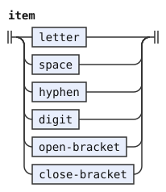</p>
</details>

## Letters and their classes

The forms stage reads letters by their sound classes. The tags below name the classes that the morphology chapter uses for its pair and triplet rules. A tag marks a token by an identifier.

- `Vowel`: `i`, `e`, `a`, `o` and `u`.
- `H`: the letter `h`, which stands only between vowels.
- `Consonant`: every letter that is neither a vowel nor `h`.
- `Sonorant`: `n`, `r` and `l`. A sonorant can end a word, and the morphology treats it apart from the other consonants.
- `Nasal`: `m` and `n`. `Liquid`: `r` and `l`.
- `Plosive`: `p`, `b`, `t`, `d`, `k` and `g`. `Sibilant`: `s`, `z`, `c` and `j`.
- `Voiced`: `b`, `d`, `g`, `v`, `z` and `j`. `Unvoiced`: `p`, `t`, `k`, `f`, `s` and `c`. The nasals and liquids have no voicing.
- `Other`: `p`, `b`, `t`, `d`, `v`, `f`, `k`, `g` and `m`, the non-sibilant consonants that can precede a sonorant in a medial pair.

Every letter token also carries `Letter`. The template `letter-of` reads one letter in either case, repeated any number of times, and emits one token whose value is the lowercase letter. Its condition makes the run maximal, so two tokens never hold the same letter side by side.

```jbogenbau
%rule letter
  | i | e | a | o | u | h
  | n | r | l | m | p | b | f | v | t | d | s | z | c | j | k | g

%rule letter-of(@Chars, @Value, @Tags)
  {@Chars} :: Letter ∪ @Tags := @Value
%conditions
  ¬$.following-tokens.begins(@Chars)
%emits
  $

%const $NASAL-SONORANT Consonant ∪ Sonorant ∪ Nasal
%const $LIQUID Consonant ∪ Sonorant ∪ Liquid
%const $M Consonant ∪ Nasal ∪ Other
%const $UNVOICED-PLOSIVE Consonant ∪ Unvoiced ∪ Plosive ∪ Other
%const $VOICED-PLOSIVE Consonant ∪ Voiced ∪ Plosive ∪ Other
%const $UNVOICED-FRICATIVE Consonant ∪ Unvoiced ∪ Other
%const $VOICED-FRICATIVE Consonant ∪ Voiced ∪ Other
%const $UNVOICED-SIBILANT Consonant ∪ Unvoiced ∪ Sibilant
%const $VOICED-SIBILANT Consonant ∪ Voiced ∪ Sibilant

%rule i-chars
  "i" | "I"

%rule i = letter-of(i-chars, "i", Vowel)

%rule e-chars
  "e" | "E"

%rule e = letter-of(e-chars, "e", Vowel)

%rule a-chars
  "a" | "A"

%rule a = letter-of(a-chars, "a", Vowel)

%rule o-chars
  "o" | "O"

%rule o = letter-of(o-chars, "o", Vowel)

%rule u-chars
  "u" | "U"

%rule u = letter-of(u-chars, "u", Vowel)

%rule h-chars
  "h" | "H"

%rule h = letter-of(h-chars, "h", H)

%rule n-chars
  "n" | "N"

%rule n = letter-of(n-chars, "n", $NASAL-SONORANT)

%rule r-chars
  "r" | "R"

%rule r = letter-of(r-chars, "r", $LIQUID)

%rule l-chars
  "l" | "L"

%rule l = letter-of(l-chars, "l", $LIQUID)

%rule m-chars
  "m" | "M"

%rule m = letter-of(m-chars, "m", $M)

%rule p-chars
  "p" | "P"

%rule p = letter-of(p-chars, "p", $UNVOICED-PLOSIVE)

%rule b-chars
  "b" | "B"

%rule b = letter-of(b-chars, "b", $VOICED-PLOSIVE)

%rule f-chars
  "f" | "F"

%rule f = letter-of(f-chars, "f", $UNVOICED-FRICATIVE)

%rule v-chars
  "v" | "V"

%rule v = letter-of(v-chars, "v", $VOICED-FRICATIVE)

%rule t-chars
  "t" | "T"

%rule t = letter-of(t-chars, "t", $UNVOICED-PLOSIVE)

%rule d-chars
  "d" | "D"

%rule d = letter-of(d-chars, "d", $VOICED-PLOSIVE)

%rule s-chars
  "s" | "S"

%rule s = letter-of(s-chars, "s", $UNVOICED-SIBILANT)

%rule z-chars
  "z" | "Z"

%rule z = letter-of(z-chars, "z", $VOICED-SIBILANT)

%rule c-chars
  "c" | "C"

%rule c = letter-of(c-chars, "c", $UNVOICED-SIBILANT)

%rule j-chars
  "j" | "J"

%rule j = letter-of(j-chars, "j", $VOICED-SIBILANT)

%rule k-chars
  "k" | "K"

%rule k = letter-of(k-chars, "k", $UNVOICED-PLOSIVE)

%rule g-chars
  "g" | "G"

%rule g = letter-of(g-chars, "g", $VOICED-PLOSIVE)
```

<details><summary>Railroad diagrams of the 46 rules from <code>letter</code> to <code>g</code></summary>
<p>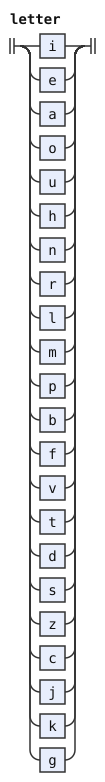</p>
<p>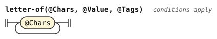</p>
<p>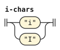</p>
<p>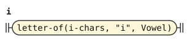</p>
<p>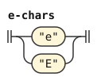</p>
<p>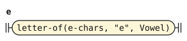</p>
<p>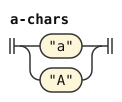</p>
<p>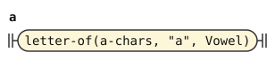</p>
<p></p>
<p></p>
<p></p>
<p>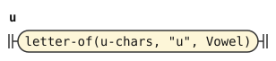</p>
<p>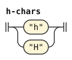</p>
<p>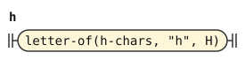</p>
<p>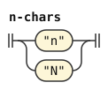</p>
<p>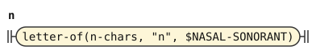</p>
<p>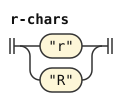</p>
<p>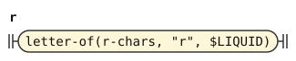</p>
<p>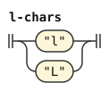</p>
<p>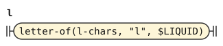</p>
<p>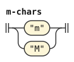</p>
<p>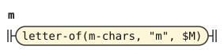</p>
<p>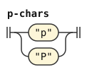</p>
<p>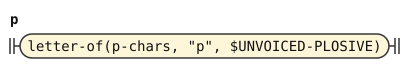</p>
<p>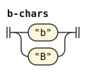</p>
<p></p>
<p>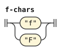</p>
<p>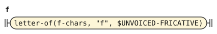</p>
<p>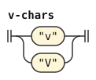</p>
<p>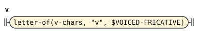</p>
<p>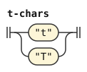</p>
<p>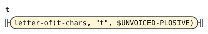</p>
<p>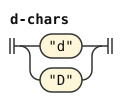</p>
<p>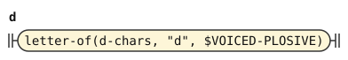</p>
<p>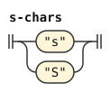</p>
<p>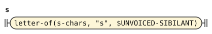</p>
<p></p>
<p>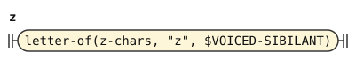</p>
<p>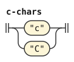</p>
<p>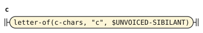</p>
<p>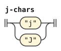</p>
<p>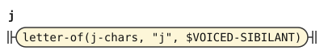</p>
<p>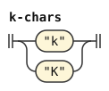</p>
<p>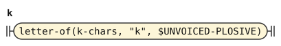</p>
<p>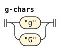</p>
<p>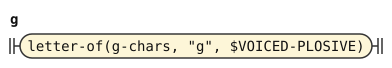</p>
</details>

The Latin letters `q`, `w`, `x` and `y` are not Eberban letters. The stage emits a run of one of them as a `Foreign-Letter` token. The forms stage reads no word from a run that holds one. Such a run can stand only inside a foreign quote or in text that `ra` erases.

```jbogenbau
%rule foreign-letter
  {foreign-char}
%conditions
  ¬$.following-tokens.begins(foreign-char)
%emits
  $ :: Foreign-Letter := $.decomposed-source-text :- $.source-text

%rule foreign-char
  "q" | "Q" | "w" | "W" | "x" | "X" | "y" | "Y"
```

<details><summary>Railroad diagrams of <code>foreign-letter</code> and <code>foreign-char</code></summary>
<p>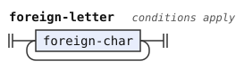</p>
<p>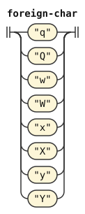</p>
</details>

## Spaces, hyphens, digits and brackets

The book says that any character other than a letter, a hyphen or a quotation bracket is a space. A digit is a number word, so it is not a space either. A run of space characters is one `Space` token with the value of one space. The run keeps its source text, which a foreign quote shows verbatim.

The book says that Eberban has no mathematical symbols. The PEG warns when `+`, `*` or `/` follows a number, and reads the symbol as a space. The tag `Math-Symbol` marks a space run that holds one of them, so the forms stage can warn in the same place.

```jbogenbau
%rule space
  {space-char}
%conditions
  ¬$.following-tokens.begins(space-char)
%emits
  $ :: Space ∪ ($.matches(math-run) ⟹ Math-Symbol) := " "

%rule space-char
  $c:_
%conditions
  ¬$c.matches(word-char)

%rule word-char
  letter-char | digit-char | hyphen-char | "[" | "]"

%rule letter-char
  "a".."z" | "A".."Z"

%rule digit-char
  "0".."9"

%rule math-run
  [{space-char}] ("+" | "*" | "/") [{space-char}]
```

<details><summary>Railroad diagrams of the 6 rules from <code>space</code> to <code>math-run</code></summary>
<p>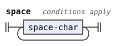</p>
<p>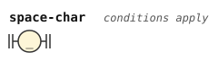</p>
<p>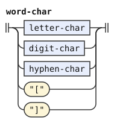</p>
<p>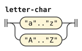</p>
<p></p>
<p>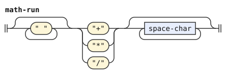</p>
</details>

A hyphen can stand at a syllable boundary to make the syllable stand out, and it lets a word continue on the next line. The book allows the hyphen-minus, the hyphen U+2010 and the em dash U+2014, as the PEG does. A hyphen token has an empty value, so it never changes the value of a word. Its image is `-`. The line breaks after a hyphen belong to its token.

```jbogenbau
%rule hyphen
  hyphen-char [{"‹U+000A›" | "‹U+000D›"}]
%emits
  $ :: Hyphen := "" :- "-"

%rule hyphen-char
  "-" | "‹U+2010›" | "‹U+2014›"
```

<details><summary>Railroad diagrams of <code>hyphen</code> and <code>hyphen-char</code></summary>
<p>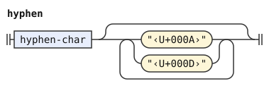</p>
<p></p>
</details>

A digit is a number word of family TI, as the [numbers chapter](https://eberban.github.io/eberban/grammar/numbers.html) allows. The stage emits each digit as a `Digit` token whose value is the digit. The brackets `[` and `]` delimit foreign quotes. Outside a quote they are spaces, which the forms stage decides.

```jbogenbau
%rule digit
  digit-char
%emits
  $ :: Digit

%rule open-bracket
  "["
%emits
  $ :: Open

%rule close-bracket
  "]"
%emits
  $ :: Close
```

<details><summary>Railroad diagrams of <code>digit</code>, <code>open-bracket</code> and <code>close-bracket</code></summary>
<p></p>
<p></p>
<p></p>
</details>

## Differences from the reference grammar and the PEG

The PEG reads a letter outside the alphabet as an error wherever it expects a letter. Inside a foreign quote or erased text it reads any character. This stage emits the letter as a foreign letter, and the forms stage keeps its run from becoming a word. The texts that the two accept are the same.

The PEG treats every non-ASCII letter as a space. This stage does the same, because the book says that any other character is a space.
