# Word forms

This document opens the forms stage of the [Eberban pipeline](pipeline.md). A stage is one step of a pipeline, with its own grammar. A token is one unit that a stage reads or emits. A token's value is the string that exact comparisons read. Its image is the string that people see.

The stage reads the letter tokens of the [letters stage](letters.md). It is the one stage that reads words and quotes from letters. It divides the letters into words and tags each word with its family. A compound, a spelling quote and a foreign quote are each one word. A tag marks a token by an identifier. The stage hands the words to the words stage, [stream.md](stream.md), with a space token for each gap between them.

The reference grammar's [morphology chapter](https://eberban.github.io/eberban/books/refgram/book/morphonology/morphology.html) states the word shapes. Eberban has a self-segregating morphology. A stream of letters divides into words in one way only. The chapter gives the reasoning.

Outside borrowings and freeform variables, a non-sonorant consonant begins a word, except as the first letter of a medial pair or a triplet. A word that begins with a vowel or a sonorant needs a space before it. So the rules below never look past a word to decide where it ends. The next word begins where a non-sonorant consonant stands outside a cluster, or after a space.

The prose uses these Eberban terms:

- A particle is a word with a grammatical function. Its family is the set of particles with one grammar, such as `VI`.
- A root is a predicate word that is not a particle.
- A borrowing is a foreign word written after the prefix `u`.
- A freeform variable is a speaker-defined predicate written after the prefix `i`.
- A compound is a word made from other words after the prefix `e`, `en` or `er`.
- A foreign quote is `co` and foreign text between brackets.
- Vhowels are a string of vowels, with `h` between some of them.
- A sonorant is `n`, `r` or `l`. The other consonants are non-sonorant.

[The notation document](../../../docs/notation.md) explains jbogenbau, the notation of these grammars.

## The text

The text is a sequence of items. An item is a space, a digit, a hesitation or an eraser. It can also be a borrowing, a freeform variable, a run of words, or a run that no rule reads. A compound is an item too, and it can stretch over several runs and the gaps between them.

A run is a maximal stretch of letters and hyphens between two items that are not letters. Each rule that reads a run makes it maximal with a condition on the tokens after it. A foreign quote is the last part of its run, so a new run can start right after the quote. Otherwise two runs never stand side by side, and one run has one division. The ranked choice in `item` reads a run as junk only where no other item reads the same text.

Five forms can hold a space inside one token: a borrowing, a freeform variable, a compound, a spelling quote and a foreign quote. An unfinished compound also reaches over spaces, but it emits several tokens. The step `leftmost-longest #(·borrowing ∪ ·freeform-variable ∪ ·spelling-quote ∪ ·foreign-quote ∪ ·compound ∪ ·open-compound)` names the five rules and `open-compound`, the unfinished compound. At each free position, the stage takes the longest such form that starts there. The step chooses between forms by their start, then by their length.

It never chooses where a foreign quote ends, because the quote rule fixes its end. The one exception is a trailing hyphen after a digit closer ("Delimiters" below). So a spelling quote at `ce` wins over an inner `co` by its earlier start, and `a ce co [ba] cei` is one spelling quote. In the same way, an unfinished compound wins over a quote in one of its slots. A complete compound wins over an unfinished one ("Unfinished compounds" below).

The book allows a hyphen only at a syllable boundary inside a word. Each digit is a word of its own, so a hyphen beside a digit stands at a word boundary. So a run reads every hyphen, and `run-char` reads a hyphen as it reads a letter.

```jbogenbau
%ambiguity-resolution
  leftmost-longest #(·borrowing ∪ ·freeform-variable ∪ ·spelling-quote ∪ ·foreign-quote ∪ ·compound ∪ ·open-compound), lazy

%rule text
  [{item}]

%rule item
  | space | digit-word | borrowing | freeform-variable
  | ((hesitation | eraser-run | word-run | compound-run | stray-compound) ≻ junk-run)

%rule run-char
  Letter | Hyphen

%rule run-end
  ε
%conditions
  ¬$.following-tokens.begins(run-char)
```

<details><summary>Railroad diagrams of <code>text</code>, <code>item</code>, <code>run-char</code> and <code>run-end</code></summary>
<p>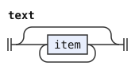</p>
<p>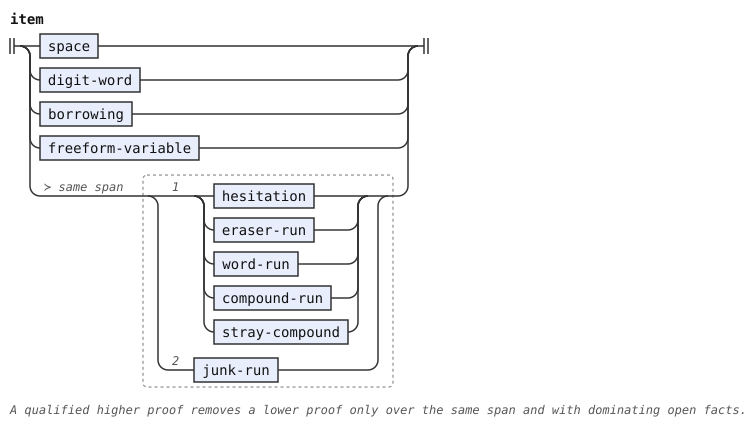</p>
<p>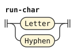</p>
<p>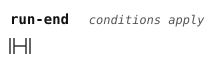</p>
</details>

`run-end` matches where a run ends. A rule that reads a run ends with it, or with a foreign quote.

### Gaps

The morphology chapter says that a bracket is a space outside the syntax of foreign quotes. So a bracket that no quote reads is a space here, and so is a foreign letter. A gap is a run of such spaces. Between two items, `space` reads the whole gap and emits one `Space` token with the value of one space. So the words stage sees no bracket, and a gap of brackets alone still stands between two words.

The book says that `q`, `w`, `x` and `y` are spaces. The PEG warns about each of them where no foreign quote holds it. So `space-unit` reads one space token, and it carries the warning `non-eberban-letter` for a foreign letter. Every gap reads its spaces through `space-unit`, so each foreign letter in a gap warns once. A foreign quote reads its text as quoted characters, so a foreign letter in the text warns nothing.

A borrowing, a freeform variable, a compound and a spelling quote can hold a gap inside one token. Such a gap can also hold hesitation. The rule `gap` reads it. Each such token builds its value from its parts, so the gap adds nothing to the value. An unfinished compound holds gaps between its tokens. There `gap` emits one `Space` token, as `space` does between items. Inside a token, the emission of the token replaces it.

The rules `space-before` and `space-after` hold beside a space, a bracket of a gap or an edge of the text. Hesitation, erasers and the end of a borrowing need them. They test the neighboring node of the parse, so a bracket that a foreign quote reads is no space. So `co [x]ra` holds no eraser, and an `n` right before the `[` of a quote is no hesitation.

```jbogenbau
%rule space
  {space-unit | space-open | space-close}
%conditions
  ¬$.following-tokens.begins(Space | Open | Close)
%emits
  $ :: Space := " "

%rule space-unit
  | Space<¬Foreign-Letter>
  | non-eberban-letter! Space<Foreign-Letter>

%rule space-open
  Open

%rule space-close
  Close

%rule gap
  {space-unit | space-open | space-close | hesitation}
%emits
  $ :: Space := " "

%rule space-before
  ε
%conditions
  $.starts-input ∨ $.preceded-by(space-unit | space-open | space-close)

%rule space-after
  ε
%conditions
  $.ends-input ∨ $.followed-by(space-unit | space-open | space-close)
```

<details><summary>Railroad diagrams of the 7 rules from <code>space</code> to <code>space-after</code></summary>
<p>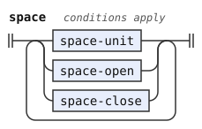</p>
<p>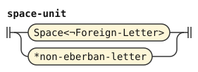</p>
<p>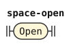</p>
<p>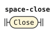</p>
<p>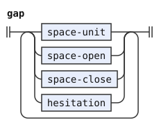</p>
<p>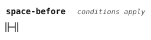</p>
<p>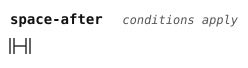</p>
</details>

## Letters, vowels and hyphens

The rules below name the letter classes that the letters stage tags. `ns-consonant` is a non-sonorant consonant, the kind that can begin a word.

The morphology chapter says that a hyphen can stand at a syllable boundary inside a word. A syllable starts at a vowel after a different vowel, at `h`, and at a single consonant between vowels. Inside a borrowing, a syllable also starts at an initial pair. A medial pair splits between its two consonants, and a triplet `XYZ` splits between `X` and `YZ`. In a borrowing, a sonorant or `m` before a consonant splits the same way. A hyphen at one of these places is silent.

Anywhere else, the grammar accepts a hyphen with the warning `hyphen-misplaced`. That includes the start and the end of a word. The rule `misplaced-hyphen` reads such a hyphen, and the pipeline turns the warning on. The PEG warns at most of these places, and the closing section lists the others.

A delimiter of a foreign quote is an Eberban word, and the quote reads such a word in two ways. It reads its delimiters with warnings, and the words inside its text in silence ("Foreign quotes" below). So the rules that a delimiter reaches take the hyphen rule as the parameter `@Hyphen`. The ordinary words read them with `misplaced-hyphen`, which warns. The silent reader reads them with a plain `Hyphen`. A named instance gives each ordinary reading its own name, such as `vhowels`.

```jbogenbau
%rule vowel
  Letter<Vowel>

%rule consonant
  Letter<Consonant>

%rule sonorant
  Letter<Sonorant>

%rule ns-consonant
  Letter<Consonant ¬Sonorant>

%rule misplaced-hyphen
  hyphen-misplaced! Hyphen
```

<details><summary>Railroad diagrams of the 5 rules from <code>vowel</code> to <code>misplaced-hyphen</code></summary>
<p>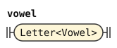</p>
<p>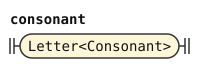</p>
<p>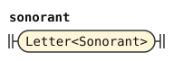</p>
<p>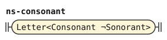</p>
<p>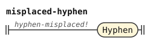</p>
</details>

Two vowels written in a row are two letters, because the letters stage merges a repeated letter into one. A hyphen between two copies of the same vowel splits one vowel in two, so the book forbids it. The condition on the hyphenated alternative states that.

```jbogenbau
%rule vowels
  | vowel
  | vowels vowel
  | $a:vowels Hyphen $b:vowel
%conditions
  $a.last-token.value ≠ $b.value

%rule vhowels-of(@Hyphen)
  vowels [{[Hyphen] Letter<H> [@Hyphen] vowels}]

%rule vhowels = vhowels-of(misplaced-hyphen)
```

<details><summary>Railroad diagrams of <code>vowels</code>, <code>vhowels-of</code> and <code>vhowels</code></summary>
<p>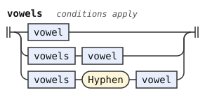</p>
<p>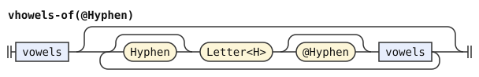</p>
<p>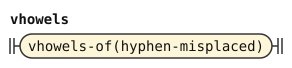</p>
</details>

## Pairs and triplets

The morphology chapter lists the consonant pairs. An initial pair can begin a word. A medial pair stands only between vowels inside a word. Every other pair of consonants is invalid, and a sonorant before a non-sonorant consonant breaks the stream into two words. The two constants copy the chapter's lists, so the chart of the chapter is the grammar's table.

```jbogenbau
%const $INITIAL-PAIRS
  "bj" "bz" "dj" "dz" "gj" "gz" "vj" "vz" "fc" "fs" "kc" "ks" "pc" "ps" "tc" "ts"
  "jb" "jd" "jg" "jv" "jm" "zb" "zd" "zg" "zv" "zm" "cf" "ck" "cp" "ct" "cm" "sf" "sk" "sp" "st" "sm"

%const $MEDIAL-PAIRS
  "bd" "bg" "bv" "db" "dg" "dv" "gb" "gd" "gv" "vb" "vd" "vg" "bm" "dm" "gm" "vm"
  "fk" "fp" "ft" "kf" "kp" "kt" "pf" "pk" "pt" "tf" "tk" "tp" "fm" "km" "pm" "tm"
  "bl" "br" "bn" "cl" "cr" "cn" "dl" "dr" "dn" "fl" "fr" "fn" "gl" "gr" "gn" "jl" "jr" "jn"
  "kl" "kr" "kn" "ml" "mr" "mn" "pl" "pr" "pn" "sl" "sr" "sn" "tl" "tr" "tn" "vl" "vr" "vn"
  "zl" "zr" "zn" "nl" "nr" "ln" "rn"

%const $LIQUIDS "r" "l"

%const $NOT-BEFORE-LIQUID "m" "n" "r" "l"

%rule initial-pair-of(@Hyphen)
  $x:consonant [@Hyphen] $y:consonant
%conditions
  $x.value ++ $y.value ∈ $INITIAL-PAIRS

%rule initial-pair = initial-pair-of(misplaced-hyphen)

%rule medial-pair
  $x:consonant [Hyphen] $y:consonant
%conditions
  $x.value ++ $y.value ∈ $MEDIAL-PAIRS
```

<details><summary>Railroad diagrams of <code>initial-pair-of</code>, <code>initial-pair</code> and <code>medial-pair</code></summary>
<p>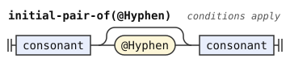</p>
<p>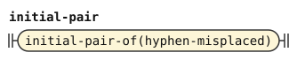</p>
<p>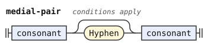</p>
</details>

A triplet is three consonants `XYZ` between vowels. In a root it has one of two shapes. Either `XY` is a medial pair and `YZ` an initial pair, as in `pks`. Or `XY` is a medial or initial pair, `Y` is neither `m` nor a sonorant, and `Z` is a liquid, as in `str`.

A freeform variable or borrowing has a third shape: `X` is a sonorant and `YZ` is an initial pair or a consonant-sonorant medial pair. A consonant-sonorant medial pair starts with a non-sonorant consonant, so `nrn` is no triplet. Four consonants in a row form no word.

```jbogenbau
%rule root-triplet-of(@Hyphen)
  $x:consonant [Hyphen] $y:consonant [@Hyphen] $z:consonant
%conditions
  $x.value ++ $y.value ∈ $MEDIAL-PAIRS ∧ $y.value ++ $z.value ∈ $INITIAL-PAIRS
    ∨ ($x.value ++ $y.value ∈ $MEDIAL-PAIRS ∨ $x.value ++ $y.value ∈ $INITIAL-PAIRS)
      ∧ $y.value ∉ $NOT-BEFORE-LIQUID ∧ $z.value ∈ $LIQUIDS

%rule root-triplet = root-triplet-of(misplaced-hyphen)

%rule freeform-triplet
  root-triplet | sonorant-triplet

%rule sonorant-triplet
  sonorant [Hyphen] $y:ns-consonant [misplaced-hyphen] $z:consonant
%conditions
  $y.value ++ $z.value ∈ $INITIAL-PAIRS
    ∨ $y.value ++ $z.value ∈ $MEDIAL-PAIRS ∧ Sonorant ⊆ $z.tags
```

<details><summary>Railroad diagrams of the 4 rules from <code>root-triplet-of</code> to <code>sonorant-triplet</code></summary>
<p>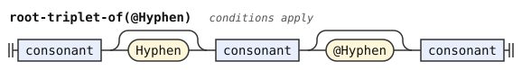</p>
<p>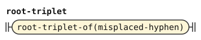</p>
<p>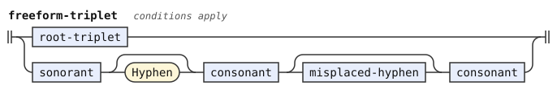</p>
<p>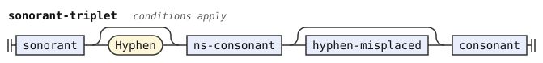</p>
</details>

## Particles

A particle starts with a non-sonorant consonant followed only by vhowels, as `zi` or `tiho`. Or it starts with `n`, `a` or `o` and continues with vhowels and sonorants, as `a`, `on`, `ahu` or `nu`. The closing section explains why only these three letters start the second kind.

The shape of a particle gives its family. As in the PEG, the first consonant gives the family, and for `p`, `b`, `d`, `c` and `j` the first vowel refines it. The book makes six particles families of their own: `pei`, `vei`, `dai`, `cei`, `cai` and `coi`. The templates below read the kinds of family. Each instance names its family.

```jbogenbau
%rule particle-cv(@Consonant, @Tag)
  $c:ns-consonant [misplaced-hyphen] vhowels :: @Tag
%conditions
  $c.value = @Consonant

%rule particle-cv-except(@Consonant, @Except, @Tag)
  $c:ns-consonant [misplaced-hyphen] $v:vhowels :: @Tag
%conditions
  $c.value = @Consonant,
  $v.value ≠ @Except

%rule particle-cvv(@Consonant, @Vowel, @Tag)
  $c:ns-consonant [misplaced-hyphen] $v:vhowels :: @Tag
%conditions
  $c.value = @Consonant,
  $v.first-token.value = @Vowel

%rule particle-cvv-except(@Consonant, @Vowel, @Except, @Tag)
  $c:ns-consonant [misplaced-hyphen] $v:vhowels :: @Tag
%conditions
  $c.value = @Consonant,
  $v.first-token.value = @Vowel,
  $v.value ≠ @Except

%rule particle-exact(@Consonant, @Vowels, @Tag)
  $c:ns-consonant [misplaced-hyphen] $v:vhowels :: @Tag
%conditions
  $c.value = @Consonant,
  $v.value = @Vowels
```

<details><summary>Railroad diagrams of the 5 rules from <code>particle-cv</code> to <code>particle-exact</code></summary>
<p>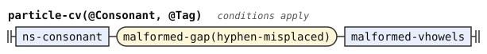</p>
<p>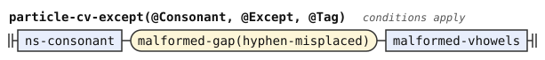</p>
<p>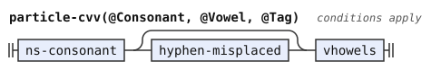</p>
<p>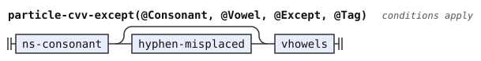</p>
<p>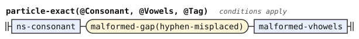</p>
</details>


```jbogenbau
%rule mi-particle = particle-cv("m", MI)
%rule fi-particle = particle-cv("f", FI)
%rule vi-particle = particle-cv-except("v", "ei", VI)
%rule vei-particle = particle-exact("v", "ei", VEI)
%rule ti-particle = particle-cv("t", TI)
%rule si-particle = particle-cv("s", SI)
%rule zi-particle = particle-cv("z", ZI)
%rule ki-particle = particle-cv("k", KI)
%rule gi-particle = particle-cv("g", GI)
%rule pi-particle = particle-cvv("p", "i", PI)
%rule pe-particle = particle-cvv-except("p", "e", "ei", PE)
%rule pei-particle = particle-exact("p", "ei", PEI)
%rule pa-particle = particle-cvv("p", "a", PA)
%rule po-particle = particle-cvv("p", "o", PO)
%rule pu-particle = particle-cvv("p", "u", PU)
%rule bi-particle = particle-cvv("b", "i", BI)
%rule be-particle = particle-cvv("b", "e", BE)
%rule ba-particle = particle-cvv("b", "a", BA)
%rule bo-particle = particle-cvv("b", "o", BO)
%rule bu-particle = particle-cvv("b", "u", BU)
%rule di-particle = particle-cvv("d", "i", DI)
%rule de-particle = particle-cvv("d", "e", DE)
%rule da-particle = particle-cvv-except("d", "a", "ai", DA)
%rule dai-particle = particle-exact("d", "ai", DAI)
%rule do-particle = particle-cvv("d", "o", DO)
%rule du-particle = particle-cvv("d", "u", DU)
%rule ci-particle = particle-cvv("c", "i", CI)
%rule ce-particle = particle-cvv-except("c", "e", "ei", CE)
%rule cei-particle = particle-exact("c", "ei", CEI)
%rule ca-particle = particle-cvv-except("c", "a", "ai", CA)
%rule cai-particle = particle-exact("c", "ai", CAI)
%rule co-particle = particle-cvv-except("c", "o", "oi", CO)
%rule coi-particle = particle-exact("c", "oi", COI)
%rule cu-particle = particle-cvv("c", "u", CU)
%rule ji-particle = particle-cvv("j", "i", JI)
%rule je-particle = particle-cvv("j", "e", JE)
%rule ja-particle = particle-cvv("j", "a", JA)
%rule jo-particle = particle-cvv("j", "o", JO)
%rule ju-particle = particle-cvv("j", "u", JU)
```

<details><summary>Railroad diagrams of the 39 rules from <code>mi-particle</code> to <code>ju-particle</code></summary>
<p>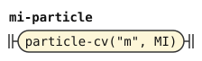</p>
<p></p>
<p>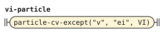</p>
<p></p>
<p></p>
<p></p>
<p>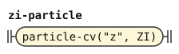</p>
<p>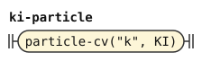</p>
<p>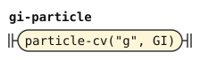</p>
<p>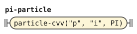</p>
<p>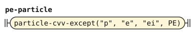</p>
<p>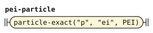</p>
<p></p>
<p></p>
<p>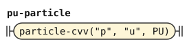</p>
<p></p>
<p></p>
<p>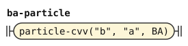</p>
<p>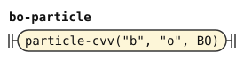</p>
<p></p>
<p>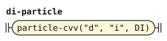</p>
<p></p>
<p>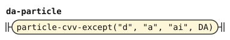</p>
<p></p>
<p></p>
<p></p>
<p>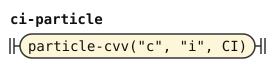</p>
<p></p>
<p></p>
<p></p>
<p>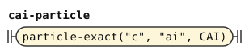</p>
<p>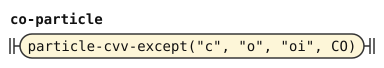</p>
<p>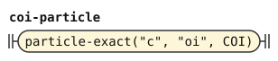</p>
<p></p>
<p></p>
<p>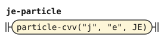</p>
<p></p>
<p></p>
<p></p>
</details>


The particle families of `n`, `a` and `o` are `NI`, `A` and `O`. The `n` can take a hyphen after it, with a warning. A sonorant inside the particle stands between vowels, and one can end it.

```jbogenbau
%rule ni-particle
  Letter="n" [misplaced-hyphen] vhowels particle-tail :: NI

%rule a-particle
  $v:vhowels particle-tail :: A
%conditions
  $v.first-token.value = "a"

%rule o-particle
  $v:vhowels particle-tail :: O
%conditions
  $v.first-token.value = "o"

%rule particle-tail-of(@Hyphen)
  [{[Hyphen] sonorant [@Hyphen] vhowels-of(@Hyphen)}] [[@Hyphen] sonorant]

%rule particle-tail = particle-tail-of(misplaced-hyphen)

%rule consonant-particle
  | mi-particle | fi-particle | vi-particle | vei-particle | ti-particle | si-particle
  | zi-particle | ki-particle | gi-particle | pi-particle | pe-particle | pei-particle
  | pa-particle | po-particle | pu-particle | bi-particle | be-particle | ba-particle
  | bo-particle | bu-particle | di-particle | de-particle | da-particle | dai-particle
  | do-particle | du-particle | ci-particle | ce-particle | cei-particle | ca-particle
  | cai-particle | co-particle | coi-particle | cu-particle | ji-particle | je-particle
  | ja-particle | jo-particle | ju-particle

%rule vowel-particle
  a-particle | o-particle
```

<details><summary>Railroad diagrams of the 7 rules from <code>ni-particle</code> to <code>vowel-particle</code></summary>
<p>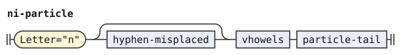</p>
<p></p>
<p></p>
<p></p>
<p></p>
<p></p>
<p></p>
</details>

## Roots

A root starts with a non-sonorant consonant or an initial pair. After its first vhowels come any number of middles, each a sonorant, a medial pair or a triplet before more vhowels. A sonorant can end it. A root that starts with one consonant needs at least one middle or a final sonorant, because a consonant and vhowels alone form a particle.

```jbogenbau
%rule root-form-of(@Hyphen)
  | ns-consonant [@Hyphen] vhowels-of(@Hyphen) {root-middle-of(@Hyphen)} [final-sonorant-of(@Hyphen)]
  | ns-consonant [@Hyphen] vhowels-of(@Hyphen) final-sonorant-of(@Hyphen)
  | initial-pair-of(@Hyphen) [@Hyphen] vhowels-of(@Hyphen) [{root-middle-of(@Hyphen)}] [final-sonorant-of(@Hyphen)]

%rule root-middle-of(@Hyphen)
  | [Hyphen] sonorant [@Hyphen] vhowels-of(@Hyphen)
  | [@Hyphen] medial-pair [@Hyphen] vhowels-of(@Hyphen)
  | [@Hyphen] root-triplet-of(@Hyphen) [@Hyphen] vhowels-of(@Hyphen)

%rule final-sonorant-of(@Hyphen)
  [@Hyphen] sonorant

%rule root-form = root-form-of(misplaced-hyphen)
%rule root-middle = root-middle-of(misplaced-hyphen)
%rule final-sonorant = final-sonorant-of(misplaced-hyphen)
```

<details><summary>Railroad diagrams of the 6 rules from <code>root-form-of</code> to <code>final-sonorant</code></summary>
<p></p>
<p></p>
<p></p>
<p></p>
<p></p>
<p></p>
</details>

## Runs of words

A run of words starts with any word and continues with words that begin with a non-sonorant consonant. A word that begins with a vowel or `n` can only begin a run. A spelling quote starts with `ce`, so it can stand anywhere a word that starts with `c` can. A foreign quote is the last part that a run can have, because the end of the quote ends the run. A run can also be a foreign quote alone.

A run that starts with compound prefixes starts a compound ("Compounds" below). Where the compound is not complete, its prefixes are junk and its components stay words. A vowel-initial particle or a borrowing can follow the prefixes directly, as the [compounds chapter](https://eberban.github.io/eberban/books/refgram/book/grammar/compounds.html) allows. A hyphen at the start of a run, after the prefixes or at the end of a word is a warning.

Each word emits one token tagged `Word` and its kind. A particle also carries `Particle` and its family. The image of a word is its value, so a hyphen inside a word never shows in it. A digit keeps the digit as its image, as the letters stage gives it.

The morphology chapter says: "Spaces are only mandatory before words starting with a vowel or a sonorant." A digit is a word, so that rule holds after a digit too. So a word that starts with a vowel or `n` never stands right after a digit, with or without a hyphen between them. The rule `after-digit` names that place.

The conditions on `ni-word`, `vowel-particle-word`, `first-prefix` and `freeform-word` refuse it. So `a mi 1an mo` and `a mi 1-an mo` have no parse, while `a mi 1 an mo` and `a mi 1mo` are texts. The erasers and hesitation already need a space before them.

A `co` that a complete opener follows starts a foreign quote, so it is never a plain word. A complete opener is `co`, its optional gap and delimiter, and an opening bracket, and `quote-opener` reads it. The condition on `consonant-particle-word` states the bar. It tests only a particle of the `CO` family, so no other particle before a bracket is tested.

The quote reads its own `co` through the particle rule, so the bar never meets the quote. A compound reads its components without the bar ("Compounds" below). The test reads the opener alone, not the whole quote. So an unclosed quote has no parse, as in `a mico [x`.

```jbogenbau
%rule word-run
  | [misplaced-hyphen] first-word [{consonant-word}] run-close
  | [misplaced-hyphen] foreign-quote

%rule run-close
  run-end | foreign-quote

%rule first-word
  consonant-word | vowel-particle-word | ni-word

%rule consonant-word
  consonant-particle-word | root-word | spelling-quote

%rule consonant-particle-word
  $p:consonant-particle [misplaced-hyphen] :: Word ∪ Particle ∪ $p.tags
%conditions
  CO ⊆ $p.tags ⟹ ¬$.onward.begins(quote-opener)
%emits
  $ :- $.value

%rule ni-word
  $p:ni-particle [misplaced-hyphen] :: Word ∪ Particle ∪ $p.tags
%conditions
  ¬$.preceding-tokens.ends(after-digit)
%emits
  $ :- $.value

%rule vowel-particle-word
  $p:vowel-particle [misplaced-hyphen] :: Word ∪ Particle ∪ $p.tags
%conditions
  ¬$.preceding-tokens.ends(after-digit)
%emits
  $ :- $.value

%rule root-word
  root-form [misplaced-hyphen] :: Word ∪ Root
%emits
  $ :- $.value

%rule quote-opener
  quote-co [opening-gap] [delimiter-shape] Open

%rule after-digit
  Digit [Hyphen]
```

<details><summary>Railroad diagrams of the 10 rules from <code>word-run</code> to <code>after-digit</code></summary>
<p></p>
<p></p>
<p></p>
<p></p>
<p></p>
<p></p>
<p></p>
<p></p>
<p></p>
<p></p>
</details>

## Borrowings and freeform variables

A borrowing is `u`, then its content. The book says that spaces must follow a borrowing. So `space-after` ends it, and a bracket of a gap or the end of the text also counts. A freeform variable is the same with `i`. The template `freeform-word` reads both.

The content has looser rules than a root. An initial pair can stand in the middle, and a medial pair at the start. A sonorant or `m` before a consonant counts as a pair. A sonorant before an initial pair or a consonant-sonorant medial pair counts as a triplet. The content can start with a vowel, a consonant, a pair, a triplet or `h`. It ends with a vowel or with one consonant.

The PEG lets a gap stand between the prefix and the content. The book writes content that starts with `u` after `u'`, and the apostrophe is a space. Two copies of the prefix letter merge into one letter, so a gap must stand there.

A cluster before more vowels has its syllable boundary before it or inside it. A single consonant and an initial pair start a syllable, so a hyphen before them is silent. A medial pair, a sonorant or `m` before a consonant, and a triplet split inside, as the section on hyphens says. The rule `sonorant-pair` reads a sonorant or `m` before a consonant that forms no medial pair. A pair of the same letter twice is no pair, as the morphology chapter says.

The PEG warns about a hyphen before or after the prefix, and about content that starts with the prefix letter after a hyphen. A hyphen after a cluster at the start of the content also warns. Each carries `hyphen-misplaced` here. The token's value is the prefix letter and the content, without the gap.

```jbogenbau
%rule freeform-word(@Prefix, @Tag)
  [misplaced-hyphen] $p:Letter prefix-gap $c:content [misplaced-hyphen] space-after :: Word ∪ @Tag := @Prefix ++ $c.value
%conditions
  $p.value = @Prefix,
  ¬$p.preceding-tokens.ends(after-digit)
%emits
  $

%rule borrowing = freeform-word("u", Borrowing)
%rule freeform-variable = freeform-word("i", Freeform)

%rule prefix-gap
  [gap] [misplaced-hyphen]

%rule content
  [content-onset] vhowels [{content-middle vhowels}] [[misplaced-hyphen] consonant]

%rule content-onset
  (onset-cluster | split-cluster | Letter<H>) [misplaced-hyphen]

%rule content-middle
  | [Hyphen] onset-cluster [misplaced-hyphen]
  | [misplaced-hyphen] split-cluster [misplaced-hyphen]

%rule onset-cluster
  initial-pair | consonant

%rule split-cluster
  freeform-triplet | medial-pair | sonorant-pair

%rule sonorant-pair
  $x:pair-opener [Hyphen] $y:consonant
%conditions
  $x.value ++ $y.value ∉ $MEDIAL-PAIRS,
  $x.value ≠ $y.value

%rule pair-opener
  sonorant | Letter="m"
```

<details><summary>Railroad diagrams of the 11 rules from <code>freeform-word</code> to <code>pair-opener</code></summary>
<p></p>
<p></p>
<p></p>
<p></p>
<p></p>
<p></p>
<p></p>
<p></p>
<p></p>
<p></p>
<p></p>
</details>

## Digits, hesitation and erasers

A digit is a number word of family `TI`. The numbers chapter says that a `-` before or after a digit is a hyphen, which is not allowed there. A digit is a word of its own, so such a hyphen stands at a word boundary, and it carries `hyphen-misplaced`.

The node that holds the hyphen does not matter, only its warning. A word boundary holds at most one misplaced hyphen, as the PEG's `W_HyphenPostWord` reads exactly one. So the first two conditions of `digit-word` refuse a hyphen next to another hyphen. A row of two hyphens beside a digit then stays junk ("Runs that form no word" below).

The numbers chapter also says that `+`, `*` and `/` are spaces, and that verbs express mathematical operations. The PEG warns about such a symbol after a digit, and `math-symbol` carries that warning here. The rule `digit-math` reads that warning wherever a digit word ends, so a digit that closes a quote warns too.

```jbogenbau
%rule digit-word
  [$l:misplaced-hyphen] $d:Digit [$t:misplaced-hyphen] digit-math
%conditions
  ¬$l.preceding-tokens.ends(Hyphen),
  ¬$t.following-tokens.begins(Hyphen)
%emits
  $d :: Word ∪ Particle ∪ TI

%rule digit-math
  [$m:math-mark]
%conditions
  $m ∨ ¬$.following-tokens.begins(math-space)

%rule math-mark
  math-symbol! ε
%conditions
  $.following-tokens.begins(math-space)

%rule math-space
  Space<Math-Symbol>
```

<details><summary>Railroad diagrams of <code>digit-word</code>, <code>digit-math</code>, <code>math-mark</code> and <code>math-space</code></summary>
<p></p>
<p></p>
<p></p>
<p></p>
</details>


The [phonology chapter](https://eberban.github.io/eberban/books/refgram/book/morphonology/phonology.html) says that where spaces are allowed, a speaker can hesitate with one or more `n` surrounded by spaces. So the letter `n` alone is hesitation where a space, a bracket of a gap or an edge of the text stands on each side. The stage drops it. A gap can hold hesitation too.

The words `ra` and `ri` are the erasers of the [sentences chapter](https://eberban.github.io/eberban/books/refgram/book/logic/sentences.html). They start with `r`, so no particle or root has their shape. The chapter says that `ra` must stand between spaces or pauses. The PEG reads `ri` the same way.

A run of `ra` is one eraser per `ra`. The syntax stage applies them. A hyphen after the `r` carries `hyphen-misplaced`, as after the first consonant of any particle.

```jbogenbau
%rule hesitation
  space-before Letter="n" space-after
%erased

%rule eraser-run
  | space-before {ra-word} space-after
  | space-before ri-word space-after

%rule ra-word
  Letter="r" [misplaced-hyphen] Letter="a" :: Word ∪ RA
%emits
  $ :- $.value

%rule ri-word
  Letter="r" [misplaced-hyphen] Letter="i" :: Word ∪ RI
%emits
  $ :- $.value
```

<details><summary>Railroad diagrams of <code>hesitation</code>, <code>eraser-run</code>, <code>ra-word</code> and <code>ri-word</code></summary>
<p></p>
<p></p>
<p></p>
<p></p>
</details>

## Compounds

The [compounds chapter](https://eberban.github.io/eberban/books/refgram/book/grammar/compounds.html) makes one word from several. The prefix `e` takes two components, `en` three, and `er` any number up to a standalone `e`. A component is a particle, a root, a borrowing or a nested compound. A digit is a `TI` particle, so it can be a component.

Words and quotes are read before the syntax stage parses them, as [the pipeline](pipeline.md#differences-from-the-reference-grammar-and-the-peg) says. A compound is a word unit made of actual words, and its components lose their usual special meaning. A quote is one unit, but it is no word unit. So this stage reads each compound from its letters, and no quote starts in a component slot of an open compound. So `a en ce bu cei` is a compound of the three particles `ce`, `bu` and `cei`, and `a e cei co` is a compound too. A quote can start after a complete compound, as in `a e ber ban ce bu cei`.

An eraser keeps its meaning inside a compound. It is no component, so it ends a compound that is not complete. The sentences chapter lets `ra` erase ungrammatical text, and such a compound is ungrammatical. So `a e mi ra a mo` is a text, and its `ra` erases the first sentence with the unfinished compound. Hesitation is dropped as part of a gap, so `a e mi n bjan` is the compound of `mi` and `bjan`.

### Prefixes

A compound starts with `e`, `en` or `er`, for two, three or more components. A nested compound that is the first component of another can attach its prefix to the outer prefix. The compounds chapter spells the attached prefix `i` after `e`, because `ee` collapses to `e`. It spells it `e` after `n`, `r` or an attached `i`. So `ein` is `e` and `en`, `ene` is `en` and `e`, and `eie` is `e`, `e` and `e`. An attached `i` after `n` or `r` is accepted with the warning `prefix-i-after-sonorant`.

A hyphen inside a prefix, between two prefixes or after the last prefix carries `hyphen-misplaced`, as in the PEG. Such a hyphen has an empty value. So the rules `after-e`, `after-i` and `after-arity` look past it to the letter before an attached prefix.

The rule `first-prefix` reads a prefix that starts a run, and `attached-prefix` reads one that follows another prefix in the same run. Their conditions keep each to its place, so `prefix` reads each prefix in one way only. Each prefix carries `E-PREFIX`, `EN-PREFIX` or `ER-PREFIX` by its length. A first prefix that is a run of its own also carries `Standalone`, even with a hyphen after it.

```jbogenbau
%rule prefix
  first-prefix | attached-prefix

%rule first-prefix
  Letter="e" [[misplaced-hyphen] prefix-arity] :: $.value.classify(prefix-length) ∪ (¬$.following-tokens.begins(later-letter) ⟹ Standalone)
%conditions
  ¬$.preceding-tokens.ends(after-digit),
  ¬$.preceding-tokens.ends(after-letter)

%rule later-letter
  [Hyphen] Letter

%rule after-letter
  Letter [Hyphen]

%rule attached-prefix
  | $e:Letter="e" [[misplaced-hyphen] prefix-arity] :: $.value.classify(prefix-length)
  | $i:Letter="i" :: E-PREFIX
  | $i:Letter="i" [misplaced-hyphen] $r:prefix-arity :: ("e" ++ $r.value).classify(prefix-length)
%conditions
  $e.preceding-tokens.ends(after-e | after-i | after-arity),
  $i.preceding-tokens.ends(after-e)

%rule after-e
  Letter="e" [Hyphen]

%rule after-i
  Letter="i" [Hyphen]

%rule prefix-arity
  Letter="n" | Letter="r"

%classifier prefix-length
  "e" ∈ E-PREFIX
  "en" ∈ EN-PREFIX
  "er" ∈ ER-PREFIX
```

<details><summary>Railroad diagrams of the 8 rules from <code>prefix</code> to <code>prefix-arity</code></summary>
<p></p>
<p></p>
<p></p>
<p></p>
<p></p>
<p></p>
<p></p>
<p></p>
</details>

```jbogenbau
%extend-rule attached-prefix
  | prefix-i-after-sonorant! $i:Letter="i" :: E-PREFIX
  | prefix-i-after-sonorant! $i:Letter="i" [misplaced-hyphen] $r:prefix-arity :: ("e" ++ $r.value).classify(prefix-length)
%conditions
  $i.preceding-tokens.ends(after-arity)

%rule after-arity
  prefix-arity [Hyphen]
```

<details><summary>Railroad diagrams of <code>attached-prefix</code> and <code>after-arity</code></summary>
<p></p>
<p></p>
</details>

The rule `prefixes` reads the prefixes at the start of a run as one form. The junk rules use it ("Runs that form no word" below).

```jbogenbau
%rule prefixes
  first-prefix [{[misplaced-hyphen] attached-prefix}]
```

<details><summary>Railroad diagram of <code>prefixes</code></summary>
<p></p>
</details>

### Components

The rule `compound-run` reads a compound at the start of a run. The run can go on after the compound with more words, as in `eberbanmi`. The rules `first-slot` and `later-slot` read a component with what joins it to the part before it. `first-slot` follows a prefix, and `later-slot` follows a component. Both read the gap between two parts, which holds spaces, brackets and hesitation. A gap holds no eraser, so an eraser ends the compound.

Without a gap, a component must be able to stand where it stands in a run of words. After a prefix, it can start with a vowel, as in `ea mi`, or it can be a borrowing. After another component, it starts with a non-sonorant consonant or it is a digit. An `NI` particle and a nested compound later in the compound need a gap before them. A word that starts with a vowel needs a space after a digit, as the conditions of the word rules say.

A hyphen after a prefix or at the start of a run carries `hyphen-misplaced`, as in a run of words. A word component reads the hyphen after it, as a word of a run does. A digit and a borrowing read their own hyphens, so `first-slot` reads no hyphen before them. After a word component, a hyphen before a digit can belong to either word. There the lazy step of the stage gives it to the digit, with the same warning.

`component-particle` reads a particle that starts with a consonant without the bar of `consonant-particle-word`. So `co` and `ce` start no quote in a component slot. It emits a word token, as `root-word` does, which an unfinished compound hands on. Inside a complete compound, the token of the compound replaces it.

```jbogenbau
%rule compound-run
  [misplaced-hyphen] compound [{consonant-word}] run-close

%rule first-slot := $c.emitted.value
  | [misplaced-hyphen] $c:attached-first
  | $c:digit-word
  | $c:borrowing
  | [misplaced-hyphen] gap $c:spaced-component

%rule later-slot :: $c.tags ∩ Spaced-E := $c.emitted.value
  | $c:attached-later
  | gap $c:spaced-later

%rule prefix-join
  [misplaced-hyphen] [gap [misplaced-hyphen]]

%rule attached-first
  vowel-particle-word | component-particle | root-word

%rule attached-later
  component-particle | root-word | digit-word

%rule spaced-component
  | [misplaced-hyphen] (component-particle | root-word | vowel-particle-word | ni-word)
  | digit-word | borrowing

%rule spaced-later
  | spaced-component
  | [misplaced-hyphen] $n:compound :: $n.tags

%rule component-particle
  $p:consonant-particle [misplaced-hyphen] :: Word ∪ Particle ∪ $p.tags
%emits
  $ :- $.value
```

<details><summary>Railroad diagrams of the 9 rules from <code>compound-run</code> to <code>component-particle</code></summary>
<p></p>
<p></p>
<p></p>
<p></p>
<p></p>
<p></p>
<p></p>
<p></p>
<p></p>
</details>

### Compound values

A compound emits one token tagged `Word` and `Compound`. Its value is the compound in the shortest canonical form of the compounds chapter, which the dictionary uses. When a nested compound is the first component of another, their prefixes join into one unit. The joined prefix spells its vowel `i` after `e` and `e` after `n` or `r`. So `e e ber ban ban` and `ei ber ban ban` both have the value `ei ber ban ban`. Single spaces separate the other parts.

A component keeps its word value, so a digit stands as its `TI` word. The image of the compound is the same as its value.

The rule `compound-tail` reads a compound and gives its value without the vowel of its own prefix. A compound puts `e` in front of its tail. A compound whose first component is a nested compound reads that component as a tail after `prefix-join`. It joins the tail with the vowel that the chapter gives.

That vowel depends on the letter before it, so a tail comes in two kinds. `compound-tail` follows a vowel written `e`, and `joined-tail` follows one written `i`. The rule `fixed-tail` holds the alternatives that are the same in both kinds. `first-slot` holds no compound, so each first component has one reading. Each `er-component` adds a space and its value to the value of the list.

```jbogenbau
%rule compound
  $t:compound-tail :: Word ∪ Compound ∪ $t.tags := "e" ++ $t.emitted.value
%emits
  $

%rule compound-tail
  | $t:fixed-tail :: $t.tags := $t.emitted.value
  | $p:prefix<E-PREFIX> prefix-join $n:joined-tail $b:later-slot
      :: (Standalone ⊆ $p.tags ⟹ Spaced-E) := "i" ++ $n.emitted.value ++ " " ++ $b.emitted.value

%rule joined-tail
  | $t:fixed-tail :: $t.tags := $t.emitted.value
  | $p:prefix<E-PREFIX> prefix-join $n:compound-tail $b:later-slot
      :: (Standalone ⊆ $p.tags ⟹ Spaced-E) := "e" ++ $n.emitted.value ++ " " ++ $b.emitted.value

%rule fixed-tail
  | $p:prefix<E-PREFIX> $a:first-slot $b:later-slot
      :: (Standalone ⊆ $p.tags ⟹ Spaced-E) := " " ++ $a.emitted.value ++ " " ++ $b.emitted.value
  | prefix<EN-PREFIX> $a:first-slot $b:later-slot $c:later-slot
      := "n " ++ $a.emitted.value ++ " " ++ $b.emitted.value ++ " " ++ $c.emitted.value
  | prefix<EN-PREFIX> prefix-join $n:compound-tail $b:later-slot $c:later-slot
      := "ne" ++ $n.emitted.value ++ " " ++ $b.emitted.value ++ " " ++ $c.emitted.value
  | prefix<ER-PREFIX> $l:er-components er-closer
      := "r" ++ $l.emitted.value ++ " e"
  | compound-size! prefix<ER-PREFIX> $l:few-er-components er-closer
      := "r" ++ $l.emitted.value ++ " e"
```

<details><summary>Railroad diagrams of <code>compound</code>, <code>compound-tail</code>, <code>joined-tail</code> and <code>fixed-tail</code></summary>
<p></p>
<p></p>
<p></p>
<p></p>
</details>

### The end of an `er` compound

The compounds chapter says that an `er` compound stops at a single `e` with a space before it. `er-closer` reads such an `e` as a run of its own, after a gap. A nested compound whose own prefix is a standalone `e` carries `Spaced-E`, and no `er` component can carry it. So the first standalone `e` that is no component's own prefix ends the compound. A nested compound with an attached prefix, as in `eberban`, can stand there.

The rules test only the direct components of the `er` compound, as the PEG does. A standalone `e` deeper inside a nested compound does not end it, so `a er mi en e ber ban ban ban e` is a text. Issue [#273](https://github.com/int19h/gencmu/issues/273) asks the designer whether the end reaches every depth.

The PEG warns about an `er` compound of one, two or three components. A single word needs no compound, and `e` and `en` spell two and three. The warning `compound-size` marks such a compound here. The rule `few-er-components` reads one to three components, and `er-components` reads four or more. Their bodies show the bounds.

```jbogenbau
%rule er-first
  | $c:first-slot := " " ++ $c.emitted.value
  | prefix-join $n:compound-tail<¬Spaced-E> := "e" ++ $n.emitted.value

%rule er-component
  $c:later-slot<¬Spaced-E> := " " ++ $c.emitted.value

%rule few-er-components
  er-first [er-component [er-component]]

%rule er-components
  er-first er-component er-component er-component [{er-component}]

%rule er-closer
  gap [misplaced-hyphen] Letter="e" [misplaced-hyphen] run-end
```

<details><summary>Railroad diagrams of the 5 rules from <code>er-first</code> to <code>er-closer</code></summary>
<p></p>
<p></p>
<p></p>
<p></p>
<p></p>
</details>

### Unfinished compounds

A compound that lacks a component is unfinished. Its prefixes are no words, so they are junk. Its components are actual words, so they stay words. The sentences chapter lets `ra` erase ungrammatical text, and an unfinished compound is ungrammatical. So `ra` erases the first sentence of `a e mi ra a mo`.

As in a complete compound, no quote starts in a component slot of an unfinished one. An eraser is no component, so it ends the compound. So in `a e co [ra a mo`, `co` is a plain particle and the bracket is a gap. Then `ra` erases the unfinished compound, and the text keeps `a mo`.

The rule `open-compound` reads an unfinished compound. It follows `compound` level by level, with the same slot rules. Each of its levels lacks a component, and the last component of a level can itself be unfinished. An `e` level needs two components, and an `en` level needs three. An `er` level reads no closing `e`. So the rule counts the open slots of every prefix at every depth.

So in `a ei mi co [ra a mo`, the inner `i` has its two components `mi` and `co`. The outer `e` still lacks its second component, so `co` starts no quote. In the same way, `a ene mi mo co [ra a ke` reads `e mi mo` and `co` as the first two components of `en`. The third is missing.

At an `er` level, no component carries `Spaced-E`, as in a complete compound ("The end of an `er` compound" above). So a standalone `e` ends the level, and an unfinished reading never reaches past the end of a complete `er` compound.

`stray-compound` reads an unfinished compound as an item of the text. `stray-prefix` emits a `Junk` token for each prefix of an unfinished level. Each simple component emits its word token, and a complete nested compound emits its compound token. A gap between them emits a `Space` token, and a foreign letter in it warns, as in any gap. So `a eco [x] ra a mo` reads the junk `e`, the particle `co` and a gap that warns about `x`.

The step `leftmost-longest` names `open-compound`. An unfinished compound starts at its prefixes, so it wins over a quote that starts in one of its slots. A complete compound on the same start is always longer, because the unfinished one stops at a slot that it lacks. So the complete compound wins, and a quote after it still starts, as in `a e ber ban ce bu ra cei`.

The step names `open-compound` and not `stray-compound`, because a hyphen before the prefixes belongs to the item. A complete compound starts after that hyphen too, so both readings start at the same letter, as in `a -e 2 mi`. The ranked choice of `item` prefers the unfinished compound to junk over the same run.

A reader can expect each quote rule to test the letters before it for an unfinished compound instead. Such a backward test needs the same counts as `open-compound`. Both quote rules and the bar on `co` then read it. The test also has to find where the compound starts. Otherwise the `en` at the end of `ben` in `a ben ce bu cei` counts as a prefix. The forward rule needs none of this, because `first-prefix` starts a compound only at the start of a run.

```jbogenbau
%rule stray-compound
  [misplaced-hyphen] open-compound run-end

%rule open-compound
  | $p:stray-prefix<E-PREFIX> [open-first | first-component [open-later]]
      :: (Standalone ⊆ $p.tags ⟹ Spaced-E)
  | stray-prefix<EN-PREFIX> [open-first | first-component [later-slot] [open-later]]
  | stray-prefix<ER-PREFIX> [open-first<¬Spaced-E> | first-component<¬Spaced-E> [{er-component}] [open-later<¬Spaced-E>]]

%rule stray-prefix
  $p:prefix :: $p.tags
%emits
  $ :: Junk := $.decomposed-source-text :- $.source-text

%rule first-component
  | first-slot
  | prefix-join $n:compound :: $n.tags ∩ Spaced-E

%rule open-first
  prefix-join $o:open-compound :: $o.tags ∩ Spaced-E

%rule open-later
  gap [misplaced-hyphen] $o:open-compound :: $o.tags ∩ Spaced-E
```

<details><summary>Railroad diagrams of the 6 rules from <code>stray-compound</code> to <code>open-later</code></summary>
<p></p>
<p></p>
<p></p>
<p></p>
<p></p>
<p></p>
</details>

## Spelling quotes

The [quotes chapter](https://eberban.github.io/eberban/books/refgram/book/grammar/quotes.html) spells a text with units between `ce` and `cei`. A unit is a consonant or an initial pair, or nothing, followed by vhowels. The chapter says that spaces between units are optional, except before a unit that starts with a vowel. Here a gap stands between two units, so a bracket or a hesitation can stand there too. The units are letters, not words, so this stage reads the whole quote as one token.

The token carries `CE`, `Quote`, `Word` and `Particle`. Its image is the written text. Its value is the opening particle, the units and `cei`, with one space between each two, whatever spaces the text writes. So `ce bu nu cei` and `ce bunu cei` have one value, and a `pa` resumption can repeat either spelling. A different division into units gives another value, as `ce ti i a nu cei` and `ce ti ia nu cei` show. The rules `first-unit` and `later-unit` give each unit its place in the value.

The quote is a word that starts with `c`, so a run of words can hold it, as in `mice bu cei`. The `ce` is a complete particle, so a word must be able to end after it. After a gap, the first unit can start with any consonant, as the book spells `nu`, `ri` and `lu`. Without a gap, the first unit starts with a non-sonorant consonant, which can begin a word. So `a cenu cei` reads the root `cenu`, and `a ce nu cei` reads a quote of `nu`.

A unit that starts with a vowel needs a gap before it. The quote ends at the first complete `cei` particle, which `complete-cei` reads with a word boundary after it, as the PEG's `CEI` does. So a unit can be `cei` where no word boundary follows it, as in `a ce bu ceinu cei`. A `ce` particle that no `cei` closes is an ordinary word. The syntax stage has no use for it, so such a text fails there.

The morphology chapter allows a hyphen at a syllable boundary. A consonant unit starts a syllable, so a hyphen right before it is silent, as in `a ce bu-nu cei`. Inside a unit, the hyphen rules of the words apply, so `a ce b-u cei` carries `hyphen-misplaced`. A hyphen beside a gap, after `ce` or before `cei` stands at the edge of a word, so it carries the warning too.

```jbogenbau
%rule spelling-quote
  $s:ce-particle $u:units unit-join $e:cei-particle [misplaced-hyphen]
    :: Word ∪ Particle ∪ CE ∪ Quote := $s.value ++ " " ++ $u.emitted.value ++ " " ++ $e.value :- $.source-text
%emits
  $

%rule units
  first-unit [{later-unit}]

%rule first-unit := $u.value
  | [misplaced-hyphen] $u:attached-unit
  | spelling-gap $u:unit

%rule later-unit := " " ++ $u.value
  | [Hyphen] $u:consonant-unit
  | spelling-gap $u:unit

%rule unit-join
  [misplaced-hyphen] | spelling-gap

%rule spelling-gap
  [misplaced-hyphen] gap [misplaced-hyphen]

%rule unit
  consonant-unit | vowel-unit

%rule attached-unit
  $u:consonant-unit
%conditions
  Sonorant ⊈ $u.first-token.tags

%rule consonant-unit
  $u:unit-letters
%conditions
  ¬$u.onward.begins(complete-cei)

%rule vowel-unit
  vhowels

%rule unit-letters
  (initial-pair | consonant) [misplaced-hyphen] vhowels

%rule complete-cei
  cei-particle particle-end [Hyphen] word-boundary
```

<details><summary>Railroad diagrams of the 12 rules from <code>spelling-quote</code> to <code>complete-cei</code></summary>
<p></p>
<p></p>
<p></p>
<p></p>
<p></p>
<p></p>
<p></p>
<p></p>
<p></p>
<p></p>
<p></p>
<p></p>
</details>

## Foreign quotes

The [quotes chapter](https://eberban.github.io/eberban/books/refgram/book/grammar/quotes.html) gives `co` two forms. If a `[` follows `co`, the quote holds everything up to the next `]`. Otherwise a delimiter and then a `[` follow `co`. That quote holds everything up to the first `]` that the delimiter follows. The delimiter is any particle or root form. The book says that the delimiter appears again prefixed by `]`, so the closing delimiter follows the closing bracket.

A quote is one word unit, so this stage reads it whole, and no later rule sees its text. The rule `foreign-quote` reads `co`, an optional opening gap, then the quoted text. Every particle of the `CO` family opens a quote, so `coa` and `coho` open quotes too. In a component slot of a compound, `co` is a plain particle ("Compounds" above). `coi` stands in place of a quote. It reads no bracket and passes as a plain word, so `a coi [x]` reads `coi`, then a gap with one warning for `x`.

The chapter lets spaces stand before the `[` of the first form. The [phonology chapter](https://eberban.github.io/eberban/books/refgram/book/morphonology/phonology.html) allows hesitation wherever spaces are allowed. The morphology chapter makes a bracket a space outside the syntax of foreign quotes.

So `opening-gap` reads spaces, closing brackets and hesitation after `co`, in both forms. It reads its spaces through `space-unit`, so a foreign letter there warns. It holds no `[`, because the first `[` after `co` opens the quote. The quotes chapter puts no space between the delimiter and its `[`, so `co bu [x]bu` is no quote.

The `co` of a quote is a complete particle, so a word boundary follows it, as it follows a delimiter (below). A hyphen between `co` and its delimiter is a misplaced hyphen at that boundary, as in `co-zao[x]`. So a delimiter with no gap before it starts with a non-sonorant consonant or a digit. A delimiter that starts with a vowel or `n` needs a gap.

The text of the first form is every letter token up to the first `]`. So a digit, a hyphen and a `[` are text, and `a co [1-]` warns nothing. The text of either form can be empty.

In the second form, `$d` is the opening delimiter and `$e` the closing one. A `]` inside the text ends the quote only where the delimiter follows it as a complete word. So `shaped-close` reads a `]` and the complete word after it, which `delimiter-shape` reads as `$c`. Its condition requires another value than the delimiter's. A `]` with no complete word after it is `$k`, and its condition makes sure that no word follows. So the quote ends at the first `]` that the delimiter follows.

The quote emits one token tagged `Word`, `Particle`, `CO` and `Quote`. Its image is the written text from `co` to the end of the quote. Quoted text has no canonical word, so the value keeps it exactly as written, with its case, spacing and any `n`.

The value is the `co` word, a space and the text from `[` to `]`. In the second form, the delimiter stands before and after the text. A delimiter is an Eberban word, so it takes its word value. So `co [Mi Nu]` and `co n  [Mi Nu]` both have the value `co [Mi Nu]`, and `co Zao[x]ZAO` has the value `co zao[x]zao`. The rules `quote-char` and `shaped-close` give the value the written text of each quoted token.

```jbogenbau
%rule foreign-quote
  $q:quote-co [opening-gap] $t:quoted-text :: Word ∪ Particle ∪ CO ∪ Quote := $q.value ++ " " ++ $t.emitted.value :- $.source-text
%emits
  $

%rule quote-co
  co-particle particle-end [misplaced-hyphen] word-boundary

%rule opening-gap
  {space-unit | space-close | hesitation}

%rule quoted-text
  simple-text | delimited-text

%rule simple-text
  Open [{quote-char}] Close

%rule delimited-text
  $d:native-delimiter Open [{quote-char | $c:shaped-close | $k:Close}] Close $e:native-delimiter
%conditions
  $c.tokens-after-first.value ≠ $d.value,
  ¬$k.following-tokens.begins(delimiter-shape),
  $e.value = $d.value

%rule quote-char
  _<¬Close> := $.source-text

%rule shaped-close
  Close delimiter-shape := $.source-text
```

<details><summary>Railroad diagrams of the 8 rules from <code>foreign-quote</code> to <code>shaped-close</code></summary>
<p></p>
<p></p>
<p></p>
<p></p>
<p></p>
<p></p>
<p></p>
<p></p>
</details>

### Delimiters

The quote reads a delimiter word in two ways. The opening and closing delimiters are Eberban words outside the quoted text, so `native-delimiter` reads them with the ordinary warnings. Inside the text, `delimiter-shape` reads the word after each `]` in silence, because quoted text runs no word rule. The two readers must accept the same spans as a complete first word, end at a word boundary and give the same value. Otherwise one reader can find a delimiter that the other misses, and the quote then has two ends.

So both readers are instances of the template `delimiter-of`, over the same form templates. They differ in their hyphen rule and in one more warning. After a digit, the ordinary reader reads `digit-math`, which reads no token, and the silent reader reads nothing there.

A delimiter follows the PEG's `NativeWord`. It is the longest root or particle form that reads from its start, with a root before a particle, and a word boundary after it. The rule `word-boundary` holds at the end of the text, and before a non-sonorant consonant, a digit, a space or a bracket. It does not hold before a hyphen, so a second hyphen never ends a word. A trailing hyphen stays in the word where a word boundary follows it.

The root branch reads its longest form and then tests the boundary. A root that ends in a vowel goes on through a root middle only. So the condition on `$r` refuses such a root where a middle follows it. A root that ends in a sonorant goes on through nothing. If the boundary fails, the form is not shortened, and the root branch fails. So `bjaptah` reads no word, because the root `bjapta` fails before `h`.

The particle branch reads only where no root word reads from the same start. A particle also refuses a medial pair right after its whole form, before any trailing hyphen, as `particle-end` says. So `nan` is no word before `pta`, and `zaostrah` reads the particle `zao`. The rule `particle-shape-of` reads the particle forms without their families, because a delimiter needs only its form and value.

A digit is one `TI` particle, and a digit can be a delimiter. It needs no word boundary after it, as in the PEG's `TI` rule. A word that starts with a vowel or `n` still needs a space after it, as after any digit ("Runs of words" above). It takes the same optional hyphens as a letter word, with one hyphen at most at each boundary. With no word boundary after it, a digit closer can take a trailing hyphen or leave it. There the step of the stage takes the longer quote, so `a co te[x]1-an mo` holds the hyphen in its quote.

```jbogenbau
%rule delimiter-of(@Hyphen, @Math)
  | [@Hyphen] native-root-of(@Hyphen)
  | [@Hyphen] native-particle-of(@Hyphen)
  | digit-form-of(@Hyphen) @Math

%rule native-delimiter = delimiter-of(misplaced-hyphen, digit-math)
%rule delimiter-shape = delimiter-of(Hyphen, ε)

%rule native-root-of(@Hyphen)
  $r:root-form-of(@Hyphen) [@Hyphen] word-boundary
%conditions
  Sonorant ⊆ $r.last-token.tags ∨ ¬$r.following-tokens.begins(root-middle-of(@Hyphen))

%rule native-particle-of(@Hyphen)
  particle-shape-of(@Hyphen) particle-end [@Hyphen] word-boundary
%conditions
  ¬$.onward.begins(native-root-of(@Hyphen))

%rule particle-shape-of(@Hyphen)
  | ns-consonant [@Hyphen] vhowels-of(@Hyphen)
  | Letter="n" [@Hyphen] vhowels-of(@Hyphen) particle-tail-of(@Hyphen)
  | $v:vhowels-of(@Hyphen) particle-tail-of(@Hyphen)
%conditions
  $v.first-token.value = "a" ∨ $v.first-token.value = "o"

%rule digit-form-of(@Hyphen)
  [$l:@Hyphen] Digit [$t:@Hyphen]
%conditions
  ¬$l.preceding-tokens.ends(Hyphen),
  ¬$t.following-tokens.begins(Hyphen)

%rule particle-end
  ε
%conditions
  ¬$.following-tokens.begins(medial-pair)

%rule word-boundary
  ε
%conditions
  $.ends-input ∨ $.following-tokens.begins(ns-consonant | Digit | Space | Open | Close)
```

<details><summary>Railroad diagrams of the 9 rules from <code>delimiter-of</code> to <code>word-boundary</code></summary>
<p></p>
<p></p>
<p></p>
<p></p>
<p></p>
<p></p>
<p></p>
<p></p>
<p></p>
</details>

## Runs that form no word

A run that this grammar reads as no word is one `Junk` token. Its value is its source text. The syntax stage admits it in text that `ra` erases. The PEG reports an error for such a run, with a message about the letter, pair or ending at fault. Here the text fails later, where the junk stands. Where a compound begins at a run, complete or not, the stage prefers it to junk ("Unfinished compounds" above).

Two conditions keep junk from standing where a word reads. First, a run whose words end with the `co` of a complete opener is no junk. The rule `run-opener` reads the words of a run and then the opener. Its words are the forms without the word wrappers, because a wrapper carries the plain-word bar, which asks the same opener query again. So a run such as `ntco` before a bracket stays junk, because no word reading reaches its `co`. A quote never ends inside a junk run, so `a tkco [x] ra a mo` reads the junk `tkco`, then a gap.

The query reads its words from the start of the run and cannot see what stands before the run. So the bar does not apply where a digit stands before a run that starts with a vowel or a sonorant, as `spaced-start` reads it. No word reading of that run exists, because such a word needs a space before it. So `a 1anco[x ra a mo` is junk that `ra` erases, while `a 1 anco[x ra a mo` has no parse.

Second, a single hyphen beside a digit belongs to the digit word, so it is no junk. A row of hyphens beside a digit stays junk, so the syntax stage accepts it only where `ra` erases it. So `a mi 1--2 ra a mo` is a text, and `mi 1--2 bjan` is not. A hyphen with no digit beside it stays junk, so `a mi - bjan mo` has no parse. A hyphen that starts a longer junk run belongs to that run, as in `a mi 1-an mo`. So it carries no warning, and only the junk stops the text.

```jbogenbau
%rule junk-run
  {run-char} run-end
%conditions
  ¬$.onward.begins(run-opener) ∨ $.preceding-tokens.ends(after-digit) ∧ $.onward.begins(spaced-start),
  ¬$.matches(Hyphen) ∨ ¬$.preceding-tokens.ends(Digit) ∧ ¬$.following-tokens.begins(Digit)
%emits
  $ :: Junk := $.decomposed-source-text :- $.source-text

%rule run-opener
  [misplaced-hyphen] [{word-form}] quote-opener

%rule word-form
  (prefixes | consonant-particle | vowel-particle | ni-particle | root-form | spelling-quote) [misplaced-hyphen]

%rule spaced-start
  [Hyphen] (vowel | sonorant)
```

<details><summary>Railroad diagrams of <code>junk-run</code>, <code>run-opener</code>, <code>word-form</code> and <code>spaced-start</code></summary>
<p></p>
<p></p>
<p></p>
<p></p>
</details>

## Differences from the reference grammar and the PEG

The book says that a particle can start with a sonorant or a vowel. The PEG reads only `n`, `a` and `o`, and this grammar does the same. The morphology chapter says that a word that starts with `n`, `a` or `o` is always a particle. Two sonorants never follow each other in such a word, so `a mi anra` has no parse. The sentences chapter names A, O and NI as the particles that start with `a`, `o` and `n`.

The vowels `e`, `i` and `u` open compounds, freeform variables and borrowings. The book gives no other family that starts with `r` or `l`. So `ra` and `ri` are the only words that start with `r`, and no word starts with `l`.

The annotations chapter says that the families DA and DAI have the single members `da` and `dai`. The sentences chapter gives PI the single member `pi` and PO the members `po` and `poi`. The enumeration chapter makes `bu` the only member of BU. The PEG gives every word of the shape of these families its family, and this grammar does the same. The shapes of the morphology chapter make such a word a particle, and the book gives it no other family. This is the interim choice of issue [#274](https://github.com/int19h/gencmu/issues/274), which asks the designer whether these lists are closed.

The PEG reads hesitation only after a space character, so a text that starts with `n` fails there. The PEG accepts hesitation at the end of the text. This grammar also accepts it at the start, which is the symmetric choice.

The sentences chapter says that a `ra` inside a foreign quote erases a sentence that was already ungrammatical. It describes the PEG, which reads a foreign quote only where the syntax expects a verb. When a sentence is ungrammatical, the PEG reads its characters again as erasable text and ignores quotes. mia, who designed Eberban, considers this a limitation of the PEG.

Her intent is that words and quotes are read first and parsed after. This stage does that. A closed quote is one word wherever it stands, so a `ra` inside it is quoted text. A `co` and opener that no closer follows is an unclosed quote, and the text has no parse. The PEG reads such text again as erasable characters, so `a sune co [mi ra a sunu` and `a co [x ra a mo` are texts there.

The PEG ends an `er` compound only at an `e` with spaces before it and spaces or the end of the text after it. So `a er mi bjan sa ta e1` fails there. The compounds chapter asks only for a space before the `e`. This stage ends the compound at any `e` that is a run of its own, so a digit can follow it.

The PEG reads no digit as a compound component, so `a e 1 mi` fails there. The book calls each digit a `TI` particle, and the compounds chapter lets a particle be a component. So this stage reads that compound.

The PEG reads an `NI` particle right after a compound prefix as a component, as in `a enun mi` and `a en-nu ban ban`. The compounds chapter says that an `NI` particle needs a pause or a space before it. Otherwise it can be confused with the start of `en`. A hyphen is no space, so this stage reads such a run as junk, and both texts have no parse.

The PEG records each prefix as the text writes it. So `ei ber ban ban` has the inner prefix `i`, and `e e ber ban ban` has `e`. Two spellings of one compound then differ, and a `pa` resumption that repeats the verb in the other spelling fails there. The compounds chapter calls the joined prefix a shorthand for the spaced one. This stage gives both spellings one value, in the shortest canonical form that the chapter says the dictionary uses.

The PEG reads only space characters between `co` and the `[` of the first form. So `a co n [x]` fails there. The quotes chapter lets spaces stand there, and the phonology chapter allows hesitation wherever spaces are allowed. This stage accepts it, because the grammar keeps one opening gap for both forms.

The PEG reads no word boundary after a digit, so `a mi 1an mo` and `a mi 1-an mo` are texts there. The morphology chapter makes a space mandatory before a word that starts with a vowel or a sonorant, and a digit is a word. So this grammar rejects them, and a quote that a digit closes, as in `a co te[x]1an mo`, too.

The PEG reads no digit as a delimiter. The book calls each digit a `TI` particle, and the quotes chapter lets any particle be a delimiter. So `a co 1[x]1 mo]1` closes at the first `]1` here, and the PEG rejects it.

An invalid cluster reads no word here. The PEG reads a pair with mismatched voicing or an invalid triplet as part of a longer word, and it queues an error. The book makes no such cluster part of a root. So a delimiter reader can end before such a cluster where the PEG reads on. In `a co bja[x]bjapsta]bja mo`, the PEG reads `bjapsta` and the text is a quote of `x]bjapsta` there. Here the root `bja` closes the quote at the first `]bja`, and `psta` is junk.

In a borrowing, the PEG tests a sonorant triplet with the pair shapes, without their voicing. So it accepts `a unsba`, where the voicing of `s` and `b` does not match. The morphology chapter makes voicing agree in every pair, so this grammar rejects the text.

The PEG warns about each misplaced hyphen with its own message. This grammar carries one warning, `hyphen-misplaced`, at the position of each such hyphen. The places below differ from the PEG.

- Inside a borrowing, a hyphen before a cluster that splits inside carries the warning, as in `ua-msa`. So does a hyphen after such a cluster in the middle of a borrowing, as in `uapts-a`. The PEG rejects these, because its content rule then reads a final consonant and reports two consonants at the end. Such a hyphen is misplaced like any other, so this grammar warns.
- Inside a spelling quote, a hyphen before a consonant unit is silent, as in `a ce bu-nu cei`. A hyphen inside a unit carries the warning, as in `a ce b-u cei`. The PEG reads no hyphen in a spelling quote and rejects both texts. Each unit has its syllables, and the morphology chapter allows a hyphen at a syllable boundary.
- A hyphen inside `ra` or `ri`, as in `r-a`, carries the warning. The PEG reads no hyphen there and rejects the text. This grammar treats the hyphen as it does after the first consonant of any particle.
- An attached `i` after `n-` or `r-`, as in `en-iber`, carries `prefix-i-after-sonorant` as well as `hyphen-misplaced`. The PEG tests the letter right before the `i`, so the hyphen hides the `n` there. The hyphen has an empty value, so the letter before the `i` is still `n`. The compounds chapter spells the vowel `e` after it.

The PEG itself departs from the book in one class of texts. Its digit has no word boundary after it, and its trailing hyphen rule reads a hyphen before a digit or word. So the PEG accepts a row of two hyphens between a digit and a following digit or word. Examples are `1--bjan` and `mi 1--2 bjan`, each with three warnings. A word boundary holds one hyphen at most, so this grammar rejects them. The PEG rejects such a row before a space, as in `a mi 1-- mo`.
