# Word forms

This document opens the forms stage of the [Eberban pipeline](pipeline.md). A stage is one step of a pipeline, with its own grammar. A token is one unit that a stage reads or emits. A token's value is the string that exact comparisons read. Its image is the string that people see.

The stage reads the letter tokens of the [letters stage](letters.md). It divides them into words and tags each word with its family. A tag marks a token by an identifier. The stage hands the words to the words stage, [stream.md](stream.md), with the spaces and brackets between them.

The reference grammar's [morphology chapter](https://eberban.github.io/eberban/morphonology/morphology.html) states the word shapes. Eberban has a self-segregating morphology. A stream of letters divides into words in one way only. The chapter gives the reasoning. Outside borrowings and freeform variables, a non-sonorant consonant begins a word, unless a medial pair or a triplet starts with it. A word that begins with a vowel or a sonorant needs a space before it. So the rules below never look past a word to decide where it ends. The next word begins where a non-sonorant consonant stands outside a cluster, or after a space.

The prose uses these Eberban terms:

- A particle is a word with a grammatical function. Its family is the set of particles with one grammar, such as `VI`.
- A root is a predicate word that is not a particle.
- A borrowing is a foreign word written after the prefix `u`.
- A freeform variable is a speaker-defined predicate written after the prefix `i`.
- A compound is a word made from other words after the prefix `e`, `en` or `er`.
- Vhowels are a string of vowels, with `h` between some of them.
- A sonorant is `n`, `r` or `l`. The other consonants are non-sonorant.

[The notation document](../../../docs/notation.md) explains jbogenbau, the notation of these grammars.

## The text

The text is a sequence of items. An item is a space, a bracket, a digit, a hesitation or an eraser. It can also be a borrowing, a freeform variable, a run of words, or a run that no rule reads. A run is a maximal stretch of letters and hyphens between two items that are not letters. Each rule that reads a run makes it maximal with a condition on the tokens after it. So two runs never stand side by side, and one run has one division. The ranked choice in `item` reads a run as junk only where no other item reads the same text.

The numbers chapter says that a `-` before or after a digit is a hyphen that is not allowed there. The PEG reads such a hyphen with the digit and warns. So the hyphens that touch a digit, alone or in a row, belong to the digit. Only another hyphen joins a run, and `run-hyphen` reads it.

```jbogenbau
%ambiguity-resolution lazy

%rule text
  [{item}]

%rule item
  | space | open-bracket | close-bracket | digit-word
  | borrowing | freeform-variable | ((hesitation | eraser-run | word-run) ≻ junk-run)

%rule run-char
  Letter | run-hyphen

%rule run-hyphen
  $h:Hyphen
%conditions
  ¬$h.preceding-tokens.ends(digit-hyphens),
  ¬$h.following-tokens.begins(hyphens-digit)

%rule digit-hyphens
  Digit [{Hyphen}]

%rule hyphens-digit
  [{Hyphen}] Digit

%rule run-end
  ε
%conditions
  ¬$.following-tokens.begins(run-char)
```

<details><summary>Railroad diagrams of the 7 rules from <code>text</code> to <code>run-end</code></summary>
<p></p>
<p></p>
<p>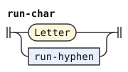</p>
<p>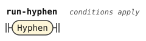</p>
<p>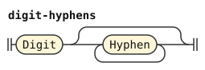</p>
<p>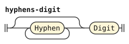</p>
<p></p>
</details>

`run-end` matches where a run ends. A rule that reads a run ends with it. The space token keeps its value of one space. The words stage reads spaces to find the ends of compounds and borrowings.

```jbogenbau
%rule space
  $s:Space :: $s.tags
%emits
  $

%rule open-bracket
  Open
%emits
  $ :: Open

%rule close-bracket
  Close
%emits
  $ :: Close
```

<details><summary>Railroad diagrams of <code>space</code>, <code>open-bracket</code> and <code>close-bracket</code></summary>
<p></p>
<p></p>
<p></p>
</details>

### Gaps

The morphology chapter says that a bracket is a space outside the syntax of foreign quotes. Most brackets pass to the words stage, which reads the quotes. But a borrowing, a freeform variable and a spelling quote can hold spaces inside one token. Such a space is a gap: a run of spaces, brackets and hesitations. A gap counts as one space in the value of the token.

The rules `borrowing`, `freeform-variable` and `spelling-quote` carry the flag `leftmost-longest`. Where such a token can start, the parse that reads it wins. A parse that reads its first letters as junk or as a plain word loses. A parse where the token cannot form, as where its gap meets a closing bracket, keeps the other reading.

The words stage reads a foreign quote from `co`, any spaces, hesitations and `]`, an optional delimiter, and a `[`. The rule `quote-start` reads the same shape up to that `[`. Its `n` is a hesitation only between spaces and closing brackets. Such a `[` opens a quote, so it is no space, and `free-open` refuses it. So `co ce[ba cei]ce` stays a quote with the delimiter `ce`, and no spelling quote takes its `[`.

A `]` can close a foreign quote, and a token that holds it would hide it from the words stage. So `free-close` takes a `]` only where no quote start and `[` stand before it without a `]` between them. In a quote with a delimiter, a `]` can stand inside the quote, so every `]` after such an opening stays out of gaps. The test can also refuse a `]` that closes nothing, where the letters `co` stand inside another word, as in `tco [u]bar`.

The rules `space-before` and `space-after` hold beside a space, a free bracket or an edge of the text. Hesitation, erasers and the end of a borrowing need them. A bracket of a quote is no space, so `co [x]ra` holds no eraser, and an `n` that touches the `[` of `co n[x]` is no hesitation. A query on the tokens after a constituent cannot see the text before it. So `space-after` tests the bracket after it with the tokens before it, which are the same tokens that come before the bracket.

```jbogenbau
%rule gap
  {Space | free-open | free-close | hesitation} := " "

%rule free-open
  $b:Open
%conditions
  ¬$b.preceding-tokens.ends(quote-start)

%rule free-close
  $b:Close
%conditions
  ¬$b.preceding-tokens.ends(open-quote)

%rule quote-start
  quote-co [opening-space] [{run-char}]

%rule open-quote
  | quote-co [opening-space] Open [{_<¬Close>}]
  | quote-co [opening-space] {run-char} Open [{_}]

%rule quote-co
  Letter="c" [Hyphen] $v:vhowels
%conditions
  $v.first-token.value = "o",
  $v.value ≠ "oi"

%rule opening-space
  {Space | Close | opening-hesitation}

%rule opening-hesitation
  Letter="n"
%conditions
  $.preceding-tokens.ends(Space | Close),
  $.following-tokens.begins(Space | Close)

%rule space-before
  ε
%conditions
  $.starts-input ∨ $.preceding-tokens.ends(Space | free-open | free-close)

%rule space-after
  ε
%conditions
  $.ends-input ∨ $.following-tokens.begins(Space)
    ∨ $.following-tokens.begins(Open) ∧ ¬$.preceding-tokens.ends(quote-start)
    ∨ $.following-tokens.begins(Close) ∧ ¬$.preceding-tokens.ends(open-quote)
```

<details><summary>Railroad diagrams of the 10 rules from <code>gap</code> to <code>space-after</code></summary>
<p>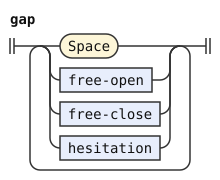</p>
<p>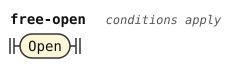</p>
<p>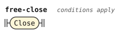</p>
<p>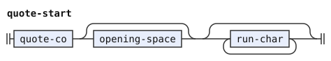</p>
<p>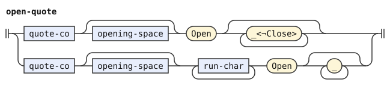</p>
<p>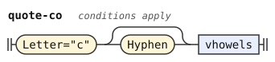</p>
<p>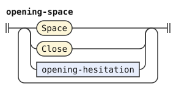</p>
<p>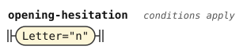</p>
<p>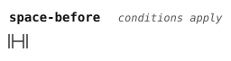</p>
<p>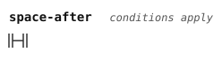</p>
</details>

## Letters, vowels and hyphens

The rules below name the letter classes that the letters stage tags. `ns-consonant` is a non-sonorant consonant, the kind that can begin a word.

The morphology chapter says that a hyphen can stand at a syllable boundary inside a word. A syllable starts at a vowel after a different vowel, at `h`, and at a single consonant between vowels. Inside a borrowing, a syllable also starts at an initial pair. A medial pair splits between its two consonants, and a triplet `XYZ` splits between `X` and `YZ`. In a borrowing, a sonorant or `m` before a consonant splits the same way. A hyphen at one of these places is silent.

Anywhere else, the grammar accepts a hyphen with the warning `hyphen-misplaced`. That includes the start and the end of a word. The rule `misplaced-hyphen` reads such a hyphen, and the pipeline turns the warning on. The PEG warns at most of these places, and the closing section lists the others.

```jbogenbau
%rule vowel
  Letter<Vowel>

%rule consonant
  Letter<Consonant>

%rule sonorant
  Letter<Sonorant>

%rule ns-consonant
  Letter<Consonant ¬Sonorant>

%rule misplaced-hyphen
  hyphen-misplaced! run-hyphen
```

<details><summary>Railroad diagrams of the 5 rules from <code>vowel</code> to <code>misplaced-hyphen</code></summary>
<p></p>
<p></p>
<p></p>
<p></p>
<p></p>
</details>

Two vowels written in a row are two letters, because the letters stage merges a repeated letter into one. A hyphen between two copies of the same vowel would split one vowel in two, so the book forbids it. The condition on the hyphenated alternative states that.

```jbogenbau
%rule vowels
  | vowel
  | vowels vowel
  | $a:vowels Hyphen $b:vowel
%conditions
  $a.last-token.value ≠ $b.value

%rule vhowels
  vowels [{[Hyphen] Letter<H> [misplaced-hyphen] vowels}]
```

<details><summary>Railroad diagrams of <code>vowels</code> and <code>vhowels</code></summary>
<p></p>
<p></p>
</details>

## Pairs and triplets

The morphology chapter lists the consonant pairs. An initial pair can begin a word. A medial pair stands only between vowels inside a word. Every other pair of consonants is invalid, and a sonorant before a non-sonorant consonant breaks the stream into two words. The two constants copy the chapter's lists, so the chart of the chapter is the grammar's table.

```jbogenbau
%const $INITIAL-PAIRS
  "bj" "bz" "dj" "dz" "gj" "gz" "vj" "vz" "fc" "fs" "kc" "ks" "pc" "ps" "tc" "ts"
  "jb" "jd" "jg" "jv" "jm" "zb" "zd" "zg" "zv" "zm" "cf" "ck" "cp" "ct" "cm" "sf" "sk" "sp" "st" "sm"

%const $MEDIAL-PAIRS
  "bd" "bg" "bv" "db" "dg" "dv" "gb" "gd" "gv" "vb" "vd" "vg" "bm" "dm" "gm" "vm"
  "fk" "fp" "ft" "kf" "kp" "kt" "pf" "pk" "pt" "tf" "tk" "tp" "fm" "km" "pm" "tm"
  "bl" "br" "bn" "cl" "cr" "cn" "dl" "dr" "dn" "fl" "fr" "fn" "gl" "gr" "gn" "jl" "jr" "jn"
  "kl" "kr" "kn" "ml" "mr" "mn" "pl" "pr" "pn" "sl" "sr" "sn" "tl" "tr" "tn" "vl" "vr" "vn"
  "zl" "zr" "zn" "nl" "nr" "ln" "rn"

%const $LIQUIDS "r" "l"

%const $NOT-BEFORE-LIQUID "m" "n" "r" "l"

%rule initial-pair
  $x:consonant [misplaced-hyphen] $y:consonant
%conditions
  $x.value ++ $y.value ∈ $INITIAL-PAIRS

%rule medial-pair
  $x:consonant [Hyphen] $y:consonant
%conditions
  $x.value ++ $y.value ∈ $MEDIAL-PAIRS
```

<details><summary>Railroad diagrams of <code>initial-pair</code> and <code>medial-pair</code></summary>
<p></p>
<p></p>
</details>

A triplet is three consonants `XYZ` between vowels. In a root it has one of two shapes. Either `XY` is a medial pair and `YZ` an initial pair, as in `pks`. Or `XY` is a medial or initial pair, `Y` is neither `m` nor a sonorant, and `Z` is a liquid, as in `str`. A freeform variable or borrowing has a third shape: `X` is a sonorant and `YZ` is an initial pair or a consonant-sonorant medial pair. A consonant-sonorant medial pair starts with a non-sonorant consonant, so `nrn` is no triplet. Four consonants in a row form no word.

```jbogenbau
%rule root-triplet
  $x:consonant [Hyphen] $y:consonant [misplaced-hyphen] $z:consonant
%conditions
  $x.value ++ $y.value ∈ $MEDIAL-PAIRS ∧ $y.value ++ $z.value ∈ $INITIAL-PAIRS
    ∨ ($x.value ++ $y.value ∈ $MEDIAL-PAIRS ∨ $x.value ++ $y.value ∈ $INITIAL-PAIRS)
      ∧ $y.value ∉ $NOT-BEFORE-LIQUID ∧ $z.value ∈ $LIQUIDS

%rule freeform-triplet
  root-triplet | sonorant-triplet

%rule sonorant-triplet
  sonorant [Hyphen] $y:ns-consonant [misplaced-hyphen] $z:consonant
%conditions
  $y.value ++ $z.value ∈ $INITIAL-PAIRS
    ∨ $y.value ++ $z.value ∈ $MEDIAL-PAIRS ∧ Sonorant ⊆ $z.tags
```

<details><summary>Railroad diagrams of <code>root-triplet</code>, <code>freeform-triplet</code> and <code>sonorant-triplet</code></summary>
<p></p>
<p></p>
<p>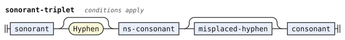</p>
</details>

## Particles

A particle starts with a non-sonorant consonant followed only by vhowels, as `zi` or `tiho`. Or it starts with `n`, `a` or `o` and continues with vhowels and sonorants, as `a`, `on`, `ahu` or `nu`. The closing section explains why only these three letters start the second kind.

The shape of a particle gives its family. As in the PEG, the first consonant gives the family, and for `p`, `b`, `d`, `c` and `j` the first vowel refines it. The book makes six particles families of their own: `pei`, `vei`, `dai`, `cei`, `cai` and `coi`. The templates below read the kinds of family. Each instance names its family.

```jbogenbau
%rule particle-cv(@Consonant, @Tag)
  $c:ns-consonant [misplaced-hyphen] vhowels :: @Tag
%conditions
  $c.value = @Consonant

%rule particle-cv-except(@Consonant, @Except, @Tag)
  $c:ns-consonant [misplaced-hyphen] $v:vhowels :: @Tag
%conditions
  $c.value = @Consonant,
  $v.value ≠ @Except

%rule particle-cvv(@Consonant, @Vowel, @Tag)
  $c:ns-consonant [misplaced-hyphen] $v:vhowels :: @Tag
%conditions
  $c.value = @Consonant,
  $v.first-token.value = @Vowel

%rule particle-cvv-except(@Consonant, @Vowel, @Except, @Tag)
  $c:ns-consonant [misplaced-hyphen] $v:vhowels :: @Tag
%conditions
  $c.value = @Consonant,
  $v.first-token.value = @Vowel,
  $v.value ≠ @Except

%rule particle-exact(@Consonant, @Vowels, @Tag)
  $c:ns-consonant [misplaced-hyphen] $v:vhowels :: @Tag
%conditions
  $c.value = @Consonant,
  $v.value = @Vowels
```

<details><summary>Railroad diagrams of the 5 rules from <code>particle-cv</code> to <code>particle-exact</code></summary>
<p></p>
<p></p>
<p></p>
<p></p>
<p></p>
</details>

```jbogenbau
%rule mi-particle = particle-cv("m", MI)
%rule fi-particle = particle-cv("f", FI)
%rule vi-particle = particle-cv-except("v", "ei", VI)
%rule vei-particle = particle-exact("v", "ei", VEI)
%rule ti-particle = particle-cv("t", TI)
%rule si-particle = particle-cv("s", SI)
%rule zi-particle = particle-cv("z", ZI)
%rule ki-particle = particle-cv("k", KI)
%rule gi-particle = particle-cv("g", GI)
%rule pi-particle = particle-cvv("p", "i", PI)
%rule pe-particle = particle-cvv-except("p", "e", "ei", PE)
%rule pei-particle = particle-exact("p", "ei", PEI)
%rule pa-particle = particle-cvv("p", "a", PA)
%rule po-particle = particle-cvv("p", "o", PO)
%rule pu-particle = particle-cvv("p", "u", PU)
%rule bi-particle = particle-cvv("b", "i", BI)
%rule be-particle = particle-cvv("b", "e", BE)
%rule ba-particle = particle-cvv("b", "a", BA)
%rule bo-particle = particle-cvv("b", "o", BO)
%rule bu-particle = particle-cvv("b", "u", BU)
%rule di-particle = particle-cvv("d", "i", DI)
%rule de-particle = particle-cvv("d", "e", DE)
%rule da-particle = particle-cvv-except("d", "a", "ai", DA)
%rule dai-particle = particle-exact("d", "ai", DAI)
%rule do-particle = particle-cvv("d", "o", DO)
%rule du-particle = particle-cvv("d", "u", DU)
%rule ci-particle = particle-cvv("c", "i", CI)
%rule ce-particle = particle-cvv-except("c", "e", "ei", CE)
%rule cei-particle = particle-exact("c", "ei", CEI)
%rule ca-particle = particle-cvv-except("c", "a", "ai", CA)
%rule cai-particle = particle-exact("c", "ai", CAI)
%rule co-particle = particle-cvv-except("c", "o", "oi", CO)
%rule coi-particle = particle-exact("c", "oi", COI)
%rule cu-particle = particle-cvv("c", "u", CU)
%rule ji-particle = particle-cvv("j", "i", JI)
%rule je-particle = particle-cvv("j", "e", JE)
%rule ja-particle = particle-cvv("j", "a", JA)
%rule jo-particle = particle-cvv("j", "o", JO)
%rule ju-particle = particle-cvv("j", "u", JU)
```

<details><summary>Railroad diagrams of the 39 rules from <code>mi-particle</code> to <code>ju-particle</code></summary>
<p></p>
<p></p>
<p></p>
<p></p>
<p></p>
<p></p>
<p></p>
<p></p>
<p></p>
<p></p>
<p></p>
<p></p>
<p></p>
<p></p>
<p></p>
<p></p>
<p></p>
<p></p>
<p></p>
<p></p>
<p></p>
<p></p>
<p></p>
<p></p>
<p></p>
<p></p>
<p></p>
<p></p>
<p></p>
<p></p>
<p></p>
<p></p>
<p></p>
<p></p>
<p></p>
<p></p>
<p></p>
<p></p>
<p></p>
</details>

The particle families of `n`, `a` and `o` are `NI`, `A` and `O`. The `n` can take a hyphen after it, with a warning. A sonorant inside the particle stands between vowels, and one can end it.

```jbogenbau
%rule ni-particle
  Letter="n" [misplaced-hyphen] vhowels particle-tail :: NI

%rule a-particle
  $v:vhowels particle-tail :: A
%conditions
  $v.first-token.value = "a"

%rule o-particle
  $v:vhowels particle-tail :: O
%conditions
  $v.first-token.value = "o"

%rule particle-tail
  [{[Hyphen] sonorant [misplaced-hyphen] vhowels}] [[misplaced-hyphen] sonorant]

%rule consonant-particle
  | mi-particle | fi-particle | vi-particle | vei-particle | ti-particle | si-particle
  | zi-particle | ki-particle | gi-particle | pi-particle | pe-particle | pei-particle
  | pa-particle | po-particle | pu-particle | bi-particle | be-particle | ba-particle
  | bo-particle | bu-particle | di-particle | de-particle | da-particle | dai-particle
  | do-particle | du-particle | ci-particle | ce-particle | cei-particle | ca-particle
  | cai-particle | co-particle | coi-particle | cu-particle | ji-particle | je-particle
  | ja-particle | jo-particle | ju-particle

%rule vowel-particle
  a-particle | o-particle
```

<details><summary>Railroad diagrams of the 6 rules from <code>ni-particle</code> to <code>vowel-particle</code></summary>
<p></p>
<p></p>
<p></p>
<p></p>
<p></p>
<p></p>
</details>

## Roots

A root starts with a non-sonorant consonant or an initial pair. After its first vhowels come any number of middles, each a sonorant, a medial pair or a triplet before more vhowels. A sonorant can end it. A root that starts with one consonant needs at least one middle or a final sonorant, because a consonant and vhowels alone form a particle.

```jbogenbau
%rule root-form
  | ns-consonant [misplaced-hyphen] vhowels {root-middle} [final-sonorant]
  | ns-consonant [misplaced-hyphen] vhowels final-sonorant
  | initial-pair [misplaced-hyphen] vhowels [{root-middle}] [final-sonorant]

%rule root-middle
  | [Hyphen] sonorant [misplaced-hyphen] vhowels
  | [misplaced-hyphen] medial-pair [misplaced-hyphen] vhowels
  | [misplaced-hyphen] root-triplet [misplaced-hyphen] vhowels

%rule final-sonorant
  [misplaced-hyphen] sonorant
```

<details><summary>Railroad diagrams of <code>root-form</code>, <code>root-middle</code> and <code>final-sonorant</code></summary>
<p></p>
<p></p>
<p></p>
</details>

## Runs of words

A run of words starts with any word and continues with words that begin with a non-sonorant consonant. A word that begins with a vowel or `n` can only begin a run. Compound prefixes also begin a run, and a vowel-initial particle or a borrowing can follow them directly, as the [compounds chapter](https://eberban.github.io/eberban/grammar/compounds.html) allows. A spelling quote starts with `ce`, so it can stand anywhere a word that starts with `c` can. A hyphen at the start of a run, after the prefixes or at the end of a word is a warning.

Each word emits one token tagged `Word` and its kind. A particle also carries `Particle` and its family. The image of a word is its value, so a hyphen inside a word never shows in it.

```jbogenbau
%rule word-run
  | [misplaced-hyphen] first-word [{consonant-word}] run-end
  | [misplaced-hyphen] prefixes [misplaced-hyphen] [vowel-particle-word [{consonant-word}] | consonant-word [{consonant-word}]] run-end
  | [misplaced-hyphen] prefixes borrowing

%rule first-word
  consonant-word | vowel-particle-word | ni-word

%rule consonant-word
  consonant-particle-word | root-word | spelling-quote

%rule consonant-particle-word
  $p:consonant-particle [misplaced-hyphen] :: Word ∪ Particle ∪ $p.tags
%emits
  $ :- $.value

%rule ni-word
  $p:ni-particle [misplaced-hyphen] :: Word ∪ Particle ∪ $p.tags
%emits
  $ :- $.value

%rule vowel-particle-word
  $p:vowel-particle [misplaced-hyphen] :: Word ∪ Particle ∪ $p.tags
%emits
  $ :- $.value

%rule root-word
  root-form [misplaced-hyphen] :: Word ∪ Root
%emits
  $ :- $.value
```

<details><summary>Railroad diagrams of the 7 rules from <code>word-run</code> to <code>root-word</code></summary>
<p></p>
<p></p>
<p></p>
<p></p>
<p></p>
<p></p>
<p></p>
</details>

### Compound prefixes

A compound starts with `e`, `en` or `er`, for two, three or more components. A nested compound that is the first component of another can attach its prefix to the outer prefix. The compounds chapter spells the attached prefix `i` after `e`, because `ee` collapses to `e`, and `e` after `n` or `r`. So `ein` is `e` and `en`, and `ene` is `en` and `e`. An attached `i` after `n` or `r` is accepted with the warning `prefix-i-after-sonorant`.

A hyphen inside a prefix, between two prefixes or after the last prefix carries `hyphen-misplaced`, as in the PEG. Such a hyphen has an empty value, so the rules `after-e` and `after-arity` look past it to the letter before an attached `i`.

Each prefix emits one token tagged `Prefix` and `E-PREFIX`, `EN-PREFIX` or `ER-PREFIX` by its length. A prefix that stands as a run of its own also carries `Standalone`, even with a hyphen after it. The words stage reads a standalone `e` as the end of an `er` compound.

```jbogenbau
%rule prefixes
  first-prefix [{[misplaced-hyphen] attached-prefix}]

%rule first-prefix
  Letter="e" [[misplaced-hyphen] prefix-arity] :: Prefix ∪ $.value.classify(prefix-length) ∪ (¬$.following-tokens.begins(later-letter) ⟹ Standalone)
%emits
  $ :- $.value

%rule later-letter
  [Hyphen] Letter

%rule attached-prefix
  | Letter="e" [[misplaced-hyphen] prefix-arity] :: Prefix ∪ $.value.classify(prefix-length)
  | $i:Letter="i" :: Prefix ∪ E-PREFIX := "e"
  | $i:Letter="i" [misplaced-hyphen] $r:prefix-arity :: Prefix ∪ ("e" ++ $r.value).classify(prefix-length) := "e" ++ $r.value
%conditions
  $i.preceding-tokens.ends(after-e)
%emits
  $ :- $.value

%rule after-e
  Letter="e" [Hyphen]

%rule prefix-arity
  Letter="n" | Letter="r"

%classifier prefix-length
  "e" ∈ E-PREFIX
  "en" ∈ EN-PREFIX
  "er" ∈ ER-PREFIX
```

<details><summary>Railroad diagrams of the 6 rules from <code>prefixes</code> to <code>prefix-arity</code></summary>
<p></p>
<p></p>
<p>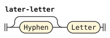</p>
<p></p>
<p>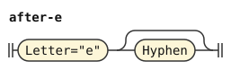</p>
<p></p>
</details>

```jbogenbau
%extend-rule attached-prefix
  | prefix-i-after-sonorant! $i:Letter="i" :: Prefix ∪ E-PREFIX := "e"
  | prefix-i-after-sonorant! $i:Letter="i" [misplaced-hyphen] $r:prefix-arity :: Prefix ∪ ("e" ++ $r.value).classify(prefix-length) := "e" ++ $r.value
%conditions
  $i.preceding-tokens.ends(after-arity)
%emits
  $ :- $.value

%rule after-arity
  prefix-arity [Hyphen]
```

<details><summary>Railroad diagrams of <code>attached-prefix</code> and <code>after-arity</code></summary>
<p></p>
<p>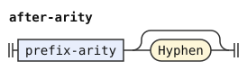</p>
</details>

## Borrowings and freeform variables

A borrowing is `u`, then its content. The book says that spaces must follow a borrowing. So `space-after` ends it, and a free bracket or the end of the text also counts. A freeform variable is the same with `i`. The content has looser rules than a root. An initial pair can stand in the middle, and a medial pair at the start. A sonorant or `m` before a consonant counts as a pair. A sonorant before an initial pair or a consonant-sonorant medial pair counts as a triplet. The content can start with a vowel, a consonant, a pair, a triplet or `h`. It ends with a vowel or with one consonant.

The PEG lets a gap stand between the prefix and the content. The book writes content that starts with `u` after `u'`, and the apostrophe is a space. Two copies of the prefix letter would merge into one letter, so a gap must stand there.

A cluster before more vowels has its syllable boundary before it or inside it. A single consonant and an initial pair start a syllable, so a hyphen before them is silent. A medial pair, a sonorant or `m` before a consonant, and a triplet split inside, as the section on hyphens says. The rule `sonorant-pair` reads a sonorant or `m` before a consonant that forms no medial pair. A pair of the same letter twice is no pair, as the morphology chapter says.

The PEG warns about a hyphen before or after the prefix, and about content that starts with the prefix letter after a hyphen. A hyphen after a cluster at the start of the content also warns. Each carries `hyphen-misplaced` here. The token's value is the prefix letter and the content, without the gap.

```jbogenbau
%rule(leftmost-longest) borrowing
  [misplaced-hyphen] Letter="u" prefix-gap $c:content [misplaced-hyphen] space-after :: Word ∪ Borrowing := "u" ++ $c.value
%emits
  $

%rule(leftmost-longest) freeform-variable
  [misplaced-hyphen] Letter="i" prefix-gap $c:content [misplaced-hyphen] space-after :: Word ∪ Freeform := "i" ++ $c.value
%emits
  $

%rule prefix-gap
  [gap] [misplaced-hyphen]

%rule content
  [content-onset] vhowels [{content-middle vhowels}] [[misplaced-hyphen] consonant]

%rule content-onset
  (onset-cluster | split-cluster | Letter<H>) [misplaced-hyphen]

%rule content-middle
  | [Hyphen] onset-cluster [misplaced-hyphen]
  | [misplaced-hyphen] split-cluster [misplaced-hyphen]

%rule onset-cluster
  initial-pair | consonant

%rule split-cluster
  freeform-triplet | medial-pair | sonorant-pair

%rule sonorant-pair
  $x:pair-opener [Hyphen] $y:consonant
%conditions
  $x.value ++ $y.value ∉ $MEDIAL-PAIRS,
  $x.value ≠ $y.value

%rule pair-opener
  sonorant | Letter="m"
```

<details><summary>Railroad diagrams of the 10 rules from <code>borrowing</code> to <code>pair-opener</code></summary>
<p></p>
<p></p>
<p></p>
<p></p>
<p></p>
<p>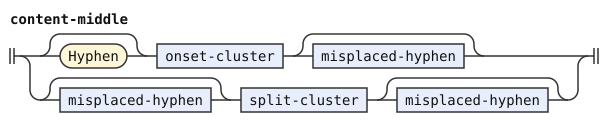</p>
<p>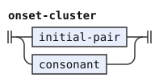</p>
<p>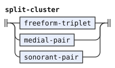</p>
<p>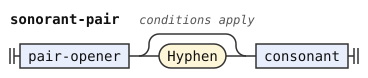</p>
<p>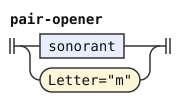</p>
</details>

## Digits, hesitation and erasers

A digit is a number word of family `TI`. The numbers chapter says that a `-` before or after a digit is a hyphen that is not allowed there. The PEG warns about it, because a writer may have meant a minus sign. It also warns about a mathematical symbol after a digit. The warnings are `minus-sign` and `math-symbol`. A digit takes every hyphen beside it, so the token after it never starts with such a hyphen.

```jbogenbau
%rule digit-word
  [{minus-hyphen}] $d:Digit [{minus-hyphen}] [$m:math-mark]
%conditions
  ¬$.following-tokens.begins(Hyphen),
  $m ∨ ¬$.following-tokens.begins(math-space)
%emits
  $d :: Word ∪ Particle ∪ TI ∪ Digit-Symbol

%rule minus-hyphen
  minus-sign! Hyphen

%rule math-mark
  math-symbol! ε
%conditions
  $.following-tokens.begins(math-space)

%rule math-space
  Space<Math-Symbol>
```

<details><summary>Railroad diagrams of <code>digit-word</code>, <code>minus-hyphen</code>, <code>math-mark</code> and <code>math-space</code></summary>
<p></p>
<p>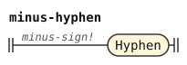</p>
<p>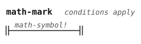</p>
<p></p>
</details>

The [phonology chapter](https://eberban.github.io/eberban/morphonology/phonology.html) says that where spaces are allowed, a speaker can hesitate with one or more `n` surrounded by spaces. So the letter `n` alone is hesitation where a space, a free bracket or an edge of the text stands on each side. The stage drops it. A gap can hold hesitation too.

The words `ra` and `ri` are the erasers of the [sentences chapter](https://eberban.github.io/eberban/logic/sentences.html). They start with `r`, so no particle or root has their shape. The chapter says that `ra` must stand between spaces or pauses. The PEG reads `ri` the same way. A run of `ra` is one eraser per `ra`. The syntax stage applies them. A hyphen after the `r` carries `hyphen-misplaced`, as after the first consonant of any particle.

```jbogenbau
%rule hesitation
  space-before Letter="n" space-after
%erased

%rule eraser-run
  | space-before {ra-word} space-after
  | space-before ri-word space-after

%rule ra-word
  Letter="r" [misplaced-hyphen] Letter="a" :: Word ∪ RA
%emits
  $ :- $.value

%rule ri-word
  Letter="r" [misplaced-hyphen] Letter="i" :: Word ∪ RI
%emits
  $ :- $.value
```

<details><summary>Railroad diagrams of <code>hesitation</code>, <code>eraser-run</code>, <code>ra-word</code> and <code>ri-word</code></summary>
<p></p>
<p></p>
<p></p>
<p></p>
</details>

## Spelling quotes

The [quotes chapter](https://eberban.github.io/eberban/grammar/quotes.html) spells a text with units between `ce` and `cei`. A unit is a consonant or an initial pair, or nothing, followed by vhowels. The chapter says that spaces between units are optional, except before a unit that starts with a vowel. Here a gap stands between two units, so a bracket or a hesitation can stand there too. The units are letters, not words, so this stage reads the whole quote as one token. The token carries `CE`, `Quote`, `Word` and `Particle`. Each gap counts as one space in its value, and its image is the written text.

The quote is a word that starts with `c`, so a run of words can hold it, as in `mice bu cei`. A hyphen before `cei` carries `hyphen-misplaced`, as at the start of any word. A `ce` particle that no `cei` closes is an ordinary word. The syntax stage has no use for it, so such a text fails there.

```jbogenbau
%rule(leftmost-longest) spelling-quote
  ce-particle [misplaced-hyphen] units [gap] [misplaced-hyphen] cei-particle [misplaced-hyphen]
    :: Word ∪ Particle ∪ CE ∪ Quote :- $.source-text
%emits
  $

%rule units
  | first-unit [{later-unit}]
  | gap vowel-unit [{later-unit}]

%rule first-unit
  [gap] consonant-unit

%rule later-unit
  [gap] consonant-unit | gap vowel-unit

%rule consonant-unit
  $u:unit-letters
%conditions
  $u.value ≠ "cei"

%rule vowel-unit
  vhowels

%rule unit-letters
  (initial-pair | consonant) vhowels
```

<details><summary>Railroad diagrams of the 7 rules from <code>spelling-quote</code> to <code>unit-letters</code></summary>
<p></p>
<p></p>
<p></p>
<p></p>
<p></p>
<p></p>
<p></p>
</details>

## Runs that form no word

A run that this grammar reads as no word is one `Junk` token. Its value is its source text. The words stage admits it inside a foreign quote, and the syntax stage admits it in text that `ra` erases. The PEG reports an error for such a run, with a message about the letter, pair or ending at fault. Here the text fails later, where the junk stands.

```jbogenbau
%rule junk-run
  {run-char} run-end
%emits
  $ :: Junk := $.decomposed-source-text :- $.source-text
```

<details><summary>Railroad diagram of <code>junk-run</code></summary>
<p></p>
</details>

## Differences from the reference grammar and the PEG

The book says that a particle can start with a sonorant or a vowel. The PEG reads only `n`, `a` and `o`, and this grammar does the same. The sentences chapter names A, O and NI as the particles that start with `a`, `o` and `n`. The vowels `e`, `i` and `u` open compounds, freeform variables and borrowings. The book gives no other family that starts with `r` or `l`. So `ra` and `ri` are the only words that start with `r`, and no word starts with `l`.

The annotations chapter says that the families DA and DAI have the single members `da` and `dai`. The PEG reads every other `d` and vhowels that start with `a` as DA, and this grammar does the same. The shapes of the morphology chapter make such a word a particle, and the book gives it no other family.

The PEG reads hesitation only after a space character, so a text that starts with `n` fails there. The PEG accepts hesitation at the end of the text. This grammar also accepts it at the start, which is the symmetric choice.

The PEG reads every bracket outside the syntax of a quote as a space. This grammar keeps a `]` out of a gap wherever a quote start and `[` stand before it with no `]` between them. After a quote with a delimiter, it keeps every later `]` out of gaps. So `tco [u]bar` and `co zao[x]zao u]bar` have no borrowing `ubar` here. The forms stage does not read quotes, so it cannot tell which `]` closes one. This rule never lets a token hide such a `]`.

The PEG reads a text from left to right, so in `ce co [ba] cei` the spelling quote opens first and `co` is one of its units. Here the `[` after `co` can open a foreign quote, so it is no space, and the spelling quote cannot take it. The text then has no parse. The forms stage cannot tell whether a `co` stands inside a spelling quote without reading the quote that it is building.

The PEG warns about each misplaced hyphen with its own message. This grammar carries one warning, `hyphen-misplaced`, at the position of each such hyphen. The places below differ from the PEG.

- Inside a borrowing, a hyphen before a cluster that splits inside carries the warning, as in `ua-msa`. So does a hyphen after such a cluster in the middle of a borrowing, as in `uapts-a`. The PEG rejects these, because its content rule then reads a final consonant and reports two consonants at the end. Such a hyphen is misplaced like any other, so this grammar warns.
- A hyphen inside `ra` or `ri`, as in `r-a`, carries the warning. The PEG reads no hyphen there and rejects the text. This grammar treats the hyphen as it does after the first consonant of any particle.
- A hyphen between a word and a digit, as in `bjan-1`, carries `minus-sign`. The PEG reads it as the end of the word and warns with its message for that. The numbers chapter says that a hyphen before or after a digit is not allowed, whatever stands on its other side.
- A row of hyphens that touches a digit belongs to the digit, and each hyphen carries `minus-sign`. So `bjan--1` is accepted with two warnings. The PEG takes only one hyphen at the end of a word and rejects it. This grammar treats every hyphen beside a digit alike.
- An attached `i` after `n-` or `r-`, as in `en-iber`, carries `prefix-i-after-sonorant` as well as `hyphen-misplaced`. The PEG tests the letter right before the `i`, so the hyphen hides the `n` there. The hyphen has an empty value, so the letter before the `i` is still `n`, and the compounds chapter spells the vowel `e` after it.
