# Word forms

This document opens the forms stage of the [Eberban pipeline](pipeline.md). A stage is one step of a pipeline, with its own grammar. A token is one unit that a stage reads or emits. A token's value is the string that exact comparisons read. Its image is the string that people see.

The stage reads the letter tokens of the [letters stage](letters.md). It divides them into words and tags each word with its family. A tag marks a token by an identifier. The stage hands the words to the words stage, [stream.md](stream.md), with the spaces and brackets between them.

The reference grammar's [morphology chapter](https://eberban.github.io/eberban/morphonology/morphology.html) states the word shapes. Eberban has a self-segregating morphology. A stream of letters divides into words in one way only. The chapter gives the reasoning. A non-sonorant consonant begins a word, unless it is the first letter of a medial pair or triplet inside a word. A word that begins with a vowel or a sonorant needs a space before it. So the rules below never look past a word to decide where it ends. The next word begins where a non-sonorant consonant stands outside a cluster, or after a space.

The prose uses these Eberban terms:

- A particle is a word with a grammatical function. Its family is the set of particles with one grammar, such as `VI`.
- A root is a predicate word that is not a particle.
- A borrowing is a foreign word written after the prefix `u`.
- A freeform variable is a speaker-defined predicate written after the prefix `i`.
- A compound is a word made from other words after the prefix `e`, `en` or `er`.
- Vhowels are a string of vowels, with `h` between some of them.
- A sonorant is `n`, `r` or `l`. The other consonants are non-sonorant.

[The notation document](../../../docs/notation.md) explains jbogenbau, the notation of these grammars.

## The text

The text is a sequence of items. An item is a space, a bracket, a digit, a hesitation, an eraser, a run of words, or a run that no rule reads. A run is a maximal stretch of letters and hyphens between two items that are not letters. Each rule that reads a run makes it maximal with a condition on the tokens after it. So two runs never stand side by side, and one run has one division.

```jbogenbau
%ambiguity-resolution lazy

%rule text
  [{item}]

%rule item
  | space | open-bracket | close-bracket | digit-word
  | hesitation | eraser-run | borrowing | freeform-variable | word-run | spelling-quote | junk-run

%rule letter-or-hyphen
  Letter | Hyphen

%rule run-end
  ε
%conditions
  ¬$.following-tokens.begins(letter-or-hyphen)
```

<details><summary>Railroad diagrams of <code>text</code>, <code>item</code>, <code>letter-or-hyphen</code> and <code>run-end</code></summary>
<p>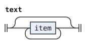</p>
<p>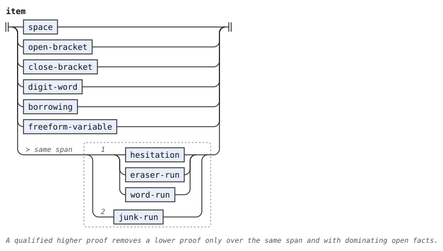</p>
<p>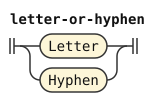</p>
<p>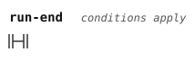</p>
</details>

`run-end` matches where a run ends. A rule that reads a run ends with it. The space token keeps its value of one space. The words stage reads spaces to find the ends of compounds and borrowings. A bracket is a space outside a foreign quote, which the words stage decides.

```jbogenbau
%rule space
  $s:Space :: $s.tags
%emits
  $

%rule open-bracket
  Open
%emits
  $ :: Open

%rule close-bracket
  Close
%emits
  $ :: Close
```

<details><summary>Railroad diagrams of <code>space</code>, <code>open-bracket</code> and <code>close-bracket</code></summary>
<p>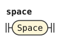</p>
<p>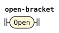</p>
<p>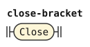</p>
</details>

## Letters, vowels and hyphens

The rules below name the letter classes that the letters stage tags. `ns-consonant` is a non-sonorant consonant, the kind that can begin a word.

A hyphen can stand at a syllable boundary. The book allows it where a syllable starts. That is between two different vowels, before `h`, before a single sonorant between vowels, and between the two consonants of a pair. In a triplet `XYZ`, the hyphen stands between `X` and `YZ`. Anywhere else the PEG accepts the hyphen with a warning. The rule `misplaced-hyphen` reads such a hyphen and carries the warning `hyphen-misplaced`. The pipeline turns that warning on.

```jbogenbau
%rule vowel
  Letter<Vowel>

%rule consonant
  Letter<Consonant>

%rule sonorant
  Letter<Sonorant>

%rule ns-consonant
  Letter<Consonant ¬Sonorant>

%rule misplaced-hyphen
  hyphen-misplaced! Hyphen
```

<details><summary>Railroad diagrams of the 5 rules from <code>vowel</code> to <code>misplaced-hyphen</code></summary>
<p>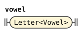</p>
<p>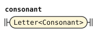</p>
<p>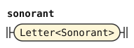</p>
<p>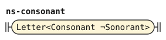</p>
<p>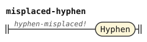</p>
</details>

Two vowels written in a row are two letters, because the letters stage merges a repeated letter into one. A hyphen between two copies of the same vowel would split one vowel in two, so the book forbids it. The condition on the hyphenated alternative states that.

```jbogenbau
%rule vowels
  | vowel
  | vowels vowel
  | $a:vowels Hyphen $b:vowel
%conditions
  $a.last-token.value ≠ $b.value

%rule vhowels
  vowels [{[Hyphen] Letter<H> [misplaced-hyphen] vowels}]
```

<details><summary>Railroad diagrams of <code>vowels</code> and <code>vhowels</code></summary>
<p>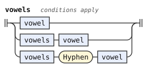</p>
<p>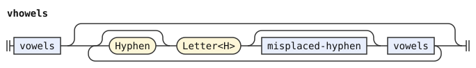</p>
</details>

## Pairs and triplets

The morphology chapter lists the consonant pairs. An initial pair can begin a word. A medial pair stands only between vowels inside a word. Every other pair of consonants is invalid, and a sonorant before a non-sonorant consonant breaks the stream into two words. The two constants copy the chapter's lists, so the chart of the chapter is the grammar's table.

```jbogenbau
%const $INITIAL-PAIRS
  "bj" "bz" "dj" "dz" "gj" "gz" "vj" "vz" "fc" "fs" "kc" "ks" "pc" "ps" "tc" "ts"
  "jb" "jd" "jg" "jv" "jm" "zb" "zd" "zg" "zv" "zm" "cf" "ck" "cp" "ct" "cm" "sf" "sk" "sp" "st" "sm"

%const $MEDIAL-PAIRS
  "bd" "bg" "bv" "db" "dg" "dv" "gb" "gd" "gv" "vb" "vd" "vg" "bm" "dm" "gm" "vm"
  "fk" "fp" "ft" "kf" "kp" "kt" "pf" "pk" "pt" "tf" "tk" "tp" "fm" "km" "pm" "tm"
  "bl" "br" "bn" "cl" "cr" "cn" "dl" "dr" "dn" "fl" "fr" "fn" "gl" "gr" "gn" "jl" "jr" "jn"
  "kl" "kr" "kn" "ml" "mr" "mn" "pl" "pr" "pn" "sl" "sr" "sn" "tl" "tr" "tn" "vl" "vr" "vn"
  "zl" "zr" "zn" "nl" "nr" "ln" "rn"

%const $LIQUIDS "r" "l"

%const $NOT-BEFORE-LIQUID "m" "n" "r" "l"

%rule initial-pair
  $x:consonant [misplaced-hyphen] $y:consonant
%conditions
  $x.value ++ $y.value ∈ $INITIAL-PAIRS

%rule medial-pair
  $x:consonant [Hyphen] $y:consonant
%conditions
  $x.value ++ $y.value ∈ $MEDIAL-PAIRS
```

<details><summary>Railroad diagrams of <code>initial-pair</code> and <code>medial-pair</code></summary>
<p>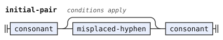</p>
<p>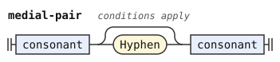</p>
</details>

A triplet is three consonants `XYZ` between vowels. In a root it has one of two shapes. Either `XY` is a medial pair and `YZ` an initial pair, as in `pks`. Or `XY` is a medial or initial pair, `Y` is neither `m` nor a sonorant, and `Z` is a liquid, as in `str`. A freeform variable or borrowing has a third shape: `X` is a sonorant and `YZ` is an initial pair or a consonant-sonorant medial pair. Four consonants in a row form no word.

```jbogenbau
%rule root-triplet
  $x:consonant [Hyphen] $y:consonant [misplaced-hyphen] $z:consonant
%conditions
  $x.value ++ $y.value ∈ $MEDIAL-PAIRS ∧ $y.value ++ $z.value ∈ $INITIAL-PAIRS
    ∨ ($x.value ++ $y.value ∈ $MEDIAL-PAIRS ∨ $x.value ++ $y.value ∈ $INITIAL-PAIRS)
      ∧ $y.value ∉ $NOT-BEFORE-LIQUID ∧ $z.value ∈ $LIQUIDS

%rule freeform-triplet
  | root-triplet
  | $x:sonorant [Hyphen] $y:consonant [misplaced-hyphen] $z:consonant
%conditions
  $y.value ++ $z.value ∈ $INITIAL-PAIRS
    ∨ $y.value ++ $z.value ∈ $MEDIAL-PAIRS ∧ Sonorant ⊆ $z.tags
```

<details><summary>Railroad diagrams of <code>root-triplet</code> and <code>freeform-triplet</code></summary>
<p>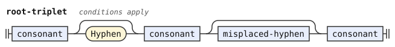</p>
<p>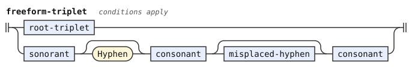</p>
</details>

## Particles

A particle starts with a non-sonorant consonant followed only by vhowels, as `zi` or `tiho`. Or it starts with `n`, `a` or `o` and continues with vhowels and sonorants, as `a`, `on`, `ahu` or `nu`. The book says that such a particle starts with a sonorant or a vowel. The PEG reads only `n` among the sonorants, and `a` and `o` among the vowels. The vowels `e`, `i` and `u` open compounds, freeform variables and borrowings instead. This grammar follows the PEG.

Every particle family is infinite. The first consonant of a particle gives its family, and for `p`, `b`, `d`, `c` and `j` the first vowel refines it. Six particles are families of their own: `pei`, `vei`, `dai`, `cei`, `cai` and `coi`. The three templates below read the three kinds of family. Each instance names its family.

```jbogenbau
%rule particle-cv(@Consonant, @Tag)
  $c:ns-consonant [misplaced-hyphen] vhowels :: @Tag
%conditions
  $c.value = @Consonant

%rule particle-cv-except(@Consonant, @Except, @Tag)
  $c:ns-consonant [misplaced-hyphen] $v:vhowels :: @Tag
%conditions
  $c.value = @Consonant,
  $v.value ≠ @Except

%rule particle-cvv(@Consonant, @Vowel, @Tag)
  $c:ns-consonant [misplaced-hyphen] $v:vhowels :: @Tag
%conditions
  $c.value = @Consonant,
  $v.first-token.value = @Vowel

%rule particle-cvv-except(@Consonant, @Vowel, @Except, @Tag)
  $c:ns-consonant [misplaced-hyphen] $v:vhowels :: @Tag
%conditions
  $c.value = @Consonant,
  $v.first-token.value = @Vowel,
  $v.value ≠ @Except

%rule particle-exact(@Consonant, @Vowels, @Tag)
  $c:ns-consonant [misplaced-hyphen] $v:vhowels :: @Tag
%conditions
  $c.value = @Consonant,
  $v.value = @Vowels
```

<details><summary>Railroad diagrams of the 5 rules from <code>particle-cv</code> to <code>particle-exact</code></summary>
<p>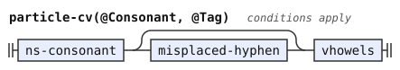</p>
<p>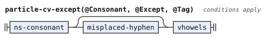</p>
<p>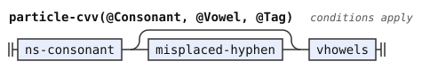</p>
<p>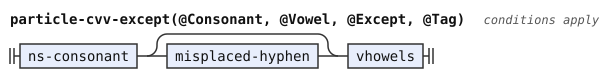</p>
<p>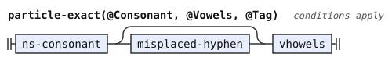</p>
</details>

```jbogenbau
%rule mi-particle = particle-cv("m", MI)
%rule fi-particle = particle-cv("f", FI)
%rule vi-particle = particle-cv-except("v", "ei", VI)
%rule vei-particle = particle-exact("v", "ei", VEI)
%rule ti-particle = particle-cv("t", TI)
%rule si-particle = particle-cv("s", SI)
%rule zi-particle = particle-cv("z", ZI)
%rule ki-particle = particle-cv("k", KI)
%rule gi-particle = particle-cv("g", GI)
%rule pi-particle = particle-cvv("p", "i", PI)
%rule pe-particle = particle-cvv-except("p", "e", "ei", PE)
%rule pei-particle = particle-exact("p", "ei", PEI)
%rule pa-particle = particle-cvv("p", "a", PA)
%rule po-particle = particle-cvv("p", "o", PO)
%rule pu-particle = particle-cvv("p", "u", PU)
%rule bi-particle = particle-cvv("b", "i", BI)
%rule be-particle = particle-cvv("b", "e", BE)
%rule ba-particle = particle-cvv("b", "a", BA)
%rule bo-particle = particle-cvv("b", "o", BO)
%rule bu-particle = particle-cvv("b", "u", BU)
%rule di-particle = particle-cvv("d", "i", DI)
%rule de-particle = particle-cvv("d", "e", DE)
%rule da-particle = particle-cvv-except("d", "a", "ai", DA)
%rule dai-particle = particle-exact("d", "ai", DAI)
%rule do-particle = particle-cvv("d", "o", DO)
%rule du-particle = particle-cvv("d", "u", DU)
%rule ci-particle = particle-cvv("c", "i", CI)
%rule ce-particle = particle-cvv-except("c", "e", "ei", CE)
%rule cei-particle = particle-exact("c", "ei", CEI)
%rule ca-particle = particle-cvv-except("c", "a", "ai", CA)
%rule cai-particle = particle-exact("c", "ai", CAI)
%rule co-particle = particle-cvv-except("c", "o", "oi", CO)
%rule coi-particle = particle-exact("c", "oi", COI)
%rule cu-particle = particle-cvv("c", "u", CU)
%rule ji-particle = particle-cvv("j", "i", JI)
%rule je-particle = particle-cvv("j", "e", JE)
%rule ja-particle = particle-cvv("j", "a", JA)
%rule jo-particle = particle-cvv("j", "o", JO)
%rule ju-particle = particle-cvv("j", "u", JU)
```

<details><summary>Railroad diagrams of the 39 rules from <code>mi-particle</code> to <code>ju-particle</code></summary>
<p>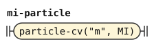</p>
<p></p>
<p>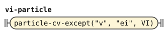</p>
<p></p>
<p></p>
<p>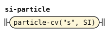</p>
<p></p>
<p>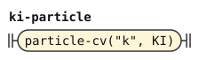</p>
<p>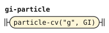</p>
<p></p>
<p>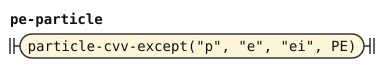</p>
<p>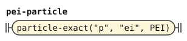</p>
<p>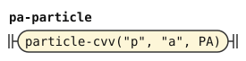</p>
<p>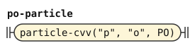</p>
<p></p>
<p></p>
<p></p>
<p></p>
<p></p>
<p>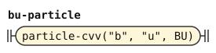</p>
<p>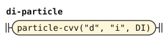</p>
<p></p>
<p>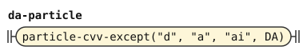</p>
<p>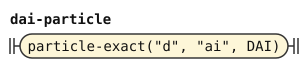</p>
<p>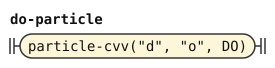</p>
<p></p>
<p></p>
<p></p>
<p>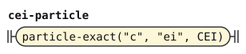</p>
<p></p>
<p></p>
<p>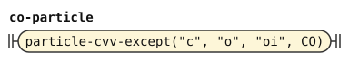</p>
<p></p>
<p></p>
<p></p>
<p>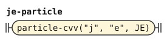</p>
<p>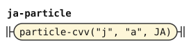</p>
<p></p>
<p></p>
</details>

The particle families of `n`, `a` and `o` are `NI`, `A` and `O`. The `n` can take a hyphen after it, with a warning. A sonorant inside the particle stands between vowels, and one can end it.

```jbogenbau
%rule ni-particle
  Letter="n" [misplaced-hyphen] vhowels particle-tail :: NI

%rule a-particle
  $v:vhowels particle-tail :: A
%conditions
  $v.first-token.value = "a"

%rule o-particle
  $v:vhowels particle-tail :: O
%conditions
  $v.first-token.value = "o"

%rule particle-tail
  [{[Hyphen] sonorant [misplaced-hyphen] vhowels}] [[misplaced-hyphen] sonorant]

%rule consonant-particle
  | mi-particle | fi-particle | vi-particle | vei-particle | ti-particle | si-particle
  | zi-particle | ki-particle | gi-particle | pi-particle | pe-particle | pei-particle
  | pa-particle | po-particle | pu-particle | bi-particle | be-particle | ba-particle
  | bo-particle | bu-particle | di-particle | de-particle | da-particle | dai-particle
  | do-particle | du-particle | ci-particle | ce-particle | cei-particle | ca-particle
  | cai-particle | co-particle | coi-particle | cu-particle | ji-particle | je-particle
  | ja-particle | jo-particle | ju-particle

%rule vowel-particle
  a-particle | o-particle
```

<details><summary>Railroad diagrams of the 6 rules from <code>ni-particle</code> to <code>vowel-particle</code></summary>
<p>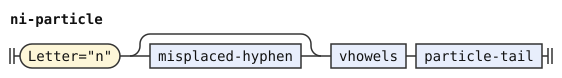</p>
<p></p>
<p>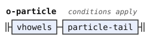</p>
<p>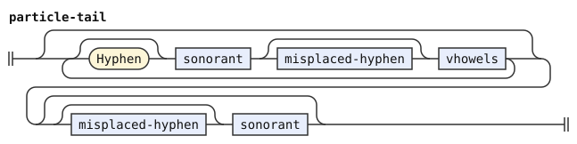</p>
<p>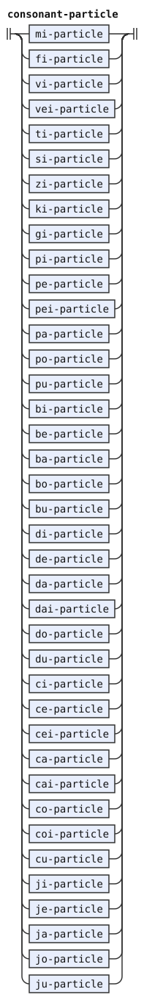</p>
<p>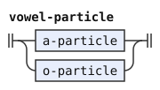</p>
</details>

## Roots

A root starts with a non-sonorant consonant or an initial pair. After its first vhowels come any number of middles, each a sonorant, a medial pair or a triplet before more vhowels. A sonorant can end it. A root that starts with one consonant needs at least one middle or a final sonorant, because a consonant and vhowels alone form a particle.

```jbogenbau
%rule root-form
  | ns-consonant [misplaced-hyphen] vhowels {root-middle} [final-sonorant]
  | ns-consonant [misplaced-hyphen] vhowels final-sonorant
  | initial-pair [misplaced-hyphen] vhowels [{root-middle}] [final-sonorant]

%rule root-middle
  | [Hyphen] sonorant [misplaced-hyphen] vhowels
  | [misplaced-hyphen] medial-pair [misplaced-hyphen] vhowels
  | [misplaced-hyphen] root-triplet [misplaced-hyphen] vhowels

%rule final-sonorant
  [misplaced-hyphen] sonorant
```

<details><summary>Railroad diagrams of <code>root-form</code>, <code>root-middle</code> and <code>final-sonorant</code></summary>
<p>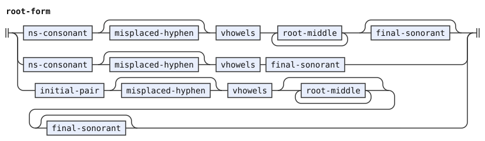</p>
<p>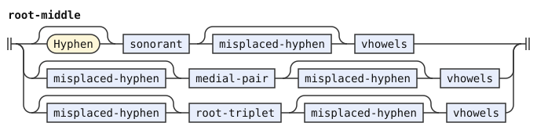</p>
<p>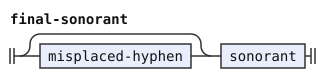</p>
</details>

## Runs of words

A run of words starts with any word and continues with words that begin with a non-sonorant consonant. A word that begins with a vowel or `n` can only begin a run. Compound prefixes also begin a run, and a vowel-initial particle or a borrowing can follow them directly, as the [compounds chapter](https://eberban.github.io/eberban/grammar/compounds.html) allows. A hyphen at the start of a run or at the end of a word is a warning.

Each word emits one token tagged `Word` and its kind. A particle also carries `Particle` and its family. The image of a word is its value, so a hyphen inside a word never shows in it.

```jbogenbau
%rule word-run
  | [misplaced-hyphen] first-word [{consonant-word}] run-end
  | [misplaced-hyphen] prefixes [vowel-particle-word [{consonant-word}] | consonant-word [{consonant-word}]] run-end
  | [misplaced-hyphen] prefixes borrowing

%rule first-word
  consonant-word | vowel-particle-word | ni-word

%rule consonant-word
  consonant-particle-word | root-word

%rule consonant-particle-word
  $p:consonant-particle [misplaced-hyphen] :: Word ∪ Particle ∪ $p.tags
%conditions
  ¬$p.onward.begins(spelling-quote)
%emits
  $ :- $.value

%rule ni-word
  $p:ni-particle [misplaced-hyphen] :: Word ∪ Particle ∪ $p.tags
%emits
  $ :- $.value

%rule vowel-particle-word
  $p:vowel-particle [misplaced-hyphen] :: Word ∪ Particle ∪ $p.tags
%emits
  $ :- $.value

%rule root-word
  root-form [misplaced-hyphen] :: Word ∪ Root
%emits
  $ :- $.value
```

<details><summary>Railroad diagrams of the 7 rules from <code>word-run</code> to <code>root-word</code></summary>
<p>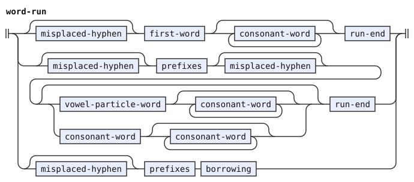</p>
<p></p>
<p></p>
<p></p>
<p></p>
<p></p>
<p></p>
</details>

### Compound prefixes

A compound starts with `e`, `en` or `er`, for two, three or more components. A nested compound that is the first component of another can attach its prefix to the outer prefix. The compounds chapter spells the attached prefix `i` after `e`, because `ee` collapses to `e`, and `e` after `n` or `r`. So `ein` is `e` and `en`, and `ene` is `en` and `e`. An attached `i` after `n` or `r` is accepted with the warning `prefix-i-after-sonorant`.

Each prefix emits one token tagged `Prefix` and `E-PREFIX`, `EN-PREFIX` or `ER-PREFIX` by its length. A prefix that stands as a run of its own also carries `Standalone`. The words stage reads a standalone `e` as the end of an `er` compound.

```jbogenbau
%rule prefixes
  first-prefix [{attached-prefix}]

%rule first-prefix
  $e:Letter="e" [misplaced-hyphen] [prefix-arity] :: Prefix ∪ $.value.classify(prefix-length) ∪ (¬$.following-tokens.begins(letter-or-hyphen) ⟹ Standalone)
%emits
  $ :- $.value

%rule attached-prefix
  | Letter="e" [prefix-arity] :: Prefix ∪ $.value.classify(prefix-length)
  | $i:Letter="i" :: Prefix ∪ E-PREFIX := "e"
  | $i:Letter="i" $r:prefix-arity :: Prefix ∪ ("e" ++ $r.value).classify(prefix-length) := "e" ++ $r.value
%conditions
  $i.preceding-tokens.last-token.value = "e"
%emits
  $ :- $.value

%rule prefix-arity
  Letter="n" | Letter="r"

%classifier prefix-length
  "e" ∈ E-PREFIX
  "en" ∈ EN-PREFIX
  "er" ∈ ER-PREFIX
```

<details><summary>Railroad diagrams of the 4 rules from <code>prefixes</code> to <code>prefix-arity</code></summary>
<p></p>
<p></p>
<p></p>
<p></p>
</details>

```jbogenbau
%extend-rule attached-prefix
  | prefix-i-after-sonorant! $i:Letter="i" :: Prefix ∪ E-PREFIX := "e"
  | prefix-i-after-sonorant! $i:Letter="i" $r:prefix-arity :: Prefix ∪ ("e" ++ $r.value).classify(prefix-length) := "e" ++ $r.value
%conditions
  $i.preceding-tokens.last-token.value ≠ "e"
%emits
  $ :- $.value
```

<details><summary>Railroad diagram of <code>attached-prefix</code></summary>
<p></p>
</details>

## Borrowings and freeform variables

A borrowing is `u`, then its content, then a space or the end of the text. A freeform variable is the same with `i`. The content has looser rules than a root. An initial pair can stand in the middle, and a medial pair at the start. A sonorant before a consonant counts as a pair. A sonorant before an initial pair counts as a triplet. The content can start with a vowel or `h`. It ends with a vowel or with one consonant. A space can stand between the prefix and the content, and must when the content starts with the prefix letter.

The PEG warns about a hyphen after the prefix, and about content that starts with the prefix letter after a hyphen. Both carry `hyphen-misplaced` here. The token's value is the prefix letter and the content, without the space.

```jbogenbau
%rule borrowing
  $u:Letter="u" prefix-gap $c:content [misplaced-hyphen] run-end :: Word ∪ Borrowing := "u" ++ $c.value
%emits
  $

%rule freeform-variable
  $i:Letter="i" prefix-gap $c:content [misplaced-hyphen] run-end :: Word ∪ Freeform := "i" ++ $c.value
%emits
  $

%rule prefix-gap
  ε | Space | misplaced-hyphen | Space misplaced-hyphen

%rule content
  [content-onset] vhowels [{content-cluster vhowels}] [[misplaced-hyphen] consonant]

%rule content-onset
  content-cluster | Letter<H> [misplaced-hyphen]

%rule content-cluster
  | freeform-triplet [misplaced-hyphen]
  | medial-pair [misplaced-hyphen]
  | [Hyphen] (sonorant | Letter="m") [Hyphen] consonant
  | [Hyphen] initial-pair [misplaced-hyphen]
  | [Hyphen] consonant [misplaced-hyphen]
```

<details><summary>Railroad diagrams of the 6 rules from <code>borrowing</code> to <code>content-cluster</code></summary>
<p></p>
<p></p>
<p></p>
<p></p>
<p></p>
<p></p>
</details>

## Digits, hesitation and erasers

A digit is a number word of family `TI`. The PEG warns about a hyphen beside a digit, which a writer may have meant as a minus sign. It also warns about a mathematical symbol after a digit. The warnings are `minus-sign` and `math-symbol`.

```jbogenbau
%rule digit-word
  | $d:Digit :: Word ∪ Particle ∪ TI ∪ Digit-Symbol
  | math-symbol! $m:Digit :: Word ∪ Particle ∪ TI ∪ Digit-Symbol
%conditions
  ¬$d.following-tokens.begins(math-space),
  $m.following-tokens.begins(math-space)
%emits
  $

%rule math-space
  Space<Math-Symbol>
```

<details><summary>Railroad diagrams of <code>digit-word</code> and <code>math-space</code></summary>
<p></p>
<p></p>
</details>

```jbogenbau
%extend-rule digit-word
  | minus-sign! Hyphen $d:Digit [Hyphen] :: Word ∪ Particle ∪ TI ∪ Digit-Symbol
  | minus-sign! $d:Digit Hyphen :: Word ∪ Particle ∪ TI ∪ Digit-Symbol
%emits
  $d :: Word ∪ Particle ∪ TI ∪ Digit-Symbol
```

<details><summary>Railroad diagram of <code>digit-word</code></summary>
<p></p>
</details>

The letter `n` alone between spaces is hesitation. The [phonology chapter](https://eberban.github.io/eberban/morphonology/phonology.html) says that a speaker can hesitate with one or more `n` surrounded by spaces. The stage drops it.

The words `ra` and `ri` are the erasers of the [sentences chapter](https://eberban.github.io/eberban/logic/sentences.html). They start with `r`, so no particle or root has their shape. A run of `ra` is one eraser per `ra`. The syntax stage applies them.

```jbogenbau
%rule hesitation
  Letter="n" run-end
%erased

%rule eraser-run
  | {ra-word} run-end
  | ri-word run-end

%rule ra-word
  Letter="r" [Hyphen] Letter="a" :: Word ∪ RA
%emits
  $ :- $.value

%rule ri-word
  Letter="r" [Hyphen] Letter="i" :: Word ∪ RI
%emits
  $ :- $.value
```

<details><summary>Railroad diagrams of <code>hesitation</code>, <code>eraser-run</code>, <code>ra-word</code> and <code>ri-word</code></summary>
<p></p>
<p></p>
<p></p>
<p></p>
</details>

## Spelling quotes

The [quotes chapter](https://eberban.github.io/eberban/grammar/quotes.html) spells a text with units between `ce` and `cei`. A unit is a consonant or an initial pair, or nothing, followed by vhowels. A space can stand between two units, and must before a unit that starts with a vowel. The units are letters, not words, so this stage reads the whole quote as one token. The token carries `CE`, `Quote`, `Word` and `Particle`. Its value joins the units with single spaces, and its image is the written text.

A `ce` particle that no `cei` closes is an ordinary word. The syntax stage has no use for it, so such a text fails there.

```jbogenbau
%rule spelling-quote
  $p:ce-particle [misplaced-hyphen] units [Space] cei-particle [misplaced-hyphen] run-end
    :: Word ∪ Particle ∪ CE ∪ Quote :- $.source-text
%emits
  $

%rule units
  | first-unit [{later-unit}]
  | Space vowel-unit [{later-unit}]

%rule first-unit
  Space consonant-unit | consonant-unit

%rule later-unit
  [Space] consonant-unit | Space vowel-unit

%rule consonant-unit
  $u:unit-letters
%conditions
  $u.value ≠ "cei"

%rule vowel-unit
  vhowels

%rule unit-letters
  (initial-pair | consonant) vhowels
```

<details><summary>Railroad diagrams of the 7 rules from <code>spelling-quote</code> to <code>unit-letters</code></summary>
<p></p>
<p></p>
<p></p>
<p></p>
<p></p>
<p></p>
<p></p>
</details>

## Runs that form no word

A run that this grammar reads as no word is one `Junk` token. Its value is its source text. The words stage admits it inside a foreign quote, and the syntax stage admits it in text that `ra` erases. The PEG reports an error for such a run, with a message about the letter, pair or ending at fault. Here the text fails later, where the junk stands.

```jbogenbau
%rule junk-run
  {letter-or-hyphen} run-end
%conditions
  ¬$.matches(readable-run),
  ¬$.onward.begins(borrowing | freeform-variable | digit-word)
%emits
  $ :: Junk := $.decomposed-source-text :- $.source-text

%rule readable-run
  word-run | hesitation | eraser-run | spelling-quote
```

<details><summary>Railroad diagrams of <code>junk-run</code> and <code>readable-run</code></summary>
<p></p>
<p></p>
</details>

## Differences from the reference grammar and the PEG

The book says that a particle can start with a sonorant or a vowel. The PEG reads `n`, `a` and `o`, and this grammar does the same. `ra` and `ri` are the only words that start with `r`, and no word starts with `l`.

The PEG reads hesitation only after a space character, so a text that starts with `n` fails there. This grammar reads hesitation wherever it stands between spaces or at the edges of the text.

The PEG warns about each misplaced hyphen with its own message. This grammar carries one warning, `hyphen-misplaced`, at the position of each such hyphen.
