# The word stream

This document opens the words stage of the [Eberban pipeline](pipeline.md). A stage is one step of a pipeline, with its own grammar. A token is one unit that a stage reads or emits. A token's value is the string that exact comparisons read. Its image is the string that people see.

The stage reads the words, spaces and brackets of the [forms stage](morphology.md). It assembles compounds and foreign quotes into single tokens, keeps the other words, and drops the spaces and brackets. It hands the syntax stage a stream of words. A tag marks a token by an identifier. [The notation document](../../../docs/notation.md) explains jbogenbau, the notation of these grammars.

## The stream

The stream is a sequence of units with gaps between them. A gap is one or more spaces or brackets. Two units can also stand side by side, as `mi` and `bjan` do in `mibjan`. A gap emits nothing. The stage is lazy. Where two parses differ, it takes the one that closes a constituent over the one that reads on. A constituent is the text that one rule matches.

```jbogenbau
%ambiguity-resolution lazy

%rule text
  [gap] [{unit [gap]}]

%rule gap
  {Space | Open | Close}
%erased

%rule unit
  plain-word | compound | foreign-quote | junk
```

<details><summary>Railroad diagrams of <code>text</code>, <code>gap</code> and <code>unit</code></summary>
<p>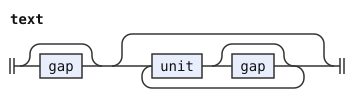</p>
<p>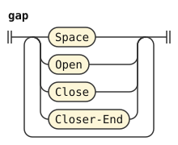</p>
<p>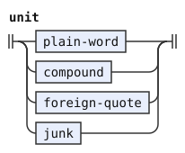</p>
</details>

A plain word is any word token except a compound prefix, which only a compound reads. A `co` that opens no quote stays a plain word, and the syntax stage has no use for it. Junk is a run that the forms stage read as no word. It passes through for the syntax stage, where only erased text admits it.

```jbogenbau
%rule plain-word
  $w:Word<¬Prefix> :: $w.tags
%conditions
  ¬$w.onward.begins(foreign-quote)
%emits
  $

%rule junk
  $j:Junk :: $j.tags
%emits
  $
```

<details><summary>Railroad diagrams of <code>plain-word</code> and <code>junk</code></summary>
<p>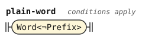</p>
<p>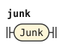</p>
</details>

## Compounds

The [compounds chapter](https://eberban.github.io/eberban/grammar/compounds.html) makes one word from several. The prefix `e` takes two components, `en` three, and `er` any number up to a standalone `e`. A component is a particle, a root, a borrowing or a nested compound. Spaces can stand between the parts, so a component can follow its prefix in the same run or after a gap.

The forms stage tags a prefix written as a run of its own `Standalone`. An `er` compound ends at the first standalone `e`, so no component of an `er` compound can be a nested compound that starts with one. A nested compound with an attached prefix, as in `eberban`, can stand there.

The PEG warns about an `er` compound of one, two or three components, because `e` and `en` spell those. The warning `compound-size` marks such a compound here. The rule `few-er-components` reads up to three components, and `er-components` reads four or more.

A compound emits one token tagged `Word` and `Compound`. Its value is the compound in the shortest canonical form of the compounds chapter, which the dictionary uses. When a nested compound is the first component of another, their prefixes join into one unit. The joined prefix spells its vowel `i` after `e` and `e` after `n` or `r`. So `e e ber ban ban` and `ei ber ban ban` both have the value `ei ber ban ban`. Single spaces separate the other parts. The image is the same as the value.

The rule `compound-tail` reads a compound and gives its value without the vowel of its own prefix. A compound puts `e` in front of its tail. A compound whose first component is a nested compound reads that component as a tail, and joins it with the vowel that the chapter gives. That vowel depends on the letter before it, so a tail comes in two kinds. `compound-tail` follows a vowel written `e`, and `joined-tail` follows one written `i`. The rule `fixed-tail` holds the alternatives that are the same in both kinds. The rule `simple-component` is a component that is not a compound, so each first component has one reading.

```jbogenbau
%rule compound
  $t:compound-tail :: Word ∪ Compound ∪ $t.tags := "e" ++ $t.emitted.value
%emits
  $

%rule compound-tail
  | $t:fixed-tail :: $t.tags := $t.emitted.value
  | $p:E-PREFIX [gap] $n:joined-tail [gap] $b:component
      :: ($p.tags ∩ Standalone ≠ ∅ ⟹ Spaced-E) := "i" ++ $n.emitted.value ++ " " ++ $b.emitted.value

%rule joined-tail
  | $t:fixed-tail :: $t.tags := $t.emitted.value
  | $p:E-PREFIX [gap] $n:compound-tail [gap] $b:component
      :: ($p.tags ∩ Standalone ≠ ∅ ⟹ Spaced-E) := "e" ++ $n.emitted.value ++ " " ++ $b.emitted.value

%rule fixed-tail
  | $p:E-PREFIX [gap] $a:simple-component [gap] $b:component
      :: ($p.tags ∩ Standalone ≠ ∅ ⟹ Spaced-E) := " " ++ $a.emitted.value ++ " " ++ $b.emitted.value
  | EN-PREFIX [gap] $a:simple-component [gap] $b:component [gap] $c:component
      := "n " ++ $a.emitted.value ++ " " ++ $b.emitted.value ++ " " ++ $c.emitted.value
  | EN-PREFIX [gap] $n:compound-tail [gap] $b:component [gap] $c:component
      := "ne" ++ $n.emitted.value ++ " " ++ $b.emitted.value ++ " " ++ $c.emitted.value
  | ER-PREFIX [gap] $l:er-components gap E-PREFIX<Standalone>
      := "r" ++ $l.emitted.value ++ " e"
  | compound-size! ER-PREFIX [gap] $l:few-er-components gap E-PREFIX<Standalone>
      := "r" ++ $l.emitted.value ++ " e"

%rule simple-component
  | $w:Word<Particle ¬Quote ¬Digit-Symbol> :: $w.tags
  | $w:Word<Root> :: $w.tags
  | $w:Word<Borrowing> :: $w.tags

%rule component
  | $w:simple-component :: $w.tags
  | $c:compound :: $c.tags

%rule er-first
  | $c:simple-component := " " ++ $c.emitted.value
  | $n:compound-tail<¬Spaced-E> := "e" ++ $n.emitted.value

%rule er-components
  | $f:few-er-components [gap] $c:component<¬Spaced-E> := $f.emitted.value ++ " " ++ $c.emitted.value
  | $l:er-components [gap] $c:component<¬Spaced-E> := $l.emitted.value ++ " " ++ $c.emitted.value
%conditions
  $f.matches(three-er-components)

%rule few-er-components
  | $c:er-first := $c.emitted.value
  | $l:few-er-components [gap] $c:component<¬Spaced-E> := $l.emitted.value ++ " " ++ $c.emitted.value
%conditions
  ¬$l.matches(three-er-components)

%rule three-er-components
  er-first [gap] component<¬Spaced-E> [gap] component<¬Spaced-E>
```

<details><summary>Railroad diagrams of the 10 rules from <code>compound</code> to <code>three-er-components</code></summary>
<p>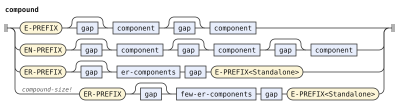</p>
<p>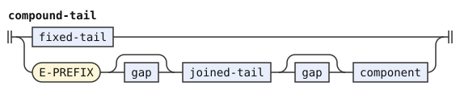</p>
<p>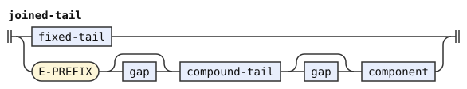</p>
<p>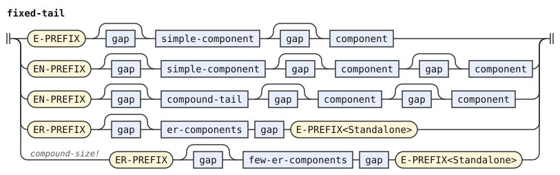</p>
<p>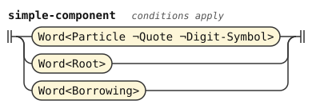</p>
<p>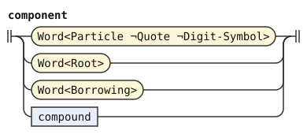</p>
<p>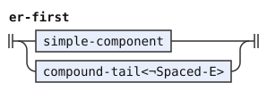</p>
<p>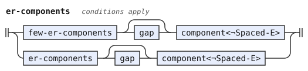</p>
<p>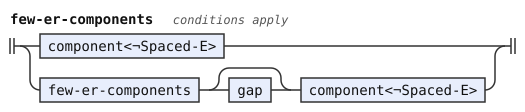</p>
<p>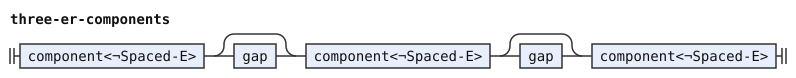</p>
</details>

## Foreign quotes

The [quotes chapter](https://eberban.github.io/eberban/grammar/quotes.html) gives `co` two forms. With `[` after it, the quote holds everything up to the next `]`. With a delimiter word before the `[`, the quote holds everything up to the first `]` followed by that word. The delimiter is a particle or root form. Any spaces can stand between `co` and the bracket, but the delimiter stands directly before its bracket.

The quote body is a repetition of tokens. A condition on each `]` inside the body requires that the word after it differs from the delimiter. The quote therefore ends at the first bracket-and-word that repeats the delimiter, as the chapter says.

The quote emits one token tagged `Word`, `Particle`, `CO` and `Quote`. Its image is the written text, brackets included.

```jbogenbau
%rule foreign-quote :: Word ∪ Particle ∪ CO ∪ Quote :- $.source-text
  | CO [gap] Open [{_<¬Close>}] Close
  | CO [Space] $open:delimiter Open [{_<¬Close> | $c:Close}] Close $close:delimiter
%conditions
  $open.value = $close.value,
  $c.following-tokens.first-token.value ≠ $open.value
%emits
  $

%rule delimiter
  Word<Particle ¬Quote ¬Digit-Symbol> | Word<Root>
```

<details><summary>Railroad diagrams of <code>foreign-quote</code> and <code>delimiter</code></summary>
<p>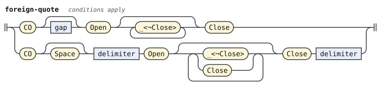</p>
<p>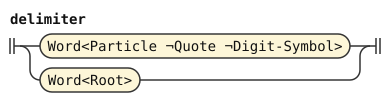</p>
</details>

## Differences from the reference grammar and the PEG

The PEG reads a foreign quote only where the syntax expects a verb. When the sentence around it is ungrammatical, the PEG reads its characters again as erasable text. So a `ra` inside a closed quote erases an ungrammatical sentence, and the text after the `ra` leaks out of the quote. The chapter on sentences describes this as a hazard and advises closing quotes properly. This stage reads every quote as a quote, so a `ra` inside one is quoted text. An ungrammatical sentence with a `ra` inside its quote and none after it has no parse here.

The PEG records each prefix as the text writes it, so `ei ber ban ban` has the inner prefix `i` and `e e ber ban ban` has `e`. Two spellings of one compound then differ, and a `pa` resumption that repeats the verb in the other spelling fails there. The compounds chapter calls the joined prefix a shorthand for the spaced one. This stage gives both spellings one value, in the shortest canonical form that the chapter says the dictionary uses.
