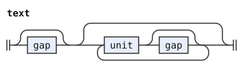
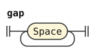
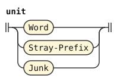

# The word stream

This document opens the words stage of the [Eberban pipeline](pipeline.md). A stage is one step of a pipeline, with its own grammar. A token is one unit that a stage reads or emits. A tag marks a token by an identifier.

The stage reads the words and spaces of the [forms stage](morphology.md). It keeps the words and drops the spaces, and it hands the syntax stage a stream of words. The forms stage reads each compound, spelling quote and foreign quote as one word token. [The notation document](../../../docs/notation.md) explains jbogenbau, the notation of these grammars.

## The stream

The stream is a sequence of units with gaps between them. A gap is one or more space tokens, and it emits nothing. Two units can also stand side by side, as `mi` and `bjan` do in `mibjan`. Each unit reads one token, so the text has one parse, and the `lazy` policy of the stage decides nothing.

A unit is a word or junk. Junk is a run that the forms stage read as no word, or prefixes where no compound begins. It passes through for the syntax stage, where only erased text admits it.

```jbogenbau
%ambiguity-resolution lazy

%rule text
  [gap] [{unit [gap]}]

%rule gap
  {Space}
%erased

%rule unit
  Word | Junk
%emits
  $
```

<details><summary>Railroad diagrams of <code>text</code>, <code>gap</code> and <code>unit</code></summary>
<p></p>
<p></p>
<p></p>
</details>
