# The grammar

This document opens the syntax stage of the [Eberban pipeline](pipeline.md). A stage is one step of a pipeline, with its own grammar. A token is one unit that a stage reads or emits. A tag marks a token by an identifier.

The stage reads the words of the [words stage](stream.md). Each word carries its family as a tag, and the terminals of this grammar are those families. The chapters of the reference grammar give the constructs. The PEG `eberban.peggy` is the executable baseline, and the closing section lists the departures from it.

The prose uses these Eberban terms:

- A verb is a predicate word or construct in a chain. Every word of Eberban is a predicate.
- A chain is a sequence of verbs. The chapter on [chaining](https://eberban.github.io/eberban/logic/chaining.html) groups it from the right.
- A bind is an explicit binding of a place of a verb, opened by `VI` or `FI` and closed by `vei`.
- An annotation is a free prefix or suffix with no logical effect.

[The notation document](../../../docs/notation.md) explains jbogenbau, the notation of these grammars. An elided terminator is a closing word left unwritten. The pipeline ranks the parses with `late-elision`, so an elided terminator falls as late as the text allows.

## Texts and paragraphs

A text is language flags, then paragraphs. An empty text is valid. The [sentences chapter](https://eberban.github.io/eberban/logic/sentences.html) marks a new paragraph with `PO`. The first paragraph can lack it. A paragraph is a sentence and any number of further sentences. A further sentence starts with a sentence starter, a particle of family `A`, `O` or `NI`, or it is ungrammatical text that `ra` erases.

```jbogenbau
%rule text
  [{DO}] [paragraphs]

%rule paragraphs
  [po-head] sentences [{po-head sentences}]

%rule po-head
  [{prefix}] PO [{postfix}]

%rule sentences
  sentence [{tail-sentence}]

%rule tail-sentence
  starter-sentence | invalid-tail

%rule starter-sentence
  $s:sentence
%conditions
  $s.onward.begins(starter-head)

%rule invalid-tail
  $s:erased-invalid
%conditions
  ¬$s.onward.begins(starter-head),
  ¬$s.onward.begins(po-or-dai)

%rule starter-head
  [{prefix}] (A | O | NI)

%rule po-or-dai
  [{prefix}] PO | DAI
```

<details><summary>Railroad diagrams of the 9 rules from <code>text</code> to <code>po-or-dai</code></summary>
<p>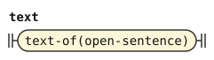</p>
<p>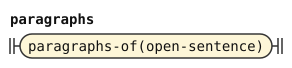</p>
<p>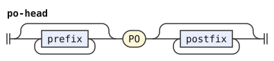</p>
<p>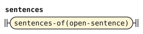</p>
<p>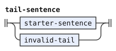</p>
<p>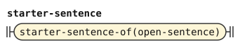</p>
<p>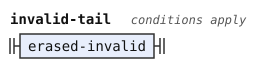</p>
<p>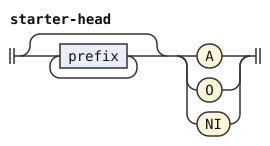</p>
<p>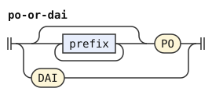</p>
</details>

## Sentences and erasure

A sentence starts with `A`, `O` or `NI`. An `A` sentence is an inner predicate, which is a chain with an optional arguments list. An `O` sentence names a definable word, then an inner predicate. An `NI` sentence names a definable word alone. The first sentence of a paragraph can leave its `a` out.

A sentence ends where the next sentence, paragraph, quote end, parenthesis end or eraser begins, or at the end of the text. Inside a grammatical quote, a particle that closes an outer construct ends the sentence too: `FI`, `VEI`, `PEI`, `BU` or `PA`. The rule `sentence-end` names these ends, and `sentence-choice` requires one after the sentence.

```jbogenbau
%rule sentence
  erased-valid | sentence-choice | erased-invalid

%rule sentence-choice
  $s:sentence-body
%conditions
  $s.following-tokens.begins(sentence-end)

%rule sentence-body
  o-sentence | ni-sentence | a-sentence

%rule sentence-end
  | starter-head | [{prefix}] PO | CAI | DAI | RA | elider-word | end-of-text

%rule elider-word
  FI | VEI | PEI | BU | PA

%rule end-of-text
  ε
%conditions
  $.ends-input

%rule a-sentence
  | [+A [{postfix}]] definition
  | {prefix} A [{postfix}] definition

%rule o-sentence
  [{prefix}] O [{postfix}] definable definition

%rule ni-sentence
  [{prefix}] NI definable
```

<details><summary>Railroad diagrams of the 9 rules from <code>sentence</code> to <code>ni-sentence</code></summary>
<p>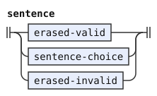</p>
<p>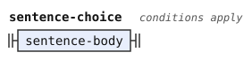</p>
<p>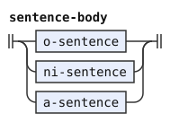</p>
<p>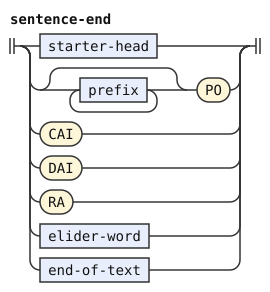</p>
<p>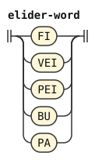</p>
<p>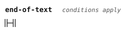</p>
<p>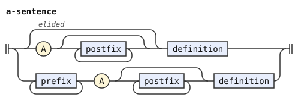</p>
<p>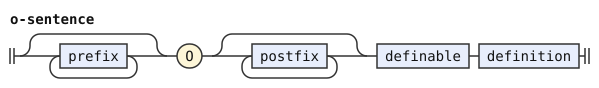</p>
<p>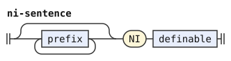</p>
</details>

The chapter on sentences gives two erasers. `ra` erases everything since the start of the current sentence, and it erases ungrammatical text back to the start of the last grammatical sentence. `ri` erases the current chain, which must be grammatical.

An erased valid sentence is a sentence followed by one or more `ra`. Erased invalid text is anything up to the first `ra`, at a place where no grammatical sentence stands. The condition on `erased-invalid` states that. After an erasure, the chapter requires the next sentence starter to be written. So the rules require a starter, a paragraph mark, the end of the enclosing text or a particle that ends it.

```jbogenbau
%rule erased-valid
  $s:sentence-choice ra-run
%conditions
  $.following-tokens.begins(after-erasure)

%rule erased-invalid
  invalid-head [{_<¬RA>}] ra-run
%conditions
  ¬$.onward.begins(sentence-choice),
  $.following-tokens.begins(after-erasure)

%rule invalid-head
  elider-word | _<¬RA ¬FI ¬VEI ¬PEI ¬BU ¬PA>

%rule ra-run
  {RA}

%rule after-erasure
  starter-head | [{prefix}] PO | CAI | DAI | elider-word | end-of-text
```

<details><summary>Railroad diagrams of the 5 rules from <code>erased-valid</code> to <code>after-erasure</code></summary>
<p>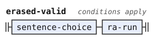</p>
<p>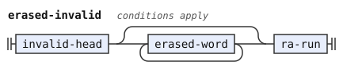</p>
<p>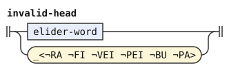</p>
<p>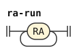</p>
<p>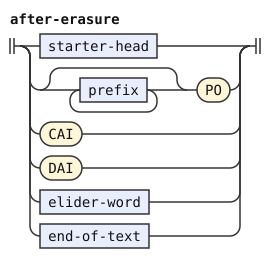</p>
</details>

## Definable words and inner predicates

A definable word is a root, a compound, a freeform variable or a `GI` variable, each with optional annotations before it. The chapter on sentences lets a namespace precede it: a definable word or `MI` particle, then `pi`. A definable word for `O` and `NI` cannot start with an `MI` particle.

An inner predicate is a chain, with an optional arguments list before it. The arguments list is zero or more `KI`, `GI` or `BA` variables ended by `be`, as the [explicit binding chapter](https://eberban.github.io/eberban/logic/explicit_binding.html) says.

```jbogenbau
%rule definable
  $d:definable-usage
%conditions
  ¬$d.onward.begins(mi-free)

%rule definable-usage
  [{namespace-step}] definable-part

%rule namespace-step
  (definable-part | mi-free) PI

%rule definable-part
  [{prefix}] (GI | Freeform | Compound | Root)

%rule mi-free
  [{prefix}] MI

%rule definition
  [arguments-list] chain

%rule arguments-list
  [{KI | GI | BA}] BE
```

<details><summary>Railroad diagrams of the 7 rules from <code>definable</code> to <code>arguments-list</code></summary>
<p>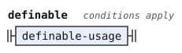</p>
<p>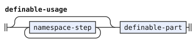</p>
<p>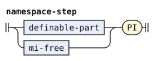</p>
<p>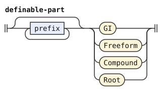</p>
<p></p>
<p>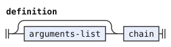</p>
<p>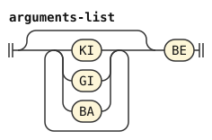</p>
</details>

## Chains

A chain is one or more steps, grouped from the right. `ri` erases the chain read so far, and the chain starts again after it. `bi` before a chain negates the whole of it, as the chapter on [transformations](https://eberban.github.io/eberban/logic/transformations.html) says.

A step is a verb with its binds, then the rest of the chain. The verb can take an `SI` particle before it, which selects its places. An `SI` can also follow each `ZI` modifier of the verb.

```jbogenbau
%rule chain
  [{chain-inner RI}] chain-inner

%rule chain-inner
  | bi-free chain
  | step

%rule bi-free
  [{prefix}] BI [{postfix}]

%rule si-free
  [{prefix}] SI

%rule verb
  [{zi-free [si-free]}] base-verb

%rule zi-free
  [{prefix}] ZI
```

<details><summary>Railroad diagrams of the 6 rules from <code>chain</code> to <code>zi-free</code></summary>
<p>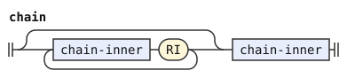</p>
<p>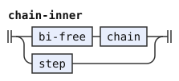</p>
<p>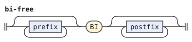</p>
<p>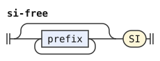</p>
<p>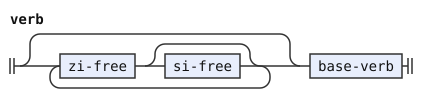</p>
<p></p>
</details>

### Resuming a verb

`PA` resumes the bindings of a verb earlier in the chain. The speaker repeats the verb after `pa`, then adds binds or continues the chain. The repeated verb must match the earlier one, `ZI` modifiers included, while the `SI` before it may differ. The PEG resumes the latest matching verb, the deepest one in the right-grouped chain.

The `fewest` flag states that preference. A step that takes no resumption, but stands right before one, is a step that the resumption passed over. The parse with the fewest such steps attaches the resumption as deep as the matching verb allows. The two conditions with `followed-by` tell the two kinds of step apart, so every step is exactly one of them.

A step takes any number of resumptions in a row. The condition compares each repeated verb with the verb of the step. The repeated verb can carry its own binds and continue the chain.

```jbogenbau
%rule step
  plain-step | passed-step | resumed-step

%rule plain-step
  [si-free] verb step-tail
%conditions
  ¬$.followed-by(resume-head)

%rule(fewest) passed-step
  [si-free] verb step-tail
%conditions
  $.followed-by(resume-head)

%rule resumed-step
  [si-free] $v:verb step-tail {resume-head $e:verb step-tail}
%conditions
  $v.value = $e.value

%rule step-tail
  [{postfix}] [{bind-group}] [chain-inner]

%rule resume-head
  PA [si-free]
```

<details><summary>Railroad diagrams of the 6 rules from <code>step</code> to <code>resume-head</code></summary>
<p>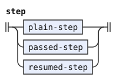</p>
<p>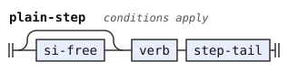</p>
<p>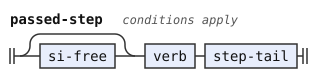</p>
<p>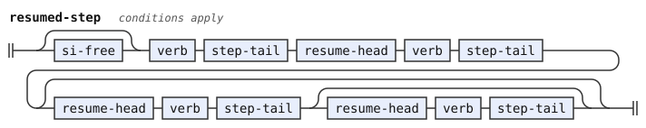</p>
<p>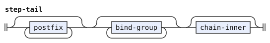</p>
<p>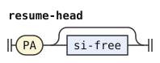</p>
</details>

## Binds

`VI` opens a bind on a place of the preceding verb, and `FI` binds another place of the same verb. `vei` closes the group, and the speaker can leave it out at the end of a sentence. A bind holds an inner predicate. `bi` before `VI` or `FI` negates the bind.

```jbogenbau
%rule bind-group
  bind-first [{bind-next}] [+VEI]

%rule bind-first
  [bi-free] vi-free definition

%rule bind-next
  [bi-free] fi-free definition

%rule vi-free
  [{prefix}] VI [{postfix}]

%rule fi-free
  [{prefix}] FI [{postfix}]
```

<details><summary>Railroad diagrams of the 5 rules from <code>bind-group</code> to <code>fi-free</code></summary>
<p>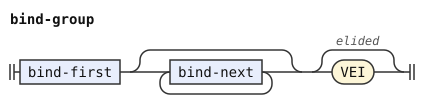</p>
<p>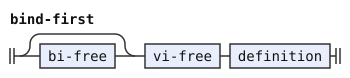</p>
<p>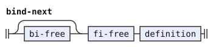</p>
<p>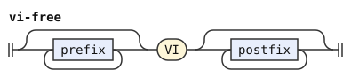</p>
<p>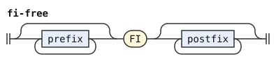</p>
</details>

## Verbs

A verb is a definable word with its namespace, or an inline assignment with `bo`. It can also be a `KI`, `BA` or `MI` particle, a quote, an enumeration, a borrowing group or a number. A `KI` carries no annotations. The others take free prefixes.

```jbogenbau
%rule base-verb
  | definable-usage | inline-assignment | KI | ba-free | mi-free
  | grammatical-quote | word-quote | spelling-quote | foreign-quote
  | enumeration | borrowing-group | number

%rule inline-assignment
  [{prefix}] BO (KI | definable)

%rule ba-free
  [{prefix}] BA
```

<details><summary>Railroad diagrams of <code>base-verb</code>, <code>inline-assignment</code> and <code>ba-free</code></summary>
<p>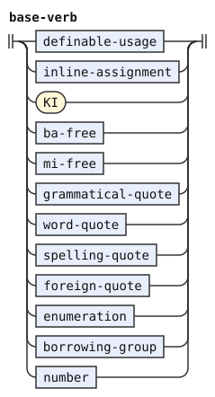</p>
<p>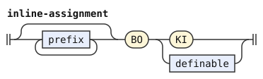</p>
<p>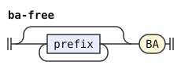</p>
</details>

### Quotes

The [quotes chapter](https://eberban.github.io/eberban/grammar/quotes.html) gives four quotes. `ca` quotes a grammatical text up to `cai`, which can be left out at the end of the text. `ci` quotes one word. `ce` spells a text up to `cei`, which the forms stage reads as one word. `co` quotes foreign text, which the words stage reads as one word, and `coi` stands for a quote that the speaker does not read out.

Inside a `ca` quote, a particle that closes an outer construct ends the quoted text instead of starting erasable text. The condition on the quote states that: its text holds no erased invalid stretch that starts with such a particle.

```jbogenbau
%rule grammatical-quote
  [{prefix}] CA $t:text quote-end
%conditions
  $t ≇ #(⋮ erased-invalid« elider-word ⋯ »)

%rule quote-end
  | [+CAI]
  | {prefix} CAI

%rule word-quote
  [{prefix}] CI (Word<Particle> | Root | Compound | Borrowing)

%rule spelling-quote
  [{prefix}] CE<Quote>

%rule foreign-quote
  [{prefix}] (CO<Quote> | COI)
```

<details><summary>Railroad diagrams of the 5 rules from <code>grammatical-quote</code> to <code>foreign-quote</code></summary>
<p>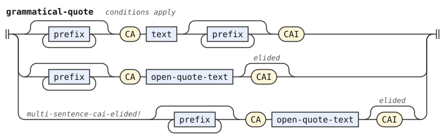</p>
<p>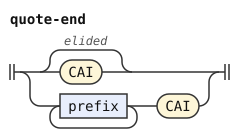</p>
<p></p>
<p></p>
<p></p>
</details>

### Enumerations

The [enumeration chapter](https://eberban.github.io/eberban/grammar/enum.html) gives two forms. In the separator form, `PE` takes chains separated by `bu`. In the prefix form, `bu` follows `PE` directly, and each item is one verb with its binds. `pei` closes the enumeration, and the speaker can leave it out at the end of a sentence.

```jbogenbau
%rule enumeration
  [{prefix}] PE [{postfix}] (prefix-form | separator-form) [+PEI]

%rule prefix-form
  bu-free [{[bi-free] enumerated-verb}]

%rule enumerated-verb
  [si-free] verb [{postfix}] [{bind-group}]

%rule separator-form
  [arguments-list] {chain / bu-free}

%rule bu-free
  [{prefix}] BU
```

<details><summary>Railroad diagrams of the 5 rules from <code>enumeration</code> to <code>bu-free</code></summary>
<p></p>
<p></p>
<p></p>
<p></p>
<p></p>
</details>

### Borrowing groups and numbers

Consecutive borrowings form one group, which `be` can close. The [borrowings chapter](https://eberban.github.io/eberban/grammar/borrowings.html) needs the `be` only between two groups.

A number is digits with separators, as the [numbers chapter](https://eberban.github.io/eberban/grammar/numbers.html) lays them out. Its parts are a base and `ju`, an integer part, `jo` and a fractional part, `ja` and a repeated part, and `je` and a magnitude. A `JI` particle ends it, and the speaker can leave that out. The repeated part needs the fractional separator before it. The number needs a digit in one of its parts, or a magnitude. The alternatives of `number-body` list the parts that can come first. The chapter makes `jie` mandatory between two numbers, so a number with its `JI` left out cannot stand directly before another number. The condition on `number` states that with a tree pattern: either the last child is a written `JI`, or no number part follows.

```jbogenbau
%rule borrowing-group
  {Borrowing} [+BE]

%rule number
  [TI JU] number-body [+JI]
%conditions
  $ ≅ #« ⋯ JI≠"" » ∨ ¬$.following-tokens.begins(number-start)

%rule number-start
  TI | JU | JO | JA | JE

%rule number-body
  | digits [JO [digits] [JA digits]] [JE digits]
  | JO digits [JA digits] [JE digits]
  | JO JA digits [JE digits]
  | JO JE digits
  | JE digits

%rule digits
  {TI}
```

<details><summary>Railroad diagrams of the 5 rules from <code>borrowing-group</code> to <code>digits</code></summary>
<p></p>
<p></p>
<p></p>
<p></p>
<p></p>
</details>

## Annotations

The [annotations chapter](https://eberban.github.io/eberban/grammar/annotations.html) gives free prefixes and suffixes. A prefix is a `DI` particle, with an optional `DU` scope before it. A suffix is `DE` with one verb, or a parenthetical text between `da` and `dai`. A parenthetical cannot be empty.

```jbogenbau
%rule prefix
  [DU] DI

%rule postfix
  interjection | parenthetical

%rule interjection
  DE [si-free] verb

%rule parenthetical
  DA $t:text DAI
%conditions
  $t ≠ ""
```

<details><summary>Railroad diagrams of <code>prefix</code>, <code>postfix</code>, <code>interjection</code> and <code>parenthetical</code></summary>
<p></p>
<p></p>
<p></p>
<p></p>
</details>

## Differences from the reference grammar and the PEG

The PEG compares the repeated verb of a resumption with the earlier verb as a whole, free suffixes included. This grammar compares the verb with its `ZI` modifiers and leaves the annotations free, because an annotation has no logical effect.

After an erasure, the PEG requires a sentence starter, a paragraph mark or the end of the whole text. It requires that inside a quote or a parenthesis too. This grammar also accepts the end of the quote or parenthesis there.
