# The grammar

This document opens the syntax stage of the [Eberban pipeline](pipeline.md). A stage is one step of a pipeline, with its own grammar. A token is one unit that a stage reads or emits. A tag marks a token by an identifier.

The stage reads the words of the [words stage](stream.md). Each word carries its family as a tag, and the terminals of this grammar are those families. The chapters of the reference grammar give the constructs. The PEG `eberban.peggy` is the executable baseline, and the closing section lists the departures from it.

The prose uses these Eberban terms:

- A verb is a predicate word or construct in a chain. Every word of Eberban is a predicate.
- A chain is a sequence of verbs. The chapter on [chaining](https://eberban.github.io/eberban/logic/chaining.html) groups it from the right.
- A bind is an explicit binding of a place of a verb, opened by `VI` or `FI` and closed by `vei`.
- An annotation is a free prefix or suffix with no logical effect.

[The notation document](../../../docs/notation.md) explains jbogenbau, the notation of these grammars. An elided terminator is a closing word left unwritten. The pipeline ranks the parses with `late-elision`, so an elided terminator falls as late as the text allows.

## Texts and paragraphs

A text is language flags, then paragraphs. An empty text is valid. The [sentences chapter](https://eberban.github.io/eberban/logic/sentences.html) marks a new paragraph with `PO`. The first paragraph can lack it. A paragraph is a sentence and any number of further sentences. A further sentence starts with a sentence starter, a particle of family `A`, `O` or `NI`, or it is ungrammatical text that `ra` erases. The text rules are templates. Their parameter names what blocks an erasure at the start of a paragraph, as "Sentences and erasure" explains. `text` and its rules serve the whole text, a parenthetical and a quote with a written `cai`. `open-quote-text` and its rules serve a quote whose `cai` is left out.

The sentences chapter starts every sentence with a starter, and lets the first sentence of a paragraph leave it out. So a further sentence without a starter is always ungrammatical. `invalid-tail` reads it as erased text, even where it would be a sentence at the start of a paragraph. A further sentence cannot start with a paragraph mark or the end of a parenthesis, because those end the paragraph. Erased text after a complete sentence cannot start with a closer, `FI`, `VEI`, `PEI`, `BU`, `PA` or `cai`, unless a `ra` comes right before it. Such a closer belongs to the sentence before it, which is then ungrammatical, so the erasure starts at that sentence.

```jbogenbau
%rule text-of(@Open)
  [{DO}] [paragraphs-of(@Open)]

%rule paragraphs-of(@Open)
  [po-head] sentences-of(@Open) [{po-head sentences-of(@Open)}]

%rule po-head
  [{prefix}] PO [{postfix}]

%rule sentences-of(@Open)
  sentence-of(@Open) [{tail-sentence-of(@Open)}]

%rule tail-sentence-of(@Open)
  starter-sentence-of(@Open) | invalid-tail

%rule starter-sentence-of(@Open)
  $s:sentence-of(@Open)
%conditions
  $s.onward.begins(starter-head)

%rule invalid-tail
  $s:erased-invalid
%conditions
  ¬$s.onward.begins(starter-head),
  ¬$s.onward.begins(po-or-dai),
  ¬$s.onward.begins(closer) ∨ $s.preceding-tokens.ends(RA)

%rule starter-head
  [{prefix}] (A | O | NI)

%rule po-or-dai
  [{prefix}] PO | DAI

%rule closer
  elider-word | CAI

%rule text = text-of(open-sentence)
%rule paragraphs = paragraphs-of(open-sentence)
%rule sentences = sentences-of(open-sentence)
%rule tail-sentence = tail-sentence-of(open-sentence)
%rule starter-sentence = starter-sentence-of(open-sentence)
%rule sentence = sentence-of(open-sentence)

%rule open-quote-text = text-of(sentence-choice)
%rule open-quote-paragraphs = paragraphs-of(sentence-choice)
%rule open-quote-sentences = sentences-of(sentence-choice)
%rule open-quote-tail-sentence = tail-sentence-of(sentence-choice)
%rule open-quote-starter-sentence = starter-sentence-of(sentence-choice)
%rule open-quote-sentence = sentence-of(sentence-choice)
```

<details><summary>Railroad diagrams of the 22 rules from <code>text-of</code> to <code>open-quote-sentence</code></summary>
<p>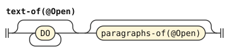</p>
<p>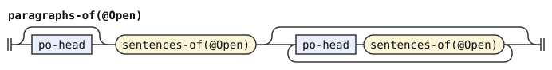</p>
<p></p>
<p>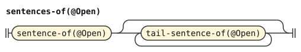</p>
<p>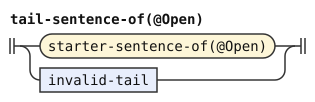</p>
<p>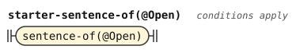</p>
<p></p>
<p></p>
<p></p>
<p>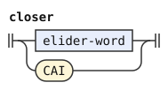</p>
<p></p>
<p></p>
<p></p>
<p></p>
<p></p>
<p></p>
<p>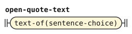</p>
<p>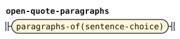</p>
<p>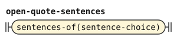</p>
<p>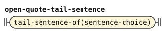</p>
<p>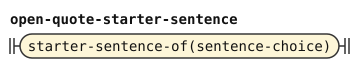</p>
<p>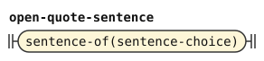</p>
</details>

## Sentences and erasure

A sentence starts with `A`, `O` or `NI`. An `A` sentence is an inner predicate, which is a chain with an optional arguments list. An `O` sentence names a definable word, then an inner predicate. An `NI` sentence names a definable word alone. The first sentence of a paragraph can leave its `a` out.

A sentence ends where the next sentence, paragraph, quote end, parenthesis end or eraser begins, or at the end of the text. A particle that closes an outer construct ends the sentence too: `FI`, `VEI`, `PEI`, `BU` or `PA`. Such a particle ends a quote whose `cai` is left out, together with its last sentence. The rule `sentence-end` names these ends, and `sentence-choice` requires one after the sentence. An open sentence is one that ends at the next sentence, paragraph or eraser, or at the end of the text. No enclosing construct has to claim what follows it, so it is grammatical wherever it stands. `open-sentence` and `open-end` name it.

The rule `sentence` also reads erasures. The chapter on sentences gives two erasers. `ra` erases everything since the start of the current sentence. It also erases ungrammatical text back to the start of the last grammatical sentence. `ri` erases the current chain, which must be grammatical.

The chapter erases back to the start of the last sentence that was still grammatical. So the first sentence of a paragraph is erased invalid text only where no grammatical sentence starts. The first condition of `sentence-of` states that, and its parameter says which sentence counts. A sentence that ends only before a closer or `dai` is grammatical only where an enclosing construct claims that word. In the whole text, a parenthetical or a quote with a written `cai`, the parameter is `open-sentence`. Such a sentence then does not block the erasure. In a quote whose `cai` is left out, a closer can end the quote, so any sentence blocks it. The parameter there is `sentence-choice`. A paragraph mark at the start of a paragraph is always the paragraph's mark, so the second condition keeps it out of the erased text. A `ra` can also stand where a sentence starts, with nothing to erase. That is `empty-erasure`.

```jbogenbau
%rule sentence-of(@Open)
  erased-valid | sentence-choice | $i:erased-invalid | empty-erasure
%conditions
  ¬$i.onward.begins(@Open),
  ¬$i.onward.begins(po-head)

%rule sentence-choice
  $s:sentence-body
%conditions
  $s.following-tokens.begins(sentence-end)

%rule sentence-body
  o-sentence | ni-sentence | a-sentence

%rule sentence-end
  open-end | CAI | DAI | elider-word

%rule open-sentence
  $s:sentence-body
%conditions
  $s.following-tokens.begins(open-end)

%rule open-end
  starter-head | [{prefix}] PO | RA | end-of-text

%rule elider-word
  FI | VEI | PEI | BU | PA

%rule end-of-text
  ε
%conditions
  $.ends-input

%rule a-sentence
  | [+A [{postfix}]] definition
  | {prefix} A [{postfix}] definition

%rule o-sentence
  [{prefix}] O [{postfix}] definable definition

%rule ni-sentence
  [{prefix}] NI definable
```

<details><summary>Railroad diagrams of the 11 rules from <code>sentence-of</code> to <code>ni-sentence</code></summary>
<p>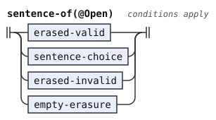</p>
<p></p>
<p></p>
<p></p>
<p>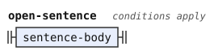</p>
<p>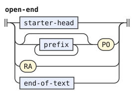</p>
<p></p>
<p></p>
<p></p>
<p></p>
<p></p>
</details>

An erased valid sentence is a sentence followed by one or more `ra`. Erased invalid text is one or more words up to the first `ra`. The words can be anything, so a stretch that the chapter calls one ungrammatical sentence can hold several sentences that look grammatical. `invalid-head` names its first word, so that the condition on a grammatical quote can test it. An empty erasure is a `ra` alone. Each word after the first is an `erased-word`, which carries the `fewest` flag. So of two readings, the one that erases fewer words wins, as the chapter's "last sentence that was still grammatical" asks. The flag shares its count with `passed-step`. An erased stretch always holds more words than the steps of a resumption it hides, so a reading cannot win by erasing a resumption.

The chapter says that `ra` "must be surrounded by spaces or pauses". The start of a text counts as a pause, as it does for hesitation in the [word forms](morphology.md). So a text can start with `ra`.

The PEG requires a written starter after an erasure, and states this rule in an error message. The book supports it only by inference. It lets only the first sentence of a paragraph leave its starter out, and the sentence after an erasure is not the first. Erased text can follow an erasure too, because the later `ra` erases it. So `after-erasure` accepts a starter, a paragraph mark or more erased text. It also accepts the end of the text, or a particle that ends an enclosing quote or parenthesis. The particles of `elider-word` end a quote whose `cai` is left out.

```jbogenbau
%rule erased-valid
  $s:sentence-choice ra-run
%conditions
  $.following-tokens.begins(after-erasure)

%rule erased-invalid
  invalid-head [{erased-word}] ra-run
%conditions
  $.following-tokens.begins(after-erasure)

%rule empty-erasure
  ra-run
%conditions
  $.following-tokens.begins(after-erasure)

%rule invalid-head
  elider-word | _<¬RA ¬FI ¬VEI ¬PEI ¬BU ¬PA>

%rule(fewest) erased-word
  _<¬RA>

%rule ra-run
  {RA}

%rule after-erasure
  | starter-head | [{prefix}] PO | erased-invalid
  | CAI | DAI | elider-word | end-of-text
```

<details><summary>Railroad diagrams of the 7 rules from <code>erased-valid</code> to <code>after-erasure</code></summary>
<p></p>
<p></p>
<p>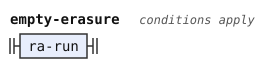</p>
<p></p>
<p>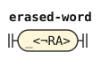</p>
<p></p>
<p></p>
</details>

## Definable words and inner predicates

A definable word is a root, a compound, a freeform variable or a `GI` variable, each with optional annotations before it. The chapter on sentences lets a namespace precede it: a definable word or `MI` particle, then `pi`. A definable word for `O` and `NI` cannot start with an `MI` particle.

An inner predicate is a chain, with an optional arguments list before it. The arguments list is zero or more `KI`, `GI` or `BA` variables ended by `be`, as the [explicit binding chapter](https://eberban.github.io/eberban/logic/explicit_binding.html) says.

```jbogenbau
%rule definable
  $d:definable-usage
%conditions
  ¬$d.onward.begins(mi-free)

%rule definable-usage
  [{namespace-step}] definable-part

%rule namespace-step
  (definable-part | mi-free) PI

%rule definable-part
  [{prefix}] (GI | Freeform | Compound | Root)

%rule mi-free
  [{prefix}] MI

%rule definition
  [arguments-list] chain

%rule arguments-list
  [{KI | GI | BA}] BE
```

<details><summary>Railroad diagrams of the 7 rules from <code>definable</code> to <code>arguments-list</code></summary>
<p></p>
<p></p>
<p></p>
<p></p>
<p></p>
<p></p>
<p></p>
</details>

## Chains

A chain is one or more steps, grouped from the right. `ri` erases the chain read so far, and the chain starts again after it. `bi` before a chain negates the whole of it, as the chapter on [transformations](https://eberban.github.io/eberban/logic/transformations.html) says.

A step is a verb with its binds, then the rest of the chain. The verb can take an `SI` particle before it, which selects its places. An `SI` can also follow each `ZI` modifier of the verb.

```jbogenbau
%rule chain
  [{chain-inner RI}] chain-inner

%rule chain-inner
  | bi-free chain
  | step

%rule bi-free
  [{prefix}] BI [{postfix}]

%rule si-free
  [{prefix}] SI

%rule verb
  [{zi-free [si-free]}] base-verb

%rule zi-free
  [{prefix}] ZI
```

<details><summary>Railroad diagrams of the 6 rules from <code>chain</code> to <code>zi-free</code></summary>
<p></p>
<p></p>
<p></p>
<p></p>
<p></p>
<p></p>
</details>

### Resuming a verb

`PA` resumes the bindings of a verb earlier in the chain. The book does not describe `pa`, so the dictionary and the PEG are the sources. The dictionary says that `pa` "resumes bindings to a matching verb higher in the chain". The speaker repeats the verb after `pa`, then adds binds or continues the chain. The PEG resumes the latest matching verb, the deepest one in the right-grouped chain.

The `fewest` flag states that preference. A step that takes no resumption, but stands right before one, is a step that the resumption passed over. The parse with the fewest such steps attaches the resumption as deep as the matching verb allows. The two conditions with `followed-by` tell the two kinds of step apart, so every step is exactly one of them.

A step takes any number of resumptions in a row. The repeated verb can carry its own binds and continue the chain. The condition compares each repeated verb with the verb of the step.

The comparison reads values. A value joins the values of the words. So it covers the free prefixes inside the verb, its `ZI` modifiers and the `SI` after each modifier. The `SI` before the verb stands outside it, so that `SI` may differ. Free suffixes stand in `step-tail`, after the verb, so the comparison leaves them out.

```jbogenbau
%rule step
  plain-step | passed-step | resumed-step

%rule plain-step
  [si-free] verb step-tail
%conditions
  ¬$.followed-by(resume-head)

%rule(fewest) passed-step
  [si-free] verb step-tail
%conditions
  $.followed-by(resume-head)

%rule resumed-step
  [si-free] $v:verb step-tail {resume-head $e:verb step-tail}
%conditions
  $v.value = $e.value

%rule step-tail
  [{postfix}] [{bind-group}] [chain-inner]

%rule resume-head
  PA [si-free]
```

<details><summary>Railroad diagrams of the 6 rules from <code>step</code> to <code>resume-head</code></summary>
<p></p>
<p></p>
<p></p>
<p></p>
<p></p>
<p></p>
</details>

## Binds

`VI` opens a bind on a place of the preceding verb, and `FI` binds another place of the same verb. `vei` closes the group, and the speaker can leave it out at the end of a sentence. A bind holds an inner predicate. `bi` before `VI` or `FI` negates the bind.

```jbogenbau
%rule bind-group
  bind-first [{bind-next}] [+VEI]

%rule bind-first
  [bi-free] vi-free definition

%rule bind-next
  [bi-free] fi-free definition

%rule vi-free
  [{prefix}] VI [{postfix}]

%rule fi-free
  [{prefix}] FI [{postfix}]
```

<details><summary>Railroad diagrams of the 5 rules from <code>bind-group</code> to <code>fi-free</code></summary>
<p></p>
<p></p>
<p></p>
<p></p>
<p></p>
</details>

## Verbs

A verb is a definable word with its namespace, or an inline assignment with `bo`. It can also be a `KI`, `BA` or `MI` particle, a quote, an enumeration, a borrowing group or a number. A `KI` carries no annotations. The others take free prefixes.

```jbogenbau
%rule base-verb
  | definable-usage | inline-assignment | KI | ba-free | mi-free
  | grammatical-quote | word-quote | spelling-quote | foreign-quote
  | enumeration | borrowing-group | number

%rule inline-assignment
  [{prefix}] BO (KI | definable)

%rule ba-free
  [{prefix}] BA
```

<details><summary>Railroad diagrams of <code>base-verb</code>, <code>inline-assignment</code> and <code>ba-free</code></summary>
<p></p>
<p></p>
<p></p>
</details>

### Quotes

The [quotes chapter](https://eberban.github.io/eberban/grammar/quotes.html) gives four quotes. `ca` quotes a grammatical text up to `cai`. The text can be empty. `ci` quotes one word. `ce` spells a text up to `cei`, which the forms stage reads as one word. `co` quotes foreign text, which the words stage reads as one word, and `coi` stands for a quote whose content the speaker cannot read.

The chapter does not say that `cai` can be left out. The PEG lets the speaker leave it out where the quoted text can end, and this grammar follows the PEG.

A quote with a written `cai` reads `text`, like the whole text, because no closer inside it can end it. In a quote whose `cai` is left out, a particle that closes an outer construct ends the quoted text instead of starting erasable text. The second and third alternatives read such a quote. Their first two conditions require that the `cai` is left out. The next two require that the text holds no erased invalid stretch that starts with such a particle.

The PEG warns when a quote of several sentences leaves out its `cai` before the end of the text. The end of the quote is then hard to see. The third alternative carries that warning as `multi-sentence-cai-elided`. A quote holds several sentences when it has several paragraphs, or when its first paragraph has more than one sentence that is not erased. `$SEVERAL-SENTENCES` states that. The last three conditions send each such quote to exactly one of the two alternatives.

```jbogenbau
%const $SEVERAL-SENTENCES
  #« ⋯ open-quote-paragraphs« ⋯ open-quote-sentences po-head ⋯ » »
  ∪ #« ⋯ open-quote-paragraphs« [po-head] open-quote-sentences« ⋯ sentence-choice ⋯ sentence-choice ⋯ » ⋯ » »

%rule grammatical-quote
  | [{prefix}] CA text [{prefix}] CAI
  | [{prefix}] CA $q:open-quote-text [+CAI]
  | multi-sentence-cai-elided! [{prefix}] CA $l:open-quote-text [+CAI]
%conditions
  $q ⟹ $ ≅ #(⋱ CAI=""),
  $l ⟹ $ ≅ #(⋱ CAI=""),
  $q ≇ #(⋮ erased-invalid« elider-word ⋯ »),
  $l ≇ #(⋮ erased-invalid« elider-word ⋯ »),
  $q ≅ $SEVERAL-SENTENCES ⟹ $.following-tokens.begins(end-of-text),
  $l ≅ $SEVERAL-SENTENCES,
  $l ⟹ ¬$.following-tokens.begins(end-of-text)

%rule word-quote
  [{prefix}] CI (Word<Particle> | Root | Compound | Borrowing)

%rule spelling-quote
  [{prefix}] CE<Quote>

%rule foreign-quote
  [{prefix}] (CO<Quote> | COI)
```

<details><summary>Railroad diagrams of the 4 rules from <code>grammatical-quote</code> to <code>foreign-quote</code></summary>
<p></p>
<p></p>
<p></p>
<p></p>
</details>

### Enumerations

The [enumeration chapter](https://eberban.github.io/eberban/grammar/enum.html) gives two forms. In the separator form, `PE` takes chains separated by `bu`. In the prefix form, `bu` follows `PE` directly, and each item is one verb with its binds. `pei` closes the enumeration, and the speaker can leave it out at the end of a sentence.

```jbogenbau
%rule enumeration
  [{prefix}] PE [{postfix}] (prefix-form | separator-form) [+PEI]

%rule prefix-form
  bu-free [{[bi-free] enumerated-verb}]

%rule enumerated-verb
  [si-free] verb [{postfix}] [{bind-group}]

%rule separator-form
  [arguments-list] {chain / bu-free}

%rule bu-free
  [{prefix}] BU
```

<details><summary>Railroad diagrams of the 5 rules from <code>enumeration</code> to <code>bu-free</code></summary>
<p></p>
<p></p>
<p></p>
<p></p>
<p></p>
</details>

### Borrowing groups and numbers

Consecutive borrowings form one group, which `be` can close. The [borrowings chapter](https://eberban.github.io/eberban/grammar/borrowings.html) needs the `be` only between two groups.

A number is digits with separators, as the [numbers chapter](https://eberban.github.io/eberban/grammar/numbers.html) lays them out. Its parts are a base and `ju`, an integer part, `jo` and a fractional part, `ja` and a repeated part, and `je` and a magnitude. A `JI` particle ends it, and the speaker can leave that out. The repeated part needs the fractional separator before it. The number needs a digit in one of its parts, or a magnitude. The alternatives of `integer-body` and `fraction-body` list the parts that can come first. The chapter makes `jie` mandatory between two numbers, so a number with its `JI` left out cannot stand directly before another number. The condition on `number` states that with a tree pattern: either the last child is a written `JI`, or no number part follows.

The chapter says that `jie` "is inferred if omitted", and that a `JI` other than `jie` "must follow positive integer (no fractional part)". So a number with `jo` or `joi` takes only `jie`, even where its fractional part is empty, as in `to jo`. A negative magnitude with `jei` divides the number by a power of the base, so such a number takes only `jie` too. Whether such a division leaves an integer depends on the digits, so the rule covers every `jei`. `fraction-body` lists these numbers, and the test `JI="jie"` in the second alternative of `number` restricts them. A `JI` left out there stands for `jie`. The chapter counts list members from zero with `jiu`, so this grammar reads "positive" as "not negative", and zero takes any `JI`.

```jbogenbau
%rule borrowing-group
  {Borrowing} [+BE]

%rule number
  | [TI JU] integer-body [+JI]
  | [TI JU] fraction-body [+JI="jie"]
%conditions
  $ ≅ #« ⋯ JI≠"" » ∨ ¬$.following-tokens.begins(number-start)

%rule number-start
  TI | JU | JO | JA | JE

%rule integer-body
  | digits [JE≠"jei" digits]
  | JE≠"jei" digits

%rule fraction-body
  | digits JO [digits] [JA digits] [JE digits]
  | JO digits [JA digits] [JE digits]
  | JO JA digits [JE digits]
  | JO JE digits
  | digits JE="jei" digits
  | JE="jei" digits

%rule digits
  {TI}
```

<details><summary>Railroad diagrams of the 6 rules from <code>borrowing-group</code> to <code>digits</code></summary>
<p></p>
<p></p>
<p></p>
<p>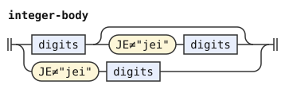</p>
<p>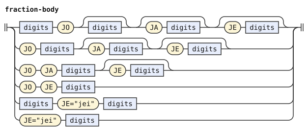</p>
<p></p>
</details>

## Annotations

The [annotations chapter](https://eberban.github.io/eberban/grammar/annotations.html) gives free prefixes and suffixes. A prefix is a `DI` particle, with an optional `DU` scope before it. A suffix is `DE` with one verb, or a parenthetical text between `da` and `dai`. The chapter allows any valid text in a parenthetical, and an empty text is valid. So `da dai` is a parenthetical.

```jbogenbau
%rule prefix
  [DU] DI

%rule postfix
  interjection | parenthetical

%rule interjection
  DE [si-free] verb

%rule parenthetical
  DA text DAI
```

<details><summary>Railroad diagrams of <code>prefix</code>, <code>postfix</code>, <code>interjection</code> and <code>parenthetical</code></summary>
<p></p>
<p></p>
<p></p>
<p></p>
</details>

## Differences from the reference grammar and the PEG

The PEG compares the repeated verb of a resumption with the earlier verb as written. Its comparison covers the free prefixes and suffixes of the verb, and the spelling of each word except the hyphens that its word forms drop. This grammar compares values, so it leaves out the free suffixes after the verb. The annotations chapter says that an annotation has no logical effect, so free prefixes should be free too. This grammar still compares them, because no condition of the notation can compare a value that leaves out some words of a constituent. So `a mi di duna meon pa duna vo mo` has no parse in either grammar.

The numbers chapter infers `jie` where a number leaves out its `JI`, so `to` and `to jie` are the same number. Both the PEG and this grammar still compare the two spellings as different verbs. So neither parses `a mi to jie meon pa to vo mo`. Neither parses `a mi pe to pei meon pa pe to jie pei vo mo` either. A value joins only the written words, and a restored terminator adds no string to a value. A notation change could state the inference. An elided `JI` would restore as `jie`, while a written `JI` stays free to be any `JI`. Then `$x.without-elision.value` would join the restored strings too. The condition would compare `$v.without-elision.value` with `$e.without-elision.value`.

A resumption also matches a nested compound that repeats the verb in its other spelling. An example is `pa e e ber ban ban` after `ei ber ban ban`. Both spellings have one value here, and the PEG fails to resume. [The word stream](stream.md#differences-from-the-reference-grammar-and-the-peg) explains the choice.

The PEG accepts any `JI` after any number. This grammar follows the numbers chapter. So `a to jo te ji mian`, `a to joi ji mian` and `a to jei te ji mian` have no parse.

After an erasure, the PEG queues its message about the starter, unless a starter, a paragraph mark or the end of the whole text follows. It applies that rule inside a quote or a parenthesis too. A later `ra` that erases ungrammatical text discards the message. So erased text can follow an erasure in the PEG, as it can here. This grammar also accepts the end of an enclosing quote or parenthesis after an erasure. So `a mi da a mo ra dai` is a text here and not in the PEG.

Outside a quote, the PEG ends a sentence before `FI`, `VEI`, `PEI`, `BU` or `PA`, so that particle starts erased text. So in `a mo vei ra a ke`, its `ra` erases only `vei`, and `a mo` stays. The sentences chapter says that `ra` erases back to the start of the last sentence that was still grammatical. This grammar follows the chapter and erases `a mo vei`. The same holds for a stray `cai` or `dai`. The PEG reads a stray `dai` as an error. Inside a quote with a written `cai`, the PEG ends the quoted text before a closer and then fails, as in `a mi ca a mo vei ra a ke cai`. This grammar reads that quote like the whole text, so the erasure stays inside it. For the same reason, erased text can follow an erasure there, as in `a mi ca a mo ra vei ra a ke cai`. The PEG requires a starter after the erasure.

The quotes chapter does not say that `cai` can be left out. The PEG lets the speaker leave `cai` out, and this grammar follows the PEG.

The annotations chapter allows any valid text in a parenthetical, and an empty text is valid. The PEG rejects an empty parenthetical with a message. This grammar follows the book, so `a mi da dai` is a text here and not in the PEG.

The PEG reads `ra` only after a space character, so a text that starts with `ra` fails there. This grammar counts the start of a text as a pause, so `ra a mo` is a text here.

The PEG warns about a `cai` left out after a quote of several sentences. It counts erased text after an erasure as a sentence, because its tree gives that text no eraser field. This grammar counts only sentences that are not erased. So the PEG warns about `a mi pe ca a mo ra ke ra a ke bu ke` and this grammar does not.
