# The grammar

This document opens the syntax stage of the [Eberban pipeline](pipeline.md). A stage is one step of a pipeline, with its own grammar. A token is one unit that a stage reads or emits. A tag marks a token by an identifier.

The stage reads the words of the [words stage](stream.md). Each word carries its family as a tag, and the terminals of this grammar are those families. The chapters of the reference grammar give the constructs. The PEG `eberban.peggy` is the executable baseline, and the closing section lists the departures from it.

The prose uses these Eberban terms:

- A verb is a predicate word or construct in a chain. Every word of Eberban is a predicate.
- A chain is a sequence of verbs. The chapter on [chaining](https://eberban.github.io/eberban/books/refgram/book/logic/chaining.html) groups it from the right.
- A bind is an explicit binding of a place of a verb, opened by `VI` or `FI` and closed by `vei`.
- An annotation is a free prefix or suffix with no logical effect.

[The notation document](../../../docs/notation.md) explains jbogenbau, the notation of these grammars. An elided terminator is a closing word left unwritten. The engine first prefers fewer errors. The pipeline then counts unmatched errors, erased words, and passed resumption steps, in that order. Its final step, `late #·_<_Elided>`, puts an elided terminator as late as the text allows.

## Texts and paragraphs

A text is language flags, then paragraphs, and an empty text is valid. The [sentences chapter](https://eberban.github.io/eberban/books/refgram/book/logic/sentences.html) marks a new paragraph with `PO`. The first paragraph can lack it. A paragraph is a sentence and any number of further sentences. A further sentence starts with a sentence starter, a particle of family `A`, `O` or `NI`. Or it is ungrammatical text that `ra` erases.

The chapter says that where several prefixes stand in a row, `PO` is the first of them. So `po-head` reads no free prefix before `PO`, and `di po a mi` is rejected. A free prefix can follow it, as in `po di a mi`.

The text rules are templates. Their parameter names what blocks an erasure at the start of a paragraph, as "Sentences and erasure" explains. `text` and its rules serve the whole text, a parenthetical and a quote with a written `cai`. `open-quote-text` and its rules serve a quote whose `cai` is left out.

The sentences chapter starts every sentence with a starter, and lets the first sentence of a paragraph leave it out. So a further sentence without a starter is always ungrammatical. `invalid-tail` reads it as erased text, even where the same words form a sentence at the start of a paragraph.

A further sentence cannot start with a paragraph mark or the end of a parenthesis, because those end the paragraph. If no `ra` comes right before it, erased text after a complete sentence cannot start with a closer. A closer is `FI`, `VEI`, `PEI`, `BU`, `PA` or `cai`. Such a closer belongs to the sentence before it, which is then ungrammatical, so the erasure starts at that sentence.

```jbogenbau
%rule text-of(@Open)
  [{DO}] [paragraphs-of(@Open)]
%conditions
  $ ≇ #·open-quote-text ∨ $ ≇ $TEXT-RECOVERY

%rule paragraphs-of(@Open)
  [po-head] sentences-of(@Open) [{po-head sentences-of(@Open)}]

%rule po-head
  PO [{postfix}]

%rule sentences-of(@Open)
  sentence-of(@Open) [{tail-sentence-of(@Open)}]

%rule tail-sentence-of(@Open)
  starter-sentence-of(@Open) | invalid-tail

%rule starter-sentence-of(@Open)
  $s:sentence-of(@Open)
%conditions
  $s.onward.begins(starter-head)

%rule invalid-tail
  $s:erased-invalid
%conditions
  ¬$s.onward.begins(starter-head),
  ¬$s.onward.begins(po-or-dai),
  ¬$s.onward.begins(closer) ∨ $s.preceding-tokens.ends(RA)

%rule starter-head
  [{prefix}] (A | O | NI)

%rule po-or-dai
  PO | DAI

%rule closer
  FI | VEI | PEI | BU | PA | CAI

%rule text = text-of(open-sentence)
%rule paragraphs = paragraphs-of(open-sentence)
%rule sentences = sentences-of(open-sentence)
%rule tail-sentence = tail-sentence-of(open-sentence)
%rule starter-sentence = starter-sentence-of(open-sentence)
%rule sentence = sentence-of(open-sentence)

%rule open-quote-text = text-of(sentence-choice)
%rule open-quote-paragraphs = paragraphs-of(sentence-choice)
%rule open-quote-sentences = sentences-of(sentence-choice)
%rule open-quote-tail-sentence = tail-sentence-of(sentence-choice)
%rule open-quote-starter-sentence = starter-sentence-of(sentence-choice)
%rule open-quote-sentence = sentence-of(sentence-choice)
```

<details><summary>Railroad diagrams of the 22 rules from <code>text-of</code> to <code>open-quote-sentence</code></summary>
<p>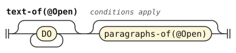</p>
<p>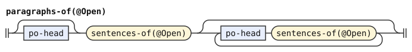</p>
<p>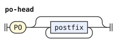</p>
<p>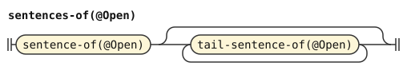</p>
<p>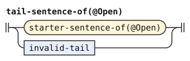</p>
<p>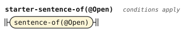</p>
<p>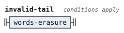</p>
<p>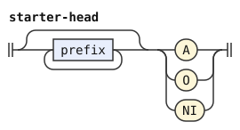</p>
<p>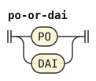</p>
<p>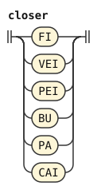</p>
<p>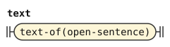</p>
<p>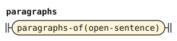</p>
<p>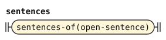</p>
<p>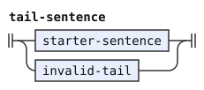</p>
<p>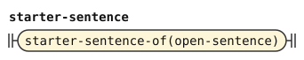</p>
<p>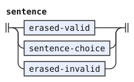</p>
<p>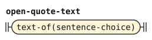</p>
<p>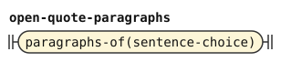</p>
<p>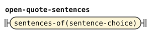</p>
<p>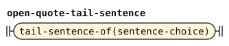</p>
<p>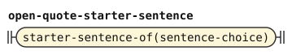</p>
<p>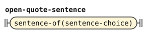</p>
</details>


## Sentences and erasure

A sentence starts with `A`, `O` or `NI`. An `A` sentence is an inner predicate, which is a chain with an optional arguments list. An `O` sentence names a definable word, then an inner predicate. An `NI` sentence names a definable word alone.

The first sentence of a paragraph can leave its `a` out. An elidable optional starts with its terminator, so no free prefix can stand before an elided `a`. So the second alternative of `a-sentence` reads one or more prefixes before a written `a`.

A sentence ends where the next sentence, paragraph, quote end, parenthesis end or eraser begins, or at the end of the text. A particle that closes an outer construct ends the sentence too: `FI`, `VEI`, `PEI`, `BU` or `PA`. Such a particle ends a quote whose `cai` is left out, together with its last sentence. The rule `sentence-end` names these ends, and `sentence-choice` requires one after the sentence. `sentence-closer` names the closing particles.

A free prefix can stand before `cai`, `fi` or `bu`, as in `ca mo di cai`, because the rules that read those particles allow one. An open sentence is one that ends at the next sentence, paragraph or eraser, or at the end of the text. No enclosing construct has to claim what follows it, so it is grammatical wherever it stands. `open-sentence` and `open-end` name it.

The rule `sentence` also reads erasures. The chapter on sentences gives two erasers. `ra` erases everything since the start of the current sentence. It also erases ungrammatical text back to the start of the last grammatical sentence. `ri` erases the current chain, which must be grammatical.

The chapter erases back to the start of the last sentence that was still grammatical. So the first sentence of a paragraph is erased invalid text only where no grammatical sentence starts. The first condition of `sentence-of` states that, and its parameter says which sentence counts. A sentence that ends only before a closer or `dai` is grammatical only where an enclosing construct claims that word.

In the whole text, a parenthetical or a quote with a written `cai`, the parameter is `open-sentence`. Such a sentence then does not block the erasure. In a quote whose `cai` is left out, a closer can end the quote, so any sentence blocks it. The parameter there is `sentence-choice`.

A paragraph mark at the start of a paragraph is always the paragraph's mark, so the second condition keeps it out of the erased text. A `ra` can also stand where a sentence starts, with nothing to erase. That is `empty-erasure`.

```jbogenbau
%rule sentence-of(@Open)
  erased-valid | sentence-choice | $i:erased-invalid | empty-erasure
%conditions
  ¬$i.onward.begins(@Open),
  ¬$i.onward.begins(po-head)

%rule sentence-choice
  $s:sentence-body
%conditions
  $s.following-tokens.begins(sentence-end)

%rule sentence-body
  o-sentence | ni-sentence | a-sentence

%rule sentence-end
  open-end | sentence-closer

%rule sentence-closer
  [{prefix}] (CAI | FI | BU) | DAI | VEI | PEI | PA

%rule open-sentence
  $s:sentence-body
%conditions
  $s.following-tokens.begins(open-end)

%rule open-end
  starter-head | PO | RA | end-of-text

%rule elider-word
  FI | VEI | PEI | BU | PA
%conditions
  $.onward.begins(erasure-reach)

%rule end-of-text
  ε
%conditions
  $.ends-input

%rule a-sentence
  | [+A [{postfix}]] definition
  | {prefix} A [{postfix}] definition

%rule o-sentence
  [{prefix}] O [{postfix}] definable definition

%rule ni-sentence
  [{prefix}] NI definable
```

<details><summary>Railroad diagrams of the 12 rules from <code>sentence-of</code> to <code>ni-sentence</code></summary>
<p>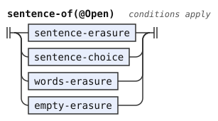</p>
<p>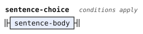</p>
<p>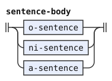</p>
<p>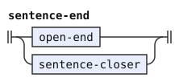</p>
<p>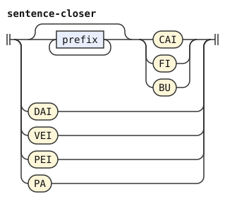</p>
<p>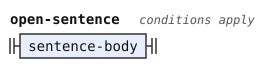</p>
<p>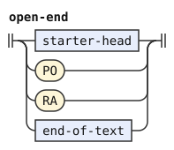</p>
<p>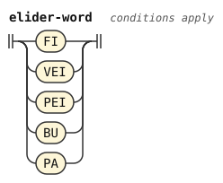</p>
<p>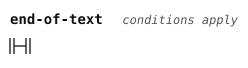</p>
<p>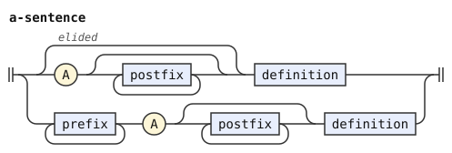</p>
<p>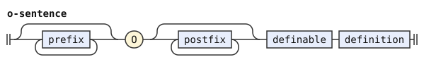</p>
<p>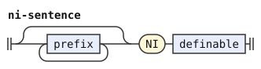</p>
</details>


An erased valid sentence is a sentence followed by one or more `ra`. Erased invalid text is one or more words up to the first `ra`. The words can be anything, so a stretch that the chapter calls one ungrammatical sentence can hold several sentences that look grammatical.

`invalid-head` names its first word, so that the condition on a grammatical quote can test it. An empty erasure is a `ra` alone. Each word after the first is an `erased-word`. After error counts and unmatched-error counts tie, the pipeline applies `fewest #·erased-word`. The reading that erases fewer words wins, as the chapter's "last sentence that was still grammatical" asks.

`invalid-head` needs a later `ra` somewhere in the text, which the rule `erasure-reach` tests. A closer at the head, an `elider-word`, needs the same. The conditions change no reading, because erased invalid text always ends with `ra`. They serve the error report.

Without them, a reading as erased text survives every word, so a failed text reports only its end and a missing `ra`. With them, `a pban` reports the word `pban`, and `a mi fa mo` reports `fa`. A text with a later `ra` reports the first word that the erasure cannot explain. In `a pban mo ra mo`, that word is the last `mo`.

The chapter says that `ra` "must be surrounded by spaces or pauses". The start of a text counts as a pause, as it does for hesitation in the [word forms](morphology.md). So a text can start with `ra`.

The PEG requires a written starter after an erasure, and states this rule in an error message. The book supports it only by inference. It lets only the first sentence of a paragraph leave its starter out, and the sentence after an erasure is not the first.

`ra-run` keeps the tags of its repeated particles through a captured splice. The optional diagnostic tail adds no tag to a zero-error reading.

Erased text can follow an erasure too, because the later `ra` erases it. So `after-erasure` accepts a starter, a paragraph mark or more erased text. It also accepts the end of the text, or a particle that ends an enclosing quote or parenthesis. The particles of `elider-word` end a quote whose `cai` is left out.

```jbogenbau
%rule erased-valid
  $s:sentence-choice ra-run
%conditions
  $.following-tokens.begins(after-erasure)

%rule erased-invalid
  invalid-head [{erased-word}] ra-run
%conditions
  $.following-tokens.begins(after-erasure)

%rule empty-erasure
  ra-run
%conditions
  $.following-tokens.begins(after-erasure)

%rule invalid-head
  elider-word | _<¬RA ¬FI ¬VEI ¬PEI ¬BU ¬PA>
%conditions
  $.onward.begins(erasure-reach)

%rule erasure-reach
  {_<¬RA>} RA

%rule erased-word
  _<¬RA>

%rule ra-run
  $r:*ra-words [*erased-must-be-followed-by-sentence-starter] :: $r.tags

%rule ra-words
  {RA}

%rule after-erasure
  | starter-head | PO | erased-invalid
  | sentence-closer | end-of-text
```

<details><summary>Railroad diagrams of the 9 rules from <code>erased-valid</code> to <code>after-erasure</code></summary>
<p>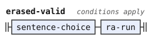</p>
<p>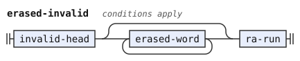</p>
<p>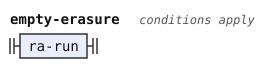</p>
<p>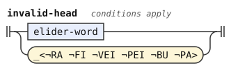</p>
<p>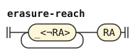</p>
<p>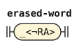</p>
<p>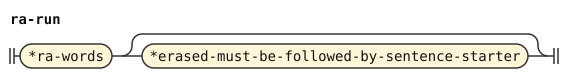</p>
<p>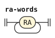</p>
<p>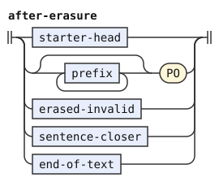</p>
</details>


## Definable words and inner predicates

A definable word is a root, a compound, a freeform variable or a `GI` variable, each with optional annotations before it. The chapter on sentences lets a namespace precede it: a definable word or `MI` particle, then `pi`. A definable word for `O` and `NI` cannot start with an `MI` particle.

An inner predicate is a chain, with an optional arguments list before it. The arguments list is zero or more `KI`, `GI` or `BA` variables ended by `be`. A `BA` variable can take free prefixes, as everywhere else, as the [explicit binding chapter](https://eberban.github.io/eberban/books/refgram/book/logic/explicit_binding.html) says.

```jbogenbau
%rule definable
  $d:definable-usage
%conditions
  ¬$d.onward.begins(mi-free)

%rule definable-usage
  [{namespace-step}] definable-part

%rule namespace-step
  (definable-part | mi-free) PI

%rule definable-part
  [{prefix}] (GI | Freeform | Compound | Root)

%rule mi-free
  [{prefix}] MI

%rule definition
  | [arguments-list] chain
  | arguments-list *chain-empty

%rule arguments-list
  [{KI | GI | ba-free}] BE
```

<details><summary>Railroad diagrams of the 7 rules from <code>definable</code> to <code>arguments-list</code></summary>
<p>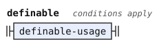</p>
<p>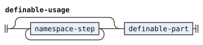</p>
<p>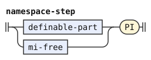</p>
<p>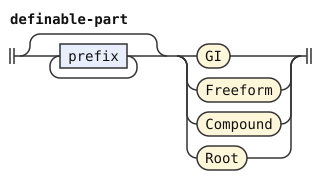</p>
<p>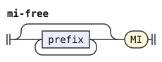</p>
<p>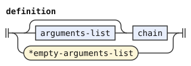</p>
<p>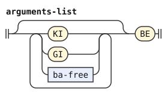</p>
</details>


## Chains

A chain is one or more steps, grouped from the right. `ri` erases the chain read so far, and the chain starts again after it. `bi` before a chain negates the whole of it, as the chapter on [transformations](https://eberban.github.io/eberban/books/refgram/book/logic/transformations.html) says.

After `bi`, `ri` erases the chain that the `bi` negates, and the `bi` stays. So `a mi bi mo ri ke` negates `ke`, as in the PEG. The chain after `bi` can read the `ri` itself, so the rule `erased-chain` refuses an erased item that ends in a `bi` chain. Without that condition, each such text has two readings.

A step is a verb with its free suffixes and binds, then the rest of the chain. The verb can take an `SI` particle before it, which selects its places. An `SI` can also follow each `ZI` modifier of the verb. The rule `annotated-verb` reads the verb with its free suffixes, as the PEG's `ChainVerb` does.

```jbogenbau
%rule chain
  [{erased-chain RI}] chain-inner

%rule erased-chain
  chain-inner
%conditions
  $ ≇ #(⋱ chain-inner« bi-free chain »)

%rule chain-inner
  | bi-free chain
  | step

%rule bi-free
  [{prefix}] BI [{postfix}]

%rule si-free
  [{prefix}] SI

%rule verb
  [{zi-free [si-free]}] base-verb

%rule annotated-verb
  verb [{postfix}]

%rule zi-free
  [{prefix}] ZI
```

<details><summary>Railroad diagrams of the 8 rules from <code>chain</code> to <code>zi-free</code></summary>
<p></p>
<p></p>
<p></p>
<p></p>
<p></p>
<p></p>
<p></p>
<p></p>
</details>


### Resuming a verb

`PA` resumes the bindings of a verb earlier in the chain. The book does not describe `pa`, so the dictionary and the PEG are the sources. The dictionary says that `pa` "resumes bindings to a matching verb higher in the chain". The speaker repeats the verb after `pa`, then adds binds or continues the chain. The PEG resumes the latest matching verb, the deepest one in the right-grouped chain.

The pipeline's step `fewest #·passed-step` states that preference. A step that takes no resumption, but stands right before one, is a step that the resumption passed over. The parse with the fewest such steps attaches the resumption as deep as the matching verb allows. The two conditions with `followed-by` tell the two kinds of step apart, so every step is exactly one of them.

A step takes any number of resumptions in a row. The repeated verb can carry its own binds and continue the chain. The condition compares each repeated verb with the verb of the step.

A resumption matches the words of the two verbs, as the PEG does. The condition `$v ≅ $e` compares the two verbs as trees. Two trees are equal where they have the same rules and the same words in the same order. So the free prefixes and suffixes of the verb count, and so do its `ZI` modifiers and the `SI` after each modifier. The `SI` before the verb stands outside it, so that `SI` can differ, as in the PEG.

A written terminator never equals an elided one, so `to jie` and `to` are two verbs. A word compares by its value, which is its canonical word. So the two spellings of a compound or a spelling quote, and a digit and its `TI` word, resume each other. `$e` is an item capture, so the condition holds of each resumption in the list.

```jbogenbau
%rule step
  plain-step | passed-step | resumed-step

%rule plain-step
  [si-free] annotated-verb step-tail
%conditions
  ¬$.followed-by(resume-head)

%rule passed-step
  [si-free] annotated-verb step-tail
%conditions
  $.followed-by(resume-head)

%rule resumed-step
  [si-free] $v:annotated-verb step-tail {resume-head $e:annotated-verb step-tail}
%conditions
  $v ≅ $e

%rule step-tail
  [{bind-group}] [chain-inner]

%rule resume-head
  PA [si-free]
```

<details><summary>Railroad diagrams of the 6 rules from <code>step</code> to <code>resume-head</code></summary>
<p></p>
<p></p>
<p></p>
<p></p>
<p></p>
<p></p>
</details>


## Binds

`VI` opens a bind on a place of the preceding verb, and `FI` binds another place of the same verb. `vei` closes the group, and the speaker can leave it out at the end of a sentence. A bind holds an inner predicate. `bi` before `VI` or `FI` negates the bind.

```jbogenbau
%rule bind-group
  bind-first [{bind-next}] [+VEI]

%rule bind-first
  [bi-free] vi-free (definition | *bind-empty-vi)

%rule bind-next
  [bi-free] fi-free (definition | *bind-empty-fi)

%rule vi-free
  [{prefix}] VI [{postfix}]

%rule fi-free
  [{prefix}] FI [{postfix}]
```

<details><summary>Railroad diagrams of the 5 rules from <code>bind-group</code> to <code>fi-free</code></summary>
<p></p>
<p></p>
<p></p>
<p></p>
<p></p>
</details>


## Verbs

A verb is a definable word with its namespace, or an inline assignment with `bo`. It can also be a `KI`, `BA` or `MI` particle, a quote, an enumeration, a borrowing group or a number. A `KI`, a number and a borrowing group take no free prefix of their own, as in the PEG. So `a di 1` and `a di ualis` are rejected. The others can take free prefixes. Any verb of a chain can take free suffixes, as in `a ke de mi`, because `annotated-verb` reads them.

```jbogenbau
%rule base-verb
  | $d:definable-usage | inline-assignment | KI | ba-free | mi-free
  | grammatical-quote | word-quote | spelling-quote | foreign-quote
  | enumeration | borrowing-group | number
%conditions
  $d ≇ #« definable-part« fault-token » »

%rule inline-assignment
  [{prefix}] BO (KI | definable)

%rule ba-free
  [{prefix}] BA
```

<details><summary>Railroad diagrams of <code>base-verb</code>, <code>inline-assignment</code> and <code>ba-free</code></summary>
<p></p>
<p></p>
<p></p>
</details>


### Quotes

The [quotes chapter](https://eberban.github.io/eberban/books/refgram/book/grammar/quotes.html) gives four quotes. `ca` quotes a grammatical text up to `cai`. The text can be empty. `ci` quotes one actual word: a particle, a root, a compound or a borrowing. A spelling quote and a foreign quote are each one quote unit, not a word, so `ci` does not quote them. A digit is a particle, so `ci` quotes it.

`ce` spells a text up to `cei`, which the forms stage reads as one unit. `co` quotes foreign text, which the forms stage also reads as one unit, and `coi` stands for a quote whose content the speaker cannot read.

The chapter does not say that `cai` can be left out. The PEG lets the speaker leave it out where the quoted text can end, and this grammar follows the PEG.

A quote with a written `cai` reads `text`, like the whole text, because no closer inside it can end it. In a quote whose `cai` is left out, a particle that closes an outer construct ends the quoted text instead of starting erasable text. The second and third alternatives read such a quote. Their terminator `[+CAI=""]` allows only the omitted `cai`, because a written `cai` has the value `cai`. Their first two conditions require that the text holds no erased invalid stretch that starts with such a particle.

Where a quote of several sentences leaves out its `cai` before the end of the text, the PEG warns. The end of the quote is then hard to see. The third alternative splices the warning rule `multi-sentence-cai-elided`.

A quote holds several sentences in two cases: it has several paragraphs, or its first paragraph has more than one sentence that is not erased. `$SEVERAL-SENTENCES` states that. An erased sentence is a node that holds the sentence and its `ra`. So the single-child search of the pattern stops there, and the sentence does not count. The last three conditions send each such quote to exactly one of the two alternatives.

```jbogenbau
%const $SEVERAL-SENTENCES
  #« ⋯ open-quote-paragraphs« ⋯ open-quote-sentences po-head ⋯ » »
  ∪ #« ⋯ open-quote-paragraphs« [po-head] open-quote-sentences« ⋯ sentence-choice ⋯
    sentence-choice ⋯ » ⋯ » »

%rule grammatical-quote
  | [{prefix}] CA text [{prefix}] CAI
  | [{prefix}] CA $q:open-quote-text [+CAI=""]
  | *multi-sentence-cai-elided
%conditions
  $q ≇ #(⋮ erased-invalid« elider-word ⋯ »),
  $q ≅ $SEVERAL-SENTENCES ⟹ $.following-tokens.begins(end-of-text)

%rule multi-sentence-cai-elided
  [{prefix}] CA $l:open-quote-text [+CAI=""]
%conditions
  $l ≇ #(⋮ erased-invalid« elider-word ⋯ »),
  $l ≅ $SEVERAL-SENTENCES,
  ¬$.following-tokens.begins(end-of-text)
%warning "a quote of several sentences omits cai before more text"

%rule word-quote
  [{prefix}] CI (Word<Particle ¬Quote> | Root | Compound | Borrowing)

%rule spelling-quote
  [{prefix}] CE<Quote>

%rule foreign-quote
  [{prefix}] (CO<Quote> | COI)
```

<details><summary>Railroad diagrams of the 5 rules from <code>grammatical-quote</code> to <code>foreign-quote</code></summary>
<p></p>
<p></p>
<p></p>
<p></p>
<p></p>
</details>


### Enumerations

The [enumeration chapter](https://eberban.github.io/eberban/books/refgram/book/grammar/enum.html) gives two forms. In the separator form, `PE` takes chains separated by `bu`. In the prefix form, `bu` follows `PE` directly, and each item is one verb with its binds. `pei` closes the enumeration, and the speaker can leave it out at the end of a sentence.

```jbogenbau
%rule enumeration
  [{prefix}] PE [{postfix}] (prefix-form | separator-form) [+PEI]

%rule prefix-form
  bu-free [{[bi-free] enumerated-verb}]

%rule enumerated-verb
  [si-free] annotated-verb [{bind-group}]

%rule separator-form
  [arguments-list] {chain / bu-free}

%rule bu-free
  [{prefix}] BU
```

<details><summary>Railroad diagrams of the 5 rules from <code>enumeration</code> to <code>bu-free</code></summary>
<p></p>
<p></p>
<p></p>
<p></p>
<p></p>
</details>


### Borrowing groups and numbers

Consecutive borrowings form one group, which `be` can close. The [borrowings chapter](https://eberban.github.io/eberban/books/refgram/book/grammar/borrowings.html) needs the `be` only between two groups, because consecutive borrowings always fuse. So a group whose `be` is left out ends only where no borrowing follows, as the condition on `borrowing-group` says. Then a run of borrowings has one division.

A number is digits with separators, as the [numbers chapter](https://eberban.github.io/eberban/books/refgram/book/grammar/numbers.html) lays them out. Its parts are a base and `ju`, an integer part, and `jo` and a fractional part. Then come `ja` and a repeated part, and `je` and a magnitude. A `JI` particle ends it, and the speaker can leave that out. The repeated part needs the fractional separator before it. The number needs a digit in one of its parts, or a magnitude.

The alternatives of `number-body` list the parts that can come first. Any `JI` can end any number, as in the PEG. The chapter says that `jie` is mandatory between consecutive numbers to tell them apart. That means only that the ending cannot be left out there, so any written `JI` separates two numbers. A number with its `JI` left out cannot stand directly before another number, while `a te ji ta` is two numbers.

The condition on `number` tests its closing `JI` with a tree pattern. Either the last child is a written `JI`, or no number part follows.

The chapter says that a `JI` other than `jie` "must follow positive integer (no fractional part)". That rule concerns the value of the number, and the closing section explains why the grammar imposes no condition on that value.

```jbogenbau
%rule borrowing-group
  {Borrowing} [+BE]
%conditions
  $ ≅ #« ⋯ BE<¬_Elided> » ∨ ¬$.following-tokens.begins(Borrowing)

%rule number
  [TI JU] number-body [+JI]
%conditions
  $ ≅ #« ⋯ JI<¬_Elided> » ∨ ¬$.following-tokens.begins(number-start)

%rule number-start
  TI | JU | JO | JA | JE

%rule number-body
  | digits [JE digits]
  | digits JO [digits] [JA digits] [JE digits]
  | JO digits [JA digits] [JE digits]
  | JO JA digits [JE digits]
  | JO JE digits
  | JE digits

%rule digits
  {TI}
```

<details><summary>Railroad diagrams of the 5 rules from <code>borrowing-group</code> to <code>digits</code></summary>
<p></p>
<p></p>
<p></p>
<p></p>
<p></p>
</details>


## Annotations

The [annotations chapter](https://eberban.github.io/eberban/books/refgram/book/grammar/annotations.html) gives free prefixes and suffixes. A prefix is a `DI` particle, with an optional `DU` scope before it. A suffix is `DE` with one verb, or a parenthetical text between `da` and `dai`. The chapter allows any valid text in a parenthetical, and an empty text is valid. So `da dai` is a parenthetical.

```jbogenbau
%rule prefix
  [DU] DI

%rule postfix
  interjection | parenthetical

%rule interjection
  DE [si-free] verb

%const $TEXT-RECOVERY
  #text-of« ⋯ paragraphs-of« ⋯ sentences-of« ⋯ sentence-of« ⋯ unmatched-tail » ⋯ » ⋯ » »

%const $OWNED-DAI-RECOVERY
  #text-of« ⋯ paragraphs-of« ⋯ sentences-of« ⋯ sentence-of« ⋯ unmatched-tail<DAI> » ⋯ » ⋯ » »

%rule parenthetical
  DA $t:text (DAI | *unclosed-parenthetical)
%conditions
  $t ≇ $OWNED-DAI-RECOVERY
```

<details><summary>Railroad diagrams of <code>prefix</code>, <code>postfix</code>, <code>interjection</code> and <code>parenthetical</code></summary>
<p></p>
<p></p>
<p></p>
<p></p>
</details>


## Diagnostic recovery

For equal error counts, a specific construct failure precedes an unmatched closer or resumption. The pipeline counts these named error nodes with `$UNMATCHED-ERRORS`. Every zero-error reading has the same zero count.

```jbogenbau
%const $UNMATCHED-ERRORS
  #(·unmatched-fi ∪ ·unmatched-vei ∪ ·unmatched-be ∪ ·unmatched-pei
    ∪ ·unmatched-bu ∪ ·unmatched-dai ∪ ·unmatched-resume)
```

Named errors preserve a complete reading of faulty text. A zero-error reading always takes precedence, including erasure. A query uses only zero-error witnesses, so error recovery never makes erased invalid text grammatical.

When its closing `e` starts another compound, an empty `er` still reports on its own token. The combined recovery consumes a stray closing `e` without reporting a second error.

Fault-bearing junk is a verb error or a definable-part error. The condition on the ordinary definable-usage branch excludes its bare fault reading at a verb position. That leaves one reading there, while namespaced and prefixed fault readings keep their structure.

```jbogenbau
%extend-rule base-verb
  fault-token

%extend-rule definable-part
  [{prefix}] fault-token

%rule fault-token
  quadruplet | triplet-middle-m | triplet-yz-sonorant-x | triplet-root-first-pair |
    triplet-freeform-first-pair | triplet-root-shape | triplet-freeform-shape | doubled-pair |
    pair-voiceness | sibilant-pair | root-starts-with-medial-pair | particle-sonorant-pair |
    h-not-between-vowels | hyphen-same-vowels | invalid-medial-pair |
    freeform-multi-consonents-ending | spaced-i-prefix | empty-compound-fault
    | compound-empty | incomplete-compound
```

<details><summary>Railroad diagrams of <code>base-verb</code>, <code>definable-part</code> and <code>fault-token</code></summary>
<p></p>
<p></p>
<p></p>
</details>

Each fault error reads the token that carries its class. Its span is that token alone. Incomplete compounds therefore report on each stray prefix rather than on the whole compound. The empty-compound recovery consumes its closing `e` outside the diagnostic, so only the `er` token reports.

```jbogenbau
%rule quadruplet
  Junk<Fault-quadruplet>
%error "a word permits at most three consecutive consonants"

%rule triplet-middle-m
  Junk<Fault-triplet-middle-m>
%error "the middle consonant of this triplet cannot be m"

%rule triplet-yz-sonorant-x
  Junk<Fault-triplet-yz-sonorant-x>
%error "after a sonorant, the last pair needs an initial or consonant-sonorant shape"

%rule triplet-root-first-pair
  Junk<Fault-triplet-root-first-pair>
%error "a root triplet needs a medial or initial first pair"

%rule triplet-freeform-first-pair
  Junk<Fault-triplet-freeform-first-pair>
%error "a freeform triplet needs a medial or initial first pair, or a sonorant first consonant"

%rule triplet-root-shape
  Junk<Fault-triplet-root-shape>
%error "the root triplet needs a medial-initial shape or a permitted liquid ending"

%rule triplet-freeform-shape
  Junk<Fault-triplet-freeform-shape>
%error "the freeform triplet fits none of the permitted shapes"

%rule doubled-pair
  Junk<Fault-doubled-pair>
%error "a consonant pair cannot repeat the same consonant across a hyphen"

%rule pair-voiceness
  Junk<Fault-pair-voiceness>
%error "invalid consonant pair: the consonants differ in voicing"

%rule sibilant-pair
  Junk<Fault-sibilant-pair>
%error "a consonant pair cannot contain two sibilants"

%rule root-starts-with-medial-pair
  Junk<Fault-root-starts-with-medial-pair>
%error "a root cannot start with a medial consonant pair"

%rule particle-sonorant-pair
  Junk<Fault-particle-sonorant-pair>
%error "a particle cannot contain two consecutive sonorants"

%rule h-not-between-vowels
  Junk<Fault-h-not-between-vowels>
%error "h must stand between vowels, except at a borrowing or freeform onset"

%rule hyphen-same-vowels
  Junk<Fault-hyphen-same-vowels>
%error "a hyphen cannot separate two copies of the same vowel"

%rule invalid-medial-pair
  Junk<Fault-invalid-medial-pair>
%error "the consonant pair is neither medial nor an initial pair starting another word"

%rule freeform-multi-consonents-ending
  Junk<Fault-freeform-multi-consonents-ending>
%error "a borrowing or freeform can end with at most one consonant"

%rule spaced-i-prefix
  Junk<Fault-spaced-i-prefix>
%error "attach the nested prefix as ei, or write e e instead of e i"

%rule empty-compound-fault
  *compound-empty Junk<Fault-incomplete-compound>="e"

%rule compound-empty
  Junk<Fault-compound-empty>
%error "an er compound needs at least one component"

%rule incomplete-compound
  Junk<Fault-incomplete-compound>
%error "the compound needs more components or its closing e"
```

<details><summary>Railroad diagrams of the 20 rules from <code>quadruplet</code> to <code>incomplete-compound</code></summary>
<p></p>
<p></p>
<p></p>
<p></p>
<p></p>
<p></p>
<p></p>
<p></p>
<p></p>
<p></p>
<p></p>
<p></p>
<p></p>
<p></p>
<p></p>
<p></p>
<p></p>
<p></p>
<p></p>
<p></p>
</details>

Unmatched closing particles have no open construct to claim them. Text recovery reads them after a sentence body or at a sentence start. This keeps closers out of verb positions inside chains.

A stray resumption reads its attempted verb and explains that its structure does not match. The empty resumption instead names the missing verb. Its following binds remain readable, so a bind opener does not hide that error. Recovery also spans a closer after erasure.

Each recovery tail forwards only its own unmatched `DAI` mark and the marks of subsequent tails. It does not forward marks from nested definitions. `$OWNED-DAI-RECOVERY` finds those tails only in the parenthetical's own text skeleton. The parenthetical rejects that recovery, so its first available `dai` closes it.

A quote with written `cai` retains its own recovery scope. Without `cai`, a quote leaves unmatched closers to the enclosing text. `$TEXT-RECOVERY` enforces that boundary without crossing into nested text scopes.

```jbogenbau
%extend-rule sentence-of(@Open)
  | sentence-body unmatched-tail | erased-valid unmatched-tail
  | $i:erased-invalid unmatched-tail | empty-erasure unmatched-tail | unmatched-tail
%conditions
  ¬$i.onward.begins(@Open),
  ¬$i.onward.begins(po-head)

%extend-rule base-verb
  *select-empty | *modified-empty

%rule unmatched-tail
  | unmatched-resume step-tail [ri-continuation] [$t:unmatched-tail] :: ($t ⟹ $t.tags)
  | *resume-chain-empty step-tail [ri-continuation] [$t:unmatched-tail] :: ($t ⟹ $t.tags)
  | $c:unmatched-closer [ri-continuation | definition] [$t:unmatched-tail]
      :: ($c.tags ∩ DAI) ∪ ($t ⟹ $t.tags)

%rule unmatched-closer
  unmatched-fi | unmatched-vei | unmatched-be | unmatched-pei | unmatched-bu | unmatched-dai

%rule ri-continuation
  {RI} (definition | *chain-empty)

%rule unmatched-fi
  fi-free
%error "fi has no open vi binding group"

%rule unmatched-vei
  VEI
%error "vei has no open vi binding group"

%rule unmatched-be
  BE
%error "be needs an arguments list or a borrowing group"

%rule unmatched-pei
  PEI
%error "pei has no open pe enumeration"

%rule unmatched-bu
  bu-free
%error "bu needs an open pe enumeration"

%rule unmatched-dai
  DAI
%error "dai has no open da parenthetical"

%rule unmatched-resume
  resume-head annotated-verb
%error "pa needs an earlier verb with matching structure"

%rule resume-chain-empty
  resume-head
%conditions
  $.following-tokens.begins(missing-operand-boundary)
%error "pa needs the verb whose bindings it resumes"

%rule select-empty
  si-free
%conditions
  $.following-tokens.begins(missing-operand-boundary)
%error "si needs a following verb"

%rule modified-empty
  zi-free
%conditions
  $.following-tokens.begins(missing-operand-boundary)
%error "zi needs a verb to modify"

```

<details><summary>Railroad diagrams of the 15 rules from <code>sentence-of</code> to <code>modified-empty</code></summary>
<p></p>
<p></p>
<p></p>
<p></p>
<p></p>
<p></p>
<p></p>
<p></p>
<p></p>
<p></p>
<p></p>
<p></p>
<p></p>
<p></p>
<p></p>
</details>

An empty-chain diagnostic follows a written `a`, a definable `o` target, `bi`, an arguments list, or an enumeration separator. It also follows `ri` in `chain` or in an erroneous tail's `ri-continuation`. An enumeration can lack its first chain too. When its following chain is missing, the separator still belongs to its open enumeration. Recovery retains later separators and items, so an interior empty item does not abandon its enumeration.

Each repeated recovery segment contains a written `bu`, so it reads at least one token. A boundary test detects the missing operand without recursively parsing recovery alternatives. It recognizes annotated `vi` and `fi`, with optional `bi`, without reading the bind operand. The diagnostic preference chooses this recovery over an unmatched `be` reading with the same error count.

```jbogenbau
%extend-rule a-sentence
  [{prefix}] A [{postfix}] *chain-empty

%extend-rule chain
  {erased-chain RI} *chain-empty

%extend-rule o-sentence
  [{prefix}] O [{postfix}] definable *chain-empty

%extend-rule separator-form
  | [arguments-list] *chain-empty [{bu-free (chain | *chain-empty)}]
  | [arguments-list] {chain / bu-free} bu-free *chain-empty [{bu-free (chain | *chain-empty)}]

%extend-rule chain-inner
  bi-free *chain-empty

%rule missing-operand-boundary
  starter-head | PO | RA | RI | bind-start | sentence-closer | end-of-text

%rule bind-start
  [bi-free] [{prefix}] (VI | FI)

%rule chain-empty
  ε
%conditions
  $.onward.begins(missing-operand-boundary)
%error "a chain needs at least one non-erased verb"

%rule bind-empty-vi
  ε
%conditions
  $.onward.begins(missing-operand-boundary)
%error "vi needs a following chain"

%rule bind-empty-fi
  ε
%conditions
  $.onward.begins(missing-operand-boundary)
%error "fi needs a following chain"
```

<details><summary>Railroad diagrams of the 10 rules from <code>a-sentence</code> to <code>bind-empty-fi</code></summary>
<p></p>
<p></p>
<p></p>
<p></p>
<p></p>
<p></p>
<p></p>
<p></p>
<p></p>
<p></p>
</details>

An `o` or `ni` sentence needs a definable target before any definition. Its recovery marks the missing target at that position. A missing parenthetical end reports at the end of the input. A written `dai` closes its parenthetical instead of becoming an unmatched closer there.


```jbogenbau
%extend-rule o-sentence
  [{prefix}] O [{postfix}] *not-definable-o [definition]

%extend-rule ni-sentence
  [{prefix}] NI *not-definable-ni [definition]

%rule not-definable-o
  ε
%conditions
  ¬$.onward.begins(definable)
%error "o needs a root, compound, freeform, or gi variable as its target"

%rule not-definable-ni
  ε
%conditions
  ¬$.onward.begins(definable)
%error "ni needs a root, compound, freeform, or gi variable as its target"

%rule unclosed-parenthetical
  ε
%conditions
  $.ends-input
%error "the parenthetical needs its closing dai"
```

<details><summary>Railroad diagrams of the 7 rules from <code>o-sentence</code> to <code>unclosed-parenthetical</code></summary>
<p></p>
<p></p>
<p></p>
<p></p>
<p></p>
<p></p>
<p></p>
</details>

A written `ce cei` reports an empty spelling quote. Without `cei`, the error requires the forms mark for a missing first unit. The forms stage marks that absence before words become indivisible syntax tokens. A following digit or malformed pair starts no unit. A valid unit without `cei` remains an unclosed quote, including `a ce mi`.

A sentence after `ra` needs a written starter. A sentence without that starter is an `a-sentence` with an omitted `A`. The recovery follows the erasure and does not remove errors from its children.

```jbogenbau
%extend-rule base-verb
  *spelling-empty

%rule spelling-empty
  [{prefix}] CE<¬Quote> CEI
%error "a spelling quote needs at least one unit"

%extend-rule spelling-empty
  [{prefix}] CE<¬Quote>
%conditions
  Missing-spelling-unit ⊆ $.last-token.tags
%error "a spelling quote needs at least one unit"

%rule erased-must-be-followed-by-sentence-starter
  $s:a-sentence
%conditions
  ¬$s.onward.begins(starter-head | PO | sentence-closer)
%error "after ra, write a sentence starter: a, o, or ni"
```

<details><summary>Railroad diagrams of the 3 rules from <code>base-verb</code> to <code>erased-must-be-followed-by-sentence-starter</code></summary>
<p></p>
<p></p>
<p></p>
<p></p>
</details>

A written `JI` cannot detach from a number that omits its own `JI`. This prevents splitting a written terminator from its number to disguise a failed resumption. Empty base recovery retains its written `JI`. Empty repeat and magnitude recovery retain only a grammatical prefix and report on the trailing `ja` or `je`.

The recovery prefix admits ordered parts, including a complete repeated part or magnitude. A repeated part still needs `jo`. An erroneous prefix stays outside the empty-part wrapper and keeps its own error.

Number recovery distinguishes missing parts from parts in the wrong order. The loose reader retains each part. Digit runs take every following digit except the start of a base. This prevents alternate divisions of one faulty number. The ordered counterpart distinguishes order errors from missing digits or a missing fraction marker.

```jbogenbau
%extend-rule base-verb
  | *number-end-alone | *empty-base-number | *empty-repeat-number | *empty-magnitude-number
  | *number-repeat-without-fraction | *number-without-digits | *number-part-order

%rule number-part
  loose-base | loose-digits | loose-fraction | JA loose-digits | JE loose-digits

%rule loose-base
  TI JU

%rule loose-digits
  {TI}
%conditions
  ¬$.following-tokens.begins(TI) ∨ $.following-tokens.begins(loose-base)

%rule loose-fraction
  JO [$d:loose-digits]
%conditions
  $d ∨ ¬$.following-tokens.begins(TI) ∨ $.following-tokens.begins(loose-base)

%rule ordered-number-parts
  [TI JU] [digits] [JO [digits]] [JA digits] [JE digits] [JI]

%rule number-end-alone
  JI
%conditions
  $.preceding-tokens.ends(JI) ∨ ¬$.preceded-by(number)
%error "ji needs a preceding number part"

%rule empty-base-number
  *number-empty-base [JI]

%rule number-empty-base
  JU
%error "ju needs a preceding ti digit for its base"

%rule number-recovery-prefix
  [loose-base] [loose-digits] [loose-fraction [JA loose-digits]] [JE loose-digits]

%rule empty-repeat-number
  *number-recovery-prefix *number-empty-repeat [JI]

%rule empty-magnitude-number
  *number-recovery-prefix *number-empty-magnitude [JI]

%rule number-empty-repeat
  JA
%conditions
  ¬$.following-tokens.begins(TI)
%error "ja starts a repeated part and needs at least one ti digit"

%rule number-empty-magnitude
  JE
%conditions
  ¬$.following-tokens.begins(TI)
%error "je starts a magnitude and needs at least one ti digit"

%rule number-repeat-without-fraction
  [TI JU] [digits] JA digits [JE digits] [JI]
%error "repeating digits need a fractional part introduced by jo"

%rule number-without-digits
  JO [JI] | TI JU [JO] [JI]
%error "a number needs integer digits, fractional digits, or a magnitude"

%rule number-part-order
  {number-part} [JI]
%conditions
  ¬$.matches(ordered-number-parts)
%error "number parts need base, integer, fraction, repeat, then magnitude, without duplicates"

```

<details><summary>Railroad diagrams of the 18 rules from <code>base-verb</code> to <code>number-part-order</code></summary>
<p></p>
<p></p>
<p></p>
<p></p>
<p></p>
<p></p>
<p></p>
<p></p>
<p></p>
<p></p>
<p></p>
<p></p>
<p></p>
<p></p>
<p></p>
<p></p>
<p></p>
<p></p>
</details>

## Differences from the reference grammar and the PEG

The dictionary says that `pa` resumes the bindings of "a matching verb", and the book does not describe `pa`. Only the PEG defines the match. Its `same_structure` compares the trees of the two verbs, with their free prefixes and suffixes. This grammar follows that model with the tree comparison `$v ≅ $e`. So `a mi di duna meon pa duna vo mo` and `a mi to jie meon pa to vo mo` are no texts, as in the PEG.

The match departs from the PEG in three places. In the first two, a word compares by its canonical value. In the third, the PEG drops a part of the verb from its tree.

- A nested compound matches its other spelling, as `pa e e ber ban ban` after `ei ber ban ban`. Both spellings have one value here, and the PEG fails to resume. [The word forms](morphology.md#differences-from-the-reference-grammar-and-the-peg) explain the choice.
- A digit matches its spelled `TI` word, so `a mi 3 meon pa to vo mo` is a text here. The PEG's digit node holds a `symbol` field where a spelled particle holds a `word`, so the two spellings differ there. The numbers chapter makes each digit the same particle as its word.
- A free prefix before an `NI` starter stays in the tree here. So `a ca di nu ga cai meon pa ca nu ga cai vo mo` is rejected here. The control with `di` in both quotes is a text in both parsers. The PEG's `NI_Free` reads the free prefixes and then drops them from its tree, so the two verbs match there. This grammar keeps the annotation, so the verbs differ.

The numbers chapter says that a `JI` other than `jie` must follow a positive integer, with no fractional part. Whether a number is a positive integer depends on its value, as `to jei ti` shows. The grammar tests no values, so it accepts any `JI` after any number, as the PEG does. So `a to jo te ji mian` is a text here. This departs from the book's usage rule, not from the PEG.

The PEG's `ci` reads a native word, a compound or a borrowing, so it reads no digit. A digit is a particle here, so `a ci 1 mian` is a text here and not in the PEG. The PEG's `ci` reads `co` as a particle and its brackets as spaces. A quote is one quote unit here, and `ci` quotes only words. So `a ci co [x] mian` is a text in the PEG and not here.

If no starter, paragraph mark or end of the whole text follows an erasure, the PEG queues its message about the starter. It applies that rule inside a quote or a parenthesis too. A later `ra` that erases ungrammatical text discards the message. So erased text can follow an erasure in the PEG, as it can here. This grammar also accepts the end of an enclosing quote or parenthesis after an erasure. So `a mi da a mo ra dai` is a text here and not in the PEG.

Outside a quote, the PEG ends a sentence before `FI`, `VEI`, `PEI`, `BU` or `PA`, so that particle starts erased text. So in `a mo vei ra a ke`, its `ra` erases only `vei`, and `a mo` stays. The sentences chapter says that `ra` erases back to the start of the last sentence that was still grammatical. This grammar follows the chapter and erases `a mo vei`. The same holds for a stray `cai` or `dai`. The PEG reads a stray `dai` as an error.

Inside a quote with a written `cai`, the PEG ends the quoted text before a closer and then fails, as in `a mi ca a mo vei ra a ke cai`. This grammar reads that quote like the whole text, so the erasure stays inside it. For the same reason, erased text can follow an erasure there, as in `a mi ca a mo ra vei ra a ke cai`. The PEG requires a starter after the erasure.

The quotes chapter does not say that `cai` can be left out. The PEG lets the speaker leave `cai` out, and this grammar follows the PEG.

The annotations chapter allows any valid text in a parenthetical, and an empty text is valid. The PEG rejects an empty parenthetical with a message. This grammar follows the book, so `a mi da dai` is a text here and not in the PEG.

The sentences chapter says that where several prefixes stand in a row, `PO` is the first of them. The PEG reads free prefixes before `PO`, so `di po a mi` is a text there. This grammar follows the book, and the text is rejected here.

The PEG reads no `bu` after a prefix-form enumeration whose `pei` is left out. So `a pe pe bu mi bu mo` fails there, while `a pe pe bu mi pei bu mo` is a text in both. The enumeration chapter puts no limit on an elided `pei` before `bu`. The PEG's guard `!BU_Free` only turns texts into rejections. So this grammar closes the inner enumeration before the second `bu`, and `a pe pe bu mi bu mo` has the nested reading here.

The PEG reads `ra` only after a space character, so a text that starts with `ra` fails there. This grammar counts the start of a text as a pause, so `ra a mo` is a text here.

The PEG warns about a `cai` left out after a quote of several sentences. Its paragraph rule stores the erased sentence in a sequence, and the warning reads the field `eraser` on that sequence. The sentence inside the sequence has that field, but the sequence has none. So the PEG counts the erased sentence. This grammar counts only sentences that are not erased. So the PEG warns about `a mi pe ca a mo ra ke ra a ke bu ke` and this grammar does not.

### Diagnostic codes and PEG sources

Each named error adds the failed relation or states the default rejection's information more briefly. The messages belong to this grammar. Error counts precede the written diagnostic preference, erasure preference, resumption preference, and elision preference.

The named rules below reject only their chosen erroneous reading. Every erasable span retains a zero-error reading, so `a tkco ra a mo` reports no error. Erasure by `ri` discards no errors: `a mi duna vo ri ke` and `a mi fa ri bjan` remain reported failures.

| Code and rule | Grammar position | PEG source |
| --- | --- | --- |
| `quadruplet` | `fault-token`, through `base-verb` or `definable-part` | [`E_Quadruplet`](https://github.com/eberban/eberban/blob/f10f86a05f0d95d60e9cb7ffc7b7d7505c13ba99/web/src/grammar/eberban.peggy#L1025) |
| `triplet-middle-m` | `fault-token`, through `base-verb` or `definable-part` | [`E_TripletInvalid_Root`](https://github.com/eberban/eberban/blob/f10f86a05f0d95d60e9cb7ffc7b7d7505c13ba99/web/src/grammar/eberban.peggy#L1031) / [`E_TripletInvalid_Freeform`](https://github.com/eberban/eberban/blob/f10f86a05f0d95d60e9cb7ffc7b7d7505c13ba99/web/src/grammar/eberban.peggy#L1041) |
| `triplet-yz-sonorant-x` | `fault-token`, through `base-verb` or `definable-part` | [`E_TripletYZ_SonorantX`](https://github.com/eberban/eberban/blob/f10f86a05f0d95d60e9cb7ffc7b7d7505c13ba99/web/src/grammar/eberban.peggy#L1028) |
| `triplet-root-first-pair` | `fault-token`, through `base-verb` or `definable-part` | [`E_TripletInvalid_Root`](https://github.com/eberban/eberban/blob/f10f86a05f0d95d60e9cb7ffc7b7d7505c13ba99/web/src/grammar/eberban.peggy#L1031) |
| `triplet-freeform-first-pair` | `fault-token`, through `base-verb` or `definable-part` | [`E_TripletInvalid_Freeform`](https://github.com/eberban/eberban/blob/f10f86a05f0d95d60e9cb7ffc7b7d7505c13ba99/web/src/grammar/eberban.peggy#L1041) |
| `triplet-root-shape` | `fault-token`, through `base-verb` or `definable-part` | [`E_TripletInvalid_Root`](https://github.com/eberban/eberban/blob/f10f86a05f0d95d60e9cb7ffc7b7d7505c13ba99/web/src/grammar/eberban.peggy#L1031) |
| `triplet-freeform-shape` | `fault-token`, through `base-verb` or `definable-part` | [`E_TripletInvalid_Freeform`](https://github.com/eberban/eberban/blob/f10f86a05f0d95d60e9cb7ffc7b7d7505c13ba99/web/src/grammar/eberban.peggy#L1041) |
| `doubled-pair` | `fault-token`, through `base-verb` or `definable-part` | [`E_DoubledPair`](https://github.com/eberban/eberban/blob/f10f86a05f0d95d60e9cb7ffc7b7d7505c13ba99/web/src/grammar/eberban.peggy#L1073) |
| `pair-voiceness` | `fault-token`, through `base-verb` or `definable-part` | [`E_PairVoiceness1`](https://github.com/eberban/eberban/blob/f10f86a05f0d95d60e9cb7ffc7b7d7505c13ba99/web/src/grammar/eberban.peggy#L1075) / [`E_PairVoiceness2`](https://github.com/eberban/eberban/blob/f10f86a05f0d95d60e9cb7ffc7b7d7505c13ba99/web/src/grammar/eberban.peggy#L1077) |
| `sibilant-pair` | `fault-token`, through `base-verb` or `definable-part` | [`E_SibilantPair`](https://github.com/eberban/eberban/blob/f10f86a05f0d95d60e9cb7ffc7b7d7505c13ba99/web/src/grammar/eberban.peggy#L1079) |
| `root-starts-with-medial-pair` | `fault-token`, through `base-verb` or `definable-part` | [`E_RootStartsWithMedialPair`](https://github.com/eberban/eberban/blob/f10f86a05f0d95d60e9cb7ffc7b7d7505c13ba99/web/src/grammar/eberban.peggy#L919) |
| `particle-sonorant-pair` | `fault-token`, through `base-verb` or `definable-part` | [`E_ParticleSonorantPair`](https://github.com/eberban/eberban/blob/f10f86a05f0d95d60e9cb7ffc7b7d7505c13ba99/web/src/grammar/eberban.peggy#L910) |
| `h-not-between-vowels` | `fault-token`, through `base-verb` or `definable-part` | [`E_NoVowelBeforeH`](https://github.com/eberban/eberban/blob/f10f86a05f0d95d60e9cb7ffc7b7d7505c13ba99/web/src/grammar/eberban.peggy#L999) / [`E_NoVowelAfterH`](https://github.com/eberban/eberban/blob/f10f86a05f0d95d60e9cb7ffc7b7d7505c13ba99/web/src/grammar/eberban.peggy#L1000) |
| `hyphen-same-vowels` | `fault-token`, through `base-verb` or `definable-part` | [`Vowels`](https://github.com/eberban/eberban/blob/f10f86a05f0d95d60e9cb7ffc7b7d7505c13ba99/web/src/grammar/eberban.peggy#L974) |
| `invalid-medial-pair` | `fault-token`, through `base-verb` or `definable-part` | [`E_InvalidMedialPair`](https://github.com/eberban/eberban/blob/f10f86a05f0d95d60e9cb7ffc7b7d7505c13ba99/web/src/grammar/eberban.peggy#L939) |
| `freeform-multi-consonents-ending` | `fault-token`, through `base-verb` or `definable-part` | [`E_FreeformMultiConsonentsEnding`](https://github.com/eberban/eberban/blob/f10f86a05f0d95d60e9cb7ffc7b7d7505c13ba99/web/src/grammar/eberban.peggy#L881) |
| `spaced-i-prefix` | `fault-token`, through `base-verb` or `definable-part` | [`E_SpacedIPrefix`](https://github.com/eberban/eberban/blob/f10f86a05f0d95d60e9cb7ffc7b7d7505c13ba99/web/src/grammar/eberban.peggy#L807) |
| `compound-empty` | `fault-token`, directly or through `empty-compound-fault` | [`CompoundN`](https://github.com/eberban/eberban/blob/f10f86a05f0d95d60e9cb7ffc7b7d7505c13ba99/web/src/grammar/eberban.peggy#L785) |
| `incomplete-compound` | `fault-token`, through `base-verb` or `definable-part` | [`E_IncompleteCompound`](https://github.com/eberban/eberban/blob/f10f86a05f0d95d60e9cb7ffc7b7d7505c13ba99/web/src/grammar/eberban.peggy#L810) |
| `unmatched-fi` | `unmatched-tail` in text recovery | [`E_UnmatchedFI`](https://github.com/eberban/eberban/blob/f10f86a05f0d95d60e9cb7ffc7b7d7505c13ba99/web/src/grammar/eberban.peggy#L211) |
| `unmatched-vei` | `unmatched-tail` in text recovery | [`E_UnmatchedVEI`](https://github.com/eberban/eberban/blob/f10f86a05f0d95d60e9cb7ffc7b7d7505c13ba99/web/src/grammar/eberban.peggy#L212) |
| `unmatched-be` | `unmatched-tail` in text recovery | [`E_UnmatchedBE`](https://github.com/eberban/eberban/blob/f10f86a05f0d95d60e9cb7ffc7b7d7505c13ba99/web/src/grammar/eberban.peggy#L213) |
| `unmatched-pei` | `unmatched-tail` in text recovery | [`E_UnmatchedPEI`](https://github.com/eberban/eberban/blob/f10f86a05f0d95d60e9cb7ffc7b7d7505c13ba99/web/src/grammar/eberban.peggy#L214) |
| `unmatched-bu` | `unmatched-tail` in text recovery | [`E_UnmatchedBU`](https://github.com/eberban/eberban/blob/f10f86a05f0d95d60e9cb7ffc7b7d7505c13ba99/web/src/grammar/eberban.peggy#L215) |
| `unmatched-dai` | `unmatched-tail` in text recovery | [`E_UnmatchedDAI`](https://github.com/eberban/eberban/blob/f10f86a05f0d95d60e9cb7ffc7b7d7505c13ba99/web/src/grammar/eberban.peggy#L216) |
| `unmatched-resume` | `unmatched-tail` in text recovery | [`E_UnmatchedResume`](https://github.com/eberban/eberban/blob/f10f86a05f0d95d60e9cb7ffc7b7d7505c13ba99/web/src/grammar/eberban.peggy#L217) |
| `resume-chain-empty` | `unmatched-tail` in text recovery | [`E_ResumeChainEmpty`](https://github.com/eberban/eberban/blob/f10f86a05f0d95d60e9cb7ffc7b7d7505c13ba99/web/src/grammar/eberban.peggy#L323) |
| `select-empty` | `base-verb` | [`E_SelectEmpty`](https://github.com/eberban/eberban/blob/f10f86a05f0d95d60e9cb7ffc7b7d7505c13ba99/web/src/grammar/eberban.peggy#L420) |
| `modified-empty` | `base-verb` | [`E_ModifiedEmpty`](https://github.com/eberban/eberban/blob/f10f86a05f0d95d60e9cb7ffc7b7d7505c13ba99/web/src/grammar/eberban.peggy#L421) |
| `chain-empty` | `a-sentence`, `o-sentence`, `chain`, `chain-inner`, `definition`, `separator-form`, or `ri-continuation` | [`E_ChainEmpty`](https://github.com/eberban/eberban/blob/f10f86a05f0d95d60e9cb7ffc7b7d7505c13ba99/web/src/grammar/eberban.peggy#L322) |
| `bind-empty-vi` | `bind-first` | [`E_BindEmptyVI`](https://github.com/eberban/eberban/blob/f10f86a05f0d95d60e9cb7ffc7b7d7505c13ba99/web/src/grammar/eberban.peggy#L391) |
| `bind-empty-fi` | `bind-next` | [`E_BindEmptyFI`](https://github.com/eberban/eberban/blob/f10f86a05f0d95d60e9cb7ffc7b7d7505c13ba99/web/src/grammar/eberban.peggy#L392) |
| `not-definable-o` | `o-sentence` | [`E_NotDefinableO`](https://github.com/eberban/eberban/blob/f10f86a05f0d95d60e9cb7ffc7b7d7505c13ba99/web/src/grammar/eberban.peggy#L297) |
| `not-definable-ni` | `ni-sentence` | [`E_NotDefinableNI`](https://github.com/eberban/eberban/blob/f10f86a05f0d95d60e9cb7ffc7b7d7505c13ba99/web/src/grammar/eberban.peggy#L298) |
| `unclosed-parenthetical` | `parenthetical`, at input end | [`E_UnclosedParenthetical`](https://github.com/eberban/eberban/blob/f10f86a05f0d95d60e9cb7ffc7b7d7505c13ba99/web/src/grammar/eberban.peggy#L631) |
| `spelling-empty` | `base-verb` | [`E_SpellingEmpty`](https://github.com/eberban/eberban/blob/f10f86a05f0d95d60e9cb7ffc7b7d7505c13ba99/web/src/grammar/eberban.peggy#L524) |
| `erased-must-be-followed-by-sentence-starter` | The optional final child inside `ra-run` | [`E_ErasedMustBeFollowedBySentenceStarter`](https://github.com/eberban/eberban/blob/f10f86a05f0d95d60e9cb7ffc7b7d7505c13ba99/web/src/grammar/eberban.peggy#L287) |
| `number-end-alone` | `base-verb` | [`E_NumberEndAlone`](https://github.com/eberban/eberban/blob/f10f86a05f0d95d60e9cb7ffc7b7d7505c13ba99/web/src/grammar/eberban.peggy#L611) |
| `number-empty-base` | `empty-base-number`, on its `JU` | [`E_NumberEmptyBase`](https://github.com/eberban/eberban/blob/f10f86a05f0d95d60e9cb7ffc7b7d7505c13ba99/web/src/grammar/eberban.peggy#L612) |
| `number-empty-repeat` | `empty-repeat-number`, on its `JA` | [`E_NumberEmptyRepeat`](https://github.com/eberban/eberban/blob/f10f86a05f0d95d60e9cb7ffc7b7d7505c13ba99/web/src/grammar/eberban.peggy#L613) |
| `number-empty-magnitude` | `empty-magnitude-number`, on its `JE` | [`E_NumberEmptyMagnitude`](https://github.com/eberban/eberban/blob/f10f86a05f0d95d60e9cb7ffc7b7d7505c13ba99/web/src/grammar/eberban.peggy#L614) |
| `number-repeat-without-fraction` | `base-verb` | [`Number`](https://github.com/eberban/eberban/blob/f10f86a05f0d95d60e9cb7ffc7b7d7505c13ba99/web/src/grammar/eberban.peggy#L558) |
| `number-without-digits` | `base-verb` | [`Number`](https://github.com/eberban/eberban/blob/f10f86a05f0d95d60e9cb7ffc7b7d7505c13ba99/web/src/grammar/eberban.peggy#L558) |
| `number-part-order` | `base-verb` | [`NumberFormat`](https://github.com/eberban/eberban/blob/f10f86a05f0d95d60e9cb7ffc7b7d7505c13ba99/web/src/grammar/eberban.peggy#L578) |

`E_EmptyParenthetical` remains a book-based departure because any valid text, including an empty text, can occupy a parenthetical. The book-allowed `E_ErasedMustBeFollowedBySentenceStarter` cases also remain departures. An enclosing quote or parenthesis can end after erasure, and a later `ra` can erase the following invalid stretch.

A numeric word quoted by `ci` is not a number constituent. It does not block `number-end-alone`. A second written `JI` can also report after a number that already has its terminator.

The grammar gives `ci` no fault alternative. Unsupported quote operands, unclassified junk, missing word boundaries, and a free prefix before `po` retain ordinary rejection. A `JI` value restriction also remains outside this grammar, as the preceding numbers discussion explains.

An unclaimed `cai` keeps the default rejection, including `a mo ra cai`. This map has no named error for an unmatched `cai`.

A parenthetical needs a preceding head. So `a ca da mi cai` retains plain rejection: its quoted text has no verb for `da` to annotate. A headed parenthetical before `cai` also retains plain rejection, as in `a ca a mi da mo cai`. The PEG can retain its parenthetical message from a failed reading of the first input.

Missing-operand recovery stops at structural boundaries, including a bind opener. A dangling free prefix lies inside an unfinished operand and retains the default rejection. Examples are `a mi pa di` and `a mi dona va di`. The prefix supplies no complete operand for an independent resumption or binding diagnosis. A bare `be` also lies outside this boundary, so `a zi be` retains plain rejection. It supplies neither a modification operand nor a bind head.

A missing parenthetical end reports only at input end. Recovery before `cai` needs the owning quote's own terminator status. Neighbour tests cannot qualify that node by its tags or a pattern. A named elided-quote constituent changes valid trees, and a splice cannot serve as a neighbour target. So a missing `dai` before `cai` retains ordinary rejection.

Enclosing bind and enumeration closers lie outside that boundary. Examples are `a mi va ke da mo fi ke vei` and `a pe ke da mo pei`. Their chosen readings report the swallowed closers and then the missing `dai` at input end.

The PEG can queue a message from a reading that later fails. This grammar reports only errors in its chosen derivation, so its message need not match that queued message.

| Warning code | PEG source |
| --- | --- |
| `multi-sentence-cai-elided` | The warning call in [`GrammaticalQuote`](https://github.com/eberban/eberban/blob/f10f86a05f0d95d60e9cb7ffc7b7d7505c13ba99/web/src/grammar/eberban.peggy#L450) |

The warning counts only sentences that are not erased. The PEG's erased-sentence counting departure remains as described above.
