# jbogenbau: from characters to tokens

The lexical stage opens the [notation pipeline](pipeline.md). A stage is one step of a pipeline. A token is one unit that a stage reads or emits.

This stage reads the decomposed character tokens of stage zero. A token's value is the string that exact comparisons read. Its image is the string that people see. Each input token carries its decomposed scalar as both strings and the stored engine tags.

A tag is a named mark on a token. The rules read characters by string terminals, ranges, or engine tags such as `_White_Space`.

The stage passes these token kinds to [syntax.md](syntax.md):

- Identifiers
- Call names
- Parameters
- Emoji names
- Strings
- Integers
- Engine tags
- Wildcards
- Captures
- Constants
- Gates
- Keywords
- Resource paths
- Negation signs
- Punctuation

It discards whitespace and comments. Each emitted token covers the exact source characters that form it.

[The notation guide](../../../docs/notation.md) explains these forms. This document defines their lexical recognition under [engine §9.1](../../../docs/engine.md#91-lexical-forms).

## Choosing among readings

The greedy reading favors the longest complete piece. It reads `...` as one punctuation token rather than three periods.

If a line comment begins or no name character follows, the name ends. This prevents a token from ending inside a longer name.

```jbogenbau
%ambiguity-resolution greedy
```

## The text

A text contains any number of pieces. Each piece is a token or layout.

The left-recursive `text` gives each shorter text its own constituent. Greedy ranking can then compare where each piece ends.

```jbogenbau
%rule text
  ε | text piece

%rule piece
  | call-name | parameter-token | emoji-name | identifier | string
  | engine-tag | wildcard | capture-token
  | constant-token | feature-gate | include-directive | names-directive | keyword
  | integer | punctuation | negation-sign | layout
```

<details><summary>Railroad diagrams of <code>text</code> and <code>piece</code></summary>
<p>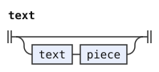</p>
<p>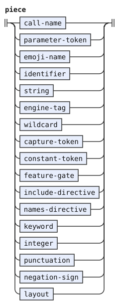</p>
</details>

## Names and engine tags

An ordinary name starts with an ASCII letter. Letters, digits, hyphens, and underscores can follow it.

An emoji name contains one scalar with `Emoji_Presentation` and without `Emoji_Component` in the configured Unicode table. Adjacent emoji names remain separate tokens.

`identifier` distinguishes lowercase and uppercase names while marking both as `Identifier`. The first letter later distinguishes rule names from user tags.

`whole-name` refuses a following name character. Keywords use it so that a keyword cannot stop inside a longer name.

An integer token is a run of decimal digits. The reader permits it only as a positive `.ngrams` argument without leading zeros.

An engine tag starts with `_` and continues with letters, digits, or underscores. A dot is part of the tag when it sits between two digits. The short Age aliases need it, as in `_age_15.1`. The greedy reading keeps that alias as one tag, and does not split it at the dot. A bare `_` is the wildcard. The `wildcard` rule reads it as its own token, without `Engine-Tag`.

```jbogenbau
%rule emoji-name
  _Emoji_Presentation<¬_Emoji_Component>
%conditions
  ¬$.following-tokens.parse(call-open …)
%emits
  $ :: Emoji-Name

%rule identifier :: Identifier
  | $lower:lower-initial-name :: Lowercase-Name
  | upper-initial-name :: Uppercase-Name
%conditions
  ¬$.following-tokens.parse(name-character …),
  $lower ⟹ ¬$.following-tokens.parse(call-open …)
%emits
  $

%rule whole-name
  name
%conditions
  ¬$.following-tokens.parse(name-character …)

%rule name
  letter | name name-character

%rule name-character
  letter | digit | name-hyphen | "_"

%rule name-hyphen
  "-"
%conditions
  $.following-tokens.first-token.value ≠ "-"

%rule letter
  "a".."z"
  | "A".."Z"

%rule digit
  "0".."9"

%rule integer
  digit | integer digit
%emits
  $ :: Integer

%rule lower-initial-name
  "a".."z"
  | lower-initial-name name-character

%rule upper-initial-name
  "A".."Z"
  | upper-initial-name name-character

%rule wildcard
  "_"
%conditions
  ¬$.following-tokens.parse(engine-name-part …)
%emits
  $

%rule engine-tag
  "_" engine-name
%conditions
  ¬$.following-tokens.parse(engine-name-part …)
%emits
  $ :: Engine-Tag

%rule engine-name
  engine-name-part | engine-name engine-name-part

%rule engine-name-part
  letter | digit | "_" | engine-digit-dot

%rule engine-digit-dot
  digit "."
%conditions
  $.following-tokens.parse(digit …)
```

<details><summary>Railroad diagrams of the 16 rules from <code>emoji-name</code> to <code>engine-digit-dot</code></summary>
<p>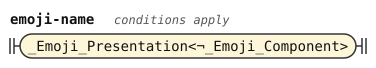</p>
<p>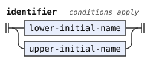</p>
<p>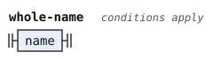</p>
<p>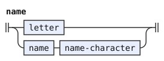</p>
<p>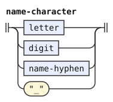</p>
<p>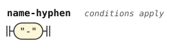</p>
<p>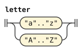</p>
<p>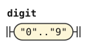</p>
<p>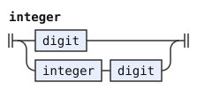</p>
<p>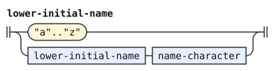</p>
<p>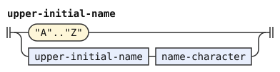</p>
<p>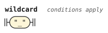</p>
<p>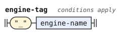</p>
<p>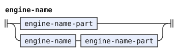</p>
<p>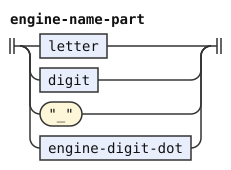</p>
<p>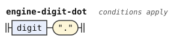</p>
</details>

## Calls and parameters

A call name requires an adjacent opening parenthesis. The name does not include that parenthesis. The opening parenthesis belongs to the call.

A parameter starts with `@` and an ASCII letter. Its remaining characters follow the ordinary name rules.

```jbogenbau
%rule call-name
  lower-initial-name
  | _Emoji_Presentation<¬_Emoji_Component>
%conditions
  $.following-tokens.parse(call-open …)
%emits
  $ :: Call-Name

%rule call-open
  "("

%rule parameter-token
  "@" whole-name
%emits
  $ :: Parameter
```

<details><summary>Railroad diagrams of <code>call-name</code>, <code>call-open</code> and <code>parameter-token</code></summary>
<p>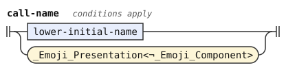</p>
<p>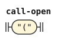</p>
<p>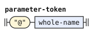</p>
</details>

## Captures and constants

A capture is `$` alone or `$` followed by a lowercase name. `$` alone names the enclosing constituent.

A user constant starts with `$` and an uppercase name.

`"$" upper-initial-name` reads a constant.

The boundary conditions prevent either token from ending inside its name. The syntax stage receives each prefixed name as one token.

```jbogenbau
%rule capture-token
  "$" [lower-initial-name]
%conditions
  ¬$.following-tokens.parse(name-character …)
%emits
  $ :: Capture

%rule constant-token
  "$" upper-initial-name
%conditions
  ¬$.following-tokens.parse(name-character …)
%emits
  $ :: Constant
```

<details><summary>Railroad diagrams of <code>capture-token</code> and <code>constant-token</code></summary>
<p>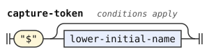</p>
<p>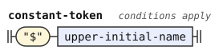</p>
</details>

## Feature gates

A feature is a named switch that a grammar tests. Its name starts with a letter and continues with letters, digits, or hyphens.

A gate ends with `?` and can start with `¬`. This token serves feature gates only.

A `¬` immediately before a gate belongs to that gate. Elsewhere, `negation-sign` emits it separately for a condition.

```jbogenbau
%rule feature-gate
  ["¬"] feature-name "?"
%emits
  $ :: Gate

%rule feature-name
  letter | feature-name feature-character

%rule feature-character
  letter | digit | name-hyphen

%rule negation-sign
  "¬"
%conditions
  ¬$.followed-by(feature-gate)
%emits
  $
```

<details><summary>Railroad diagrams of the 4 rules from <code>feature-gate</code> to <code>negation-sign</code></summary>
<p>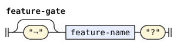</p>
<p>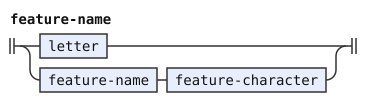</p>
<p>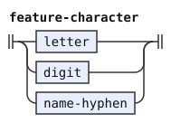</p>
<p>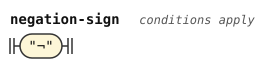</p>
</details>

## Strings

Straight double quotes enclose a string. Ordinary string characters exclude only the quote, U+0022.

Dollar signs and backslashes are ordinary characters.

`string` reads `quoted-string`, which `resource-path` also uses.

The lexical stage keeps escapes as written. A separate inspection validates each escape and loads any needed names data after lexing and before syntax recognition (engine §9.1). DOM conversion then decodes the original spellings once, without a second scan. Lexical errors precede escape errors, which precede syntax errors, which precede reader validation errors.

```jbogenbau
%rule string
  quoted-string
%emits
  $ :: String

%rule quoted-string
  "‹U+0022›" [{string-character}] "‹U+0022›"

%rule string-character
  "‹U+0000›".."‹U+0021›"
  | "‹U+0023›".."‹U+10FFFF›"
```

<details><summary>Railroad diagrams of <code>string</code>, <code>quoted-string</code> and <code>string-character</code></summary>
<p>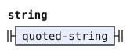</p>
<p>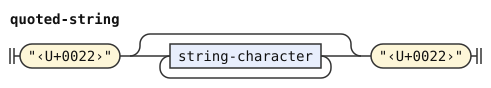</p>
<p>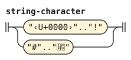</p>
</details>

## Resource paths

`include-directive` reads `%include` and its quoted path together, then emits two tokens. The keyword carries `KW-INCLUDE`, and the path carries `Resource-Path`.

`names-directive` reads `%names` and its quoted path in the same way. Its keyword carries `KW-NAMES`. The reader collects leading names declarations before it inspects other string escapes.

A resource path keeps dollar signs and backslashes literally. It excludes quotes.

`resource-path-tail` identifies layout followed by a path. The ordinary keyword rule uses it to avoid a competing bare directive token when a path follows.

```jbogenbau
%rule include-directive
  $keyword:include-keyword [layout-run] $path:resource-path
%emits
  $keyword :: KW-INCLUDE, $path :: Resource-Path

%rule names-directive
  $keyword:names-keyword [layout-run] $path:resource-path
%emits
  $keyword :: KW-NAMES, $path :: Resource-Path

%rule resource-path-tail
  [layout-run] resource-path

%rule include-keyword
  "%" whole-name="include"

%rule names-keyword
  "%" whole-name="names"

%rule resource-path
  quoted-string
```

<details><summary>Railroad diagrams of the 6 rules from <code>include-directive</code> to <code>resource-path</code></summary>
<p>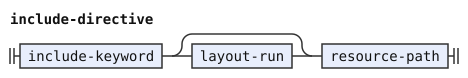</p>
<p>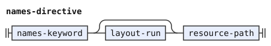</p>
<p>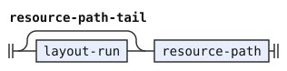</p>
<p>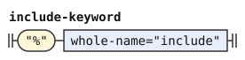</p>
<p>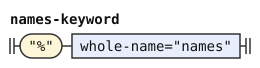</p>
<p>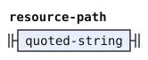</p>
</details>

## Layout

Whitespace and comments separate tokens without contributing meaning. `layout-run` joins consecutive layout pieces for resource-path recognition.

A comment starts with `--` and ends before LF, CR, or the end of the file. Strings retain their comment characters. The end condition keeps every character before the line boundary inside the comment.

These rules emit nothing. Their contents therefore never reach syntax recognition.

```jbogenbau
%rule layout-run
  layout | layout-run layout

%rule layout
  _White_Space | comment

%rule comment
  "-" "-" [{comment-character}]
%conditions
  $.following-tokens.first-token.value ∈ ("" "‹U+000A›" "‹U+000D›")

%rule comment-character
  _
%conditions
  $.value ∉ ("‹U+000A›" "‹U+000D›")
```

<details><summary>Railroad diagrams of <code>layout-run</code>, <code>layout</code>, <code>comment</code> and <code>comment-character</code></summary>
<p>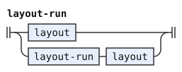</p>
<p>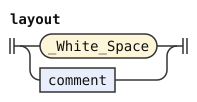</p>
<p>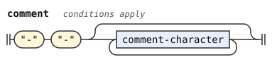</p>
<p>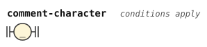</p>
</details>

## Keywords

A keyword is `%` followed by a whole name. Each known keyword receives its own tag, such as `KW-RULE`.

An unknown keyword receives `Keyword`, which the syntax grammar never reads. Recognition therefore reports it as a syntax error at that token.

The classified alternative reads `%include` or `%names` only when no quoted path follows. A complete directive instead uses its path rule above.

The `keywords` classifier assigns each known keyword its tag. The fallback emits `Keyword` for a name with no assigned class.

```jbogenbau
%classifier keywords
  "check" ∈ KW-CHECK
  "rule" ∈ KW-RULE
  "redefine-rule" ∈ KW-REDEFINE-RULE
  "extend-rule" ∈ KW-EXTEND-RULE
  "conditions" ∈ KW-CONDITIONS
  "error" ∈ KW-ERROR
  "warning" ∈ KW-WARNING
  "suppress-warnings" ∈ KW-SUPPRESS-WARNINGS
  "emits" ∈ KW-EMITS
  "erased" ∈ KW-ERASED
  "ambiguity-resolution" ∈ KW-AMBIGUITY-RESOLUTION
  "elision-only" ∈ KW-ELISION-ONLY
  "stage" ∈ KW-STAGE
  "extend-stage" ∈ KW-EXTEND-STAGE
  "redefine-stage" ∈ KW-REDEFINE-STAGE
  "include" ∈ KW-INCLUDE
  "names" ∈ KW-NAMES
  "features" ∈ KW-FEATURES
  "const" ∈ KW-CONST
  "redefine-const" ∈ KW-REDEFINE-CONST
  "classifier" ∈ KW-CLASSIFIER
  "implies" ∈ KW-IMPLIES

%rule keyword
  | "%" $name:whole-name :: $name.value.classify(keywords)
  | "%" $other:whole-name :: Keyword
%conditions
  $name.value.classify(keywords) ≠ ∅,
  $other.value.classify(keywords) = ∅,
  $name.value = "include" ⟹ ¬$.following-tokens.parse(resource-path-tail …),
  $name.value = "names" ⟹ ¬$.following-tokens.parse(resource-path-tail …)
%emits
  $
```

<details><summary>Railroad diagram of <code>keyword</code></summary>
<p>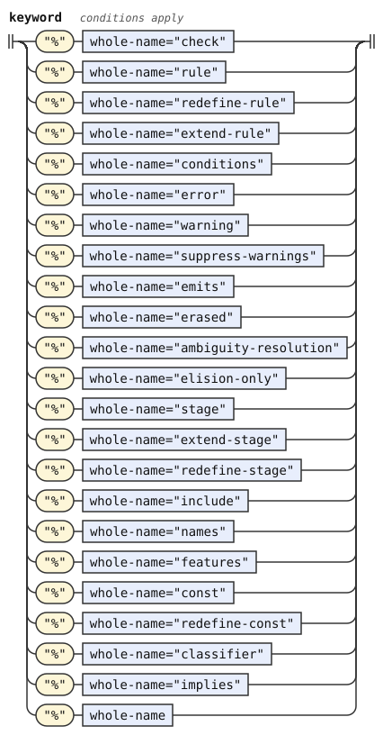</p>
</details>

## Punctuation

`@` starts a parameter token. A bare `@` is invalid.

A punctuation token is one that no larger lexical form contains. Punctuation tokens preserve their input values and images. The operator `≇` has value and image `≅` followed by U+0338. Its `text` retains `≇`.

The greedy reading keeps `...`, `..`, `++`, `::`, `:=`, and `:-` together as compound tokens. `#` and `(` remain separate tokens.

`…` marks the unread remainder at an outer edge of a body query.

`≻` separates ranked options. `≝` gives an elided terminator its default value. `/` separates a repetition's item and separator. Pattern paths and comparisons retain their own punctuation tokens.

```jbogenbau
%rule punctuation
  | "⁅" | "⁆" | "·" | "…" | "*" | "|" | "&" | "(" | ")" | "[" | "]" | "{" | "}"
  | "/" | "+" | "<" | ">" | "#" | "ε" | "," | "∧" | "∨" | "⟹" | "=" | "∈" | "⊆"
  | "∪" | "∩" | "∖" | "∅" | "≅" | "≝" | "⋯" | "⋮" | "⋰" | "⋱" | "≻" | ":" | "."
  | "+" "+" | "." "." "." | "." "." | ":" ":" | ":" "=" | ":" "-"
  | ("=" | "∈" | "⊆" | "≅") "‹U+0338›"
%emits
  $
```

<details><summary>Railroad diagram of <code>punctuation</code></summary>
<p>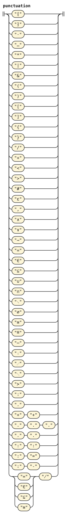</p>
</details>
