# jbogenbau: from tokens to a grammar

The syntax stage follows [lexical.md](lexical.md) in the [notation pipeline](pipeline.md). A stage is one step of a pipeline. A token is one unit that a stage reads or emits.

A token's value is the string that exact comparisons read. Its image is the string that people see.

The stage recognizes a complete grammar document before the reader converts its tree. A syntax error anywhere therefore precedes every reader error.

A tag is a named mark on a token. Lexical tags distinguish names, strings, integers, prefixed names, gates, engine tags, and keywords. String terminals read punctuation by its value.

These rules implement the recognition productions of [engine §9.2](../../../docs/engine.md#92-syntax-forms). They admit forms that the reader rejects under [§9.3](../../../docs/engine.md#93-conversion-and-validation).

The rule names identify reader constructors. Engine §9.3 defines their conversion and wrapper handling.

## Choosing among readings

The syntax stage receives complete tokens without layout.

Greedy ranking makes each `recipe-term` take the longest term, so `:= "a" "b"` holds one string run. The reader then rejects it and asks for `++`.

A keyword begins every declaration. Inside each declaration, punctuation and lexical categories determine where its lists end.

```jbogenbau
%ambiguity-resolution greedy
```

## Documents

A grammar text is a sequence of rules, directives, constant definitions, classifiers, and implications. Each starts with a keyword, so the next statement determines where the preceding one ends.

The reader converts the recognized tree into a DOM, its document object model. Constructor names preserve the parts that this conversion needs.

```jbogenbau
%rule text
  [{statement}]

%rule statement
  rule | ranking-directive | directive | constant-definition | classifier | implication-declaration
```

<details><summary>Railroad diagrams of <code>text</code> and <code>statement</code></summary>
<p>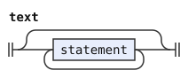</p>
<p>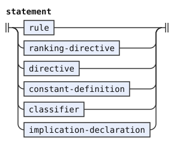</p>
</details>

## Rules and alternatives

A rule defines, redefines, or extends a name. Its trailing clauses are conditions, diagnostic, suppression, then output.

Header tag and string clauses apply to every alternative. A header clause requires the leading `|`, which separates its operands from the body.

An ordinary body separates alternatives with `|`. A ranked body joins at least two options with `≻`. Gates and clauses on a ranked body apply to the complete ranked choice. After header clauses, a leading `|` can introduce either body without parentheses.

An alternative can carry its own tag, value, and image clauses. Both clause lists preserve that order and permit each channel once.

```jbogenbau
%rule rule
  rule-keyword (rule-name | call) ("=" call | (body | header-clauses headed-body)
    [conditions-clause] [diagnostic-clause] [suppress-warnings-clause] [output-clause])

%rule rule-keyword
  KW-RULE | KW-REDEFINE-RULE | KW-EXTEND-RULE

%rule rule-name
  Identifier | Emoji-Name

%rule header-clauses
  header-tags [value-clause] [image-clause]
  | value-clause [image-clause]
  | image-clause

%rule headed-body
  "|" (ordinary-body | ranked-body)

%rule body
  ["|"] ordinary-body
  | ranked-body

%rule ordinary-body
  {alternative / "|"}

%rule ranked-body
  [{feature-gate}] ranked-choice [alternative-clauses]

%rule ranked-choice
  some-of "≻" {some-of / "≻"}

%rule alternative
  [{feature-gate}] some-of [alternative-clauses]

%rule alternative-clauses
  alternative-tags [value-clause] [image-clause]
  | value-clause [image-clause]
  | image-clause

%rule alternative-tags
  "::" term
```

<details><summary>Railroad diagrams of the 12 rules from <code>rule</code> to <code>alternative-tags</code></summary>
<p>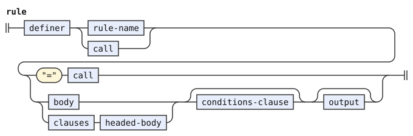</p>
<p>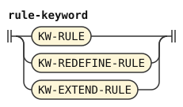</p>
<p>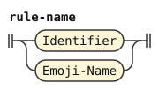</p>
<p>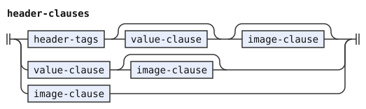</p>
<p>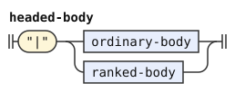</p>
<p>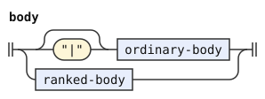</p>
<p>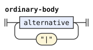</p>
<p>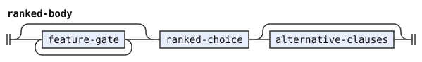</p>
<p>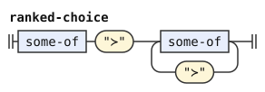</p>
<p>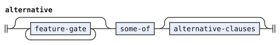</p>
<p>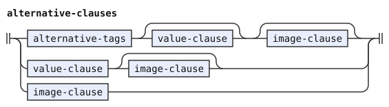</p>
<p>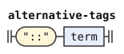</p>
</details>

## Calls and arguments

A call names a template and supplies one or more arguments. Ranked recognition selects the first argument category that reads the complete argument.

A requirement list and a target choice retain their distinct categories. Parenthesized bodies preserve their grouping during substitution.

```jbogenbau
%rule call
  Call-Name "(" {call-argument / ","} ")"

%rule parameter
  Parameter

%rule call-argument
  requirement-argument ≻ target-argument ≻ body-argument ≻ symbol-argument ≻ term :: ∅

%rule requirement-argument
  "<" [{tag-requirement}] ">"

%rule target-argument
  target-option "|" {target-option / "|"}

%rule target-option
  rule-reference | tag | call | parameter

%rule body-argument
  group | optional | repetition | empty

%rule symbol-argument
  tested-primary | range | wildcard | splice
```

<details><summary>Railroad diagrams of the 8 rules from <code>call</code> to <code>symbol-argument</code></summary>
<p>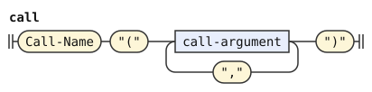</p>
<p>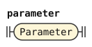</p>
<p>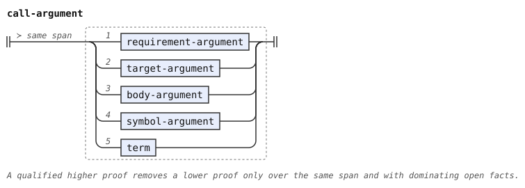</p>
<p>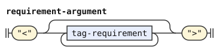</p>
<p>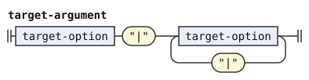</p>
<p>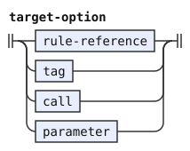</p>
<p>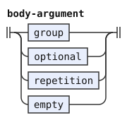</p>
<p>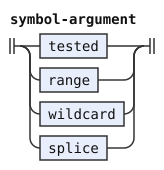</p>
</details>

## Expressions and captures

A choice uses `|` or `≻` at one level, never both. `&` joins sequences, and each sequence contains one or more primaries.

A primary is a symbol, capture, tested primary, group, optional, repetition, or `ε`. Lowercase names and valid emoji names reference rules. Uppercase names and engine tags read tagged tokens.

Strings and string constants read exact values. A range reads one scalar between its endpoints. The wildcard `_` reads any token. The lexical stage gives the bare `_` no `Engine-Tag`, so `tag` never reads it.

Parentheses group a choice. Brackets make it optional, and `+` marks an elidable optional. Braces repeat a choice, with an optional separator after `/`.

A chain has `...` before or after its item. The reader requires a chain to occupy its entire alternative.

A capture writes its binder before `:` and a primary after it. Recognition admits a `Constant` binder so that the reader can report the capitalized capture name there.

Recognition also admits invalid capture targets. A captured terminator has its own optional route, with its binder before `+`. The reader rejects them at the positions in engine §9.3.

```jbogenbau
%rule choice
  ["|"] {some-of / "|"}
  | ranked-choice

%rule some-of
  ["&"] {sequence / "&"}

%rule sequence
  {primary}

%rule primary
  capture
  | tested-primary | untested-primary

%rule capture
  (Capture | Constant) ":" primary

%rule untested-primary
  | rule-reference | call | splice | parameter | tag | string-terminal
  | range | wildcard | group | optional | repetition | empty

%rule splice
  "*" (rule-reference | call)
%conditions
  $.source-text = "*" ++ $.tokens-after-first.source-text

%rule rule-reference
  Lowercase-Name | Emoji-Name

%rule tag
  Uppercase-Name
  | Engine-Tag

%rule string-terminal
  string | constant-reference

%rule wildcard
  "_"

%rule group
  "(" choice ")"

%rule optional
  "[" ["+"] choice "]"
  | "[" captured-terminator "]"

%rule captured-terminator
  (Capture | Constant) ":" "+" primary

%rule repetition
  "{" ["..."] choice ["/" choice] "}"
  | "{" choice "..." ["/" choice] "}"

%rule empty
  "ε"

%rule feature-gate
  Gate
```

<details><summary>Railroad diagrams of the 17 rules from <code>choice</code> to <code>feature-gate</code></summary>
<p>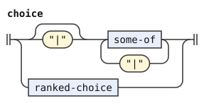</p>
<p>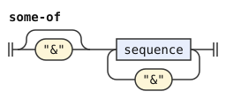</p>
<p>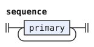</p>
<p>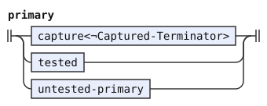</p>
<p>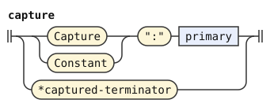</p>
<p>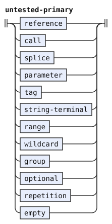</p>
<p>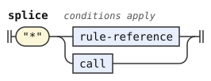</p>
<p>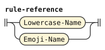</p>
<p>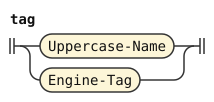</p>
<p>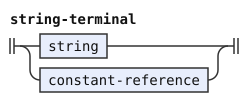</p>
<p>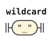</p>
<p>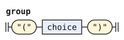</p>
<p>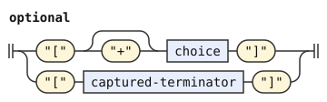</p>
<p>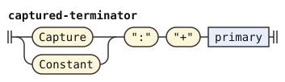</p>
<p>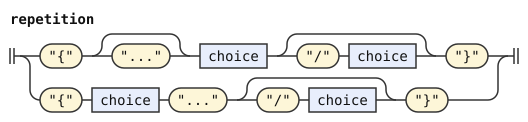</p>
<p>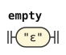</p>
<p>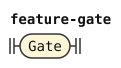</p>
</details>

## Symbol tests

A `tested-primary` holds its base and all following tests in written order. Tests after a capture binder belong to its target.

Valid symbols accept a tag test followed by a value test. Recognition admits extra tests, reversed tests, and wider operands so that the reader can name their errors.

Each tag requirement has an optional `¬`. An empty requirement list holds vacuously. A value test uses `=` or `≠` and requires a string literal or string constant. A default value, `≝` and a string, has the form of a value test. Recognition admits it after any symbol, and the reader accepts it only on the head of an elidable optional.

```jbogenbau
%rule tested-primary
  untested-primary {symbol-test}

%rule symbol-test
  tag-test | value-test | default-value

%rule tag-test
  "<" [{tag-requirement}] ">"

%rule tag-requirement
  ["¬"] test-operand

%rule value-test
  value-comparator test-operand

%rule value-comparator
  "=" | "≠"

%rule default-value
  "≝" test-operand

%rule operand-atom
  | call | parameter | string | constant-reference | rule-or-classifier-name | tag | range
  | capture-reference | empty-set | pattern-literal | "(" term ")"

%rule test-operand
  operand-atom | method-chain

%rule range
  string-operand ".." string-operand

%rule string-operand
  string | constant-reference | parameter
```

<details><summary>Railroad diagrams of the 11 rules from <code>tested-primary</code> to <code>string-operand</code></summary>
<p>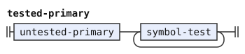</p>
<p>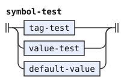</p>
<p>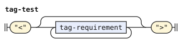</p>
<p>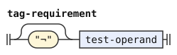</p>
<p>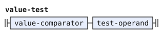</p>
<p>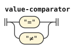</p>
<p>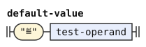</p>
<p>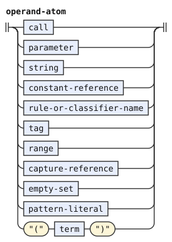</p>
<p>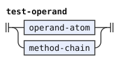</p>
<p>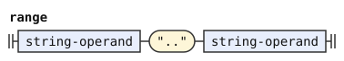</p>
<p>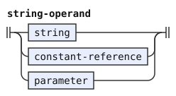</p>
</details>

## Conditions and output

`%conditions` lists predicates that the captured parts must satisfy. Its comma-separated list can start with a comma.

On `%features`, the clause tests stage input before parsing ([Pipelines](../../../docs/notation.md#pipelines)).

`%error` and `%warning` carry one message recipe. `%suppress-warnings` names codes or `_` for all warnings.

`%emits` lists output items, or means one whole-rule item when it has no items. A clause without a target also applies to that whole-rule item.

A valid target is a capture or `ε`, which inserts a token. Recognition admits names and ranges too, so the reader reports an invalid target at that item.

Attachments are named captures in parentheses around a named carrier. The reader rejects attachments around the whole-rule capture or an inserted item.

`%erased` discards the constituent during emission. It cannot share output with `%emits`.

```jbogenbau
%rule conditions-clause
  KW-CONDITIONS [","] {condition / ","}

%rule diagnostic-clause
  error-clause | warning-clause

%rule error-clause
  KW-ERROR recipe

%rule warning-clause
  KW-WARNING recipe

%rule suppress-warnings-clause
  KW-SUPPRESS-WARNINGS ("_" | {suppression-code / ","})

%rule suppression-code
  Identifier

%rule output-clause
  erased-clause | emits-clause

%rule erased-clause
  KW-ERASED

%rule emits-clause
  KW-EMITS [emission]

%rule emission
  [","] {emit-item / ","}
  | emit-clauses

%rule emit-item
  [{attachment-before}] emit-target [{attachment-after}] [emit-clauses]

%rule emit-target
  | Capture | "ε" | Identifier
  | Engine-Tag
  | range

%rule attachment-before
  "(" capture-reference ")"

%rule attachment-after
  "(" capture-reference ")"

%rule emit-clauses
  emit-tags [value-clause] [image-clause]
  | value-clause [image-clause]
  | image-clause

%rule emit-tags
  "::" term
```

<details><summary>Railroad diagrams of the 16 rules from <code>conditions-clause</code> to <code>emit-tags</code></summary>
<p></p>
<p></p>
<p></p>
<p></p>
<p></p>
<p></p>
<p></p>
<p></p>
<p></p>
<p></p>
<p></p>
<p></p>
<p></p>
<p></p>
<p></p>
<p></p>
</details>

## Tags and string recipes

`::` supplies tags, `:=` supplies a value recipe, and `:-` supplies an image recipe. A recipe is exactly one term that joins its string atoms with `++` in written order.

Recognition admits repeated terms for diagnostics, but a valid recipe contains exactly one term. The reader rejects a second term at its first token and tells the author to use `++`. Adjacent string literals form a set, so the reader rejects them and tells the author to use `++`. The reader permits only strings, string constants, and the seven capture string methods of engine §11.3.

This wider recognition lets the reader reject a written operator or forbidden method at its atom. It does not make those atoms valid recipes.

```jbogenbau
%rule recipe
  {recipe-term}

%rule recipe-term
  term

%rule value-clause
  ":=" recipe

%rule image-clause
  ":-" recipe

%rule header-tags
  "::" term
```

<details><summary>Railroad diagrams of the 5 rules from <code>recipe</code> to <code>header-tags</code></summary>
<p></p>
<p></p>
<p></p>
<p></p>
<p></p>
</details>

## Terms and methods

A term can be a string, a set, a pattern, a capture, a span, or a method result. Its context determines the type of `∅`.

The reader folds each `method-chain` from left to right.

`++` binds tighter than `∩`, which binds tighter than `∪` and `∖`. These operators group from the left. Adjacent tags or strings form one union. In terms and constants, string runs bind tighter than concatenation.

A guarded term writes a condition before `⟹`. It supplies its value only where that condition holds. A guarded term binds less tightly than set operators.

The reader groups repeated guards to the right. Flat lists retain their written order without completing a separate recursive level for each guard.

A method chain starts with a receiver and follows it with selectors. Each selector names a method and can supply nonempty parenthesized arguments. The `parse` selector takes a capture-free body constituent instead of a list of terms. A remainder mark at one outer edge selects a prefix or suffix query. Remainder marks at both edges select a query over some part of the view.

The methods `.followed-by` and `.preceded-by` separate target names with `|`. Other methods separate arguments with `,`. The reader enforces this distinction.

The reader folds selectors from left to right. It retains the receiver's actual type and applies the signature rules in engine §10.

A name used as an argument can identify a rule or classifier where the method signature requires one. The reader rejects unknown methods, invalid receivers, and wrong arities.

An emoji rule name is also a method argument. A classifier name starts with a lowercase letter, so an emoji cannot name a classifier.

```jbogenbau
%rule term
  union | guarded-term

%rule guarded-term
  {any-of "⟹"} union

%rule union
  ["∪"] {intersection / ("∪" | "∖")}

%rule intersection
  ["∩"] {concatenation / "∩"}

%rule concatenation
  {term-atom / "++"}

%rule tag-run
  tag {tag}

%rule string-run
  string {string}

%rule term-atom
  plain-term-atom | method-chain

%rule plain-term-atom
  tag-run | string-run | operand-atom

%rule method-chain
  method-receiver {method-selector}

%rule method-receiver
  plain-term-atom

%rule method-selector
  "." (parse-selector | named-selector)

%rule named-selector
  method-name ["(" method-arguments ")"]
%conditions
  $.first-token.value ≠ "parse"

%rule parse-selector
  "parse" "(" parse-argument ")"

%rule parse-argument
  "…" choice "…" | "…" choice | choice "…" | choice

%rule method-name
  Identifier | Call-Name

%rule method-arguments
  {method-argument / ("," | "|")}

%rule method-argument
  term | integer

%rule integer
  Integer

%rule rule-or-classifier-name
  Lowercase-Name | Emoji-Name

%rule empty-set
  "∅"

%rule capture-reference
  Capture

%rule constant-reference
  Constant

%rule string
  String
```

<details><summary>Railroad diagrams of the 24 rules from <code>term</code> to <code>string</code></summary>
<p></p>
<p></p>
<p></p>
<p></p>
<p></p>
<p></p>
<p></p>
<p></p>
<p></p>
<p></p>
<p></p>
<p></p>
<p></p>
<p></p>
<p></p>
<p></p>
<p></p>
<p></p>
<p></p>
<p></p>
<p></p>
<p></p>
<p></p>
<p></p>
</details>

## Boolean conditions

A condition is a comparison, tree comparison, method, presence test, negation, grouped condition, or set term. A bare capture tests its presence. A set term as a condition holds where the set is not empty. A parameter can stand as a set term. A lone string is a scalar, so it is not a set term. A leading `∪` or `∩` in a set operation is a separator, not an operator.

These rules restate `union` and `intersection` for a condition. An operation needs one operator or a leading separator, and a lone operand must be a set atom. A single method, capture or group already reads as a condition. So this rule does not also read it as a `union`. The reader checks the type of every set term. The grammar leaves out only the lone forms that can never be sets.

`∧`, `∨`, and `⟹` bind in that order. Implication groups to the right. `¬` negates the following condition.

The flat implication list preserves every operand for the reader's grouping. This keeps recognition work proportional to the list rather than its nested completions.

A tree comparison requires a bare capture on the left. On the right, a pattern tests structure, and a bare capture compares two trees.

```jbogenbau
%rule condition
  {any-of / "⟹"}

%rule any-of
  ["∨"] {all-of / "∨"}

%rule all-of
  ["∧"] {condition-primary / "∧"}

%rule condition-primary
  | comparison | tree-comparison | method-chain | presence | negation | set-condition
  | "(" condition ")"

%rule set-condition
  union-operation | intersection-operation | set-atom

%rule union-operation
  ["∪"] intersection ("∪" | "∖") {intersection / ("∪" | "∖")}
  | "∪" intersection

%rule intersection-operation
  ["∩"] concatenation "∩" {concatenation / "∩"}
  | "∩" concatenation

%rule set-atom
  tag | tag-run | string-run | empty-set | constant-reference | parameter

%rule presence
  Capture

%rule negation
  "¬" condition-primary

%rule comparison
  union comparator union

%rule comparator
  "=" | "≠" | "∈" | "∉" | "⊆" | "⊈"

%rule tree-comparison
  capture-reference tree-comparator union

%rule tree-comparator
  "≅" | "≇"
```

<details><summary>Railroad diagrams of the 14 rules from <code>condition</code> to <code>tree-comparator</code></summary>
<p></p>
<p></p>
<p></p>
<p></p>
<p></p>
<p></p>
<p></p>
<p></p>
<p></p>
<p></p>
<p></p>
<p></p>
<p></p>
<p></p>
</details>

## Tree patterns

A pattern starts with `#` and one node test, bare child list, or grouped predicate. An exact prefix suppresses the node test's single-child search.

A pattern atom names a rule, terminal, constant, or wildcard. A tag test follows the atom, as in `#_<Tense>`. The reader converts it as [engine §9.3](../../../docs/engine.md#93-conversion-and-validation) says.

The brackets `⁅` and `⁆` enclose child items. A child list attaches to the preceding atom. Only a rule name, emoji rule, template family, exact call, or compatible parameter accepts an attached list.

A bare list or an exact prefix needs whitespace or a comment after a node test, `⁆`, `]`, `}`, or a group's `)`. Thus `⁅ a ⁅b⁆ ⁆` has two items, while `⁅ a⁅b⁆ ⁆` attaches the list to `a`. `⁅ (a)⁅b⁆ ⁆` is an error. After `⋯` or `⋰`, no space is necessary.

The syntax stage does not see layout, which consists of whitespace and comments. The helper rules test adjacency through source text. `adjacent-item-opening` matches two tokens whose joined source text equals the source text of their span. That equality holds only when nothing lies between them.

`pattern-exact-start` keeps `·` adjacent to its node test. `pattern-attached-start` detects a list directly after the complete atom. `pattern-node` tests this condition in both directions, so an adjacent list always attaches and a separated list never does. Its third condition rejects an unattached reading of `a⁅b⁆`, which keeps the attachment routes disjoint.

`pattern-item-opening` reads `⁅` or `·`. `child-item` rejects such an adjacent opening after its last token, except after `⋯` or `⋰`.

A child set has at least one operator. A lone child path is therefore a one-item sequence, and never also a set.

Child lists contain sequences, choices, optional sequences, repeats, and sibling gaps. Paths and set operations combine whole predicates.

Recognition admits repeated or reversed tests on node atoms. Each node atom accepts one tag test, then one value test. A pattern-valued constant atom accepts neither test.

```jbogenbau
%rule pattern-literal
  "#" pattern-primary

%rule pattern-union
  {pattern-intersection / ("∪" | "∖")}

%rule pattern-intersection
  {pattern-path / "∩"}

%rule pattern-path
  ("⋮" | "⋱") pattern-primary
  | pattern-primary ["⋰"]

%rule pattern-primary
  pattern-node | bare-child-list | "(" pattern-union ")"

%rule pattern-node
  [$exact:"·"] $atom:pattern-atom [$list:child-list]
%conditions
  $exact ⟹ $exact.onward.parse(pattern-exact-start …),
  $list ⟹ $atom.onward.parse(pattern-attached-start …),
  ¬$list ⟹ ¬$atom.onward.parse(pattern-attached-start …)

%rule bare-child-list
  [$exact:"·"] child-list
%conditions
  $exact ⟹ $exact.onward.parse(pattern-exact-start …)

%rule pattern-atom
  (pattern-rule | tag | string | range | wildcard | constant-reference) [{symbol-test}]

%rule pattern-rule
  Lowercase-Name | Emoji-Name | call | parameter

%rule child-list
  "⁅" [child-choice] "⁆"

%rule child-choice
  {child-alternative / "|"}

%rule child-alternative
  child-sequence | child-set-operation

%rule child-sequence
  {child-item}

%rule child-set-operation
  child-intersection ("∪" | "∖") {child-intersection / ("∪" | "∖")}
  | child-path "∩" {child-path / "∩"}

%rule child-intersection
  {child-path / "∩"}

%rule child-item
  child-path | child-optional | child-repetition | "⋯"
%conditions
  ¬$.last-token.onward.parse(adjacent-item-opening …)

%rule child-path
  ("⋮" | "⋱") child-primary
  | child-primary ["⋰"]

%rule child-primary
  pattern-node | bare-child-list | "(" child-choice ")"

%rule child-optional
  "[" child-choice "]"

%rule child-repetition
  "{" child-choice ["/" child-choice] "}"

%rule pattern-exact-start
  $mark:"·" $next:_
%conditions
  $.source-text = $mark.source-text ++ $next.source-text

%rule pattern-attached-start
  $atom:pattern-atom $open:"⁅"
%conditions
  $.source-text = $atom.source-text ++ $open.source-text

%rule pattern-item-opening
  "⁅" | "·"

%rule adjacent-item-opening
  $left:_ $right:pattern-item-opening
%conditions
  $left.value ≠ "⋯",
  $left.value ≠ "⋰",
  $.source-text = $left.source-text ++ $right.source-text
```

<details><summary>Railroad diagrams of the 24 rules from <code>pattern-literal</code> to <code>adjacent-item-opening</code></summary>
<p></p>
<p></p>
<p></p>
<p></p>
<p></p>
<p></p>
<p></p>
<p></p>
<p></p>
<p></p>
<p></p>
<p></p>
<p></p>
<p></p>
<p></p>
<p></p>
<p></p>
<p></p>
<p></p>
<p></p>
<p></p>
<p></p>
<p></p>
<p></p>
</details>

## Directives

A directive starts a stage, includes a document, declares features, turns on the elision check, or lists the ranking steps. Each written name is a separate argument. The ranking directive lists steps separated by commas. Each step is a name alone or a name followed by one pattern literal or constant reference. The reader requires an exact local pattern there, as [engine §9.3](../../../docs/engine.md#93-conversion-and-validation) says.

Recognition accepts wider arguments than each directive permits. The reader rejects wrong counts and types at the directive before converting those arguments.

`%features` alone accepts a following `%conditions` clause. The loader requires a selected stage for that clause.

`%include` takes exactly one quoted path. Its first argument uses literal path decoding. A resource path cannot serve as a method receiver.

`%names` takes one quoted path and stands before every other statement. Its names apply to the document and to the documents that it includes. A names file that an included document declares does not apply after that include ends.

```jbogenbau
%rule directive
  directive-keyword [{directive-argument}] [conditions-clause]

%rule ranking-directive
  KW-AMBIGUITY-RESOLUTION {ranking-step / ","}

%rule ranking-step
  Identifier [pattern-literal | constant-reference]

%rule directive-keyword
  | KW-STAGE | KW-EXTEND-STAGE | KW-REDEFINE-STAGE
  | KW-INCLUDE | KW-NAMES | KW-FEATURES | KW-ELISION-ONLY

%rule directive-argument
  directive-identifier | directive-string | directive-terminal | directive-term

%rule directive-identifier
  Identifier

%rule directive-string
  String | Resource-Path

%rule directive-terminal
  Engine-Tag
  | range

%rule directive-term
  | directive-method-chain | capture-reference | constant-reference
  | empty-set | pattern-literal | "(" term ")" | Emoji-Name | "_"

%rule directive-method-chain
  (tag | rule-or-classifier-name | string | constant-reference | range
    | capture-reference | empty-set | pattern-literal | "(" term ")") {method-selector}
```

<details><summary>Railroad diagrams of the 10 rules from <code>directive</code> to <code>directive-method-chain</code></summary>
<p></p>
<p></p>
<p></p>
<p></p>
<p></p>
<p></p>
<p></p>
<p></p>
<p></p>
<p></p>
</details>

## Constants, classifiers, and implications

A constant definition defines or redefines a prefixed name and gives it a term. The loader resolves its type and final value after stitching the stage.

A classifier has a name and entries. Each entry has gates, one or more string keys, an operator, and a class. Each gate controls whether its entry applies. The reader rejects invalid class names.

`%implies` joins two tag-set terms with `⟹`. Neither side is an ungrouped guarded term, so that symbol identifies the implication itself.

```jbogenbau
%rule constant-definition
  constant-keyword constant-name term

%rule constant-name
  Constant

%rule constant-keyword
  KW-CONST | KW-REDEFINE-CONST

%rule classifier
  KW-CLASSIFIER classifier-name [{classifier-entry}]

%rule classifier-name
  Identifier

%rule classifier-entry
  [{feature-gate}] {classifier-key} classifier-operator classifier-class

%rule classifier-key
  string | constant-reference

%rule classifier-operator
  "∈" | "∉"

%rule classifier-class
  Identifier
  | Engine-Tag

%rule implication-declaration
  KW-IMPLIES union "⟹" union
```

<details><summary>Railroad diagrams of the 10 rules from <code>constant-definition</code> to <code>implication-declaration</code></summary>
<p></p>
<p></p>
<p></p>
<p></p>
<p></p>
<p></p>
<p></p>
<p></p>
<p></p>
<p></p>
</details>
