# BPFK working word forms

This document supplies the word family for the forms stage in the [BPFK](pipeline.md), [experimental](../experimental/pipeline.md) and [Zantufa](../zantufa/pipeline.md) pipelines. A stage is one step of a pipeline, with its own grammar ([engine §1](../../../docs/engine.md#1-tokens)). A word family is a set of word forms that pipelines use.

A token is one unit that a stage reads or emits. A token's value is the string that exact comparisons read. Its image is the string that people see.

The loader stitches this document in after [../common/forms.md](../common/forms.md). The experimental pipeline stitches [../experimental/morphology.md](../experimental/morphology.md) after it, and the Zantufa pipeline stitches [../zantufa/morphology.md](../zantufa/morphology.md). [The notation document](../../../docs/notation.md) explains jbogenbau, the notation of these grammars.

This document gives the working word-form grammar of the BPFK, the Lojban language planning committee. It derives from the morphology part of `camxes.peg`, a parsing expression grammar (PEG). The executable baseline is ilmentufa commit [`778ea138f7d150121ca722db7536ce3b123943ac`](https://github.com/lojban/ilmentufa/blob/778ea138f7d150121ca722db7536ce3b123943ac/camxes.peg). [CLL 1.3.4](https://github.com/int19h/cll/blob/v1.3.4/chapters/a02.xml) (*The Complete Lojban Language*) prints that grammar in appendix A2.

The prose uses these Lojban terms for words:

- A cmavo is a particle, a short structure word.
- A selma'o is a word class of cmavo.
- A brivla is a predicate word.
- A cmevla is a name word.
- A gismu is a root word.
- A lujvo is a compound word.
- A rafsi is a word form used inside compounds.

Where a rule corresponds to a PEG rule, its name uses lowercase letters and hyphens for underscores. Other named parts support conditions or expose a word-form restriction. C denotes a consonant. V denotes `a`, `e`, `i`, `o`, or `u`.

## How this grammar states the morphology

A diphthong combines two vowels in one syllable. A nucleus is the vowel, diphthong or `y` at the center of a syllable. A glide is an `i` or `u` before a nucleus. An onset is the part of a syllable before its nucleus. A coda is the consonant part after a nucleus.

This grammar states the morphology's rules directly. Its alternatives have no order. It retains PEG lookaheads where they state word shapes, stress, hyphens, or word boundaries. A lookahead tests the text without consuming it. The conditions use a prefix parse to test starts, including text beyond the word and before the next pause. They use a whole parse to test a complete captured span.

Different letters or incompatible conditions separate most alternatives. Other alternatives overlap as prefixes, but only one can complete the surrounding word. Their comments and the prose name the letters, stress, hyphens, or boundaries that force completion. At the end of a lookahead, alternative endpoints need no preference because the test asks only whether a form begins. Inside a lookahead, optionals and repetitions need an exclusion or completion argument, or an argument that every reading gives the PEG's answer.

A y-hyphen is a `y` between rafsi. An r-hyphen is `r` before a consonant, or `n` before `r`.

Plain optionals and repetitions express parts whose presence or count follows from their context. A shorter name body leaves a letter that the required final consonant cannot absorb before the pause. A shorter nucleus-apostrophe run leaves an apostrophe where the word must end, so the `post-word` test fails. A shorter unstressed rafsi or syllable run cannot reach the stressed core or its required hyphen. Consonantal syllables cannot consume the start of a following vowel-bearing syllable. A following rafsi cannot start with an apostrophe or the consonant pair that an r-hyphen supplies.

Where two stress tests apply to the same constituent, one alternative joins their conditions with `∨`. The grammar gives names one general shape. Nonempty final codas use one form, with an optional syllabic consonant before the required consonant. These forms remove duplicate proofs of the same word. The closing section explains deliberate differences from camxes-std.

## Words

The phoneme stage supplies phoneme and pause tokens. A stressed vowel has a lowercase value and the `Stressed` tag. The forms stage reads names, particles, predicate words, and hesitation. Names end in consonants before a pause. Particles exclude names, and predicate words cannot complete at a particle start, as the Brivla section explains.

A particle excludes a name that begins at its own start. A final syllable excludes a name that follows it. Hesitation can stand before a name without a pause. `yyykevin.` divides as `yyy` and `kevin`, so an odd run can stand before a name too. The name test in `y-run` reads a name that begins at the start of the hesitation itself.

The document [../common/forms.md](../common/forms.md) says how words join.

The word-boundary conditions decide which words can stand together without a pause.

The PEG's `CMAVO` is a list of the selma'o, each a set of spellings, followed by `cmavo` for every other cmavo. Each selma'o rule begins with `&cmavo` and ends with `&post_word`. Every spelling except `ybu` reads exactly what `cmavo` reads, and the lexicon gives each cmavo its selma'o.

Hesitation that stands as its own word is one token. The [Magic Words proposal](https://mw.lojban.org/papri/Magic_Words) says that `y` is not a word and counts as whitespace. Thus `.yyy.` is one token here. The separate split before `bu` preserves letter words, as [the ybu exception](#the-ybu-exception) explains.

A `y` is a nucleus exactly where no nucleus follows it. So the first `y` of a run is a nucleus exactly when the run has an odd number of letters. A run with an even number can follow a word directly: `kyyykerlo` is `ky yy kerlo`, but `bayyy` is no text. So a run of `y` has `Onset` where no nucleus begins it.

Ilmentufa's morphology-only parser accepts this division of `kyyykerlo`, but full camxes-std rejects the text. Its lexer wrapper calls `spaces` after `ky`, and that rule refuses a leading Y token. The [shared forms document](../common/forms.md#differences-from-camxes) compares the word streams.

### Whole hesitation runs

The camxes-std [morphology-only parser](https://github.com/lojban/ilmentufa/blob/778ea138f7d150121ca722db7536ce3b123943ac/camxes-morpho.js) splits a bare odd y run through its `cmavo_form` onset alternative. Its `initial_spaces` reader instead reads a whole run. The [full camxes-std parser](https://github.com/lojban/ilmentufa/blob/778ea138f7d150121ca722db7536ce3b123943ac/camxes.js) uses that whole-run spacing reading. Both reference parsers keep every y inside the `ybu` letter word before BU.

`cmavo` excludes a pure `y` run, and `y-run` reads the whole run as hesitation, in agreement with camxes-std's spacing rule. The words stage drops this hesitation in `lojban/bpfk` and `lojban/experimental`. Zantufa can retain attached hesitation, so its erasure can observe the whole-run division.

### Word shapes and boundaries

One template states the shape of each word. A word shape carries `Continued`, so another word can follow it directly. If no nucleus begins the word, it carries `Onset`. Only a word with `Onset` can follow another word without a pause.

Hesitation is a direct run of `y` letters, outside `cmavo`. It keeps the test that no name begins at its own start. `cmavo` keeps its exclusion of a pure `y` run, so a particle is never hesitation.

```jbogenbau
-- A word shape carries its join property and an onset mark when no nucleus begins it.
%rule word-shape(@W)
  $w:@W :: Continued ∪ (¬$w.onward.parse(nucleus …) ⟹ Onset)

-- A name carries its join property and its onset mark.
%rule cmevla-shape
  $n:word-shape(cmevla) :: $n.tags

-- A particle carries its join property and its onset mark.
%rule cmavo-shape = word-shape(cmavo)

-- A predicate word carries its join property and its onset mark.
%rule brivla-shape
  $b:word-shape(brivla-word) :: $b.tags

-- A direct run of y letters that does not begin a name. It cannot end before another y. It ends at a word boundary.
%rule y-run-body
  {y}
%conditions
  ¬$.onward.parse(cmevla …),
  ¬$.following-tokens.parse(y …),
  $.following-tokens.parse(post-word …)

-- Hesitation is a direct y run with the shared onset mark.
%redefine-rule y-run = word-shape(y-run-body)
```

<details><summary>Railroad diagrams of the 6 rules from <code>word-shape</code> to <code>y-run</code></summary>
<p>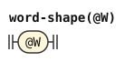</p>
<p>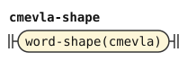</p>
<p>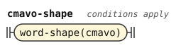</p>
<p>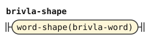</p>
<p>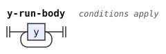</p>
<p>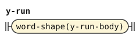</p>
</details>


The PEG's `lojban_word` is what `post_word` looks for after a word.

```jbogenbau
-- A legal word is a name, a particle, a predicate word, or hesitation. Their own conditions separate the classes.
%rule lojban-word
  cmevla | cmavo | brivla-word | y-run

-- Predicate words are roots, compounds, or borrowings. Root stress and consonant clusters prevent a particle reading. Lujvo exclude roots and borrowings. Borrowing heads exclude root-shaped rafsi strings.
%rule brivla-word
  gismu | lujvo | fuhivla

-- A compound is a predicate word that is neither a root nor a borrowing.
%rule lujvo
  $b:brivla
%conditions
  ¬$b.parse(gismu | fuhivla)

-- A word ends before a pause or a legal next word. Without a pause, the next word cannot start with a nucleus.
%rule post-word
  | pause
  | $w:lojban-word
%conditions
  ¬$w.onward.parse(nucleus …)

-- A pause test accepts a pause token or the end of input.
%rule pause
  PAUSE | end-of-text

-- Require the end of input.
%rule end-of-text
  ε
%conditions
  $.ends-input
```

<details><summary>Railroad diagrams of the 6 rules from <code>lojban-word</code> to <code>end-of-text</code></summary>
<p>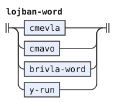</p>
<p>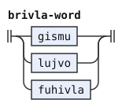</p>
<p>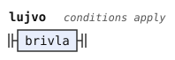</p>
<p>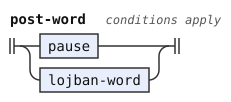</p>
<p>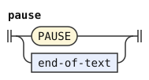</p>
<p>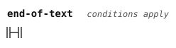</p>
</details>


The test on `lujvo` reads the whole word, and a test at its start gives the same result. A root or borrowing that stands as a proper prefix of a longer brivla needs a stressed syllable of its own. Stress by position puts a pause right after the prefix, so a longer brivla cannot hold the prefix. Every syllable of a brivla before its stressed syllable is unstressed, and its final syllable has no mark. Stress by a mark cannot stand in an unstressed initial rafsi of the longer brivla. So the marked syllable of the prefix is the stressed syllable of the longer brivla itself.

One counted syllable follows it in both readings, and the letters fix both ends. Each reading therefore ends at the same nucleus, and no proper prefix exists.

## Cmevla

A name is a run of letters that ends in a consonant before a pause. The repeated sounds exclude that final consonant, so only one repetition count reaches it. The PEG also offers a syllabified name shape, which requires the same general shape and ends at the same pause. The single `cmevla` form covers both name readings without duplicate proofs.

No sound in the repetition needs a test against a pause. The final consonant of `cmevla` always follows the repetition, so the repetition cannot take that consonant and still complete the name.

```jbogenbau
-- A name forbids an initial apostrophe and ends in a consonant before a pause. A syllabified name requires the same general shape and ends at the same pause. An apostrophe and a consonant use distinct letters. A glide needs a following nucleus, and a vowel forbids one, so one letter gives one sound reading. No pause test stands on the sounds, because the final consonant always follows them.
%rule cmevla
  [{nucleus | glide | h | consonant}] $c:consonant
%conditions
  ¬$.onward.parse(h …),
  $c.following-tokens.parse(pause …)

```

<details><summary>Railroad diagram of <code>cmevla</code></summary>
<p>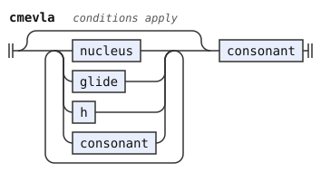</p>
</details>


## Cmavo

A cmavo is not the start of a name, and not the start of a lujvo that begins with a CVC rafsi and a y-hyphen. Its form is an onset and nuclei joined by apostrophes. A pause or another word follows it. `CVCy_lujvo` keeps `bajykerlo` one lujvo, rather than `ba jy kerlo`.

```jbogenbau
-- A lujvo that begins with a CVC rafsi and a y-hyphen. Stress separates its two forms.
%rule cvcy-lujvo
  | cvc-rafsi y [h] [{initial-rafsi}] brivla-core
  | stressed-cvc-rafsi y short-final-rafsi

-- A particle is an onset and nuclei joined by apostrophes. It excludes a name start, a CVCy compound start and pure y. The pure y test says that not every letter of the span is y. It ends at a complete word boundary.
%rule cmavo
  $o:onset [{nucleus h}] cmavo-last-nucleus
%conditions
-- Detect a CVC rafsi with a y-hyphen before the compound core. Stress separates the two forms. Unhyphenated initial rafsi cannot start where the core starts, because of stress and their own exclusions. Only a lookahead.
  ¬$o.onward.parse((h | cluster | cmevla
                    | cvcy-lujvo) …),
  $.value.ngrams(1) ≠ "y",
  $.following-tokens.parse(post-word …)

```

<details><summary>Railroad diagrams of <code>cvcy-lujvo</code> and <code>cmavo</code></summary>
<p>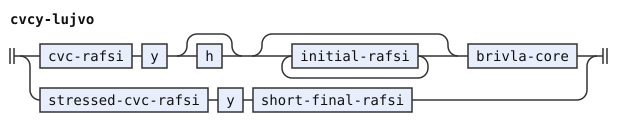</p>
<p>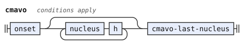</p>
</details>


The last nucleus of a cmavo is unstressed, or it is not followed by a consonant cluster. So `MIklama` is not `mI klama`. One condition covers both reasons for the same nucleus.

```jbogenbau
-- A particle ends in an unstressed nucleus, or in a nucleus with no following consonant cluster. One nucleus covers both cases.
%rule cmavo-last-nucleus
  $n:nucleus
%conditions
  ¬$n.onward.parse(stressed …) ∨ ¬$n.following-tokens.parse(cluster …)

```

<details><summary>Railroad diagram of <code>cmavo-last-nucleus</code></summary>
<p>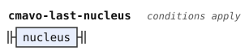</p>
</details>


## Brivla

A gismu has CCVCV or CVCCV shape. A CCVCV gismu begins with a consonant cluster, which a cmavo forbids. In a CVCCV gismu, the first vowel is stressed before a cluster, which the last cmavo nucleus forbids. Thus a gismu cannot complete at a cmavo start, even though its branch bypasses the `brivla` rule.

The `brivla` rule excludes cmavo starts directly. Unstressed initial rafsi precede its core, which contains the stressed syllable. The borrowing head excludes rafsi strings, including gismu starts, so a borrowing and a gismu cannot complete together. The `lujvo` conditions exclude both gismu and borrowings from compounds. The other cores differ in consonant positions, apostrophes, hyphens, or stress.

No syllable of a borrowing has `y` as its nucleus. A borrowing cannot cross a y-hyphen. Its head excludes the rafsi strings that describe the classical cores. The `cvv-final-rafsi` form has an apostrophe where neither gismu shape permits one.

The `short-final-rafsi` rule reads a consonant and diphthong, or an initial pair and vowel. Its diphthong cannot split into a gismu's final vowel and another word, because that vowel forbids a following nucleus. The `cvv-final-rafsi` rule stresses its first vowel, while the apostrophe form of the stressed instance of `cvv-rafsi-of` stresses its second vowel.

```jbogenbau
-- A predicate word cannot start where a particle begins. Unstressed initial rafsi precede its stressed core.
%rule brivla
  [{initial-rafsi}] brivla-core
%conditions
  ¬$.onward.parse(cmavo …)

-- Borrowing heads exclude rafsi strings. The other cores differ in consonant positions, apostrophes, hyphens, or stress. A stressed long y-rafsi leaves consonant-y after its CCV prefix, and no short final starts with consonant-y. No short final starts with an apostrophe, so a stressed CVV form cannot compete with an apostrophe-y form. Stressed extended forms need an unstressed first syllable and apostrophe-y, or a borrowing head.
%rule brivla-core
  | fuhivla | gismu | cvv-final-rafsi
  | (stressed-extended-rafsi | stressed-y-rafsi | stressed-y-less-rafsi) short-final-rafsi

```

<details><summary>Railroad diagrams of <code>brivla</code> and <code>brivla-core</code></summary>
<p>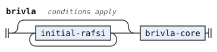</p>
<p>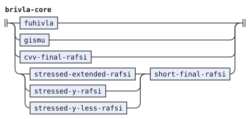</p>
</details>


A short rafsi without a y-hyphen cannot start an extended rafsi or borrowing, or stand directly before one. Thus `spageti'ybroda` begins with `spageti'y`, and `selspageti` is one borrowing. The short form excludes rafsi with `y` or `'y` through `y-less-rafsi`, and extended forms through `any-extended-rafsi`.

The comment on `initial-rafsi` states why its three alternatives cannot complete the same initial rafsi.

```jbogenbau
-- A short unhyphenated rafsi cannot start or directly precede an extended rafsi or borrowing. It excludes y-rafsi and hy-rafsi through y-less-rafsi, and extended forms through any-extended-rafsi. Initial borrowing rafsi need an unstressed first syllable. Extended brivla forms need two syllables before apostrophe-y. The stressed counterparts also need a short final that cannot start with consonant-y or apostrophe.
%rule initial-rafsi
  | extended-rafsi | y-rafsi
  | $l:y-less-rafsi
%conditions
  ¬$l.onward.parse(any-extended-rafsi …),
  ¬$l.following-tokens.parse(any-extended-rafsi …)

-- The test detects a borrowing or either extended rafsi form.
%rule any-extended-rafsi
  fuhivla | extended-rafsi | stressed-extended-rafsi
```

<details><summary>Railroad diagrams of <code>initial-rafsi</code> and <code>any-extended-rafsi</code></summary>
<p>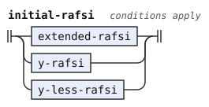</p>
<p>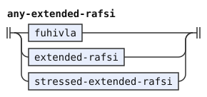</p>
</details>


## Borrowings and extended rafsi

A consonantal syllable has a consonant and then a coda that begins with a syllabic consonant. A borrowing is a head of unstressed syllables, a stressed syllable, any number of consonantal syllables and a final syllable. Its head does not begin with a string of rafsi. It also does not begin with a cmavo, or with a consonant and a string of rafsi. That last test is the slinku'i test of CLL[^cll-s4-7].

An extended rafsi lets a brivla or a borrowing, whole or cut short, stand before a y-hyphen inside a compound. A `brivla_rafsi` is a head of two syllables or more, followed by `'y`, as `klama'y` in `klama'ybroda`. A `fuhivla_rafsi` is the head of a borrowing followed by an onset and `y`. The onset is a consonant, as in `aktyiismu`, a legal initial cluster, or a glide, as in `spageiybroda`. Each has a stressed form, which stands before `short-final-rafsi`.

```jbogenbau
-- A borrowing ends with its stressed syllable and final syllable. A vowel-bearing final syllable cannot start with a consonantal syllable.
%rule fuhivla
  fuhivla-head stressed-syllable [{consonantal-syllable}] final-syllable

-- The stressed brivla form requires apostrophe-y after its stressed syllable. The stressed borrowing form forbids that onset at its fixed boundary.
%rule stressed-extended-rafsi
  stressed-brivla-rafsi | stressed-fuhivla-rafsi

-- A brivla rafsi requires an apostrophe after its head. A borrowing rafsi forbids that onset. The complete heads fix that boundary.
%rule extended-rafsi
  brivla-rafsi | fuhivla-rafsi

-- A stressed extended brivla rafsi needs an unstressed first syllable before its stressed end and apostrophe-y.
%rule stressed-brivla-rafsi
  $b:brivla-head stressed-syllable h y
%conditions
  $b.onward.parse(unstressed-syllable …)

-- A whole brivla head before apostrophe-y needs at least two syllables. A following rafsi cannot start with the optional apostrophe.
%rule brivla-rafsi
  brivla-head h y [h]
%conditions
  $.onward.parse(two-syllables …)

-- Require two vowel-bearing syllables. A consonantal syllable cannot consume the start of the second one.
%rule two-syllables
  syllable [{consonantal-syllable}] syllable

-- A stressed borrowing rafsi ends before y. Its onset cannot be an apostrophe.
%rule stressed-fuhivla-rafsi
  fuhivla-head stressed-syllable [{consonantal-syllable}] $o:onset y
%conditions
  ¬$o.onward.parse(h …)

-- A borrowing rafsi starts with an unstressed syllable and forbids an apostrophe onset after its head. A following rafsi cannot start with apostrophe.
%rule fuhivla-rafsi
  $f:fuhivla-head onset y [h]
%conditions
  $f.onward.parse(unstressed-syllable …),
  ¬$f.following-tokens.parse(h …)

-- A borrowing head cannot begin with a rafsi string.
%rule fuhivla-head
  $b:brivla-head
%conditions
  ¬$b.onward.parse(rafsi-string …)

-- An unstressed head starts at a legal onset and excludes particles, slinku'i forms, and apostrophe starts. The following stress or hyphen fixes its length.
%rule brivla-head
  [{unstressed-syllable}]
%conditions
  ¬$.onward.parse((cmavo | slinkuhi | h) …),
  $.onward.parse(syllable-onset …)

-- A slinku'i form starts with a consonant plus a rafsi string, but the whole start is not itself a rafsi string. Only a lookahead.
%rule slinkuhi
  $c:consonant rafsi-string
%conditions
  ¬$c.onward.parse(rafsi-string …)
```

<details><summary>Railroad diagrams of the 11 rules from <code>fuhivla</code> to <code>slinkuhi</code></summary>
<p>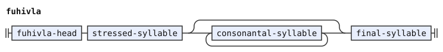</p>
<p>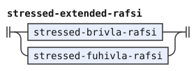</p>
<p>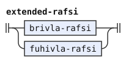</p>
<p>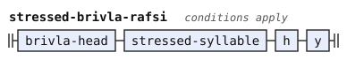</p>
<p>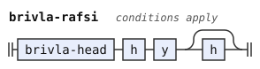</p>
<p>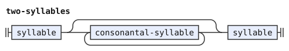</p>
<p>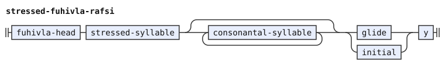</p>
<p>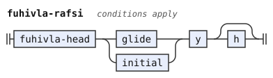</p>
<p>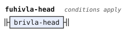</p>
<p>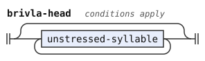</p>
<p>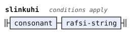</p>
</details>


The slinku'i test and a borrowing's head look for a string of rafsi. That is any number of rafsi without a y-hyphen, and then a part that can end a lujvo or that has a y-hyphen. The PEG uses it only in lookaheads.

```jbogenbau
-- Detect a string of rafsi. The stressed ending or y boundary fixes the unstressed prefix. Only a lookahead.
%rule rafsi-string
  [{y-less-rafsi}] rafsi-string-end

-- The string ends a compound, or it reaches a y-hyphen of either stress.
%rule rafsi-string-end
  | gismu
  | cvv-final-rafsi
  | stressed-y-less-rafsi short-final-rafsi
  | y-rafsi-of(vowel, [h])
  -- A stressed CVC or CVV rafsi differs from initial-pair in its second letter. A stressed CCV rafsi has a vowel where the following y is required. So the optional cannot consume the required pair.
  | [stressed-y-less-rafsi] initial-pair y
  | hy-rafsi-of(vowel, diphthong, vowel, [h])

```

<details><summary>Railroad diagrams of <code>rafsi-string</code> and <code>rafsi-string-end</code></summary>
<p>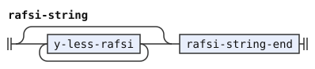</p>
<p>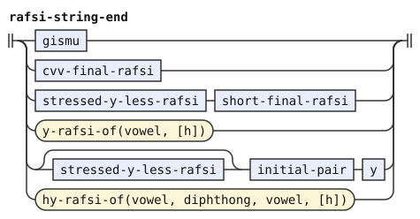</p>
</details>


## Rafsi

The core of a brivla ends it, and a pause or another word follows it. Its final syllable has a nucleus with no stress mark and is not followed by a name.

Three rules test `final-syllable` at one anchor each, and no rule repeats its `post-word` test. In `gismu`, the witness begins at the last consonant, and its nucleus is the last vowel of the body. In `cvv-final-rafsi`, the witness begins at the final vowel, and its nucleus is that vowel. In `short-final-rafsi`, the witness begins at the start of the body, and its nucleus ends the body. Each witness ends where its body ends, so its `post-word` test reads the same place as a test on the body.

The callers of the stressed CVC form put a consonant after it. A short final rafsi begins with a consonant, and an initial pair begins with a consonant. So no caller can put `y` after the stressed CVC form, and no test against `y` stands on that form.

Each rafsi shape stands once as a template. The stress argument of a template is one stress unit. The units are `stressed-vowel`, `unstressed-vowel`, `stressed-diphthong` and `unstressed-diphthong`. Plain `vowel` or `diphthong` as an argument means either stress. The two plain units cover the stressed unit and the unstressed unit of each kind.

The tail of the `y` templates is an argument, `[h]` or `ε`. The first vowel of the apostrophe form of CVV stays unstressed in each binding. The long apostrophe-y body takes its own final-vowel argument. A layer can change that vowel without a change to the other parts.

`y-less-rafsi` and `rafsi-string-end` read the apostrophe-y shape of either stress through `hy-rafsi-of`. The named apostrophe-y bindings stand in the experimental layer, which reads them inside compounds. `gismu` reads the stressed long shape and one more vowel.

```jbogenbau
-- A root is the stressed long shape and a vowel. Its final syllable test stands at its last consonant.
%rule gismu
  $s:long-rafsi-of(stressed-vowel) vowel
%conditions
  $s.last-token.onward.parse(final-syllable …)

-- A CVV final rafsi ends with a valid final syllable. Its test stands at its final vowel.
%rule cvv-final-rafsi
  consonant stressed-vowel h $v:vowel
%conditions
  $v.onward.parse(final-syllable …)

-- A short final rafsi forms a valid final syllable. The second letter is a vowel in one form and a consonant in the other.
%rule short-final-rafsi
  consonant diphthong | initial-pair vowel
%conditions
  $.onward.parse(final-syllable …)

-- A CVC rafsi has the given vowel unit between two consonants.
%rule cvc-rafsi-of(@V)
  consonant @V consonant

-- A CCV rafsi ends in the given vowel unit after an initial consonant pair.
%rule ccv-rafsi-of(@V)
  initial-pair @V

-- A long rafsi has the given vowel unit and one or two consonants after it. The forms differ in their second letter.
%rule long-rafsi-of(@V)
  initial-pair @V consonant | consonant @V consonant consonant

-- A CVV rafsi begins with a consonant. Its apostrophe form keeps its first vowel unstressed. An r-hyphen can follow either form.
%rule cvv-rafsi-of(@V, @D)
  consonant (unstressed-vowel h @V | @D) [r-hyphen]

-- A short rafsi is a CVC, CCV or CVV rafsi with the given units. The forms differ in their second or third letter.
%rule short-rafsi-of(@V, @D)
  cvc-rafsi-of(@V)
  | ccv-rafsi-of(@V)
  | cvv-rafsi-of(@V, @D)

-- A long rafsi or CVC rafsi with the given unit ends before y. The tail after y is an argument.
%rule y-rafsi-of(@V, @T)
  (long-rafsi-of(@V) | cvc-rafsi-of(@V)) y @T

-- A classical body ends with apostrophe-y. The long body takes its own final-vowel argument.
%rule hy-rafsi-of(@V, @D, @LV, @T)
  (long-rafsi @LV | ccv-rafsi-of(@V) | cvv-rafsi-of(@V, @D)) h y @T

-- A CVC rafsi has an unstressed vowel between two consonants.
%rule cvc-rafsi = cvc-rafsi-of(unstressed-vowel)

-- A stressed CVC rafsi has a stressed vowel between two consonants.
%rule stressed-cvc-rafsi = cvc-rafsi-of(stressed-vowel)

-- A long rafsi has an unstressed vowel and one or two consonants after it.
%rule long-rafsi = long-rafsi-of(unstressed-vowel)

-- A long rafsi or CVC rafsi ends before y. A following rafsi cannot start with the optional apostrophe.
%rule y-rafsi = y-rafsi-of(unstressed-vowel, [h])

-- A stressed long rafsi or CVC rafsi ends before y.
%rule stressed-y-rafsi = y-rafsi-of(stressed-vowel, ε)

-- A stressed short rafsi is a CVC, CCV or CVV rafsi. No test against y stands here, because each caller puts a consonant after it.
%rule stressed-y-less-rafsi = short-rafsi-of(stressed-vowel, stressed-diphthong)

-- An unhyphenated rafsi excludes a y rafsi and an apostrophe-y rafsi of either stress at its start. It cannot end directly before an apostrophe. Its body is a CVC, CCV or CVV rafsi, whose forms differ in their second or third letter.
%rule y-less-rafsi
  $r:short-rafsi-of(unstressed-vowel, unstressed-diphthong)
%conditions
  ¬$r.onward.parse((y-rafsi-of(vowel, [h]) | hy-rafsi-of(vowel, diphthong, vowel, [h])) …),
  ¬$r.following-tokens.parse(h …)
```

<details><summary>Railroad diagrams of the 17 rules from <code>gismu</code> to <code>y-less-rafsi</code></summary>
<p>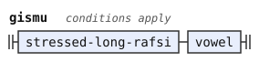</p>
<p>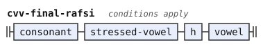</p>
<p>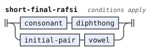</p>
<p>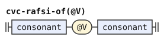</p>
<p>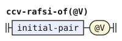</p>
<p>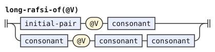</p>
<p>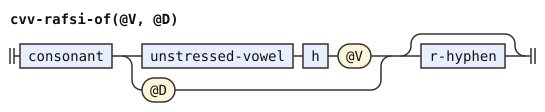</p>
<p>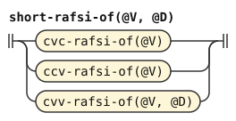</p>
<p>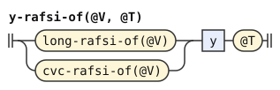</p>
<p>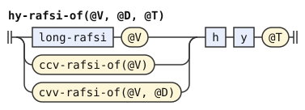</p>
<p>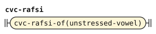</p>
<p>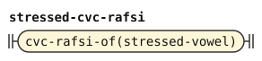</p>
<p>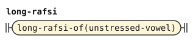</p>
<p>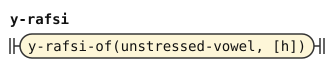</p>
<p>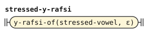</p>
<p>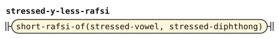</p>
<p>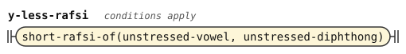</p>
</details>


```jbogenbau
-- The hyphen is r before a consonant, or n before r. Each letter reads as a full consonant, so its pair with the next letter must stand in the table.
%rule r-hyphen
  | $r:consonant="r"
  | $n:consonant="n"
%conditions
  $r.following-tokens.parse(consonant …),
  $n.following-tokens.first-token.value = "r",
  $n.following-tokens.parse(consonant …)

```

<details><summary>Railroad diagram of <code>r-hyphen</code></summary>
<p></p>
</details>


## Syllables and stress

A counted syllable has a vowel or diphthong as its nucleus, not `y`. Consonantal syllables do not count.

A vowel, diphthong or syllable is stressed in two cases. In one, the vowel after its onset carries `Stressed`, a written stress mark (`stressed`). In the other, one more counted syllable follows it before a pause (`stress`). Intervening `y` syllables and consonantal syllables do not count. It is unstressed when neither test holds. A capital glide, or a capital second letter of a diphthong, marks nothing.

So an unmarked brivla is stressed on its penultimate counted syllable, and a pause must follow it. Another word can directly follow a brivla whose stress is marked.

```jbogenbau
-- The final counted syllable forbids y and marked stress. It excludes a following name and ends at a complete word boundary.
%rule final-syllable
  $o:syllable-onset $n:nucleus
%conditions
  ¬$o.following-tokens.parse((y | stressed) …),
  ¬$n.following-tokens.parse(cmevla …),
  $n.following-tokens.parse(post-word …)

%rule stressed-unit(@U)
  $s:@U
%conditions
  $s.onward.parse(stressed …) ∨ $s.following-tokens.parse(stress …)

%rule unstressed-unit(@U)
  $s:@U
%conditions
  ¬$s.onward.parse(stressed …),
  ¬$s.following-tokens.parse(stress …)

-- A syllable is stressed by a written mark or its position before the final syllable. One constituent covers both cases.
%rule stressed-syllable = stressed-unit(syllable)

-- A diphthong is stressed by a written mark or its position before the final syllable. One constituent covers both cases.
%rule stressed-diphthong = stressed-unit(diphthong)

-- A vowel is stressed by a written mark or its position before the final syllable. One constituent covers both cases.
%rule stressed-vowel = stressed-unit(vowel)

-- An unstressed vowel-bearing syllable has a nucleus. A consonantal syllable has none. Only one kind can complete at a syllable boundary. The plain form has neither a written stress mark nor positional stress.
%rule unstressed-syllable
  unstressed-unit(syllable)
  | consonantal-syllable

-- An unstressed diphthong has neither a written stress mark nor positional stress.
%rule unstressed-diphthong = unstressed-unit(diphthong)

-- An unstressed vowel has neither a written stress mark nor positional stress.
%rule unstressed-vowel = unstressed-unit(vowel)

-- Positional stress precedes the last counted syllable before a pause. The counted syllable cannot start with y. The test asks whether a split reaches that final syllable and the pause.
%rule stress
  [{consonant | glide}] [h] [y] $s:syllable
%conditions
  $s.following-tokens.parse(pause …)

-- A stressed syllable begins at a syllable onset and has a stressed vowel letter. It reads the letter, not the vowel rule.
%rule stressed
  syllable-onset _<Vowel Stressed>
```

<details><summary>Railroad diagrams of the 11 rules from <code>final-syllable</code> to <code>stressed</code></summary>
<p></p>
<p></p>
<p></p>
<p></p>
<p></p>
<p></p>
<p></p>
<p></p>
<p></p>
<p></p>
<p></p>
</details>


The `syllable-onset` hook reads an ordinary onset. Syllables, stress tests, the brivla head, and the coda lookahead use it. This includes `final-syllable`. A layer can extend their shared onset without changing the other restrictions. The `cmavo`, `fuhivla-rafsi`, and `stressed-fuhivla-rafsi` rules read plain `onset` and remain unchanged by that extension.

A syllable has an onset, a nucleus, and an optional nonempty coda. A consonantal syllable has a consonant and then a coda that begins with a syllabic consonant. A consonantal syllable cannot consume the same complete letters as a syllable with a nucleus. A coda ends before another syllable or a pause, which are incompatible boundaries. Before a pause, one consonant and two consonants have different lengths. The absent optional covers the empty coda once.

If a coda stands before another syllable, omitting it leaves consonants that cannot begin that syllable. If it stands before a pause, omitting it leaves consonants before that required pause. Thus both presence choices cannot complete the same word.

```jbogenbau
-- This hook supplies the shared onset for syllables, stress tests, the brivla head and coda lookahead.
%rule syllable-onset
  onset

-- A vowel-bearing syllable has the given nucleus and an optional nonempty coda. Omitting a required coda leaves consonants that cannot start the following syllable.
%rule syllable-of(@N)
  syllable-onset @N [coda]

-- A counted syllable has a vowel or diphthong as its nucleus, never y. Its optional nonempty coda leaves no duplicate empty reading at a pause.
%rule syllable = syllable-of((vowel | diphthong))

-- The second consonant must be syllabic. The nonempty coda contains it.
%rule consonantal-syllable
  $c:consonant coda
%conditions
  $c.following-tokens.parse(syllabic …)

-- A nonempty coda ends before a syllable or a pause. Those following boundaries cannot coincide. A final coda has one consonant or a syllabic consonant and another consonant, whose lengths before the pause cannot coincide.
%rule coda
  | $c:consonant
  | [syllabic] $p:consonant
%conditions
-- A vowel-bearing syllable has a nucleus. A consonantal syllable has none, so they cannot consume the same complete syllable.
  ¬$c.onward.parse((syllable-of(nucleus) | consonantal-syllable) …),
  $c.following-tokens.parse((syllable-of(nucleus) | consonantal-syllable) …),
  $p.following-tokens.parse(pause …)

-- An apostrophe, glide, or consonant initial precedes a nucleus. An empty initial before apostrophe cannot reach that nucleus. Initial forbids a following glide.
%rule onset
  h | glide | initial

-- A nucleus is a vowel, diphthong, or y. A vowel forbids the following nucleus that a diphthong requires. A y nucleus forbids another nucleus.
%rule nucleus
  | vowel | diphthong
  | $y:y
%conditions
  ¬$y.following-tokens.parse(nucleus …)

-- A glide is i or u directly before a nucleus.
%rule glide
  "i" | "u"
%conditions
  $.following-tokens.parse(nucleus …)

-- A diphthong cannot end directly before another nucleus.
%rule diphthong
  $d:diphthong-letters
%conditions
  ¬$d.following-tokens.parse(nucleus …)

-- The four diphthongs differ in their first or second letter. A repeated i or u cannot follow the matching diphthong.
%rule diphthong-letters
  | "a" $i:"i"
  | "a" $u:"u"
  | "e" $i:"i"
  | "o" $i:"i"
%conditions
  $i.following-tokens.first-token.value ≠ "i",
  $u.following-tokens.first-token.value ≠ "u"

-- A vowel cannot end directly before another nucleus. It reads one token with the Vowel tag.
%rule vowel
  $v:_<Vowel>
%conditions
  ¬$v.following-tokens.parse(nucleus …)
```

<details><summary>Railroad diagrams of the 11 rules from <code>syllable-onset</code> to <code>vowel</code></summary>
<p></p>
<p></p>
<p></p>
<p></p>
<p></p>
<p></p>
<p></p>
<p></p>
<p></p>
<p></p>
<p></p>
</details>


## Letters

A vowel letter has a lowercase value with or without `Stressed`, and it carries the `Vowel` tag. Rules read a vowel letter through that tag, and one letter through a value test on it. A stressed vowel letter also carries `Stressed`, which the stressed test reads.

A `y` is not followed by a nucleus, unless that nucleus is another `y`. An apostrophe is followed by a nucleus. The `y` rule carries the test against a following non-y nucleus. A value test alone cannot state that test.

```jbogenbau
-- A y letter cannot precede a non-y nucleus.
%rule y
  $y:"y"
%conditions
  ¬$y.following-tokens.parse((vowel | diphthong) …)

-- An apostrophe must precede a nucleus.
%rule h
  $h:"'"<¬PAUSE>
%conditions
  $h.following-tokens.parse(nucleus …)
```

<details><summary>Railroad diagrams of <code>y</code> and <code>h</code></summary>
<p></p>
<p></p>
</details>


## Consonants

An initial pair is two consonants that can begin a word. `initial` reads a cluster where each pair of neighbours stands in `$INITIAL`. An affricate can stand only as the whole cluster. That limit is a departure from CLL 4.7, and the closing section lists it.

A sibilant, another consonant and a liquid give the usual shape of a long cluster. No consonant or glide can follow the cluster. The initial can be empty only where no consonant or glide follows.

The pair law reads raw consonant tokens against `$PERMISSIBLE`. A law that reads each consonant through its own rule can differ on one consonant query inside a bad run, as in `btb`. They give the same words, because each consonant of a divided run passes its own test. A run with a consonant that fails stays foreign under both laws. The `bu` test is the only lookahead that leaves a run. Its `post-word` chain reads whole words, so it reads each letter of the run.

```jbogenbau
-- The first two consonants decide this lookahead.
%rule cluster
  consonant consonant

-- An initial pair is in $INITIAL, and no third consonant follows it.
%rule initial-pair
  consonant consonant
%conditions
  $.value ∈ $INITIAL,
  ¬$.following-tokens.parse(consonant …)

-- An initial is a cluster from the table, or no consonant at all. No consonant or glide follows it.
%rule initial
  [initial-cluster]
%conditions
  ¬$.following-tokens.parse((consonant | glide) …)

-- Each pair of neighbours is in $INITIAL. An affricate stands only as the whole cluster.
%rule initial-cluster
  {consonant}
%conditions
  $.value.ngrams(2) ⊆ $INITIAL,
  $.value ∈ $AFFRICATES ∨ $.value.ngrams(2) ∩ $AFFRICATES = ∅

-- The letter n and an affricate after it, read as raw consonant tokens against $AFFRICATES. Only a lookahead.
%rule n-affricate
  "n" _<Consonant> _<Consonant>
%conditions
  $.tokens-after-first.value ∈ $AFFRICATES

-- A consonant token cannot stand before a banned sound, an impermissible pair, or n with an affricate.
%rule consonant
  $c:_<Consonant>
%conditions
  ¬$c.following-tokens.parse(letter-ban …),
  ¬$c.onward.parse(impermissible-pair …),
  ¬$c.onward.parse(n-affricate …)

-- Two raw consonant tokens whose pair is outside $PERMISSIBLE. Only a lookahead.
%rule impermissible-pair
  _<Consonant> _<Consonant>
%conditions
  $.value ∉ $PERMISSIBLE

%const $SYLLABIC-CONSONANTS
  "l" "m" "n" "r"

-- A syllabic consonant is a full consonant with one of the four syllabic values.
%rule syllabic
  $s:consonant
%conditions
  $s.value ∈ $SYLLABIC-CONSONANTS
```

<details><summary>Railroad diagrams of the 8 rules from <code>cluster</code> to <code>syllabic</code></summary>
<p></p>
<p></p>
<p></p>
<p></p>
<p></p>
<p></p>
<p></p>
<p></p>
</details>


The `letter-ban` hook reads a following syllable-initial apostrophe or glide. `$PERMISSIBLE` states the pair law of CLL[^cll-s3-6], and `n-affricate` states the triple law of CLL[^cll-s3-7]. This hook states the apostrophe rule and the committee's glide ban. No rule names one consonant letter, because the `Consonant` tag and a value test state each letter that a rule needs.

```jbogenbau
-- Consonant letters cannot precede a syllable-initial apostrophe or glide.
%rule letter-ban
  h | glide
```

<details><summary>Railroad diagram of <code>letter-ban</code></summary>
<p></p>
</details>


## Differences from CLL and the reference PEG

The [checkpoint record](https://mw.lojban.org/index.php?title=BPFK_Checkpoints&oldid=109606) defers morphology. CLL 1.3.4[^cll-later-a3-3] records two committee votes on word forms. One vote covers [consonants before glides](#consonant-restriction). The other requires a pause before and after every name, and so lifts the ban on `la`, `lai`, `la'i` and `doi` inside names. Any pause serves as the vote's dot. Hesitation also serves, because the Magic Words proposal counts `y` as whitespace.

The PEG implements both votes. CLL 1.3.4 describes the rest of this working grammar, its extended rafsi included, as practice without a vote.

The phoneme stage reads the text before this stage does. This comparison uses `camxes.peg` alone. The ilmentufa preprocessor applies the digit, decimal-point and accent conventions before the PEG runs. In five ways, the text that this stage reads differs from the text that the PEG reads:

- The PEG reads a digit as a cmavo, and lets a digit stand in a name (its rule `digit`). The phoneme stage reads each digit as the letters of its number word, so `2` is `re`. So this grammar has no rule `digit`. `.b1b.` is not a name, and `.dj2n.` is the name `djren`.
- A period between two digits emits the letters of `pi`. Thus `2.3` becomes three cmavo: `re`, `pi`, and `ci`. The PEG instead reads two digits separated by a pause.
- The PEG ignores a comma before any letter (`comma*` in each letter rule). The phoneme stage drops commas inside words. This grammar omits `comma*` in letter rules, with the same result except in the letter word `ybu`. Separate comma material remains a pause token.

  The PEG's `ybu` reads pause characters between the `y` and the `bu`, but no comma, unless the comma stands directly before the `bu`. Where `ybu` fails, full camxes-std treats the `y` as hesitation, which is space. Full camxes-std rejects `y, bu` and `y , bu`. It reads `doi y, bu` as one letter word `doi bu`, because it treats that `y` as space.

  The morphology-only parser reads `y` and `bu` as two words in `y, bu` and `y , bu`. It reads `doi` and `bu` as two words in `doi y, bu`. The words stage reads `y, bu` and `y , bu` as the letter word `y bu`. In `doi y, bu`, it reads `doi` followed by the letter word `y bu`. Both full camxes-std and the words stage read `y ,bu` as that letter word.
- The PEG reads a lowercase `h` as an apostrophe, and a consonant or `y` in either case. The phoneme stage reads a capital `H` as an apostrophe too, so `koHa` is `ko'a`, which the PEG rejects. It emits each apostrophe phoneme as `'` and lowercase values for consonants and `y`, so the grammar reads only those. A capital vowel outside a capital run is stressed for both. The phoneme stage also reads accents as stress and folds runs of two vowel groups or more in which every vowel is a capital. The PEG reads neither convention.
- The PEG's pauses are the space, tab, line feed and carriage return, and the characters `.`, `?` and `!` (its rule `space_char`). The phoneme stage reads every Unicode `White_Space` character and other punctuation as a pause too. A period between two digits is instead the cmavo `pi`. A no-break space between two words is a pause here, but the PEG rejects it. A [quiet pause](../common/latin.md#punctuation) emits one `PAUSE` with value `" "`. Punctuation in the same pause emits its own [material token](../common/latin.md#punctuation).

  A pause token can retain a punctuation apostrophe as its value. The apostrophe rule excludes that token so that raw punctuation never becomes a word phoneme.

### The ybu exception

The PEG's first spelling of `BY`, the rule `ybu <- Y space_char* BU`, reads more than `cmavo`. It reads a run of `y`, any run of space characters, and `bu` as one letter word. Thus `ybu`, `y bu` and `yyybu` are each one word. That is the letter word `.y bu`, which the Magic Words proposal forms "before any other processing of any kind". This stage reads each run on its own, so it reads the `y` and the `bu` as two words. The shared word reader then forms the letter word ([../common/stream.md](../common/stream.md)).

A run stays one hesitation token except for the split that prepares a letter word before BU. That split separates its final y from the hesitation prefix. The words stage drops the prefix and forms `y bu` from the final y and BU. Thus `ybu`, `y bu`, `yyybu`, `.y.bu`, and `yy bu` each produce the same letter word.

### Duplicate proofs

[How this grammar states the morphology](#how-this-grammar-states-the-morphology) explains how the rules avoid duplicate proofs without changing ordinary word division or word classes.

### Consonant restriction

The consonant rules retain the ban on a consonant directly followed by a glide. The committee voted for this ban, and CLL 1.3.4 records the vote.[^cll-later-a3-3]

The pair tables state the pair law and the initial law in one place for each fact. An affricate stands only as a whole initial cluster in this grammar. CLL 4.7 allows a longer cluster with an affricate pair inside it, so that limit departs from CLL.[^cll-s4-7]

[^cll-s4-7]: [CLL 1.1, section 4.7](https://lojban.org/publications/cll/cll_v1.1_xhtml-section-chunks/section-fuhivla.html).

[^cll-s3-6]: [CLL 1.1, section 3.6](https://lojban.org/publications/cll/cll_v1.1_xhtml-section-chunks/section-clusters.html).

[^cll-later-a3-3]: [CLL 1.3.4, appendix A3.3](https://github.com/int19h/cll/blob/v1.3.4/chapters/a03.xml#L155-L243). This later approval record has no CLL 1.1 counterpart.
