# Word forms

This document opens the forms stage. A stage is one step of a pipeline, with its own grammar ([engine §1](../../../docs/engine.md#1-tokens)).

A token is one unit that a stage reads or emits. A token's value is the string that exact comparisons read. Its image is the string that people see.

The forms stage follows the phoneme stage in every Lojban pipeline: [CLL](../cll/pipeline.md), [BPFK](../bpfk/pipeline.md), [experimental](../experimental/pipeline.md) and [Zantufa](../zantufa/pipeline.md). The stage reads the phoneme values, images and tags.

The stage divides the text into its source words and tags each word with its class. A tag marks a token by an identifier. The stage hands the words to the words stage ([stream.md](stream.md)), where the magic words act on them. [The notation document](../../../docs/notation.md) explains the notation.

This document does not decide what a word looks like. The loader stitches other documents into the stage with this one: the word forms of one word family, and one lexicon. A word family is a set of word forms that pipelines use. The word family defines three of the shapes this grammar reads: `cmavo-shape`, `brivla-shape` and `cmevla-shape`. It tags each with the pause properties below.

The prose uses these Lojban terms for words:

- A cmavo is a particle, a short structure word.
- A selma'o is a word class of cmavo.
- A brivla is a predicate word.
- A cmevla is a name word.
- A rafsi is a shortened word form used inside compounds.
- A gismu is a root word.

The `lojban/cll` pipeline stitches [../cll/shapes.md](../cll/shapes.md) and [../cll/morphology.md](../cll/morphology.md) as its word family. The other pipelines stitch [../bpfk/morphology.md](../bpfk/morphology.md), with [../experimental/morphology.md](../experimental/morphology.md) or [../zantufa/morphology.md](../zantufa/morphology.md) after it. The lexicon is [../cll/lexicon.md](../cll/lexicon.md), [../experimental/lexicon.md](../experimental/lexicon.md) or [../zantufa/lexicon.md](../zantufa/lexicon.md), and it gives each cmavo its selma'o.

## Runs

The text is runs and pauses. A run is a stretch of text with no pause inside. The phoneme stage emits a pause as one or more `PAUSE` tokens. The phoneme stage decides what counts as a pause. In the orthography of *The Complete Lojban Language* (CLL), a pause is a space or a period. In the conventions that the other pipelines read, other punctuation is a pause too.

The numbered pause rules of CLL[^cll-s4-9] and its stress rule[^cll-s4-2] hold within one run. A pause satisfies each of them, so two words with a pause between them never constrain each other.

A lookahead tests following input without consuming it. The BPFK word forms look ahead only as far as the next pause. BPFK is the Lojban language planning committee. This stage reads each run on its own, except for two lookaheads.

A prolonged y run tests for `bu` across one pause. In the BPFK word family, `cmavo-shape` ends with the PEG's `post_word` test, so this lookahead requires the whole cmavo. In the CLL word family, it tests only the letters `bu`, even at the start of another word.

In Zantufa, a second lookahead applies before a quoted form. There, a `ra'oi` before a pause changes how the stage divides the next run ([../zantufa/morphology.md](../zantufa/morphology.md)).

A run is a sequence of words or a foreign run. A foreign run is a stretch that the pipeline did not read as words. It carries the tag `FOREIGN`. The phoneme stage emits a foreign run when it contains a character that no script reads. The forms stage also emits a foreign run when its phonemes divide into no words.

A `Quote-Material` pause token preserves punctuation or ignored source text in [latin.md](latin.md). This stage preserves each pause token separately, with its tags and image. Every pause receives the value of one space. Raw quote recipes recover material from its source text. A punctuation apostrophe tagged `PAUSE` is no word phoneme. A supplied `Silent` token also keeps its strings and receives `Run-Initial` and `Run-Final`.

A foreign run is not an error here. The words stage decides whether a foreign run can stand where it is. The words stage takes it as the body of a quote, such as `zoi` or `zo'oi`, and after `fa'o`. Elsewhere it rejects a foreign run ([stream.md](stream.md)). So this stage never rejects a text.

In `lojban/cll`, a syllable comma has an empty value, so `nonpause-phoneme` reads its `Syllable-Break` tag. The other Lojban pipelines drop commas in the phoneme stage.

Ordinary word forms divide each run in one way only. Zantufa's `ra'oi` quote is the exception. Its `leftmost-longest` flag selects the longest rafsi or gismu form within a complete reading. The other word forms fix every boundary, so the stage's `lazy` choice decides nothing else.

```jbogenbau
%ambiguity-resolution lazy
```

```jbogenbau
%rule text
  | ε | pause-token
  | [pause-token] runs [pause-token]

%rule runs
  run | runs pause-token run

%rule pause-token
  {pause-part}

%rule pause-part
  PAUSE
%emits
  $ :: $.tags := " " :- $.image

%rule run
  word-run | foreign-token | unsegmentable-run | silent-token

%rule silent-token
  $s:Silent
%emits
  $ :: $s.tags ∪ Run-Initial ∪ Run-Final

%rule word-run
  run-words

%rule foreign-token
  $f:FOREIGN
%emits
  $ :: $f.tags ∪ Run-Initial ∪ Run-Final

%rule unsegmentable-run
  $f:phoneme-sequence
%conditions
  ¬$f.following-tokens.begins(nonpause-phoneme),
  ¬$f.matches(word-run)
%emits
  $ :: FOREIGN ∪ Run-Initial ∪ Run-Final := $.decomposed-source-text :- $.image

%rule phoneme-sequence
  nonpause-phoneme | phoneme-sequence nonpause-phoneme

%rule nonpause-phoneme
  | "a" | "e" | "i" | "o" | "u" | "y" | "'"<¬PAUSE> | Syllable-Break
  | "b" | "c" | "d" | "f" | "g" | "j" | "k" | "l" | "m"
  | "n" | "p" | "r" | "s" | "t" | "v" | "x" | "z"
```

<details><summary>Railroad diagrams of the 11 rules from <code>text</code> to <code>nonpause-phoneme</code></summary>
<p>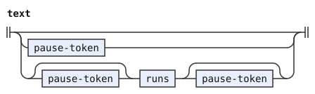</p>
<p>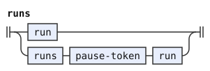</p>
<p>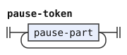</p>
<p>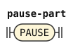</p>
<p>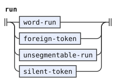</p>
<p>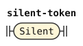</p>
<p>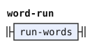</p>
<p>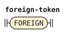</p>
<p>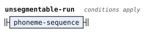</p>
<p>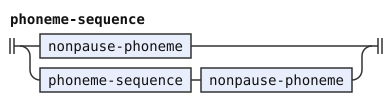</p>
<p>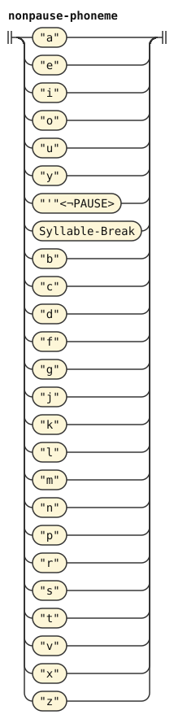</p>
</details>


The stage covers every input token. It preserves pause boundaries, images and tags, and sets pause values to one space. It passes foreign runs through and combines phonemes into words or foreign runs. A phoneme-stage `FOREIGN` token keeps its value, image and text. The `foreign-token` rule adds `Run-Initial` and `Run-Final`.

A run of phonemes that divides into no words becomes one `FOREIGN` token. Its value is its source text, the run as the author wrote it, in the decomposed form of stage zero. Its image concatenates its phoneme images. A word's value never equals such a text, so the run never closes a quote that a word opened. A delimiter must be a word, and such a run is none. The token's text retains what the author wrote.

The stage tests only a whole run, and it tests the run in isolation. No rule except the two lookaheads reads past the run, so the isolated test agrees with a test in place. A `yy` that the y lookahead splits divides into words either way.

The rule `word-run` is a run that divides into words. A pipeline that divides a run in another way extends `word-run`, as [../zantufa/morphology.md](../zantufa/morphology.md) does for `ra'oi`. So `unsegmentable-run` never takes a run that one of these ways reads.

## Words in a run

The stage reads the words of a run from the left. Each word after the first can follow the word before it only if the pause rules let the two stand together with no pause. The word family tags each word with the properties that these rules test. The run carries the tags of its last word, so the condition sees the word before and the word after. The following list describes the CLL word family:

- `Onset`: The word can follow another word directly. It begins with a consonant and is not a name (rules 3 and 4).
- `Continued`: Another word can follow this one directly. A name never has it (rule 2), nor a `Cy` letter, nor a brivla whose stress is not marked.
- `Name-Intro` and `Name-Onset`: `Name-Intro` marks `la`, `lai`, `la'i` and `doi`, and `Name-Onset` marks a name that begins with a consonant. The name can follow the cmavo directly (rule 4).
- `Cy`: A `Cy` letter, which only another `Cy` letter can follow directly (rule 6).
- `Final-Stress`, `Initial-Stress` and `Stress-Guard`: The word's last or first syllable is stressed, or the word is a brivla. A word with `Initial-Stress` cannot directly follow a word with `Final-Stress`.[^cll-s4-2] Neither can a brivla with `Stress-Guard` (pause rule 5).[^cll-s4-9]
- `Open-Stress` and `Uncounted`: `Open-Stress` marks a brivla whose stress is not marked, and `Uncounted` marks a word with no counted syllable. CLL[^cll-s3-9] puts its stress on its penultimate syllable, so no counted syllable can follow it before the next pause. The run carries `Open-Stress` on through them.

A nucleus is the vowel or diphthong of a syllable.

The BPFK word forms set only `Onset` and `Continued`, with the meaning that the PEG gives them. The PEG is the parsing expression grammar from which [../bpfk/morphology.md](../bpfk/morphology.md) derives its word forms. That document states the morphology's rules directly and [lists its departures](../bpfk/morphology.md#differences-from-cll-and-the-reference-peg). Every word is `Continued`, and a word that does not begin with a nucleus is `Onset`, a name included. Their words look past their own ends, as the words of the PEG do, and decide the rest themselves.

```jbogenbau
%rule run-words
  | $f:first-word :: $f.tags
  | $r:run-words $v:later-word
      :: $v.tags ∪ (Uncounted ⊆ $v.tags ⟹ Open-Stress ∩ $r.tags)
%conditions
  (Continued ∪ Cy ∪ Name-Intro ∪ Open-Stress) ∩ $r.tags ≠ ∅,
  Cy ⊆ $r.tags ∧ Cy ⊆ $v.tags
    ∨ Continued ⊆ $r.tags ∧ Open-Stress ⊈ $r.tags ∧ Onset ⊆ $v.tags
    ∨ Name-Intro ⊆ $r.tags ∧ Name-Onset ⊆ $v.tags
    ∨ Open-Stress ⊆ $r.tags ∧ Cy ⊈ $r.tags ∧ Onset ⊆ $v.tags,
  Final-Stress ⊈ $r.tags ∨ (Stress-Guard ∪ Initial-Stress) ∩ $v.tags = ∅,
  Open-Stress ⊈ $r.tags ∨ Uncounted ⊆ $v.tags
```

<details><summary>Railroad diagram of <code>run-words</code></summary>
<p>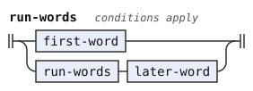</p>
</details>


A join permits two words without a pause. No two joins apply to the same pair. The general join excludes `Open-Stress`, which has its own join.

For example, in the CLL word family, a word tagged `Cy` never carries `Continued`. So only the `Cy` rule joins two `Cy` letters there, and the general join, a continued word followed by an onset, never follows one. The BPFK word forms tag no word `Cy`. They join a `Cy`-shaped word such as `fy` by the general join, so `fyno` is `fy` and `no`.

The first condition of `run-words` follows from the second. Each join of the second needs one of four tags on the words before: `Continued`, `Cy`, `Name-Intro` or `Open-Stress`. The first condition stays because it uses only `$r`.

The parser tests it as soon as it reads `$r`. If the condition fails, the parser drops the join before reading another word. Engine §4 gives this order of evaluation. Without the condition, the parser tries every word shape after a word that no word can join.

Before the cmavo `bu`, this stage splits prolonged y hesitation into a prefix and a final y token, with or without a pause. In the BPFK word family, the `post_word` test requires the whole cmavo, so `yy buntu` keeps `yy` whole. In the CLL word family, the test reads only the letters `bu`, so `yy buntu` splits `yy`. Both pieces stay hesitation, so the split changes no reading there.

Both split rules mark their final y with `Spacing` for the Zantufa word stream. Other pipelines ignore it. The word reader drops the prefix and joins only the final y with BU. This split preserves source positions and leaves raw quote bodies unjoined.

The words stage needs to know where a run begins and ends. A name that `bu` takes needs a pause before it (CLL[^cll-s17-4]). A `zoi` quote and a `zo'oi` quote end at the end of a run. So this stage tags the first word of each run `Run-Initial`, and the last word `Run-Final`.

```jbogenbau
%rule first-word
  ordinary-first-word | split-first-y

%rule ordinary-first-word
  $w:source-word
%conditions
  ¬$w.onward.begins(split-first-y)
%emits
  $ :: $w.tags ∪ Run-Initial ∪ (¬$w.following-tokens.begins(nonpause-phoneme) ⟹ Run-Final)

%rule later-word
  ordinary-later-word | split-later-y

%rule ordinary-later-word
  $w:source-word
%conditions
  ¬$w.onward.begins(split-later-y)
%emits
  $ :: $w.tags ∪ (¬$w.following-tokens.begins(nonpause-phoneme) ⟹ Run-Final)

%rule split-first-y
  $p:y-prefix $y:y-atom :: $.tags(source-word)
%conditions
  $.matches(hesitation-shape),
  $.following-tokens.begins(bu-form-ahead)
%emits
  $p :: $.tags(source-word) ∪ Run-Initial,
  $y :: $.tags(source-word) ∪ Spacing ∪ (¬$.following-tokens.begins(nonpause-phoneme) ⟹ Run-Final)

%rule split-later-y
  $p:y-prefix $y:y-atom :: $.tags(source-word)
%conditions
  $.matches(hesitation-shape),
  $.following-tokens.begins(bu-form-ahead)
%emits
  $p :: $.tags(source-word),
  $y :: $.tags(source-word) ∪ Spacing ∪ (¬$.following-tokens.begins(nonpause-phoneme) ⟹ Run-Final)

%rule y-prefix
  y-atom | y-prefix y-atom

%rule y-atom
  [Syllable-Break] "y"

%rule bu-form-ahead
  [pause-run] bu-form

%rule pause-run
  PAUSE | pause-run PAUSE | pause-run Silent PAUSE

%rule bu-form
  cmavo-shape="bu"

```

<details><summary>Railroad diagrams of the 11 rules from <code>first-word</code> to <code>bu-form</code></summary>
<p>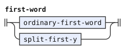</p>
<p>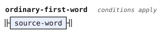</p>
<p>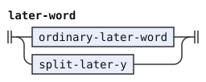</p>
<p>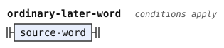</p>
<p>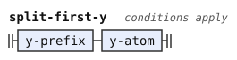</p>
<p>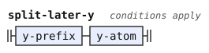</p>
<p>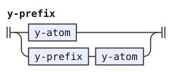</p>
<p>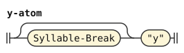</p>
<p>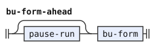</p>
<p>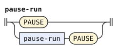</p>
<p>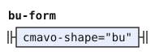</p>
</details>


## Words

A source word is a cmavo, a brivla, a name, or hesitation. The stage hands it on with its kind: `Word` and `Cmavo`, `BRIVLA` or `CMEVLA` for a word, and `Hesitation` for hesitation. A cmavo also carries the selma'o that the lexicon gives it: `$c.value.classify(lexicon)` looks the cmavo's value up in the lexicon. A cmavo unknown to the lexicon is still a word, of no class.

```jbogenbau
%rule source-word
  | $c:cmavo-shape :: Word ∪ Cmavo ∪ $c.tags ∪ $c.value.classify(lexicon)
  | $b:brivla-shape :: Word ∪ BRIVLA ∪ $b.tags
  | $n:cmevla-shape :: Word ∪ CMEVLA ∪ $n.tags
  | $h:hesitation-shape :: Hesitation ∪ $h.tags
```

<details><summary>Railroad diagram of <code>source-word</code></summary>
<p>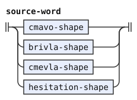</p>
</details>


Hesitation is `y` of any length. It is a source word of its own here, because the pause rules hold for it as for any word. It begins with a vowel, so a pause comes before it, unless the word family gives it `Onset`. The BPFK word forms read `kyyykerlo` as `ky`, `yy` and `kerlo`. The first `y` of `yy` is not a nucleus there.

CLL[^cll-s19-14] requires pauses before and after `.y.`. These pipelines omit the following pause because they treat `y` as whitespace, as the Magic Words proposal does. That proposal states no pause rule. [Departure 4](stream.md#cll-and-magic-words) records this difference from CLL.

The words stage drops hesitation, or reads it as the base of the letter word `.y bu`. The terminal `"y"` reads a `y` with or without `Stressed`. Two letters `y` never form one syllable, so a comma between them changes nothing, and `y,y` is hesitation as `yy` is (CLL[^cll-s3-3]).

```jbogenbau
%rule hesitation-shape
  $h:y-run :: Continued ∪ Uncounted ∪ $h.tags

%rule y-run
  "y" | "y" y-run | "y" Syllable-Break y-run
```

<details><summary>Railroad diagrams of <code>hesitation-shape</code> and <code>y-run</code></summary>
<p>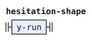</p>
<p>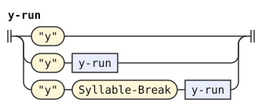</p>
</details>


## Differences from camxes

Separate material tokens preserve punctuation for raw quotes. Their normalized pause values also let delimiter comparisons find punctuation boundaries. The words stage recovers the raw spelling through source recipes, as [stream.md](stream.md) specifies.

camxes-std, the standard grammar of the camxes parser, rejects the whole text `kyyykerlo`. camxes-exp, the experimental grammar of the camxes parser, rejects it too. Their [standard spaces rule](https://github.com/lojban/ilmentufa/blob/778ea138f7d150121ca722db7536ce3b123943ac/camxes.peg#L1529-L1531) and [experimental spaces rule](https://github.com/lojban/ilmentufa/blob/778ea138f7d150121ca722db7536ce3b123943ac/camxes-exp.peg#L1625-L1627) refuse a leading Y token. The words stages of `lojban/bpfk` and `lojban/experimental` instead drop the hesitation `yy`.

[^cll-s4-9]: [CLL 1.1, section 4.9](https://lojban.org/publications/cll/cll_v1.1_xhtml-section-chunks/section-pauses.html).

[^cll-s4-2]: [CLL 1.1, section 4.2](https://lojban.org/publications/cll/cll_v1.1_xhtml-section-chunks/section-cmavo.html).

[^cll-s3-9]: [CLL 1.1, section 3.9](https://lojban.org/publications/cll/cll_v1.1_xhtml-section-chunks/section-stress.html).

[^cll-s17-4]: [CLL 1.1, section 17.4](https://lojban.org/publications/cll/cll_v1.1_xhtml-section-chunks/section-bu.html).

[^cll-s3-3]: [CLL 1.1, section 3.3](https://lojban.org/publications/cll/cll_v1.1_xhtml-section-chunks/section-lojban-characters.html).

[^cll-s19-14]: [CLL 1.1, section 19.14](https://lojban.org/publications/cll/cll_v1.1_xhtml-section-chunks/section-hesitation.html).
