# Latin conventions

This document adds to [../cll/latin.md](../cll/latin.md) the conventions that Lojban texts use beyond *The Complete Lojban Language* (CLL), edition 1.1.[^cll-c3] Both documents belong to the phoneme stage, the first stage of the pipeline. The pipelines of the [BPFK](../bpfk/pipeline.md), [experimental](../experimental/pipeline.md) and [Zantufa](../zantufa/pipeline.md) read this document after [../cll/latin.md](../cll/latin.md). BPFK is the Lojban language planning committee. The [CLL](../cll/pipeline.md) pipeline does not. [The notation document](../../../docs/notation.md) explains the notation.

A token is one unit that a stage reads or emits. A token's value is the string that exact comparisons read. Its image is the string that people see.

Most conventions here admit spellings that [../cll/latin.md](../cll/latin.md) rejects. Three change existing readings: a comma between vowels, a capital run, and material preserved between pauses. A capital run has multiple vowel groups with only capital vowels. A material token preserves punctuation or ignored text within a pause. The conventions are these:

- Punctuation other than the period and the comma is a pause.
- A comma between two vowels is nothing, as it is elsewhere.
- `h` writes the apostrophe.
- A capital run carries no stress mark except its accents.
- An accent marks stress, and a breve marks a glide. A breve is the U+0306 mark. A glide is `i` or `u` before a vowel in one syllable.
- A digit stands for its number word.

## Punctuation

A punctuation character is a pause when no letter, vowel or apostrophe rule reads it, as the next paragraph defines. Texts put quotation marks, brackets and dashes around words, so `mi "klama"` reads as `mi klama`.

Stage-zero tokens store Unicode category and whitespace tags. The rule `other-char` uses `_` and excludes letters, marks, digits and whitespace. A letter is a character of the Unicode property `L`. A mark is a combining mark of category M, or the stress mark or the shorthand of [zbalermorna.md](zbalermorna.md). A digit is `0` to `9`, and whitespace is a character of the property White_Space. A punctuation character is such a character that no rule of `any-lojban-char` or `core-char` reads by itself.

A quiet pause contains only whitespace characters and periods. It emits one `PAUSE` token with value `" "`. The core keeps the period tags of [../cll/latin.md](../cll/latin.md). Quote boundaries can therefore read the period classification of each script.

Punctuation beside a quiet pause emits a separate token tagged `PAUSE` and `Quote-Material`. Separate ignored stretches use these tags too. `Punctuation-Material` marks a stretch with visible punctuation rather than ignored characters. Their images keep their source spelling. Their values keep their decomposed source text.

Punctuation between letters also emits such a token, as in `klama!do`. Outside quotes, all these tokens still act as pauses.

Quotes read `Quote-Material` as body text. Thus `zoi gy. !!! .gy.` keeps `!!!`. In `lojban/experimental`, `zo'oi :)` also quotes `:)`.

A format character, of Unicode category Cf, is nothing, as a comma is. It is invisible, so a soft hyphen or a joiner inside a word does not split it. There are two exceptions, which are pauses. The zero-width space U+200B stands between words. The number signs of Arabic, Syriac and Kaithi are visible, as other punctuation is. Their code points are those of the Unicode property Prepended_Concatenation_Mark.

The rule lists these code points instead of naming the property. Thus the pipelines need only the core properties, and they also work with a custom Unicode table.

An ignored character at a pause edge is a comma or a non-breaking format character. Beside a word, an ignored-only edge stays uncovered. A quoted word can therefore keep that edge through its verbatim image. Between quiet cores, or after the final quiet core, a material token keeps an ignored-only stretch.

```jbogenbau
%redefine-rule pause
  spaced-pause | punctuation-pause

%redefine-rule edge-pause
  pause | commas

%redefine-rule spaced-pause
  [left-pause-edge] pause-cores [right-pause-edge]

%rule pause-cores
  | pause-core
  | pause-cores pause-material pause-core

%rule left-pause-edge
  punctuation-edge | commas

%rule right-pause-edge
  punctuation-edge | final-ignored-edge | medial-ignored-edge

%rule punctuation-edge
  $e:pause-edge
%conditions
  ¬$e.matches(commas)
%emits
  $ :: PAUSE ∪ Quote-Material ∪ Punctuation-Material := $.decomposed-source-text :- $.source-text

%rule final-ignored-edge
  commas
%conditions
  $.ends-input
%emits
  $ :: PAUSE ∪ Quote-Material := $.decomposed-source-text :- $.source-text

%rule medial-ignored-edge
  commas
%conditions
  ¬$.ends-input

%rule pause-material
  pause-edge
%emits
  $ :: PAUSE ∪ Quote-Material ∪ (¬$.matches(commas) ⟹ Punctuation-Material) := $.decomposed-source-text :- $.source-text

%redefine-rule pause-core
  {core-char}
%emits
  $ :: PAUSE ∪ ($.first-token.matches(period-char) ⟹ Period-Initial) ∪ ($.matches(period-core) ⟹ Period-Only) := " "

%rule punctuation-pause
  [commas] punctuation [commas]
%emits
  $ :: PAUSE ∪ Quote-Material ∪ Punctuation-Material := $.decomposed-source-text :- $.source-text

%redefine-rule pause-edge
  edge-char | pause-edge edge-char

%rule edge-char
  comma | punctuation-char

%rule punctuation
  punctuation-char | punctuation punctuation-char | punctuation commas punctuation-char

%rule punctuation-char
  $c:other-char [{combining-mark}]
%conditions
  ¬$c.matches(any-lojban-char | core-char),
  ¬$.following-tokens.begins(combining-mark)

%rule other-char
  $c:_
%conditions
  ¬$c.matches(non-punctuation-char)

%rule non-punctuation-char
  alpha-char | mark-char | digit-char | space-char

%rule alpha-char
  _General_Category_Letter

%rule mark-char
  combining-mark

%rule combining-mark
  _General_Category_Mark

%rule digit-char
  "0".."9"

%extend-rule comma
  $c:_General_Category_Format
%conditions
  ¬$c.matches(breaking-format-char)

%rule breaking-format-char
  | "‹U+200B›"
  | "‹U+0600›".."‹U+0605›" | "‹U+06DD›" | "‹U+070F›" | "‹U+0890›".."‹U+0891›" | "‹U+08E2›"
  | "‹U+110BD›" | "‹U+110CD›"

%redefine-rule run-char
  $c:_
%conditions
  ¬$c.matches(core-char | punctuation-char)
```

<details><summary>Railroad diagrams of the 25 rules from <code>pause</code> to <code>run-char</code></summary>
<p>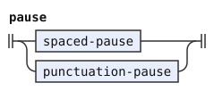</p>
<p>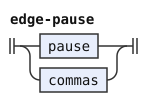</p>
<p>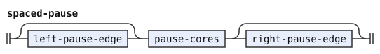</p>
<p>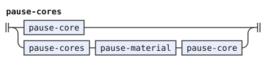</p>
<p>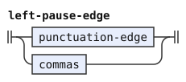</p>
<p>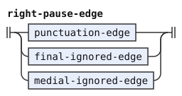</p>
<p>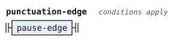</p>
<p>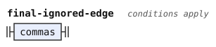</p>
<p>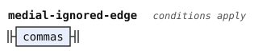</p>
<p>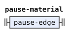</p>
<p>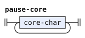</p>
<p>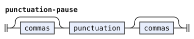</p>
<p>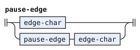</p>
<p>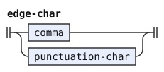</p>
<p>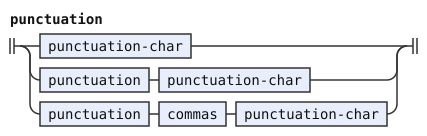</p>
<p>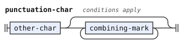</p>
<p>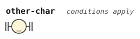</p>
<p>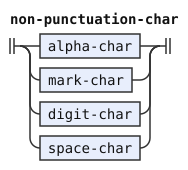</p>
<p>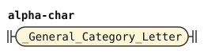</p>
<p>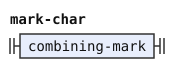</p>
<p>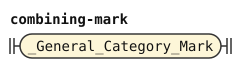</p>
<p>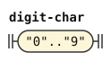</p>
<p>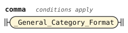</p>
<p>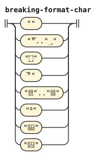</p>
<p>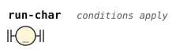</p>
</details>

## The comma

A comma between vowels is ignored, as it is between other letters. It creates no syllable break. The vowels on either side are one vowel group, as if they stood side by side. `me,iin` is `meiin`, and the Cyrillic `ма,и` is `ma'i`, as `маи` is. This document redefines `letters-after-vowel` without the `syllable-break` of [../cll/latin.md](../cll/latin.md). So nothing reads `syllable-break` in these pipelines.

```jbogenbau
%redefine-rule letters-after-vowel
  | vowel-group
  | letters-after-consonant [commas] vowel-group

%extend-rule vowel-group-plain-with(@V)
  | vowel-group-with(@V)<¬Syllabic> commas $v:@V :: $v.tags
  | vowel-group-with(@V)<Syllabic> commas $w:@V<¬Syllabic> :: $w.tags

%extend-rule vowel-group-joined-with(@V)
  vowel-group-with(@V)<Syllabic> commas $v:joined-vowel-with(@V)<Syllabic> :: $v.tags
```

<details><summary>Railroad diagrams of the 3 rules from <code>letters-after-vowel</code> to <code>vowel-group-joined-with</code></summary>
<p>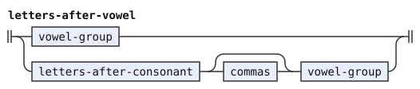</p>
<p>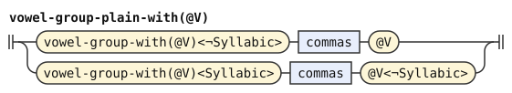</p>
<p>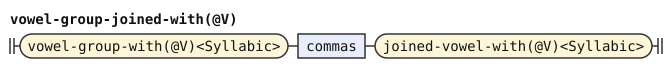</p>
</details>

## The apostrophe

The rule reads `h` and `H` as the apostrophe. A selma'o is a class of Lojban particles. Selma'o names such as KOhA use this spelling.

```jbogenbau
%extend-rule apostrophe
  ("h" | "H")
%emits
  $ :: ∅ := "'"
```

<details><summary>Railroad diagram of <code>apostrophe</code></summary>
<p>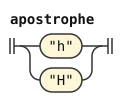</p>
</details>

## Capital runs

A run in which every vowel is a capital carries no stress mark, and the stage reads its vowels as plain vowels. A title or a shout is often written all in capitals, and its capitals do not mark stress. The run must have at least two vowel groups. So a name with one stressed syllable in capitals keeps its stress mark: `.DJORdj.` keeps its stress on `o`. The cost is that the stage reads a word of one vowel group, written in capitals, as stressed: in the text `MI KLAMA`, `MI` is `mI`.

An accent on a capital still marks stress there, and the other capitals fold. So `KLÁMA` is `klAma`. An accent is written on purpose, while a title in capitals marks no stress. A capital glide, `Ĭ` or `Ŭ`, folds to its plain vowel, as the capital Cyrillic glides do.

`capital-shape` is that shape: its consonants and digits and its capital vowels, written out so that two groups are required. Consonants stand between every two groups, so the rules never split adjacent vowels into separate groups. `capital-consonants` reads a decimal point between two digits, as `non-vowels` does in an ordinary run (see "Digits"). So `MI2.3KLAMA` is a capital run. `capital-consonants` does not reuse `non-vowels`, because other scripts extend `non-vowel` with forms that hold a vowel. Forms such as the zbalermorna shorthand keep a run from folding.

`capital-run` reads that shape with every vowel folded. An ordinary run is any other run of letters, which the condition states by exclusion. In an ordinary run, a capital vowel marks stress. No capital run matches `chars-with-non-lojban-char` in the bundled grammars, so `non-lojban-char-run` needs no separate test for it.

```jbogenbau
%extend-rule run
  capital-run

%redefine-rule ordinary-run
  $r:letters
%conditions
  ¬$r.matches(capital-shape)

%rule capital-run
  capital-shape

%rule capital-shape
  [capital-consonants [commas]] capital-groups [[commas] capital-consonants]

%rule capital-groups
  | folded-vowel-group capital-gap folded-vowel-group
  | capital-groups capital-gap folded-vowel-group

%rule capital-gap
  [commas] capital-consonants [commas]

%rule capital-consonants
  | capital-non-vowel
  | capital-consonants capital-non-vowel
  | capital-consonants commas capital-non-vowel
  | $c:capital-consonants decimal-point digit
%conditions
  $c.last-token.matches(digit)

%rule capital-non-vowel
  consonant | digit | apostrophe

%rule folded-vowel-group = vowel-group-with(folded-vowel)
%rule folded-vowel-group-plain = vowel-group-plain-with(folded-vowel)
%rule folded-vowel-group-joined = vowel-group-joined-with(folded-vowel)
%rule joined-folded-vowel = joined-vowel-with(folded-vowel)

%rule folded-vowel :: ∅
  | "A" := "a"
  | "E" := "e"
  | "I" [glide-mark] := "i"
  | "O" := "o"
  | "U" [glide-mark] := "u"
  | "Y" := "y"
  | "A" stress-mark :: Stressed := "a" :- "A"
  | "E" stress-mark :: Stressed := "e" :- "E"
  | "I" stress-mark :: Stressed := "i" :- "I"
  | "O" stress-mark :: Stressed := "o" :- "O"
  | "U" stress-mark :: Stressed := "u" :- "U"
  | "Y" stress-mark :: Stressed := "y" :- "Y"
%emits
  $
```

<details><summary>Railroad diagrams of the 13 rules from <code>run</code> to <code>folded-vowel</code></summary>
<p>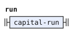</p>
<p>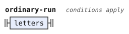</p>
<p>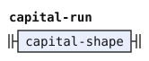</p>
<p>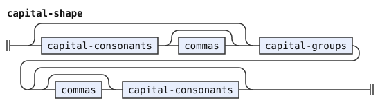</p>
<p>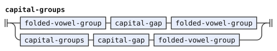</p>
<p>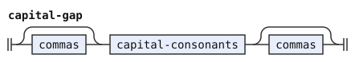</p>
<p>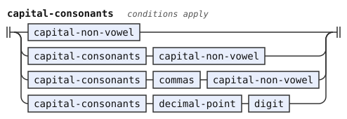</p>
<p>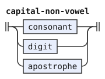</p>
<p>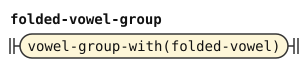</p>
<p>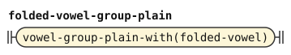</p>
<p>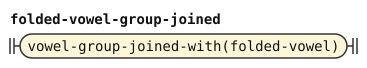</p>
<p>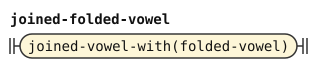</p>
<p>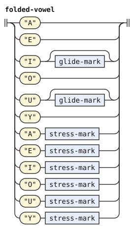</p>
</details>

## Accents and breves

A vowel with an acute or a grave accent is the stressed phoneme, as a capital vowel is. A breve on `i` or `u` marks a glide in some texts. The word grammar finds a glide by its position, so the stage emits the letter plain. Stage zero gives a precomposed letter as its base and its marks.

A combining mark that no letter rule takes makes its run foreign, whatever its category. So in `lojban/bpfk` and `lojban/zantufa`, `mï` and `mi` followed by U+093E are foreign. The experimental layer reads both marks ([../experimental/latin.md](../experimental/latin.md)).

```jbogenbau
%extend-rule plain-vowel :: ∅
  | ("i" | "I") glide-mark := "i"
  | ("u" | "U") glide-mark := "u"
%emits
  $

%extend-rule stressed-vowel :: Stressed
  | ("a" | "A") stress-mark := "a" :- "A"
  | ("e" | "E") stress-mark := "e" :- "E"
  | ("i" | "I") stress-mark := "i" :- "I"
  | ("o" | "O") stress-mark := "o" :- "O"
  | ("u" | "U") stress-mark := "u" :- "U"
  | ("y" | "Y") stress-mark := "y" :- "Y"
%emits
  $

%rule stress-mark
  "‹U+0301›" | "‹U+0300›"

%rule glide-mark
  "‹U+0306›"
```

<details><summary>Railroad diagrams of the 4 rules from <code>plain-vowel</code> to <code>glide-mark</code></summary>
<p>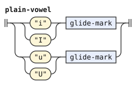</p>
<p>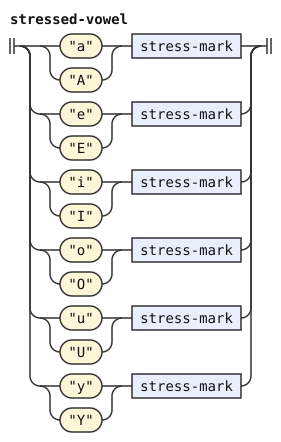</p>
<p>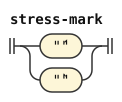</p>
<p>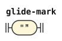</p>
</details>

## Digits

Each digit emits the letters of its number word, so `2` is `re`. The first emission covers the character. The second is inserted at the end of that span, with empty source and text. It names the digit rule in `insertedBy`. Their values and images spell the number word.

The `two-phonemes` template takes a character and two output strings. The named instances keep each digit rule and the decimal-point rule as the `insertedBy` rule.

A single period between two digits is the decimal point, `pi`. The decimal point needs a digit before it, so `la .djan.2mei` has a pause after `djan`.

The `items` condition tests the pause span with `decimal-point`. Commas prevent that match, so `2,.3`, `2.,3` and `2,.,3` each contain a pause between the digit words.

A period between two digits is the decimal point in a foreign run too, so it belongs to the run. So `zoi gy. 3.0w .gy.` quotes the run `3.0w`. A period with something else beside it is still a pause, so `3.w` holds a pause.

```jbogenbau
%redefine-rule items
  | run
  | $i:items $p:pause $r:run
%conditions
  ¬$i.last-token.matches(digit) ∨ ¬$p.matches(decimal-point) ∨ ¬$r.first-token.matches(digit)

%extend-rule non-vowel
  digit

%extend-rule non-vowels
  $n:non-vowels decimal-point digit
%conditions
  $n.last-token.matches(digit)

%extend-rule any-lojban-char
  digit

%extend-rule lojban-chars
  $c:lojban-chars "." $d:lojban-char
%conditions
  $c.last-token.matches(digit-char),
  $d.matches(digit-char)

%extend-rule chars-with-non-lojban-char
  $c:chars-with-non-lojban-char "." $d:run-char
%conditions
  $c.last-token.matches(digit-char),
  $d.matches(digit-char)

%rule digit
  digit-0 | digit-1 | digit-2 | digit-3 | digit-4 | digit-5 | digit-6 | digit-7 | digit-8 | digit-9

%rule two-phonemes(@C, @A, @B)
  @C
%emits
  $ :: ∅ := @A, ε :: ∅ := @B

%rule digit-0 = two-phonemes("0", "n", "o")

%rule digit-1 = two-phonemes("1", "p", "a")

%rule digit-2 = two-phonemes("2", "r", "e")

%rule digit-3 = two-phonemes("3", "c", "i")

%rule digit-4 = two-phonemes("4", "v", "o")

%rule digit-5 = two-phonemes("5", "m", "u")

%rule digit-6 = two-phonemes("6", "x", "a")

%rule digit-7 = two-phonemes("7", "z", "e")

%rule digit-8 = two-phonemes("8", "b", "i")

%rule digit-9 = two-phonemes("9", "s", "o")

%rule decimal-point = two-phonemes(".", "p", "i")
```

<details><summary>Railroad diagrams of the 19 rules from <code>items</code> to <code>decimal-point</code></summary>
<p>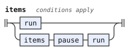</p>
<p>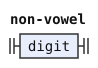</p>
<p>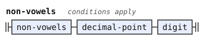</p>
<p>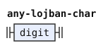</p>
<p></p>
<p></p>
<p></p>
<p></p>
<p></p>
<p></p>
<p></p>
<p></p>
<p></p>
<p></p>
<p></p>
<p></p>
<p></p>
<p></p>
<p></p>
</details>

## Differences from CLL and the reference PEG

The reference PEG is the morphology in [camxes.peg](https://github.com/lojban/ilmentufa/blob/778ea138f7d150121ca722db7536ce3b123943ac/camxes.peg). These conventions extend CLL's Latin orthography. Most admit spellings that CLL does not describe. Commas between vowels, capital runs and material preserved between pauses change readings that [../cll/latin.md](../cll/latin.md) also permits.

The PEG's pauses are the space, tab, line feed and carriage return, and the characters `.`, `?` and `!` (its rule `space_char`). This document reads every Unicode `White_Space` character and other punctuation as a pause too. So it reads a no-break space between two words as a pause, which the PEG rejects. It also accepts `mi "klama"`, which the PEG rejects. Both read `jy?,sai` as `jy` and `sai`.

camxes-std, the standard grammar of the camxes parser, also reads `zoi gy. !!! .gy.` as an empty quote because `!` is space. This stage preserves the punctuation as material, so the words stage can keep it inside a quote.

The PEG ignores commas through `comma*` in each letter rule. This document follows that treatment even between vowels. Strict CLL instead uses a comma there as a syllable break.

CLL does not use `h` for the apostrophe. The PEG accepts lowercase `h` through `h <- comma* ['h] &nucleus`. This document also reads capital `H` as an apostrophe, so `koHa` is `ko'a`, which the PEG rejects.

CLL does not define capital folding, accented vowels or breve glides. The PEG lacks these conventions too, and marks stress only with capital `A`, `E`, `I`, `O` and `U`. This document accepts those conventions, so it reads `KLAMA` as `klama`, while camxes-std rejects it. Capital folding supports titles and shouts, while requiring two vowel groups preserves stress in names with one capital syllable.

PA is the number selma'o. The PEG reads digits directly as PA words and also permits them inside names. This stage emits their letters instead. CLL does not write digits. A period between digits emits `pi` rather than a pause.

[^cll-c3]: [CLL 1.1, chapter 3](https://lojban.org/publications/cll/cll_v1.1_xhtml-section-chunks/chapter-phonology.html).
