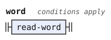
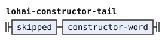
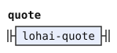
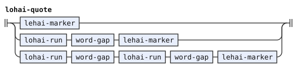
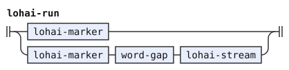
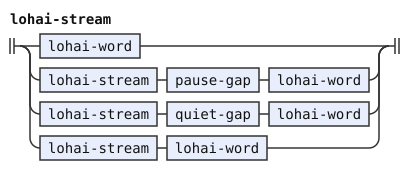
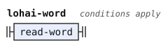
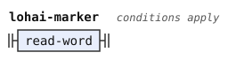
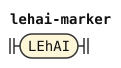

# Replacement quotes

This document is part of the words stage of the [experimental](../experimental/pipeline.md) and [Zantufa](../zantufa/pipeline.md) pipelines, after [the word stream](stream.md). A stage is one step of a pipeline, with its own grammar. A token is one unit that a stage reads or emits. Each stage reads the tokens that the stage before it emitted, and emits new tokens. [The notation document](../../../docs/notation.md) explains the notation.

A replacement quote is one unit of raw words. It is up to two runs of words, each opened by a word of LOhAI (`lo'ai` or `sa'ai`), and then `le'ai`. A `le'ai` alone is a whole quote too.

A magic word acts on other words. The words inside are plain words, whatever they are. No magic word executes there, including BU, ZEI, and FAhO. No indicator attaches there.

So `mi lo'ai su le'ai klama` keeps `mi`, and `mi lo'ai zo le'ai klama` is a text. A magic word after the quote acts on all of it. Thus `lo'ai mi le'ai si` is nothing, and `lo'ai mi le'ai bu` is a letteral, a letter word of class BY, as [stream.md](stream.md) defines it.

The quote uses `quiet-gap`, `pause-gap` and `word-gap` from the shared word stream. A gap with a surviving pause contributes one space, and hesitation without a pause contributes no string. These rules execute no erasure inside the quote. `lohai-stream` also joins two words with no gap. The first alternative of `lohai-run` reads a bare marker, so a stream always holds a run.

A free modifier adds information outside predicate arguments. The syntax reads the quote as a free modifier.

The quote token carries its opening class and the tag `Quote`. A bare `le'ai` carries LEhAI. Syntax requires `Quote` on LOhAI, so an incomplete replacement quote cannot act as a finished quote. A tag marks a token by an identifier. So in the experimental pipeline, `sa` finds it by its class, and `mi lo'ai do le'ai sa lo'ai ti le'ai klama` keeps `mi`. The words inside carry no class, so none of them is a boundary for `su`.

In the experimental pipeline, an unfinished marker carries `Fault` unless a [`constructor-word`](stream.md#compounds) takes it as a base. That rule names `bu` and `zei`, with `ze'ei` added in experimental. The named rule keeps the fallback test consistent with the pipeline's constructors.

[The word stream](stream.md) reads no word where a quote begins, and only there. So `mi lo'ai si klama` is `mi klama`, and `mi lo'ai bu klama` has a letteral. An eraser can remove the fault. A surviving fault rejects the words stage at the missing LEhAI. The Zantufa word stream has its own rules for such a marker.

```jbogenbau
%redefine-rule word
  $c:read-word
    :: $c.tags ∪ (LOhAI ⊆ $c.classes ∧ ¬$c.following-tokens.begins(lohai-constructor-tail) ⟹ Fault)
%conditions
  $c.classes ∩ $MAGIC-WORDS = ∅,
  ¬$c.onward.begins(quote)
%emits
  $

%rule lohai-constructor-tail
  skipped constructor-word

%extend-rule quote
  (* LOhAI_pre <- pre_clause (LOhAI spaces? (!LOhAI !LEhAI any_word)* )? (LOhAI spaces? (!LOhAI !LEhAI any_word)* )? LEhAI spaces? *)
  lohai-quote

%rule lohai-quote :- $.source-text
  | $e:lehai-marker :: $e.tags
  | $r:lohai-run word-gap lehai-marker :: $r.tags
  | $r:lohai-run word-gap lohai-run word-gap lehai-marker :: $r.tags
%emits
  $ :: $.tags ∪ Quote

%rule lohai-run
  | $m:lohai-marker :: $m.tags
  | $m:lohai-marker word-gap lohai-stream :: $m.tags

%rule lohai-stream
  | lohai-word
  | lohai-stream pause-gap lohai-word
  | lohai-stream quiet-gap lohai-word
  | lohai-stream lohai-word

%rule lohai-word
  $w:read-word
%conditions
  $w.classes ∩ (LOhAI ∪ LEhAI) = ∅
%emits
  $ :: Word

%rule lohai-marker
  $q:read-word :: $q.classes ∪ Word ∪ Cmavo
%conditions
  LOhAI ⊆ $q.classes
%emits
  $

%rule lehai-marker
  $q:LEhAI :: $q.classes ∪ Word ∪ Cmavo
%emits
  $
```

<details><summary>Railroad diagrams of the 9 rules from <code>word</code> to <code>lehai-marker</code></summary>
<p></p>
<p></p>
<p></p>
<p></p>
<p></p>
<p></p>
<p></p>
<p></p>
<p></p>
</details>

## Reference behavior

camxes-exp, the experimental grammar of the camxes parser, reads replacement quotes as raw words in `LOhAI_pre`. Zantufa 1.9999 does too. This stage retains that treatment and the single-unit boundary of Zantufa's `si_word`. Magic words after a quote act on the whole unit, as the [experimental pipeline's differences section](../experimental/pipeline.md#where-it-reads-texts-differently-from-camxes-exp) describes.
