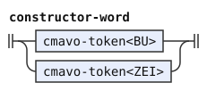
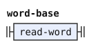
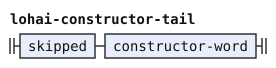
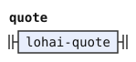
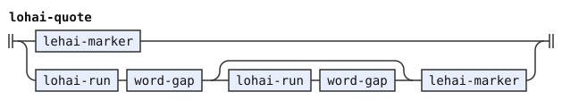
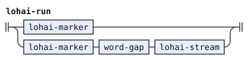
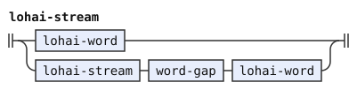
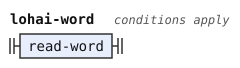
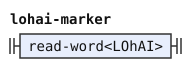
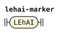

# Replacement quotes

This document is part of the words stage of the [experimental](../experimental/pipeline.md) and [Zantufa](../zantufa/pipeline.md) pipelines, after [the word stream](stream.md). A stage is one step of a pipeline, with its own grammar. A token is one unit that a stage reads or emits. Each stage reads the tokens that the stage before it emitted, and emits new tokens. [The notation document](../../../docs/notation.md) explains the notation.

A replacement quote is one unit of raw words. It is up to two runs of words, each opened by a word of LOhAI (`lo'ai` or `sa'ai`), and then `le'ai`. A `le'ai` alone is a whole quote too.

A magic word acts on other words. The words inside are plain words, whatever they are. No magic word executes there, including BU, ZEI, and FAhO. No indicator attaches there.

So `mi lo'ai su le'ai klama` keeps `mi`, and `mi lo'ai zo le'ai klama` is a text. A magic word after the quote acts on all of it. Thus `lo'ai mi le'ai si` is nothing, and `lo'ai mi le'ai bu` is a letteral, a letter word of class BY, as [stream.md](stream.md) defines it.

The quote uses `quiet-gap`, `pause-gap` and `word-gap` from the shared word stream. A gap with a surviving pause contributes one space, and hesitation without a pause contributes no string. These rules execute no erasure inside the quote. `lohai-stream` uses `word-gap` between words, including its empty route. Its first alternative reads `lohai-word`, so the stream always holds at least one word.

The first alternative of `lohai-run` reads a bare marker with no body.

A free modifier adds information outside predicate arguments. The syntax reads the quote as a free modifier.

A tag marks a token by an identifier. The quote token carries its opening class and the tag `Quote`. So in the experimental pipeline, `sa` finds it by its class, and `mi lo'ai do le'ai sa lo'ai ti le'ai klama` keeps `mi`.

A bare `le'ai` carries LEhAI. Its marker reads `LEhAI` directly so that an unclosed quote names the missing marker. Syntax requires `Quote` on LOhAI, so an incomplete replacement quote cannot act as a finished quote. The words inside carry no class, so none of them is a boundary for `su`.

In the experimental pipeline, an unfinished marker carries `Fault` unless a `constructor-word` takes it as a base. That rule names `bu` and `zei`, with `ze'ei` added in `lojban/experimental`. The named rule keeps the fallback test consistent with the pipeline's constructors. The `word-base` hook adds the fault tag without changing the shared word exclusions.

[The word stream](stream.md) reads no ordinary word where a quote begins. So `mi lo'ai si klama` is `mi klama`, and `mi lo'ai bu klama` has a letteral. An eraser can remove the fault. A surviving fault rejects the words stage at the missing LEhAI. The Zantufa word stream has its own rules for such a marker.

The `constructor-word` rule lists BU and ZEI for the replacement-quote fallback. That fallback uses the rule after an unfinished marker. A pipeline that adds a constructor must also extend `constructor-word`.

```jbogenbau
%rule constructor-word
  cmavo-token<BU>
  | cmavo-token<ZEI>

%redefine-rule word-base
  $c:read-word
      :: $c.tags ∪
         (LOhAI ⊆ $c.classes ∧ ¬$c.following-tokens.parse(lohai-constructor-tail …) ⟹ Fault)

%rule lohai-constructor-tail
  skipped constructor-word

%extend-rule quote
  lohai-quote

%rule lohai-quote :- $.source-text
  | $e:lehai-marker :: $e.tags
  | $r:lohai-run word-gap [lohai-run word-gap] lehai-marker :: $r.tags
%emits
  $ :: Quote ∪ $.tags

%rule lohai-run :: $m.tags
  | $m:lohai-marker
  | $m:lohai-marker word-gap lohai-stream

%rule lohai-stream
  | lohai-word
  | lohai-stream word-gap lohai-word

%rule lohai-word
  $w:read-word
%conditions
  $w.classes ∩ (LOhAI ∪ LEhAI) = ∅
%emits
  $ :: Word

%rule lohai-marker
  $q:read-word<LOhAI> :: Word Cmavo ∪ $q.classes
%emits
  $

%rule lehai-marker
  $q:LEhAI :: Word Cmavo ∪ $q.classes
%emits
  $
```

<details><summary>Railroad diagrams of the 10 rules from <code>constructor-word</code> to <code>lehai-marker</code></summary>
<p></p>
<p></p>
<p></p>
<p></p>
<p></p>
<p></p>
<p></p>
<p></p>
<p></p>
<p></p>
</details>

## Reference behavior

camxes-exp, the experimental grammar of the camxes parser, reads replacement quotes as raw words in `LOhAI_pre`. Zantufa 1.9999 does too. This stage retains that treatment and the single-unit boundary of Zantufa's `si_word`. Magic words after a quote act on the whole unit, as the [experimental pipeline's differences section](../experimental/pipeline.md#where-it-reads-texts-differently-from-camxes-exp) describes.

camxes-exp states the quote frame as follows.

```peg
LOhAI_pre <- pre_clause (LOhAI spaces? (!LOhAI !LEhAI any_word)* )? (LOhAI spaces? (!LOhAI !LEhAI any_word)* )? LEhAI spaces?
```
