# zbalermorna

This document adds the zbalermorna script to the phoneme stage. The pipelines of the [BPFK](../bpfk/pipeline.md), the Lojban language planning committee, [experimental](../experimental/pipeline.md) and [Zantufa](../zantufa/pipeline.md) read it. The [CLL](../cll/pipeline.md) pipeline omits this script. CLL is *The Complete Lojban Language*. The stage reads both private-use encodings defined in [Two encodings](#two-encodings).

A token is one unit that a stage reads or emits. A token's value is the string that exact comparisons read. Its image is the string that people see.

The phoneme stage is the first stage of the pipeline. The document adds alternatives to the rules of [../cll/latin.md](../cll/latin.md) and [latin.md](latin.md) with `%extend-rule`. It defines no frame of its own. It uses the shared text, pause and run rules. [The notation document](../../../docs/notation.md) explains the notation.

A diacritic is a mark on another symbol. Each zbalermorna symbol is a radical, a consonant, with a diacritic above it for the vowel that follows. A vowel with no consonant before it stands on the radical for the period, which the script uses as a null onset. A null onset marks a syllable with no consonant before its vowel. The script writes a word-initial vowel on that radical too. The script also has these forms:

- A full-vowel form, used in names and borrowings
- Four diphthong diacritics
- A stress mark, placed after the vowel
- An "attitudinal shorthand" that stands for a vowel and the apostrophe after it
- Glide radicals for `i` and `u`, which read as plain vowels without a following vowel

The phoneme explanations use Humbert code points. The mapping in [Two encodings](#two-encodings) gives their UCSUR counterparts. This document writes each character as a named escape, so that a reader can read the rule without the font. The names come from [zbalermorna-names.txt](zbalermorna-names.txt).

The first rules below read the consonant radicals. DENPA BU (U+ED89) is the radical for the period, and YHY (U+ED8A) is the apostrophe. SLAKA BU (U+ED9A) is the comma. PA TONGA (U+ED8C), SMAJI BU (U+ED99), and TCENA BU (U+ED9B) also map to a comma.

The diphthong instances use `two-phonemes` for their two output strings. The `stressed-two-phonemes` template also reads the stress mark. Its second and third arguments are the value and the image of the first output, and that output carries `Stressed`. The fourth argument is the second output.

```jbogenbau
%names "zbalermorna-names.txt"

%extend-rule consonant :: ∅
  | ("‹ZBALERMORNA HUMBERT LETTER PY›" | "‹ZBALERMORNA UCSUR LETTER PY›") := "p"
  | ("‹ZBALERMORNA HUMBERT LETTER TY›" | "‹ZBALERMORNA UCSUR LETTER TY›") := "t"
  | ("‹ZBALERMORNA HUMBERT LETTER KY›" | "‹ZBALERMORNA UCSUR LETTER KY›") := "k"
  | ("‹ZBALERMORNA HUMBERT LETTER FY›" | "‹ZBALERMORNA UCSUR LETTER FY›") := "f"
  | ("‹ZBALERMORNA HUMBERT LETTER BY›" | "‹ZBALERMORNA UCSUR LETTER BY›") := "b"
  | ("‹ZBALERMORNA HUMBERT LETTER DY›" | "‹ZBALERMORNA UCSUR LETTER DY›") := "d"
  | ("‹ZBALERMORNA HUMBERT LETTER GY›" | "‹ZBALERMORNA UCSUR LETTER GY›") := "g"
  | ("‹ZBALERMORNA HUMBERT LETTER VY›" | "‹ZBALERMORNA UCSUR LETTER VY›") := "v"
  | ("‹ZBALERMORNA HUMBERT LETTER LY›" | "‹ZBALERMORNA UCSUR LETTER LY›") := "l"
  | ("‹ZBALERMORNA HUMBERT LETTER SY›" | "‹ZBALERMORNA UCSUR LETTER SY›") := "s"
  | ("‹ZBALERMORNA HUMBERT LETTER CY›" | "‹ZBALERMORNA UCSUR LETTER CY›") := "c"
  | ("‹ZBALERMORNA HUMBERT LETTER MY›" | "‹ZBALERMORNA UCSUR LETTER MY›") := "m"
  | ("‹ZBALERMORNA HUMBERT LETTER RY›" | "‹ZBALERMORNA UCSUR LETTER RY›") := "r"
  | ("‹ZBALERMORNA HUMBERT LETTER ZY›" | "‹ZBALERMORNA UCSUR LETTER ZY›") := "z"
  | ("‹ZBALERMORNA HUMBERT LETTER JY›" | "‹ZBALERMORNA UCSUR LETTER JY›") := "j"
  | ("‹ZBALERMORNA HUMBERT LETTER NY›" | "‹ZBALERMORNA UCSUR LETTER NY›") := "n"
  | ("‹ZBALERMORNA HUMBERT LETTER XY›" | "‹ZBALERMORNA UCSUR LETTER XY›") := "x"
%emits
  $

%extend-rule apostrophe
  ("‹ZBALERMORNA HUMBERT SYMBOL FOR YHY›" | "‹ZBALERMORNA UCSUR SYMBOL FOR YHY›")
%emits
  $ :: ∅ := "'"

%extend-rule core-char
  ("‹ZBALERMORNA HUMBERT SYMBOL FOR DENPA BU›" | "‹ZBALERMORNA UCSUR SYMBOL FOR DENPA BU›")

%extend-rule comma
  | ("‹ZBALERMORNA HUMBERT SYMBOL FOR SLAKA BU›" | "‹ZBALERMORNA UCSUR SYMBOL FOR SLAKA BU›")
  | ("‹ZBALERMORNA HUMBERT COMBINING PA TONGA›" | "‹ZBALERMORNA UCSUR COMBINING PA TONGA›")
  | ("‹ZBALERMORNA HUMBERT SYMBOL FOR SMAJI BU›" | "‹ZBALERMORNA UCSUR SYMBOL FOR SMAJI BU›")
  | ("‹ZBALERMORNA HUMBERT COMBINING TCENA BU›" | "‹ZBALERMORNA UCSUR COMBINING TCENA BU›")
```

<details><summary>Railroad diagrams of <code>consonant</code>, <code>apostrophe</code>, <code>core-char</code> and <code>comma</code></summary>
<p>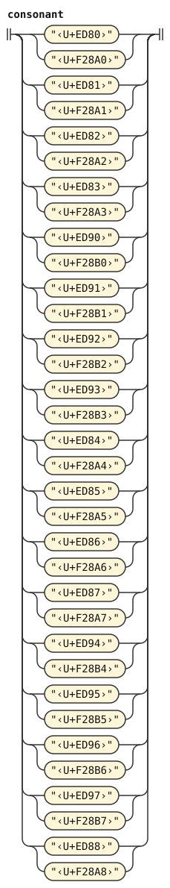</p>
<p>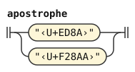</p>
<p></p>
<p>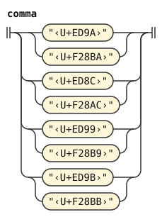</p>
</details>

A vowel diacritic and its full-vowel form are the same phoneme. BAHEBU (U+ED98) after either form or a diphthong diacritic makes it stressed. A repeated stress mark is one mark. SEMIVOWEL IY (U+EDAA) and SEMIVOWEL UY (U+EDAB) read as plain vowels `i` and `u`, even without a following vowel.

A diphthong diacritic is two phonemes and stands where a vowel stands. The first emission covers the character and any stress marks. The second is inserted after them, with empty source and text. Only the first stressed token carries `Stressed`. That token has a lowercase value and an uppercase image.

CNIMAHO BU (U+ED8B) followed by a plain or stressed vowel is that vowel and an apostrophe. The vowel's token covers the shorthand too, as a stressed vowel's token covers its stress mark. The rule emits the apostrophe as a token with an empty span.

The shorthand stands where a non-vowel stands, because the apostrophe closes the vowel group. The shorthand's vowel is always a single vowel. `zbalermorna-marked-vowel` takes its strings from the reconstructed vowel through `.emitted`. This excludes the written shorthand mark from both strings without erasing its source ownership. A diphthong diacritic cannot directly follow the mark.

A stress mark or a shorthand is a mark of the script, like an accent. So this document adds both to `mark-char` of [latin.md](latin.md), and no punctuation rule reads them as a pause. Neither is a Lojban character by itself. So `non-lojban-char` takes a stray mark, one that no letter takes, and the mark makes its run foreign.

```jbogenbau
%extend-rule plain-vowel :: ∅
  | ("‹ZBALERMORNA HUMBERT VOWEL SIGN ABU›" | "‹ZBALERMORNA UCSUR VOWEL SIGN ABU›"
    | "‹ZBALERMORNA HUMBERT LETTER FULL ABU›" | "‹ZBALERMORNA UCSUR LETTER FULL ABU›") := "a"
  | ("‹ZBALERMORNA HUMBERT VOWEL SIGN EBU›" | "‹ZBALERMORNA UCSUR VOWEL SIGN EBU›"
    | "‹ZBALERMORNA HUMBERT LETTER FULL EBU›" | "‹ZBALERMORNA UCSUR LETTER FULL EBU›") := "e"
  | ("‹ZBALERMORNA HUMBERT VOWEL SIGN IBU›" | "‹ZBALERMORNA UCSUR VOWEL SIGN IBU›"
    | "‹ZBALERMORNA HUMBERT LETTER FULL IBU›" | "‹ZBALERMORNA UCSUR LETTER FULL IBU›"
    | "‹ZBALERMORNA HUMBERT LETTER SEMIVOWEL IY›"
    | "‹ZBALERMORNA UCSUR LETTER SEMIVOWEL IY›") := "i"
  | ("‹ZBALERMORNA HUMBERT VOWEL SIGN OBU›" | "‹ZBALERMORNA UCSUR VOWEL SIGN OBU›"
    | "‹ZBALERMORNA HUMBERT LETTER FULL OBU›" | "‹ZBALERMORNA UCSUR LETTER FULL OBU›") := "o"
  | ("‹ZBALERMORNA HUMBERT VOWEL SIGN UBU›" | "‹ZBALERMORNA UCSUR VOWEL SIGN UBU›"
    | "‹ZBALERMORNA HUMBERT LETTER FULL UBU›" | "‹ZBALERMORNA UCSUR LETTER FULL UBU›"
    | "‹ZBALERMORNA HUMBERT LETTER SEMIVOWEL UY›"
    | "‹ZBALERMORNA UCSUR LETTER SEMIVOWEL UY›") := "u"
  | ("‹ZBALERMORNA HUMBERT VOWEL SIGN YBU›" | "‹ZBALERMORNA UCSUR VOWEL SIGN YBU›"
    | "‹ZBALERMORNA HUMBERT LETTER FULL YBU›" | "‹ZBALERMORNA UCSUR LETTER FULL YBU›") := "y"
%emits
  $

%extend-rule stressed-vowel :: Stressed
  | ("‹ZBALERMORNA HUMBERT VOWEL SIGN ABU›" | "‹ZBALERMORNA UCSUR VOWEL SIGN ABU›"
    | "‹ZBALERMORNA HUMBERT LETTER FULL ABU›"
    | "‹ZBALERMORNA UCSUR LETTER FULL ABU›") zbalermorna-stress := "a" :- "A"
  | ("‹ZBALERMORNA HUMBERT VOWEL SIGN EBU›" | "‹ZBALERMORNA UCSUR VOWEL SIGN EBU›"
    | "‹ZBALERMORNA HUMBERT LETTER FULL EBU›"
    | "‹ZBALERMORNA UCSUR LETTER FULL EBU›") zbalermorna-stress := "e" :- "E"
  | ("‹ZBALERMORNA HUMBERT VOWEL SIGN IBU›" | "‹ZBALERMORNA UCSUR VOWEL SIGN IBU›"
    | "‹ZBALERMORNA HUMBERT LETTER FULL IBU›"
    | "‹ZBALERMORNA UCSUR LETTER FULL IBU›") zbalermorna-stress := "i" :- "I"
  | ("‹ZBALERMORNA HUMBERT VOWEL SIGN OBU›" | "‹ZBALERMORNA UCSUR VOWEL SIGN OBU›"
    | "‹ZBALERMORNA HUMBERT LETTER FULL OBU›"
    | "‹ZBALERMORNA UCSUR LETTER FULL OBU›") zbalermorna-stress := "o" :- "O"
  | ("‹ZBALERMORNA HUMBERT VOWEL SIGN UBU›" | "‹ZBALERMORNA UCSUR VOWEL SIGN UBU›"
    | "‹ZBALERMORNA HUMBERT LETTER FULL UBU›"
    | "‹ZBALERMORNA UCSUR LETTER FULL UBU›") zbalermorna-stress := "u" :- "U"
  | ("‹ZBALERMORNA HUMBERT VOWEL SIGN YBU›" | "‹ZBALERMORNA UCSUR VOWEL SIGN YBU›"
    | "‹ZBALERMORNA HUMBERT LETTER FULL YBU›"
    | "‹ZBALERMORNA UCSUR LETTER FULL YBU›") zbalermorna-stress := "y" :- "Y"
%emits
  $

%rule zbalermorna-stress
  {zbalermorna-stress-mark}

%extend-rule vowel
  zbalermorna-diphthong | zbalermorna-stressed-diphthong

%extend-rule non-vowel
  zbalermorna-shorthand

%extend-rule any-lojban-char
  zbalermorna-diphthong

%extend-rule mark-char
  zbalermorna-shorthand-mark | zbalermorna-stress-mark

%rule zbalermorna-stress-mark
  ("‹ZBALERMORNA HUMBERT COMBINING BAHEBU›" | "‹ZBALERMORNA UCSUR COMBINING BAHEBU›")

%rule zbalermorna-diphthong
  zbalermorna-ai | zbalermorna-ei | zbalermorna-oi | zbalermorna-au

%rule zbalermorna-ai = two-phonemes(
  ("‹ZBALERMORNA HUMBERT VOWEL SIGN AIBU›" | "‹ZBALERMORNA UCSUR VOWEL SIGN AIBU›"),
  "a", "i")

%rule zbalermorna-ei = two-phonemes(
  ("‹ZBALERMORNA HUMBERT VOWEL SIGN EIBU›" | "‹ZBALERMORNA UCSUR VOWEL SIGN EIBU›"),
  "e", "i")

%rule zbalermorna-oi = two-phonemes(
  ("‹ZBALERMORNA HUMBERT VOWEL SIGN OIBU›" | "‹ZBALERMORNA UCSUR VOWEL SIGN OIBU›"),
  "o", "i")

%rule zbalermorna-au = two-phonemes(
  ("‹ZBALERMORNA HUMBERT VOWEL SIGN AUBU›" | "‹ZBALERMORNA UCSUR VOWEL SIGN AUBU›"),
  "a", "u")

%rule zbalermorna-stressed-diphthong
  | zbalermorna-stressed-ai | zbalermorna-stressed-ei
  | zbalermorna-stressed-oi | zbalermorna-stressed-au

%rule stressed-two-phonemes(@C, @A, @Image, @B)
  @C zbalermorna-stress
%emits
  $ :: Stressed := @A :- @Image, ε :: ∅ := @B

%rule zbalermorna-stressed-ai = stressed-two-phonemes(
  ("‹ZBALERMORNA HUMBERT VOWEL SIGN AIBU›" | "‹ZBALERMORNA UCSUR VOWEL SIGN AIBU›"),
  "a", "A", "i")

%rule zbalermorna-stressed-ei = stressed-two-phonemes(
  ("‹ZBALERMORNA HUMBERT VOWEL SIGN EIBU›" | "‹ZBALERMORNA UCSUR VOWEL SIGN EIBU›"),
  "e", "E", "i")

%rule zbalermorna-stressed-oi = stressed-two-phonemes(
  ("‹ZBALERMORNA HUMBERT VOWEL SIGN OIBU›" | "‹ZBALERMORNA UCSUR VOWEL SIGN OIBU›"),
  "o", "O", "i")

%rule zbalermorna-stressed-au = stressed-two-phonemes(
  ("‹ZBALERMORNA HUMBERT VOWEL SIGN AUBU›" | "‹ZBALERMORNA UCSUR VOWEL SIGN AUBU›"),
  "a", "A", "u")

%rule zbalermorna-shorthand
  $v:zbalermorna-marked-vowel
%emits
  $v, ε :: ∅ := "'"

%rule zbalermorna-marked-vowel
  zbalermorna-shorthand-mark $v:zbalermorna-shorthand-vowel
    :: $v.tags := $v.emitted.value :- $v.emitted.image

%rule zbalermorna-shorthand-vowel
  plain-vowel | stressed-vowel

%rule zbalermorna-shorthand-mark
  ("‹ZBALERMORNA HUMBERT SYMBOL FOR CNIMAHO BU›" | "‹ZBALERMORNA UCSUR SYMBOL FOR CNIMAHO BU›")
```

<details><summary>Railroad diagrams of the 23 rules from <code>plain-vowel</code> to <code>zbalermorna-shorthand-mark</code></summary>
<p></p>
<p>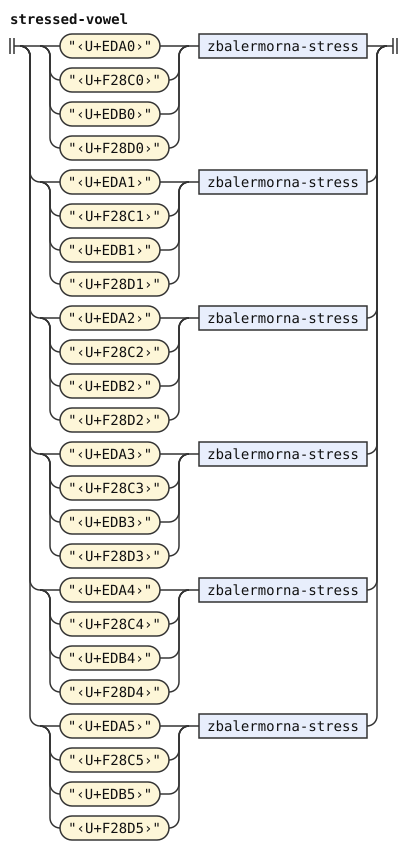</p>
<p>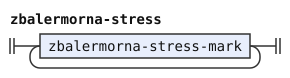</p>
<p>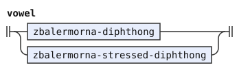</p>
<p>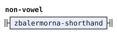</p>
<p></p>
<p>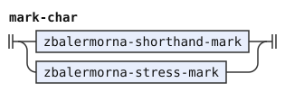</p>
<p>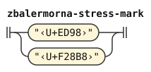</p>
<p>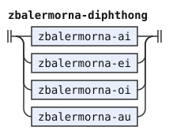</p>
<p></p>
<p>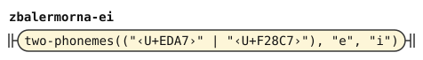</p>
<p></p>
<p>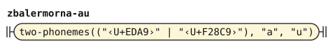</p>
<p>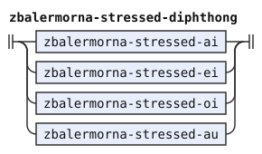</p>
<p>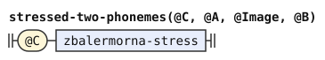</p>
<p></p>
<p></p>
<p>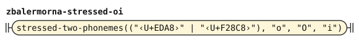</p>
<p>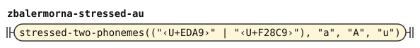</p>
<p>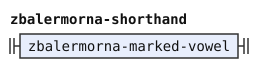</p>
<p></p>
<p></p>
<p>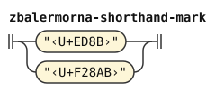</p>
</details>

## Two encodings

`tools/unicode-table.py` supplies `grammars/lojban/common/zbalermorna-names.txt` from the mapping below. The file uses `unicode-names 15.1.0` and contains 100 added names. It names 50 characters in each encoding. A name supplies an exact scalar, rather than declaring a grammar terminal.

The zbalermorna phoneme grammar reads both encodings. The older interval is U+ED80–U+EDB9, and the UCSUR allocation is U+F28A0–U+F28DF. Each row marked Explicit rule contributes both scalars to exactly the same grammar alternatives. Neither loading nor parsing warns merely because text uses the older encoding. `grammars/lojban/common/zbalermorna.md` declares `%names "zbalermorna-names.txt"` before its rules. Bundled pipelines select this resource through that declaration.

The older source is Jack Humbert's [Unicode Space proposal at commit 920b28d](https://github.com/JackHumbert/zbalermorna/blob/920b28d798ae1c06885c674bbf02b08ffed12b2f/doc/unicode.md). Its [manri font source at the same commit](https://github.com/JackHumbert/zbalermorna/blob/920b28d798ae1c06885c674bbf02b08ffed12b2f/src/unicode-manri.sfd) resolves three inconsistent numeric tone rows. The font assigns RE TONGA to U+ED8D, CI TONGA to U+ED8E, and VO TONGA to U+ED8F. The proposal's glyph grid agrees with those assignments.

The other source is the [UCSUR zbalermorna entry](https://www.kreativekorp.com/ucsur/), proposal dated 2024-08-20, credited to la kmir. That proposal date identifies the encoding version. The entry gives no separate numbered version. It assigns U+F28A0–U+F28DF and links Humbert's proposal. This source version is independent of the names file's Unicode 15.1.0 header.

The registry publisher's [Fairfax character table](https://github.com/kreativekorp/open-relay/blob/e4b81241e8c7269a91c0bd865cf5c9e7208fbada/Fairfax/pua.html) records the UCSUR scalars and names individually. This supporting snapshot is Fairfax 2026.09.21, dated 2026-09-21, at commit `e4b81241e8c7269a91c0bd865cf5c9e7208fbada`. The table below pins those assignments rather than using a later live resource.

Each row gives one character and its exact scalar in each encoding. The character's source name is `ZBALERMORNA ` followed by the character suffix. The names file inserts an encoding qualifier after `ZBALERMORNA`. Thus its older name is `ZBALERMORNA HUMBERT ` followed by the suffix. Its UCSUR name is `ZBALERMORNA UCSUR ` followed by the suffix.

These qualified names keep the two scalar bindings distinct in one lookup namespace. The file supplies no unqualified spelling. For example, `‹ZBALERMORNA HUMBERT LETTER PY›` decodes to U+ED80. `‹ZBALERMORNA UCSUR LETTER PY›` decodes to U+F28A0. Neither spelling silently changes encoding.

The final column states whether a character pair has explicit alternatives in the zbalermorna phoneme grammar. Each Explicit rule row requires both scalars in exactly the same alternatives. Where an alternative sets a value, image, or tags by recipe, both encodings produce equal results for that channel.

Shared rules that copy source text keep the written scalar in values and images, including pause material and foreign runs. Token text and source metadata always preserve the written scalar. The names file also includes every No explicit rule row.

| Character suffix | Humbert | UCSUR | Zbalermorna alternatives |
| --- | --- | --- | --- |
| LETTER PY | U+ED80 | U+F28A0 | Explicit rule |
| LETTER TY | U+ED81 | U+F28A1 | Explicit rule |
| LETTER KY | U+ED82 | U+F28A2 | Explicit rule |
| LETTER FY | U+ED83 | U+F28A3 | Explicit rule |
| LETTER LY | U+ED84 | U+F28A4 | Explicit rule |
| LETTER SY | U+ED85 | U+F28A5 | Explicit rule |
| LETTER CY | U+ED86 | U+F28A6 | Explicit rule |
| LETTER MY | U+ED87 | U+F28A7 | Explicit rule |
| LETTER XY | U+ED88 | U+F28A8 | Explicit rule |
| SYMBOL FOR DENPA BU | U+ED89 | U+F28A9 | Explicit rule |
| SYMBOL FOR YHY | U+ED8A | U+F28AA | Explicit rule |
| SYMBOL FOR CNIMAHO BU | U+ED8B | U+F28AB | Explicit rule |
| COMBINING PA TONGA | U+ED8C | U+F28AC | Explicit rule |
| COMBINING RE TONGA | U+ED8D | U+F28AD | No explicit rule |
| COMBINING CI TONGA | U+ED8E | U+F28AE | No explicit rule |
| COMBINING VO TONGA | U+ED8F | U+F28AF | No explicit rule |
| LETTER BY | U+ED90 | U+F28B0 | Explicit rule |
| LETTER DY | U+ED91 | U+F28B1 | Explicit rule |
| LETTER GY | U+ED92 | U+F28B2 | Explicit rule |
| LETTER VY | U+ED93 | U+F28B3 | Explicit rule |
| LETTER RY | U+ED94 | U+F28B4 | Explicit rule |
| LETTER ZY | U+ED95 | U+F28B5 | Explicit rule |
| LETTER JY | U+ED96 | U+F28B6 | Explicit rule |
| LETTER NY | U+ED97 | U+F28B7 | Explicit rule |
| COMBINING BAHEBU | U+ED98 | U+F28B8 | Explicit rule |
| SYMBOL FOR SMAJI BU | U+ED99 | U+F28B9 | Explicit rule |
| SYMBOL FOR SLAKA BU | U+ED9A | U+F28BA | Explicit rule |
| COMBINING TCENA BU | U+ED9B | U+F28BB | Explicit rule |
| VOWEL SIGN ABU | U+EDA0 | U+F28C0 | Explicit rule |
| VOWEL SIGN EBU | U+EDA1 | U+F28C1 | Explicit rule |
| VOWEL SIGN IBU | U+EDA2 | U+F28C2 | Explicit rule |
| VOWEL SIGN OBU | U+EDA3 | U+F28C3 | Explicit rule |
| VOWEL SIGN UBU | U+EDA4 | U+F28C4 | Explicit rule |
| VOWEL SIGN YBU | U+EDA5 | U+F28C5 | Explicit rule |
| VOWEL SIGN AIBU | U+EDA6 | U+F28C6 | Explicit rule |
| VOWEL SIGN EIBU | U+EDA7 | U+F28C7 | Explicit rule |
| VOWEL SIGN OIBU | U+EDA8 | U+F28C8 | Explicit rule |
| VOWEL SIGN AUBU | U+EDA9 | U+F28C9 | Explicit rule |
| LETTER SEMIVOWEL IY | U+EDAA | U+F28CA | Explicit rule |
| LETTER SEMIVOWEL UY | U+EDAB | U+F28CB | Explicit rule |
| LETTER FULL ABU | U+EDB0 | U+F28D0 | Explicit rule |
| LETTER FULL EBU | U+EDB1 | U+F28D1 | Explicit rule |
| LETTER FULL IBU | U+EDB2 | U+F28D2 | Explicit rule |
| LETTER FULL OBU | U+EDB3 | U+F28D3 | Explicit rule |
| LETTER FULL UBU | U+EDB4 | U+F28D4 | Explicit rule |
| LETTER FULL YBU | U+EDB5 | U+F28D5 | Explicit rule |
| LETTER FULL AIBU | U+EDB6 | U+F28D6 | No explicit rule |
| LETTER FULL EIBU | U+EDB7 | U+F28D7 | No explicit rule |
| LETTER FULL OIBU | U+EDB8 | U+F28D8 | No explicit rule |
| LETTER FULL AUBU | U+EDB9 | U+F28D9 | No explicit rule |

For every paired scalar, the UCSUR code point equals the older code point plus hexadecimal E3B20. The individual rows define the mapping. No older character inside U+ED80–U+EDB9 lacks a UCSUR counterpart. Unlisted slots in either interval are gaps, without character names or implied mappings.

The full diphthong letters at U+EDB6–U+EDB9 belong to the older encoding. Their UCSUR counterparts are U+F28D6–U+F28D9. Both sets receive encoding-qualified names in this resource. Every character occurs in both encodings, so no character belongs to only one encoding.

These alternatives cover 43 character pairs. The seven No explicit rule pairs have no zbalermorna alternative. They are three tone marks and four full diphthong letters. The pipeline's shared rules still read these characters in both encodings. A names declaration alone adds no phoneme rule. Escape decoding never converts between the encodings.

At the phoneme stage, `lojban/bpfk` and `lojban/zantufa` read these seven pairs as pause material tagged `PAUSE`, `Punctuation-Material`, and `Quote-Material`. The experimental pipeline reads them as `FOREIGN`. Shared recipes retain the written scalar in each value and image.

The names resource supplies no categories, combining classes, or decompositions from either script source. The pinned Unicode tables still decide those properties. The names file never supplies printer abbreviations. With bundled core data, private-use scalars print with numeric escapes. The grammar's ordinary value, image, and source rules remain in force.

Bundled cases decode all 100 zbalermorna names and distinguish both encodings. They cover every pair, both encodings of all four full diphthong letters, reserved gaps, and the corrected tone rows. Every Explicit rule pair stands in the same alternatives and gives equal results for channels that those alternatives set by recipe. Shared rules that copy source text retain the written scalar in values and images. All text and source metadata retain that scalar.

Cases preserve the shared pause and foreign readings for the seven No explicit rule pairs. No case warns about the older encoding.

## Differences from CLL and jbotci

CLL 1.1 describes Tolkien's Tengwar, a different script.[^cll-s3-12] The CLL pipeline follows that edition and omits zbalermorna.

jbotci, another Lojban parser, ignores PA TONGA (U+ED8C), SMAJI BU (U+ED99), and TCENA BU (U+ED9B). This document treats them as commas.

After CNIMAHO BU (U+ED8B), jbotci accepts the diphthong diacritics AIBU, EIBU, OIBU, and AUBU (U+EDA6 to U+EDA9). Those diacritics make the run foreign here. This document accepts Latin and Cyrillic vowels and the glide radicals SEMIVOWEL IY (U+EDAA) and SEMIVOWEL UY (U+EDAB) there. jbotci rejects them.

In `lojban/bpfk` and `lojban/zantufa`, RE TONGA (U+ED8D) and FULL AIBU (U+EDB6) read as pauses. The unnamed slots U+EDAC and U+ED9C also read as pauses. The experimental pipeline reads all four scalars as foreign material. jbotci rejects them as invalid characters.

A stress mark after a glide radical makes the run foreign here. jbotci ignores that mark when no earlier full vowel takes its stress.

jbotci rejects the UCSUR encoding as invalid characters. This document reads it.

[^cll-s3-12]: [CLL 1.1, section 3.12](https://lojban.org/publications/cll/cll_v1.1_xhtml-section-chunks/section-oddball-orthographies.html).
