# Cyrillic conventions of the experimental pipeline

This document adds to [../common/cyrillic.md](../common/cyrillic.md) and [../cll/cyrillic.md](../cll/cyrillic.md) the Cyrillic conventions of the [experimental](pipeline.md) pipeline. Only that pipeline reads it. It stands right after [../cll/cyrillic.md](../cll/cyrillic.md), and it restates the letter rules of both documents. [The notation document](../../../docs/notation.md) explains the notation.

A Cyrillic letter takes any combining marks after it, as a Latin letter does in [latin.md](latin.md). `letter-marks` of that document reads them. An acute or grave accent on a full vowel marks stress, as in [../common/cyrillic.md](../common/cyrillic.md). A breve on `и` or `у` makes the glide, as `й` and `ў` do. The stage ignores every other mark.

So `ё` reads as `е` and `ї` as `і`, because a dieresis means nothing here. The Cyrillic orthography already puts an apostrophe between two full vowels, so the Latin meaning of the dieresis has no job. The stage ignores marks on consonants, so `ќ` is `к`. The stage ignores a breve on another vowel, so `ӑ` is `а`. The stage ignores accents on glides, as it does on Latin glide letters.

The Cyrillic glides carry no `Glide` tag, and the word forms find them by position, as they do in `lojban/bpfk`. These letters belong to the base Cyrillic orthographies. This layer adds marks without changing their positional readings.

Latin `ɩ`, `q` and `w` are dedicated glide letters. Outside zbalermorna shorthand, this pipeline reads inherited Latin `ĭ` and `ŭ` only as glides, while the base conventions read them by position ([word forms](morphology.md#glide-letters)).

`cyrillic-vowel` reads every Cyrillic vowel letter with its marks. Its tags work as those of `latin-vowel`. A capital full vowel without an accent has a stressed and a folded reading. An accented capital has one reading, stressed and `Accented`, which an all-capital run keeps, as "Capital runs" in [../common/latin.md](../common/latin.md) says. The three restated vowel rules take the readings that fit them.

The `Vowel` tag marks the letters of `a`, `e`, `i`, `o` and `u`, full vowels and glides, and not `y`. The full vowels and the `y` letters carry `Syllabic`, and the glides do not. So `cyrillic-full-vowel` holds the full vowels of `cyrillic-vowel`, and `cyrillic-glide` holds the glides and carries `Vowel` on its header. The `y` forms stay in `cyrillic-vowel`.

The restated vowel rules read `cyrillic-vowel` instead of the inherited vowel and glide readers. Nothing reads `cyrillic-plain-full-vowel`, `cyrillic-stressed-full-vowel`, `cyrillic-folded-full-vowel`, `cyrillic-plain-glide` or `cyrillic-folded-glide` in this pipeline.

Joined vowels use the same public tags as isolated vowels. The emission filter keeps only `Stressed`, `Syllabic` and `Vowel`. Bookkeeping tags stay inside the phoneme stage.

```jbogenbau
%redefine-rule cyrillic-consonant :: Consonant
  | ("б" | "Б") [letter-marks] := "b"
  | ("ш" | "Ш" | "щ" | "Щ") [letter-marks] := "c"
  | ("д" | "Д") [letter-marks] := "d"
  | ("ф" | "Ф") [letter-marks] := "f"
  | ("г" | "Г" | "ґ" | "Ґ") [letter-marks] := "g"
  | ("ж" | "Ж") [letter-marks] := "j"
  | ("к" | "К") [letter-marks] := "k"
  | ("л" | "Л") [letter-marks] := "l"
  | ("м" | "М") [letter-marks] := "m"
  | ("н" | "Н") [letter-marks] := "n"
  | ("п" | "П") [letter-marks] := "p"
  | ("р" | "Р") [letter-marks] := "r"
  | ("с" | "С") [letter-marks] := "s"
  | ("т" | "Т") [letter-marks] := "t"
  | ("в" | "В") [letter-marks] := "v"
  | ("х" | "Х") [letter-marks] := "x"
  | ("з" | "З") [letter-marks] := "z"
%emits
  $

%redefine-rule cyrillic-apostrophe
  ("һ" | "Һ") [letter-marks]
%emits
  $ :: ∅ := "'"

%rule cyrillic-full-vowel :: Syllabic Vowel
  | "а" [letter-marks<¬Accent>] := "a"
  | "а" letter-marks<Accent> :: Stressed := "a" :- "A"
  | "А" letter-marks<Accent> :: Stressed Accented := "a" :- "A"
  | "А" [letter-marks<¬Accent>] :: Stressed Capital := "a" :- "A"
  | "А" [letter-marks<¬Accent>] :: Folded Capital := "a"
  | ("е" | "э" | "є") [letter-marks<¬Accent>] := "e"
  | ("е" | "э" | "є") letter-marks<Accent> :: Stressed := "e" :- "E"
  | ("Е" | "Э" | "Є") letter-marks<Accent> :: Stressed Accented := "e" :- "E"
  | ("Е" | "Э" | "Є") [letter-marks<¬Accent>] :: Stressed Capital := "e" :- "E"
  | ("Е" | "Э" | "Є") [letter-marks<¬Accent>] :: Folded Capital := "e"
  | ("и" [letter-marks<¬Accent ¬Breve>] | "і" [letter-marks<¬Accent>]) := "i"
  | ("и" letter-marks<Accent ¬Breve> | "і" letter-marks<Accent>) :: Stressed := "i" :- "I"
  | ("И" letter-marks<Accent ¬Breve> | "І" letter-marks<Accent>)
      :: Stressed Accented
      := "i"
      :- "I"
  | ("И" [letter-marks<¬Accent ¬Breve>] | "І" [letter-marks<¬Accent>])
      :: Stressed Capital
      := "i"
      :- "I"
  | ("И" [letter-marks<¬Accent ¬Breve>] | "І" [letter-marks<¬Accent>])
      :: Folded Capital
      := "i"
  | "о" [letter-marks<¬Accent>] := "o"
  | "о" letter-marks<Accent> :: Stressed := "o" :- "O"
  | "О" letter-marks<Accent> :: Stressed Accented := "o" :- "O"
  | "О" [letter-marks<¬Accent>] :: Stressed Capital := "o" :- "O"
  | "О" [letter-marks<¬Accent>] :: Folded Capital := "o"
  | "у" [letter-marks<¬Accent ¬Breve>] := "u"
  | "у" letter-marks<Accent ¬Breve> :: Stressed := "u" :- "U"
  | "У" letter-marks<Accent ¬Breve> :: Stressed Accented := "u" :- "U"
  | "У" [letter-marks<¬Accent ¬Breve>] :: Stressed Capital := "u" :- "U"
  | "У" [letter-marks<¬Accent ¬Breve>] :: Folded Capital := "u"

%rule cyrillic-glide :: Vowel
  | "и" letter-marks<Breve> := "i"
  | "И" letter-marks<Breve> :: Capital := "i"
  | "у" letter-marks<Breve> := "u"
  | "У" letter-marks<Breve> :: Capital := "u"
  | "ј" [letter-marks] := "i"
  | "Ј" [letter-marks] :: Capital := "i"

%rule cyrillic-vowel
  | cyrillic-full-vowel
  | ("ъ" | "ы" | "ә") [letter-marks<¬Accent>] :: Syllabic := "y"
  | ("ъ" | "ы" | "ә") letter-marks<Accent> :: Stressed Syllabic := "y" :- "Y"
  | ("Ъ" | "Ы" | "Ә") letter-marks<Accent> :: Stressed Syllabic Accented := "y" :- "Y"
  | ("Ъ" | "Ы" | "Ә") [letter-marks<¬Accent>] :: Stressed Syllabic Capital := "y" :- "Y"
  | ("Ъ" | "Ы" | "Ә") [letter-marks<¬Accent>] :: Folded Syllabic Capital := "y"
  | cyrillic-glide
%emits
  $ :: $.tags ∩ (Stressed ∪ Syllabic ∪ Vowel)

%redefine-rule cyrillic-plain-vowel
  cyrillic-vowel<¬Stressed ¬Folded>

%redefine-rule cyrillic-stressed-vowel
  cyrillic-vowel<Stressed ¬Folded>

%redefine-rule cyrillic-folded-vowel
  cyrillic-vowel<Capital ¬Stressed>
  | cyrillic-vowel<Accented>

%redefine-rule joined-vowel-with(@V)
  $v:@V :: $v.tags
%emits
  ε :: ∅ := "'", $v :: $v.tags ∩ (Stressed ∪ Syllabic ∪ Vowel)

```

<details><summary>Railroad diagrams of the 9 rules from <code>cyrillic-consonant</code> to <code>joined-vowel-with</code></summary>
<p>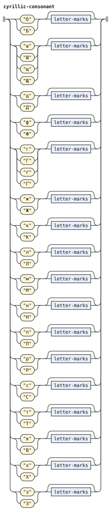</p>
<p>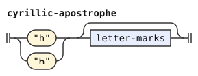</p>
<p>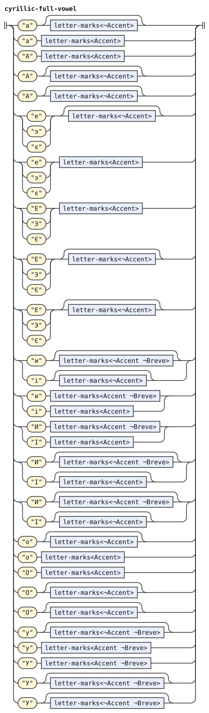</p>
<p>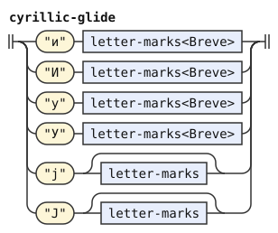</p>
<p>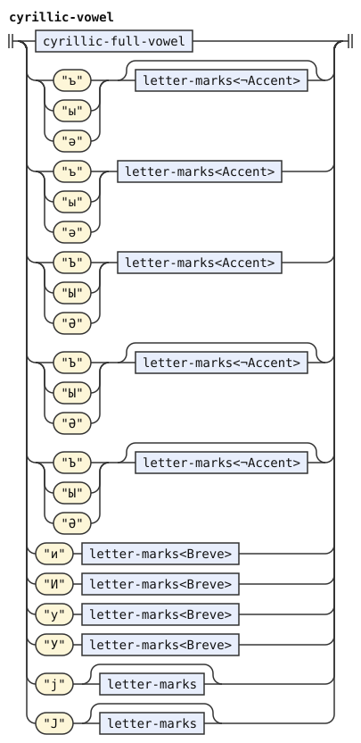</p>
<p>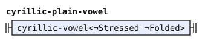</p>
<p>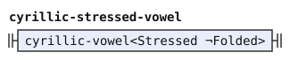</p>
<p>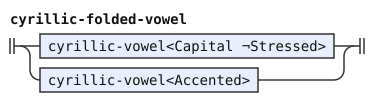</p>
<p>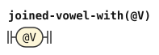</p>
</details>

The Cyrillic of CLL, in [../cll/cyrillic.md](../cll/cyrillic.md), ignores unknown marks too. It writes a diphthong as two plain vowels, as the Latin orthography does, so it has no glide letters. An accent on a vowel marks stress, as on a Latin vowel. It ignores every other mark, the breve and the dieresis included. So `май` is `mai`, `мёи` is `mei` and `ма́и` is `mAi`. A capital vowel still marks stress, because this orthography has no all-capital runs.

The restated CLL rules leave two inherited template instances without callers: `stressed-full-vowel-with("А", "Е", "И", "О", "У")` and `stressed-vowel-with("А", "Е", "И", "О", "У", "Ъ")`. This layer supplies letter readers that also accept combining marks.

The `Vowel` tag marks the five full vowels and not `y`, so the restated `cll-cyrillic-plain-full-vowel` holds them and carries `Vowel` on its header. The hard sign stays in `cll-cyrillic-plain-vowel`.

```jbogenbau
%redefine-rule cll-cyrillic-consonant :: Consonant
  | ("б" | "Б") [letter-marks] := "b"
  | ("в" | "В") [letter-marks] := "v"
  | ("г" | "Г") [letter-marks] := "g"
  | ("д" | "Д") [letter-marks] := "d"
  | ("ж" | "Ж") [letter-marks] := "j"
  | ("з" | "З") [letter-marks] := "z"
  | ("к" | "К") [letter-marks] := "k"
  | ("л" | "Л") [letter-marks] := "l"
  | ("м" | "М") [letter-marks] := "m"
  | ("н" | "Н") [letter-marks] := "n"
  | ("п" | "П") [letter-marks] := "p"
  | ("р" | "Р") [letter-marks] := "r"
  | ("с" | "С") [letter-marks] := "s"
  | ("т" | "Т") [letter-marks] := "t"
  | ("ф" | "Ф") [letter-marks] := "f"
  | ("х" | "Х") [letter-marks] := "x"
  | ("ш" | "Ш") [letter-marks] := "c"
%emits
  $

%redefine-rule cll-cyrillic-plain-full-vowel :: Vowel
  | "а" [letter-marks<¬Accent>] := "a"
  | "е" [letter-marks<¬Accent>] := "e"
  | "и" [letter-marks<¬Accent>] := "i"
  | "о" [letter-marks<¬Accent>] := "o"
  | "у" [letter-marks<¬Accent>] := "u"

%redefine-rule cll-cyrillic-plain-vowel :: ∅
  | cll-cyrillic-plain-full-vowel :: Vowel
  | "ъ" [letter-marks<¬Accent>] := "y"
%emits
  $

%redefine-rule cll-cyrillic-stressed-vowel = stressed-vowel-with(
  ("а" letter-marks<Accent> | "А" [letter-marks]),
  ("е" letter-marks<Accent> | "Е" [letter-marks]),
  ("и" letter-marks<Accent> | "И" [letter-marks]),
  ("о" letter-marks<Accent> | "О" [letter-marks]),
  ("у" letter-marks<Accent> | "У" [letter-marks]),
  ("ъ" letter-marks<Accent> | "Ъ" [letter-marks]))
```

<details><summary>Railroad diagrams of the 4 rules from <code>cll-cyrillic-consonant</code> to <code>cll-cyrillic-stressed-vowel</code></summary>
<p>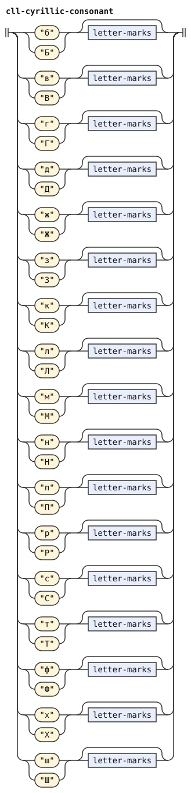</p>
<p>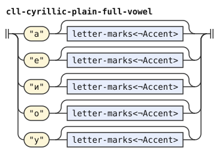</p>
<p>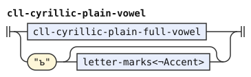</p>
<p>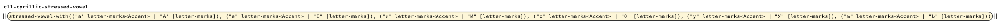</p>
</details>

## Differences from camxes-exp

camxes-exp reads no Cyrillic orthography. These Cyrillic conventions belong to gencmu.

The experimental pipeline inherits the genuine-punctuation boundary from [latin.md](latin.md#genuine-punctuation). Non-ASCII numbers remain foreign because numeric characters do not mark word boundaries. Thus `ми½клама` forms one foreign run here, while `lojban/bpfk` reads two words.

The pipeline also inherits silent marks for length or visual separation without new phonemes or word boundaries. Thus `кла~ма` reads as `klama` here. BPFK treats `~` as punctuation and separates the two runs.

Joined vowels retain the apostrophe insertion of [../common/cyrillic.md](../common/cyrillic.md). Their emitted tokens expose only the public vowel tags, as isolated vowels do.
