# Experimental word forms

This document is part of the forms stage in the [experimental](pipeline.md) pipeline. The forms stage follows the phoneme stage. It divides the phonemes of the text into words. The loader stitches this document into the stage after [../bpfk/morphology.md](../bpfk/morphology.md).

A layer is a document that changes earlier rules. This layer changes the word forms in [../bpfk/morphology.md](../bpfk/morphology.md). A lookahead tests input without reading it.

The baseline is camxes-exp, the experimental grammar of the camxes parser, written as a parsing expression grammar (PEG). The rule names follow camxes-exp, while their comments state the morphology constraints, as in [../bpfk/morphology.md](../bpfk/morphology.md). The section on glide letters adds a test of gencmu's own to three inherited rules. The [Zantufa](../zantufa/pipeline.md) pipeline shares the `ie'o` hesitation and the permitted `mz` pair, as [../zantufa/morphology.md](../zantufa/morphology.md) describes. [The notation document](../../../docs/notation.md) explains the notation.

The prose uses these Lojban terms for words:

- A brivla is a predicate word.
- A gismu is a root word.
- A lujvo is a compound word.
- A rafsi is a word form used inside compounds.

## Hesitation words

The filler `ie'o` has class Y and acts as hesitation. The forms stage marks it `Hesitation`, so every words-stage reader uses the same classification. It also marks it `Uncounted`, like other hesitation.

It carries no ordinary `Word` or `Cmavo` tag. Thus a raw quote body cannot read it through two competing token kinds.

The words stage drops hesitation outside opaque bodies, except before BU. That exception forms a letter word and also supports letter-word delimiters.

```jbogenbau
%redefine-rule source-word
  | $c:cmavo-shape
      :: Word Cmavo ∪
         $c.tags ∪
         $c.value.classify(lexicon)
  | $y:cmavo-shape :: Hesitation Y Uncounted ∪ $y.tags
  | $b:brivla-shape :: Word BRIVLA ∪ $b.tags
  | $n:cmevla-shape :: Word CMEVLA ∪ $n.tags
  | $h:hesitation-shape :: Hesitation ∪ $h.tags
%conditions
  Y ⊈ $c.value.classify(lexicon),
  Y ⊆ $y.value.classify(lexicon)
```

<details><summary>Railroad diagram of <code>source-word</code></summary>
<p>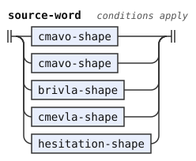</p>
</details>

## The pair mz

A diphthong combines two vowels in one syllable. A nucleus is a syllable's vowel or diphthong. A glide is an `i` or `u` before a nucleus.

This layer adds the pair `mz` to the shared table of its own stitched pipeline. Thus `kamzi`, `bamzda` and `.djeimz.` have permissible consonant pairs.

```jbogenbau
%redefine-const $PERMISSIBLE $PERMISSIBLE ∪ "mz"
```

## Consonants before glides

The `letter-ban` hook reads only a syllable-initial apostrophe. Experimental accepts a consonant before a glide in names and borrowings, as CLL 1.1 section 3.4 permits.[^cll-s3-4] BPFK and Zantufa keep their source ban. The CLL word family already accepts these forms. A CgV sequence is a consonant, a glide and its nucleus.

The consonant rules retain every restriction except the glide ban. A borrowing syllable onset can add a glide after a nonempty legal initial. Particles and rafsi slots keep the ordinary onset. Classical rafsi still require their original vowel positions, so CgV creates no new classical compound shape.

A coda is a syllable's ending consonant group. The `syllable-onset` hook uses `brivla-onset` for borrowing syllables, their stress tests and their head test. The coda lookahead uses it too. Thus a preceding syllable cannot take the consonant before `iy` or `uy` as its coda. The rafsi slot still uses ordinary `onset`.

A borrowing retains its head, stress, final syllable and slinku'i restrictions. It must contain a consonant cluster. The cluster can occur beyond the first five letters. Only a complete borrowing with CgV can bypass the head's rafsi-string exclusion. At a borrowing's start, a CVC or CCV rafsi cannot directly precede one consonant, a glide and its nucleus unless that consonant is `r`.

CLL 1.3.4 appendix A3.3 records that the working morphology drops the five-letter limit for borrowings.[^cll-a3-3] The word must resolve as one brivla. Thus `puamamakla` is legal despite its late cluster.

Thus `atkuila` and `zgiaca'a` are borrowings, while `language` remains foreign. Its initial `lan` is a CVC rafsi directly before `gua`. The guard tests the one consonant directly after the initial rafsi. It follows jbotci's `r` exception, so `lanruage` and `blaruage` remain borrowings.

The guard excludes neither cluster onsets nor CVV rafsi nor rafsi later in a borrowing. Thus `lanstia`, `baltcuiska`, `baistia` and `bailanguaska` remain borrowings. Borrowing rafsi retain their separate head exclusion. Their final onset before `y` remains ordinary, so `spagetiybroda` and `spagekuykla` stay foreign.

The forms stage marks each CgV name or predicate word with `Cgv-Warning`. The span test reads only that word, so it cannot mark CgV in a later word. [The experimental word stream](stream.md) reads this tag and supplies the warning. Disabling the warning changes no reading.

```jbogenbau
-- A name ends in a consonant, unlike a predicate word. It carries the template marks and its warning. The warning test inspects only this complete word.
%redefine-rule cmevla-shape
  $n:word-shape(cmevla)
      :: $n.tags ∪
         ($n.parse(([{nonpause-phoneme}] consonant glide [{nonpause-phoneme}])) ⟹ Cgv-Warning)

-- A predicate word ends in a vowel, unlike a name. It carries the template marks and its warning. The warning test inspects only this complete word.
%redefine-rule brivla-shape
  $b:word-shape(brivla-word)
      :: $b.tags ∪
         ($b.parse(([{nonpause-phoneme}] consonant glide [{nonpause-phoneme}])) ⟹ Cgv-Warning)

-- This boolean span test requires a consonant, glide and nucleus. Several possible positions give the same truth value.

-- An ordinary initial forbids a following glide. A CgV onset requires a consonant before its glide, unlike an ordinary glide onset.
%rule brivla-onset
  onset | cgv-onset

-- This hook permits a consonant before a glide in syllables but leaves rafsi onsets unchanged.
%redefine-rule syllable-onset
  brivla-onset

-- The nonempty consonant initial precedes one glide. The glide requires a following nucleus.
%rule cgv-onset
  cgv-initial glide

-- A CgV onset begins with the shared initial cluster. The cluster is not empty, and no consonant follows it.
%rule cgv-initial
  $c:initial-cluster
%conditions
  ¬$c.following-tokens.parse(consonant …)

-- Only a complete CgV borrowing bypasses the rafsi-string exclusion. The initial-rafsi conditions exclude the competing compound, while the cluster and continuation tests constrain the borrowing.
%redefine-rule fuhivla
  $b:brivla-head stressed-syllable [{consonantal-syllable}] final-syllable
%conditions
  ¬$b.onward.parse(rafsi-string …) ∨
    $.parse(([{nonpause-phoneme}] consonant glide [{nonpause-phoneme}])),
  ¬$.onward.parse(cgv-rafsi-continuation …),
  $.parse(([{nonpause-phoneme}] consonant consonant [{nonpause-phoneme}]))

-- This boolean span test requires adjacent consonants. Different possible cluster positions give the same truth value.

-- The start is a CVC or CCV rafsi of either stress. The tested single consonant directly before the glide cannot be r.
%rule cgv-rafsi-continuation
  (cvc-rafsi-of(vowel) | ccv-rafsi-of(vowel)) $c:consonant glide
%conditions
  $c.value ≠ "r"

-- Consonant letters cannot precede a syllable-initial apostrophe but can precede a glide.
%redefine-rule letter-ban
  h

```

<details><summary>Railroad diagrams of the 9 rules from <code>cmevla-shape</code> to <code>letter-ban</code></summary>
<p>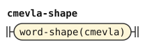</p>
<p>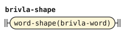</p>
<p>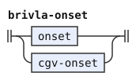</p>
<p>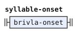</p>
<p>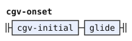</p>
<p>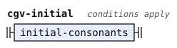</p>
<p>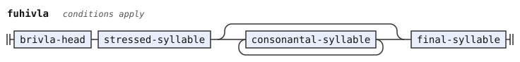</p>
<p>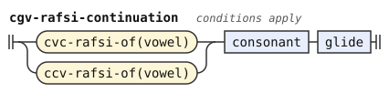</p>
<p>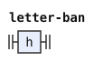</p>
</details>

## Extended rafsi

An extended rafsi is a whole or shortened word before a y-hyphen. It has a classical apostrophe-y form or a borrowing head. A borrowing head excludes rafsi strings, whose endings include `hy-rafsi` and `stressed-hy-rafsi`. Thus the two alternatives cannot complete from the same start, even with an apostrophe onset in the borrowing form.

A `hy_rafsi` is a CCVCV, CVCCV, CCV, or CVV rafsi body followed by `'y`. The BPFK grammar reads that shape only through the `hy-rafsi-of` template in lookaheads. It ends a rafsi string, and it keeps `y-less-rafsi` from starting one. This layer also reads it inside compounds.

`hy-rafsi` takes a long rafsi with an unstressed vowel, a CCV rafsi, or a CVV rafsi before `'y`. The long form leaves a consonant after a CCV prefix, so the shorter form cannot reach the apostrophe there. CVV differs in its second or third letter. The stressed forms have the same separation. After these redefinitions, nothing reads the rules `brivla-rafsi`, `stressed-brivla-rafsi` and `two-syllables` of [../bpfk/morphology.md](../bpfk/morphology.md).

```jbogenbau
-- An extended rafsi has a classical apostrophe-y form or a borrowing head. Borrowing heads exclude rafsi strings, which include hy-rafsi.
%redefine-rule extended-rafsi
  hy-rafsi | fuhivla-rafsi

-- The stressed borrowing head excludes rafsi strings, including stressed-hy-rafsi. Only one extended form can complete at this start.
%redefine-rule stressed-extended-rafsi
  stressed-hy-rafsi | stressed-fuhivla-rafsi

-- An apostrophe-y rafsi ends its classical body with apostrophe-y. The long classical form appends an unstressed vowel to a long rafsi in this layer. Another apostrophe can follow the hyphen.
%rule hy-rafsi = hy-rafsi-of(unstressed-vowel, unstressed-diphthong, unstressed-vowel, [h])

-- A stressed apostrophe-y rafsi ends its stressed classical body with apostrophe-y.
%rule stressed-hy-rafsi = hy-rafsi-of(stressed-vowel, stressed-diphthong, stressed-vowel, ε)
```

<details><summary>Railroad diagrams of the 4 rules from <code>extended-rafsi</code> to <code>stressed-hy-rafsi</code></summary>
<p>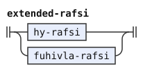</p>
<p>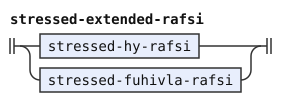</p>
<p>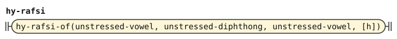</p>
<p>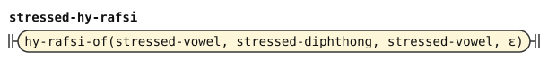</p>
</details>

A CCV `hy-rafsi` can otherwise begin a brivla, as in `bla'ykla`. `brivla` rejects that start with a CCV rafsi, `'y` and the next onset, which `slihykru` tests. This onset includes CgV, so `bla'ykuiska`, `kla'ykuiska` and `bla'ytcuiska` are foreign too. Thus `kerlybla'ykla` is one word, but `bla'ykla` is not. The plain and stressed CCV choices need no order because their vowel stress differs. Only `brivla` reads `slihykru`.

```jbogenbau
-- A predicate word excludes a particle start and the CCV-apostrophe-y start that slihykru detects. Its unstressed rafsi precede the stressed core.
%redefine-rule brivla
  [{initial-rafsi}] brivla-core
%conditions
  ¬($.onward.parse(cmavo …) ∨ $.onward.parse(slihykru …))

-- The forbidden start is a CCV rafsi of either stress, apostrophe-y, and a borrowing onset, including CgV.
%rule slihykru
  ccv-rafsi-of(vowel) h y brivla-onset
```

<details><summary>Railroad diagrams of <code>brivla</code> and <code>slihykru</code></summary>
<p>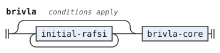</p>
<p>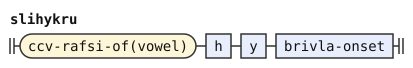</p>
</details>

The onset after a borrowing rafsi head can be an apostrophe. `spageti'ybroda` uses `fuhivla-rafsi` before `broda`. `spageti'ykla` uses `stressed-fuhivla-rafsi` before `kla`. Each example needs the apostrophe onset in its own rule.

```jbogenbau
-- A borrowing rafsi starts with an unstressed syllable. Its onset can be an apostrophe. A following rafsi cannot start with the optional apostrophe.
%redefine-rule fuhivla-rafsi
  $f:fuhivla-head onset y [h]
%conditions
  $f.onward.parse(unstressed-syllable …)

-- A stressed borrowing rafsi permits an apostrophe onset. A consonantal syllable cannot consume the start of the following onset and y.
%redefine-rule stressed-fuhivla-rafsi
  fuhivla-head stressed-syllable [{consonantal-syllable}] onset y

```

<details><summary>Railroad diagrams of <code>fuhivla-rafsi</code> and <code>stressed-fuhivla-rafsi</code></summary>
<p>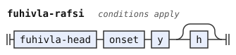</p>
<p>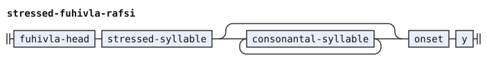</p>
</details>

An initial rafsi is an extended form, an ordinary y-rafsi, or a short unhyphenated form. Extended forms also carry a hyphen. The short form cannot start a borrowing or borrowing rafsi, or stand directly before one. It excludes y-rafsi and apostrophe-y forms through `y-less-rafsi`.

A y-rafsi requires y where a classical extended form needs a vowel or apostrophe. A borrowing head excludes that y-rafsi through its rafsi-string test. Thus only one kind can complete at the same start. No rule reads `any-extended-rafsi` after this replacement.

```jbogenbau
-- A short unhyphenated rafsi cannot start or directly precede a borrowing or borrowing rafsi. It excludes y-rafsi and hy-rafsi through y-less-rafsi, and borrowing forms through any-fuhivla-rafsi. Initial borrowing rafsi need an unstressed first syllable. Classical extended forms require apostrophe-y. The stressed counterparts also need a short final that cannot start with consonant-y or apostrophe.
%redefine-rule initial-rafsi
  | extended-rafsi | y-rafsi
  | $l:y-less-rafsi
%conditions
  ¬$l.onward.parse(any-fuhivla-rafsi …),
  ¬$l.following-tokens.parse(any-fuhivla-rafsi …)

-- The test detects a complete borrowing or either borrowing rafsi form.
%rule any-fuhivla-rafsi
  fuhivla | fuhivla-rafsi | stressed-fuhivla-rafsi
```

<details><summary>Railroad diagrams of <code>initial-rafsi</code> and <code>any-fuhivla-rafsi</code></summary>
<p>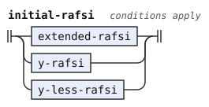</p>
<p>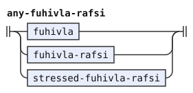</p>
</details>

## A bare nai

The implication marks every NAI word `Indicator`, as [the experimental lexicon](lexicon.md) marks the attitudinals. The mark comes from an implication, which the forms stage applies to each word that it emits. The indicator stage then attaches a bare `nai` to the word before it ([the experimental indicators](indicators.md)).

```jbogenbau
%implies NAI ⟹ Indicator
```

## Glide letters

The experimental phoneme stage reads `ɩ`, `q`, `w`, `ĭ` and `ŭ` as the glides `i` and `u`, with the tag `Glide` ([latin.md](latin.md)). `ɩ`, `q` and `w` also carry `Onglide`, because they write only a glide before its vowel. Such a letter is a glide wherever it stands. So no rule reads it as a vowel.

A glide letter carries no `Vowel` tag, so the `Vowel` test of `vowel` does not read it. `diphthong-letters` refuses an onglide letter, so `ĭ` and `ŭ` can end a diphthong, as in `maĭ`. These tests of glide letters are gencmu's own.

When a diphthong ends in a glide letter, its second letter is no vowel. So the `a` of `maĭ` passes the `!nucleus` test of `vowel`, and without a change it reads as a vowel alone. `vowel` therefore also refuses a letter where a diphthong begins. Without a glide letter the extra test changes nothing, because a diphthong's second letter is then a nucleus, and the camxes test already fails.

A run with a glide letter where no glide can stand then divides into no words. The forms stage emits it as a foreign run ([../common/forms.md](../common/forms.md)), and the words stage rejects it outside a quote. So `mɩ`, `mĭ`, `kaw` and `www` are errors, while `maĭ`, `coĭ` and `kaŭ` read as `mai`, `coi` and `kau`.

The lookaheads still read the letter as `i` or `u`. A glide letter is no vowel, so it is a nucleus only as the end of a diphthong. So `aɩa` and `aĭa` are `a` and `ia`, as `aia` is. The `!i` after a diphthong still sees a glide letter, so `aiɩa` divides into no words, as `aiia` does.

```jbogenbau
-- A vowel forbids a following nucleus. It also excludes a diphthong start, so a marked glide cannot leave a competing single vowel. A marked glide letter cannot serve as a vowel.
%redefine-rule vowel
  $v:_<Vowel>
%conditions
  ¬$v.following-tokens.parse(nucleus …),
  ¬$v.onward.parse(diphthong …)

-- An onglide letter cannot end a diphthong. A diphthong also forbids another matching i or u directly after it.
%redefine-rule diphthong-letters
  | "a" $i:"i"<¬Onglide>
  | "a" $u:"u"<¬Onglide>
  | "e" $i:"i"<¬Onglide>
  | "o" $i:"i"<¬Onglide>
%conditions
  $i.following-tokens.first-token.value ≠ "i",
  $u.following-tokens.first-token.value ≠ "u"
```

<details><summary>Railroad diagrams of <code>vowel</code> and <code>diphthong-letters</code></summary>
<p>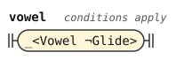</p>
<p>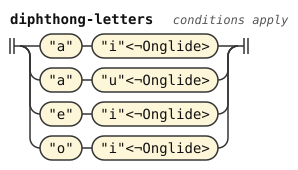</p>
</details>

## Differences from CLL, BPFK and camxes-exp

camxes-exp extends the working word forms of the BPFK, the Lojban language planning committee. This layer retains its changes except the redundant glide lookahead described in [the pipeline departures](pipeline.md#where-it-reads-texts-differently-from-camxes-exp).

*The Complete Lojban Language* (CLL) forbids the consonant pair `mz`.[^cll-s3-6] The BPFK working morphology also forbids it, because its pair table has no `mz`. The letter rule for `m` in camxes-exp refuses only another `m` among the consonants. So camxes-exp accepts `mz` wherever a permissible pair can stand. This layer adds `mz` to its own pair table. Examples are the predicate word `kamzi`, the lujvo `bamzda` and the name `.djeimz.`.

The working morphology has two kinds of extended rafsi, which let a word, whole or cut short, stand before a y-hyphen inside a compound. A `brivla_rafsi` is the head of a brivla of two syllables or more, followed by `'y`, as in `klama'ybroda`. A `fuhivla_rafsi` is the head of a borrowing, followed by an onset and `y`, as in `spageiybroda`.

camxes-exp replaces the first kind with `hy_rafsi`, which the working morphology uses only in lookaheads. A `hy_rafsi` is a long rafsi and an unstressed vowel, a CCV rafsi, or a CVV rafsi, followed by `'y`. So `klama'ybroda` is one word in both grammars, but only camxes-exp reads `kerlybai'ybroda` as one word.

A `hy_rafsi` can also begin a brivla with a CCV rafsi, `'y` and the next rafsi. camxes-exp refuses that start, which it calls `slihykru`. So camxes-exp reads `kerlybla'ykla` as one word, but not `bla'ykla`, which the working morphology rejects too.

The working morphology rejects `kerlyfa'u'yiismu` because its borrowing rafsi onset cannot be an apostrophe. This layer follows camxes-exp and permits that onset.

In the working morphology, a short rafsi without a y-hyphen cannot stand where an extended rafsi or a borrowing begins, or directly before one. In camxes-exp, it cannot stand where a borrowing or the rafsi of a borrowing begins, or directly before one.

camxes-exp's `indicator` rule accepts a bare NAI like an attitudinal. This layer marks NAI as an indicator so that the indicator stage can attach it.

This layer inherits whole hesitation runs from [../bpfk/morphology.md](../bpfk/morphology.md#whole-hesitation-runs). A pure run of y is one hesitation token, and the split before BU preserves its letter word. The words stage drops the hesitation, so its division changes no final reading here.

The alternatives and repetitions state morphology constraints without PEG order. Merged stress tests and name forms remove duplicate proofs without changing the word classes.

This layer accepts CgV in names and borrowings, unlike camxes-exp. CLL 1.1 permits these diphthongs in those classes.[^cll-s3-4] The words stage identifies this extension by default when it reads a marked word. Opaque raw bodies and text after active FAhO contain no such word reads. The full borrowing shape still rejects invalid compound-like forms. Only borrowing syllables receive the added onset, so a rafsi slot cannot use it.

camxes-exp reads no glide letters. This layer refuses a glide letter as a vowel, and an onglide letter as the second letter of a diphthong. So a glide letter reads only as a glide.

The experimental filler `ie'o` uses ordinary hesitation behavior, including the BU exception. Zantufa restricts where hesitation counts as spacing. Here it counts as spacing in every gap, so `zo'oi ie'o broda` quotes `broda`.

[^cll-s3-6]: [CLL 1.1, section 3.6](https://lojban.org/publications/cll/cll_v1.1_xhtml-section-chunks/section-clusters.html).

[^cll-s3-4]: [CLL 1.1, section 3.4](https://lojban.org/publications/cll/cll_v1.1_xhtml-section-chunks/section-diphthongs.html).

[^cll-a3-3]: [CLL 1.3.4, appendix A3.3](https://github.com/int19h/cll/blob/v1.3.4/chapters/a03.xml#L155-L208).
