# The experimental grammar

This document is a layer over [the CLL grammar](../cll/syntax.md), the grammar of *The Complete Lojban Language* (CLL), edition 1.1. A layer is a document that changes earlier rules. A pipeline document defines an ordered sequence of stages. The [experimental](pipeline.md) pipeline stitches this layer after that grammar, that is, combines their rules into one grammar.

A token is one unit that a stage reads or emits. A token's value is the string that exact comparisons read. Its image is the string that people see.

The layer adds experimental constructs. It always accepts some constructs, and a feature, a named switch that the grammars test, guards others. Its baseline is camxes-exp, the experimental grammar of the camxes parser, written as a parsing expression grammar (PEG). A PEG tries alternatives in order.

The layer restates each CLL rule that it changes with `%redefine-rule`. It states its own rules with `%rule`. Each section below says what the layer changes in that part of the grammar. A rule that this document does not name is the CLL grammar's, as that document explains it.

The prose uses these Lojban terms, as [the CLL grammar](../cll/syntax.md) does:

- A cmavo is a particle, a short structure word.
- A selma'o is a word class of cmavo.
- A brivla is a predicate word.
- A cmevla is a name word.
- A selbri is the predicate of a sentence.
- A sumti is an argument of a selbri.
- A tanru is a compound selbri.
- A tanru unit is one component of a tanru.
- An ek is a logical sumti connective, such as `.e`.
- A jek is a logical connective, such as `je`.
- A joik is a non-logical connective, such as `joi`.
- A gihek connects bridi-tails, as `gi'e` does.
- A gek introduces two branches connected in forethought.
- A stag is a tense or modal inside a connective.
- A bridi-tail is a selbri with any terms after it.
- A lerfu word is a letter word, such as `.abu` or `xy.`.
- A mekso is a mathematical expression.
- VUhU is the class of mathematical operator words.

[The experimental lexicon](lexicon.md) gives each cmavo one selma'o. For example, `mi'ai` is KOhA, `la` is LE, `fi'oi` is SOI, `ma'oi` is ZO and `la'oi` is ZOhOI. `no'oi` and `po'oi` are NOhOI, with the terminators `ku'oi` and `ku'o`. The added classes include `LOhOI`, `NOhOI`, `KUhOI`, `KUhAU`, `LOhAI`, `LEhAI`, `ZOhOI` and `MEhOI`.

[The notation document](../../../docs/notation.md) explains the notation. The terminals of this grammar (the symbols that each match one input token) are selma'o. A token is one unit of input. A tag marks a token by an identifier.

A stage is one step of a pipeline, with its own grammar. The pipeline is the sequence of stages that reads a text. The words stage emits each finished quote as one token of its opening class. The syntax reads one terminal for that token. Its internal structure remains in the tree of the words stage.

The layer uses two feature guards, which make a part of a rule depend on a feature. `cbm` is the cmevla-brivla merger, which permits name words as predicates. `soi-clause` makes `soi` a term that takes a subsentence. The experimental pipeline turns both on. A caller, the program that requests parsing, can turn either off.

A free modifier is a phrase that stands in many positions. An elidable terminator is a closing word that can be omitted. The free-modifier slot follows it outside its brackets: `[+X] 🆓`. So free modifiers can follow an elided terminator.

The number and letter-string rules prevent a run from ending before a part that can continue it. Each rule tests its actual following node. Numbers continue with number parts or letter words. Letter strings continue with letter words or PA. A written BOI separates the run from the next part. The free-slot wrappers hold BOI and the following free modifiers.

A span is a range between input token boundaries. A ranked choice filters alternatives at one written position. An option qualifies when its complete reading passes the grammar's conditions. An earlier option can exclude a later option over the same span. The [notation document](../../../docs/notation.md#ranked-choices) defines when this occurs.

A derivation is one complete grammatical reading. An admitted derivation survives ranked filtering. `fewest` prefers fewer nonempty flagged rule occurrences. The stage ranks admitted derivations by `leftmost-longest`, then `fewest`, then `late-elision`. After the flags tie, fewer omitted terminators win at the first differing boundary. Two best derivations with equal counts at every boundary tie, and a tie is an error.

`free` and `tense-modal` carry `leftmost-longest`. A rule profile counts flagged spans. Both rules contribute to one span profile, without priority by rule name. The earliest differing start decides, with longer spans first. A flagged span that prevents the full text from completing contributes nothing.

The `fewest` flag counts links built by `bridi-tail-connective` and `gi-stag-connective` across the whole reading.

After span ranking, a smaller count wins. Equal counts leave late elision to decide, which can keep the first description open. The same ranking applies to A, JA, JOI, and VUhU. Each family can connect sumti and bridi-tails. The flag compares whole readings because their omitted terminators fall under different parents and at different boundaries.

This favors sumti and term connections when they avoid a bridi-tail link. Such terms include terms marked with `fe` or `pu`, and bare `na ku` terms. Written `kei ku` after the first description selects parallel descriptions. A written `gi'e` explicitly marks a bridi-tail link. The closing section explains both choices with examples.

So `to mi klama` holds `mi klama` in its parenthesis. In the same way, `lu mi klama` holds `mi klama` in its quote.

The layer permits ambiguity beyond omitted terminators. It uses these rules to select a reading:

- A free modifier's span is settled before the `fewest` ranking. Its terminator can be omitted.
- In a tanru and between operators, `ke` directly after a joik, jek or ek opens the connective's own group. The selbri and mekso sections explain that choice.
- A connection that can be a sumti connection is one ("Terms"). After span ranking, fewer bridi-tail links in the whole reading win. Equal counts leave late elision to decide.
- A `be` group attaches to the tanru unit before it ("Selbri and tanru").
- A subscript after a subscript nests. Any other free modifier after a subscript belongs to the word that the subscript marks ("Free modifiers, vocatives and indicators").

The `leftmost-longest` flag on `free` settles a free modifier's span before the `fewest` ranking. An omitted terminator therefore closes as late as the text allows. In `mi viska to do klama le zarci`, `le zarci` stays inside the parenthesis.

The experimental terminators `ku'au` and `ku'oi` are elidable: the rules below write them `[+KUhAU]` and `[+KUhOI]`.

```jbogenbau
%ambiguity-resolution late-elision
```

## The text and its paragraphs

The layer changes the text in five ways. The first change makes a text-initial `nai` an indicator, as the indicator stage of the experimental pipeline reads it. The `indicators` rule takes that bare NAI. A separate `nai` stands only before a run of names.

The second change permits an ek after a text-leading `.i`, as in `.i .e do klama`. After that connective, an optional tense can precede `bo`. The rule writes that tense as a `tag`. A `stag` is a `tag` in this pipeline, so either name reads the same words.

The third change is that an ek, a jek or a joik directly after `.i` is always a connective. So `i.e`, `.iji` and `mi klama .i e` read `.i e` or `.i ji` as a connective. Without this rule, these texts tie, because a bare ek is a fragment. The rule `lone-i` is an `.i` that no ek, jek or joik follows directly. It stands in the bare-`.i` positions of `text-1` and `paragraph`, before a statement, a fragment or nothing.

The `lone-i` rule tests these three connective families. A VUhU can also follow `.i` as a connective, as in `mi klama .i su'i do klama`. It can instead start a mathematical fragment, as in `mi klama .i su'i pa`. Therefore `lone-i` permits VUhU after it.

In `mi klama .i su'i pa moi`, both the connective and operator readings complete. Late elision selects the connective reading. A gihek answer after `.i` stays a fragment, as in `.i gi'e` and `mi klama .i gi'e`. No `.i` connective is a gihek, so these texts cause no tie.

A bare connective answer needs no `.i`. `e` alone is an ek fragment, and `je` alone is the connective before an empty `text-1`. So reading `.i e` as a connective loses no answer.

A free modifier can stand between `.i` and an ek. Then the ek can still be a fragment, as in `mi klama .i sei broda se'u e`. Neither `ge'i` nor `gu'i` can stand as a bare answer.[^cll-e14-105] A forethought connective can start with an ek, a jek or a joik, as in `je gi mi gi do`. The connective after `.i` consumes that initial ek, jek or joik. Therefore `.i e gi mi gi do` and `mi klama .i je gi mi gi do` fail.

The fourth change permits `.i` after a run of `ni'o` and its free modifiers. Thus `ni'o coi do .i mi klama` keeps `do` inside the vocative. Empty paragraphs can separate runs, as in `ni'o coi ni'o coi`. One `.i ni'o` transition can also stand between paragraphs, so a reply can introduce another topic. A second transition needs an intervening paragraph, so `ni'o .i ni'o .i ni'o` fails. A run can end the text, as in `mi klama ni'o`.

`paragraph-break` collects the topic runs at one paragraph boundary. It can precede the first paragraph, separate two paragraphs, or follow the last paragraph. Nonempty free modifiers separate adjacent NIhO runs, so one run cannot split at an empty free slot. A free slot follows each run group, including the group before the I transition. `leading-separators` collects the ordinary text-leading `.i` forms, both before an initial break and after any break.

The fifth change permits a text-initial run of names only with `cbm` off. Under `cbm`, a cmevla is a selbri word, so the pipeline rejects `.djan. mi klama`.

All four connective families can stand before the first `.i` of a text, as in `e mi klama` and `su'i mi klama`. An ek or a VUhU needs a nonempty `text-1` after it. So a bare `e` stays an ek fragment, and a bare `su'i` fails.

A first-child path follows each node's first child. The `$NEEDS-TEXT` pattern finds an initial ek or VUhU along this path, even with conversion or free modifiers. The `text-token` wildcard tests that the following `text-1` starts with a token.

The ranked choice compares complete candidates and prefers the form without an initial connective when both forms complete. So `e .i mi klama` reads an ek fragment and a following sentence. The initial-connective candidate remains available when the fragment reading cannot complete.

An initial connective cannot immediately follow a leading free modifier in the same reading. Thus `doi zed jinvi jena morji` reads the vocative `doi zed` before one sentence with connected bridi-tails. So `coi je mi klama` and `doi djan do'u je do klama` fail, as in camxes-exp.

IhAU stands for the elided terminators that end the current sentence, except its last VAU. It closes every construction that is still open in that sentence.

So a reset belongs to one sentence. In `mi klama .i je do cadzu iau ti`, it closes only the second sentence, and `ti` joins that sentence's main bridi.

While the main bridi is open, IhAU permits more terms, a written VAU and free modifiers. A plain `.i`, a statement connection or a sentence link can then follow, as after written terminators.

Terms after IhAU join the outermost tail that remains open. In a nonfinal connected tail, they join that tail. In the final tail, they join the shared tail terms.

A bridi-tail connection can follow a reset. Thus `mi klama lo nu do cadzu iau do gi'e tavla` parses. The reset closes the abstraction and description before the connected tail.

IhAU can also stand among the terms before the selbri, as in `fau lo nu do klama i'au ko danfu`. There it closes the constructions in those terms. That head reset needs a term before IhAU. A final CU directly before IhAU cannot combine with an initial CU directly after it. Other CU positions in the heads remain available.

A reset after leading free modifiers closes them, as `do'u` closes a vocative. A sentence, a prenex, a TUhE group or a fragment can follow it.

IhAU stands in the unit that it marks: a sentence, a prenexed statement, or the paragraph item of a fragment. So an indicator after IhAU marks that whole unit, as definition 66786 says.

A bridi reset belongs to a sentence of a text. A subsentence inside a description, a relative clause or a term has none, so a reset always returns to the outer bridi.

A quotation, a parenthesis and a TUhE group each hold their own text. A reset inside one of them returns to the sentence of that inner text.

A reset needs an earlier construction, so `iau mi klama` rejects. A reset after a closed TUhE group also rejects, because the group leaves no bridi open. A fragment has no main bridi, so `li pa iau do` rejects.

The prefix condition keeps adjacent leading free modifiers together. Otherwise, a free slot before the sentence and the reset prefix can split the same modifiers into duplicate readings.

A written VAU closes a simple main bridi. After connected tails, only a written VAU in the shared tail terms closes it. A VAU inside a forethought branch closes that branch alone.

A written KEhE also closes a KE-wrapped forethought bridi. A later reset permits free modifiers, but it cannot reopen that bridi for terms. Thus `mi klama vau iau ui` parses, while `mi klama vau iau ti` rejects.

```jbogenbau
%const $NEEDS-TEXT #(ek ⋰) ∪ #(VUhU ⋰)

%redefine-rule text
  | ¬cbm? [{NAI}] {CMEVLA} 🆓 (text-1 ≻ $c:connective $t:text-1)
  | [indicators & {free}] (text-1 ≻ $c:connective $t:text-1)
%conditions
  $c ≇ $NEEDS-TEXT ∨ $t.first-token.matches(text-token),
  ¬$c.preceded-by(free)

%rule text-token
  _

%redefine-rule indicators
  {[FUhE] indicator}

%redefine-rule indicator
  UI | CAI | NAI | DAhO | FUhO

%redefine-rule text-1
  [leading-separators] [paragraph-break] [paragraphs]

%redefine-rule paragraphs
  paragraph [paragraph-break [paragraphs]]

%rule paragraph-break
  {{NIhO} / {free}} 🆓 [I 🆓 {{NIhO} / {free}} 🆓] [leading-separators]

%rule leading-separators
  {(I joik-jek-ek | lone-i) [[tag] BO] 🆓}

%redefine-rule paragraph
  paragraph-item [{lone-i 🆓 [paragraph-item]}]

%rule paragraph-item
  statement | [reset-opening] fragment | reset-opening

%rule reset-opening
  $f:reset-free-prefix IhAU 🆓
%conditions
  ¬$f.preceded-by(free)

%rule reset-free-prefix
  {free}

%rule reset-head
  [CU 🆓] {terms / CU 🆓} [CU 🆓]

%rule lone-i
  (* I_clause !jek !joik !joik_jek in camxes-exp's paragraph, whose joik includes A *)
  $i:I
%conditions
  ¬$i.following-tokens.begins(joik-jek-ek)
```

<details><summary>Railroad diagrams of the 14 rules from <code>text</code> to <code>lone-i</code></summary>
<p>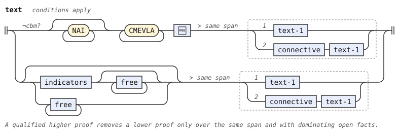</p>
<p>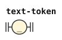</p>
<p>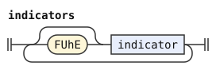</p>
<p>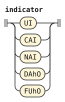</p>
<p>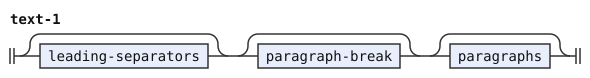</p>
<p></p>
<p>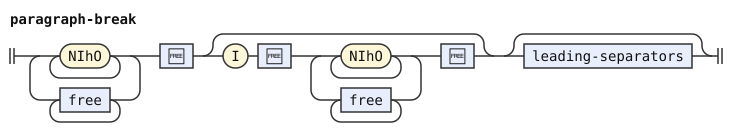</p>
<p>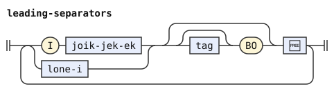</p>
<p></p>
<p>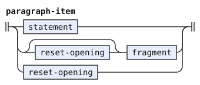</p>
<p>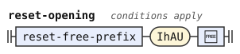</p>
<p>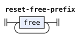</p>
<p>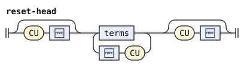</p>
<p>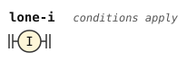</p>
</details>

## Statements and fragments

The connective after `.i` can be an ek or a VUhU as well as a joik or jek. A statement connective can also precede `.i`, as in `mi klama joi .i do klama`. Both are `connective`. Before `bo` after `.i`, the connective can also be an ek, and the tense is a `stag`, which is a `tag` here.

`sentence-link` joins a sentence to a following subsentence through a connective before `.i`. A stag can stand before `bo`, but only with `bo`. The subsentence can begin with a prenex, even an empty one, as in `mi klama su'i .i zo'u do klama`. It can hold another link, so these links group from the right.

A TUhE group is not a sentence, so `tu'e mi klama tu'u je .i do klama` fails, as in camxes-exp. Plain connections after `.i` stay in `statement-1` and group from the left. Connections with `bo` use `statement-2` and group from the right.

A bare `na` forms a term. So `na` and `na na` are terms fragments. The layer omits the separate `NA 🆓` alternative from `fragment`, because it duplicates that reading.

```jbogenbau
%redefine-rule statement
  statement-1 | [reset-opening] prenex statement

%redefine-rule statement-1
  | statement-2
  | statement-1 I connective [statement-2]

%redefine-rule statement-2
  statement-3 [I [joik-jek-ek] [stag] BO 🆓 [statement-2]]

%redefine-rule statement-3
  [reset-opening] (top-sentence | [tag] TUhE 🆓 text-1 [+TUhU] 🆓)

%redefine-rule fragment
  ek 🆓 | gihek 🆓 | mekso-fragment | terms [+VAU] 🆓 | prenex | relative-clauses | links | linkargs

%redefine-rule prenex
  [terms] ZOhU 🆓
```

<details><summary>Railroad diagrams of the 6 rules from <code>statement</code> to <code>prenex</code></summary>
<p>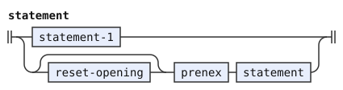</p>
<p></p>
<p></p>
<p>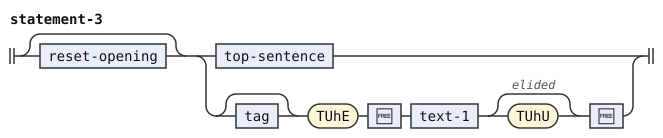</p>
<p></p>
<p>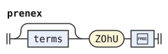</p>
</details>

## Sentences and bridi-tails

A bridi-tail can have terms before its selbri. The terms and `cu` before a selbri form a `bridi-tail-head`. In a head, runs of terms and single `cu` words alternate: `mi cu do klama`, `cu mi klama`. A head can stand before the first bridi-tail of a sentence, and after each connective between bridi-tails. Examples are `mi klama je do tavla` and `mi klama gi'e cu do tavla`.

A bare tense, modal, or `na` is not a term before a selbri ("Terms" below). So `mi pu klama` has the tense `pu` on its selbri, and so does `mi pu sei do klama se'u klama`. And `mi na klama` negates its selbri.

The afterthought connective between bridi-tails can be a gihek, joik, jek, ek or VUhU (`bridi-tail-connective`). Each of them can also open a `bo` or `ke` grouping of bridi-tails. The `gi-stag-connective` rule also opens these groups with `gi` and a stag, as in `mi klama gi ba bo tavla`.

A structural pattern tests a node and its children. Connected bridi-tails group from the left, and `bridi-tail-1` uses left recursion.[^cll-s14-10] At a final plain connection, a whole-tail pattern tests whether the connective can own the same KE group. A continuing selbri or a head keeps the plain reading. A written inner VAU with nonempty shared tail terms also keeps it.

A final connection is last at its grammar level. The layer reuses `bridi-tail-1-final` for the final plain connection. Its pattern excludes a complete KE-unit tail or KE-wrapped forethought sentence when the connective can own that group. An earlier plain connection remains available before a following connection. A head or BO continuation stops the whole-wrapper pattern.

The KU conditions apply in heads, tails, prenexes, fragments, and NUhI termsets. A bare NA or tag can omit KU before a written closing word, a gihek, or the text's end. A bare NA can also omit KU before any actual term. The "Terms" section gives the complete KU rule. A written CU separates runs of terms within a head.

`top-sentence` is the sentence of a text, and it adds the resets. `sentence` serves subsentences, which take no reset. `top-sentence-link` and `top-subsentence` repeat the sentence link at the top level, so that a linked sentence can reset too.

A reader is a rule that supplies one part of the family. The templates take four readers:

- Final tail
- Final forethought bridi
- Nonfinal tail
- Nonfinal forethought bridi

The ordinary named instances use `tail-terms` and `gek-sentence`. The main named instances use `main-tail` and `main-gek`. A connected final branch leaves its resets to the shared tail terms.

A KE group uses the ordinary reader inside its brackets. A reset closes that group before it reaches the shared tail terms.

When NA starts a forethought opener's joik, jek or ek before `gi`, NA belongs to that opener. This form has NA, optional SE, JOI, JA or A, then `gi`. Thus `na je gi broda gi brode` keeps NA inside its connective. Both recursive NA forms exclude this opener, in sentences and selbri. KE can negate the whole bridi of this opener, as in `na ke je gi broda gi brode ke'e`. Before `ge`, NA instead negates the whole bridi, as in `na ge broda gi brode`.

The `main-tail` reader separates open tails from tails with written VAU. The `main-gek` reader also separates open and closed forethought wrappers.

The open forethought reader requires omitted KEhE in each wrapper. The closed reader records a written final VAU or a written KEhE around the bridi.

The final reader supplies the shared tail after a KE or BO group. Nonfinal branches use the nonfinal reader, so connections can follow resets.

An open tail can take terms after a reset. A closed tail can take only resets and free modifiers. An empty reset after a closed tail can precede a connection.

```jbogenbau
%rule top-sentence-link
  connective [[stag] BO] I 🆓 top-subsentence

%rule top-subsentence
  [reset-opening] (top-sentence | prenex top-subsentence)

%redefine-rule sentence
  (* sentence <- terms? bridi_tail_t1 ... (joik_jek (stag? BO_clause)? I_clause free* subsentence)* *)
  headed-bridi-tail [sentence-link]

%rule sentence-link
  connective [[stag] BO] I 🆓 subsentence

%rule bridi-tail-head
  | {terms / CU 🆓} [CU 🆓]
  | CU 🆓 [{terms / CU 🆓} [CU 🆓]]

%const $KE-FORETHOUGHT #« [tag] KE [🆓] gek-sentence KEhE [🆓] »
%const $CONNECTED-KE-SELBRI #« [tag] $KE-UNIT »
%const $CONNECTED-KE-TAIL #« $CONNECTED-KE-SELBRI tail-terms » ∪ $KE-FORETHOUGHT
%const $CONNECTED-KE-WITH-VAU #« $CONNECTED-KE-SELBRI (tail-terms ∩ $WRITTEN-VAU) »

%rule headed-bridi-tail-with(@T, @G, @P, @H)
  [bridi-tail-head] bridi-tail-with(@T, @G, @P, @H)

%rule headed-bridi-tail-2-with(@T, @G, @P, @H)
  [bridi-tail-head] bridi-tail-2-with(@T, @G, @P, @H)

%rule bridi-tail-with(@T, @G, @P, @H)
  | bridi-tail-1-final-with(@T, @G, @P, @H)
  | bridi-tail-1-with(@P, @H, @P, @H)
    (bridi-tail-connective [stag] | gi-stag-connective) KE 🆓
    headed-bridi-tail-with(tail-terms, gek-sentence, tail-terms, gek-sentence)
    [+KEhE] 🆓 @T

%rule bridi-tail-1-with(@T, @G, @P, @H)
  | bridi-tail-2-with(@T, @G, @P, @H)
  | bridi-tail-1-with(@P, @H, @P, @H) bridi-tail-connective
    connected-bridi-tail-with(tail-terms, gek-sentence, @P, @H) @T

%rule bridi-tail-1-final-with(@T, @G, @P, @H)
  | bridi-tail-2-with(@T, @G, @P, @H)
  | bridi-tail-1-with(@P, @H, @P, @H) bridi-tail-connective
    $b:connected-bridi-tail-with(tail-terms, gek-sentence, @P, @H) $t:@T
%conditions
  $b ≇ $CONNECTED-KE-TAIL ∨ ($b ≅ $CONNECTED-KE-WITH-VAU ∧ $t.source-text ≠ "")

%rule connected-bridi-tail-with(@T, @G, @P, @H)
  [bridi-tail-head] bridi-tail-2-with(@T, @G, @P, @H)

%rule bridi-tail-2-with(@T, @G, @P, @H)
  | bridi-tail-3-with(@T, @G)
  | bridi-tail-3-with(@P, @H) (bridi-tail-connective [stag] | gi-stag-connective) BO 🆓
    headed-bridi-tail-2-with(tail-terms, gek-sentence, @P, @H) @T

%rule bridi-tail-3-with(@T, @G)
  selbri @T | @G

%rule headed-bridi-tail = headed-bridi-tail-with(tail-terms, gek-sentence, tail-terms, gek-sentence)
%rule headed-bridi-tail-2 = headed-bridi-tail-2-with(tail-terms, gek-sentence, tail-terms, gek-sentence)
%redefine-rule bridi-tail = bridi-tail-with(tail-terms, gek-sentence, tail-terms, gek-sentence)
%redefine-rule bridi-tail-1 = bridi-tail-1-with(tail-terms, gek-sentence, tail-terms, gek-sentence)
%redefine-rule bridi-tail-1-final = bridi-tail-1-final-with(tail-terms, gek-sentence, tail-terms, gek-sentence)
%rule connected-bridi-tail = connected-bridi-tail-with(tail-terms, gek-sentence, tail-terms, gek-sentence)
%redefine-rule bridi-tail-2 = bridi-tail-2-with(tail-terms, gek-sentence, tail-terms, gek-sentence)
%redefine-rule bridi-tail-3 = bridi-tail-3-with(tail-terms, gek-sentence)

%rule main-headed-bridi-tail = headed-bridi-tail-with(main-tail, main-gek, main-tail, main-gek)
%rule main-bridi-tail = bridi-tail-with(main-tail, main-gek, main-tail, main-gek)
%rule main-bridi-tail-1 = bridi-tail-1-with(main-tail, main-gek, main-tail, main-gek)
%rule main-bridi-tail-1-final = bridi-tail-1-final-with(main-tail, main-gek, main-tail, main-gek)
%rule main-bridi-tail-2 = bridi-tail-2-with(main-tail, main-gek, main-tail, main-gek)
%rule main-bridi-tail-3 = bridi-tail-3-with(main-tail, main-gek)
%rule connected-main-bridi-tail = connected-bridi-tail-with(tail-terms, gek-sentence, main-tail, main-gek)
%rule connected-main-bridi-tail-2 = bridi-tail-2-with(tail-terms, gek-sentence, main-tail, main-gek)
%rule headed-connected-main-bridi-tail-2 = headed-bridi-tail-2-with(tail-terms, gek-sentence, main-tail, main-gek)

%rule top-sentence
  [$h:reset-head IhAU 🆓]
  $b:main-headed-bridi-tail [top-sentence-link]
%conditions
  $h ≇ #« ⋯ CU [🆓] » ∨ $b ≇ #(CU ⋰)

%redefine-rule tail-terms
  [terms] [+VAU] 🆓

%redefine-rule gek-sentence
  | gek subsentence gik subsentence tail-terms
  | [tag] KE 🆓 gek-sentence [+KEhE] 🆓
  | $n:NA 🆓 gek-sentence
%conditions
  ¬$n.onward.begins(gek)

%rule main-tail
  | tail-terms
  | $o:tail-terms IhAU 🆓 main-tail
  | $c:tail-terms {IhAU 🆓}
%conditions
  $o ≇ $WRITTEN-VAU,
  $c ≅ $WRITTEN-VAU

%rule main-gek
  | gek-sentence
  | open-gek IhAU 🆓 main-tail
  | closed-gek {IhAU 🆓}

%rule open-gek
  | gek subsentence gik subsentence open-tail
  | [tag] KE 🆓 open-gek omitted-kehe 🆓
  | $n:NA 🆓 open-gek
%conditions
  ¬$n.onward.begins(gek)

%rule closed-gek
  | gek subsentence gik subsentence written-tail
  | [tag] KE 🆓 gek-sentence KEhE 🆓
  | [tag] KE 🆓 closed-gek omitted-kehe 🆓
  | $n:NA 🆓 closed-gek
%conditions
  ¬$n.onward.begins(gek)

%rule open-tail
  [terms] omitted-vau 🆓

%rule omitted-vau
  [+VAU]
%conditions
  $.value = ""

%rule omitted-kehe
  [+KEhE]
%conditions
  $.value = ""

%rule written-tail
  [terms] VAU 🆓

%rule(fewest) gi-stag-connective
  GI stag

%rule(fewest) bridi-tail-connective
  gihek 🆓 | connective

```

<details><summary>Railroad diagrams of the 43 rules from <code>top-sentence-link</code> to <code>bridi-tail-connective</code></summary>
<p>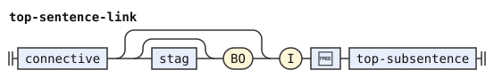</p>
<p>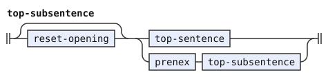</p>
<p>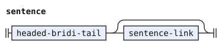</p>
<p>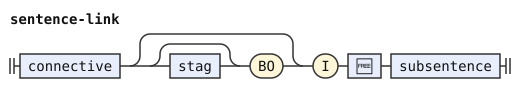</p>
<p>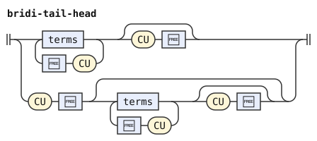</p>
<p>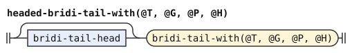</p>
<p>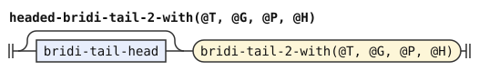</p>
<p>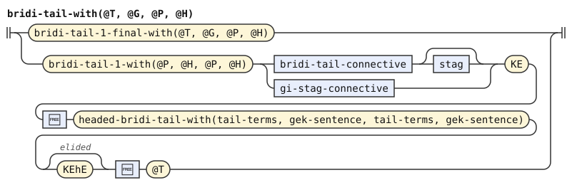</p>
<p>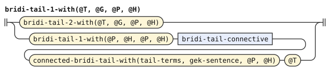</p>
<p>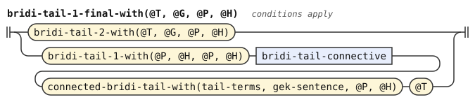</p>
<p>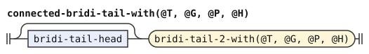</p>
<p>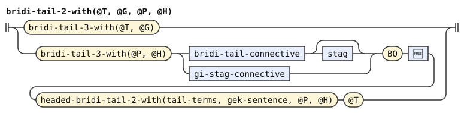</p>
<p>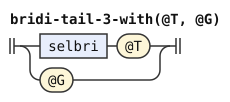</p>
<p>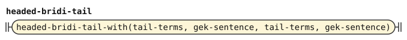</p>
<p>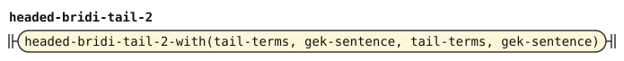</p>
<p>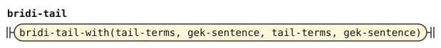</p>
<p></p>
<p>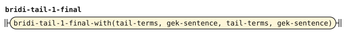</p>
<p>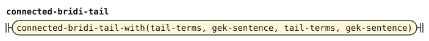</p>
<p>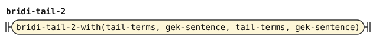</p>
<p>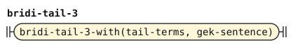</p>
<p>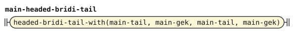</p>
<p>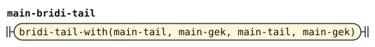</p>
<p>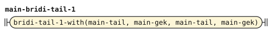</p>
<p>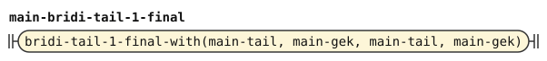</p>
<p></p>
<p>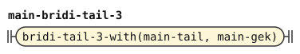</p>
<p>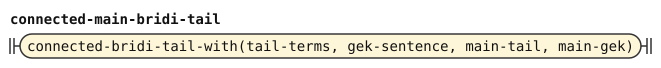</p>
<p>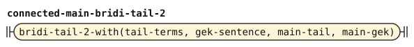</p>
<p>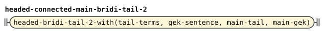</p>
<p>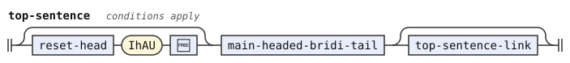</p>
<p>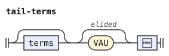</p>
<p>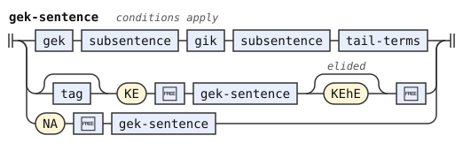</p>
<p>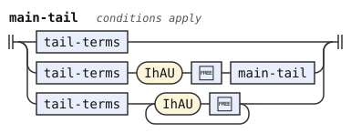</p>
<p>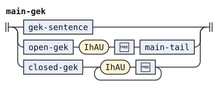</p>
<p>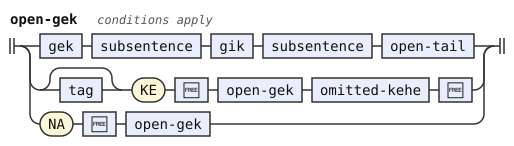</p>
<p>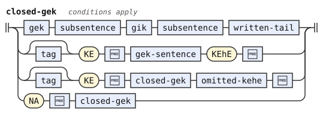</p>
<p></p>
<p></p>
<p></p>
<p></p>
<p></p>
<p></p>
</details>

## Terms

The layer joins terms at two levels. A connective, an optional stag, and `bo` join terms into a `term-bo-group`. A plain connective joins those groups through `term-link`. Thus `broda be na ku .e bo na ku .a na ku` groups its terms as `(na ku .e bo na ku) .a na ku`. Joik, jek, ek, and VUhU supply these connectives.

Plain connections group from the left. A run of BO connections groups from the right, as CLL requires.[^cll-s14-8]

A term stands in heads, tails, prenexes, fragments, and NUhI termsets. BE, BEI, GOI, LAhE, and NAhE each take one term. Branches of a bare forethought termset also take terms.

A bare tag term can omit KU only before a written closing word, a gihek, or the text's end. A bare NA term can omit KU in these positions too. Closing words include `.i`, `ni'o`, `cu`, `gi`, `bei`, `zi'e`, `zo'u`, `ce'e`, and `pe'e`. Written terminators of surrounding constructions also close the place. `fa'oi` and `oi'i` also separate sentences, and `fi'ai` also closes a prenex. An omitted terminator never counts as a closing word.

A gihek can start with NA or SE. Thus `mi klama pu se gi'e tavla` and `mi klama pu na gi'e tavla` keep the bare tag before that gihek. As a closing word, `.i` can stand before its own connective. NA or SE before an ordinary connective permits no KU omission.

JA, A, JOI, and VUhU alone do not close a term's place. These words can also connect tenses or terms. ZIhE only joins relative clauses, so it closes a term's place.

A bare NA term can also omit KU before any term in the same reading. These terms include sumti, tagged terms, termsets, SOI terms, and other bare NA terms. Thus `ro da na ka'e` and `na fa mi klama` parse. A tag term keeps the closing-word rule. A tag with its own sumti uses the separate tagged-term alternative and needs no KU.

The KU test starts after the term's own free modifiers. The test of the next written word uses its selma'o. The gihek and term tests read the complete tree. They parse nothing again.

Both written and omitted KU use `bare-na`, so the tree records every omitted KU. The closing-position condition applies only when KU is omitted. `KU=""` matches only an omitted KU because an omitted terminator has an empty value.

The same KU rule applies in lists and single-term positions. A written KU permits either term before any following constituent. A bare `na` cannot begin a term where its NA token starts a connective.

A connection that can form one sumti takes that reading. Each term connection tests its preceding part and the link after the connective. The condition refuses the link when both parts can form one sumti. Thus `mi .e do klama` and `mi .e bo do klama` join sumti. In `mi .e ca do klama`, `ca do` is a modal term, so the connective joins terms.

After span ranking, `fewest` also favors term connections over readings with more bridi-tail links in the whole reading. Equal counts leave closing boundaries to late elision.

Three tags carry these facts through the tree. `Link-Extensible-End` marks a sumti that a plain connective can extend. `Bo-Extensible-End` marks one that a BO connective can extend. `Sumti-Start` marks a link that begins with a sumti. `$EXTENSIBLE-END` holds the two end tags.

`sumti-2` carries both end tags. A KE group with written KEhE lacks them. Thus `mi .e ke do ke'e .e ko'a klama` joins terms. After VUhO, a plain connective can extend the sumti, but a BO connective cannot.

A termset closed by written NUhU is not a sumti, and a link that starts with it has no `Sumti-Start` tag. Thus `mi .e ge do gi ti nu'u klama` joins terms. Without NUhU, `mi .e ge do gi ti klama` joins sumti.

Each term level has its own link rules and sumti conditions. A BO group takes its start tag from its first term and its end tags from the group after BO. Neither `term-link` nor `term-bo-link` carries a rule flag. `term-bo-link` permits BO with or without a stag, as in `fa mi .e bo fe do klama`.

PEhE takes any statement connective. `terms-1` forms a left chain in ordinary terms and forethought branches alike. A SOI term contains a subsentence and ends with SEhU. The `soi-clause` feature enables it, and `fi'oi` belongs to SOI.

A bare forethought termset needs no NUhI, and its branches can hold different numbers of terms. Its first branch ends in `termset-branch`, which elides NUhU before GI. A competing forethought sumti elides nothing there, so `late-elision` prefers it.

The dictionary gives `xoi` class SEI. It opens a free modifier, independent of `soi-clause`.

Thus `ge mi gi do ce'e ti` contains a connected sumti followed by CEhE and another term. In `broda be ge mi gi do ce'e ti be'o`, BE instead takes a termset. Its single argument cannot continue with CEhE after a sumti.

Inside NUhI, a ranked choice prefers `gek-termset-body` over `terms` when both complete over the same span. Thus `nu'i ge mi gi do nu'u` contains two termset branches. A bare forethought termset can also start the plain body. A written inner NUhU keeps its boundary distinct from the outer body.

NIhE keeps an ordinary elidable TEhU, so it can close before the next predicate. In `nu'i ge ni'e broda brode gi re mi nu'u klama`, the first branch contains one quantified sumti. NIhE supplies its quantifier, and `brode` supplies its predicate. The second branch contains `re mi`.

NOIhA converts a selbri into an adverbial term with elidable FEhU. `poi'a`, `noi'a`, and `soi'a` describe the bridi, while `poi'o'a` describes its first argument.

The term has no implied sumti or relative-clause opener. A following bare sumti stays outside, and an inner argument needs BE.

Before the main predicate, an omitted FEhU lets that predicate continue the adverbial's tanru. Thus `mi poi'a sutra klama` is a terms fragment.

With FEhU, `mi poi'a sutra fe'u klama` has the main predicate `klama`. The converted predicate is only `sutra`.

SOhOI instead contains a full subsentence with elidable SEhU. It binds `ke'a` to the containing bridi and works independently of the `soi-clause` feature.

Before the main predicate, an omitted SEhU lets that predicate continue the clause's tanru. Thus `mi so'oi cafne klama` is a terms fragment. With SEhU, `mi so'oi cafne se'u klama` has the main predicate `klama`.

In `mi klama so'oi do cadzu ti`, the following `ti` stays inside the clause. In `mi klama so'oi do cadzu se'u ti`, it belongs to the main bridi.

CAhEI abbreviates `ca lo nu` as a subsentence term with elidable KUhEI. It takes an event clause, not unrestricted text or a free modifier.

Before the main predicate, an omitted KUhEI lets that predicate continue the event clause's tanru. Thus `mi ca'ei do cadzu klama` is a terms fragment. With KUhEI, `mi ca'ei do cadzu ku'ei klama` has the main predicate `klama`.

In `mi klama ca'ei do cadzu ti`, the following `ti` stays inside the event clause. In `mi klama ca'ei do cadzu ku'ei ti`, it belongs to the main bridi.

These terms carry no span or connection flag. Their contained predicates use the `fewest` and late-elision preferences.

```jbogenbau
%redefine-rule terms-1
  {... terms-2 / PEhE 🆓 connective}

%redefine-rule term
  | term-bo-group
  | $t:term $l:term-link :: $l.tags ∩ $EXTENSIBLE-END
%conditions
  Link-Extensible-End ⊈ $t.tags ∨ Sumti-Start ⊈ $l.tags

%rule term-bo-group
  (* term_2 <- term_3 (joik_ek stag? BO_clause term_3)* *)
  | term-3
  | $g:term-3 $l:term-bo-link :: ($g.tags ∩ Sumti-Start) ∪ ($l.tags ∩ $EXTENSIBLE-END)
%conditions
  Bo-Extensible-End ⊈ $g.tags ∨ Sumti-Start ⊈ $l.tags

%rule term-bo-link
  connective [stag] BO 🆓 $g:term-bo-group :: $g.tags ∩ ($EXTENSIBLE-END ∪ Sumti-Start)

%rule term-link
  connective $g:term-bo-group :: $g.tags ∩ ($EXTENSIBLE-END ∪ Sumti-Start)

%const $EXTENSIBLE-END Link-Extensible-End ∪ Bo-Extensible-End

%const $PLACE-CLOSE I ∪ NIhO ∪ CU ∪ GI ∪ BEI ∪ ZIhE ∪ ZOhU ∪ CEhE ∪ PEhE ∪ KU ∪ VAU ∪ KEI ∪ KUhO ∪ BEhO ∪ LIhU ∪ TOI ∪ NUhU ∪ GEhU ∪ SEhU ∪ LUhU ∪ TEhU ∪ MEhU ∪ BOI ∪ VEhO ∪ KEhE ∪ LOhO ∪ DOhU ∪ FEhU ∪ TUhU ∪ KUhE ∪ KUhAU ∪ KUhOI ∪ IhAU ∪ LIhAU ∪ KUhEI

%const $BARE-TAG #« tag KU="" [🆓] »
%const $BARE-NA #« NA [🆓] KU="" [🆓] »

%rule term-3
  (* term_3 <- sumti / tag_term / termset *)
  | $s:sumti :: $s.tags ∪ Sumti-Start
  | tagged-term
  | termset
  | bare-na
  | soi-clause? soi-term
  | noiha-term
  | sohoi-term
  | cahei-term

%rule bare-na
  (* !gek !ek !joik_jek !gihek NA_clause free* KU_elidible free* *)
  $n:NA 🆓 [+KU] 🆓
%conditions
  ¬$n.onward.begins(na-connective),
  $ ≇ $BARE-NA ∨ $.ends-input ∨ ($PLACE-CLOSE ∩ $.following-tokens.first-token.tags) ⊈ ∅ ∨ $.followed-by(gihek | term)

%rule na-connective
  gek | joik-jek-ek | gihek

%rule soi-term
  SOI 🆓 subsentence [+SEhU] 🆓

%rule noiha-term
  NOIhA 🆓 selbri [+FEhU] 🆓

%rule sohoi-term
  SOhOI 🆓 subsentence [+SEhU] 🆓

%rule cahei-term
  CAhEI 🆓 subsentence [+KUhEI] 🆓

%rule tagged-term
  (* tag_term: !gek tag free* followed by a sumti or KU_elidible free* *)
  | tag $s:sumti :: $s.tags ∩ $EXTENSIBLE-END
  | tag [+KU] 🆓
%conditions
  $ ≇ $BARE-TAG ∨ $.ends-input ∨ ($PLACE-CLOSE ∩ $.following-tokens.first-token.tags) ⊈ ∅ ∨ $.followed-by(gihek)

%redefine-rule termset
  (* termset <- gek_termset / NUhI_clause free* gek terms NUhU_elidible free* gik terms NUhU_elidible free* / NUhI_clause free* terms NUhU_elidible free* *)
  | gek termset-branch gik terms [+NUhU] 🆓
  | termset-with-nuhi

%rule gek-termset-body
  (* NUhI_clause free* gek terms NUhU_elidible free* gik terms: tried before NUhI_clause free* terms *)
  gek terms [+NUhU] 🆓 gik terms

%rule termset-branch
  terms [+NUhU] 🆓

%rule termset-with-nuhi
  NUhI 🆓 (gek-termset-body ≻ terms) [+NUhU] 🆓
```

<details><summary>Railroad diagrams of the 17 rules from <code>terms-1</code> to <code>termset-with-nuhi</code></summary>
<p></p>
<p></p>
<p></p>
<p></p>
<p></p>
<p></p>
<p></p>
<p></p>
<p></p>
<p></p>
<p></p>
<p></p>
<p></p>
<p></p>
<p></p>
<p></p>
<p></p>
</details>

## Sumti

Sumti connectives are ek, joik, jek or VUhU (`connective`). This change and the new mekso below leave the CLL rule `joik-ek` unused. After `vu'o`, a connected sumti can follow the relative clauses or replace them, and `vu'o` can also end the sumti (`mi vu'o`). Under `cbm` a cmevla is a selbri word, so the layer removes the `la CMEVLA` name form, and `la .alis.` is a description. That form begins with `la`, `lai` or `la'i`, which are words of LE here, and `name-marker` names them by their values. The new sumti are these:

- `na'e` and `lu'u` surround a sumti, without `bo`.
- `la'e` or `na'e bo` around a term that is not a sumti, such as `na ku` or a tense or modal with its sumti or `ku`
- `na'e` around a term that is neither a sumti nor a tense or modal with its sumti or `ku`, such as `na ku`
- `lo'oi` and `ku'au` surround a subsentence as a description.
- The single-word quotes `zo'oi`, `la'oi` and `ra'oi`, whose bodies the words stage delimits

A bare NAhE cannot wrap one tagged term, even when that term omits KU. The pattern tests the actual `tagged-term` constructor. A connected term can begin with such a term, as in `na'e pu ku .e na ku lu'u`. This grammar accepts `mi na'e pu ku .e ca lu'u klama`. The first tag requires KU before `.e`. The second can omit KU before `lu'u`.

The inner sumti of a description can be any sumti, including a connected one, as in `lo mi .e do broda`. It cannot start with a quantifier. Thus `lo re mi broda` contains `lo re mi` and the selbri `broda`.

The `sumti-tail` condition follows the possessor's first-child path and refuses an initial quantifier. This path crosses plain, BO, KE, and VUhO connections. A forethought connection starts with its gek, so its first branch can begin with a quantifier. The rules `sumti-2` and `sumti-3` are left and right chains, respectively.

A description can take a forethought sentence in place of a selbri, and so can a quantifier without a descriptor. Examples are `le ga mi klama gi do klama ku` and `re ga mi klama gi do klama ku`.

```jbogenbau
%redefine-rule sumti
  | sumti-1
  | sumti-1 VUhO 🆓 [relative-clauses] :: Link-Extensible-End
  | sumti-1 VUhO 🆓 [relative-clauses] connective $i:sumti :: $i.tags ∩ $EXTENSIBLE-END

%redefine-rule sumti-1
  | sumti-2
  | sumti-2 connective [stag] KE 🆓 $i:sumti [+KEhE] 🆓 :: KEhE ⊈ $i.following-tokens.first-token.tags ⟹ $i.tags ∩ $EXTENSIBLE-END

%redefine-rule sumti-2 :: $EXTENSIBLE-END
  | {... sumti-3 / connective}

%redefine-rule sumti-3
  {sumti-4 ... / connective [stag] BO 🆓}

%redefine-rule sumti-5
  | [quantifier] sumti-6 [relative-clauses]
  | quantifier (selbri | gek-sentence) [+KU] 🆓 [relative-clauses]

%redefine-rule sumti-6
  | (LAhE 🆓 | NAhE BO 🆓 | NAhE 🆓) [relative-clauses] sumti [+LUhU] 🆓
  | (LAhE 🆓 | NAhE BO 🆓) $t:term [+LUhU] 🆓
  | NAhE 🆓 $u:term [+LUhU] 🆓
  | KOhA 🆓
  | lerfu-string free-after-lerfu-string
  | ¬cbm? name-marker 🆓 [relative-clauses] {CMEVLA} 🆓
  | LE 🆓 sumti-tail [+KU] 🆓
  | LOhOI 🆓 subsentence [+KUhAU] 🆓
  | LI 🆓 mex [+LOhO] 🆓
  | ZO 🆓
  | LU text [+LIhU] 🆓
  | LOhU 🆓
  | ZOI 🆓
  | ZOhOI 🆓
%conditions
  $t ≇ #sumti,
  $u ≇ #sumti,
  $u ≇ #tagged-term

%redefine-rule sumti-tail
  | $s:sumti sumti-tail-1
  | sumti-tail-1
  | relative-clauses sumti-tail-1
  | gek-sentence
%conditions
  $s ≇ #(quantifier ⋰)
```

<details><summary>Railroad diagrams of the 7 rules from <code>sumti</code> to <code>sumti-tail</code></summary>
<p></p>
<p></p>
<p></p>
<p></p>
<p></p>
<p></p>
<p></p>
</details>

## Relative clauses

Consecutive relative clauses can be joined by a joik, a jek or an ek, as well as by `zi'e`. Two groups of them can be connected in forethought (`ge poi broda gi poi brode`).

```jbogenbau
%rule relative-clause-list(@C)
  | {@C / ZIhE 🆓 | joik-jek-ek 🆓}
  | gek relative-clause-list(@C) gik relative-clause-list(@C)

%redefine-rule relative-clauses = relative-clause-list(relative-clause)

%redefine-rule relative-clause
  GOI 🆓 term [+GEhU] 🆓 | NOI 🆓 subsentence [+KUhO] 🆓
```

<details><summary>Railroad diagrams of the 3 rules from <code>relative-clause-list</code> to <code>relative-clause</code></summary>
<p></p>
<p></p>
<p></p>
</details>

## Selbri and tanru

`joik-jek-ek` groups joik, jek and ek. `connective` adds VUhU. All four families connect selbri and tanru units. Abstraction markers use those four families, as in `mi nu e ka broda` and `mi nu su'i ka broda`. KE and BO connections use only `joik-jek-ek`.

The recursive NA alternative uses the forethought-opener condition of `gek-sentence`. This condition gives NA to the mathematical opener in `na je gi pa boi gi re boi moi vau`.

A bare `fa`, which matches the rule `tag`, can come before a selbri. The term after `be` or `bei` can be absent. The new tanru units are a cmevla, under `cbm`, and preposed linked arguments (`lo be mi broda`). `me'oi` with the word that it quotes is a tanru unit too (`le me'oi klama cu broda`).

`me-unit` takes a sumti or a mekso. A sumti reading excludes a mekso only when both read the same words with the same boundaries. The mekso query restores its omitted terminators, so a competing sumti cannot move an inner close or shorten a free modifier.

The whole `mex MOI 🆓` construction outranks an SE conversion over the same span. A mekso can begin with SE through a forethought `gek`, as in `mi se ga pa gi re moi`.

An outer NAhE modifier outranks the whole `mex MOI 🆓` construction over the same span. Thus `mi na'e su'i pa moi` puts `na'e` on the predicate. Writing PEhO before NAhE selects the operator modifier instead, as in `mi pe'o na'e su'i pa moi`.

In `mi me la'e ge my gi ny su'i zy moi`, ME takes the complete sumti operand. Its LAhE holds the forethought sumti and the following connection.

`selbri-4` keeps the left recursion of the CLL rule, and `selbri-5` is a right chain. Its recursive alternative ranks the KE group above a plain connection across the same span. The plain connective is `connective`, which accepts all four families. The preferred option uses `joik-jek-ek [stag] KE`. So `mi broda joi ke brode ke'e` joins a `ke` group with `joi` through that option.

Where only the plain reading parses, the layer keeps it. So `mi broda joi ke brode ke'e bo brodi` joins `broda` to the unit `ke brode ke'e bo brodi`.

A group of preposed linked arguments comes before a whole `tanru-unit-1`. A `be` group attaches to the tanru unit before it, where there is one. So a unit without a group of its own cannot be directly followed by `be` (`tanru-unit-1`). A preposed group stands only where no such unit comes before it, as at the start of a selbri or after a connective.

So `zdani be mi vorme` gives `be mi` to `zdani`, and `le tutci be sigdanva le marna` gives an empty `be` group to `tutci`. Without the rule, each text has two readings that elide the same terminators.

In `be mi klama be do be ti`, `be do` belongs to `klama`, and `be ti` to the whole unit. In `be mi klama be do`, `be do` belongs to `klama`. The whole unit cannot take it, because `klama` then stands directly before `be`.

A tanru unit can take a selbri relative clause. The clause opens with NOhOI (`no'oi` or `po'oi`) and contains a subsentence. It ends with `ku'oi` or `ku'o`. In that clause, `ke'a` refers to the selbri, as in `mi klama no'oi bajra`. The clauses join with `zi'e`, a joik, a jek or an ek. Forethought connections join two groups of clauses.

The `ke-after` template supplies `selbri-4` and `operator`. Each named instance keeps its reference rule name. This layer changes their shared connective choices.

```jbogenbau
%redefine-rule selbri-1
  | selbri-2
  | $n:NA 🆓 selbri
%conditions
  ¬$n.onward.begins(gek)

%redefine-rule ke-after(@B, @U)
  | @U
  | ke-after(@B, @U) (joik-jek-ek [stag] KE 🆓 @B [+KEhE] 🆓 ≻ connective @U)

%redefine-rule selbri-5
  {selbri-6 ... / joik-jek-ek [stag] BO 🆓}

%redefine-rule tanru-unit
  {tanru-unit-1 / CEI 🆓} [selbri-relative-clauses]

%redefine-rule tanru-unit-1
  | $u:tanru-unit-2
  | tanru-unit-2 linkargs
%conditions
  BE ⊈ $u.following-tokens.first-token.tags

%redefine-rule tanru-unit-2
  | KE 🆓 selbri-3 [+KEhE] 🆓
  | BRIVLA 🆓
  | cbm? CMEVLA 🆓
  | GOhA [RAhO] 🆓
  | me-unit
  | (NAhE 🆓 tanru-unit-2 ≻ mex MOI 🆓 ≻ SE 🆓 tanru-unit-2)
  | NUhA 🆓 operator
  | JAI 🆓 [tag] tanru-unit-2
  | abstractor-chain subsentence [+KEI] 🆓
  | linkargs tanru-unit-1
  | MEhOI 🆓

%rule me-unit
  ME 🆓 (sumti | $m:mex) [+MEhU] 🆓 [MOI 🆓]
%conditions
  ¬$m.without-elision.matches(sumti)

%redefine-rule abstractor-chain
  {... NU 🆓 / connective}

%rule selbri-relative-clauses = relative-clause-list(selbri-relative-clause)

%rule selbri-relative-clause
  NOhOI 🆓 subsentence ([+KUhOI] | KUhO) 🆓

%redefine-rule linkargs
  BE 🆓 [term] [links] [+BEhO] 🆓

%redefine-rule links
  BEI 🆓 [term] [links]
```

<details><summary>Railroad diagrams of the 12 rules from <code>selbri-1</code> to <code>links</code></summary>
<p></p>
<p></p>
<p></p>
<p></p>
<p></p>
<p></p>
<p></p>
<p></p>
<p></p>
<p></p>
<p></p>
<p></p>
</details>

### Quoted predicates and converted attitudes

GOhOI and MUhOI arrive as opaque quote tokens from the words stage. Each acts as one tanru unit, with a free slot after it.

LUhEI instead opens grammatical quoted text, with elidable LIhAU. Its x1 expresses that text to audience x2 through medium x3.

The text body preserves leading indicators and vocatives as quoted content. It can contain complete sentences or fragments, like an LU quotation.

A written LIhAU ends the quote before an outer audience sumti. In `mi lu'ei coi do`, `do` stays inside the quoted vocative. In `mi lu'ei coi li'au do`, it names the outer audience.

CIhAU converts attitudes into a predicate whose x1 feels them toward x2. Its run must contain at least one UI, with optional CAI and NAI.

The indicator stage keeps that run as syntax tokens. Therefore, its attitudes describe the predicate's subject rather than becoming the speaker's attached reaction.

CIhAUhU ends the conversion before another attitude. Without it, consecutive UI, CAI, and NAI tokens stay in the conversion. Each NAI belongs to the UI or CAI directly before it, even with intervening emphasis.

DAhO, FUhE, and FUhO do not belong to the converted run. A written CIhAUhU permits them outside it with their ordinary attachment behavior.

Emphasis before an attitude or its NAI remains attached to that token. It does not change the conversion's syntax.

```jbogenbau
%extend-rule tanru-unit-2
  | GOhOI 🆓
  | MUhOI 🆓
  | LUhEI text [+LIhAU] 🆓
  | CIhAU cihau-run [+CIhAUhU] 🆓

%rule cihau-run
  [{cihau-cai}] UI [NAI] [{UI [NAI] | cihau-cai}]

%rule cihau-cai
  CAI [NAI]
```

<details><summary>Railroad diagrams of <code>tanru-unit-2</code>, <code>cihau-run</code> and <code>cihau-cai</code></summary>
<p></p>
<p></p>
<p></p>
</details>

## Numbers, lerfu strings and mekso

The layer reads mekso with the rules below. Its number and lerfu rules leave the CLL helper `number-continuation` unreachable because their conditions read the actual following node. No reachable rule calls `operand`, `operand-1` to `operand-3` or `rp-operand`. The forms are these:

- A number starts with PA, `ni'e` selbri or `mo'e` sumti. It continues with those parts or lerfu words. A lerfu string starts with a letter word and continues with letter words or PA. Thus `li cy mu my ci no` is one lerfu string, and `li pa by` is one number.
- `mex-2` reads a number, a lerfu string, a `vei` group, a forethought connection, or a `la'e` or `na'e` qualifier. It can also be a forethought expression or a reverse Polish expression. An operator that begins with an unconverted, ungrouped joik, jek or ek unit needs PEhO, including connected operators. Other initial forms permit omitted PEhO. The operands `ni'e` and `mo'e` are inside numbers. There is no `jo'i` array, although the lexicon has `jo'i`.
- `bo` after an operator, with an optional tense or modal, groups two operands tighter (`li pa su'i bo re`). There is no `bi'e`. A forethought operator takes one or more mekso operands, as in `li gei so'i`.
- An operator can be any of the four connective families. Each has one final slot of free modifiers.
- Plain operator connections use `connective`, with all four families. BO and KE connections use `joik-jek-ek`, without VUhU. The KE preference covers JOI, JA and A. So `li ci su'i joi ke pi'i ke'e re du li xa` joins `su'i` to the operator's own `ke` group. Where the operator goes on after its `ke` group, as in `li ci su'i joi ke pi'i ke'e je bo vu'u re du li xa`, only the plain reading parses. The layer keeps it.
- A quantifier is a whole mekso, as in `pa su'i re broda`. A competing `sumti-6` or selbri at its start excludes it. The queries preserve the selected mekso's omitted terminators and free-modifier boundaries. The `sumti-6` constructor holds a sumti without its own outer quantifier. Numeric LAhE and NAhE operands remain possible where no such sumti exists. So in `mi piso'umei jimpe`, `pi so'u mei jimpe` is the selbri, and not a quantifier of a description.
- The first branch of a forethought quantifier cannot begin a `sumti-6` either. The rule `gek-barrier` tests that branch, including nested connections. So in `ge nai abu gi no drata`, `ge nai ... gi` joins the two sumti `abu` and `no drata`. The quantifier `ge nai abu gi no` over `drata` is not a reading. In the same way, `ge ge abu gi by gi no drata` joins two sumti, and the first one connects `abu` and `by`.
- A forethought connection of numbers can form a quantifier, as in `lo ge pa gi re mi broda`. Numeric references also remain possible, as in `ge la'e pa gi re broda`.
- Where no sumti reading remains, `gek-barrier` rejects the text, as in `ge abu gi by broda cu klama`. In `lo ge by gi re mi broda`, `ge by gi re mi` is the possessor sumti, with `broda` inside the description.
- `me` takes a mekso as well as a sumti, a whole mekso takes `moi`, and `nu'a` takes a whole operator.

`mekso-fragment` admits a standalone mathematical expression after the sumti and predicate tests. `quantifier` uses that expression to quantify a sumti. In that position, an initial forethought operator needs PEhO, or the expression needs VEI brackets. Thus `su'i re prenu cu klama` starts with a connective, while `lo su'i re prenu` fails. Both `pe'o su'i re prenu cu klama` and `vei su'i re ve'o prenu` retain their quantified readings. The fragment in `mi klama .i su'i pa` needs neither marker because it quantifies no sumti.

The quantifier condition tests the selected tree's first-child path. A qualifier prefix stops that path before its operand. Thus LAhE and NAhE qualifiers can quantify a sumti, even without written LUhU.

`mex` is the chain of operators itself, a left chain. So the CLL rule `mex-chain` is not reached here. A reverse Polish expression is not an infix chain, and stays a flat list. `operator` keeps the left recursion of the CLL rule.

An initial SE in an operator is its mathematical conversion. The connective alternative excludes that initial SE to avoid a duplicate inner conversion.

A number is followed by `free-after-number`, and a lerfu string by `free-after-lerfu-string`, defined under "Free modifiers", and not by a plain `🆓`.

```jbogenbau
%redefine-rule quantifier
  $m:mekso-fragment
%conditions
  $m ≇ #(forethought-operator ⋰)

%rule mekso-fragment
  (* quantifier <- !selbri !sumti_6 mex *)
  $m:mex
%conditions
  ¬$m.without-elision.onward.begins(sumti-6 | gek-barrier | selbri)

%rule gek-barrier
  gek (sumti-6 | gek-barrier)

%redefine-rule mex
  {... mex-1 / operator}

%redefine-rule mex-1
  mex-2 [operator [stag] BO 🆓 mex-1]

%redefine-rule mex-2
  | number free-after-number
  | lerfu-string free-after-lerfu-string
  | VEI 🆓 mex [+VEhO] 🆓
  | gek mex gik mex-2
  | (LAhE 🆓 | NAhE 🆓 [BO 🆓]) mex [+LUhU] 🆓
  | (PEhO 🆓 operator | forethought-operator) {mex} [+KUhE] 🆓
  | FUhA 🆓 rp-expression

%rule forethought-operator
  $o:operator
%conditions
  $o ≇ #(joik-jek-ek ⋰)

%redefine-rule rp-expression
  mex-1 [{rp-expression operator}]

%redefine-rule operator-1
  | operator-2
  | guhek operator-1 gik operator-2
  | operator-2 joik-jek-ek [stag] BO 🆓 operator-1

%redefine-rule operator-2
  | mex-operator
  | KE 🆓 operator [+KEhE] 🆓

%redefine-rule mex-operator
  | SE 🆓 mex-operator
  | NAhE 🆓 mex-operator
  | MAhO 🆓 mex [+TEhU] 🆓
  | NAhU 🆓 selbri [+TEhU] 🆓
  | $c:connective
%conditions
  SE ⊈ $c.first-token.tags

%redefine-rule number
  number-part [{number-part | lerfu-word}]
%conditions
  ¬$.followed-by(number-part | lerfu-word)

%rule number-part
  PA | NIhE 🆓 selbri [+TEhU] 🆓 | MOhE 🆓 sumti [+TEhU] 🆓

%redefine-rule lerfu-string
  lerfu-word [{PA | lerfu-word}]
%conditions
  ¬$.followed-by(PA | lerfu-word)
```

<details><summary>Railroad diagrams of the 14 rules from <code>quantifier</code> to <code>lerfu-string</code></summary>
<p></p>
<p></p>
<p></p>
<p></p>
<p></p>
<p></p>
<p></p>
<p></p>
<p></p>
<p></p>
<p></p>
<p></p>
<p></p>
<p></p>
</details>

## Logical and non-logical connectives

The connective rules below have no NAI slot. The indicator stage attaches every NAI after a connective, so no separate `nai` reaches the syntax at those positions.

An ek connects sumti with A, and a jek connects predicates with JA. Both permit negation with NA and conversion with SE. An interval connective uses BIhI, with optional conversion. A gik separates forethought branches with GI and permits free modifiers after it.

A joik permits `na` before a word of JOI. So `mi na joi do klama` has one term, `mi na joi do`. The `bare-na` conditions exclude a bare NA term where NA begins a connective. The words can connect sumti or terms, and the term conditions keep the sumti reading.

A forethought connective can be `ga` or `gu` followed by a joik, jek, ek or VUhU, as in `ga je lo mlatu gi lo gerku`. With `ga`, it is a gek. With `gu`, it is a guhek, as in `mi gu je melbi gi kargydu'e`. The connective before `gi` in a gek can also be a jek or an ek (`je gi mi broda gi mi brode`). A gihek can be `gi` followed by a word of JOI, JA or A (`mi klama gi je tavla`).

After `ga` or `gu`, an SE word can convert the whole connective, as in `ga se su'i mi gi do`. This is the outer conversion. The alternative without outer conversion cannot begin with SE, so `ga se je mi gi do` has one reading. A second SE belongs to the inner connective, as in `ga se se je mi gi do`. After NA, an SE word stays inside the connective, as in `ga na se je mi gi do`. The rule `prefixed-connective` states this for both prefixes.

The rules name the two words by their values, `GA="ga"` and `GA="gu"`, which ignores stress. The GA class test excludes caller-supplied tokens with value `ga` or `gu` but no GA tag.

```jbogenbau
%redefine-rule ek
  [NA] [SE] A

%redefine-rule jek
  [NA] [SE] JA

%redefine-rule joik
  [NA] [SE] JOI | interval | GAhO interval GAhO

%redefine-rule interval
  [SE] BIhI

%rule joik-jek-ek
  joik | jek | ek

%rule connective
  joik-jek-ek 🆓 | VUhU 🆓

%redefine-rule gek
  | [SE] GA 🆓
  | GA="ga" 🆓 prefixed-connective
  | joik-jek-ek GI 🆓
  | stag gik

%redefine-rule guhek
  | [SE] GUhA 🆓
  | GA="gu" 🆓 prefixed-connective

%redefine-rule gik
  GI 🆓

%rule prefixed-connective
  | SE connective
  | $c:connective
%conditions
  SE ⊈ $c.first-token.tags

%redefine-rule gihek
  [NA] [SE] (GIhA | GI (JOI | JA | A))
```

<details><summary>Railroad diagrams of the 11 rules from <code>ek</code> to <code>gihek</code></summary>
<p></p>
<p></p>
<p></p>
<p></p>
<p></p>
<p></p>
<p></p>
<p></p>
<p></p>
<p></p>
<p></p>
</details>

## Tenses and modals

A tense or modal (the rule `tag`) is a run of atoms: `pu ba vi ca`, `ki ba`. So nothing reads the CLL rules `simple-tense-modal`, `time`, `time-offset`, `space`, `space-offset`, `space-interval`, `space-int-props` and `interval-property`. Each atom can have `na'e` and `se` before it, and free modifiers after it: `na'e pu na'e ca`, `jai se ki broda`. An atom is one of these:

- A word of BAI, CAhA, CUhE, KI, ZI, PU, VA, ZEhA, VEhA or VIhA
- A word of FAhA, with an optional `mo'i` before it
- A word of ROI after a number or a `vei` group, with an optional `fe'e` before them
- A word of TAhE or ZAhO, with an optional `fe'e` before it
- `fi'o` with a selbri

A joik, jek, ek or VUhU connects tenses and modals, and `tag` is a left chain of them. A run of atoms is a flat list, since nothing connects them. A `stag` is a `tag`. So a stag can be a run of atoms (`ko'a .e pu ba bo ko'e broda`). It can also be a `fi'o` selbri (`mi klama .i fi'o broda fe'u bo do klama`).

`fa` is an atom too, and it is the only way a place marker enters the grammar. So `fa` alone matches `tag` wherever that rule can stand: before a sumti (`fa mi`), a selbri (`mi fa klama`) or `bo`, and after `jai` (`jai fa broda`). It can be converted like a modal (`se fa`) or joined to other atoms (`mi fa pu klama`).

The `tense-modal` flag prefers the earliest, longest atom run among complete readings. Thus `pu ca gi` begins one gek instead of a separate PU term before `ca gi`.

```jbogenbau
%redefine-rule tag
  {... tense-modal / connective}

%redefine-rule stag
  tag

%redefine-rule(leftmost-longest) tense-modal
  {tense-atom}

%rule tense-atom
  | [NAhE] [SE] (BAI | CAhA | CUhE | KI | ZI | PU | VA | [MOhI] FAhA | ZEhA | VEhA | VIhA) 🆓
  | [NAhE] [SE] [FEhE] ((number | VEI 🆓 mex [+VEhO] 🆓) ROI | TAhE | ZAhO) 🆓
  | [NAhE] [SE] FIhO 🆓 selbri [+FEhU] 🆓
  | [NAhE] [SE] FA 🆓
```

<details><summary>Railroad diagrams of <code>tag</code>, <code>stag</code>, <code>tense-modal</code> and <code>tense-atom</code></summary>
<p></p>
<p></p>
<p></p>
<p></p>
</details>

## Free modifiers, vocatives and indicators

A replacement quote is a free modifier. It has up to two runs of words, each opened by a word of LOhAI (`lo'ai` or `sa'ai`), and then `le'ai`. The words stage reads its contents as raw words and emits one quote token ([`../common/lohai.md`](../common/lohai.md)). Syntax requires the `Quote` tag on LOhAI to exclude incomplete quotes.

`soi` is a free modifier here only without `soi-clause`. Under `cbm`, the layer removes the form of a vocative with a run of names, because a cmevla is then a selbri word. With both forms, their two readings tie.

A vocative starts with a run of COI words, DOI, or both. A COI run returns no tags, and DOI alone keeps its tags. The indicator stage attaches any following NAI to the preceding word, so the syntax reads no separate NAI after COI.

`free-after-number` and `free-after-lerfu-string` follow a number or a lerfu string. Each is an optional `boi` and the free-modifier slot. A written BOI permits a separate number or lerfu string after it.

The number and letter-string rules refuse an actual following run part. With written BOI, that terminal follows the run, so the condition holds. With BOI omitted, a number part or letter word continues the number. PA or a letter word continues a letter string. Both free-slot wrappers are named nodes in the tree.

So `pa so mo'o` is the number `pa so`, and not `pa` followed by the ordinal `so mo'o`. With written BOI, `li pa boi by mai lo'o` has the free modifier `by mai`. The elided `boi` is an elided node of the tree.

A subscript after a subscript nests. The second subscript belongs to the first.[^cll-s18-13] So in `xa xi xa xi xa`, the first `xa` has one subscript, and that subscript has its own.

The `free` preference selects this nesting because the nested subscript is the longer modifier at the first `xi`.

A non-XI modifier in the subscript operand's final free slot attaches to the marked word. In `mi broda xi pa boi to do toi`, the subscript and parenthesis both belong to `broda`.

The condition on XI tests `$FREE-ENDING` along the actual last-child path. That pattern finds a final free slot with a `$NON-XI-FREE` modifier. A modifier inside a terminated operand stays there, even when its terminator is omitted. An omitted closer stops the path only when no later child remains. A nonempty free slot after the closer remains the exposed final slot, as in `[+VEhO] 🆓` or `[+BOI] 🆓`. A written closer before the modifier leaves it in the exposed final slot.

The condition excludes an exposed modifier attachment when the modifier belongs to the marked word. It keeps a modifier inside VEI, LAhE, or PEhO when the actual constructor boundary follows that modifier.

DOhOI supplies a listener through one raw quoted word. It takes the relative-clause suffix and elidable DOhU of `doi la'oi`.

A COI run can precede that quoted listener, as it can precede DOI. DOhOI takes no second listener argument.

Its free modifier inherits `leftmost-longest`, so a complete longer vocative outranks a split into shorter modifiers. A written DOhU fixes its end.

```jbogenbau
%const $NON-XI-FREE #free ∖ #« XI ⋯ »
%const $FREE-ENDING #(⋱ (🆓 ∩ « ⋯ $NON-XI-FREE ⋯ »))

%redefine-rule(leftmost-longest) free
  | SEI 🆓 [terms [CU 🆓]] selbri [+SEhU]
  | vocative [relative-clauses] selbri [relative-clauses] [+DOhU]
  | ¬cbm? vocative [relative-clauses] {CMEVLA} 🆓 [relative-clauses] [+DOhU]
  | vocative [sumti] [+DOhU]
  | mex-2 MAI
  | TO text [+TOI]
  | XI 🆓 $m:mex-2
  | LOhAI<Quote>
  | LEhAI
  | [{COI}] DOhOI 🆓 [relative-clauses] [+DOhU]
  | ¬soi-clause? SOI 🆓 sumti [sumti] [+SEhU]
%conditions
  $m ≇ $FREE-ENDING

%redefine-rule vocative
  | {COI} :: ∅
  | DOI
  | {COI} DOI

%rule name-marker
  LE="la" | LE="lai" | LE="la'i"

%rule free-after-number
  [+BOI] 🆓

%rule free-after-lerfu-string
  [+BOI] 🆓

```

<details><summary>Railroad diagrams of the 5 rules from <code>free</code> to <code>free-after-lerfu-string</code></summary>
<p></p>
<p></p>
<p></p>
<p></p>
<p></p>
</details>

## Choosing among parses

Where a text has more than one parse, the stage follows [the notation document](../../../docs/notation.md), under "Ranked choices", "Ambiguity", and "Elided terminators". A ranked choice filters alternatives at one written position. The stage ranks admitted derivations by `leftmost-longest`, then `fewest`, then `late-elision`. `late-elision` counts the omitted terminators of each admitted derivation at each boundary. After the flags tie, fewer omitted terminators win at the first differing boundary. Two best derivations with equal counts at every boundary tie, and a tie is an error.

For example, `le sutra tavla` has two parses. One is a statement with the description `le sutra`, whose `ku` is elided before `tavla`, and the selbri `tavla`. The other is a fragment, the single description `le sutra tavla`, whose `ku` is elided at the end. `late-elision` takes the fragment.

## Differences from CLL and camxes-exp

camxes-exp tries alternatives in order. This layer considers complete readings and uses conditions or ranked choices to select among them. Both this layer and CLL read `le sutra tavla` as a fragment.

The [experimental lexicon](lexicon.md) keeps camxes-exp's words and adds dictionary entries. Its closing section lists class differences and unsupported classes. This layer never reads a CLL class that camxes-exp lacks, such as LA. The experimental pipeline enables `cbm` and `soi-clause` because camxes-exp cannot disable them. A caller can disable either here. With `soi-clause` off, `soi` retains CLL's reciprocity form.

The layer writes `[+X] 🆓` where CLL writes `/X#/`. This permits free modifiers after omitted terminators and explains many restated rules. The number and lerfu conditions keep each run together despite that extra slot. camxes-exp also reads those runs as far as possible. This layer and camxes-exp give the sentence reading to `to mi klama` and `lu mi klama`.

The layer omits `elision-only`, the option that applies CLL's rule that a terminator can be omitted only where no ambiguity results.[^cll-s21-1] Some ambiguities here concern constructs rather than terminators. camxes-exp settles those by alternative order. Here, the connective, term, linked-argument and subscript conditions settle them explicitly. The experimental terminators `ku'au` and `ku'oi` remain elidable, like CLL's terminators.

### Text and sentence connections

camxes-exp's joik includes A, so an ek can follow a text-leading `.i`. CLL instead reads `.i e` as `.i` before an ek fragment. CLL accepts `mi .i e` and `mi .i e .i do klama`. This layer rejects them because `.i e` requires a preceding statement, and `mi` is a fragment. It accepts `.i e .i mi klama`, `.i e .i e mi klama` and `.i e .ije mi klama`, as camxes-exp does.

CLL reads a bare jek answer to `je'i` only in its text-initial connective slot. Therefore CLL always reads `.ije` as a connective, never as `.i` before an answer. This layer applies the same choice to `.i e`, which agrees with camxes-exp. CLL and camxes-exp keep `.i gi'e` and `mi klama .i gi'e` as fragment answers.

A free modifier can still separate `.i` from an ek fragment. Neither CLL nor this layer permits bare `ge'i` or `gu'i` answers.[^cll-s14-13][^cll-e14-105] This layer rejects `.i e gi mi gi do` and `mi klama .i je gi mi gi do`, as camxes-exp does. The `.i` takes the initial connective.

The CLL grammar's `text-1` reads initial `.i ni'o`, as [its repair list](../cll/syntax.md#printed-rules-and-translations) explains. Real texts write `.i` after `ni'o` and its free modifiers. The break accepts every text-leading form, such as `ni'o .ije`.

Thus `ni'o coi do .i mi klama` keeps `do` in the vocative. Neither printed CLL nor camxes-exp provides that separator position. Printed CLL instead shortens the vocative and reads `do` as a fragment before `.i`. camxes-exp rejects that text at `klama`.

Empty paragraphs between topic runs also follow camxes-exp's optional `paragraph`. CLL requires a nonempty paragraph there. So this layer accepts `ni'o coi ni'o coi` to preserve free modifiers between topic markers.

Within a paragraph break, `.i ni'o` can stand once, after a topic run and its free modifiers. It precedes the text-leading `.i` forms. This form permits a topic change inside a reply. CLL and camxes-exp reject `mi klama ni'o .i ni'o`. Another such transition needs an intervening nonempty paragraph. A final `ni'o` also follows camxes-exp.

camxes-exp has no text-leading run of names. This layer excludes that form with `cbm` on and retains CLL's form with it off.

This layer permits all four initial connective families, as in `je mi klama`, `e mi klama` and `su'i mi klama`. An ek or a VUhU needs a nonempty `text-1`, so a bare `e` remains a fragment. camxes-exp contains the wider form, but `text_1` can match an empty span. Thus its `(!text_1 joik_jek)?` never consumes a connective. This layer makes that connective reachable. No reachable rule calls the CLL rule `joik-jek`.

Where both complete, the ek fragment takes priority over the initial connective. Thus `e ni'o` and `e .i mi klama` keep their fragment readings. This preference also applies after the initial name run with `cbm` off.

An initial connective cannot immediately follow a leading free modifier in this layer. Thus `doi djan klama je do cadzu` gives the vocative only `djan`, then reads one connected sentence. In `doi zed jinvi jena morji`, it likewise reads `doi zed` before the connected sentence. camxes-exp rejects both texts. `ui je mi klama` keeps its initial connective because UI is an indicator. `doi djan .i mi klama` keeps its separate statement marker.

Connections between sentences follow camxes-exp, including `mi klama joi .i do klama` and `mi klama .e pu bo .i do klama`. Plain connections after `.i` and plain bridi-tail connections retain CLL's left grouping.[^cll-s14-7][^cll-s14-10] Connections after `.i` with `bo` group from the right. Bare `na` instead forms a term, which removes CLL's duplicate fragment alternative.

### Bridi-tail connections

In camxes-exp, [`gihek_1`](https://github.com/lojban/ilmentufa/blob/778ea138f7d150121ca722db7536ce3b123943ac/camxes-exp.peg#L336-L341) gives JA and JOI the GIhA level for bridi-tail connections. A, VUhU and BIhI use a [looser outer loop](https://github.com/lojban/ilmentufa/blob/778ea138f7d150121ca722db7536ce3b123943ac/camxes-exp.peg#L80-L88) with no shared tail terms. When their gihek reading fails, JA and JOI also use that loop.

The [2014-03-19 changelog entry](https://github.com/lojban/ilmentufa/blob/778ea138f7d150121ca722db7536ce3b123943ac/camxes-exp-changelog.txt#L89) calls JACU Selpa'i's alternative to GIhA. The [2014-10-17 fix](https://github.com/lojban/ilmentufa/blob/778ea138f7d150121ca722db7536ce3b123943ac/camxes-exp-changelog.txt#L124) shows shared tail terms in `brode ja cu brodo vau mi`.

PEG ordering and the incomplete `gihek_1` list produce the looser binding and missing shared terms. These effects do not follow from JACU's JA/JOI replacement for GIhA. This layer gives A, JA, JOI and VUhU CLL's GIhA grouping, shared terms and final-KE boundary, including BIhI intervals through joik.

Scope beside a GIhA connection also differs. In `mi klama do .e tavla ti gi'a cadzu ko'a`, this layer groups `(klama do .e tavla ti) gi'a cadzu ko'a`. camxes-exp groups `klama do .e (tavla ti gi'a cadzu ko'a)`. The same difference applies with `su'i` or `bi'i` in place of `.e`.

Shared tail terms also differ. This layer accepts `mi klama do .e tavla vau ti` and shares `ti` across both tails. camxes-exp rejects the final `ti` because its outer loop has no shared tail terms.

A connective-owned KE group stands only at a final bridi-tail connection in this layer. Thus `mi klama do .e ke tavla ti ke'e .e cadzu ko'a` rejects at `cadzu`. The JA form `mi klama do je ke tavla ti ke'e je cadzu ko'a` also rejects there. camxes-exp accepts both. Its outer loop takes the second link, even for JA.

BO scope differs too. In `mi klama do .e bo tavla ti gi'a cadzu ko'a`, this layer joins `klama do` to `tavla ti` before GIhA. In camxes-exp, `.e bo` takes the whole `tavla ti gi'a cadzu ko'a` as its right operand.

A separate [terms-before-selbri proposal](https://mw.lojban.org/papri/nu_curmi_lo_nu_lo_sumti_cu_jbini_zo_cu_joi_lo_selbri) permits terms before a later selbri, as in `mi klama je do tavla`. This layer includes it. Like camxes-exp, it keeps `gi'e ke` and `gi'e ba ke` as the start of a KE group of bridi-tails.

camxes-exp uses lookahead after its gihek. This layer tests the whole selected tail. Only a complete KE-unit tail or KE-wrapped forethought sentence yields to the final connective's KE group. A continuing selbri, an earlier link, or written inner VAU with nonempty outer terms keeps the plain reading. A free modifier after the connective does not change this preference, because its slot belongs to `bridi-tail-connective` in either reading. camxes-exp's immediate lookahead instead permits a plain connection when a free modifier separates the connective from KE.

Unlike camxes-exp, this layer keeps `mi broda gi'e ke brode ke'e brodi` and `mi broda gi'e ke brode ke'e bo brodi`. Their selbri continue beyond KEhE. It also keeps `mi broda gi'e ke brode ke'e gi'e brodo`, whose KE unit precedes another link. In `mi broda gi'e ke brode ke'e vau do`, written inner VAU separates the two tail-term runs. The whole-tail tests preserve these plain readings because the connective's KE group cannot read the same words.

Only the final connection has the connective's KE-group alternative. This layer therefore accepts `mi broda gi'e ke ge brode gi brodi ke'e gi'e brodo` as a non-final plain connection, while camxes-exp rejects it.

At a final connection, `mi broda gi'e to do toi ke brode ke'e` takes the connective's KE group. The plain KE-unit exclusion applies there with or without a free modifier. camxes-exp instead reads a plain connection when a free modifier separates its gihek from KE.

### Terms and descriptions

The two levels of term connection correspond to camxes-exp's `term_1` and `term_2`. Its `joik_ek` and `joik_jek` include JOI, JA, A and VUhU. This layer uses those classes for term, sumti and plain selbri connectives too. Selbri KE and BO connections exclude VUhU, as camxes-exp does.

This layer's tagged and bare-`na` terms in a list correspond to `abs_tag_term`. Tagged and bare-`na` single terms, including those in bare forethought branches, correspond to `tag_term`. `tag_term` has no `!selbri` or `!gek_sentence` lookahead.

The KU rule keeps NA on the outer predicate in `le nu do klama na brode`. It also keeps PU there in `le nu do klama pu brode`. The abstraction and description close before those words.

The same rule rejects `nu'i na broda` and `nu'i pu broda`, as camxes-exp does. A written NUhU permits both termsets to end before `broda`.

The [#130 examples](https://github.com/int19h/gencmu/issues/130) distinguish a term's own free modifiers from a later constituent. In `mi klama na to broda`, the NA term owns the complete parenthesis. In `mi klama na sei mi broda brode`, it owns the complete SEI clause. `na to broda` permits the same fragment reading. In `na na to broda toi`, the first NA term precedes a second NA term with its own parenthesis.

camxes-exp writes successive BO term links as a flat list. This layer groups them from the right, as CLL 14.8 requires, to match its sumti and selbri connections.

camxes-exp requires a stag before `bo` in `abs_term_2`. This layer permits its omission, so `fa mi .e bo fe do klama` parses here and fails there. camxes-exp prefers sumti over term connections by trying sumti first. This layer uses conditions for both levels. Both therefore prefer the sumti when both readings complete.

Bare forethought termsets can have unequal branch lengths here, as CLL's bracketed termsets can. camxes-exp pairs the branches term by term. Where a forethought sumti also completes, its earlier choice agrees with this layer's elision ranking. The termset omits NUhU before GI, while the sumti omits nothing there.

A bare forethought termset can close with NUhU here. camxes-exp gives that form no terminator. A written closer permits the nested termset at the start of a NUhI body.

Inside NUhI, this layer ranks the complete forethought body first. In `nu'i ge ni'e broda brode gi re mi nu'u klama`, NIhE can close before `brode`, which becomes the quantified sumti's predicate. camxes-exp greedily keeps `broda brode` inside NIhE and takes the plain body. This layer revisits inner choices when a whole construction needs them.

camxes-exp excludes every bare NAhE operand that starts with a tense or modal because `na'e pu` matches `tag`. This layer excludes only one actual tagged term, whose tag reading duplicates it. A connection of terms remains possible, even with omitted KUs.

After span ranking, `fewest` counts links built by `bridi-tail-connective` and `gi-stag-connective` across the whole reading. The `gi-stag-connective` rule includes GI with a stag before BO or KE in that count. It favors sumti and term connections when these avoid a link. This includes terms marked with `fe` or `pu`, and bare `na ku` terms. The same ranking applies to A, JA, JOI, and VUhU. Equal counts leave late elision to decide, which can keep the first description open.

Thus `mi nelci lo ka smuni .e lo ka pemci melbi` joins the two descriptions, as camxes-exp does. The flag does not choose between two sumti connections with different scopes. Late elision still selects their closing boundaries.

In `mi djica lo nu do klama .e lo nu do citka .e lo plise cu cpacu`, the competing readings each have one bridi-tail link. Late elision keeps the first description open. The first `.e` links going to getting, while the second joins the eating event and the apple. camxes-exp instead joins the two outer event descriptions.

Writing `kei ku` after `klama` chooses `mi djica lo nu do klama kei ku .e lo nu do citka .e lo plise cu cpacu`. The wanting then covers two event descriptions, for going and for eating. The getting predicate remains inside the second description.

In `mi djica lo nu do klama .e lo mlatu .e lo gerku cu citka`, the first description also stays open. The wanting covers going and eating inside one event description. The cat and dog supply connected terms for the eating predicate.

Writing `gi'e` for the first `.e` gives `mi djica lo nu do klama gi'e lo mlatu .e lo gerku cu citka`. That connective cannot join sumti or terms, so it explicitly marks a bridi-tail link. Late elision still keeps that link inside the first event description.

No preference based only on form selects the intended meaning in every text. This layer keeps the whole-reading count and leaves the other readings available through written words.

In `lo ka smuni .e fe lo ka pemci cu melbi`, this layer connects terms before the main selbri `melbi`. camxes-exp keeps the connection inside the first abstraction and reads the whole text as a bare sumti. The written `cu` marks the main bridi, so this layer prefers the reading with a main bridi. The inner reading instead puts `cu` inside an abstraction.

The description's possessor can be any unquantified sumti. camxes-exp also reads an initial quantifier as `quantifier` followed by `sumti`. Thus `lo re mi broda` contains `lo re mi` followed by the selbri `broda`. Forethought sentences in descriptions follow camxes-exp's `sumti_tail` and `sumti_5`.

After `vu'o`, a connected sumti can follow with or without relative clauses. Thus `mi viska ko'a vu'o .e ko'e` connects sumti. The relative-clause form `mi viska ko'a vu'o noi broda ku'o .e ko'e` also connects sumti. camxes-exp requires relative clauses before that connection. This layer keeps both forms because VUhO already marks the boundary.

### Deliberate KU omission limits

Bare NA records an omitted KU, as camxes-exp's `KU_elidible` requires. That marker participates in elision ranking and restoration queries.

This layer deliberately limits KU omission more than camxes-exp. A bare tag term can omit `ku` only at the input's end, before a written closing word, or before a gihek. A bare `na` term can omit `ku` in these positions too. The test skips the term's own free modifiers. A bare `na` term can also omit `ku` before any term in the same reading.

Thus a reader never has to guess which construct an omitted `ku` ends. CLL requires a written `ku` after a `na` term in every position.[^cll-s21-1]

A gihek can start with NA or SE. These prefixes close the term's place only when they belong to the actual gihek. An ordinary connective without `.i` does not close that place.

Writing `ku` makes each rejected text below parse. For example, `mi pe na klama` becomes `mi pe na ku klama`. `ze'u na do tavla` becomes `ze'u ku na ku do tavla`.

Outside the positions above, a bare tag or NA term requires a written KU. CLL also permits a tag to omit KU where no ambiguity results.[^cll-s21-1] This layer rejects some such texts, including `broda be pu brode`.

JA, A, JOI, and VUhU do not count as closing words because they also connect tenses or terms. Thus `mi klama pu je tavla` fails, while `mi klama pu ku je tavla` parses. Counting these connectives as closing words gives `mi klama pu je ca klama` two readings.

The corpus records these examples that camxes-exp accepts and this layer rejects:

- `mi pe na klama` places a bare NA before a selbri.
- `broda be pu brode` places a bare tag before a selbri.
- `not canada` divides into `not ca na da` and places the bare tag `ca` before NA.
- `ze'u na do tavla` places a bare tag before NA.
- `na to mi toi .e do` places a bare NA before a connective.
- `.i lei za'u da ba na ku curmi le nu mi'ai klama lo nenri be le purdi` places a bare tag before NA.
- `mi klama pu je tavla` places a bare tag before an ordinary connective. Write `mi klama pu ku je tavla`.

The rule also changes accepted readings. In `ge mi ti gi do na klama`, this layer puts NA on the following selbri. camxes-exp puts it in the termset's second branch. The same difference applies to `ge mi ti gi do pu klama`. An omitted NUhU permits no KU omission before `klama`.

In `na pa to joi re moi mi`, this layer puts `joi re moi` inside the parenthesis. camxes-exp puts only `joi` there. The final `mi` follows the parenthesis in both readings.

### NOhOI closers

NOhOI clauses close with `ku'oi` or `ku'o`. Only the KUhOI alternative permits omission. The tree records every omitted NOhOI closer as KUhOI.

This use of `ku'oi` departs from dictionary [definition 73011](https://github.com/int19h/jbocirvei/blob/8c1579254e73c72d20d202557e42d4d92346f6bc/dict/ku%27oi/en-73011.md), created in 2022. That definition makes it the terminator of ZUhEI constructs.

The [first recorded use](https://github.com/int19h/jbocirvei/blob/8c1579254e73c72d20d202557e42d4d92346f6bc/irc/lojban/2012/2012-02-05.txt#L341) in the corpus is by latros in February 2012. In [June 2012](https://github.com/int19h/jbocirvei/blob/8c1579254e73c72d20d202557e42d4d92346f6bc/irc/lojban/2012/2012-06-27.txt#L122-L128), latros described `ku'oi` as NOhOI's terminator and said "simsa zo ku'o". Other uses appear in [June 2012](https://github.com/int19h/jbocirvei/blob/8c1579254e73c72d20d202557e42d4d92346f6bc/irc/lojban/2012/2012-06-01.txt#L203), [September 2012](https://github.com/int19h/jbocirvei/blob/8c1579254e73c72d20d202557e42d4d92346f6bc/irc/lojban/2012/2012-09-03.txt#L145) and [March 2013](https://github.com/int19h/jbocirvei/blob/8c1579254e73c72d20d202557e42d4d92346f6bc/irc/lojban/2013/2013-03-07.txt#L207). camxes-exp implements NOhOI with KUhOI, as [changelog item 18](https://github.com/lojban/ilmentufa/blob/778ea138f7d150121ca722db7536ce3b123943ac/camxes-exp-changelog.txt#L57-L58) states.

In [2015](https://github.com/int19h/jbocirvei/blob/8c1579254e73c72d20d202557e42d4d92346f6bc/irc/lojban/2015/2015-04-25.txt#L356-L358), a user asked why NOhOI did not close with `ku'o`. Nobody in that exchange knew a reason. This layer accepts both closers by maintainer decision.

Late elision gives a written `ku'o` to the innermost open NOI or NOhOI clause. When that clause is a NOhOI clause inside a NOI clause, the NOI clause stays open. Words after the `ku'o` then remain inside the NOI clause until it closes. The pair `ku'oi ku'o` closes both clauses.

camxes-exp closes NOhOI only with `ku'oi`. Its `ku'o` closes the surrounding NOI clause, so words after it stand outside that clause. This layer retains late elision for these clauses. The maintainer accepts the resulting departure from camxes-exp.

In `lo broda noi brode no'oi brodi ku'o do cu klama`, `do` belongs to the NOI clause. The reading is `([{lo (broda [noi {(brode [no'oi brodi ku'o]) do}])} cu] klama)`.

In `lo broda noi brode no'oi brodi ku'oi ku'o do cu klama`, the two closers end NOhOI and NOI before `do`. The term `do` belongs to the main bridi, as in camxes-exp. The reading is `([{(lo [broda {noi (brode [no'oi brodi ku'oi]) ku'o}]) do} cu] klama)`.

### Tanru and linked arguments

A sumti reading excludes a mekso only when both read the same words with the same boundaries. Thus `me ni'e broda brode` takes a mekso whose NIhE holds both predicates, as camxes-exp does. The same rule applies in `me ni'e broda to mi toi brode`. The sumti alternative instead closes NIhE before `brode`, which supplies its predicate.

The parenthesis in `me re to le rance` contains `le rance`. The SEI clause in `me re sei mi klama broda` contains `klama broda`. A separate sumti query cannot shorten these selected free modifiers.

This layer keeps the complete sumti in `mi me la'e ge my gi ny su'i zy moi`. camxes-exp's restrictive sumti lookahead instead takes a mekso. In `me my moi`, this layer takes a sumti and camxes-exp takes a mekso. This layer accepts `me my su'i pa` as mekso, while camxes-exp commits to a shorter sumti and rejects it.

After a joik, jek or ek directly before KE, this layer prefers the connective's KE group. camxes-exp first takes a plain connective before a KE tanru unit. Both forms group the same words in `mi broda joi ke brode ke'e`.

CLL has a dedicated KE form only for joik.[^cll-s21-1] This layer also gives jek and ek that form. CLL and camxes-exp read `mi broda je ke brode ke'e` as a plain connection. This layer gives the KE group to the connective instead.

Where only the plain reading completes, this layer and camxes-exp keep it. The [official parser](../cll/syntax.md#printed-rules-and-translations) rejects `mi broda joi ke brode ke'e bo brodi`. A lexer divides text into tokens. That parser's lexer treats `joi ke` as one token.

Preposed linked arguments follow camxes-exp. If a unit precedes a `be` group, this layer and camxes-exp give the group to that unit. In `zdani be mi vorme`, camxes-std also gives `be mi` to `zdani`. In `le tutci be sigdanva le marna`, this layer and camxes-exp give an empty group to `tutci`. The alternative attachments elide the same terminators. In `be mi klama be do`, both this layer and camxes-exp give `be do` to `klama`.

### Mekso and connectives

The mekso rules follow camxes-exp.peg except for mixed numbers and letter strings, forethought operators without PEhO, and free modifiers after FUhA. They leave CLL's operand rules and `rp-operand` unreachable. The new `mex` replaces `mex-chain` and retains CLL's left grouping.[^cll-s18-5] Reverse Polish expressions remain flat lists.

FUhA takes a free-modifier slot here, as other mathematical introducers do. Thus `li fu'a to mi toi pa boi re su'i` accepts here. camxes-exp's `mex_2` has no slot after FUhA and rejects that parenthesis.

NIhE and MOhE appear inside numbers. camxes-exp lists `jo'i` only in unreachable operand rules, so this layer and camxes-exp reject `li jo'i pa re te'u`.

CLL permits PA words inside a letter string and lerfu words inside a number.[^cll-s21-1] This layer keeps both forms because real dates mix letters and digits, as in `dy pa my pa`. camxes-exp excludes these mixtures and rejects `li cy mu my ci no`. It reads `li re no pa ze ny pa ly mu dy` as separate sumti, while this layer reads one number.

A written BOI permits a number or letter string to end before another continuing word. Without it, the sequence consumes every continuation. CLL example 17.27 writes `xy. boi ro prenu cu prami` to separate the letter argument from the quantifier.[^cll-e17-27]

CLL makes PEhO optional before a forethought operator.[^cll-s21-1] This layer keeps that form, so `li gei so'i` and `li pe'o gei so'i` both parse. camxes-exp requires PEhO and rejects the first text.

CLL has no bare joik, jek or ek operator unit. Here an operator that begins with such an unconverted, ungrouped unit needs PEhO, including a connection with that leftmost unit. Converted or grouped initial units permit omitted PEhO. The first-child pattern states that boundary.

An initial forethought operator in a sumti quantifier needs written PEhO or VEI brackets, so `lo su'i re prenu` fails. Neither CLL nor camxes-exp admits that unmarked quantifier. This restriction keeps `su'i re prenu cu klama` as an initial connective followed by a quantified description and its predicate. A standalone fragment quantifies no sumti, so this layer accepts `mi klama .i su'i pa`. camxes-exp requires PEhO there, while CLL permits only a number or VEI group as a mathematical fragment.

A qualifier around that expression does not start with a forethought operator. Thus `lo na'e su'i re lu'u prenu` forms a qualified quantifier, like its `la'e` twin.

An outer NAhE predicate modifier takes priority over an omitted-PEhO operator modifier when both readings complete over the same span. Both forms otherwise elide the same terminators, so elision ranking cannot choose between them. Explicit PEhO preserves the distinction: `mi na'e pe'o su'i pa moi` modifies the predicate, while `mi pe'o na'e su'i pa moi` modifies the operator.

A connective operator has one effective final free slot in this layer and camxes-exp. camxes-exp never reads the second `free*`.

The ranked choice in `operator` gives JOI, JA and A the same KE preference. camxes-exp first reads the plain connective. It joins `su'i` to a KE operator unit in `li pa su'i je ke pi'i ke'e re`. This layer gives the KE group to the connective instead. Both parsers keep the plain reading when the operator continues after its group, as in `li ci su'i joi ke pi'i ke'e je bo vu'u re du li xa`.

The quantifier restrictions test the selected mekso's restored view against `sumti-6`, `gek-barrier` and `selbri`. Each query keeps its free modifiers and omitted terminators at their selected boundaries. These tests correspond to camxes-exp's `!sumti_6` and `!selbri`.

LAhE and NAhE exclude a quantifier only when their operand forms a sumti. Numeric operands remain possible in `la'e pa lu'u broda` and `ge la'e pa gi re broda`. The layer extends the sumti check into nested forethought connections.

CLL gives `ge nai abu gi no drata` only a sumti reading because its quantifiers are numbers or VEI groups. camxes-exp instead takes the quantifier `ge nai abu gi no` before `drata`, as in `re prenu`.

This layer accepts `la'e to mi pa broda` and `na'e to mi pa broda`, while camxes-exp rejects both. The parenthesis stays on the LAhE or NAhE prefix. The operand is `pa broda`.

Where no sumti reading remains, this layer and CLL reject `ge abu gi by broda cu klama`. camxes-exp takes the quantifier `ge abu gi by`. In `lo ge by gi re mi broda`, this layer takes `ge by gi re mi` as the possessor. camxes-exp takes `ge by gi re` as the quantifier of `mi`. Numeric forethought quantifiers remain possible, as in `lo ge pa gi re mi broda`.

The connective rules omit optional NAI because the indicator stage attaches those words first. This applies to ek, jek, joik, interval, gek, guhek and gik, as well as gihek. CLL instead gives these rules NAI slots.

The joik's initial NA and extended forethought forms follow camxes-exp. Its bare JA and JOI gihek alternatives instead use `connective` here, because `bridi-tail-connective` already admits that family. A bare JA or JOI answer therefore uses the text-initial connective slot, rather than a gihek fragment.

The atomic tenses and FA atom follow camxes-exp's `tense_modal`. Its `stag` reads the same words as its `tag`, as in this layer.

Only `ga` and `gu` introduce the extended forethought forms, so `ge je` and `gu'e je` remain invalid.

A tag remains a term when the following GI belongs to an enclosing connection. This layer accepts `mi klama pu gi ba bo tavla`, while camxes-exp rejects it. The same applies to `mi klama pu gi pu bo brode` and `broda be pu gi pu bo brode`. No complete forethought reading starts at the tag.

This layer also accepts `ge mi klama pu gi do klama` and `ge mi pu gi do nu'u klama`. camxes-exp rejects both texts without written KU. Their GI joins the outer branches, so PU remains a term within the first branch.

### Free modifiers and subscripts

The free-modifier preference compares complete readings. Thus `le to mi pilno li reci namcu` remains possible. An incomplete longer parenthesis does not block its shorter complete reading.

In `mi nelci le nu broda to brodi .e le nu brode melbi`, this layer keeps `brodi .e le nu brode melbi` inside the parenthesis. The experimental syntax permits `.e` between bridi-tails, as its [connection departures](#bridi-tail-connections) explain. The `free` rule's span preference selects the later close. camxes-exp instead closes after `brodi`, and `.e` joins the two outer descriptions. The CLL grammar also closes before `.e`, which cannot connect its bridi-tails.

camxes-exp's PEG greedily reads `le nu brode melbi` as a description inside the parenthesis. That leaves no selbri for the second bridi-tail. camxes-exp does not backtrack into that completed description, so the inner connection fails. This layer also considers a description that ends before `melbi` and keeps the parenthesis open.

Written TOI closes the parenthesis in `mi nelci le nu broda to brodi toi .e le nu brode melbi`. The `.e` then joins the two outer descriptions in both grammars.

A number cannot end before another number part without written BOI. So `li pa joi xi re re` fails because both `re` words belong to the subscript. No operand remains after `joi`. `li pa joi xi re boi re` keeps the subscript boundary and the following operand.

This layer accepts `li pa ni'e to mi broda re mai lo'o`, while camxes-exp rejects it. The ordinal `re mai` modifies the selbri inside NIhE. The outer number contains PA and that NIhE part.

The replacement quotes follow camxes-exp. Under `cbm`, a name is a predicate, so a separate name-run vocative form duplicates the selbri form. This layer removes it. With `soi-clause` on, `soi` is a term, as in camxes-exp. Without it, `soi` remains CLL's free modifier.

The vocative omits CLL's optional NAI after COI because the indicator stage attaches it to COI. Text-initial NAI and indicators after LU remain separate syntax tokens.

CLL states the nesting convention:[^cll-s18-13]

> By convention, a subscript following another subscript is taken to be a sub-subscript

camxes-exp also nests the second subscript of `xa xi xa xi xa`. camxes-std instead gives both subscripts to the first `xa`. This layer's free-modifier preference selects the nested reading.

CLL has no free slot after a subscript: `XI # (number | lerfu-string) /BOI/`. This layer and the official parser attach the parenthesis in `mi broda xi pa boi to do toi` to `broda`. camxes-exp reads the subscript operand as `mex_2`, whose final free slot takes the parenthesis. This layer excludes that exposed attachment but retains modifiers inside VEI, LAhE or PEhO when the actual constructor boundary follows them.

### Constructions beyond camxes-exp

camxes-exp lacks GOhOI, MUhOI, NOIhA, IhAU, DOhOI, SOhOI, CAhEI, KUhEI, LUhEI, LIhAU, CIhAU, and CIhAUhU. This layer admits their dictionary constructions with the stated boundaries.

GOhOI and MUhOI use the predicate roles of Zantufa's `tanru_unit_1`. LUhEI also follows its grammatical text body and elidable LIhAU.

The [NOIhA proposal](https://solpahi.wordpress.com/2016/10/13/noiha/) places a converted selbri in a term. Its selected dictionary definitions specify FEhU, while Zantufa's related POIhA construction uses KU.

This layer uses FEhU alone and requires BE for the converted predicate's inner arguments. It does not turn NOIhA into a sumti relative clause.

IhAU follows dictionary definition 66786 literally. It stands for the elided terminators that end the current sentence, except its last VAU.

The Zantufa translation instead uses `statement [IAU 🆓] [terms]` at paragraph level. Its added terms need no written IAU, as `mi klama vau do` shows. Its reset covers a whole `.i je` chain, and no statement connection can follow it.

Here a reset belongs to one sentence. A statement connection, a sentence link or `.i ba bo` can follow it, as written terminators allow.

Zantufa has no head or leading free-modifier reset. This layer permits both forms, including a leading reset before a fragment. Neither pipeline permits a reset after a fragment without a main bridi.

Zantufa permits one reset, with no written VAU after its terms. This layer permits repeated resets and a written VAU after added terms.

Zantufa accepts terms after a written final VAU, a closed TUhE group, or a KE-wrapped forethought bridi that a written KEhE closes. These terms require no written IAU. This layer rejects those terms because each boundary closes the main bridi. Free modifiers after a reset can still mark the closed bridi.

A bridi-tail connection can follow a reset here. Its terms join the outermost open tail. That tail includes the shared tail of a completed connection.

The head reset uses `reset-head`, which permits the ordinary CU positions around terms. Unlike `bridi-tail-head`, it excludes CU alone. A tree condition prevents a final CU before IhAU and an initial CU after it.

DOhOI follows its dictionary expansion as `doi la'oi`, including a preceding COI run, relative clauses and an optional DOhU. Thus `do'oi Alice noi broda` permits a relative clause on the quoted name. The inspected Zantufa grammar has no DOhOI construction.

SOhOI follows the [new-soi proposal](https://mw.lojban.org/papri/new_soi) as a subsentence term. Its two selected dictionary definitions, 71817 and 72780, disagree about claiming the outer bridi.

Definition 71817 leaves the outer bridi unclaimed. Definition 72780 also claims it incidentally. The shared syntax supports both meanings without selecting one.

CAhEI follows its `ca lo nu` definition, with KUhEI as its closer.

CIhAU follows the attitude conversion of dictionary definition 71992, with the CIhAUhU closer of definition 71993. Its run contains UI, CAI, and NAI only.

DAhO, FUhE, and FUhO require a written CIhAUhU before their external use. This explicit boundary is a deliberate restriction because the conversion proposal leaves their internal meaning unspecified.

The inspected Zantufa grammar has no SOhOI, CAhEI, or CIhAU construction. These additions introduce no new ranking flags.

[^cll-s18-13]: [CLL 1.1, section 18.13](https://lojban.org/publications/cll/cll_v1.1_xhtml-section-chunks/section-subscripts-math.html).

[^cll-s14-13]: [CLL 1.1, section 14.13](https://lojban.org/publications/cll/cll_v1.1_xhtml-section-chunks/section-truth-and-connective-questions.html).

[^cll-s14-10]: [CLL 1.1, section 14.10](https://lojban.org/publications/cll/cll_v1.1_xhtml-section-chunks/section-multiple-compound-bridi.html).

[^cll-s14-7]: [CLL 1.1, section 14.7](https://lojban.org/publications/cll/cll_v1.1_xhtml-section-chunks/section-more-propositions.html).

[^cll-s18-5]: [CLL 1.1, section 18.5](https://lojban.org/publications/cll/cll_v1.1_xhtml-section-chunks/section-simple-infix.html).

[^cll-e14-105]: [CLL 1.1, section 14.13, example 14.105](https://lojban.org/publications/cll/cll_v1.1_xhtml-section-chunks/section-truth-and-connective-questions.html#c14e13d14).

[^cll-s21-1]: [CLL 1.1, section 21.1](https://lojban.org/publications/cll/cll_v1.1_xhtml-section-chunks/chapter-grammars.html#section-EBNF).

[^cll-e17-27]: [CLL 1.1, section 17.9, example 17.27](https://lojban.org/publications/cll/cll_v1.1_xhtml-section-chunks/section-lerfu-pro-sumti.html#c17e9d7).

[^cll-s14-8]: [CLL 1.1, section 14.8](https://lojban.org/publications/cll/cll_v1.1_xhtml-section-chunks/section-afterthought-connectives-grouping.html).
