# The Zantufa word stream

A letteral is a letter word of class BY, as [../common/stream.md](../common/stream.md) defines it.

A token is one unit that a stage reads or emits. A token's value is the string that exact comparisons read. Its image is the string that people see.

This document is part of the words stage in the [Zantufa](pipeline.md) dialect. A stage is one step of a pipeline, with its own grammar. Each stage reads the tokens that the stage before it emitted, and emits new tokens.

The dialect includes this document after [the word stream](../common/stream.md). The document changes what the Zantufa lexicon's classes alone do not. The reference is Zantufa 1.9999, whose rules the comments give. [The notation document](../../../docs/notation.md) explains the notation.

The prose uses these Lojban terms for words:

- A cmavo is a particle, a short structure word.
- A gismu is a root word.
- A lujvo is a compound word.
- A rafsi is a shortened word form used inside compounds.

Magic words act on other words. Examples are quotes and erasers. Most of Zantufa's magic words follow from its lexicon. SI is `si`, `zei`, `ze'ei` and `si'u'i`, so each erases the word before it, and no word joins two words into a lujvo. `sa` is an attitudinal. ZO is `zo`, `ma'oi` and `ra'ai`, LOhU is `lo'u` and `la'ai`, and ZOI is `zoi` and `la'o`.

As in [../common/stream.md](../common/stream.md), the word `zei` rejects visible punctuation on either side.

A word of GOhOI (`go'oi`, `ze'oi`, `ta'ai` and `bo'ei`) quotes the next Lojban word, as `zo` does. It does not quote the rest of a run (a stretch with no internal pause), so `go'oi mido` quotes `mi` and leaves `do`. The Zantufa lexicon has no word of ZOhOI or MEhOI. So no Zantufa word quotes the rest of a run.

For quote markers, this layer only adds classes to the shared class sets. The shared marker rules read these classes.

```jbogenbau
%redefine-const $WORD-QUOTE-MARKERS
  (* ZO_pre <- pre_clause ZO spaces? any_word spaces?;  GOhOI_pre <- pre_clause GOhOI spaces? any_word spaces? *)
  $WORD-QUOTE-MARKERS ∪ GOhOI

```

`ra'oi` quotes the rafsi or gismu form that the forms stage read after it ([morphology.md](morphology.md)), with or without a pause between them. The shared quote gap permits attached punctuation, as in `ra'oi "klama"`. It cannot skip standalone punctuation or ignored material. A mark before another word stays in spacing, as in the shared quote.

```jbogenbau
%extend-rule quote
  rahoi-quote

%rule rahoi-quote
  $m:rahoi-marker $g:word-quote-gap $f:rafsi-quote-target
    :: $m.tags :- $m.source-text ++ $g.source-text ++ $f.verbatim-text
%emits
  $

%rule rafsi-quote-target
  $f:Rafsi-Form [quote-end-mark] :: $f.tags :- $.verbatim-text
%conditions
  ¬$.following-tokens.begins(quote-end-mark)

%rule rahoi-marker
  $q:read-word [quote-marker-end] :: $q.classes ∪ Word ∪ Cmavo
%conditions
  RAhOI ⊆ $q.classes,
  ¬$.following-tokens.begins(quote-marker-end)
```

<details><summary>Railroad diagrams of the 4 rules from <code>quote</code> to <code>rahoi-marker</code></summary>
<p>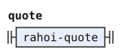</p>
<p>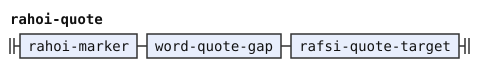</p>
<p>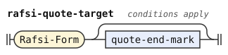</p>
<p>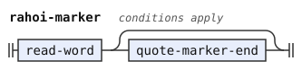</p>
</details>

`mu'oi` quotes a body between two delimiters, as `zoi` does. `zoi .ko. x .kO.` is a quote because both Lojban delimiters have stored value `ko`. Every dialect compares exact stored values, including FOREIGN values from decomposed source text ([the word stream](../common/stream.md)). So the dialect adds only the MUhOI class to the shared marker.

```jbogenbau
%redefine-const $ZOI-MARKERS
  (* ZOI_pre <- pre_clause ZOI spaces? zoi_open spaces? zoi_word* zoi_close spaces?;  MUhOI_pre likewise *)
  $ZOI-MARKERS ∪ MUhOI

```

Zantufa reads `y` and `ie'o` as space only after a pause or at the start of the text, because its `spaces` begins with `!Y`. A hesitation attached to the word before it, with no pause between them, is a word of class Y there. So `zoie'o mi` quotes `ie'o` and leaves `mi`, while `zo ie'o mi` quotes `mi`. Such a word has no place in the syntax except in a quote, so the dialect rejects `mi cuyy klama`, as Zantufa does. Before `bu`, hesitation stays the base of a letteral.

In a `lo'u` or `lo'ai` quote, the stage tags such a word `Word` only, like every other quoted word. The shared reader handles both quote bodies.

```jbogenbau
%redefine-rule hesitation
  (* spaces <- !Y initial_spaces *)
  $h:y-run :: ∅
%conditions
  ¬$h.onward.begins(y-bu-word),
  (Run-Initial ∪ Spacing) ∩ $h.tags ≠ ∅ ∨ Y-Letters ⊆ $h.tags ∧ $h.following-tokens.begins(y-letter-ahead)
%erased

%rule y-letter-ahead
  y-bu-word | Hesitation y-letter-ahead

%rule attached-y
  $h:Hesitation :: Word ∪ Cmavo ∪ Y
%conditions
  (Run-Initial ∪ Spacing) ∩ $h.tags = ∅,
  Y-Letters ⊈ $h.tags ∨ ¬$h.following-tokens.begins(y-letter-ahead),
  ¬$h.onward.begins(y-bu-word)
%emits
  $

%extend-rule read-word
  attached-y

```

<details><summary>Railroad diagrams of the 4 rules from <code>hesitation</code> to <code>read-word</code></summary>
<p>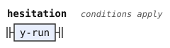</p>
<p>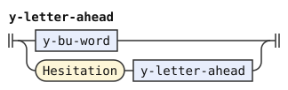</p>
<p>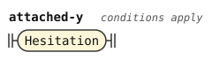</p>
<p>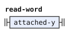</p>
</details>

A magic word is never a plain word. `$MAGIC-WORDS` includes the extended marker sets and adds RAhOI, LOhAI and LEhAI to the shared list. The constant excludes these classes from plain words, so a bare LOhAI or LEhAI is never a plain word. A bare marker is an opener that forms no complete quote. Only the classes in the [later `bare-marker` rule](#bare-markers) have the SI/BU fallback.

A word of LU, TO or LUhEI, the classes of `$TEXT-OPENERS`, that this stage reads as an unquoted word opens a text of its own. The forms stage gives the tag `Opener-Space` to the hesitation after such a word. A tag marks a token by an identifier. So that hesitation is space, and the word takes it with it. Inside a quote, such a hesitation is an attached Y word, as in `zo luyy si`, which erases the `yy` and keeps `zo lu`.

```jbogenbau
%redefine-const $MAGIC-WORDS
  $MAGIC-WORDS ∪ RAhOI ∪ LOhAI ∪ LEhAI

%const $TEXT-OPENERS
  LU ∪ TO ∪ LUhEI

%redefine-rule word
  | $c:read-word :: $c.tags
  | $o:text-opener $p:opener-spaces :: $o.tags
%conditions
  ¬$p.following-tokens.begins(opener-space-token),
  $c.classes ∩ $TEXT-OPENERS = ∅ ∨ ¬$c.following-tokens.begins(opener-space-token),
  $c.classes ∩ $MAGIC-WORDS = ∅,
  ¬$c.onward.begins(quote)
%emits
  $

%rule text-opener
  $q:cmavo-token :: $q.tags
%conditions
  $q.classes ∩ $TEXT-OPENERS ≠ ∅
%emits
  $

%rule opener-spaces
  $h:opener-space-token [opener-spaces]
%erased

%rule opener-space-token
  (* initial_spaces <- (space_char / !ybu Y)+: a hesitation before bu is no space *)
  $h:Hesitation
%conditions
  Opener-Space ⊆ $h.tags,
  ¬$h.onward.begins(y-bu-word)
```

<details><summary>Railroad diagrams of the 4 rules from <code>word</code> to <code>opener-space-token</code></summary>
<p>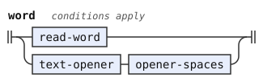</p>
<p>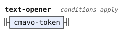</p>
<p>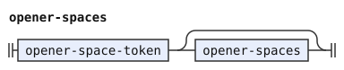</p>
<p>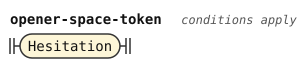</p>
</details>

The forms stage hands on the form after `ra'oi` as a `Rafsi-Form` token, even where that `ra'oi` opens no quote. So a `zoi` body, a `zoi` delimiter and the text after `fa'o` take that token as they take any other word. `fa'o ra'oi broda` is `fa'o` and what it ignores, and `zoi broda ra'oi broda` quotes `ra'oi`, as in Zantufa.

```jbogenbau
%extend-rule payload-token
  Rafsi-Form

%extend-rule delimiter
  Rafsi-Form
```

<details><summary>Railroad diagrams of <code>payload-token</code> and <code>delimiter</code></summary>
<p>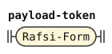</p>
<p>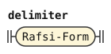</p>
</details>

## Bare markers

A quote word that opens no quote is an ordinary word in Zantufa, which `si` erases. Zantufa's `si_word` tries the quotes first, and then reads any cmavo but `bu`, a word of SI or SU, and `fa'o`. So `zoi si broda` is `broda`, and `lo'u si` is nothing. A bare marker can occupy a unit before SI or BU. It remains bare only where no complete quote begins.

`zo` and the words of GOhOI always quote the next word, so they are never bare. So a bare marker is a word of ZOI, MUhOI, LOhU, LOhAI or RAhOI, the other quotes of `si_word`.

```jbogenbau
%extend-rule unit
  $b:bare-marker :: $b.tags
%conditions
  ¬$b.onward.begins(quote),
  $b.following-tokens.begins(bare-marker-tail)

%rule bare-marker-tail
  skipped si-word | skipped cmavo-token<BU>

%rule bare-marker
  $q:read-word
%conditions
  $q.classes ∩ (ZOI ∪ MUhOI ∪ LOhU ∪ LOhAI ∪ RAhOI) ≠ ∅
```

<details><summary>Railroad diagrams of <code>unit</code>, <code>bare-marker-tail</code> and <code>bare-marker</code></summary>
<p>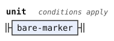</p>
<p>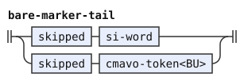</p>
<p>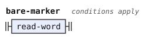</p>
</details>

The shared BU constructor also takes a bare marker when no quote begins there. Zantufa keeps its reference parser's quote-first fallback. A complete quote takes priority over a bare marker.

Zantufa also keeps SU as a letter base before BU binds. Such a SU erases nothing, so `mi su bu si` leaves `mi`. This exception follows `bu_clause_no_pre` in Zantufa 1.9999.

The constructor uses the shared `compound-gap` recipe so that surviving pauses contribute one space around erased regions. The lookahead uses `skipped`, because it tests recognition and runs no string recipes.

The lookahead skips erased regions before BU. Thus `su mi si bu` forms the letteral of SU. Without a following BU, SU erases the whole preceding text. NIhO, LU, TUhE, and TO do not stop it.

```jbogenbau
%extend-rule unit
  $s:su-letter-base compound-gap cmavo-token<BU> :: Word ∪ BY
%emits
  $

%rule su-letter-base
  $q:read-word
%conditions
  SU ⊆ $q.classes

%rule su-letter-tail
  skipped cmavo-token<BU>

%redefine-rule su-word
  $q:read-word
%conditions
  SU ⊆ $q.classes,
  ¬$q.following-tokens.begins(su-letter-tail)
```

<details><summary>Railroad diagrams of <code>unit</code>, <code>su-letter-base</code>, <code>su-letter-tail</code> and <code>su-word</code></summary>
<p>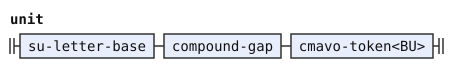</p>
<p>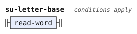</p>
<p>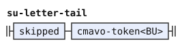</p>
<p>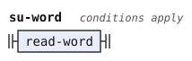</p>
</details>

## Differences from the shared word stream

The rafsi quote refuses standalone material in its gap, as the shared one-word quote does. Its body must be the next rafsi or gismu form.

The word `zei` acts as SI but retains the shared spelling-based punctuation restriction. Other SI words retain their ordinary spacing.

The shared list lacks RAhOI, which only Zantufa uses. It also lacks GOhOI and MUhOI, which both Zantufa and experimental use. It also omits LOhAI and LEhAI because the experimental dialect permits their bare markers as plain words. Zantufa does not read a bare LOhAI or LEhAI as a plain word. Its SI/BU fallback applies only to `bare-marker`. Its own `word` rule replaces the shared one, so the shared Fault test for a bare LOhAI, and with it `lohai-constructor-tail`, never applies.
