# jbogenbau: from characters to tokens

The lexical stage opens the [notation dialect](../dialects/notation.md). A stage is one step of a pipeline. A token is one unit that a stage reads or emits.

This stage reads one token per source character. A token's value is the string that exact comparisons read. Its image is the string that people see. Each input token carries its character as both strings and the stored engine tags.

A tag is a named mark on a token. The rules read characters by string terminals, ranges, or engine tags such as `_White_Space`.

The stage passes names, strings, captures, constants, guards, keywords, and punctuation to [syntax.md](syntax.md). It discards whitespace and comments. Each emitted token covers the exact source characters that form it.

[The notation guide](../../docs/notation.md) explains these forms. This document defines their lexical recognition under [engine §9.1](../../docs/engine.md#91-lexical-forms).

## Choosing among readings

The greedy reading favors the longest complete piece. It reads `...` as one symbol rather than three periods.

A name ends only when no name character follows. This prevents a token from ending inside a longer name.

```jbogenbau
%ambiguity-resolution greedy
```

## The text

A text contains any number of pieces. Each piece is a token or layout.

The left-recursive `text` gives each shorter text its own constituent. Greedy ranking can then compare where each piece ends.

```jbogenbau
%rule text
  ε | text piece

%rule piece
  | word | string | engine-tag | capture-token | constant-token | guard
  | include | keyword | symbol | negation | layout
```

<details><summary>Railroad diagrams of <code>text</code> and <code>piece</code></summary>
<p>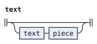</p>
<p>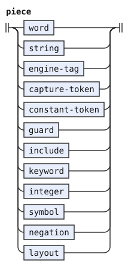</p>
</details>

## Names and engine tags

An ordinary name starts with an ASCII letter. Letters, digits, hyphens, and underscores can follow it.

`word` distinguishes lowercase and uppercase names while marking both as `Identifier`. The first letter later distinguishes rule names from user tags.

`whole-name` refuses a following name character. Keywords use it so that a keyword cannot stop inside a longer name.

An engine tag starts with `_` and continues with letters, digits, or underscores. A bare `_` is the wildcard. Later recognition rules exclude it where they require a tag.

```jbogenbau
%rule word
  | lower-name :: Identifier Lowercase-Name
  | upper-name :: Identifier Uppercase-Name
%conditions
  ¬$.following-tokens.begins(name-character)
%emits
  $

%rule whole-name
  name
%conditions
  ¬$.following-tokens.begins(name-character)

%rule name
  letter | name name-character

%rule name-character
  letter | digit | "-" | "_"

%rule letter
  "a".."z" | "A".."Z"

%rule digit
  "0".."9"

%rule lower-name
  "a".."z" | lower-name name-character

%rule upper-name
  "A".."Z" | upper-name name-character

%rule engine-tag
  "_" [engine-name]
%conditions
  ¬$.following-tokens.begins(engine-name-character)
%emits
  $ :: Engine-Tag

%rule engine-name
  engine-name-character | engine-name engine-name-character

%rule engine-name-character
  letter | digit | "_"
```

<details><summary>Railroad diagrams of the 11 rules from <code>word</code> to <code>engine-name-character</code></summary>
<p>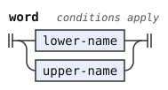</p>
<p>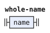</p>
<p>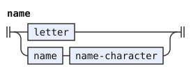</p>
<p>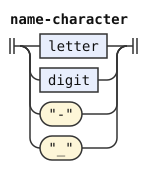</p>
<p>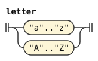</p>
<p>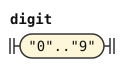</p>
<p>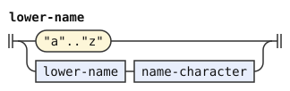</p>
<p>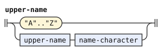</p>
<p>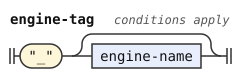</p>
<p>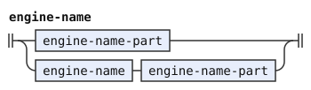</p>
<p>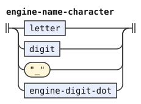</p>
</details>

## Captures and constants

A capture is `$` alone or `$` followed by a lowercase name. `$` alone names the enclosing constituent.

A user constant starts with `$` and an uppercase name. An engine scalar reference starts with `$_` and letters or digits. The reader later requires valid hexadecimal digits and a Unicode scalar value.

In these grammar strings, `"$$"` denotes one dollar sign. Thus `"$$" "$$"` reads two source dollars, while `"$$" upper-name` reads a constant.

The boundary conditions prevent either token from ending inside its name. The syntax stage receives each prefixed name as one token.

```jbogenbau
%rule capture-token
  "$$" | "$$" $n:lower-name
%conditions
  ¬$n.following-tokens.begins(name-character)
%emits
  $ :: Capture

%rule constant-token
  | user-constant
  | "$$" "_" [scalar-name]
%conditions
  ¬$.following-tokens.begins(scalar-name-character)
%emits
  $ :: Constant

%rule user-constant
  "$$" upper-name
%conditions
  ¬$.following-tokens.begins(name-character)

%rule scalar-name
  scalar-name-character | scalar-name scalar-name-character

%rule scalar-name-character
  letter | digit
```

<details><summary>Railroad diagrams of the 5 rules from <code>capture-token</code> to <code>scalar-name-character</code></summary>
<p>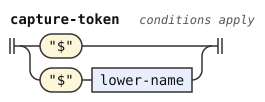</p>
<p>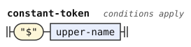</p>
<p>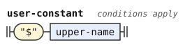</p>
<p>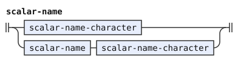</p>
<p>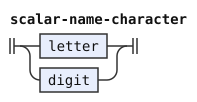</p>
</details>

## Feature guards

A feature is a named switch that a grammar tests. Its name starts with a letter and continues with letters, digits, or hyphens.

A guard ends with `?` for a gate or `!` for a warning. A gate can start with `¬`.

A `¬` immediately before a guard belongs to that guard. Elsewhere, `negation` emits it separately for a condition.

```jbogenbau
%rule guard
  ["¬"] feature-name "?" | feature-name "!"
%emits
  $ :: Guard

%rule feature-name
  letter | feature-name feature-character

%rule feature-character
  letter | digit | "-"

%rule negation
  "¬"
%conditions
  ¬$.following-tokens.begins(guard)
%emits
  $
```

<details><summary>Railroad diagrams of <code>guard</code>, <code>feature-name</code>, <code>feature-character</code> and <code>negation</code></summary>
<p>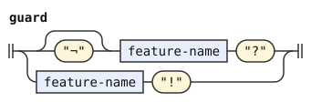</p>
<p>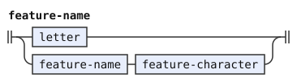</p>
<p>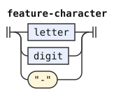</p>
<p>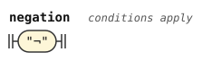</p>
</details>

## Strings

Straight double quotes enclose a string. Ordinary string characters exclude the quote, dollar sign, and backslash: U+0022, U+0024, and U+005C.

A dollar starts either `$$`, which denotes one literal dollar, or `$(NAME)`, which interpolates a constant. `dollar-ready` tests that a complete dollar form follows before the grammar consumes it.

An interpolation names a user constant or an engine scalar reference. A backslash has no string form, so the stage rejects it rather than treating it as an escape.

The reader decodes the complete token only after syntax recognition. This keeps syntax errors ahead of reader errors.

```jbogenbau
%rule string
  $_0022 [{string-part}] $_0022
%emits
  $ :: String

%rule string-part
  ordinary-string-character | dollar-ready dollar-complete

%rule ordinary-string-character
  $_0000..$_0021 | $_0023 | $_0025..$_005B | $_005D..$_10FFFF

%rule dollar-ready
  ε
%conditions
  $.onward.begins(dollar-complete)

%rule dollar-complete
  "$$" "$$" | "$$" "(" interpolation-name ")"

%rule interpolation-name
  upper-name | "_" scalar-name
```

<details><summary>Railroad diagrams of the 6 rules from <code>string</code> to <code>interpolation-name</code></summary>
<p>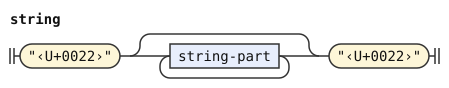</p>
<p>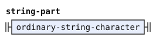</p>
<p>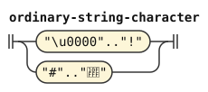</p>
<p>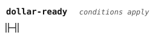</p>
<p>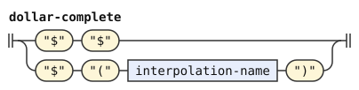</p>
<p>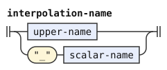</p>
</details>

## Include paths

`include` reads `%include` and its quoted path together, then emits two tokens. The keyword carries `KW-INCLUDE`, and the path carries `Include-Path`.

An include path keeps dollar signs literally. It excludes quotes and backslashes, so interpolation rules never apply inside the path.

`include-tail` identifies layout followed by a path. The ordinary keyword rule uses it to avoid a competing bare `%include` token when a path follows.

```jbogenbau
%rule include
  $keyword:include-keyword [layout-run] $path:include-path
%emits
  $keyword :: KW-INCLUDE, $path :: Include-Path

%rule include-tail
  [layout-run] include-path

%rule include-keyword
  "%" $n:whole-name
%conditions
  $n.value = "include"

%rule include-path
  $_0022 [{path-part}] $_0022

%rule path-part
  $_0000..$_0021 | $_0023..$_005B | $_005D..$_10FFFF
```

<details><summary>Railroad diagrams of the 5 rules from <code>include</code> to <code>path-part</code></summary>
<p>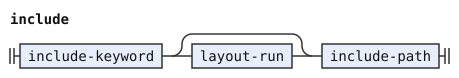</p>
<p>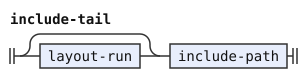</p>
<p>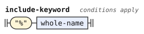</p>
<p>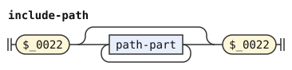</p>
<p>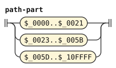</p>
</details>

## Layout

Whitespace and comments separate tokens without contributing meaning. `layout-run` joins consecutive layout pieces for include recognition.

A comment starts with `(*` and ends at the first `*)`. Stars belong to its contents unless the next character is `)`.

These rules emit nothing. Their contents therefore never reach syntax recognition.

```jbogenbau
%rule layout-run
  layout | layout-run layout

%rule layout
  _White_Space | comment

%rule comment
  "(" "*" [{comment-part}] stars ")"

%rule comment-part
  $c:_ | stars $d:_
%conditions
  $c.value ≠ "*", $d.value ≠ ")", $d.value ≠ "*"

%rule stars
  "*" | stars "*"
```

<details><summary>Railroad diagrams of <code>layout-run</code>, <code>layout</code>, <code>comment</code>, <code>comment-part</code> and <code>stars</code></summary>
<p>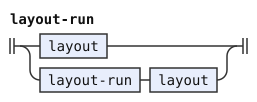</p>
<p>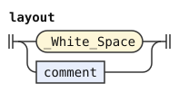</p>
<p>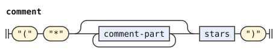</p>
<p>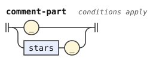</p>
<p>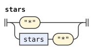</p>
</details>

## Keywords

A keyword is `%` followed by a whole name. Each known keyword receives its own tag, such as `KW-RULE`.

An unknown keyword receives `Keyword`, which the syntax grammar never reads. Recognition therefore reports it as a syntax error at that token.

The `%include` alternative applies only when no quoted path follows. A complete include instead uses the path rule above.

```jbogenbau
%rule keyword
  | "%" $rule:whole-name :: KW-RULE
  | "%" $redefine-rule:whole-name :: KW-REDEFINE-RULE
  | "%" $extend-rule:whole-name :: KW-EXTEND-RULE
  | "%" $conditions:whole-name :: KW-CONDITIONS
  | "%" $emits:whole-name :: KW-EMITS
  | "%" $erased:whole-name :: KW-ERASED
  | "%" $ambiguity-resolution:whole-name :: KW-AMBIGUITY-RESOLUTION
  | "%" $stage:whole-name :: KW-STAGE
  | "%" $extend-stage:whole-name :: KW-EXTEND-STAGE
  | "%" $redefine-stage:whole-name :: KW-REDEFINE-STAGE
  | "%" $include:whole-name :: KW-INCLUDE
  | "%" $features:whole-name :: KW-FEATURES
  | "%" $const:whole-name :: KW-CONST
  | "%" $redefine-const:whole-name :: KW-REDEFINE-CONST
  | "%" $classifier:whole-name :: KW-CLASSIFIER
  | "%" $implies:whole-name :: KW-IMPLIES
  | "%" $other:whole-name :: Keyword
%conditions
  $rule.value = "rule",
  $redefine-rule.value = "redefine-rule",
  $extend-rule.value = "extend-rule",
  $conditions.value = "conditions",
  $emits.value = "emits",
  $erased.value = "erased",
  $ambiguity-resolution.value = "ambiguity-resolution",
  $stage.value = "stage",
  $extend-stage.value = "extend-stage",
  $redefine-stage.value = "redefine-stage",
  $include.value = "include",
  $features.value = "features",
  $const.value = "const",
  $redefine-const.value = "redefine-const",
  $classifier.value = "classifier",
  $implies.value = "implies",
  $other.value ≠ "rule",
  $other.value ≠ "redefine-rule",
  $other.value ≠ "extend-rule",
  $other.value ≠ "conditions",
  $other.value ≠ "emits",
  $other.value ≠ "erased",
  $other.value ≠ "ambiguity-resolution",
  $other.value ≠ "stage",
  $other.value ≠ "extend-stage",
  $other.value ≠ "redefine-stage",
  $other.value ≠ "include",
  $other.value ≠ "features",
  $other.value ≠ "const",
  $other.value ≠ "redefine-const",
  $other.value ≠ "classifier",
  $other.value ≠ "implies",
  $include ⟹ ¬$.following-tokens.begins(include-tail)
%emits
  $
```

<details><summary>Railroad diagram of <code>keyword</code></summary>
<p>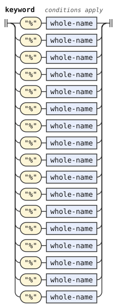</p>
</details>

## Symbols

A symbol is punctuation that no larger lexical form contains. One-character symbols preserve their source value and image.

The greedy reading keeps `...`, `..`, `::`, `:=`, and `:-` together as compound tokens. `@` and `(` remain separate tokens.

`≻` separates ranked options. `/` separates a repetition's item and separator. Pattern paths and comparisons retain their own punctuation tokens.

```jbogenbau
%rule symbol
  | "|" | "&" | "(" | ")" | "[" | "]" | "{" | "}" | "/" | "+" | "<" | ">" | "#" | "ε" | ","
  | "∧" | "∨" | "⟹" | "=" | "∈" | "⊆" | "∪" | "∩" | "∖" | "∅"
  | "≅" | "⋯" | "⋮" | "⋰" | "⋱" | "≻" | ":" | "." | "@"
  | "." "." "." | "." "." | ":" ":" | ":" "=" | ":" "-"
  | ("=" | "∈" | "⊆" | "≅") $_0338
%emits
  $
```

<details><summary>Railroad diagram of <code>symbol</code></summary>
<p>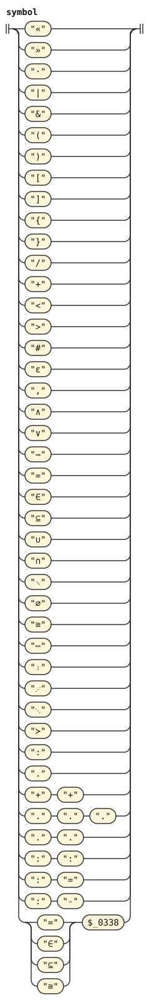</p>
</details>
