# jbogenbau: from tokens to a grammar

The syntax stage follows [lexical.md](lexical.md) in the [notation dialect](../dialects/notation.md). A stage is one step of a pipeline. A token is one unit that a stage reads or emits.

A token's value is the string that exact comparisons read. Its image is the string that people see.

The stage recognizes a complete grammar document before the reader converts its tree. A syntax error anywhere therefore precedes every reader error.

A tag is a named mark on a token. Lexical tags distinguish names, strings, integers, prefixed names, guards, engine tags, and keywords. String terminals read punctuation by its value.

These rules implement the recognition productions of [engine §9.2](../../docs/engine.md#92-syntax-forms). They admit forms that the reader rejects under [§9.3](../../docs/engine.md#93-conversion-and-validation).

The rule names identify reader constructors. Section 9.2 maps recognition names to these constructors: `document` becomes `text`, `captured` becomes `capture`, and `item` becomes `emit-item`. It also maps `flags` to `rule-flags`, `conditions` to `conditions-clause`, and `method-chain` to `method`. The same table specifies the remaining wrapper mappings.

## Choosing among readings

The syntax stage receives complete tokens without layout. Greedy ranking resolves how selectors group into method chains. In `%rule r A %conditions $x.a.b(c)`, one chain takes both selectors instead of nesting `$x.a` as the receiver of `.b(c)`. The reader folds that chain from left to right.

A keyword begins every declaration. Inside each declaration, punctuation and lexical categories determine where its lists end.

```jbogenbau
%ambiguity-resolution greedy
```

## Documents

A grammar text is a sequence of rules, directives, constant definitions, classifiers, and implications. Each starts with a keyword, so the next statement determines where the preceding one ends.

The reader converts the recognized tree into a DOM, its document object model. Constructor names preserve the parts that this conversion needs.

```jbogenbau
%rule text
  [{statement}]

%rule statement
  rule | directive | constant-definition | classifier | implication-declaration
```

<details><summary>Railroad diagrams of <code>text</code> and <code>statement</code></summary>
<p>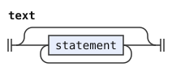</p>
<p>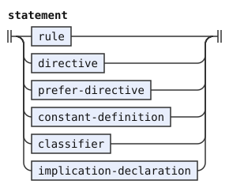</p>
</details>

## Rules and alternatives

A rule defines, redefines, or extends a name. Optional flags precede the name, and the body precedes conditions and output.

Header tag and string clauses apply to every alternative. A header clause requires the leading `|`, which separates its operands from the body.

An ordinary body separates alternatives with `|`. A ranked body joins at least two options with `≻`. Guards and clauses on a ranked body apply to the complete ranked choice.

An alternative can carry its own tag, value, and image clauses. Both clause lists preserve that order and permit each channel once.

```jbogenbau
%rule rule
  definer [rule-flags] (rule-name | call) ("=" call | (body | clauses headed-body)
    [conditions-clause] [output])

%rule definer
  KW-RULE | KW-REDEFINE-RULE | KW-EXTEND-RULE

%rule rule-flags
  "(" {rule-flag / ","} ")"

%rule rule-flag
  Identifier

%rule rule-name
  Identifier | Emoji-Name

%rule clauses
  tags-clause [value-clause] [image-clause] | value-clause [image-clause] | image-clause

%rule headed-body
  "|" ordinary-body

%rule body
  ["|"] ordinary-body | ranked-alternative

%rule ordinary-body
  {alternative / "|"}

%rule ranked-alternative
  [{guard}] ranked-choice [alternative-clauses]

%rule ranked-choice
  conjunction "≻" {conjunction / "≻"}

%rule alternative
  [{guard}] conjunction [alternative-clauses]

%rule alternative-clauses
  alternative-tags [value-clause] [image-clause] | value-clause [image-clause] | image-clause

%rule alternative-tags
  "::" term
```

<details><summary>Railroad diagrams of the 14 rules from <code>rule</code> to <code>alternative-tags</code></summary>
<p>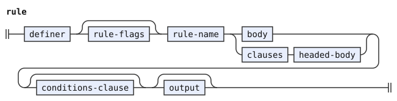</p>
<p>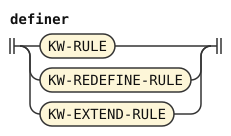</p>
<p>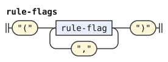</p>
<p>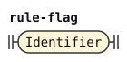</p>
<p>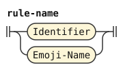</p>
<p>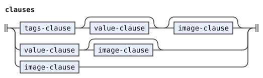</p>
<p>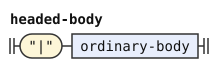</p>
<p>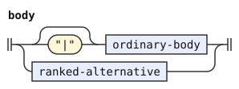</p>
<p>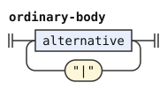</p>
<p>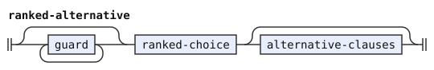</p>
<p>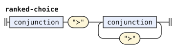</p>
<p>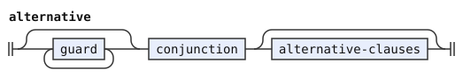</p>
<p>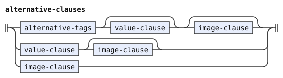</p>
<p>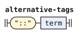</p>
</details>

## Calls and arguments

A call names a template and supplies one or more arguments. Ranked recognition selects the first argument category that reads the complete argument.

A requirement list and a target choice retain their distinct categories. Parenthesized bodies preserve their grouping during substitution.

```jbogenbau
%rule call
  Call-Name "(" {call-argument / ","} ")"

%rule parameter
  Parameter

%rule call-argument
  requirement-argument ≻ target-argument ≻ body-argument ≻ symbol-argument ≻ term :: ∅

%rule requirement-argument
  "<" [{tag-requirement}] ">"

%rule target-argument
  call-target "|" {call-target / "|"}

%rule call-target
  reference | tag | call | parameter

%rule body-argument
  group | optional | repetition | empty

%rule symbol-argument
  tested | range | wildcard
```

<details><summary>Railroad diagrams of the 8 rules from <code>call</code> to <code>symbol-argument</code></summary>
<p>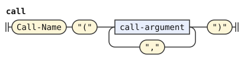</p>
<p>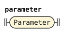</p>
<p>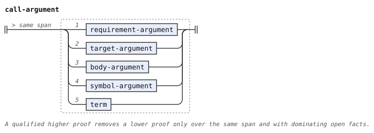</p>
<p>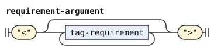</p>
<p>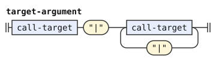</p>
<p>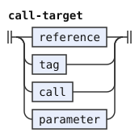</p>
<p>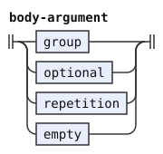</p>
<p>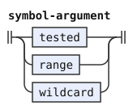</p>
</details>

## Expressions and captures

A choice uses `|` or `≻` at one level, never both. `&` joins sequences, and each sequence contains one or more primaries.

A primary is a symbol, capture, tested primary, group, optional, repetition, or `ε`. Lowercase names and eligible emoji names reference rules. Uppercase names and engine tags read tagged tokens.

Strings and string constants read exact values. A range reads one scalar between its endpoints. The wildcard `_` reads any token, so `tag` excludes it.

Parentheses group a choice. Brackets make it optional, and `+` marks an elidable optional. Braces repeat a choice, with an optional separator after `/`.

A chain has `...` before or after its item. The reader requires a chain to occupy its entire alternative.

A capture writes its binder before `:` and a primary after it. Recognition admits a `Constant` binder so that the reader can report the capitalized capture name there.

Recognition also admits invalid capture targets and captures inside braces or marked optionals. The reader rejects them at the positions in engine §9.3.

```jbogenbau
%rule choice
  ["|"] {conjunction / "|"} | ranked-choice

%rule conjunction
  ["&"] {sequence / "&"}

%rule sequence
  {primary}

%rule primary
  capture | tested | untested-primary

%rule capture
  (Capture | Constant) ":" primary

%rule untested-primary
  reference | call | parameter | tag | string-terminal | range | wildcard
  | group | optional | repetition | empty

%rule reference
  Lowercase-Name | Emoji-Name

%rule tag
  Uppercase-Name | Engine-Tag≠"_"

%rule string-terminal
  string | constant-reference

%rule wildcard
  "_"

%rule group
  "(" choice ")"

%rule optional
  "[" ["+"] choice "]"

%rule repetition
  "{" ["..."] choice ["/" choice] "}" | "{" choice "..." ["/" choice] "}"

%rule empty
  "ε"

%rule guard
  Guard
```

<details><summary>Railroad diagrams of the 15 rules from <code>choice</code> to <code>guard</code></summary>
<p>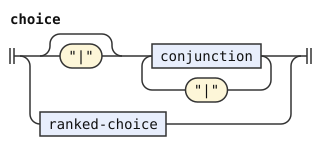</p>
<p>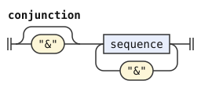</p>
<p>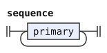</p>
<p>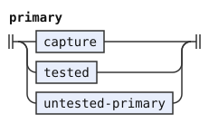</p>
<p>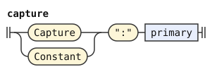</p>
<p>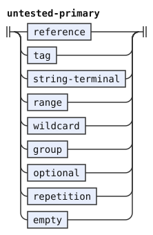</p>
<p>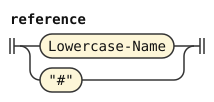</p>
<p>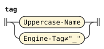</p>
<p>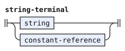</p>
<p>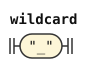</p>
<p>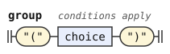</p>
<p>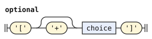</p>
<p>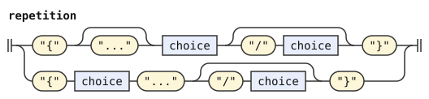</p>
<p>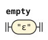</p>
<p>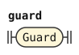</p>
</details>

## Symbol tests

A `tested` primary holds its base and all following tests in written order. Tests after a capture binder belong to its target.

Valid symbols accept a tag test followed by a value test. Recognition admits extra tests, reversed tests, and wider operands so that the reader can name their errors.

Each tag requirement has an optional `¬`. An empty requirement list holds vacuously. A value test uses `=` or `≠` and requires a string literal or string constant.

```jbogenbau
%rule tested
  untested-primary {symbol-test}

%rule symbol-test
  tag-test | value-test

%rule tag-test
  "<" [{tag-requirement}] ">"

%rule tag-requirement
  ["¬"] test-operand

%rule value-test
  test test-operand

%rule test
  "=" | "≠"

%rule operand-atom
  call | parameter | string | constant-reference | name | tag | range | capture-reference | empty-set | pattern-literal | "(" term ")"

%rule test-operand
  operand-atom | method

%rule range
  string-operand ".." string-operand

%rule string-operand
  string | constant-reference | parameter
```

<details><summary>Railroad diagrams of the 10 rules from <code>tested</code> to <code>string-operand</code></summary>
<p>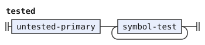</p>
<p>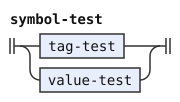</p>
<p>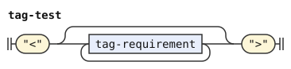</p>
<p>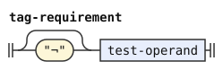</p>
<p>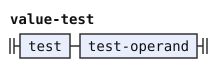</p>
<p>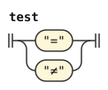</p>
<p>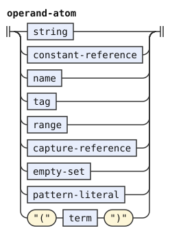</p>
<p>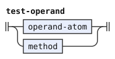</p>
<p>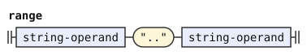</p>
<p>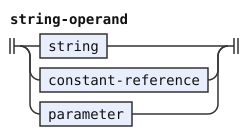</p>
</details>

## Conditions and output

`%conditions` lists predicates that the captured parts must satisfy. Its comma-separated list can start with a comma.

On `%features`, the clause tests stage input before parsing ([Pipelines](../../docs/notation.md#pipelines)).

`%emits` lists output items, or means one whole-rule item when it has no items. A clause without a target also applies to that whole-rule item.

A valid target is a capture or `ε`, which inserts a token. Recognition admits names and ranges too, so the reader reports an invalid target at that item.

Attachments are named captures in parentheses around a named carrier. The reader rejects attachments around the whole-rule capture or an inserted item.

`%erased` discards the constituent during emission. It cannot share output with `%emits`.

```jbogenbau
%rule conditions-clause
  KW-CONDITIONS [","] {implication / ","}

%rule output
  erased-clause | emits-clause

%rule erased-clause
  KW-ERASED

%rule emits-clause
  KW-EMITS [emission]

%rule emission
  [","] {emit-item / ","} | emit-clauses

%rule emit-item
  [{emit-before}] emit-target [{emit-after}] [emit-clauses]

%rule emit-target
  Capture | "ε" | Identifier | Engine-Tag≠"_" | range

%rule emit-before
  "(" capture-reference ")"

%rule emit-after
  "(" capture-reference ")"

%rule emit-clauses
  emit-tags [value-clause] [image-clause] | value-clause [image-clause] | image-clause

%rule emit-tags
  "::" term
```

<details><summary>Railroad diagrams of the 11 rules from <code>conditions-clause</code> to <code>emit-tags</code></summary>
<p>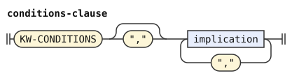</p>
<p></p>
<p></p>
<p></p>
<p></p>
<p></p>
<p></p>
<p></p>
<p></p>
<p></p>
<p></p>
</details>

## Tags and string recipes

`::` supplies tags, `:=` supplies a value recipe, and `:-` supplies an image recipe. A recipe is exactly one term that joins its string atoms with `++` in written order.

Recognition admits repeated terms for diagnostics, but a valid recipe contains exactly one term. The reader rejects a second term at its first token and tells the author to use `++`. Adjacent string literals form a set, so the reader rejects them and tells the author to use `++`. The reader permits only strings, string constants, and the seven capture string methods of engine §11.3.

This wider recognition lets the reader reject a written operator or forbidden method at its atom. It does not make those atoms valid recipes.

```jbogenbau
%rule recipe
  {recipe-atom}

%rule recipe-atom
  term

%rule value-clause
  ":=" recipe

%rule image-clause
  ":-" recipe

%rule tags-clause
  "::" term
```

<details><summary>Railroad diagrams of the 5 rules from <code>recipe</code> to <code>tags-clause</code></summary>
<p></p>
<p></p>
<p></p>
<p></p>
<p></p>
</details>

## Terms and methods

A term can be a string, a set, a pattern, a capture, a span, or a method result. Its context determines the type of `∅`.

`++` binds tighter than `∩`, which binds tighter than `∪` and `∖`. These operators group from the left. Adjacent tags or strings form one union. In terms and constants, string runs bind tighter than concatenation.

A guarded term writes a condition before `⟹`. It supplies its value only where that condition holds. A guard binds less tightly than set operators.

The reader groups repeated guards to the right. Flat lists retain their written order without completing a separate recursive level for each guard.

A method chain starts with a receiver and follows it with selectors. Each selector names a method and can supply nonempty parenthesized arguments.

The methods `.begins`, `.matches`, `.followed-by`, and `.preceded-by` separate target names with `|`. Other methods separate arguments with `,`. The reader enforces this distinction.

The reader folds selectors from left to right. It retains the receiver's actual type and applies the signature rules in engine §10.

A name used as an argument can identify a rule or classifier where the method signature requires one. The reader rejects unknown methods, invalid receivers, and wrong arities.

An emoji rule name is also a method argument. A classifier name starts with a lowercase letter, so an emoji cannot name a classifier.

```jbogenbau
%rule term
  union | guarded-term

%rule guarded-term
  {any-of "⟹"} union

%rule union
  ["∪"] {intersection / ("∪" | "∖")}

%rule intersection
  ["∩"] {concatenation / "∩"}

%rule concatenation
  {term-atom / "++"}

%rule tag-run
  tag tag [{tag}]

%rule string-run
  string string [{string}]

%rule term-atom
  plain-term-atom | method

%rule plain-term-atom
  call | parameter | tag-run | string-run | tag | name | string | constant-reference | range | capture-reference | empty-set | pattern-literal | "(" term ")"

%rule method
  method-receiver {method-selector}

%rule method-receiver
  term-atom

%rule method-selector
  "." method-name ["(" arguments ")"]

%rule method-name
  Identifier | Call-Name

%rule arguments
  {argument / ("," | "|")}

%rule argument
  term | integer

%rule integer
  Integer

%rule name
  Lowercase-Name | Emoji-Name

%rule empty-set
  "∅"

%rule capture-reference
  Capture

%rule constant-reference
  Constant

%rule string
  String
```

<details><summary>Railroad diagrams of the 21 rules from <code>term</code> to <code>string</code></summary>
<p></p>
<p></p>
<p></p>
<p></p>
<p></p>
<p></p>
<p></p>
<p></p>
<p></p>
<p></p>
<p></p>
<p></p>
<p></p>
<p></p>
<p></p>
<p></p>
<p></p>
<p></p>
<p></p>
<p></p>
<p></p>
</details>

## Boolean conditions

A condition is a comparison, tree comparison, method, presence test, negation, or grouped condition. A bare capture tests its presence.

`∧`, `∨`, and `⟹` bind in that order. Implication groups to the right. `¬` negates the following condition.

The flat implication list preserves every operand for the reader's grouping. This keeps recognition work proportional to the list rather than its nested completions.

A tree comparison has a bare capture on the left and a pattern term on the right. `≇` negates the same candidate's `≅` answer.

```jbogenbau
%rule implication
  {any-of / "⟹"}

%rule any-of
  ["∨"] {all-of / "∨"}

%rule all-of
  ["∧"] {condition / "∧"}

%rule condition
  comparison | tree-comparison | method | presence | negation | "(" implication ")"

%rule presence
  Capture

%rule negation
  "¬" condition

%rule comparison
  union comparator union

%rule comparator
  "=" | "≠" | "∈" | "∉" | "⊆" | "⊈"

%rule tree-comparison
  capture-reference tree-comparator union

%rule tree-comparator
  "≅" | "≇"
```

<details><summary>Railroad diagrams of the 10 rules from <code>implication</code> to <code>tree-comparator</code></summary>
<p></p>
<p></p>
<p></p>
<p></p>
<p></p>
<p></p>
<p></p>
<p></p>
<p></p>
<p></p>
</details>

## Tree patterns

A pattern starts with `#` and one node test, bare child list, or grouped predicate. An exact prefix suppresses the node test's single-child search.

Guillemets enclose child items. An adjacent list attaches to a rule test. Whitespace or a comment separates a bare list from the preceding item.

Child lists contain sequences, choices, optional sequences, repeats, and sibling gaps. Paths and set operations combine whole predicates.

Recognition admits repeated or reversed terminal tests. The reader restricts tests to terminal identities or string constants, in tag-then-value order.

```jbogenbau
%rule pattern-literal
  "#" pattern-primary

%rule pattern-union
  {pattern-intersection / ("∪" | "∖")}

%rule pattern-intersection
  {pattern-path / "∩"}

%rule pattern-path
  ("⋮" | "⋱") pattern-primary | pattern-primary ["⋰"]

%rule pattern-primary
  pattern-node | pattern-bare | "(" pattern-union ")"

%rule pattern-node
  [$exact:"·"] $atom:pattern-atom [$list:pattern-children]
%conditions
  $exact ⟹ $exact.onward.begins(pattern-exact-start)
  , $list ⟹ $atom.onward.begins(pattern-attached-start)
  , ¬$list ⟹ ¬$atom.onward.begins(pattern-attached-start)

%rule pattern-bare
  [$exact:"·"] pattern-children
%conditions
  $exact ⟹ $exact.onward.begins(pattern-exact-start)

%rule pattern-atom
  (pattern-name | tag | string | range | wildcard | constant-reference) [{symbol-test}]

%rule pattern-name
  Lowercase-Name | Emoji-Name | call | parameter

%rule pattern-children
  "«" [child-choice] "»"

%rule child-choice
  {child-alternative / "|"}

%rule child-alternative
  child-sequence | child-set

%rule child-sequence
  {child-item}

%rule child-set
  child-intersection ("∪" | "∖") child-intersection [{("∪" | "∖") child-intersection}]
  | child-path "∩" child-path [{"∩" child-path}]

%rule child-intersection
  {child-path / "∩"}

%rule child-item
  child-path | pattern-brackets | pattern-repeat | "⋯"
%conditions
  ¬$.last-token.onward.begins(pattern-adjacent-item)

%rule child-path
  ("⋮" | "⋱") child-primary | child-primary ["⋰"]

%rule child-primary
  pattern-node | pattern-bare | "(" child-choice ")"

%rule pattern-brackets
  "[" child-choice "]"

%rule pattern-repeat
  "{" child-choice ["/" child-choice] "}"

%rule pattern-exact-start
  $mark:"·" $next:_
%conditions
  $.source-text = $mark.source-text ++ $next.source-text

%rule pattern-attached-start
  $atom:pattern-atom $open:"«"
%conditions
  $.source-text = $atom.source-text ++ $open.source-text

%rule pattern-item-opening
  "«" | "·"

%rule pattern-adjacent-item
  $left:_ $right:pattern-item-opening
%conditions
  $left.value ≠ "⋯"
  , $left.value ≠ "⋰"
  , $.source-text = $left.source-text ++ $right.source-text
```

<details><summary>Railroad diagrams of the 24 rules from <code>pattern-literal</code> to <code>pattern-adjacent-item</code></summary>
<p></p>
<p></p>
<p></p>
<p></p>
<p></p>
<p></p>
<p></p>
<p></p>
<p></p>
<p></p>
<p></p>
<p></p>
<p></p>
<p></p>
<p></p>
<p></p>
<p></p>
<p></p>
<p></p>
<p></p>
<p></p>
<p></p>
<p></p>
<p></p>
</details>

## Directives

A directive starts a stage, includes a document, declares features, or chooses ambiguity resolution. Each written name is a separate operand.

Recognition accepts wider operands than each directive permits. The reader rejects wrong counts and types at the directive before converting those operands.

`%features` alone accepts a following `%conditions` clause. The loader requires a selected stage for that clause.

`%include` takes exactly one quoted path. Its first operand uses literal path decoding. An include path cannot serve as a method receiver.

`%names` takes one quoted path and stands before every other statement. The loader inherits its extra names file through nested includes. Returning from an include restores the parent selection.

```jbogenbau
%rule directive
  directive-name [{directive-argument}] [conditions-clause]

%rule directive-name
  | KW-STAGE | KW-EXTEND-STAGE | KW-REDEFINE-STAGE
  | KW-INCLUDE | KW-NAMES | KW-FEATURES | KW-AMBIGUITY-RESOLUTION

%rule directive-argument
  argument-word | argument-string | argument-tag | argument-term

%rule argument-word
  Identifier

%rule argument-string
  String | Include-Path

%rule argument-tag
  Engine-Tag≠"_" | range

%rule argument-term
  directive-method | capture-reference | constant-reference | empty-set | pattern-literal | "(" term ")" | Emoji-Name | "_"

%rule directive-method
  (tag | name | string | constant-reference | range | capture-reference | empty-set | pattern-literal | "(" term ")") {method-selector}
```

<details><summary>Railroad diagrams of the 8 rules from <code>directive</code> to <code>directive-method</code></summary>
<p></p>
<p></p>
<p></p>
<p></p>
<p></p>
<p></p>
<p></p>
<p></p>
</details>

## Constants, classifiers, and implications

A constant declaration defines or redefines a prefixed name and gives it a term. The loader resolves its type and final value after stitching the stage.

A classifier has a name and entries. Each entry has guards, one or more string keys, an operator, and a class. The reader rejects warning guards and invalid class names.

`%implies` joins two tag-set terms with `⟹`. Neither side is an ungrouped guarded term, so that symbol identifies the implication itself.

```jbogenbau
%rule constant-definition
  constant-definer constant-reference term

%rule constant-definer
  KW-CONST | KW-REDEFINE-CONST

%rule classifier
  KW-CLASSIFIER classifier-name [{classifier-entry}]

%rule classifier-name
  Identifier

%rule classifier-entry
  [{guard}] {classifier-key} classifier-operator classifier-class

%rule classifier-key
  string | constant-reference

%rule classifier-operator
  "∈" | "∉"

%rule classifier-class
  Identifier | Engine-Tag≠"_"

%rule implication-declaration
  KW-IMPLIES union "⟹" union
```

<details><summary>Railroad diagrams of the 9 rules from <code>constant-definition</code> to <code>implication-declaration</code></summary>
<p></p>
<p></p>
<p></p>
<p></p>
<p></p>
<p></p>
<p></p>
<p></p>
<p></p>
</details>
