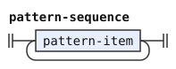
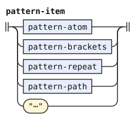

# jbogenbau: from tokens to a grammar

This stage reads the tokens from `lexical.md`. It recognizes the whole document before the reader converts or rejects any part.

The rules implement `../../docs/engine.md`, §9.2. Their named parts follow the constructor contract in §9.3. Other rules are wrappers that contribute their children in written order.

Recognition admits invalid capture targets and repeated tests. The reader reports those errors at the positions that §9.3 specifies.

```jbogenbau
%ambiguity-resolution greedy

%rule text
  [{statement}]

%rule statement
  rule | directive | constant-definition | classifier | implication-declaration

%rule rule
  definer [rule-flags] rule-name (body | clauses headed-body) [conditions-clause] [output]

%rule definer
  KW-RULE | KW-REDEFINE-RULE | KW-EXTEND-RULE

%rule rule-flags
  "(" {rule-flag / ","} ")"

%rule rule-flag
  Identifier

%rule rule-name
  Identifier | "#"

%rule clauses
  tags-clause [value-clause] [image-clause] | value-clause [image-clause] | image-clause

%rule headed-body
  "|" ordinary-body

%rule body
  ["|"] ordinary-body | ranked-alternative

%rule ordinary-body
  {alternative / "|"}

%rule ranked-alternative
  [{guard}] ranked-choice [alternative-clauses]

%rule ranked-choice
  conjunction "≻" {conjunction / "≻"}

%rule alternative
  [{guard}] conjunction [alternative-clauses]

%rule alternative-clauses
  alternative-tags [value-clause] [image-clause] | value-clause [image-clause] | image-clause

%rule alternative-tags
  "::" term

%rule choice
  ["|"] {conjunction / "|"} | ranked-choice

%rule conjunction
  ["&"] {sequence / "&"}

%rule sequence
  {primary}

%rule primary
  capture | tested | untested-primary

%rule capture
  (Capture | Constant) ":" primary

%rule untested-primary
  reference | tag | string-terminal | range | wildcard | group | optional | repetition | empty

%rule reference
  Lowercase-Name | "#"

%rule tag
  Uppercase-Name | Engine-Tag≠"_"

%rule string-terminal
  string | constant-reference

%rule wildcard
  "_"

%rule group
  "(" choice ")"

%rule optional
  "[" ["+"] choice "]"

%rule repetition
  "{" ["..."] choice ["/" choice] "}" | "{" choice "..." ["/" choice] "}"

%rule empty
  "ε"

%rule guard
  Guard

%rule tested
  untested-primary {symbol-test}

%rule symbol-test
  tag-test | value-test

%rule tag-test
  "<" [{tag-requirement}] ">"

%rule tag-requirement
  ["¬"] test-operand

%rule value-test
  test test-operand

%rule test
  "=" | "≠"

%rule operand-atom
  string | constant-reference | name | tag | range | capture-reference | empty-set | pattern-literal | "(" term ")"

%rule test-operand
  operand-atom | method

%rule range
  string-operand ".." string-operand

%rule string-operand
  string | constant-reference

%rule conditions-clause
  KW-CONDITIONS [","] {implication / ","}

%rule output
  erased-clause | emits-clause

%rule erased-clause
  KW-ERASED

%rule emits-clause
  KW-EMITS [emission]

%rule emission
  [","] {emit-item / ","} | emit-clauses

%rule emit-item
  [{emit-before}] emit-target [{emit-after}] [emit-clauses]

%rule emit-target
  Capture | "ε" | Identifier | Engine-Tag≠"_" | range

%rule emit-before
  "(" capture-reference ")"

%rule emit-after
  "(" capture-reference ")"

%rule emit-clauses
  emit-tags [value-clause] [image-clause] | value-clause [image-clause] | image-clause

%rule emit-tags
  "::" term

%rule recipe
  {recipe-atom}

%rule recipe-atom
  term

%rule value-clause
  ":=" recipe

%rule image-clause
  ":-" recipe

%rule tags-clause
  "::" term

%rule term
  union | guarded-term

%rule guarded-term
  {any-of "⟹"} union

%rule union
  ["∪"] {intersection / ("∪" | "∖")}

%rule intersection
  ["∩"] {term-atom / "∩"}

%rule tag-run
  tag tag [{tag}]

%rule term-atom
  plain-term-atom | method

%rule plain-term-atom
  tag-run | tag | name | string | constant-reference | range | capture-reference | empty-set | pattern-literal | "(" term ")"

%rule method
  method-receiver {method-selector}

%rule method-receiver
  term-atom

%rule method-selector
  "." method-name ["(" arguments ")"]

%rule method-name
  Identifier

%rule arguments
  {argument / ","}

%rule argument
  term

%rule name
  Lowercase-Name

%rule empty-set
  "∅"

%rule capture-reference
  Capture

%rule constant-reference
  Constant

%rule string
  String | Include-Path

%rule implication
  {any-of / "⟹"}

%rule any-of
  ["∨"] {all-of / "∨"}

%rule all-of
  ["∧"] {condition / "∧"}

%rule condition
  comparison | tree-comparison | method | presence | negation | "(" implication ")"

%rule presence
  Capture

%rule negation
  "¬" condition

%rule comparison
  union comparator union

%rule comparator
  "=" | "≠" | "∈" | "∉" | "⊆" | "⊈"

%rule tree-comparison
  capture-reference tree-comparator union

%rule tree-comparator
  "≅" | "≇"

%rule pattern-literal
  "@" "(" pattern-union ")" | "@" $short:pattern-atom
%conditions $short ⟹ $short.first-token.value ≠ "("

%rule pattern-union
  {pattern-intersection / ("∪" | "∖")}

%rule pattern-intersection
  {pattern-sequence / "∩"}

%rule pattern-sequence
  {pattern-item}

%rule pattern-item
  pattern-atom | pattern-brackets | pattern-repeat | pattern-path | "⋯"

%rule pattern-atom
  (pattern-name | tag | string | range | wildcard | constant-reference) [{symbol-test}] | pattern-literal | "(" pattern-union ")"

%rule pattern-name
  Lowercase-Name | "#"

%rule pattern-brackets
  "[" pattern-union "]"

%rule pattern-repeat
  "{" pattern-union ["/" pattern-union] "}"

%rule pattern-path
  ("⋮" | "⋱") pattern-atom | pattern-atom "⋰"

%rule directive
  directive-name [{directive-argument}]

%rule directive-name
  | KW-STAGE | KW-EXTEND-STAGE | KW-REDEFINE-STAGE
  | KW-INCLUDE | KW-FEATURES | KW-AMBIGUITY-RESOLUTION

%rule directive-argument
  argument-word | argument-string | argument-tag | argument-term

%rule argument-word
  Identifier

%rule argument-string
  String | Include-Path

%rule argument-tag
  Engine-Tag≠"_" | range

%rule argument-term
  method | capture-reference | constant-reference | empty-set | pattern-literal | "(" term ")" | "#" | "_"

%rule constant-definition
  constant-definer constant-reference term

%rule constant-definer
  KW-CONST | KW-REDEFINE-CONST

%rule classifier
  KW-CLASSIFIER classifier-name [{classifier-entry}]

%rule classifier-name
  Identifier

%rule classifier-entry
  [{guard}] {classifier-key} classifier-operator classifier-class

%rule classifier-key
  string

%rule classifier-operator
  "∈" | "∉"

%rule classifier-class
  Identifier | Engine-Tag≠"_"

%rule implication-declaration
  KW-IMPLIES union "⟹" union
```

<details><summary>Railroad diagrams of the 111 rules from <code>text</code> to <code>implication-declaration</code></summary>
<p></p>
<p></p>
<p></p>
<p></p>
<p></p>
<p></p>
<p></p>
<p></p>
<p></p>
<p></p>
<p></p>
<p></p>
<p></p>
<p></p>
<p></p>
<p></p>
<p></p>
<p></p>
<p></p>
<p></p>
<p></p>
<p></p>
<p></p>
<p></p>
<p></p>
<p></p>
<p></p>
<p></p>
<p></p>
<p></p>
<p></p>
<p></p>
<p></p>
<p></p>
<p></p>
<p></p>
<p></p>
<p></p>
<p></p>
<p></p>
<p></p>
<p></p>
<p></p>
<p></p>
<p></p>
<p></p>
<p></p>
<p></p>
<p></p>
<p></p>
<p></p>
<p></p>
<p></p>
<p></p>
<p></p>
<p></p>
<p></p>
<p></p>
<p></p>
<p></p>
<p></p>
<p></p>
<p></p>
<p></p>
<p></p>
<p></p>
<p></p>
<p></p>
<p></p>
<p></p>
<p></p>
<p></p>
<p></p>
<p></p>
<p></p>
<p></p>
<p></p>
<p></p>
<p></p>
<p></p>
<p></p>
<p></p>
<p></p>
<p></p>
<p></p>
<p></p>
<p></p>
<p></p>
<p></p>
<p></p>
<p></p>
<p></p>
<p></p>
<p></p>
<p></p>
<p></p>
<p></p>
<p></p>
<p></p>
<p></p>
<p></p>
<p></p>
<p></p>
<p></p>
<p></p>
<p></p>
<p></p>
<p></p>
<p></p>
<p></p>
<p></p>
</details>
