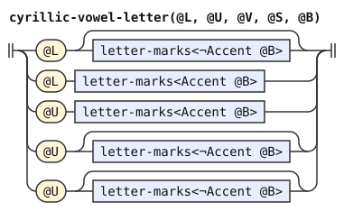
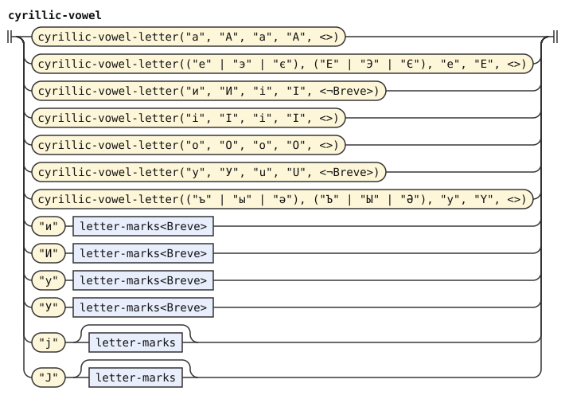
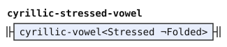
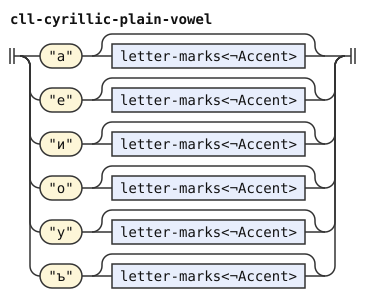

# Cyrillic conventions of the experimental dialect

This document adds to [cyrillic.md](cyrillic.md) and [cyrillic-cll.md](cyrillic-cll.md) the Cyrillic conventions of the [experimental](../dialects/experimental.md) dialect. Only that dialect reads it. It stands right after cyrillic-cll.md, and it restates the letter rules of both documents. [The notation document](../../docs/notation.md) explains the notation.

A Cyrillic letter takes any combining marks after it, as a Latin letter does in [latin-experimental.md](latin-experimental.md). `letter-marks` of that document reads them. An acute or grave accent on a full vowel marks stress, as in cyrillic.md. A breve on `и` or `у` makes the glide, as `й` and `ў` do. Every other mark is ignored.

So `ё` reads as `е` and `ї` as `і`, because a dieresis means nothing here. The Cyrillic orthography already puts an apostrophe between two full vowels, so the Latin meaning of the dieresis has no job. A mark on a consonant is ignored, so `ќ` is `к`. A breve on another vowel is ignored, so `ӑ` is `а`. An accent on a glide is ignored, as on a Latin glide letter.

The Cyrillic glides carry no `Glide` tag, and the word forms find them by position, as they do in bpfk.

`cyrillic-vowel` reads every Cyrillic vowel letter with its marks. Its tags work as those of `latin-vowel`. A capital full vowel without an accent has a stressed and a folded reading. An accented capital has one reading, stressed and `Accented`, which an all-capital run keeps, as "Capital runs" in [latin.md](latin.md) says. The three restated vowel rules take the readings that fit them.

Joined vowels use the same public tags as isolated vowels. The emission filter keeps only `Stressed` and `Syllabic`. Bookkeeping tags stay inside the phoneme stage.

```jbogenbau
%redefine-rule cyrillic-consonant :: ∅
  | ("б" | "Б") [letter-marks] := "b"
  | ("ш" | "Ш" | "щ" | "Щ") [letter-marks] := "c"
  | ("д" | "Д") [letter-marks] := "d"
  | ("ф" | "Ф") [letter-marks] := "f"
  | ("г" | "Г" | "ґ" | "Ґ") [letter-marks] := "g"
  | ("ж" | "Ж") [letter-marks] := "j"
  | ("к" | "К") [letter-marks] := "k"
  | ("л" | "Л") [letter-marks] := "l"
  | ("м" | "М") [letter-marks] := "m"
  | ("н" | "Н") [letter-marks] := "n"
  | ("п" | "П") [letter-marks] := "p"
  | ("р" | "Р") [letter-marks] := "r"
  | ("с" | "С") [letter-marks] := "s"
  | ("т" | "Т") [letter-marks] := "t"
  | ("в" | "В") [letter-marks] := "v"
  | ("х" | "Х") [letter-marks] := "x"
  | ("з" | "З") [letter-marks] := "z"
%emits
  $

%redefine-rule cyrillic-apostrophe
  ("һ" | "Һ") [letter-marks]
%emits
  $ :: ∅ := "'"

%rule cyrillic-vowel-letter(@L, @U, @V, @S, @B) :: Syllabic
  | @L [letter-marks<¬Accent @B>] := @V
  | @L letter-marks<Accent @B> :: Stressed := @S
  | @U letter-marks<Accent @B> :: Stressed Accented := @S
  | @U [letter-marks<¬Accent @B>] :: Stressed Capital := @S
  | @U [letter-marks<¬Accent @B>] :: Folded Capital := @V

%rule cyrillic-vowel :: ($v ⟹ $v.tags)
  | $v:cyrillic-vowel-letter("а", "А", "a", "A", <>)
  | $v:cyrillic-vowel-letter(("е" | "э" | "є"), ("Е" | "Э" | "Є"), "e", "E", <>)
  | $v:cyrillic-vowel-letter("и", "И", "i", "I", <¬Breve>)
  | $v:cyrillic-vowel-letter("і", "І", "i", "I", <>)
  | $v:cyrillic-vowel-letter("о", "О", "o", "O", <>)
  | $v:cyrillic-vowel-letter("у", "У", "u", "U", <¬Breve>)
  | $v:cyrillic-vowel-letter(("ъ" | "ы" | "ә"), ("Ъ" | "Ы" | "Ә"), "y", "Y", <>)
  | "и" letter-marks<Breve> := "i"
  | "И" letter-marks<Breve> :: Capital := "i"
  | "у" letter-marks<Breve> := "u"
  | "У" letter-marks<Breve> :: Capital := "u"
  | "ј" [letter-marks] := "i"
  | "Ј" [letter-marks] :: Capital := "i"
%emits
  $ :: $.tags ∩ (Stressed ∪ Syllabic)

%redefine-rule cyrillic-plain-vowel
  cyrillic-vowel<¬Stressed ¬Folded>

%redefine-rule cyrillic-stressed-vowel
  cyrillic-vowel<Stressed ¬Folded>

%redefine-rule cyrillic-folded-vowel
  cyrillic-vowel<Capital ¬Stressed> | cyrillic-vowel<Accented>

%redefine-rule joined-vowel-with(@V)
  $v:@V :: $v.tags
%emits
  ε :: ∅ := "'", $v :: $v.tags ∩ (Stressed ∪ Syllabic)

```

<details><summary>Railroad diagrams of the 8 rules from <code>cyrillic-consonant</code> to <code>joined-vowel-with</code></summary>
<p></p>
<p></p>
<p></p>
<p></p>
<p></p>
<p></p>
<p></p>
<p></p>
</details>

The Cyrillic of CLL, in [cyrillic-cll.md](cyrillic-cll.md), ignores unknown marks too. It writes a diphthong as two plain vowels, as the Latin orthography does, so it has no glide letters. An accent on a vowel marks stress, as on a Latin vowel. Every other mark is ignored, the breve and the dieresis included. So `май` is `mai`, `мёи` is `mei` and `ма́и` is `mAi`. A capital vowel still marks stress, because this orthography has no all-capital runs.

```jbogenbau
%redefine-rule cll-cyrillic-consonant :: ∅
  | ("б" | "Б") [letter-marks] := "b"
  | ("в" | "В") [letter-marks] := "v"
  | ("г" | "Г") [letter-marks] := "g"
  | ("д" | "Д") [letter-marks] := "d"
  | ("ж" | "Ж") [letter-marks] := "j"
  | ("з" | "З") [letter-marks] := "z"
  | ("к" | "К") [letter-marks] := "k"
  | ("л" | "Л") [letter-marks] := "l"
  | ("м" | "М") [letter-marks] := "m"
  | ("н" | "Н") [letter-marks] := "n"
  | ("п" | "П") [letter-marks] := "p"
  | ("р" | "Р") [letter-marks] := "r"
  | ("с" | "С") [letter-marks] := "s"
  | ("т" | "Т") [letter-marks] := "t"
  | ("ф" | "Ф") [letter-marks] := "f"
  | ("х" | "Х") [letter-marks] := "x"
  | ("ш" | "Ш") [letter-marks] := "c"
%emits
  $

%redefine-rule cll-cyrillic-plain-vowel :: ∅
  | "а" [letter-marks<¬Accent>] := "a"
  | "е" [letter-marks<¬Accent>] := "e"
  | "и" [letter-marks<¬Accent>] := "i"
  | "о" [letter-marks<¬Accent>] := "o"
  | "у" [letter-marks<¬Accent>] := "u"
  | "ъ" [letter-marks<¬Accent>] := "y"
%emits
  $

%redefine-rule cll-cyrillic-stressed-vowel :: Stressed
  | ("а" letter-marks<Accent> | "А" [letter-marks]) := "A"
  | ("е" letter-marks<Accent> | "Е" [letter-marks]) := "E"
  | ("и" letter-marks<Accent> | "И" [letter-marks]) := "I"
  | ("о" letter-marks<Accent> | "О" [letter-marks]) := "O"
  | ("у" letter-marks<Accent> | "У" [letter-marks]) := "U"
  | ("ъ" letter-marks<Accent> | "Ъ" [letter-marks]) := "Y"
%emits
  $
```

<details><summary>Railroad diagrams of the 3 rules from <code>cll-cyrillic-consonant</code> to <code>cll-cyrillic-stressed-vowel</code></summary>
<p></p>
<p></p>
<p></p>
</details>

## Differences from camxes-exp

camxes-exp reads no Cyrillic orthography. These Cyrillic conventions belong to gencmu.

The experimental pipeline inherits the genuine-punctuation boundary from [latin-experimental.md](latin-experimental.md#genuine-punctuation). Non-ASCII numbers remain foreign because numeric characters do not mark word boundaries. Thus `ми½клама` forms one foreign run here, while BPFK reads two words.

The pipeline also inherits silent marks for length or visual separation without new phonemes or word boundaries. Thus `кла~ма` reads as `klama` here. BPFK treats `~` as punctuation and separates the two runs.

Joined vowels retain the apostrophe insertion of cyrillic.md. Their emitted tokens expose only the public vowel tags, as isolated vowels do.
