# Cyrillic orthography

This document adds gencmu's Cyrillic orthography to the phoneme stage, the first stage of the pipeline. It is the default Cyrillic of the dialects of the [BPFK](../dialects/bpfk.md), the Lojban language planning committee, [experimental](../dialects/experimental.md) and [Zantufa](../dialects/zantufa.md). It has no frame of its own. It uses the shared text, pause and run rules. It adds its letters to the rules of [latin-strict.md](latin-strict.md) and [latin.md](latin.md), so a text can mix scripts.

A dialect that lists neither this document nor [cyrillic-cll.md](cyrillic-cll.md) reads a Cyrillic letter as foreign. [The notation document](../../docs/notation.md) explains the notation.

The rules map Cyrillic letters to their Lojban phonemes. The consonant mappings are `ш` for `c`, `ж` for `j`, `х` for `x`, and the others in the obvious ways. `ъ`, the Bulgarian hard sign, is `y`. The rules also accept letters from other Cyrillic alphabets with the same or nearly the same sounds:

- `э` and `є` for `e`
- `і` for `i`
- `ы` and `ә` for `y`
- `щ` for `c`
- `ґ` for `g`
- `ј` for the glide `i`, as `й`
- `ў` and `Ў` for the glide `u`
- `һ` as an explicit apostrophe
- The palochka `ӏ` as a period

```jbogenbau
%rule cyrillic-consonant :: ∅
  | ("б" | "Б") := "b"
  | ("ш" | "Ш" | "щ" | "Щ") := "c"
  | ("д" | "Д") := "d"
  | ("ф" | "Ф") := "f"
  | ("г" | "Г" | "ґ" | "Ґ") := "g"
  | ("ж" | "Ж") := "j"
  | ("к" | "К") := "k"
  | ("л" | "Л") := "l"
  | ("м" | "М") := "m"
  | ("н" | "Н") := "n"
  | ("п" | "П") := "p"
  | ("р" | "Р") := "r"
  | ("с" | "С") := "s"
  | ("т" | "Т") := "t"
  | ("в" | "В") := "v"
  | ("х" | "Х") := "x"
  | ("з" | "З") := "z"
%emits
  $

%rule cyrillic-apostrophe
  ("һ" | "Һ")
%emits
  $ :: ∅ := "'"

%rule cyrillic-period
  "ӏ" | "Ӏ"
```

<details><summary>Railroad diagrams of the 3 rules from <code>cyrillic-consonant</code> to <code>cyrillic-period</code></summary>
<p>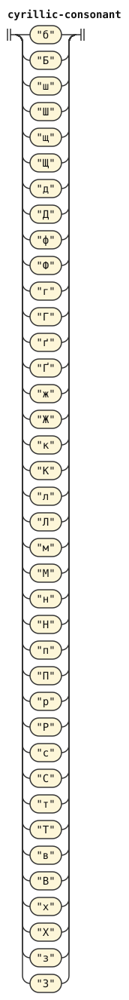</p>
<p>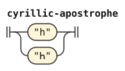</p>
<p>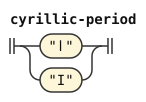</p>
</details>

Two adjacent full Cyrillic vowel letters form two syllables, so `аи` is `a'i`. The orthography writes a diphthong with the short forms `й` and `ў`, so `ай` is `ai`.

So a full vowel letter carries the tag `Syllabic`, which the vowel-group rules of [latin-strict.md](latin-strict.md) read. The stage inserts an apostrophe between adjacent syllabic vowels. `й`, `ј` and `ў`, the glides, carry no such tag, and they join the vowel beside them into a diphthong.

A capital full vowel letter, or a combining accent after one, marks stress, as in Latin. A glide never marks stress, as the Latin `ĭ` of [latin.md](latin.md) does not. The full vowel carries the syllable's stress. So a capital glide is plain, and an accent after a glide makes its run foreign. Inside an all-capital run, the stage folds a capital vowel or glide, that is, it reads the letter as plain. An accented capital keeps its stress there.

```jbogenbau
%rule cyrillic-plain-vowel
  | "а" :: Syllabic := "a"
  | ("е" | "э" | "є") :: Syllabic := "e"
  | ("и" | "і") :: Syllabic := "i"
  | "о" :: Syllabic := "o"
  | "у" :: Syllabic := "u"
  | ("ъ" | "ы" | "ә") :: Syllabic := "y"
  | (("и" | "И") glide-mark | "ј" | "Ј") :: ∅ := "i"
  | ("у" | "У") glide-mark :: ∅ := "u"
%emits
  $

%rule cyrillic-stressed-vowel :: Stressed ∪ Syllabic
  | "А" := "A"
  | ("а" | "А") stress-mark := "A"
  | ("Е" | "Э" | "Є") := "E"
  | ("е" | "э" | "є" | "Е" | "Э" | "Є") stress-mark := "E"
  | ("И" | "І") := "I"
  | ("и" | "і" | "И" | "І") stress-mark := "I"
  | "О" := "O"
  | ("о" | "О") stress-mark := "O"
  | "У" := "U"
  | ("у" | "У") stress-mark := "U"
  | ("Ъ" | "Ы" | "Ә") := "Y"
  | ("ъ" | "ы" | "ә" | "Ъ" | "Ы" | "Ә") stress-mark := "Y"
%emits
  $

%rule cyrillic-folded-vowel
  | "А" :: Syllabic := "a"
  | ("Е" | "Э" | "Є") :: Syllabic := "e"
  | ("И" | "І") :: Syllabic := "i"
  | "О" :: Syllabic := "o"
  | "У" :: Syllabic := "u"
  | ("Ъ" | "Ы" | "Ә") :: Syllabic := "y"
  | ("И" glide-mark | "Ј") :: ∅ := "i"
  | "У" glide-mark :: ∅ := "u"
  | "А" stress-mark :: Stressed ∪ Syllabic := "A"
  | ("Е" | "Э" | "Є") stress-mark :: Stressed ∪ Syllabic := "E"
  | ("И" | "І") stress-mark :: Stressed ∪ Syllabic := "I"
  | "О" stress-mark :: Stressed ∪ Syllabic := "O"
  | "У" stress-mark :: Stressed ∪ Syllabic := "U"
  | ("Ъ" | "Ы" | "Ә") stress-mark :: Stressed ∪ Syllabic := "Y"
%emits
  $
```

<details><summary>Railroad diagrams of the 3 rules from <code>cyrillic-plain-vowel</code> to <code>cyrillic-folded-vowel</code></summary>
<p>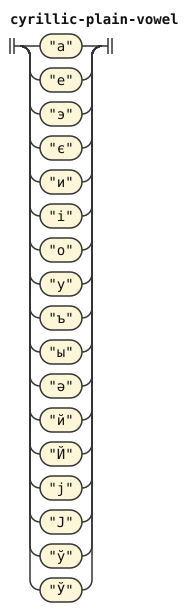</p>
<p>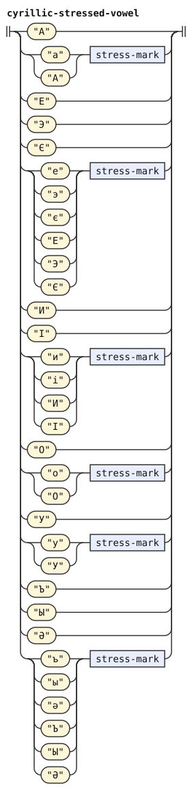</p>
<p>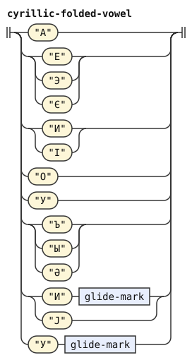</p>
</details>

The feature `cll-cyrillic` selects which Cyrillic rules apply. A feature is a named switch that the grammars test. The letters of this document apply while `cll-cyrillic` is off.

```jbogenbau
%extend-rule consonant
  ¬cll-cyrillic? cyrillic-consonant

%extend-rule apostrophe
  ¬cll-cyrillic? cyrillic-apostrophe

%extend-rule core-char
  ¬cll-cyrillic? cyrillic-period

%extend-rule plain-vowel
  ¬cll-cyrillic? cyrillic-plain-vowel

%extend-rule stressed-vowel
  ¬cll-cyrillic? cyrillic-stressed-vowel

%extend-rule folded-vowel
  ¬cll-cyrillic? cyrillic-folded-vowel
```

<details><summary>Railroad diagrams of the 6 rules from <code>consonant</code> to <code>folded-vowel</code></summary>
<p>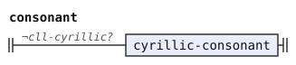</p>
<p>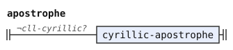</p>
<p>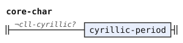</p>
<p>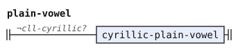</p>
<p>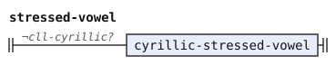</p>
<p>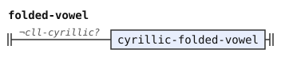</p>
</details>

## Differences from CLL

*The Complete Lojban Language* (CLL) supplies the base consonant mappings and uses `ъ` for `y`.[^cll-s3-12] It does not name the additional Cyrillic letters above. They let writers use letters from their familiar alphabets.

CLL writes diphthongs as vowel pairs, like Latin.[^cll-s3-12] This document instead gives full vowels separate syllables and uses short letters for glides. The same letters therefore need distinct readings in [cyrillic-cll.md](cyrillic-cll.md). The feature `cll-cyrillic` selects between them.

CLL requires only the vowel letter of a stressed syllable to be marked.[^cll-s3-1] This document assigns stress to the full vowel. It accepts capital full vowels and combining accents, but folds capitals inside an all-capital run. Capital glides remain plain, and accented glides make the run foreign.

[^cll-s3-12]: [CLL 1.1, section 3.12](https://lojban.org/publications/cll/cll_v1.1_xhtml-section-chunks/section-oddball-orthographies.html).

[^cll-s3-1]: [CLL 1.1, section 3.1](https://lojban.org/publications/cll/cll_v1.1_xhtml-section-chunks/chapter-phonology.html#section-orthography).
