# Latin conventions of the experimental dialect

This document adds to [latin.md](latin.md) the Latin conventions of the [experimental](../dialects/experimental.md) dialect. Only that dialect reads it. The [BPFK](../dialects/bpfk.md) and [Zantufa](../dialects/zantufa.md) dialects keep the stricter orthography of latin.md. [The notation document](../../docs/notation.md) explains the notation.

The document belongs to the phoneme stage. It stands after latin.md and before the documents of other scripts. It restates some Latin rules, and the script documents then extend them as usual.

Stage zero decomposes every text, so an accented letter arrives as its base letter and its combining marks. The conventions are these:

- Genuine punctuation is a word break. Other numbers, controls, private-use and unassigned characters make their run foreign. Format characters follow latin.md: U+200B and the visible number signs are word breaks, and the others are nothing.
- A straight or curly quotation mark, a backtick or a spacing acute accent is an apostrophe between letters and punctuation at a word edge.
- A length mark, such as `~`, and the middle dot `·` are ignored wherever they stand.
- An acute or grave accent marks stress. A dieresis on a vowel means an apostrophe before it.
- `ɩ` and `q` write the i-glide, and `w` writes the u-glide. A breve on `i` or `u` writes a glide too. These glide letters are glides wherever they stand.
- Krulermorna is a Lojban spelling system. Its letters `ą`, `ę`, `ǫ`, `ǎ` and `ꜷ` write the diphthongs ai, ei, oi and au.
- Every other combining mark on a Latin letter is accepted and ignored.
- Text in another script stays foreign.

## Genuine punctuation

Genuine punctuation is a word break: a character of Unicode category P, punctuation, or S, symbol, that no letter rule reads. The marks after it belong to it. latin.md finds punctuation by exclusion, so numbers and other characters count as punctuation there. This document excludes them too.

So a number other than an ASCII digit makes its run foreign. A control character other than white space, a private-use character and an unassigned code point do the same. The zbalermorna characters stay letters and marks of their script.

latin.md reads a format character as nothing, as a comma, with two exceptions. The zero-width space U+200B and the visible number signs of Arabic, Syriac and Kaithi are word breaks there. This document keeps that rule, so it leaves category Cf out of the excluded classes. Those exceptions then stay word breaks, although they are format characters and not genuine punctuation of category P or S.

```jbogenbau
%extend-rule non-punctuation-char
  _General_Category_Number | _General_Category_Control
  | _General_Category_Private_Use | _General_Category_Unassigned
```

<details><summary>Railroad diagram of <code>non-punctuation-char</code></summary>
<p>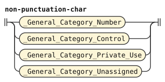</p>
</details>

## Quotation marks

Some keyboards type a curly mark, a backtick or a spacing acute accent for `'`. Texts also put these marks around words.

The straight `'`, curly `‘` and `’`, backtick and spacing acute accent serve as apostrophes between letters. At a word edge, a mark is punctuation because one side has no letter. The word forms judge an interior apostrophe as they judge `k'a`. So `‘klama’` and `'klama'` are `klama`, `mi 'klama' do` is three words, and `la’o` and `la'o` keep their apostrophe.

The backtick is U+0060 GRAVE ACCENT. The spacing acute accent is U+00B4 ACUTE ACCENT. The combining grave accent U+0300 is a stress mark on its letter. The combining acute accent U+0301 also marks stress.

latin-strict.md reads straight and curly quotation marks as apostrophes. This document removes them from `apostrophe`, so they are punctuation by default. The backtick and spacing acute accent also default to punctuation. `inner-quote-mark` reads one where a letter follows it, after any ignored characters. `inner-apostrophe` emits such a mark as the apostrophe of an ordinary or capital run. A foreign run holds it through the extensions of `lojban-chars` and `chars-with-non-lojban-char`, as [latin.md](latin.md) lets a foreign run hold a decimal point.

A letter is a character of category L that is neither ignored nor a script period. `quote-letter` reads one letter. `misplaced-quote` tests the tokens of the run before each quotation mark with `.ends(letter-final)`. The suffix must be a letter, its combining marks, and any ignored characters. A mark at the start of a run has no such suffix. A combining mark after an ignored character belongs to no letter and fails this test.

`letters`, `capital-run` and `non-lojban-char-run` reject runs that match `misplaced-quote`. On the left, `letter-final` skips the combining marks of a letter, so a marked letter counts: `lé'i` keeps its apostrophe. `letter-final` on the left and `letter-after-ignored` on the right both skip ignored characters. These are commas, format characters and silent marks.

The silent-mark rules ignore `ー`, although its Lm category is a letter category. A zbalermorna letter has private use and fails the category test. zbalermorna writes its own apostrophe.

Between two letters, a mark has two readings: in one run, or as a pause between two runs. The redefined `run` refuses the second. A run that ends in a letter, with its marks and any ignored characters, cannot stop before an inner quotation mark. `letter-final` tests the run's own end with `ends`, and `quote-after-ignored` looks ahead with `following-tokens`. So the reading with the mark inside the run is the only one, and the phoneme stage stays `unique`.

```jbogenbau
%redefine-rule apostrophe
  | "ʼ" [letter-marks]
  | ("h" | "H") [letter-marks]
%emits
  $ :: ∅ := "'"

%rule quote-mark
  "'" | "’" | "‘" | "`" | "´"

%rule inner-quote-mark
  $q:quote-mark
%conditions
  $q.following-tokens.begins(letter-after-ignored)

%rule inner-apostrophe
  inner-quote-mark
%emits
  $ :: ∅ := "'"

%extend-rule non-vowel
  inner-apostrophe

%extend-rule capital-non-vowel
  inner-apostrophe

%redefine-rule letters
  letters-after-consonant | letters-after-vowel
%conditions
  ¬$.matches(misplaced-quote)

%redefine-rule capital-run
  capital-shape
%conditions
  ¬$.matches(misplaced-quote)

%extend-rule lojban-chars
  lojban-chars inner-quote-mark lojban-char

%extend-rule chars-with-non-lojban-char
  | lojban-chars inner-quote-mark non-lojban-char
  | chars-with-non-lojban-char inner-quote-mark run-char

%rule misplaced-quote
  [{_}] $q:quote-mark [{_}]
%conditions
  ¬$q.preceding-tokens.ends(letter-final)

%rule quote-letter
  $a:alpha-char
%conditions
  ¬$a.matches(ignored | period-char)

%rule letter-after-ignored
  [{ignored}] quote-letter

%rule ignored
  $c:_
%conditions
  $c.matches(comma)

%redefine-rule run
  $r:any-run
%conditions
  ¬$r.ends(letter-final) ∨ ¬$r.following-tokens.begins(quote-after-ignored)

%rule quote-after-ignored
  [{ignored}] inner-quote-mark

%rule any-run
  ordinary-run | non-lojban-char-run | capital-run

%rule letter-final
  quote-letter [{combining-mark}] [{ignored}]
```

<details><summary>Railroad diagrams of the 18 rules from <code>apostrophe</code> to <code>letter-final</code></summary>
<p>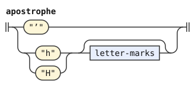</p>
<p>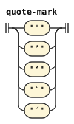</p>
<p>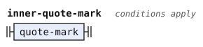</p>
<p>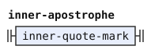</p>
<p>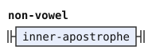</p>
<p>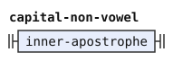</p>
<p>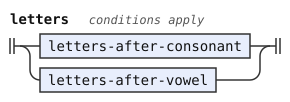</p>
<p>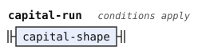</p>
<p>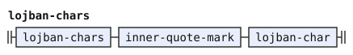</p>
<p>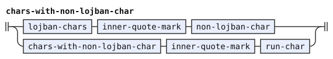</p>
<p>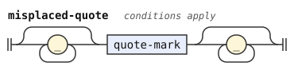</p>
<p>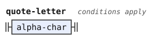</p>
<p>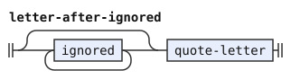</p>
<p>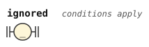</p>
<p>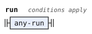</p>
<p>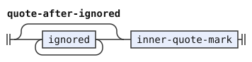</p>
<p>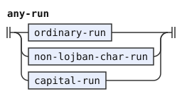</p>
<p>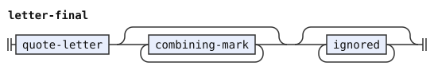</p>
</details>

`apostrophe` keeps `h`, which latin.md adds. Both `h` and the modifier apostrophe U+02BC take following combining marks. `run` keeps the three kinds of run, the capital run of latin.md included.

So a mark that touches a digit, another quotation mark, a stray combining mark or the run's edge has only its punctuation reading. `mi''do` is `mi do`, and `mi'` followed by U+0301 is `mi`, because punctuation takes the marks after it. U+0301 followed by `'a` gives a foreign run of the mark, a pause and `a`. `zoi gy. ß'a .gy.` quotes the one foreign run `ß'a`, and `zo'oibrodaß` stays one foreign run. `zoi gy. ß'٣ .gy.` splits at the mark, because `٣` is no letter.

The Cyrillic orthographies use the same apostrophe characters. The default Cyrillic reads `'мои'` as `mo'i`. With `cll-cyrillic`, it reads as `moi`.

## Length marks and the middle dot

A length mark and the middle dot `·` U+00B7 are silent marks. They contribute no phoneme and never break a word. So `bro~da` is `broda`, and `gen·cmu` is `gencmu`.

Only U+00B7 is a silent mark among the dots. The Greek ano teleia U+0387 decomposes canonically to U+00B7, so stage zero makes it the same character, and `gen`U+0387`cmu` is `gencmu` too. The katakana middle dot `・` U+30FB, the hyphenation point `‧` U+2027, the bullet operator `∙` U+2219 and the dot operator `⋅` U+22C5 stay punctuation.

The combining tilde U+0303 is a mark, so `letter-marks` already ignores it on a Latin letter.

`silent-mark` extends `comma`, so a silent mark reads wherever a comma reads. Between letters it is nothing, so `gen·cmu` is `gencmu` and `ke·lo·ri` is `kelori`, three cmavo. Between two vowels it joins them into one vowel group, as a comma does in latin.md, so `ja~i` is `jai`.

A separate ignored stretch between quiet pauses becomes a `Quote-Material` token. The same holds at the text end after a quiet pause. Ignored-only edges beside words belong to no token. A raw quote body keeps both kinds of text ([stream.md](../words/stream.md)).

So `mi · klama` is `mi klama`, and `zoi gy. ~~ .gy.` quotes `~~`.

A text of only silent marks is an empty text.

A silent mark also stands where a comma stands next to a decimal point. So `2~.3` has a pause, as `2,.3` does. The pause comes from the period, not from the mark.

A combining mark after a silent mark has no letter, so it makes its run foreign, as after a comma. Writers put an accent on the vowel, as in `bró~da` and `bró·da`, which are `brOda`.

A silent mark beside a quotation mark is skipped by the neighbor test of "Quotation marks", so `ko~'a` and `ko·'a` are `ko'a`.

`any-lojban-char` reads a comma, so a silent mark inside a foreign run belongs to the run. A foreign run never begins or ends with a comma or a silent mark. At an ignored-only edge beside a word, a mark belongs to no token. A material stretch with punctuation keeps its marks. Thus the foreign run of `クリボー` has image `クリボ`.

The run's image is its source text. A quote body keeps its verbatim text, so `zoi gy. クリボー .gy.` still shows `クリボー`.

```jbogenbau
%extend-rule comma
  silent-mark

%rule silent-mark
  "~" | "～" | "〜" | "ー" | "ｰ" | "·"

%redefine-rule non-lojban-char-run
  $r:chars-with-non-lojban-char
%conditions
  ¬$r.matches(letters | misplaced-quote),
  ¬$r.first-token.matches(comma),
  ¬$r.last-token.matches(comma)
%emits
  $ :: FOREIGN :- $.source-text
```

<details><summary>Railroad diagrams of <code>comma</code>, <code>silent-mark</code> and <code>non-lojban-char-run</code></summary>
<p>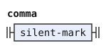</p>
<p>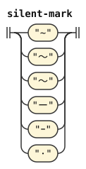</p>
<p>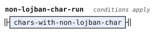</p>
</details>

The conditions on the run's edges are those of latin-strict.md, so each edge has one reading. `ア〜` is the foreign run `ア`, with the mark in no token. `ーß` is the foreign run `ß`, with the mark in no token. A run of Latin letters with a silent mark at its edge has no foreign reading either. So `klạmaー` is `klama`. The redefinition only adds `misplaced-quote` to the conditions of latin-strict.md.

bpfk and Zantufa keep `~`, `～`, `〜` and `·` as pauses. So `bro~da` and `gen·cmu` are two runs each there, and the words stage rejects them. Their `ー` and `ｰ` are letters of another script, so they make a run foreign.

## Marks

`letter-marks` reads the marks after a Latin or Cyrillic letter. A mark that can change a reading carries a tag. `Accent` marks an acute or grave accent. `Breve`, `Dieresis`, `Ogonek` and `Caron` name the others. Every other mark carries none. A run of marks has the tags of all its marks.

Stage zero sorts each uninterrupted run of marks of nonzero combining class by class. Within such a run, an ogonek comes before an accent, while an accent and a caron keep their written order. A mark of class zero, such as the grapheme joiner U+034F or U+093E, interrupts the run, and no mark moves across it. So in `a` U+0301 U+034F U+0328 the ogonek stays after the accent. The rules test only which tags a run has, so the order never matters.

A letter rule tests only the marks that mean something on its letter. Any other mark is ignored. So a breve on `a` and an ogonek on `i` change nothing. `named-mark` lists the five meaningful marks with their tags once. `letter-mark` reads a named mark, which keeps its tags, or any other combining mark with no tag.

```jbogenbau
%rule letter-marks
  | $m:letter-mark :: $m.tags
  | $l:letter-marks $m:letter-mark :: $l.tags ∪ $m.tags

%rule letter-mark
  | named-mark
  | $m:combining-mark :: ∅
%conditions
  ¬$m.matches(named-mark)

%rule named-mark
  | stress-mark :: Accent
  | glide-mark :: Breve
  | "‹U+0308›" :: Dieresis
  | "‹U+0328›" :: Ogonek
  | "‹U+030C›" :: Caron
```

<details><summary>Railroad diagrams of <code>letter-marks</code>, <code>letter-mark</code> and <code>named-mark</code></summary>
<p>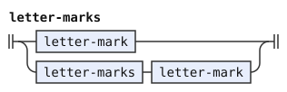</p>
<p>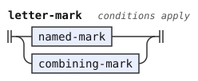</p>
<p>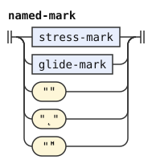</p>
</details>

## Consonants and h

A Latin consonant takes any marks and ignores them, and so does `h`, the apostrophe (see "Quotation marks"). So `ć` is `c` and `ŝ` is `s`.

```jbogenbau
%redefine-rule consonant :: ∅
  | ("b" | "B") [letter-marks] := "b"
  | ("c" | "C") [letter-marks] := "c"
  | ("d" | "D") [letter-marks] := "d"
  | ("f" | "F") [letter-marks] := "f"
  | ("g" | "G") [letter-marks] := "g"
  | ("j" | "J") [letter-marks] := "j"
  | ("k" | "K") [letter-marks] := "k"
  | ("l" | "L") [letter-marks] := "l"
  | ("m" | "M") [letter-marks] := "m"
  | ("n" | "N") [letter-marks] := "n"
  | ("p" | "P") [letter-marks] := "p"
  | ("r" | "R") [letter-marks] := "r"
  | ("s" | "S") [letter-marks] := "s"
  | ("t" | "T") [letter-marks] := "t"
  | ("v" | "V") [letter-marks] := "v"
  | ("x" | "X") [letter-marks] := "x"
  | ("z" | "Z") [letter-marks] := "z"
%emits
  $
```

<details><summary>Railroad diagram of <code>consonant</code></summary>
<p>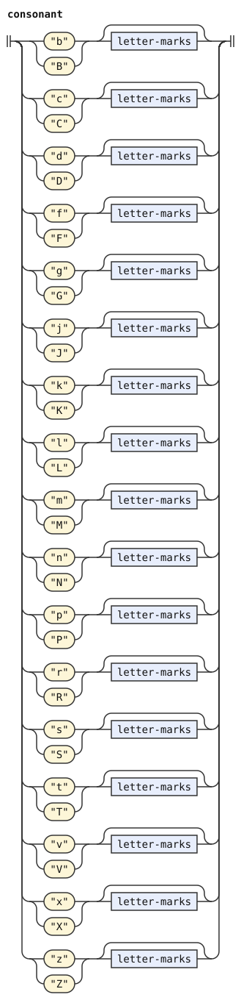</p>
</details>

## Vowels

`latin-vowel` reads one Latin vowel letter with marks that leave it one vowel. Its tags name each reading for the rules that use it:

- `Stressed`: An accent stresses the vowel, or a capital does outside an all-capital run.
- `Capital`: The letter is a capital.
- `Accented`: The letter is a capital with an accent. An all-capital run keeps its stress, as "Capital runs" in latin.md says.
- `Folded`: This is the plain reading of a capital in an all-capital run.
- `Dieresis`: The marks include a dieresis.
- `Glide`: The letter is a glide letter. The emitted token keeps this tag for the forms stage.
- `Onglide`: The glide letter writes only a glide before its vowel. The emitted token keeps this tag too.

A capital without an accent has two readings. One is stressed, for an ordinary run, and one is folded, for an all-capital run. A capital with an accent has one reading, stressed and `Accented`, which both kinds of run take. `plain-vowel`, `stressed-vowel` and `folded-vowel` each take the readings that fit them. A dieresis vowel starts a vowel group of its own, so those three rules leave it out.

A breve on `i` or `u` makes a glide letter, which the next section reads. The vowel emits itself, with `Stressed` where it is stressed and `Glide` where it is a glide letter.

```jbogenbau
%rule latin-vowel :: ($m ⟹ $m.tags ∩ Dieresis)
  | "a" [$m:letter-marks<¬Accent ¬Ogonek ¬Caron>] := "a"
  | "a" $m:letter-marks<Accent ¬Ogonek ¬Caron> :: Stressed := "a" :- "A"
  | "A" $m:letter-marks<Accent ¬Ogonek ¬Caron> :: Stressed Capital Accented := "a" :- "A"
  | "A" [$m:letter-marks<¬Accent ¬Ogonek ¬Caron>] :: Stressed Capital := "a" :- "A"
  | "A" [$m:letter-marks<¬Accent ¬Ogonek ¬Caron>] :: Folded Capital := "a"
  | "e" [$m:letter-marks<¬Accent ¬Ogonek>] := "e"
  | "e" $m:letter-marks<Accent ¬Ogonek> :: Stressed := "e" :- "E"
  | "E" $m:letter-marks<Accent ¬Ogonek> :: Stressed Capital Accented := "e" :- "E"
  | "E" [$m:letter-marks<¬Accent ¬Ogonek>] :: Stressed Capital := "e" :- "E"
  | "E" [$m:letter-marks<¬Accent ¬Ogonek>] :: Folded Capital := "e"
  | "i" [$m:letter-marks<¬Accent ¬Breve>] := "i"
  | "i" $m:letter-marks<Accent ¬Breve> :: Stressed := "i" :- "I"
  | "I" $m:letter-marks<Accent ¬Breve> :: Stressed Capital Accented := "i" :- "I"
  | "I" [$m:letter-marks<¬Accent ¬Breve>] :: Stressed Capital := "i" :- "I"
  | "I" [$m:letter-marks<¬Accent ¬Breve>] :: Folded Capital := "i"
  | "o" [$m:letter-marks<¬Accent ¬Ogonek>] := "o"
  | "o" $m:letter-marks<Accent ¬Ogonek> :: Stressed := "o" :- "O"
  | "O" $m:letter-marks<Accent ¬Ogonek> :: Stressed Capital Accented := "o" :- "O"
  | "O" [$m:letter-marks<¬Accent ¬Ogonek>] :: Stressed Capital := "o" :- "O"
  | "O" [$m:letter-marks<¬Accent ¬Ogonek>] :: Folded Capital := "o"
  | "u" [$m:letter-marks<¬Accent ¬Breve>] := "u"
  | "u" $m:letter-marks<Accent ¬Breve> :: Stressed := "u" :- "U"
  | "U" $m:letter-marks<Accent ¬Breve> :: Stressed Capital Accented := "u" :- "U"
  | "U" [$m:letter-marks<¬Accent ¬Breve>] :: Stressed Capital := "u" :- "U"
  | "U" [$m:letter-marks<¬Accent ¬Breve>] :: Folded Capital := "u"
  | "y" [$m:letter-marks<¬Accent>] := "y"
  | "y" $m:letter-marks<Accent> :: Stressed := "y" :- "Y"
  | "Y" $m:letter-marks<Accent> :: Stressed Capital Accented := "y" :- "Y"
  | "Y" [$m:letter-marks<¬Accent>] :: Stressed Capital := "y" :- "Y"
  | "Y" [$m:letter-marks<¬Accent>] :: Folded Capital := "y"
  | $g:glide-letter :: $g.tags
%emits
  $ :: $.tags ∩ (Stressed ∪ Glide ∪ Onglide)

%redefine-rule plain-vowel :: ∅
  | latin-vowel<¬Stressed ¬Folded ¬Dieresis>

%redefine-rule stressed-vowel :: Stressed
  | latin-vowel<Stressed ¬Folded ¬Dieresis>

%redefine-rule folded-vowel :: ∅
  | latin-vowel<Capital ¬Stressed ¬Dieresis> | latin-vowel<Accented ¬Dieresis>
  | latin-diphthong-i<Capital ¬Stressed ¬Dieresis> | latin-diphthong-i<Accented ¬Dieresis>
  | latin-diphthong-u<Capital ¬Stressed ¬Dieresis> | latin-diphthong-u<Accented ¬Dieresis>
```

<details><summary>Railroad diagrams of the 4 rules from <code>latin-vowel</code> to <code>folded-vowel</code></summary>
<p>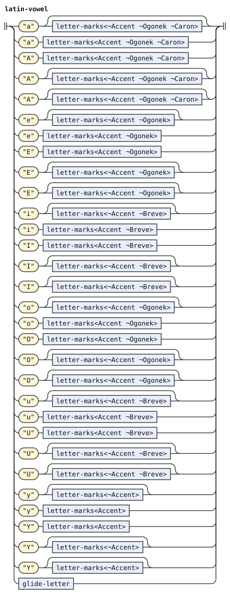</p>
<p>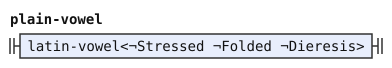</p>
<p>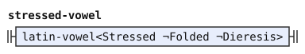</p>
<p>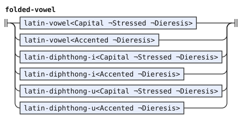</p>
</details>

The three restated rules have no `%emits`. Their walk reaches `latin-vowel`, which emits. The Cyrillic and zbalermorna extensions keep their own emissions.

## Glide letters

`ɩ` and `q` write the i-glide, and `w` writes the u-glide. `q` comes from the zbalermorna keyboard layout, and `ɩ` and `w` from krulermorna. Their capitals are `Ɩ`, the Unicode capital of `ɩ`, `Q` and `W`. A breve on `i` or `u`, in either case, also makes a glide letter: `ĭ`, `ŭ`, `Ĭ` and `Ŭ`.

A glide letter is a glide wherever it stands. This stage reads it as `i` or `u` with the tag `Glide`, and it does not test what follows. The forms stage decides whether a glide can stand there, by the glide rules of the word forms ([experimental.md](../words/experimental.md)). So `wa` is `ua`, while `mɩ` reads as the phonemes `m` and a glide `i`, which divide into no words.

`ɩ`, `q` and `w` also carry `Onglide`. krulermorna writes an offglide with a diphthong letter, so these letters write only a glide before a vowel, and `kaw` divides into no words. A breve glide carries no `Onglide`, so it can also end a diphthong: `maĭ` is `mai`.

A capital glide letter is plain. A glide is never stressed, so an accent on a glide letter is ignored: `ĭ́` is the glide `i`.

```jbogenbau
%rule glide-letter :: Glide ∪ ($m ⟹ $m.tags ∩ Dieresis)
  | ("ɩ" | "q") [$m:letter-marks] :: Onglide := "i"
  | ("Ɩ" | "Q") [$m:letter-marks] :: Onglide Capital := "i"
  | "w" [$m:letter-marks] :: Onglide := "u"
  | "W" [$m:letter-marks] :: Onglide Capital := "u"
  | "i" $m:letter-marks<Breve> := "i"
  | "I" $m:letter-marks<Breve> :: Capital := "i"
  | "u" $m:letter-marks<Breve> := "u"
  | "U" $m:letter-marks<Breve> :: Capital := "u"
```

<details><summary>Railroad diagram of <code>glide-letter</code></summary>
<p>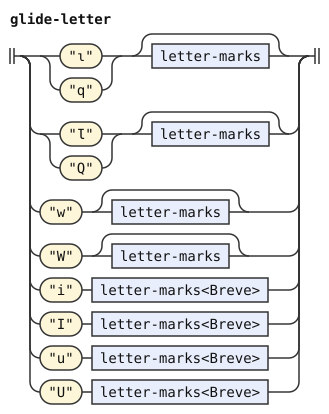</p>
</details>

`plain-vowel` reads a glide letter alone, so `any-lojban-char` reads it too. A glide letter therefore never makes its run foreign. A glide letter takes any marks, as other letters do. An accent on it changes nothing, and so does a breve on `ɩ`, `q` or `w`. A dieresis on it inserts an apostrophe before it, as on any vowel letter, so `ẅa` is `'ua`.

## Diphthong letters

krulermorna writes a diphthong with one letter: `ą` for ai, `ę` for ei, `ǫ` for oi, and `ǎ` for au. Its vlipa variant writes au as `ꜷ` U+A737, with the capital `Ꜷ` U+A736. Stage zero gives `ą` as `a` and an ogonek, and `ǎ` as `a` and a caron. `ꜷ` has no decomposition.

A diphthong letter stands where a vowel stands and gives two phonemes. The first covers the letter and its marks. The second is inserted after it, with empty source and text.

An accent stresses the first vowel, so `ą́` has image `Ai`. A capital marks stress outside an all-capital run. An accented capital diphthong letter is `Accented`, as a vowel is, and stays stressed in an all-capital run. Only the first token carries `Stressed`, as for zbalermorna.

An ogonek and a caron together on `a` give no reading, so the run is foreign. On `e` and `o`, the ogonek forms the diphthong and the caron is ignored.

```jbogenbau
%rule latin-diphthong-i :: ($m ⟹ $m.tags ∩ Dieresis)
  | "a" $m:letter-marks<Ogonek ¬Accent ¬Caron> := "a"
  | "a" $m:letter-marks<Ogonek Accent ¬Caron> :: Stressed := "a" :- "A"
  | "A" $m:letter-marks<Ogonek Accent ¬Caron> :: Stressed Capital Accented := "a" :- "A"
  | "A" $m:letter-marks<Ogonek ¬Accent ¬Caron> :: Stressed Capital := "a" :- "A"
  | "A" $m:letter-marks<Ogonek ¬Accent ¬Caron> :: Folded Capital := "a"
  | "e" $m:letter-marks<Ogonek ¬Accent> := "e"
  | "e" $m:letter-marks<Ogonek Accent> :: Stressed := "e" :- "E"
  | "E" $m:letter-marks<Ogonek Accent> :: Stressed Capital Accented := "e" :- "E"
  | "E" $m:letter-marks<Ogonek ¬Accent> :: Stressed Capital := "e" :- "E"
  | "E" $m:letter-marks<Ogonek ¬Accent> :: Folded Capital := "e"
  | "o" $m:letter-marks<Ogonek ¬Accent> := "o"
  | "o" $m:letter-marks<Ogonek Accent> :: Stressed := "o" :- "O"
  | "O" $m:letter-marks<Ogonek Accent> :: Stressed Capital Accented := "o" :- "O"
  | "O" $m:letter-marks<Ogonek ¬Accent> :: Stressed Capital := "o" :- "O"
  | "O" $m:letter-marks<Ogonek ¬Accent> :: Folded Capital := "o"
%emits
  $ :: $.tags ∩ Stressed, ε :: ∅ := "i"

%rule latin-diphthong-u :: ($m ⟹ $m.tags ∩ Dieresis)
  | "a" $m:letter-marks<Caron ¬Accent ¬Ogonek> := "a"
  | "a" $m:letter-marks<Caron Accent ¬Ogonek> :: Stressed := "a" :- "A"
  | "A" $m:letter-marks<Caron Accent ¬Ogonek> :: Stressed Capital Accented := "a" :- "A"
  | "A" $m:letter-marks<Caron ¬Accent ¬Ogonek> :: Stressed Capital := "a" :- "A"
  | "A" $m:letter-marks<Caron ¬Accent ¬Ogonek> :: Folded Capital := "a"
  | "ꜷ" [$m:letter-marks<¬Accent>] := "a"
  | "ꜷ" $m:letter-marks<Accent> :: Stressed := "a" :- "A"
  | "Ꜷ" $m:letter-marks<Accent> :: Stressed Capital Accented := "a" :- "A"
  | "Ꜷ" [$m:letter-marks<¬Accent>] :: Stressed Capital := "a" :- "A"
  | "Ꜷ" [$m:letter-marks<¬Accent>] :: Folded Capital := "a"
%emits
  $ :: $.tags ∩ Stressed, ε :: ∅ := "u"

%extend-rule vowel
  latin-diphthong-i<¬Folded ¬Dieresis> | latin-diphthong-u<¬Folded ¬Dieresis>

%extend-rule any-lojban-char
  latin-diphthong-u
```

<details><summary>Railroad diagrams of the 4 rules from <code>latin-diphthong-i</code> to <code>any-lojban-char</code></summary>
<p>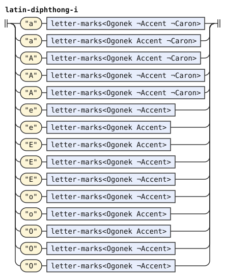</p>
<p>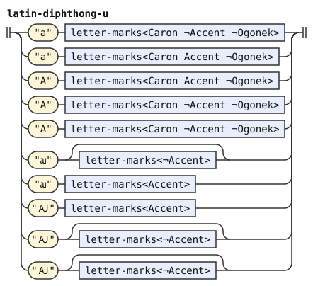</p>
<p>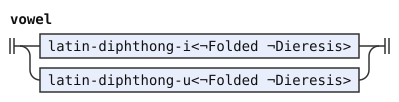</p>
<p>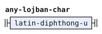</p>
</details>

`any-lojban-char` gains `latin-diphthong-u` for `ꜷ` and `Ꜷ`, the only diphthong letters that are single characters. The others are a vowel and a mark, and `letters` reads them.

## The dieresis

A dieresis on a vowel letter means an apostrophe before it, as in an orthography without apostrophes. So `aï` is `a'i`, and `uï` is `u'i`. The apostrophe ends the vowel group before it, so the vowel with the dieresis starts a new group.

`dieresis-start` inserts the apostrophe and then reads the vowel. It works for every vowel letter: plain, stressed, capital, glide and diphthong letters. A vowel group can begin with it, and such a group can follow another vowel group. At the start of a run, `ïa` gives `'ia`, which the word forms reject, as they reject `hia`.

```jbogenbau
%rule dieresis-apostrophe
  ε
%emits
  ε :: ∅ := "'"

%rule dieresis-start
  dieresis-apostrophe dieresis-letter

%rule dieresis-letter
  | latin-vowel<Dieresis ¬Folded> | latin-diphthong-i<Dieresis ¬Folded>
  | latin-diphthong-u<Dieresis ¬Folded>

%extend-rule vowel-group
  dieresis-start

%extend-rule letters-after-vowel
  letters-after-vowel [commas] $g:vowel-group
%conditions
  $g.begins(dieresis-start)
```

<details><summary>Railroad diagrams of the 5 rules from <code>dieresis-apostrophe</code> to <code>letters-after-vowel</code></summary>
<p>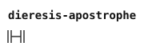</p>
<p>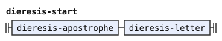</p>
<p>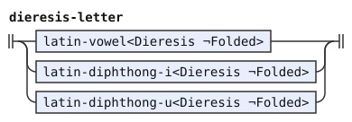</p>
<p>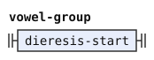</p>
<p>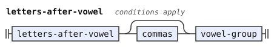</p>
</details>

The extension of `letters-after-vowel` lets a group follow a vowel group only where it starts with a dieresis. Two vowels without one still form one group, as in latin.md.

## All-capital runs

An all-capital run reads its capitals as plain vowels, as latin.md says. Capital glides, capital diphthong letters and capital dieresis vowels fold too, through `folded-vowel` and the rules below. A dieresis vowel starts a new group there as well, so `AÏ` has two vowel groups and folds to `a'i`.

An accented capital keeps its stress in an all-capital run, as latin.md says, and the other capitals still fold. So `KLÁMA` is `klAma`, `ĄKLÁMA` is `ai klAma`, and `AḮ` is `a'I`. A lowercase vowel letter keeps the run ordinary, and that includes a lowercase glide letter.

```jbogenbau
%rule folded-dieresis-start
  dieresis-apostrophe folded-dieresis-letter

%rule folded-dieresis-letter
  | latin-vowel<Dieresis Capital ¬Stressed> | latin-vowel<Dieresis Accented>
  | latin-diphthong-i<Dieresis Capital ¬Stressed> | latin-diphthong-i<Dieresis Accented>
  | latin-diphthong-u<Dieresis Capital ¬Stressed> | latin-diphthong-u<Dieresis Accented>

%extend-rule folded-vowel-group
  folded-dieresis-start

%extend-rule capital-groups
  | folded-vowel-group [commas] $g:folded-vowel-group
  | capital-groups [commas] $h:folded-vowel-group
%conditions
  $g.begins(folded-dieresis-start),
  $h.begins(folded-dieresis-start)
```

<details><summary>Railroad diagrams of the 4 rules from <code>folded-dieresis-start</code> to <code>capital-groups</code></summary>
<p>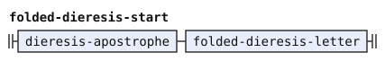</p>
<p>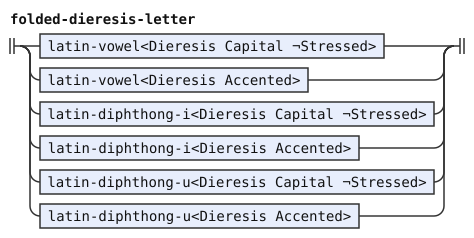</p>
<p>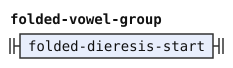</p>
<p>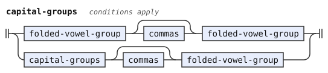</p>
</details>

## Differences from CLL and camxes-exp

CLL describes none of these conventions. camxes-exp, the baseline of the experimental syntax, reads none of these letters and marks. It also treats only some punctuation as a pause. The dialect does not follow camxes-exp on punctuation or diacritics. It reads what written Lojban means.

The shared Latin rules treat non-ASCII numbers as punctuation. This layer excludes them because numeric characters do not mark word boundaries. Thus `mi½klama` forms one foreign run instead of the two words that BPFK reads.

Silent marks show length or visual separation without adding phonemes or word boundaries. Thus `bro~da` forms one word here. BPFK instead treats `~` as punctuation and separates `bro` from `da`.

Neither CLL nor camxes-exp defines the contextual apostrophe use of U+0060 or U+00B4. The experimental dialect accepts these keyboard spellings between letters and treats either mark as punctuation at a word edge. The neighbor rules treat them like straight and curly quotation marks. They apply across ignored characters and in foreign and capital runs.

krulermorna marks syllables with its letters. This stage reads the phonemes that the letters stand for, and the word forms divide them by their own rules.
