# The Latin orthography of CLL

This document opens the phoneme stage for the Latin orthography of *The Complete Lojban Language* (CLL). A stage is one step of a pipeline, with its own grammar. Each stage reads what the stage before it emits.

A token is one unit that a stage reads or emits. A token's value is the string that exact comparisons read. Its image is the string that people see.

The phoneme stage is the first stage of every Lojban dialect. The bundled dialects are [CLL](../dialects/cll-ebnf.md), [BPFK](../dialects/bpfk.md), [experimental](../dialects/experimental.md), [Zantufa](../dialects/zantufa.md), and [Kihei](../dialects/kihei.md). BPFK is the Lojban language planning committee. The stage reads the characters of a text and hands the forms stage the phoneme tokens they stand for.

This document reads the Latin orthography of CLL[^cll-c3], with the [choices below](#choices-beyond-cll). The CLL dialect adds only the Cyrillic of CLL[^cll-s3-12], in [cyrillic-cll.md](cyrillic-cll.md). A feature is a named switch that the grammars test. The CLL dialect turns the `cll-cyrillic` feature on by default. The other dialects include that document but turn its feature off by default.

Those dialects also add the conventions of [latin.md](latin.md), such as digits and accents, and the scripts of [cyrillic.md](cyrillic.md) and [zbalermorna.md](zbalermorna.md). [The notation document](../../docs/notation.md) explains the notation.

The terminals of the stage are exact strings, such as `"a"`, scalar ranges, such as `"0".."9"`, and stored Unicode tags, such as `_White_Space`. A string terminal tests its value. An engine-tag terminal tests a tag stored at stage zero. The wildcard `_` reads any token.

The stage emits phoneme values and images for every script. A tag marks a token by an identifier. Consonant and vowel values are lowercase. A stressed vowel carries `Stressed`, and its image shows the stress as a capital vowel. The forms stage receives these values, images, and tags directly.

The phoneme values are the letters of CLL[^cll-c3]:

- The consonants `"b"`, `"c"`, `"d"` and so on through `"z"`
- The vowels `"a"`, `"e"`, `"i"`, `"o"`, `"u"`, `"y"`, with `Stressed` when stressed
- The apostrophe `"'"`
- The syllable comma, with empty value, image `","`, and tag `Syllable-Break`

In cll-ebnf, a comma run emits one token with empty value, image `,`, and tag `Syllable-Break`. Forms tests syllable boundaries through that tag. The other Lojban dialects discard commas through [latin.md](latin.md#the-comma). Every Lojban dialect retains stress tags for forms.

In this strict reading, `PAUSE` marks a pause of any length, with value and image `" "`. The [Latin conventions](latin.md) replace this pause representation. `FOREIGN` marks a run that the pipeline cannot read as words. Here, that run contains a character outside the orthography. The forms stage passes it on, and the words stage admits it only inside a foreign quote or after `fa'o`.

## The text and its runs

The text is pauses and runs. A period or whitespace marks a pause, and a space always ends a word.

A run is what stands between two pauses. It is an ordinary run of letters, or a foreign run. The stage is greedy. Where two parses differ, the stage takes the one that reads the next character over the one that closes a constituent. A constituent is a part of the text that one rule matched. So the stage never cuts a run short where a rule lets it continue.

```jbogenbau
%ambiguity-resolution greedy
```

```jbogenbau
%rule text
  ε | pause | commas | [edge-pause] items [edge-pause]

%rule edge-pause
  spaced-pause | pause-edge

%rule items
  run | items pause run

%rule run
  ordinary-run | non-lojban-char-run
```

<details><summary>Railroad diagrams of <code>text</code>, <code>edge-pause</code>, <code>items</code> and <code>run</code></summary>
<p>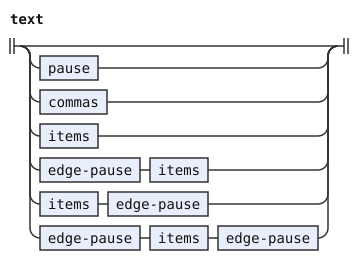</p>
<p>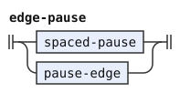</p>
<p>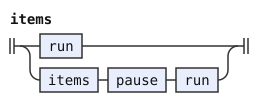</p>
<p>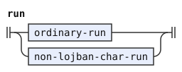</p>
</details>

In this strict reading, a pause is one token. Its core is a run of whitespace characters and periods, with any commas inside it. A whitespace character is one with the Unicode property White_Space. A comma next to the core is part of the pause, but it belongs to no token. So `mi , klama` has one pause between its two words, and a quote body next to such a comma takes it in.

`period-char` reads a core character that is not whitespace. Script extensions of `core-char` therefore supply their own periods. `Period-Initial` marks a core that starts with a period. `Period-Only` marks a core of periods without whitespace or ignored characters. Later stages preserve these tags for quote boundaries.

CLL[^cll-s3-3] says that a comma "cannot be pronounced as a pause", so a comma alone between two words is no pause. A comma at the start or the end of the text belongs to no token. A text of nothing but commas is an empty text.

```jbogenbau
%rule pause
  spaced-pause

%rule spaced-pause
  [pause-edge] $c:pause-core [pause-edge]
%emits
  $c :: PAUSE ∪ ($c.first-token.matches(period-char) ⟹ Period-Initial) ∪ ($c.matches(period-core) ⟹ Period-Only) := " "

%rule pause-core
  core-char | pause-core core-char | pause-core pause-edge core-char

%rule pause-edge
  commas

%rule core-char
  space-char | "."

%rule period-char
  $c:core-char
%conditions
  ¬$c.matches(space-char)

%rule period-core
  {period-char}

%rule space-char
  _White_Space

%rule commas
  comma | commas comma
```

<details><summary>Railroad diagrams of the 9 rules from <code>pause</code> to <code>commas</code></summary>
<p>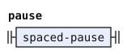</p>
<p>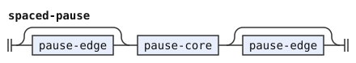</p>
<p>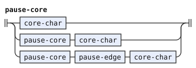</p>
<p>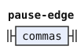</p>
<p>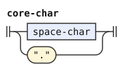</p>
<p>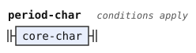</p>
<p>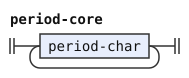</p>
<p>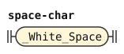</p>
<p>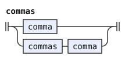</p>
</details>

An ordinary run is letters. A run of adjacent vowel letters is one vowel group, and a group carries the tags of its last vowel. In the Latin orthography, a group is its vowels, one phoneme each.

A script can tag its full vowel letters `Syllabic` to separate adjacent vowels without a written apostrophe. Two adjacent syllabic vowels form two syllables. `joined-vowel` inserts an apostrophe between them, with value `'` and no text of its own. [cyrillic.md](cyrillic.md) uses this rule. Each vowel of a group is its own token, so a group of three vowels keeps all three. Each vowel pair matches exactly one of the three cases, so a run has one parse.

In cll-ebnf, a comma stands only between two letters of a run. Between two vowels it is the syllable break of CLL[^cll-s3-3], a token with value `,` and tag `Syllable-Break`. So `kore,a` is `e` and `a` in two syllables. CLL[^cll-s4-7] writes it so "because ea is not a valid diphthong". Anywhere else it is nothing, so `ban,gu` is `bangu`.

```jbogenbau
%rule ordinary-run
  letters

%rule letters
  letters-after-consonant | letters-after-vowel

%rule letters-after-vowel
  | vowel-group
  | letters-after-consonant [commas] vowel-group
  | letters-after-vowel syllable-break vowel-group

%rule letters-after-consonant
  | non-vowels
  | letters-after-vowel [commas] non-vowels

%rule non-vowels
  non-vowel | non-vowels non-vowel | non-vowels commas non-vowel

%rule non-vowel
  consonant | apostrophe

%rule syllable-break
  commas
%emits
  $ :: Syllable-Break := "" :- ","

%rule vowel
  plain-vowel | stressed-vowel

%rule vowel-group-with(@V)
  @V | vowel-group-plain-with(@V) | vowel-group-joined-with(@V)

%rule vowel-group-plain-with(@V)
  | vowel-group-with(@V)<¬Syllabic> $v:@V :: $v.tags
  | vowel-group-with(@V)<Syllabic> $w:@V<¬Syllabic> :: $w.tags

%rule vowel-group-joined-with(@V)
  vowel-group-with(@V)<Syllabic> $v:joined-vowel-with(@V)<Syllabic> :: $v.tags

%rule joined-vowel-with(@V)
  $v:@V :: $v.tags
%emits
  ε :: ∅ := "'", $v

%rule vowel-group = vowel-group-with(vowel)
%rule vowel-group-plain = vowel-group-plain-with(vowel)
%rule vowel-group-joined = vowel-group-joined-with(vowel)
%rule joined-vowel = joined-vowel-with(vowel)

%rule any-lojban-char
  consonant | plain-vowel | stressed-vowel | apostrophe | comma
```

<details><summary>Railroad diagrams of the 17 rules from <code>ordinary-run</code> to <code>any-lojban-char</code></summary>
<p>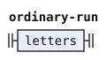</p>
<p>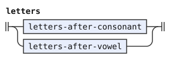</p>
<p>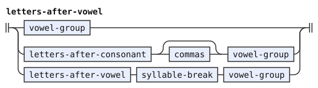</p>
<p>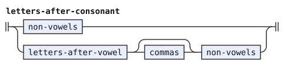</p>
<p>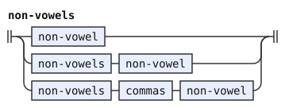</p>
<p>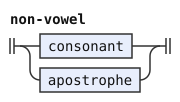</p>
<p>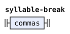</p>
<p>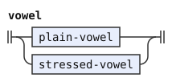</p>
<p>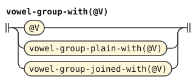</p>
<p>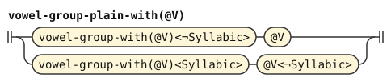</p>
<p>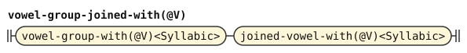</p>
<p></p>
<p>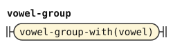</p>
<p>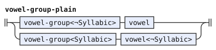</p>
<p>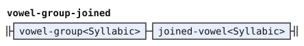</p>
<p>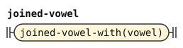</p>
<p>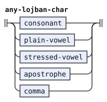</p>
</details>

A run that is not an ordinary run is foreign. It contains a character that this orthography does not read, as `mi klama?` does. The stage emits it as one `FOREIGN` token. Its value concatenates its characters as stage zero decomposed them, without applying the phoneme mappings. Its image is the run's source text, the original spelling. Different foreign runs therefore need not compare equally.

A foreign run has at least one character that no rule of `any-lojban-char` reads by itself. The rule `letters` always reads a run without one. So the stage tests only a run with one, and a long run of letters costs nothing more. A run neither begins nor ends with a comma, which is part of the pause next to it. A run character is any character but whitespace and the period. `run-char` reads it with `_`, then excludes those pause characters through conditions.

```jbogenbau
%rule non-lojban-char-run
  $r:chars-with-non-lojban-char
%conditions
  ¬$r.matches(letters),
  ¬$r.first-token.matches(comma),
  ¬$r.last-token.matches(comma)
%emits
  $ :: FOREIGN :- $.source-text

%rule chars-with-non-lojban-char
  | non-lojban-char
  | lojban-chars non-lojban-char
  | chars-with-non-lojban-char run-char

%rule lojban-chars
  lojban-char | lojban-chars lojban-char

%rule lojban-char
  $c:run-char
%conditions
  $c.matches(any-lojban-char)

%rule non-lojban-char
  $c:run-char
%conditions
  ¬$c.matches(any-lojban-char)

%rule run-char
  $c:_
%conditions
  ¬$c.matches(core-char)
```

<details><summary>Railroad diagrams of the 6 rules from <code>non-lojban-char-run</code> to <code>run-char</code></summary>
<p></p>
<p>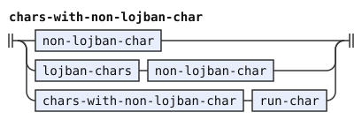</p>
<p>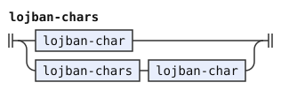</p>
<p>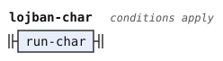</p>
<p>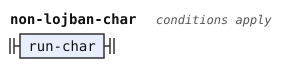</p>
<p></p>
</details>

## Letters

The stage emits each consonant as its lowercase Latin letter. Each consonant mapping sets its value and image to the same Latin phoneme letter. CLL[^cll-s3-9] writes a stressed syllable of a name in capitals, but only the capital vowel marks the stress. A capital vowel carries `Stressed`, a lowercase value, and an uppercase image. The apostrophe has value `'`. The stage reads each apostrophe character that the rule `apostrophe` lists as that same phoneme.

A brivla is a predicate word. CLL's weak stress for `y` applies to its use as a compound hyphen in a brivla.[^cll-s3-9] So in cll-ebnf, a capital `Y` cannot stand in a brivla. The other dialects ignore a stress mark on `y`, so they read `bajYkla` as a brivla.

Names can stress any syllable.[^cll-s3-9][^cll-s4-8] A cmavo is a particle. Cmavo can stress any syllable or none.[^cll-s3-9] So a stressed `y` can stand in names and cmavo.

CLL[^cll-s3-1] omits `h` from the alphabet. CLL[^cll-s3-3] says that `h` does not write the apostrophe. This stage treats `h` as foreign text. [latin.md](latin.md) reads `h` as the apostrophe.

```jbogenbau
%rule consonant :: ∅
  | ("b" | "B") := "b"
  | ("c" | "C") := "c"
  | ("d" | "D") := "d"
  | ("f" | "F") := "f"
  | ("g" | "G") := "g"
  | ("j" | "J") := "j"
  | ("k" | "K") := "k"
  | ("l" | "L") := "l"
  | ("m" | "M") := "m"
  | ("n" | "N") := "n"
  | ("p" | "P") := "p"
  | ("r" | "R") := "r"
  | ("s" | "S") := "s"
  | ("t" | "T") := "t"
  | ("v" | "V") := "v"
  | ("x" | "X") := "x"
  | ("z" | "Z") := "z"
%emits
  $

%rule plain-vowel :: ∅
  | "a" | "e" | "i" | "o" | "u" | "y"
%emits
  $

%rule stressed-vowel :: Stressed
  | "A" := "a" :- "A"
  | "E" := "e" :- "E"
  | "I" := "i" :- "I"
  | "O" := "o" :- "O"
  | "U" := "u" :- "U"
  | "Y" := "y" :- "Y"
%emits
  $

%rule apostrophe
  "'" | "’" | "‘" | "ʼ"
%emits
  $ :: ∅ := "'"

%rule comma
  ","
```

<details><summary>Railroad diagrams of the 5 rules from <code>consonant</code> to <code>comma</code></summary>
<p>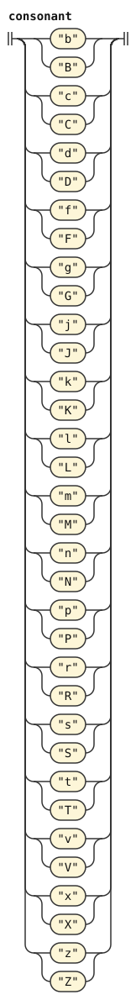</p>
<p>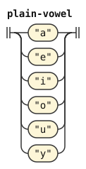</p>
<p>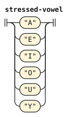</p>
<p>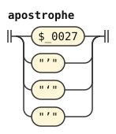</p>
<p>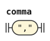</p>
</details>

## Choices beyond CLL

CLL writes a pause as a period.[^cll-s3-3] It does not define spaces. This grammar treats whitespace as a pause because texts separate words with spaces. No CLL word contains a space.

This grammar also accepts U+2019 (`’`), U+2018 (`‘`), and U+02BC (`ʼ`) as apostrophes. They are typographic forms of the same character. They change the reading of no CLL text.

CLL[^cll-s3-1] uses capitals only for nonstandard stress in names. This grammar also folds capital consonants without a capital vowel. This choice lets a writer capitalize a name or a sentence start.

CLL[^cll-s3-12] describes Loglan-compatible and Tengwar orthographies. This grammar reads neither. CLL calls the Loglan-compatible orthography nonstandard and unused.

[^cll-s3-12]: [CLL 1.1, section 3.12](https://lojban.org/publications/cll/cll_v1.1_xhtml-section-chunks/section-oddball-orthographies.html).

[^cll-s3-3]: [CLL 1.1, section 3.3](https://lojban.org/publications/cll/cll_v1.1_xhtml-section-chunks/section-lojban-characters.html).

[^cll-s4-7]: [CLL 1.1, section 4.7](https://lojban.org/publications/cll/cll_v1.1_xhtml-section-chunks/section-fuhivla.html).

[^cll-s3-9]: [CLL 1.1, section 3.9](https://lojban.org/publications/cll/cll_v1.1_xhtml-section-chunks/section-stress.html).

[^cll-s4-8]: [CLL 1.1, section 4.8](https://lojban.org/publications/cll/cll_v1.1_xhtml-section-chunks/section-cmene.html).

[^cll-s3-1]: [CLL 1.1, section 3.1](https://lojban.org/publications/cll/cll_v1.1_xhtml-section-chunks/chapter-phonology.html#section-orthography).

[^cll-c3]: [CLL 1.1, chapter 3](https://lojban.org/publications/cll/cll_v1.1_xhtml-section-chunks/chapter-phonology.html).
