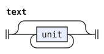
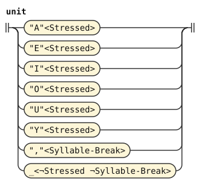

# Phoneme values

This document defines the normalization stage of every bundled Lojban dialect. A stage is one step of a pipeline. Normalization follows phonemes and precedes forms.

A token is one unit that a stage reads or emits. A token's value is the string that exact comparisons read. Its image is the string that people see.

A stressed vowel enters with an uppercase value and the tag `Stressed`. Each vowel mapping tests both of those fields. It writes the corresponding lowercase value. In cll-ebnf, a syllable comma enters with value `,` and the tag `Syllable-Break`. Its mapping writes an empty value so that comparisons ignore the syllable boundary. The other Lojban dialects discard commas in the phoneme stage.

The image recipe reads the original input image. Each alternative has one symbol, so ordinary inheritance keeps its tags. The catch-all reads only tokens without either mapped tag. A token with a mapped tag and an unsupported value fails this stage.

The stage keeps token order, count, text, image, tags, source and attachments. It changes only the mapped values. Spans use this stage's input coordinates. A covering emission loses `insertedBy`, as every covering emission does. These are the ordinary stage rules of [engine §1](../../docs/engine.md#1-tokens) and [§11](../../docs/engine.md#11-emission).

```jbogenbau
%ambiguity-resolution lazy

%rule text
  [{unit}]

%rule unit :- $.image
  | "A"<Stressed> := "a"
  | "E"<Stressed> := "e"
  | "I"<Stressed> := "i"
  | "O"<Stressed> := "o"
  | "U"<Stressed> := "u"
  | "Y"<Stressed> := "y"
  | ","<Syllable-Break> := ""
  | _<¬Stressed ¬Syllable-Break>
%emits
```

<details><summary>Railroad diagrams of <code>text</code> and <code>unit</code></summary>
<p></p>
<p></p>
</details>
