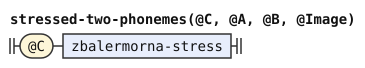

# zbalermorna

This document adds the zbalermorna script to the phoneme stage. The dialects of the [BPFK](../dialects/bpfk.md), the Lojban language planning committee, [experimental](../dialects/experimental.md) and [Zantufa](../dialects/zantufa.md) read it. The [CLL](../dialects/cll-ebnf.md) dialect omits this script. CLL is *The Complete Lojban Language*. The stage reads both private-use encodings defined in [Two encodings](#two-encodings).

A token is one unit that a stage reads or emits. A token's value is the string that exact comparisons read. Its image is the string that people see.

The phoneme stage is the first stage of the pipeline. The document adds alternatives to the rules of [latin-strict.md](latin-strict.md) and [latin.md](latin.md) with `%extend-rule`. It defines no frame of its own. It uses the shared text, pause and run rules. [The notation document](../../docs/notation.md) explains the notation.

A diacritic is a mark on another symbol. Each zbalermorna symbol is a radical, a consonant, with a diacritic above it for the vowel that follows. A vowel with no consonant before it stands on the radical for the period, which the script uses as a null onset. A null onset marks a syllable with no consonant before its vowel. The script writes a word-initial vowel on that radical too. The script also has these forms:

- A full-vowel form, used in names and borrowings
- Four diphthong diacritics
- A stress mark, placed after the vowel
- An "attitudinal shorthand" that stands for a vowel and the apostrophe after it
- Glide radicals for `i` and `u`, which read as plain vowels without a following vowel

The phoneme explanations use Humbert code points. The closing mapping gives their UCSUR counterparts. This document writes each code point as an escape, so that a reader can read the rule without the font.

The first rules below read the consonant radicals. U+ED89 is the radical for the period, and U+ED8A is the apostrophe. U+ED9A is the comma. U+ED8C, U+ED99 and U+ED9B also map to a comma.

The diphthong instances use `two-phonemes` for their two output strings. The `stressed-two-phonemes` template also reads the stress mark. It applies the `Stressed` tag to the first output.

```jbogenbau
%extend-rule consonant :: ∅
  | $_ED80 := "p"
  | $_ED81 := "t"
  | $_ED82 := "k"
  | $_ED83 := "f"
  | $_ED90 := "b"
  | $_ED91 := "d"
  | $_ED92 := "g"
  | $_ED93 := "v"
  | $_ED84 := "l"
  | $_ED85 := "s"
  | $_ED86 := "c"
  | $_ED87 := "m"
  | $_ED94 := "r"
  | $_ED95 := "z"
  | $_ED96 := "j"
  | $_ED97 := "n"
  | $_ED88 := "x"
%emits
  $

%extend-rule apostrophe
  $_ED8A
%emits
  $ :: ∅ := "'"

%extend-rule core-char
  $_ED89

%extend-rule comma
  $_ED9A | $_ED8C | $_ED99 | $_ED9B
```

<details><summary>Railroad diagrams of <code>consonant</code>, <code>apostrophe</code>, <code>core-char</code> and <code>comma</code></summary>
<p></p>
<p></p>
<p></p>
<p></p>
</details>

A vowel diacritic and its full-vowel form are the same phoneme. The stress mark U+ED98 after either, or after a diphthong diacritic, makes it stressed, and a repeated mark is one mark. The glide radicals U+EDAA and U+EDAB read as the plain vowel letters `i` and `u`, even without a following vowel.

A diphthong diacritic is two phonemes and stands where a vowel stands. The first emission covers the character and any stress marks. The second is inserted after them, with empty source and text. Only the first stressed token carries `Stressed`. Normalization lowers that value and preserves both images.

The shorthand U+ED8B followed by a vowel, plain or stressed, is that vowel and an apostrophe. The vowel's token covers the shorthand too, as a stressed vowel's token covers its stress mark. The rule emits the apostrophe as a token with an empty span.

The shorthand stands where a non-vowel stands, because the apostrophe closes the vowel group. The shorthand's vowel is always a single vowel. `zbalermorna-marked-vowel` takes its strings from the reconstructed vowel through `.emitted`. This excludes the written shorthand mark from both strings without erasing its source ownership. A diphthong diacritic cannot directly follow the mark.

A stress mark or a shorthand is a mark of the script, like an accent. So this document adds both to `mark-char` of [latin.md](latin.md), and no punctuation rule reads them as a pause. Neither is a Lojban character by itself. So `non-lojban-char` takes a stray mark, one that no letter takes, and the mark makes its run foreign.

```jbogenbau
%extend-rule plain-vowel :: ∅
  | ($_EDA0 | $_EDB0) := "a"
  | ($_EDA1 | $_EDB1) := "e"
  | ($_EDA2 | $_EDB2 | $_EDAA) := "i"
  | ($_EDA3 | $_EDB3) := "o"
  | ($_EDA4 | $_EDB4 | $_EDAB) := "u"
  | ($_EDA5 | $_EDB5) := "y"
%emits
  $

%extend-rule stressed-vowel :: Stressed
  | ($_EDA0 | $_EDB0) zbalermorna-stress := "A"
  | ($_EDA1 | $_EDB1) zbalermorna-stress := "E"
  | ($_EDA2 | $_EDB2) zbalermorna-stress := "I"
  | ($_EDA3 | $_EDB3) zbalermorna-stress := "O"
  | ($_EDA4 | $_EDB4) zbalermorna-stress := "U"
  | ($_EDA5 | $_EDB5) zbalermorna-stress := "Y"
%emits
  $

%rule zbalermorna-stress
  $_ED98 | zbalermorna-stress $_ED98

%extend-rule vowel
  zbalermorna-diphthong | zbalermorna-stressed-diphthong

%extend-rule non-vowel
  zbalermorna-shorthand

%extend-rule any-lojban-char
  zbalermorna-diphthong

%extend-rule mark-char
  zbalermorna-shorthand-mark | zbalermorna-stress-mark

%rule zbalermorna-stress-mark
  $_ED98

%rule zbalermorna-diphthong
  zbalermorna-ai | zbalermorna-ei | zbalermorna-oi | zbalermorna-au

%rule zbalermorna-ai = two-phonemes($_EDA6, "a", "i")

%rule zbalermorna-ei = two-phonemes($_EDA7, "e", "i")

%rule zbalermorna-oi = two-phonemes($_EDA8, "o", "i")

%rule zbalermorna-au = two-phonemes($_EDA9, "a", "u")

%rule zbalermorna-stressed-diphthong
  | zbalermorna-stressed-ai | zbalermorna-stressed-ei
  | zbalermorna-stressed-oi | zbalermorna-stressed-au

%rule stressed-two-phonemes(@C, @A, @B)
  @C zbalermorna-stress
%emits
  $ :: Stressed := @A, ε :: ∅ := @B

%rule zbalermorna-stressed-ai = stressed-two-phonemes($_EDA6, "A", "i")

%rule zbalermorna-stressed-ei = stressed-two-phonemes($_EDA7, "E", "i")

%rule zbalermorna-stressed-oi = stressed-two-phonemes($_EDA8, "O", "i")

%rule zbalermorna-stressed-au = stressed-two-phonemes($_EDA9, "A", "u")

%rule zbalermorna-shorthand
  $v:zbalermorna-marked-vowel
%emits
  $v, ε :: ∅ := "'"

%rule zbalermorna-marked-vowel
  zbalermorna-shorthand-mark $v:zbalermorna-shorthand-vowel
    :: $v.tags := $v.emitted.value :- $v.emitted.image

%rule zbalermorna-shorthand-vowel
  plain-vowel | stressed-vowel

%rule zbalermorna-shorthand-mark
  $_ED8B
```

<details><summary>Railroad diagrams of the 23 rules from <code>plain-vowel</code> to <code>zbalermorna-shorthand-mark</code></summary>
<p></p>
<p></p>
<p></p>
<p></p>
<p></p>
<p></p>
<p></p>
<p></p>
<p></p>
<p></p>
<p></p>
<p></p>
<p></p>
<p></p>
<p></p>
<p></p>
<p></p>
<p></p>
<p></p>
<p></p>
<p></p>
<p></p>
<p></p>
</details>

## Two encodings

`tools/unicode-table.py` supplies `grammars/phonemes/zbalermorna-names.txt` from the mapping below. The file uses `unicode-names 15.1.0` and contains 100 added names. It names 50 characters in each encoding. A name supplies an exact scalar, rather than declaring a grammar terminal.

The zbalermorna phoneme grammar reads both encodings. The older interval is U+ED80–U+EDB9, and the UCSUR allocation is U+F28A0–U+F28DF. Each row marked Explicit rule contributes both scalars to exactly the same grammar alternatives. Neither loading nor parsing warns merely because text uses the older encoding. `grammars/phonemes/zbalermorna.md` declares `%names "zbalermorna-names.txt"` before its rules. Bundled dialects select this resource through that declaration.

The older source is Jack Humbert's [Unicode Space proposal at commit 920b28d](https://github.com/JackHumbert/zbalermorna/blob/920b28d798ae1c06885c674bbf02b08ffed12b2f/doc/unicode.md). Its [manri font source at the same commit](https://github.com/JackHumbert/zbalermorna/blob/920b28d798ae1c06885c674bbf02b08ffed12b2f/src/unicode-manri.sfd) resolves three inconsistent numeric tone rows. The font assigns RE TONGA to U+ED8D, CI TONGA to U+ED8E, and VO TONGA to U+ED8F. The proposal's glyph grid agrees with those assignments.

The other source is the [UCSUR zbalermorna entry](https://www.kreativekorp.com/ucsur/), proposal dated 2024-08-20, credited to la kmir. That proposal date identifies the encoding version. The entry gives no separate numbered version. It assigns U+F28A0–U+F28DF and links Humbert's proposal. This source version is independent of the names file's Unicode 15.1.0 header.

The registry publisher's [Fairfax character table](https://github.com/kreativekorp/open-relay/blob/e4b81241e8c7269a91c0bd865cf5c9e7208fbada/Fairfax/pua.html) records the UCSUR scalars and names individually. This supporting snapshot is Fairfax 2026.09.21, dated 2026-09-21, at commit `e4b81241e8c7269a91c0bd865cf5c9e7208fbada`. The table below pins those assignments rather than using a later live resource.

Each row gives one character and its exact scalar in each encoding. The character's source name is `ZBALERMORNA ` followed by the character suffix. The names file inserts an encoding qualifier after `ZBALERMORNA`. Thus its older name is `ZBALERMORNA HUMBERT ` followed by the suffix. Its UCSUR name is `ZBALERMORNA UCSUR ` followed by the suffix.

These qualified names keep the two scalar bindings distinct in one lookup namespace. The file supplies no unqualified spelling. For example, `‹ZBALERMORNA HUMBERT LETTER PY›` decodes to U+ED80. `‹ZBALERMORNA UCSUR LETTER PY›` decodes to U+F28A0. Neither spelling silently changes encoding.

The final column states whether a character pair has explicit alternatives in the zbalermorna phoneme grammar. Each Explicit rule row requires both scalars in exactly the same alternatives. Where an alternative sets a value, image, or tags by recipe, both encodings produce equal results for that channel.

Shared rules that copy source text keep the written scalar in values and images, including pause material and foreign runs. Token text and source metadata always preserve the written scalar. The names file also includes every No explicit rule row.

| Character suffix | Humbert | UCSUR | Zbalermorna alternatives |
| --- | --- | --- | --- |
| LETTER PY | U+ED80 | U+F28A0 | Explicit rule |
| LETTER TY | U+ED81 | U+F28A1 | Explicit rule |
| LETTER KY | U+ED82 | U+F28A2 | Explicit rule |
| LETTER FY | U+ED83 | U+F28A3 | Explicit rule |
| LETTER LY | U+ED84 | U+F28A4 | Explicit rule |
| LETTER SY | U+ED85 | U+F28A5 | Explicit rule |
| LETTER CY | U+ED86 | U+F28A6 | Explicit rule |
| LETTER MY | U+ED87 | U+F28A7 | Explicit rule |
| LETTER XY | U+ED88 | U+F28A8 | Explicit rule |
| SYMBOL FOR DENPA BU | U+ED89 | U+F28A9 | Explicit rule |
| SYMBOL FOR YHY | U+ED8A | U+F28AA | Explicit rule |
| SYMBOL FOR CNIMAHO BU | U+ED8B | U+F28AB | Explicit rule |
| COMBINING PA TONGA | U+ED8C | U+F28AC | Explicit rule |
| COMBINING RE TONGA | U+ED8D | U+F28AD | No explicit rule |
| COMBINING CI TONGA | U+ED8E | U+F28AE | No explicit rule |
| COMBINING VO TONGA | U+ED8F | U+F28AF | No explicit rule |
| LETTER BY | U+ED90 | U+F28B0 | Explicit rule |
| LETTER DY | U+ED91 | U+F28B1 | Explicit rule |
| LETTER GY | U+ED92 | U+F28B2 | Explicit rule |
| LETTER VY | U+ED93 | U+F28B3 | Explicit rule |
| LETTER RY | U+ED94 | U+F28B4 | Explicit rule |
| LETTER ZY | U+ED95 | U+F28B5 | Explicit rule |
| LETTER JY | U+ED96 | U+F28B6 | Explicit rule |
| LETTER NY | U+ED97 | U+F28B7 | Explicit rule |
| COMBINING BAHEBU | U+ED98 | U+F28B8 | Explicit rule |
| SYMBOL FOR SMAJI BU | U+ED99 | U+F28B9 | Explicit rule |
| SYMBOL FOR SLAKA BU | U+ED9A | U+F28BA | Explicit rule |
| COMBINING TCENA BU | U+ED9B | U+F28BB | Explicit rule |
| VOWEL SIGN ABU | U+EDA0 | U+F28C0 | Explicit rule |
| VOWEL SIGN EBU | U+EDA1 | U+F28C1 | Explicit rule |
| VOWEL SIGN IBU | U+EDA2 | U+F28C2 | Explicit rule |
| VOWEL SIGN OBU | U+EDA3 | U+F28C3 | Explicit rule |
| VOWEL SIGN UBU | U+EDA4 | U+F28C4 | Explicit rule |
| VOWEL SIGN YBU | U+EDA5 | U+F28C5 | Explicit rule |
| VOWEL SIGN AIBU | U+EDA6 | U+F28C6 | Explicit rule |
| VOWEL SIGN EIBU | U+EDA7 | U+F28C7 | Explicit rule |
| VOWEL SIGN OIBU | U+EDA8 | U+F28C8 | Explicit rule |
| VOWEL SIGN AUBU | U+EDA9 | U+F28C9 | Explicit rule |
| LETTER SEMIVOWEL IY | U+EDAA | U+F28CA | Explicit rule |
| LETTER SEMIVOWEL UY | U+EDAB | U+F28CB | Explicit rule |
| LETTER FULL ABU | U+EDB0 | U+F28D0 | Explicit rule |
| LETTER FULL EBU | U+EDB1 | U+F28D1 | Explicit rule |
| LETTER FULL IBU | U+EDB2 | U+F28D2 | Explicit rule |
| LETTER FULL OBU | U+EDB3 | U+F28D3 | Explicit rule |
| LETTER FULL UBU | U+EDB4 | U+F28D4 | Explicit rule |
| LETTER FULL YBU | U+EDB5 | U+F28D5 | Explicit rule |
| LETTER FULL AIBU | U+EDB6 | U+F28D6 | No explicit rule |
| LETTER FULL EIBU | U+EDB7 | U+F28D7 | No explicit rule |
| LETTER FULL OIBU | U+EDB8 | U+F28D8 | No explicit rule |
| LETTER FULL AUBU | U+EDB9 | U+F28D9 | No explicit rule |

For every paired scalar, the UCSUR code point equals the older code point plus hexadecimal E3B20. The individual rows define the mapping. No older character inside U+ED80–U+EDB9 lacks a UCSUR counterpart. Unlisted slots in either interval are gaps, without character names or implied mappings.

The full diphthong letters at U+EDB6–U+EDB9 belong to the older encoding. Their UCSUR counterparts are U+F28D6–U+F28D9. Both sets receive encoding-qualified names in this resource. Every character occurs in both encodings, so no character belongs to only one encoding.

These alternatives cover 43 character pairs. The seven No explicit rule pairs have no zbalermorna alternative. They are three tone marks and four full diphthong letters. The dialect's shared rules still read these characters in both encodings. A names declaration alone adds no phoneme rule. Escape decoding never converts between the encodings.

At the phoneme stage, BPFK and Zantufa read these seven pairs as pause material tagged `PAUSE`, `Punctuation-Material`, and `Quote-Material`. The experimental dialect reads them as `FOREIGN`. Shared recipes retain the written scalar in each value and image.

The names resource supplies no categories, combining classes, or decompositions from either script source. The pinned Unicode tables still decide those properties. The names file never supplies printer abbreviations. With bundled core data, private-use scalars print with numeric escapes. The grammar's ordinary value, image, and source rules remain in force.

Bundled cases decode all 100 zbalermorna names and distinguish both encodings. They cover every pair, both encodings of all four full diphthong letters, reserved gaps, and the corrected tone rows. Every Explicit rule pair stands in the same alternatives and gives equal results for channels that those alternatives set by recipe. Shared rules that copy source text retain the written scalar in values and images. All text and source metadata retain that scalar.

Cases preserve the shared pause and foreign readings for the seven No explicit rule pairs. No case warns about the older encoding.

## Differences from CLL and jbotci

CLL 1.1 describes Tolkien's Tengwar, a different script.[^cll-s3-12] The CLL dialect follows that edition and omits zbalermorna.

jbotci, another Lojban parser, ignores U+ED8C, U+ED99 and U+ED9B. This document treats them as commas.

After the shorthand U+ED8B, jbotci accepts the diphthong diacritics U+EDA6 to U+EDA9, which make the run foreign here. This document instead accepts Latin and Cyrillic vowels and the glide radicals U+EDAA and U+EDAB there, which jbotci rejects.

In BPFK and Zantufa, this document reads U+EDAC, U+ED8D, U+ED9C and U+EDB6 as pauses. The experimental dialect reads them as foreign material. jbotci rejects them as invalid characters. A stress mark after a glide radical makes the run foreign here. jbotci ignores that mark when no earlier full vowel takes its stress.

jbotci rejects the UCSUR encoding as invalid characters. This document reads it.

[^cll-s3-12]: [CLL 1.1, section 3.12](https://lojban.org/publications/cll/cll_v1.1_xhtml-section-chunks/section-oddball-orthographies.html).
