# zbalermorna

This document adds the zbalermorna script to the phoneme stage. The dialects of the [BPFK](../dialects/bpfk.md), the Lojban language planning committee, [experimental](../dialects/experimental.md) and [Zantufa](../dialects/zantufa.md) read it. The [CLL](../dialects/cll-ebnf.md) and [kihei](../dialects/kihei.md) dialects omit this script. CLL is *The Complete Lojban Language*. The stage reads the script as the code points of the private-use block that its fonts assign it.

A token is one unit that a stage reads or emits. A token's value is the string that exact comparisons read. Its image is the string that people see.

The phoneme stage is the first stage of the pipeline. The document adds alternatives to the rules of [latin-strict.md](latin-strict.md) and [latin.md](latin.md) with `%extend-rule`. It defines no frame of its own. It uses the shared text, pause and run rules. [The notation document](../../docs/notation.md) explains the notation.

A diacritic is a mark on another symbol. Each zbalermorna symbol is a radical, a consonant, with a diacritic above it for the vowel that follows. A vowel with no consonant before it stands on the radical for the period, which the script uses as a null onset. A null onset marks a syllable with no consonant before its vowel. The script writes a word-initial vowel on that radical too. The script also has these forms:

- A full-vowel form, used in names and borrowings
- Four diphthong diacritics
- A stress mark, placed after the vowel
- An "attitudinal shorthand" that stands for a vowel and the apostrophe after it
- Glide radicals for `i` and `u` before a vowel

The code points are those of the private-use block of the font. This document writes each code point as an escape, so that a reader can read the rule without the font.

The first rules below read the consonant radicals. U+ED89 is the radical for the period, and U+ED8A is the apostrophe. U+ED9A is the comma. U+ED8C, U+ED99 and U+ED9B also map to a comma.

```jbogenbau
%extend-rule consonant :: ∅
  | $_ED80 := "p"
  | $_ED81 := "t"
  | $_ED82 := "k"
  | $_ED83 := "f"
  | $_ED90 := "b"
  | $_ED91 := "d"
  | $_ED92 := "g"
  | $_ED93 := "v"
  | $_ED84 := "l"
  | $_ED85 := "s"
  | $_ED86 := "c"
  | $_ED87 := "m"
  | $_ED94 := "r"
  | $_ED95 := "z"
  | $_ED96 := "j"
  | $_ED97 := "n"
  | $_ED88 := "x"
%emits
  $

%extend-rule apostrophe
  $_ED8A
%emits
  $ :: ∅ := "'"

%extend-rule core-char
  $_ED89

%extend-rule comma
  $_ED9A | $_ED8C | $_ED99 | $_ED9B
```

<details><summary>Railroad diagrams of <code>consonant</code>, <code>apostrophe</code>, <code>core-char</code> and <code>comma</code></summary>
<p>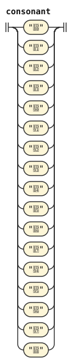</p>
<p>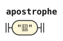</p>
<p>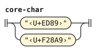</p>
<p>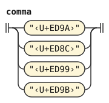</p>
</details>

A vowel diacritic and its full-vowel form are the same phoneme. The stress mark U+ED98 after either, or after a diphthong diacritic, makes it stressed, and a repeated mark is one mark. The glide radicals U+EDAA and U+EDAB are `i` and `u` before a vowel.

A diphthong diacritic is two phonemes and stands where a vowel stands. The first emission covers the character and any stress marks. The second is inserted after them, with empty source and text. Only the first stressed token carries `Stressed`. Normalization lowers that value and preserves both images.

The shorthand U+ED8B followed by a vowel, plain or stressed, is that vowel and an apostrophe. The vowel's token covers the shorthand too, as a stressed vowel's token covers its stress mark. The rule emits the apostrophe as a token with an empty span.

The shorthand stands where a non-vowel stands, because the apostrophe closes the vowel group. The shorthand's vowel is always a single vowel. `zbalermorna-marked-vowel` takes its strings from the reconstructed vowel through `.emitted`. This excludes the written shorthand mark from both strings without erasing its source ownership. A diphthong diacritic cannot directly follow the mark.

A stress mark or a shorthand is a mark of the script, like an accent. So this document adds both to `mark-char` of [latin.md](latin.md), and no punctuation rule reads them as a pause. Neither is a Lojban character by itself. So `non-lojban-char` takes a stray mark, one that no letter takes, and the mark makes its run foreign.

```jbogenbau
%extend-rule plain-vowel :: ∅
  | ($_EDA0 | $_EDB0) := "a"
  | ($_EDA1 | $_EDB1) := "e"
  | ($_EDA2 | $_EDB2 | $_EDAA) := "i"
  | ($_EDA3 | $_EDB3) := "o"
  | ($_EDA4 | $_EDB4 | $_EDAB) := "u"
  | ($_EDA5 | $_EDB5) := "y"
%emits
  $

%extend-rule stressed-vowel :: Stressed
  | ($_EDA0 | $_EDB0) zbalermorna-stress := "A"
  | ($_EDA1 | $_EDB1) zbalermorna-stress := "E"
  | ($_EDA2 | $_EDB2) zbalermorna-stress := "I"
  | ($_EDA3 | $_EDB3) zbalermorna-stress := "O"
  | ($_EDA4 | $_EDB4) zbalermorna-stress := "U"
  | ($_EDA5 | $_EDB5) zbalermorna-stress := "Y"
%emits
  $

%rule zbalermorna-stress
  $_ED98 | zbalermorna-stress $_ED98

%extend-rule vowel
  zbalermorna-diphthong | zbalermorna-stressed-diphthong

%extend-rule non-vowel
  zbalermorna-shorthand

%extend-rule any-lojban-char
  zbalermorna-diphthong

%extend-rule mark-char
  zbalermorna-shorthand-mark | zbalermorna-stress-mark

%rule zbalermorna-stress-mark
  $_ED98

%rule zbalermorna-diphthong
  zbalermorna-ai | zbalermorna-ei | zbalermorna-oi | zbalermorna-au

%rule zbalermorna-ai
  $_EDA6
%emits
  $ :: ∅ := "a", ε :: ∅ := "i"

%rule zbalermorna-ei
  $_EDA7
%emits
  $ :: ∅ := "e", ε :: ∅ := "i"

%rule zbalermorna-oi
  $_EDA8
%emits
  $ :: ∅ := "o", ε :: ∅ := "i"

%rule zbalermorna-au
  $_EDA9
%emits
  $ :: ∅ := "a", ε :: ∅ := "u"

%rule zbalermorna-stressed-diphthong
  | zbalermorna-stressed-ai | zbalermorna-stressed-ei
  | zbalermorna-stressed-oi | zbalermorna-stressed-au

%rule zbalermorna-stressed-ai
  $_EDA6 zbalermorna-stress
%emits
  $ :: Stressed := "A", ε :: ∅ := "i"

%rule zbalermorna-stressed-ei
  $_EDA7 zbalermorna-stress
%emits
  $ :: Stressed := "E", ε :: ∅ := "i"

%rule zbalermorna-stressed-oi
  $_EDA8 zbalermorna-stress
%emits
  $ :: Stressed := "O", ε :: ∅ := "i"

%rule zbalermorna-stressed-au
  $_EDA9 zbalermorna-stress
%emits
  $ :: Stressed := "A", ε :: ∅ := "u"

%rule zbalermorna-shorthand
  $v:zbalermorna-marked-vowel
%emits
  $v, ε :: ∅ := "'"

%rule zbalermorna-marked-vowel
  zbalermorna-shorthand-mark $v:zbalermorna-shorthand-vowel
    :: $v.tags := $v.emitted.value :- $v.emitted.image

%rule zbalermorna-shorthand-vowel
  plain-vowel | stressed-vowel

%rule zbalermorna-shorthand-mark
  $_ED8B
```

<details><summary>Railroad diagrams of the 22 rules from <code>plain-vowel</code> to <code>zbalermorna-shorthand-mark</code></summary>
<p>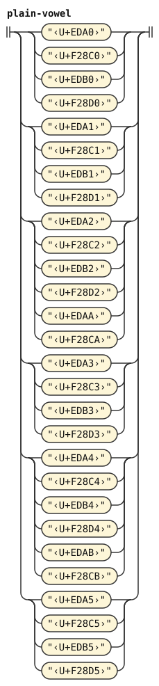</p>
<p></p>
<p>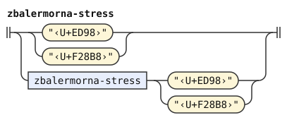</p>
<p>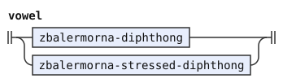</p>
<p></p>
<p>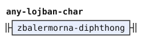</p>
<p></p>
<p>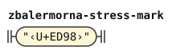</p>
<p>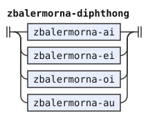</p>
<p>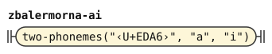</p>
<p>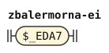</p>
<p>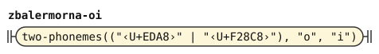</p>
<p></p>
<p>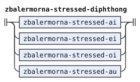</p>
<p></p>
<p></p>
<p>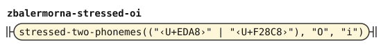</p>
<p>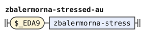</p>
<p>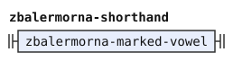</p>
<p>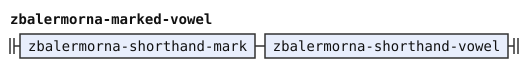</p>
<p>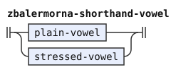</p>
<p>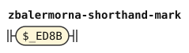</p>
</details>

## Differences from CLL and jbotci

Lojbanists made zbalermorna after CLL. The book describes Tolkien's Tengwar, a different script.[^cll-s3-12] The CLL dialect therefore omits zbalermorna.

jbotci, another Lojban parser, ignores U+ED8C, U+ED99 and U+ED9B. This document treats them as commas.

[^cll-s3-12]: [CLL 1.1, section 3.12](https://lojban.org/publications/cll/cll_v1.1_xhtml-section-chunks/section-oddball-orthographies.html).
