# The experimental grammar

This document is a layer over [the CLL grammar](cll.md), the grammar of *The Complete Lojban Language* (CLL), edition 1.1. A layer is a document that changes earlier rules. A dialect is a pipeline of stages, defined by one pipeline document. The [experimental](../dialects/experimental.md) dialect stitches this layer after that grammar, that is, combines their rules into one grammar.

A token is one unit that a stage reads or emits. A token's value is the string that exact comparisons read. Its image is the string that people see.

The layer adds experimental constructs. It always accepts some constructs, and a feature, a named switch that the grammars test, guards others. Its reference is camxes-exp, the experimental grammar of the camxes parser, written as a parsing expression grammar (PEG). A PEG tries alternatives in order.

The layer restates each CLL rule that it changes with `%redefine-rule`. It states its own rules with `%rule`. Each section below says what the layer changes in that part of the grammar. A rule that this document does not name is the CLL grammar's, as that document explains it.

The prose uses these Lojban terms, as [the CLL grammar](cll.md) does:

- A cmavo is a particle, a short structure word.
- A selma'o is a word class of cmavo.
- A brivla is a predicate word.
- A cmevla is a name word.
- A selbri is the predicate of a sentence.
- A sumti is an argument of a selbri.
- A tanru is a compound selbri.
- A tanru unit is one component of a tanru.
- An ek is a logical sumti connective, such as `.e`.
- A jek is a logical connective, such as `je`.
- A joik is a non-logical connective, such as `joi`.
- A gihek connects bridi-tails, as `gi'e` does.
- A gek introduces two branches connected in forethought.
- A stag is a tense or modal inside a connective.
- A bridi-tail is a selbri with any terms after it.
- A lerfu word is a letter word, such as `.abu` or `xy.`.
- A mekso is a mathematical expression.
- VUhU is the class of mathematical operator words.

[The experimental lexicon](../words/lexicon-experimental.md) gives each cmavo one selma'o. For example, `mi'ai` is KOhA, `la` is LE, `fi'oi` is SOI, `ma'oi` is ZO and `la'oi` is ZOhOI. `no'oi` and `po'oi` are NOhOI, with the terminator `ku'oi`. The added classes include `LOhOI`, `NOhOI`, `KUhOI`, `KUhAU`, `LOhAI`, `LEhAI`, `ZOhOI` and `MEhOI`.

[The notation document](../../docs/notation.md) explains the notation. The terminals of this grammar (the symbols that each match one input token) are selma'o. A token is one unit of input. A tag marks a token by an identifier. The rules `any-word` and `anything` match tokens tagged `Word` and `Quoted-Text`, respectively.

A stage is one step of a pipeline, with its own grammar. The pipeline is the sequence of stages that reads a text. The word stage, an earlier stage, puts these two tags on the material of a quote.

The layer uses two feature guards, which make a part of a rule depend on a feature. `cbm` is the cmevla-brivla merger, which permits name words as predicates. `soi-clause` makes `soi` a term that takes a subsentence. The experimental dialect turns both on. A caller, the program that requests parsing, can turn either off.

A free modifier is a phrase that stands in many positions. An elidable terminator is a closing word that can be omitted. The free-modifier slot follows it outside its brackets: `[+X] #`. So free modifiers can follow an elided terminator.

`free-after-number` and `free-after-lerfu-string` prevent a number or lerfu string from ending before words that can continue it. After an elided `boi`, they test the remaining input from the start of the selected free slot. The number rule excludes a following number part. The letter rule excludes a following letter word or PA. An empty free slot still shows the next word. A written BOI permits the boundary.

A span is a range between input token boundaries. A ranked choice filters alternatives at one written position. An option qualifies when its completed reading passes its recognition rules. A qualified earlier option excludes later options over the same span.

A derivation is one complete grammatical reading. An admitted derivation survives ranked filtering. The stage ranks admitted derivations by `leftmost-longest`, then `late-elision`. Fewer omitted terminators win at the first differing boundary. Two best derivations with equal counts at every boundary tie, and a tie is an error.

`free` and `tense-modal` carry `leftmost-longest`. A rule profile counts flagged spans. Both flags contribute to one profile, without priority by rule name. The earliest differing start decides, with longer spans first. A flagged span that prevents the full text from completing contributes nothing. The stage compares elisions after this preference.

So `to mi klama` holds `mi klama` in its parenthesis. In the same way, `lu mi klama` holds `mi klama` in its quote.

The layer permits ambiguity beyond omitted terminators. It uses these rules to select a reading:

- In a tanru and between operators, `ke` directly after a joik, jek or ek opens the connective's own group. The selbri and mekso sections explain that choice.
- A connection that can be a sumti connection is one ("Terms").
- A `be` group attaches to the tanru unit before it ("Selbri and tanru").
- A subscript after a subscript nests. Any other free modifier after a subscript belongs to the word that the subscript marks ("Free modifiers, vocatives and indicators").

The experimental terminators `ku'au` and `ku'oi` are elidable: the rules below write them `[+KUhAU]` and `[+KUhOI]`.

```jbogenbau
%ambiguity-resolution late-elision
```

## The text and its paragraphs

The layer changes the text in five ways. The first change makes a text-initial `nai` an indicator, as the indicator stage of the experimental dialect reads it. The `indicators` rule takes that bare NAI. A separate `nai` stands only before a run of names.

The second change permits an ek after a text-leading `.i`, as in `.i .e do klama`. After that connective, an optional tense can precede `bo`. The rule writes that tense as a `tag`. A `stag` is a `tag` in this dialect, so either name reads the same words.

The third change is that an ek, a jek or a joik directly after `.i` is always a connective. So `i.e`, `.iji` and `mi klama .i e` read `.i e` or `.i ji` as a connective. Without this rule, these texts tie, because a bare ek is a fragment. The rule `lone-i` is an `.i` that no ek, jek or joik follows directly. It stands in the bare-`.i` positions of `text-1` and `paragraph`, before a statement, a fragment or nothing.

The `lone-i` rule tests these three connective families. A VUhU can also follow `.i` as a connective, as in `mi klama .i su'i do klama`. It needs no test, because no statement or fragment begins with it. A gihek answer after `.i` stays a fragment, as in `.i gi'e` and `mi klama .i gi'e`. No `.i` connective is a gihek, so these texts cause no tie.

A bare connective answer needs no `.i`. `e` alone is an ek fragment, and `je` alone is the connective before an empty `text-1`. So reading `.i e` as a connective loses no answer.

A free modifier can stand between `.i` and an ek. Then the ek can still be a fragment, as in `mi klama .i sei broda se'u e`. Neither `ge'i` nor `gu'i` can stand as a bare answer.[^cll-e14-105] A forethought connective can start with an ek, a jek or a joik, as in `je gi mi gi do`. The connective after `.i` consumes that initial ek, jek or joik. Therefore `.i e gi mi gi do` and `mi klama .i je gi mi gi do` fail.

The fourth change permits `.i` after a run of `ni'o` and its free modifiers. Thus `ni'o coi do .i mi klama` keeps DO inside the vocative. Empty paragraphs can separate runs, as in `ni'o coi ni'o coi`. One `.i ni'o` transition can also stand between paragraphs, so a reply can introduce another topic. A second transition needs an intervening paragraph, so `ni'o .i ni'o .i ni'o` fails. A run can end the text, as in `mi klama ni'o`.

`paragraph-break` collects the topic runs between nonempty paragraphs. `topic-run` keeps adjacent NIhO words together, so empty paragraphs do not create duplicate divisions of one run. The ordinary text-leading `.i` forms can follow the last run. Both the initial break and later breaks use these rules.

The fifth change permits a text-initial run of names only with `cbm` off. Under `cbm`, a cmevla is a selbri word, so the dialect rejects `.djan. mi klama`.

All four connective families can stand before the first `.i` of a text, as in `e mi klama` and `su'i mi klama`. An ek or a VUhU needs a nonempty `text-1` after it. So a bare `e` stays an ek fragment, and a bare `su'i` fails.

A first-child path follows each node's first child. The `$NEEDS-TEXT` pattern finds an initial ek or VUhU along this path, even with conversion or free modifiers. The `text-token` wildcard tests that the following `text-1` starts with a token.

The ranked choice compares complete candidates and prefers the form without an initial connective when both forms complete. So `e .i mi klama` reads an ek fragment and a following sentence. The initial-connective candidate remains available when the fragment reading cannot complete.

```jbogenbau
%const $NEEDS-TEXT @(ek ⋰) ∪ @(VUhU ⋰)

%redefine-rule text
  | ¬cbm? [{NAI}] {CMEVLA} # (text-1 ≻ $c:connective $t:text-1)
  | [indicators & {free}] (text-1 ≻ $c:connective $t:text-1)
%conditions
  $c ≇ $NEEDS-TEXT ∨ $t.first-token.matches(text-token)

%rule text-token
  _

%redefine-rule indicators
  {[FUhE] indicator}

%redefine-rule indicator
  UI | CAI | NAI | DAhO | FUhO

%redefine-rule text-1
  [{(I joik-jek-ek | lone-i) [[tag] BO] #}] [paragraph-break] [paragraphs]

%redefine-rule paragraphs
  paragraph [paragraph-break [paragraphs]]

%rule paragraph-break
  {topic-run #} [I # {topic-run #}]
  [{(I joik-jek-ek | lone-i) [[tag] BO] #}]

%rule topic-run
  {NIhO}
%conditions
  NIhO ⊈ $.following-tokens.first-token.tags

%redefine-rule paragraph
  (statement | fragment) [{lone-i # [statement | fragment]}]

%rule lone-i
  (* I_clause !jek !joik !joik_jek in camxes-exp's paragraph, whose joik includes A *)
  $i:I
%conditions
  ¬$i.following-tokens.begins(joik-jek-ek)
```

<details><summary>Railroad diagrams of the 10 rules from <code>text</code> to <code>lone-i</code></summary>
<p></p>
<p></p>
<p></p>
<p></p>
<p></p>
<p></p>
<p></p>
<p>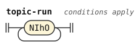</p>
<p></p>
<p></p>
</details>

## Statements and fragments

The connective after `.i` can be an ek or a VUhU as well as a joik or jek. A statement connective can also precede `.i`, as in `mi klama joi .i do klama`. Both are `connective`. Before `bo` after `.i`, the connective can also be an ek, and the tense is a `stag`, which is a `tag` here.

`sentence-link` joins a sentence to a following subsentence through a connective before `.i`. A stag can stand before `bo`, but only with `bo`. The subsentence can begin with a prenex, even an empty one, as in `mi klama su'i .i zo'u do klama`. It can hold another link, so these links group from the right.

A TUhE group is not a sentence, so `tu'e mi klama tu'u je .i do klama` fails, as in camxes-exp. Plain connections after `.i` stay in `statement-1` and group from the left. Connections with `bo` use `statement-2` and group from the right.

A bare `na` forms a term. So `na` and `na na` are terms fragments. The layer omits the separate `NA #` alternative from `fragment`, because it duplicates that reading.

```jbogenbau
%redefine-rule statement-1
  | statement-2
  | statement-1 I connective [statement-2]

%redefine-rule statement-2
  statement-3 [I [joik-jek-ek] [stag] BO # [statement-2]]

%redefine-rule statement-3
  sentence | [tag] TUhE # text-1 [+TUhU] #

%redefine-rule fragment
  ek # | gihek # | quantifier | terms [+VAU] # | prenex | relative-clauses | links | linkargs

%redefine-rule prenex
  [terms] ZOhU #
```

<details><summary>Railroad diagrams of the 5 rules from <code>statement-1</code> to <code>prenex</code></summary>
<p></p>
<p></p>
<p></p>
<p></p>
<p></p>
</details>

## Sentences and bridi-tails

A bridi-tail can have terms before its selbri. The terms and `cu` before a selbri form a `bridi-tail-head`. In a head, runs of terms and single `cu` words alternate: `mi cu do klama`, `cu mi klama`. A head can stand before the first bridi-tail of a sentence, and after each connective between bridi-tails. Examples are `mi klama je do tavla` and `mi klama gi'e cu do tavla`.

A term in a head is a term of a list. There a tense or modal, or a bare `na`, is not a term where a selbri follows it ("Terms" below). So `mi pu klama` has the tense `pu` on its selbri, and so does `mi pu sei do klama se'u klama`. And `mi na klama` negates its selbri.

The afterthought connective between bridi-tails can be a gihek, joik, jek, ek or VUhU (`bridi-tail-connective`). Each of them can also open a `bo` or `ke` grouping of bridi-tails. So can a bare `gi` with a stag, as in `mi klama gi ba bo tavla`.

A structural pattern tests a node and its children. Connected bridi-tails group from the left, and `bridi-tail-1` uses left recursion.[^cll-s14-10] After a plain connective, the headless selbri alternative excludes an initial KE tanru unit. The `gek-sentence` alternative still permits its KE wrapper. Without these limits, `gi'e ke` and `gi'e ba ke` can each open two constructs.

The listed-term queries apply in heads, tails, prenexes, fragments and `nu'i` termsets. They reserve a bare NA or tag for a following selbri or gek-sentence. A separate endpoint pattern excludes an unclosed tag at the end of a head. A written KU or final CU prevents that match.

```jbogenbau
%redefine-rule sentence
  (* sentence <- terms? bridi_tail_t1 ... (joik_jek (stag? BO_clause)? I_clause free* subsentence)* *)
  headed-bridi-tail [sentence-link]

%rule sentence-link
  connective [[stag] BO] I # subsentence

%rule bridi-tail-head
  | {terms / CU #} [CU #]
  | CU # [{terms / CU #} [CU #]]

%rule headed-bridi-tail
  [$h:bridi-tail-head] bridi-tail
%conditions
  $h ≇ @(⋱ @(tag KU="" [#]))

%rule headed-bridi-tail-2
  [$h:bridi-tail-head] bridi-tail-2
%conditions
  $h ≇ @(⋱ @(tag KU="" [#]))

%redefine-rule bridi-tail
  bridi-tail-1 [(bridi-tail-connective [stag] | GI stag) KE # headed-bridi-tail [+KEhE] # tail-terms]

%redefine-rule bridi-tail-1
  bridi-tail-2 | bridi-tail-1 bridi-tail-connective connected-bridi-tail tail-terms

%rule connected-bridi-tail
  | $h:bridi-tail-head bridi-tail-2
  | bridi-tail-2-not-starting-with-ke
%conditions
  $h ≇ @(⋱ @(tag KU="" [#]))

%redefine-rule bridi-tail-2
  bridi-tail-3 [(bridi-tail-connective [stag] | GI stag) BO # headed-bridi-tail-2 tail-terms]

%rule bridi-tail-2-not-starting-with-ke
  bridi-tail-3-not-starting-with-ke [(bridi-tail-connective [stag] | GI stag) BO # headed-bridi-tail-2 tail-terms]

%rule bridi-tail-3-not-starting-with-ke
  selbri-not-starting-with-ke tail-terms | gek-sentence

%redefine-rule gek-sentence
  gek subsentence gik subsentence tail-terms | [tag] KE # gek-sentence [+KEhE] # | NA # gek-sentence

%rule bridi-tail-connective
  gihek # | connective

%redefine-rule tail-terms
  [terms] [+VAU] #
```

<details><summary>Railroad diagrams of the 14 rules from <code>sentence</code> to <code>tail-terms</code></summary>
<p></p>
<p></p>
<p></p>
<p></p>
<p></p>
<p></p>
<p></p>
<p></p>
<p></p>
<p>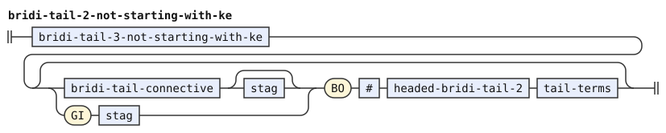</p>
<p>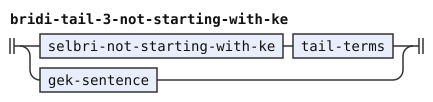</p>
<p></p>
<p></p>
<p></p>
</details>

## Terms

The layer joins terms at two levels. A connective, an optional stag and `bo` join terms into a `term-bo-group`. A plain connective joins those groups through `term-link`. So `bo` binds tighter: `broda be na ku .e bo na ku .a na ku` is `(na ku .e bo na ku) .a na ku`. The connectives are joik, jek, ek or VUhU (`connective`), so `mi joi do klama` has one term before its selbri.

The layer reads terms in two contexts. A `listed-term` stands in a sentence's head or tail terms, a prenex, a fragment or a `nu'i` termset. A `term` follows `be`, `bei`, GOI, LAhE or NAhE, which each take one term.

A listed bare NA or tag cannot stand before a selbri or gek-sentence. Queries enforce this restriction in every list position. A written KU or a final CU keeps the term distinct from the following selbri. A bare `na` is not a term where a connective begins at its NA token.

A term in a branch of a bare forethought termset (`gek-terms`) also follows the single-term rules. These permit a following selbri or gek-sentence. So `mi pe na klama` has a bare `na` after `pe`.

After a plain term connective, two tags protect connections at other levels. `Bridi-Connection-Start` marks a group that starts with a stag and `bo` or `ke` before a selbri or gek-sentence. `Sentence-Connection-Start` marks a group that starts with a stag, `bo` and `.i`. These forms remain connections of bridi-tails and sentences.

The tagged-term rules test the selected tag with `.without-elision.onward`. This view keeps the omitted terminators inside the selected tag. A query cannot shorten a free modifier inside that capture. The BO group keeps these start tags from its first part through every recursive link.

A tag can remain a term before the GI of an enclosing connection. A following GI does not by itself remove the tag term. Where a longer atom run begins a gek, the tense-modal preference selects the gek.

Listed bare NA tests `listed-na-follower`, which also excludes a following selbri or gek-sentence. The single-term rule excludes only a connective at its NA token.

`listed-term-bo-link` permits `bo` with or without a stag, as in `fa mi .e bo fe do klama`.

A connection that can be a sumti connection is one. Terms are connected only where the parts on the two sides of the connective cannot form one sumti. So `mi .e do klama` and `mi .e bo do klama` join two sumti. In `mi cadzu ca la pacac. bi'o la recac.`, the modal `ca` applies to one connected sumti. But `mi .e ca do klama` joins two terms, because `ca do` is a modal term and not a sumti.

Without this rule, each of the first three texts has two readings that elide the same terminators.

The rules `term` and `term-bo-group`, and their forms in a list of terms, state the rule. Each is left-recursive, so that its condition sees the part before a connective and the link after it. The condition refuses a link where the part before ends with a sumti that the connective can extend, and the link begins with a sumti. So the tree of three or more connected terms nests to the left, as they group.

Tags carry what the condition needs, so that it never parses the part before again. A tag `Link-Extensible-End` says that a part ends with a sumti that a plain connective can extend. `Bo-Extensible-End` says the same for a connective with `bo`. `Sumti-Start` says that a link begins with a sumti. A tense or modal before the sumti keeps these tags. Each of these rules passes them up from its first or its last part.

`sumti-2` has both end tags, since a connective can always extend it. A `ke` group with a written `ke'e` has none, so `mi .e ke do ke'e .e ko'a klama` joins two terms. After `vu'o`, a plain connective can extend the sumti, but a connective with `bo` cannot. `$EXTENSIBLE-END` holds the two end tags.

A termset closed by a written `nu'u` is never a sumti for this rule, and a link that begins with one has no `Sumti-Start`. So `mi .e ge do gi ti nu'u klama` joins two terms, the second a termset. Without `nu'u`, `mi .e ge do gi ti klama` joins two sumti, since the termset reading elides `nu'u`.

`pe'e` takes any statement connective. `terms-1` and its forethought form `gek-terms-1` are left chains. The added terms are bare `na` and a `soi` clause enabled by `soi-clause`. That clause contains a subsentence and ends with `se'u`. `fi'oi` and `xoi` are members of SOI.

A forethought termset needs no `nu'i`, and its two branches can hold different numbers of terms. The same words can often form a gek sumti or a termset.

The ranking prefers the sumti reading where both constructs can complete. The first branch of a termset, `termset-branch`, ends in `nu'u`, which the termset elides before `gi`. The sumti elides nothing there, so `late-elision` prefers it. So `ge mi gi do ce'e ti` is the sumti `ge mi gi do` followed by `ce'e ti`. But `broda be ge mi gi do ce'e ti be'o` has a termset, because the single argument of `be` cannot continue with `ce'e ti`.

The NUhI body ranks `gek-termset-body` before `terms`. A qualified forethought body excludes a plain body over the same span. Thus `nu'i ge mi gi do nu'u` contains two termset branches. The excluded plain body wraps the connected sumti `ge mi gi do` inside NUhI. In `nu'i ge mi gi do ko'a klama`, the second branch contains `do ko'a`.

A bare forethought termset can be the first term of the plain body. A written inner `nu'u` keeps its boundary distinct from the outer body. The preference applies only when both complete bodies span the same words.

NIhE keeps an ordinary elidable TEhU, so `ni'e broda` can end before `brode`. In `nu'i ge ni'e broda brode gi re mi nu'u klama`, the first branch contains one quantified sumti. NIhE supplies its quantifier, and `brode` supplies its predicate. The second branch contains `re mi`. In `nu'i ge ni'e broda brode gi re mi ko'a klama`, the second branch also contains `ko'a`.

```jbogenbau
%redefine-rule terms-1
  {... terms-2 / PEhE # connective}

%redefine-rule terms-2
  (* terms_2 <- abs_term (cehe_sa* CEhE_clause free* abs_term)* *)
  {listed-term / CEhE #}

%redefine-rule term
  (* term_1 <- term_2 (joik_ek !tag_bo_ke_bridi_tail !tag_bo_subsentence term_2)* *)
  | term-bo-group
  | $t:term $l:term-link :: $l.tags ∩ $EXTENSIBLE-END
%conditions
  Link-Extensible-End ⊈ $t.tags ∨ Sumti-Start ⊈ $l.tags

%rule term-bo-group
  (* term_2 <- term_3 (joik_ek stag? BO_clause term_3)* *)
  | term-3
  | $g:term-bo-group $l:term-bo-link :: ($g.tags ∩ (Sumti-Start ∪ $CONNECTION-START)) ∪ ($l.tags ∩ $EXTENSIBLE-END)
%conditions
  Bo-Extensible-End ⊈ $g.tags ∨ Sumti-Start ⊈ $l.tags

%rule term-bo-link
  connective [stag] BO # $u:term-3 :: $u.tags ∩ ($EXTENSIBLE-END ∪ Sumti-Start)

%rule term-link
  connective $g:term-bo-group :: $g.tags ∩ ($EXTENSIBLE-END ∪ Sumti-Start)
%conditions
  Bridi-Connection-Start ⊈ $g.tags,
  Sentence-Connection-Start ⊈ $g.tags

%rule tag-bo-ke-bridi-tail
  (* tag_bo_ke_bridi_tail <- stag (BO_clause / KE_clause) CU_elidible free* (selbri / gek_sentence) *)
  stag (BO | KE) [CU] # (selbri | gek-sentence)

%rule tag-bo-subsentence
  (* tag_bo_subsentence <- stag BO_clause I_clause *)
  stag BO I

%const $CONNECTION-START Bridi-Connection-Start ∪ Sentence-Connection-Start

%const $EXTENSIBLE-END Link-Extensible-End ∪ Bo-Extensible-End

%rule term-3
  (* term_3 <- sumti / tag_term / termset *)
  | $s:sumti :: $s.tags ∪ Sumti-Start
  | tagged-term
  | termset
  | NA # KU #
  | bare-na
  | soi-clause? soi-term

%rule bare-na
  (* !gek !ek !joik_jek !gihek NA_clause free* KU_elidible free* *)
  $n:NA #
%conditions
  ¬$n.onward.begins(na-connective)

%rule na-connective
  gek | joik-jek-ek | gihek

%rule soi-term
  SOI # subsentence [+SEhU] #

%rule tagged-term :: ($g.without-elision.onward.begins(tag-bo-ke-bridi-tail) ⟹ Bridi-Connection-Start) ∪ ($g.without-elision.onward.begins(tag-bo-subsentence) ⟹ Sentence-Connection-Start)
  (* tag_term: !gek tag free* followed by a sumti or KU_elidible free* *)
  | $g:tag $s:sumti :: $s.tags ∩ $EXTENSIBLE-END
  | $g:tag [+KU] #

%rule listed-term
  (* abs_term_1 <- abs_term_2 (joik_ek !tag_bo_ke_bridi_tail !tag_bo_subsentence abs_term_2)* *)
  | listed-term-bo-group
  | $t:listed-term $l:listed-term-link :: $l.tags ∩ $EXTENSIBLE-END
%conditions
  Link-Extensible-End ⊈ $t.tags ∨ Sumti-Start ⊈ $l.tags

%rule listed-term-bo-group
  (* abs_term_2 <- abs_term_3 (joik_ek stag BO_clause abs_term_3)*, with the stag optional *)
  | listed-term-3
  | $g:listed-term-bo-group $l:listed-term-bo-link :: ($g.tags ∩ (Sumti-Start ∪ $CONNECTION-START)) ∪ ($l.tags ∩ $EXTENSIBLE-END)
%conditions
  Bo-Extensible-End ⊈ $g.tags ∨ Sumti-Start ⊈ $l.tags

%rule listed-term-bo-link
  connective [stag] BO # $u:listed-term-3 :: $u.tags ∩ ($EXTENSIBLE-END ∪ Sumti-Start)

%rule listed-term-link
  connective $g:listed-term-bo-group :: $g.tags ∩ ($EXTENSIBLE-END ∪ Sumti-Start)
%conditions
  Bridi-Connection-Start ⊈ $g.tags,
  Sentence-Connection-Start ⊈ $g.tags

%rule listed-term-3
  (* abs_term_3 <- sumti / abs_tag_term / termset *)
  | $s:sumti :: $s.tags ∪ Sumti-Start
  | listed-tagged-term
  | termset
  | NA # KU #
  | listed-bare-na
  | soi-clause? soi-term

%rule listed-tagged-term :: ($g.without-elision.onward.begins(tag-bo-ke-bridi-tail) ⟹ Bridi-Connection-Start) ∪ ($g.without-elision.onward.begins(tag-bo-subsentence) ⟹ Sentence-Connection-Start)
  (* abs_tag_term: !gek tag free* !selbri !gek_sentence, then a sumti or an elided KU *)
  | $g:tag $s:sumti :: $s.tags ∩ $EXTENSIBLE-END
  | $g:tag [+KU] #
%conditions
  ¬$g.following-tokens.begins(selbri-after-tag)

%rule selbri-after-tag
  # (selbri | gek-sentence)

%rule listed-bare-na
  (* !selbri !gek_sentence !ek !joik_jek !gihek NA_clause free* KU_elidible free* *)
  $n:NA #
%conditions
  ¬$n.onward.begins(listed-na-follower)

%rule listed-na-follower
  selbri | gek-sentence | joik-jek-ek | gihek

%redefine-rule termset
  (* termset <- gek_termset / NUhI_clause free* gek terms NUhU_elidible free* gik terms NUhU_elidible free* / NUhI_clause free* terms NUhU_elidible free* *)
  | gek termset-branch gik gek-terms [+NUhU] #
  | termset-with-nuhi

%rule gek-termset-body
  (* NUhI_clause free* gek terms NUhU_elidible free* gik terms: tried before NUhI_clause free* terms *)
  gek terms [+NUhU] # gik terms

%rule termset-branch
  gek-terms [+NUhU] #

%rule gek-terms
  {gek-terms-1}

%rule gek-terms-1
  {... gek-terms-2 / PEhE # connective}

%rule gek-terms-2
  {term / CEhE #}

%rule termset-with-nuhi
  NUhI # (gek-termset-body ≻ terms) [+NUhU] #
```

<details><summary>Railroad diagrams of the 29 rules from <code>terms-1</code> to <code>termset-with-nuhi</code></summary>
<p></p>
<p>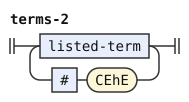</p>
<p></p>
<p></p>
<p></p>
<p></p>
<p>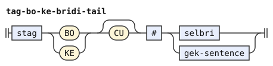</p>
<p>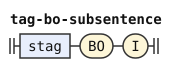</p>
<p></p>
<p></p>
<p></p>
<p></p>
<p></p>
<p>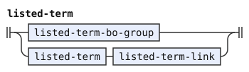</p>
<p>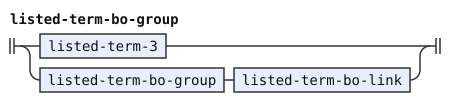</p>
<p>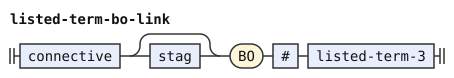</p>
<p>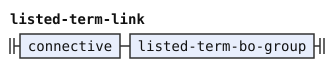</p>
<p>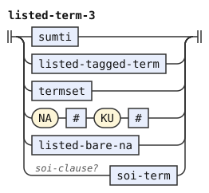</p>
<p>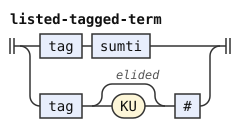</p>
<p>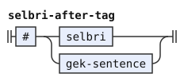</p>
<p>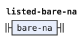</p>
<p>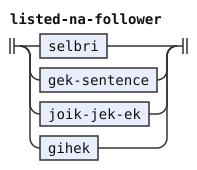</p>
<p></p>
<p></p>
<p></p>
<p></p>
<p></p>
<p></p>
<p></p>
</details>

## Sumti

Sumti connectives are ek, joik, jek or VUhU (`connective`). This change and the new mekso below leave the CLL rule `joik-ek` unused. After `vu'o`, a connected sumti can follow the relative clauses or replace them, and `vu'o` can also end the sumti (`mi vu'o`). Under `cbm` a cmevla is a selbri word, so the layer removes the `la CMEVLA` name form, and `la .alis.` is a description. That form begins with `la`, `lai` or `la'i`, which are words of LE here, and `name-marker` names them by their values. The new sumti are these:

- `na'e` and `lu'u` surround a sumti, without `bo`.
- `la'e` or `na'e bo` around a term that is not a sumti, such as `na ku` or a tense or modal with its sumti or `ku`
- `na'e` around a term that is neither a sumti nor a tense or modal with its sumti or `ku`, such as `na ku`
- `lo'oi` and `ku'au` surround a subsentence as a description.
- The single-word quotes `zo'oi`, `la'oi` and `ra'oi`, whose bodies the word stage delimits

A bare NAhE cannot wrap one tagged term, even when that term omits KU. The pattern tests the actual `tagged-term` constructor. A connected term can begin with such a term, as in `na'e pu ku .e na ku lu'u`. This grammar also accepts `mi na'e pu .e ca lu'u klama`, with both inner KUs omitted.

The inner sumti of a description can be any sumti, including a connected one, as in `lo mi .e do broda`. It cannot start with a quantifier. Thus `lo re mi broda` contains `lo re mi` and the selbri `broda`.

`Quantifier-Start` marks a sumti that begins with its own quantifier. A plain, BO or KE connection takes the mark from its first sumti, and so does a sumti with `vu'o`. Even when its first branch has the mark, a forethought connection has none. The rule `sumti-tail` refuses a possessor with the mark. The rules `sumti-2` and `sumti-3` use recursion, because a chain cannot name its first item.

A description can take a forethought sentence in place of a selbri, and so can a quantifier without a descriptor. Examples are `le ga mi klama gi do klama ku` and `re ga mi klama gi do klama ku`.

```jbogenbau
%redefine-rule sumti
  | sumti-1
  | $s:sumti-1 VUhO # [relative-clauses] :: Link-Extensible-End ∪ ($s.tags ∩ Quantifier-Start)
  | $s:sumti-1 VUhO # [relative-clauses] connective $i:sumti :: ($s.tags ∩ Quantifier-Start) ∪ ($i.tags ∩ $EXTENSIBLE-END)

%redefine-rule sumti-1
  | sumti-2
  | $s:sumti-2 connective [stag] KE # $i:sumti [+KEhE] # :: ($s.tags ∩ Quantifier-Start) ∪ (KEhE ⊈ $i.following-tokens.first-token.tags ⟹ $i.tags ∩ $EXTENSIBLE-END)

%redefine-rule sumti-2 :: $EXTENSIBLE-END ∪ ($s.tags ∩ Quantifier-Start)
  | $s:sumti-3
  | $s:sumti-2 connective sumti-3

%redefine-rule sumti-3 :: $s.tags ∩ Quantifier-Start
  | $s:sumti-4
  | $s:sumti-4 connective [stag] BO # sumti-3

%redefine-rule sumti-5
  | [$q:quantifier] sumti-6 [relative-clauses] :: $q ⟹ Quantifier-Start
  | quantifier (selbri | gek-sentence) [+KU] # [relative-clauses] :: Quantifier-Start

%redefine-rule sumti-6
  | (LAhE # | NAhE BO # | NAhE #) [relative-clauses] sumti [+LUhU] #
  | (LAhE # | NAhE BO #) $t:term [+LUhU] #
  | NAhE # $u:term [+LUhU] #
  | KOhA #
  | lerfu-string free-after-lerfu-string
  | ¬cbm? name-marker # [relative-clauses] {CMEVLA} #
  | LE # sumti-tail [+KU] #
  | LOhOI # subsentence [+KUhAU] #
  | LI # mex [+LOhO] #
  | ZO any-word #
  | LU text [+LIhU] #
  | LOhU [{any-word}] LEhU #
  | ZOI any-word anything any-word #
  | ZOhOI anything #
%conditions
  $t ≇ @(sumti),
  $u ≇ @(sumti),
  $u ≇ @(tagged-term)

%redefine-rule sumti-tail
  | $s:sumti sumti-tail-1
  | sumti-tail-1
  | relative-clauses sumti-tail-1
  | gek-sentence
%conditions
  Quantifier-Start ⊈ $s.tags
```

<details><summary>Railroad diagrams of the 7 rules from <code>sumti</code> to <code>sumti-tail</code></summary>
<p></p>
<p></p>
<p></p>
<p></p>
<p></p>
<p></p>
<p></p>
</details>

## Relative clauses

Consecutive relative clauses can be joined by a joik, a jek or an ek, as well as by `zi'e`. Two groups of them can be connected in forethought (`ge poi broda gi poi brode`).

```jbogenbau
%redefine-rule relative-clauses
  | {relative-clause / ZIhE # | joik-jek-ek #}
  | gek relative-clauses gik relative-clauses

%redefine-rule relative-clause
  GOI # term [+GEhU] # | NOI # subsentence [+KUhO] #
```

<details><summary>Railroad diagrams of <code>relative-clauses</code> and <code>relative-clause</code></summary>
<p></p>
<p></p>
</details>

## Selbri and tanru

`joik-jek-ek` groups joik, jek and ek. `connective` adds VUhU. All four families connect selbri and tanru units. Abstraction markers use those four families, as in `mi nu e ka broda` and `mi nu su'i ka broda`. A KE connection uses only `joik-jek-ek`.

A bare `fa`, which matches the rule `tag`, can come before a selbri. The term after `be` or `bei` can be absent. The new tanru units are a cmevla, under `cbm`, and preposed linked arguments (`lo be mi broda`). `me'oi` with the word that it quotes is a tanru unit too (`le me'oi klama cu broda`).

`me-unit` takes a sumti or a mekso. A sumti reading excludes a mekso only when both read the same words with the same boundaries. The mekso query restores its omitted terminators, so a competing sumti cannot move an inner close or shorten a free modifier.

The whole `mex MOI #` construction outranks an SE conversion over the same span. A mekso can begin with SE through a forethought `gek`, as in `mi se ga pa gi re moi`.

NAhE stays outside this group. Late elision puts `na'e` on `pa moi` in `la djonz. cu na'e pamoi cusku`, because the mekso option omits LUhU earlier.

In `mi me la'e ge my gi ny su'i zy moi`, ME takes the complete sumti operand. Its LAhE holds the forethought sumti and the following connection.

`selbri-4` keeps the left recursion of the CLL rule, and `selbri-5` is a right chain. In the plain form of `selbri-4`, the connective is `plain-connective`, all four families, with the KE preference. A joik, jek or ek directly before `ke` is `joik-before-ke`, and its unit cannot be only a `ke` group. So `mi broda joi ke brode ke'e` joins a `ke` group with `joi`, through `joik-jek-ek [stag] KE`.

Where only the plain reading parses, the layer keeps it. So `mi broda joi ke brode ke'e bo brodi` joins `broda` to the unit `ke brode ke'e bo brodi`.

The inherited `$KE-UNIT` pattern tests the actual KE constructor. `tanru-unit` uses one repetition with optional relative clauses. Additional children prevent the single-child match, as in the CLL grammar.

A group of preposed linked arguments comes before a whole `tanru-unit-1`. A `be` group attaches to the tanru unit before it, where there is one. So a unit without a group of its own cannot be directly followed by `be` (`tanru-unit-1`). A preposed group stands only where no such unit comes before it, as at the start of a selbri or after a connective.

So `zdani be mi vorme` gives `be mi` to `zdani`, and `le tutci be sigdanva le marna` gives an empty `be` group to `tutci`. Without the rule, each text has two readings that elide the same terminators.

In `be mi klama be do be ti`, `be do` belongs to `klama`, and `be ti` to the whole unit. In `be mi klama be do`, `be do` belongs to `klama`. The whole unit cannot take it, because `klama` then stands directly before `be`.

A tanru unit can take a selbri relative clause. The clause opens with `no'oi`, contains a subsentence, and ends with `ku'oi`. In that clause, `ke'a` refers to the selbri, as in `mi klama no'oi bajra`. They are joined as relative clauses are: by `zi'e`, a joik, a jek or an ek, or two groups of them in forethought.

```jbogenbau
%redefine-rule selbri-4
  | selbri-5
  | selbri-4 plain-connective selbri-5
  | selbri-4 joik-before-ke selbri-5-not-ke-group
  | selbri-4 joik-jek-ek [stag] KE # selbri-3 [+KEhE] #

%rule plain-connective
  | $j:joik-jek-ek #
  | VUhU #
%conditions
  KE ⊈ $j.following-tokens.first-token.tags

%redefine-rule selbri-5
  {selbri-6 ... / connective [stag] BO #}

%rule selbri-not-starting-with-ke
  [tag] selbri-1-not-starting-with-ke

%rule selbri-1-not-starting-with-ke
  selbri-2-not-starting-with-ke | NA # selbri

%rule selbri-2-not-starting-with-ke
  selbri-3-not-starting-with-ke [CO # selbri-2]

%rule selbri-3-not-starting-with-ke
  selbri-4-not-starting-with-ke | selbri-3-not-starting-with-ke selbri-4

%rule selbri-4-not-starting-with-ke
  | selbri-5-not-starting-with-ke
  | selbri-4-not-starting-with-ke plain-connective selbri-5
  | selbri-4-not-starting-with-ke joik-before-ke selbri-5-not-ke-group
  | selbri-4-not-starting-with-ke joik-jek-ek [stag] KE # selbri-3 [+KEhE] #

%rule selbri-5-not-starting-with-ke
  selbri-6-not-starting-with-ke [connective [stag] BO # selbri-5]

%rule selbri-6-not-starting-with-ke
  tanru-unit-not-starting-with-ke [BO # selbri-6] | [NAhE #] guhek selbri gik selbri-6

%redefine-rule tanru-unit
  {tanru-unit-1 / CEI #} [selbri-relative-clauses]

%redefine-rule tanru-unit-1
  | $u:tanru-unit-2
  | tanru-unit-2 linkargs
%conditions
  BE ⊈ $u.following-tokens.first-token.tags

%redefine-rule tanru-unit-2
  | KE # selbri-3 [+KEhE] #
  | BRIVLA #
  | cbm? CMEVLA #
  | GOhA [RAhO] #
  | me-unit
  | (mex MOI # ≻ SE # tanru-unit-2)
  | NUhA # operator
  | JAI # [tag] tanru-unit-2
  | NAhE # tanru-unit-2
  | abstractor-chain subsentence [+KEI] #
  | linkargs tanru-unit-1
  | MEhOI anything #

%rule me-unit
  ME # (sumti | $m:mex) [+MEhU] # [MOI #]
%conditions
  ¬$m.without-elision.matches(sumti)

%rule tanru-unit-not-starting-with-ke
  tanru-unit-1-not-starting-with-ke [{CEI # tanru-unit-1}] [selbri-relative-clauses]

%rule tanru-unit-1-not-starting-with-ke
  | $u:tanru-unit-2-not-starting-with-ke
  | tanru-unit-2-not-starting-with-ke linkargs
%conditions
  BE ⊈ $u.following-tokens.first-token.tags

%rule tanru-unit-2-not-starting-with-ke
  | BRIVLA #
  | cbm? CMEVLA #
  | GOhA [RAhO] #
  | me-unit
  | (mex MOI # ≻ SE # tanru-unit-2)
  | NUhA # operator
  | JAI # [tag] tanru-unit-2
  | NAhE # tanru-unit-2
  | abstractor-chain subsentence [+KEI] #
  | linkargs tanru-unit-1
  | MEhOI anything #

%redefine-rule abstractor-chain
  {... NU # / connective}

%rule selbri-relative-clauses
  | {selbri-relative-clause / ZIhE # | joik-jek-ek #}
  | gek selbri-relative-clauses gik selbri-relative-clauses

%rule selbri-relative-clause
  NOhOI # subsentence [+KUhOI] #

%redefine-rule linkargs
  BE # [term] [links] [+BEhO] #

%redefine-rule links
  BEI # [term] [links]
```

<details><summary>Railroad diagrams of the 22 rules from <code>selbri-4</code> to <code>links</code></summary>
<p></p>
<p>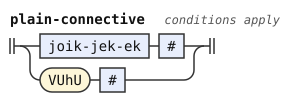</p>
<p></p>
<p>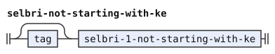</p>
<p>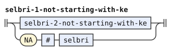</p>
<p>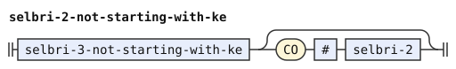</p>
<p>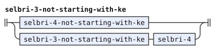</p>
<p>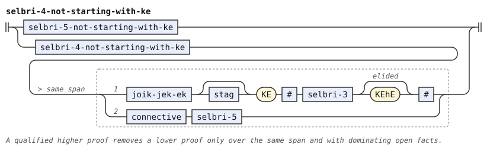</p>
<p>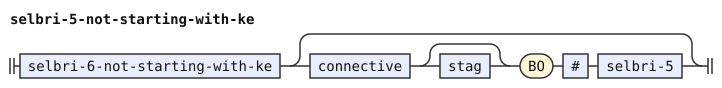</p>
<p>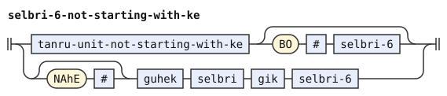</p>
<p></p>
<p></p>
<p></p>
<p></p>
<p>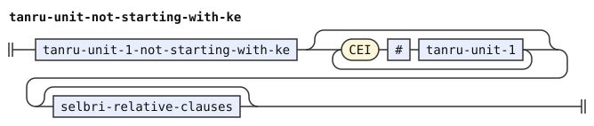</p>
<p>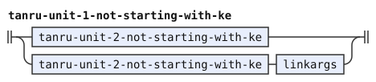</p>
<p>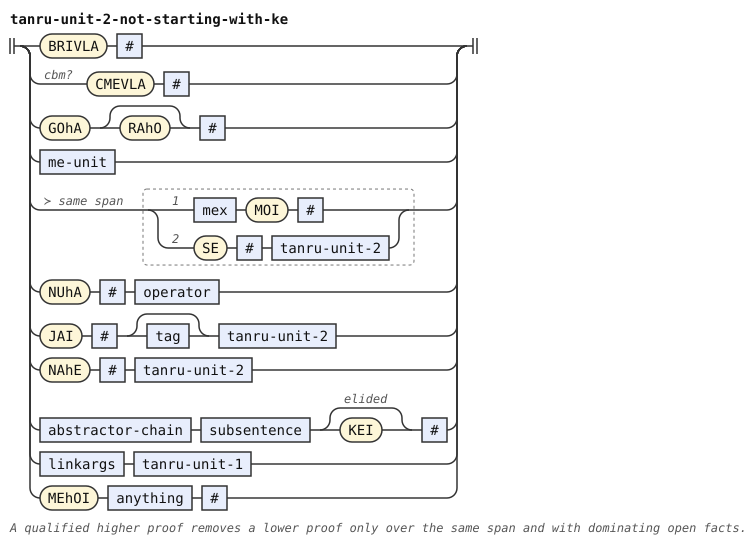</p>
<p></p>
<p></p>
<p></p>
<p></p>
<p></p>
</details>

## Numbers, lerfu strings and mekso

The layer reads mekso with the rules below. No reachable rule calls `operand`, `operand-1` to `operand-3` or `rp-operand`. The forms are these:

- A number is a run of PA words, `ni'e` selbri and `mo'e` sumti, with no lerfu word in it. A lerfu string starts with a letter word and continues with letter words or PA. Thus `li cy mu my ci no` is one date expression, while `li pa by` is two terms.
- `mex-2` reads a number, a lerfu string, a `vei` group, a forethought connection, or a `la'e` or `na'e` reference. It can also be a forethought expression, with or without `pe'o`, or a reverse Polish expression. The operands `ni'e` and `mo'e` are inside numbers. There is no `jo'i` array, although the lexicon has `jo'i`.
- `bo` after an operator, with an optional tense or modal, groups two operands tighter (`li pa su'i bo re`). There is no `bi'e`. A forethought operator takes one or more mekso operands, as in `li gei so'i`.
- An operator can be any of the four connective families. Each has one final slot of free modifiers.
- Plain operator connections use `plain-connective`, with all four families. BO and KE connections use `joik-jek-ek`, without VUhU. The KE preference covers JOI, JA and A. So `li ci su'i joi ke pi'i ke'e re du li xa` joins `su'i` to the operator's own `ke` group. Where the operator goes on after its `ke` group, as in `ke pi'i ke'e je bo vu'u`, only the plain reading parses. The layer keeps it.
- A quantifier is a whole mekso, as in `pa su'i re broda`. A competing `sumti-6` or selbri at its start excludes it. The queries preserve the selected mekso's omitted terminators and free-modifier boundaries. The `sumti-6` constructor holds a sumti without its own outer quantifier. Numeric LAhE and NAhE operands remain possible where no such sumti exists. So in `mi piso'umei jimpe`, `pi so'u mei jimpe` is the selbri, and not a quantifier of a description.
- The first branch of a forethought quantifier cannot begin a `sumti-6` either. The rule `gek-barrier` tests that branch, including nested connections. So in `ge nai abu gi no drata`, `ge nai ... gi` joins the two sumti `abu` and `no drata`. The quantifier `ge nai abu gi no` over `drata` is not a reading. In the same way, `ge ge abu gi by gi no drata` joins two sumti, and the first one connects `abu` and `by`.
- A forethought connection of numbers can form a quantifier, as in `lo ge pa gi re mi broda`. Numeric references also remain possible, as in `ge la'e pa gi re broda`.
- Where no sumti reading remains, `gek-barrier` rejects the text, as in `ge abu gi by broda cu klama`. In `lo ge by gi re mi broda`, `ge by gi re mi` is the possessor sumti, with `broda` inside the description.
- `me` takes a mekso as well as a sumti, a whole mekso takes `moi`, and `nu'a` takes a whole operator.

`mex` is the chain of operators itself, a left chain. So the CLL rule `mex-chain` is not reached here. A reverse Polish expression is not an infix chain, and stays a flat list. `operator` keeps the left recursion of the CLL rule.

An initial SE in an operator is its mathematical conversion. The connective alternative excludes that initial SE to avoid a duplicate inner conversion.

A number is followed by `free-after-number`, and a lerfu string by `free-after-lerfu-string`, defined under "Free modifiers", and not by a plain `#`.

```jbogenbau
%redefine-rule quantifier
  (* quantifier <- !selbri !sumti_6 mex *)
  $m:mex
%conditions
  ¬$m.without-elision.onward.begins(sumti-6),
  ¬$m.without-elision.onward.begins(gek-barrier),
  ¬$m.without-elision.onward.begins(selbri)

%rule gek-barrier
  gek (sumti-6 | gek-barrier)

%redefine-rule mex
  {... mex-1 / operator}

%redefine-rule mex-1
  mex-2 [operator [stag] BO # mex-1]

%redefine-rule mex-2
  | number free-after-number
  | lerfu-string free-after-lerfu-string
  | VEI # mex [+VEhO] #
  | gek mex gik mex-2
  | (LAhE # | NAhE # [BO #]) mex [+LUhU] #
  | [PEhO #] operator {mex} [+KUhE] #
  | FUhA # rp-expression

%redefine-rule rp-expression
  mex-1 [{rp-expression operator}]

%redefine-rule operator
  | operator-1
  | operator plain-connective operator-1
  | operator joik-before-ke operator-1-not-ke-group
  | operator joik-jek-ek [stag] KE # operator [+KEhE] #

%redefine-rule operator-1
  | operator-2
  | guhek operator-1 gik operator-2
  | operator-2 joik-jek-ek [stag] BO # operator-1

%redefine-rule operator-2
  | mex-operator
  | KE # operator [+KEhE] #

%redefine-rule mex-operator
  | SE # mex-operator
  | NAhE # mex-operator
  | MAhO # mex [+TEhU] #
  | NAhU # selbri [+TEhU] #
  | $c:connective
%conditions
  SE ⊈ $c.first-token.tags

%redefine-rule number
  {number-part}

%rule number-part
  PA | NIhE # selbri [+TEhU] # | MOhE # sumti [+TEhU] #

%redefine-rule lerfu-string
  lerfu-word [{PA | lerfu-word}]
```

<details><summary>Railroad diagrams of the 13 rules from <code>quantifier</code> to <code>lerfu-string</code></summary>
<p></p>
<p></p>
<p></p>
<p></p>
<p></p>
<p></p>
<p></p>
<p></p>
<p></p>
<p></p>
<p></p>
<p></p>
<p></p>
</details>

## Logical and non-logical connectives

The connective rules below have no NAI slot. The indicator stage attaches every NAI after a connective, so no separate `nai` reaches the syntax at those positions.

An ek connects sumti with A, and a jek connects predicates with JA. Both permit negation with NA and conversion with SE. An interval connective uses BIhI, with optional conversion. A gik separates forethought branches with GI and permits free modifiers after it.

A joik permits `na` before a word of JOI. So `mi na joi do klama` has one term, `mi na joi do`. The `bare-na` and `listed-bare-na` conditions exclude a bare NA term where NA begins a connective. The words can connect sumti or terms, and the term conditions keep the sumti reading.

A forethought connective can be `ga` or `gu` followed by a joik, jek, ek or VUhU, as in `ga je lo mlatu gi lo gerku`. With `ga`, it is a gek. With `gu`, it is a guhek, as in `mi gu je melbi gi kargydu'e`. The connective before `gi` in a gek can also be a jek or an ek (`je gi mi broda gi mi brode`). A gihek can be `gi` followed by a word of JOI, JA or A (`mi klama gi je tavla`).

After `ga` or `gu`, an SE word can convert the whole connective, as in `ga se su'i mi gi do`. This is the outer conversion. The alternative without outer conversion cannot begin with SE, so `ga se je mi gi do` has one reading. A second SE belongs to the inner connective, as in `ga se se je mi gi do`. After NA, an SE word stays inside the connective, as in `ga na se je mi gi do`. The rule `prefixed-connective` states this for both prefixes.

The rules name the two words by their values, `GA="ga"` and `GA="gu"`, which ignores stress. They keep the class GA, because a word that `zo` quotes has the value but not the class.

```jbogenbau
%redefine-rule ek
  [NA] [SE] A

%redefine-rule jek
  [NA] [SE] JA

%redefine-rule joik
  [NA] [SE] JOI | interval | GAhO interval GAhO

%redefine-rule interval
  [SE] BIhI

%rule joik-jek-ek
  joik | jek | ek

%rule connective
  joik-jek-ek # | VUhU #

%redefine-rule joik-before-ke
  $j:joik-jek-ek #
%conditions
  KE ⊆ $j.following-tokens.first-token.tags

%redefine-rule gek
  | [SE] GA #
  | GA="ga" # prefixed-connective
  | joik-jek-ek GI #
  | stag gik

%redefine-rule guhek
  | [SE] GUhA #
  | GA="gu" # prefixed-connective

%redefine-rule gik
  GI #

%rule prefixed-connective
  | SE connective
  | $c:connective
%conditions
  SE ⊈ $c.first-token.tags

%redefine-rule gihek
  [NA] [SE] (GIhA | GI (JOI | JA | A))
```

<details><summary>Railroad diagrams of the 12 rules from <code>ek</code> to <code>gihek</code></summary>
<p></p>
<p></p>
<p></p>
<p></p>
<p></p>
<p></p>
<p>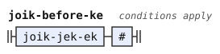</p>
<p></p>
<p></p>
<p></p>
<p></p>
<p></p>
</details>

## Tenses and modals

A tense or modal (the rule `tag`) is a run of atoms: `pu ba vi ca`, `ki ba`. So nothing reads the CLL rules `simple-tense-modal`, `time`, `time-offset`, `space`, `space-offset`, `space-interval`, `space-int-props` and `interval-property`. Each atom can have `na'e` and `se` before it, and free modifiers after it: `na'e pu na'e ca`, `jai se ki broda`. An atom is one of these:

- A word of BAI, CAhA, CUhE, KI, ZI, PU, VA, ZEhA, VEhA or VIhA
- A word of FAhA, with an optional `mo'i` before it
- A word of ROI after a number or a `vei` group, with an optional `fe'e` before them
- A word of TAhE or ZAhO, with an optional `fe'e` before it
- `fi'o` with a selbri

A joik, jek, ek or VUhU connects tenses and modals, and `tag` is a left chain of them. A run of atoms is a flat list, since nothing connects them. A `stag` is a `tag`. So a stag can be a run of atoms (`ko'a .e pu ba bo ko'e broda`). It can also be a `fi'o` selbri (`mi klama .i fi'o broda fe'u bo do klama`).

`fa` is an atom too, and it is the only way a place marker enters the grammar. So `fa` alone matches `tag` wherever that rule can stand: before a sumti (`fa mi`), a selbri (`mi fa klama`) or `bo`, and after `jai` (`jai fa broda`). It can be converted like a modal (`se fa`) or joined to other atoms (`mi fa pu klama`).

The `tense-modal` flag prefers the earliest, longest atom run among complete readings. Thus `pu ca gi` begins one gek instead of a separate PU term before `ca gi`.

```jbogenbau
%redefine-rule tag
  {... tense-modal / connective}

%redefine-rule stag
  tag

%redefine-rule(leftmost-longest) tense-modal
  {tense-atom}

%rule tense-atom
  | [NAhE] [SE] (BAI | CAhA | CUhE | KI | ZI | PU | VA | [MOhI] FAhA | ZEhA | VEhA | VIhA) #
  | [NAhE] [SE] [FEhE] ((number | VEI # mex [+VEhO] #) ROI | TAhE | ZAhO) #
  | [NAhE] [SE] FIhO # selbri [+FEhU] #
  | [NAhE] [SE] FA #
```

<details><summary>Railroad diagrams of <code>tag</code>, <code>stag</code>, <code>tense-modal</code> and <code>tense-atom</code></summary>
<p></p>
<p></p>
<p></p>
<p></p>
</details>

## Free modifiers, vocatives and indicators

A replacement quote is a free modifier. It has up to two runs of words, each opened by a word of LOhAI (`lo'ai` or `sa'ai`), and then `le'ai`. The word stage reads the words inside as raw words ([`../words/lohai.md`](../words/lohai.md)).

`soi` is a free modifier here only without `soi-clause`. Under `cbm`, the layer removes the form of a vocative with a run of names, because a cmevla is then a selbri word. With both forms, their two readings tie.

A vocative starts with a run of COI words, DOI, or both. A COI run returns no tags, and DOI alone keeps its tags. The indicator stage attaches any following NAI to the preceding word, so the syntax reads no separate NAI after COI.

`free-after-number` and `free-after-lerfu-string` follow a number or a lerfu string. Each is an optional `boi` and the free-modifier slot. A written BOI permits a separate number or lerfu string after it.

With BOI omitted, the first-token test starts at the selected free slot and sees the remaining input, even when the slot reads nothing. PA, NIhE and MOhE start number parts. BY, LAU and TEI start letter words, and PA also continues a letter string. A word of `$NUMBER-START` continues a number, and a word of `$LERFU-CONTINUATION` continues a letter string. The constants `$NUMBER-START` and `$LERFU-CONTINUATION` hold these classes.

So `pa so mo'o` is the number `pa so`, and not `pa` followed by the ordinal `so mo'o`. But `li pa by mai lo'o` has the free modifier `by mai`. The elided `boi` is an elided node of the tree.

A subscript after a subscript nests. The second subscript belongs to the first.[^cll-s18-13] So in `xa xi xa xi xa`, the first `xa` has one subscript, and that subscript has its own.

The `free` preference selects this nesting because the nested subscript is the longer modifier at the first `xi`.

A non-XI modifier in the subscript operand's final free slot attaches to the marked word. In `mi broda xi pa boi to do toi`, the subscript and parenthesis both belong to `broda`.

The condition on XI tests `$FREE-ENDING` along the actual last-child path. That pattern finds a final free slot with a `$NON-XI-FREE` modifier. A modifier inside a terminated operand stays there, even when its terminator is omitted. An omitted closer stops the path only when no later child remains. A nonempty free slot after the closer remains the exposed final slot, as in `[+VEhO] #` or `[+BOI] #`. A written closer before the modifier leaves it in the exposed final slot.

The condition excludes an exposed modifier attachment when the modifier belongs to the marked word. It keeps a modifier inside VEI, LAhE, or PEhO when the actual constructor boundary follows that modifier.

```jbogenbau
%const $NON-XI-FREE @(free) ∖ @(XI ⋯)
%const $FREE-ENDING @(⋱ (# ∩ @(⋯ $NON-XI-FREE ⋯)))

%redefine-rule(leftmost-longest) free
  | SEI # [terms [CU #]] selbri [+SEhU]
  | vocative [relative-clauses] selbri [relative-clauses] [+DOhU]
  | ¬cbm? vocative [relative-clauses] {CMEVLA} # [relative-clauses] [+DOhU]
  | vocative [sumti] [+DOhU]
  | mex-2 MAI
  | TO text [+TOI]
  | XI # $m:mex-2
  | LOhAI [{lohai-word}] [LOhAI [{lohai-word}]] LEhAI
  | LEhAI
  | ¬soi-clause? SOI # sumti [sumti] [+SEhU]
%conditions
  $m ≇ $FREE-ENDING

%redefine-rule vocative
  | {COI} :: ∅
  | DOI
  | {COI} DOI

%rule name-marker
  LE="la" | LE="lai" | LE="la'i"

%const $NUMBER-START PA ∪ NIhE ∪ MOhE

%const $LERFU-CONTINUATION PA ∪ BY ∪ LAU ∪ TEI

%rule free-after-number
  (* number BOI_elidible free*: after an elided boi, the number has read every number part *)
  [+BOI] $f:#
%conditions
  BOI ⊆ $.first-token.tags ∨ $NUMBER-START ∩ $f.onward.first-token.tags ⊆ ∅

%rule free-after-lerfu-string
  (* After an elided BOI, the string has read every continuing letter or PA. *)
  [+BOI] $f:#
%conditions
  BOI ⊆ $.first-token.tags ∨ $LERFU-CONTINUATION ∩ $f.onward.first-token.tags ⊆ ∅

%rule lohai-word
  Word<¬LOhAI ¬LEhAI>
```

<details><summary>Railroad diagrams of the 6 rules from <code>free</code> to <code>lohai-word</code></summary>
<p></p>
<p></p>
<p></p>
<p></p>
<p></p>
<p></p>
</details>

## Choosing among parses

Where a text has more than one parse, the stage follows [the notation document](../../docs/notation.md), under "Ranked choices", "Ambiguity", and "Elided terminators". A ranked choice filters alternatives at one written position. The stage ranks admitted derivations by `leftmost-longest`, then `late-elision`. `late-elision` counts the omitted terminators of each admitted derivation at each boundary. Fewer omitted terminators win at the first differing boundary. Two best derivations with equal counts at every boundary tie, and a tie is an error.

For example, `le sutra tavla` has two parses. One is a statement with the description `le sutra`, whose `ku` is elided before `tavla`, and the selbri `tavla`. The other is a fragment, the single description `le sutra tavla`, whose `ku` is elided at the end. `late-elision` takes the fragment.

## Differences from CLL and camxes-exp

camxes-exp tries alternatives in order. This layer considers complete readings and uses conditions or ranked choices to select among them. Both this layer and CLL read `le sutra tavla` as a fragment.

The experimental lexicon follows camxes-exp's classes, including the classes absent from CLL. This layer never reads a CLL class that camxes-exp lacks, such as LA. The experimental dialect enables `cbm` and `soi-clause` because camxes-exp cannot disable them. A caller can disable either here. With `soi-clause` off, `soi` retains CLL's reciprocity form.

The layer writes `[+X] #` where CLL writes `[+X #]`. This permits free modifiers after omitted terminators and explains many restated rules. The number and lerfu conditions keep each run together despite that extra slot. camxes-exp also reads those runs as far as possible. This layer and camxes-exp give the sentence reading to `to mi klama` and `lu mi klama`.

The layer omits `elision-only`, the option that applies CLL's rule that a terminator can be omitted only where no ambiguity results.[^cll-s21-1] Some ambiguities here concern constructs rather than terminators. camxes-exp settles those by alternative order. Here, the connective, term, linked-argument and subscript conditions settle them explicitly. The experimental terminators `ku'au` and `ku'oi` remain elidable, like CLL's terminators.

### Text and sentence connections

camxes-exp's joik includes A, so an ek can follow a text-leading `.i`. CLL instead reads `.i e` as `.i` before an ek fragment. CLL accepts `mi .i e` and `mi .i e .i do klama`. This layer rejects them because `.i e` requires a preceding statement, and `mi` is a fragment. It accepts `.i e .i mi klama`, `.i e .i e mi klama` and `.i e .ije mi klama`, as camxes-exp does.

CLL reads a bare jek answer to `je'i` only in its text-initial connective slot. Therefore CLL always reads `.ije` as a connective, never as `.i` before an answer. This layer applies the same choice to `.i e`, which agrees with camxes-exp. CLL and camxes-exp keep `.i gi'e` and `mi klama .i gi'e` as fragment answers.

A free modifier can still separate `.i` from an ek fragment. Neither CLL nor this layer permits bare `ge'i` or `gu'i` answers.[^cll-s14-13][^cll-e14-105] This layer rejects `.i e gi mi gi do` and `mi klama .i je gi mi gi do`, as camxes-exp does. The `.i` takes the initial connective.

The CLL grammar's `text-1` reads initial `.i ni'o`, as [its repair list](cll.md#printed-rules-and-translations) explains. This layer permits `.i` after a topic run and its free modifiers, because separators can stand on either side of topic markers. Thus `ni'o coi do .i mi klama` keeps DO in the vocative. Neither printed CLL nor camxes-exp provides that separator position. Printed CLL instead shortens the vocative and reads DO as a fragment before `.i`. camxes-exp rejects that text at `klama`.

Empty paragraphs between topic runs also follow camxes-exp's optional `paragraph`. CLL requires a nonempty paragraph there. So this layer accepts `ni'o coi ni'o coi` to preserve free modifiers between topic markers.

Within a paragraph break, `.i ni'o` can stand once, after a topic run and its free modifiers. It precedes the text-leading `.i` forms. This form permits a topic change inside a reply. CLL and camxes-exp reject `mi klama ni'o .i ni'o`. Another such transition needs an intervening nonempty paragraph. A final `ni'o` also follows camxes-exp.

camxes-exp has no text-leading run of names. This layer excludes that form with `cbm` on and retains CLL's form with it off.

This layer permits all four initial connective families, as in `je mi klama`, `e mi klama` and `su'i mi klama`. An ek or a VUhU needs a nonempty `text-1`, so a bare `e` remains a fragment. camxes-exp contains the wider form, but `text_1` can match nothing. Thus its `(!text_1 joik_jek)?` never consumes a connective. This layer makes that connective reachable. No reachable rule calls the CLL rules `joik-jek` or `plain-joik-jek`.

Where both complete, the ek fragment takes priority over the initial connective. Thus `e ni'o` and `e .i mi klama` keep their fragment readings. This preference also applies after the initial name run with `cbm` off.

The statement connectives follow camxes-exp, including `mi klama joi .i do klama` and `mi klama .e pu bo .i do klama`. Plain connections after `.i` and plain bridi-tail connections retain CLL's left grouping.[^cll-s14-7][^cll-s14-10] Connections after `.i` with `bo` group from the right. Bare `na` instead forms a term, which removes CLL's duplicate fragment alternative.

camxes-exp calls its four-family bridi-tail connection JACU. JOI, JA, A and VUhU join bridi-tails, as GIhA does, as in `mi klama do je tavla ti`. A separate [terms-before-selbri proposal](https://mw.lojban.org/papri/nu_curmi_lo_nu_lo_sumti_cu_jbini_zo_cu_joi_lo_selbri) permits terms before a later selbri, as in `mi klama je do tavla`. This layer has both changes. Like camxes-exp, it keeps `gi'e ke` and `gi'e ba ke` as the start of a KE group of bridi-tails.

camxes-exp uses lookahead after its gihek. This layer uses the listed-term queries and the `-not-starting-with-ke` rules.

### Terms and descriptions

The two levels of term connection correspond to camxes-exp's `term_1` and `term_2`. Its `joik_ek` and `joik_jek` include JOI, JA, A and VUhU. This layer uses those classes for term, sumti and selbri connectives too. This layer's tagged and bare-`na` terms in a list correspond to `abs_tag_term`. Tagged and bare-`na` single terms, including those in bare forethought branches, correspond to `tag_term`. `tag_term` has no `!selbri` or `!gek_sentence` lookahead.

The listed NA and tag rules retain camxes-exp's `!selbri !gek_sentence` restriction in every list position. In `le nu do klama na brode`, NA belongs to the outer predicate. In `le nu do klama pu brode`, PU belongs there too. The abstraction and description close before those words.

The queries reject `nu'i na broda` and `nu'i pu broda`, as camxes-exp does. A written NUhU permits each termset to end before `broda`.

A query can shorten an unterminated free modifier to invent a following predicate. Thus `mi klama na to broda` rejects, while camxes-exp keeps BRODA inside the parenthesis. In `na to broda`, `na na to broda` and `na na na to broda`, the layer instead reads predicate negations and an empty parenthesis. These selected-context limits wait for [issue #197](https://github.com/int19h/gencmu/issues/197). Written TOI keeps the parenthesis and bare terms in `na to broda toi` and `na na to broda toi`. The tail form `mi klama na to broda toi` also retains that parenthesis.

camxes-exp applies two lookaheads after its plain term connective. This layer carries the corresponding connection facts from the selected tag. These queries preserve the selected tag's own omitted terminators and free modifiers.

The connection-start queries do not preserve the surrounding KU, BEhO, LIhU, NUhU or TOI boundaries. They can exclude a term link even when no competing outer connection completes. These selected-context limits wait for [issue #197](https://github.com/int19h/gencmu/issues/197). Thus `broda be mi .e pu ke brode ke'e bo brodi` rejects despite its complete term-link reading.

camxes-exp requires a stag before `bo` in `abs_term_2`. This layer permits its omission, so `fa mi .e bo fe do klama` parses here and fails there. camxes-exp prefers sumti over term connections by trying sumti first. This layer uses conditions because the competing readings elide the same terminators. Both therefore prefer the sumti when both readings complete.

Bare forethought termsets can have unequal branch lengths here, as CLL's bracketed termsets can. camxes-exp pairs the branches term by term. Where a forethought sumti also completes, its earlier choice agrees with this layer's elision ranking. The termset omits NUhU before GI, while the sumti omits nothing there.

A bare forethought termset can close with NUhU here. camxes-exp gives that form no terminator. A written closer permits the nested termset at the start of a NUhI body.

Inside NUhI, this layer ranks the complete forethought body first. In `nu'i ge ni'e broda brode gi re mi nu'u klama`, NIhE can close before `brode`, which becomes the quantified sumti's predicate. camxes-exp greedily keeps `broda brode` inside NIhE and takes the plain body. This layer revisits inner choices when a whole construction needs them.

camxes-exp excludes every bare NAhE operand that starts with a tense or modal because `na'e pu` matches `tag`. This layer excludes only one actual tagged term, whose tag reading duplicates it. A connection of terms remains possible, even with omitted KUs.

The description's possessor can be any unquantified sumti. camxes-exp also reads an initial quantifier as `quantifier` followed by `sumti`. Thus `lo re mi broda` contains `lo re mi` followed by the selbri `broda`. Forethought sentences in descriptions follow camxes-exp's `sumti_tail` and `sumti_5`.

### Tanru and linked arguments

A sumti reading excludes a mekso only when both read the same words with the same boundaries. Thus `me ni'e broda brode` takes a mekso whose NIhE holds both predicates, as camxes-exp does. The same rule applies in `me ni'e broda to mi toi brode`. The sumti alternative instead closes NIhE before `brode`, which supplies its predicate.

The parenthesis in `me re to le rance` contains `le rance`. The SEI clause in `me re sei mi klama broda` contains `klama broda`. A separate sumti query cannot shorten these selected free modifiers.

This layer keeps the complete sumti in `mi me la'e ge my gi ny su'i zy moi`. camxes-exp's restrictive sumti lookahead instead takes a mekso. In `me my moi`, this layer takes a sumti and camxes-exp takes a mekso. This layer accepts `me my su'i pa` as mekso, while camxes-exp commits to a shorter sumti and rejects it.

After a joik, jek or ek directly before KE, this layer prefers the connective's KE group. camxes-exp first takes a plain connective before a KE tanru unit. Both forms group the same words in `mi broda joi ke brode ke'e`.

CLL has a dedicated KE form only for joik.[^cll-s21-1] This layer also gives jek and ek that form. CLL and camxes-exp read `mi broda je ke brode ke'e` as a plain connection. This layer gives the KE group to the connective instead.

Where only the plain reading completes, this layer and camxes-exp keep it. The [official parser](cll.md#printed-rules-and-translations) rejects `mi broda joi ke brode ke'e bo brodi`. A lexer divides text into tokens. That parser's lexer treats `joi ke` as one token.

Preposed linked arguments follow camxes-exp. This layer and camxes-exp give a `be` group to the preceding unit when one exists. camxes-std, the standard grammar of the camxes parser, agrees. Thus `zdani be mi vorme` gives `be mi` to `zdani`, and `le tutci be sigdanva le marna` gives an empty group to `tutci`. The alternative attachments elide the same terminators. In `be mi klama be do`, both this layer and camxes-exp give `be do` to `klama`.

### Mekso and connectives

The mekso rules follow camxes-exp.peg except for digits in letter strings and forethought operators without PEhO. They leave CLL's operand rules and `rp-operand` unreachable. The new `mex` replaces `mex-chain` and retains CLL's left grouping.[^cll-s18-5] Reverse Polish expressions remain flat lists. NIhE and MOhE appear inside numbers. camxes-exp lists `jo'i` only in unreachable operand rules, so this layer and camxes-exp reject `li jo'i pa re te'u`.

CLL permits PA words inside a letter string.[^cll-s17-8] This layer keeps that form because real dates use letters and digits together, as in `li cy mu my ci no`. camxes-exp excludes PA from its letter strings and rejects this text. A written BOI permits a string to end before another letter or PA. Without it, the string consumes every continuation.

CLL makes PEhO optional before a forethought operator.[^cll-s21-1] This layer keeps that form, so `li gei so'i` and `li pe'o gei so'i` both parse. camxes-exp requires PEhO and rejects the first text. The two spellings have the same operator and operand boundaries.

A connective operator has one effective final free slot in this layer and camxes-exp. camxes-exp never reads the second `free*`.

`plain-connective` and `joik-before-ke` give JOI, JA and A the same KE preference in operators. camxes-exp first reads the plain connective. It joins `su'i` to a KE operator unit in `li pa su'i je ke pi'i ke'e re`. This layer gives the KE group to the connective instead. Both parsers keep the plain reading when the operator continues after its group, as in `ke pi'i ke'e je bo vu'u`.

The quantifier restrictions test the selected mekso's restored view against `sumti-6`, `gek-barrier` and `selbri`. Each query keeps its free modifiers and omitted terminators at their selected boundaries. These tests correspond to camxes-exp's `!sumti_6` and `!selbri`. LAhE and NAhE exclude a quantifier only when their operand forms a sumti. Numeric operands remain possible in `la'e pa lu'u broda` and `ge la'e pa gi re broda`. The layer extends the sumti check into nested forethought connections. CLL gives `ge nai abu gi no drata` only a sumti reading because its quantifiers are numbers or VEI groups. camxes-exp instead takes the quantifier `ge nai abu gi no` before `drata`, as in `re prenu`.

This layer accepts `la'e to mi pa broda` and `na'e to mi pa broda`, while camxes-exp rejects both. The parenthesis stays on the LAhE or NAhE prefix. The operand is `pa broda`.

Where no sumti reading remains, this layer and CLL reject `ge abu gi by broda cu klama`. camxes-exp takes the quantifier `ge abu gi by`. In `lo ge by gi re mi broda`, this layer takes `ge by gi re mi` as the possessor. camxes-exp takes `ge by gi re` as the quantifier of `mi`. Numeric forethought quantifiers remain possible, as in `lo ge pa gi re mi broda`.

The connective rules omit optional NAI because the indicator stage attaches those words first. This applies to ek, jek, joik, interval, gek, guhek and gik, as well as gihek. CLL instead gives these rules NAI slots. The joik's initial NA, extended forethought forms and gihek forms follow camxes-exp. The atomic tenses and FA atom follow its `tense_modal`. Its `stag` reads the same words as its `tag`, as in this layer.

Only `ga` and `gu` introduce the extended forethought forms, so `ge je` and `gu'e je` remain invalid.

A tag remains a term when the following GI belongs to an enclosing connection. This layer accepts `mi klama pu gi ba bo tavla`, while camxes-exp rejects it. The same applies to `mi klama pu gi pu bo brode` and `broda be pu gi pu bo brode`. No complete forethought reading starts at the tag.

This layer also accepts `ge mi klama pu gi do klama` and `ge mi pu gi do nu'u klama`. camxes-exp rejects both texts without written KU. Their GI joins the outer branches, so PU remains a term within the first branch.

### Free modifiers and subscripts

The free-modifier preference compares complete readings rather than requiring a maximal TOI or SEhU. Thus `le to mi pilno li reci namcu` remains possible. An incomplete longer parenthesis does not block its shorter complete reading.

A number cannot end before another number part without written BOI. So `li pa joi xi re re` fails because both `re` words belong to the subscript. No operand remains after `joi`. `li pa joi xi re boi re` keeps the subscript boundary and the following operand.

This layer accepts `li pa ni'e to mi broda re mai lo'o`, while camxes-exp rejects it. The ordinal `re mai` modifies the selbri inside NIhE. The outer number contains PA and that NIhE part.

The replacement quotes follow camxes-exp. Under `cbm`, a name is a predicate, so a separate name-run vocative form duplicates the selbri form. This layer removes it. With `soi-clause` on, `soi` is a term, as in camxes-exp. Without it, `soi` remains CLL's free modifier.

The vocative omits CLL's optional NAI after COI because the indicator stage attaches it to COI. Text-initial NAI and indicators after LU remain separate syntax tokens.

CLL states the nesting convention:[^cll-s18-13]

> By convention, a subscript following another subscript is taken to be a sub-subscript

camxes-exp also nests the second subscript of `xa xi xa xi xa`. camxes-std instead gives both subscripts to the first `xa`. This layer's free-modifier preference selects the nested reading.

CLL has no free slot after a subscript: `XI # (number | lerfu-string) /BOI/`. This layer and the official parser attach the parenthesis in `mi broda xi pa boi to do toi` to `broda`. camxes-exp reads the subscript operand as `mex_2`, whose final free slot takes the parenthesis. This layer excludes that exposed attachment but retains modifiers inside VEI, LAhE or PEhO when the actual constructor boundary follows them.

[^cll-s18-13]: [CLL 1.1, section 18.13](https://lojban.org/publications/cll/cll_v1.1_xhtml-section-chunks/section-subscripts-math.html).

[^cll-s14-13]: [CLL 1.1, section 14.13](https://lojban.org/publications/cll/cll_v1.1_xhtml-section-chunks/section-truth-and-connective-questions.html).

[^cll-s14-10]: [CLL 1.1, section 14.10](https://lojban.org/publications/cll/cll_v1.1_xhtml-section-chunks/section-multiple-compound-bridi.html).

[^cll-s14-7]: [CLL 1.1, section 14.7](https://lojban.org/publications/cll/cll_v1.1_xhtml-section-chunks/section-more-propositions.html).

[^cll-s18-5]: [CLL 1.1, section 18.5](https://lojban.org/publications/cll/cll_v1.1_xhtml-section-chunks/section-simple-infix.html).

[^cll-e14-105]: [CLL 1.1, section 14.13, example 14.105](https://lojban.org/publications/cll/cll_v1.1_xhtml-section-chunks/section-truth-and-connective-questions.html#c14e13d14).

[^cll-s21-1]: [CLL 1.1, section 21.1](https://lojban.org/publications/cll/cll_v1.1_xhtml-section-chunks/chapter-grammars.html#section-EBNF).

[^cll-s17-8]: [CLL 1.1, section 17.8](https://lojban.org/publications/cll/cll_v1.1_xhtml-section-chunks/section-chinese-characters.html).
