# The Zantufa grammar

This document is the syntax of the [Zantufa](../dialects/zantufa.md) dialect. A dialect is a pipeline of stages, defined by one pipeline document. Its reference is Guskant's Zantufa 1.9999, `zantufa-1.9999.peg` in the `gerna_cipra` repository, a PEG (parsing expression grammar). It is a grammar of its own, and it translates the reference rule by rule.

A translated rule keeps the reference rule's name, with hyphens, and its comment names that rule.

A constituent is the text read by one rule. A candidate is one constructed reading of a constituent. A pattern tests the candidate's tree. A first-child path repeatedly follows the first child. A query parses an input range again. A span is a range between input token boundaries.

An ordered choice tries alternatives in order. Two alternatives of an ordered choice can read the same words. At some of these positions, a ranked choice or a condition removes the later reading over the same span. The grammar settles these choices even when neither reading elides a terminator.

A cmavo is a particle, a short structure word. A selma'o is a word class of cmavo. [The Zantufa lexicon](../words/lexicon-zantufa.md) gives each cmavo the selma'o that Zantufa gives it. For example, most tense words are BAI, `ca'a` and `ka'e` are NA, and `je` is JOI. Also, `la` is LE, `ce'e` is BO, and `nai` and `sa` are UI.

The prose also uses these Lojban terms:

- A cmevla is a name word.
- A brivla is a predicate word.
- A gismu is a root word.
- A rafsi is a shortened word form used inside compounds.
- A selbri is the predicate of a sentence.
- A sumti is an argument of a selbri.
- A pro-sumti is an argument pronoun, such as `mi`.
- A transformed sumti changes another sumti's meaning.
- A tanru is a compound selbri.
- A bridi-tail is a selbri with any terms after it.
- A lerfu word is a letter word, such as `.abu` or `xy.`.
- A mekso is a mathematical expression.
- A vocative addresses a listener.
- An attitudinal expresses an attitude.
- A free modifier adds information outside predicate arguments.
- A prenex puts quantified terms before their sentence.
- A gek is a forethought connective before two or more branches that `gi` separates.
- An ek is a connective built from class A.
- A joik is a connective built on a word of JOI. JOI includes the logical `je`, `ja`, `jo` and `ju` here.
- A joik-ek is a joik or an ek.

A stage is one step of a pipeline, with its own grammar. The pipeline is the sequence of stages that reads a text. The indicator stage attaches `ba'e` and the other words of BAhE to the word after them, so this grammar does not read them. It reads every other word, the attitudinals included.

Zantufa lets free modifiers follow every word (`post_clause`), with a few exceptions. These are `bu`, `fa'o`, a word of SI or BAhE, and the words inside a quote. So the translation writes `#`, the slot for free modifiers, after each terminal and after each quote. An elidable terminator keeps its slot inside its brackets, `[+KU #]`, as the reference's `KU_elidible <- KU_clause?` does. After a PA word, the free modifiers do not begin with a number (`number_post_clause`). After a BY word they do not begin with a lerfu string, and after a COI word they do not begin with a vocative.

The `free` rule tests the actual terminal before the slot. Its conditions exclude a number after PA, a letter string after BY, and a vocative after COI. These words use ordinary `#` slots.

The word stage reads the magic words, the words such as `si` that act on other words. `zei` is SI there and erases a word, `sa` is an attitudinal, and `su` erases the whole text before it. SU instead supplies a letter base before BU, as the reference grammar specifies. "Differences from Zantufa 1.9999" explains how whole-text erasure differs inside nested texts.

[The notation document](../../docs/notation.md) explains the notation. Following-input queries test words after the selected constituent. Patterns inspect its actual children and boundaries. The terminals of this grammar each match one input token and represent selma'o. A tag marks a token by an identifier. The rules `any-word` and `anything` match tokens tagged `Word` and `Quoted-Text`, respectively.

The word stage marks individually quoted words and delimiters with `Word`. It marks a quote body emitted as one token with `Quoted-Text`.

A ranked choice filters alternatives at one written position. An option qualifies when its complete reading passes the grammar's conditions. An earlier option can exclude a later option over the same span. The [notation document](../../docs/notation.md#ranked-choices) defines when this occurs.

A derivation is one complete grammatical reading. An admitted derivation survives ranked filtering. No rule carries a `leftmost-longest` flag.

The stage first prefers fewer plain term links through `fewest`. It then ranks admitted derivations by `late-elision`. Fewer omitted terminators win at the first differing boundary. Two best derivations with equal counts at every boundary tie, and a tie is an error.

The stage does not declare `elision-only`. A PEG repetition reads as far as it can, and late elision usually selects the same reading. Each terminator marked `_elidible` in the reference is elidable here, with an optional such as `[+KU]`. The separators `cu` and `i'au` remain ordinary optionals.

`$x.without-elision` restores the terminators omitted inside `$x` for a query that preserves those closes. A close records an omitted terminal and its boundary. Strict aligned readings have the same ordered closes at shared boundaries.

A witness is a reading that satisfies a query. A whole query uses `$x.without-elision.matches(r)`. An extended prefix uses `$x.without-elision.onward.begins(r)` and can read beyond the capture. Here `r` names a rule, while a capitalized identifier names a tag. Both forms keep following original words available to the witness's conditions.

A query can elide terminators under written-terminator priority ([engine §4](../../docs/engine.md#4-recognition)). It cannot omit a terminator where the same construction can read that terminator as written. The query does not select the final late-elision winner. Category conditions preserve the actual candidate's closes. Structural conditions inspect its actual children.

`$x.without-elision-except(math)` also lets the witness omit KUhE inside the shared stretch. The rule `math` names the constructs that KUhE closes.

TO contains text, and SEI and XOI contain statements. Their bodies compete with surrounding constituents by ordinary late elision. The word `soi` is SEI and also requires a statement.

An unwritten `toi` or `se'u` can close a body early when the longer body prevents a complete reading. An empty TO body remains possible. An empty SEI or XOI statement remains invalid.

`cu` separates the terms from the bridi-tail and closes neither. `[CU #]` is therefore an ordinary optional. Its absence creates no elided node and adds nothing to the ranking.

Counting an absent `cu` as early elision favors a reading that closes a parenthesis, quote or `jai` too soon. In `to na cafne`, the parenthesis holds `na cafne`, rather than ending after `na`.

`i'au` separates a statement from its following terms and closes nothing. `[IAU #]` is an ordinary optional, and its absence creates no elided node.

The grammar states these attachment conventions through patterns, aligned category queries, and following-input restrictions:

- Free modifiers nest (see "Free modifiers").
- A connective joins sumti before it joins terms (see "Sumti").
- A run of operators is one unit (see "Mekso").
- A gek before bridi-tails begins a bridi-tail, not a connection of sentences (see "Sentences and bridi-tails").

A following-input condition reserves words after a candidate for another construction. It does not shorten that candidate's selected modifiers. A structural condition removes a duplicate only when its actual tree matches the stated transformation.

```jbogenbau
%ambiguity-resolution late-elision

%rule #
  [{free}]

%rule any-word
  Word

%rule anything
  Quoted-Text
```

<details><summary>Railroad diagrams of <code>#</code>, <code>any-word</code> and <code>anything</code></summary>
<p>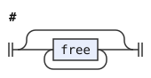</p>
<p>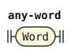</p>
<p>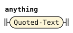</p>
</details>

## The text and its paragraphs

A text is free modifiers and then paragraphs, which `ni'o` and `no'i` separate. A run of `ni'o` can stand alone, or join two paragraphs with a connective, or with a connective or a tense or modal and `bo`. A paragraph is statements and fragments, separated by `.i`.

A quote preserves every leading free modifier as quoted content. This includes indicators and vocatives after LU and LUhEI. Otherwise a speaker cannot quote a text that starts with such a modifier.

The opener's slot takes every leading free modifier after TO. These modifiers remain outside the parenthesis body. An indicator there marks the whole bracketed remark.[^cll-e19-67]

```jbogenbau

%rule text
  (* text <- intro_null free* paragraphs? si_clause? SI_clause* faho_clause EOF? *)
  # [paragraphs]

%rule paragraphs
  (* paragraphs <- (NIhO_clause+ paragraphs_1?)+ / paragraphs_1 (NIhO_clause+ paragraphs_1?)* *)
  {NIhO #} [paragraphs-tail] | paragraphs-tail

%rule paragraphs-tail
  paragraphs-1 [{NIhO #} [paragraphs-tail]]

%rule paragraphs-1
  (* paragraphs_1 <- paragraphs_2 (NIhO_clause+ joik paragraphs_2)* *)
  {paragraphs-2 / {NIhO #} joik}

%rule paragraphs-2
  (* paragraphs_2 <- paragraph (NIhO_clause+ joik? tag? BO_clause paragraph)* *)
  {paragraph / {NIhO #} [joik] [tag] BO #}

%rule paragraph
  (* paragraph <- (I_clause (statement_terms / fragment)?)+
                / (statement_terms / fragment) (I_clause (statement_terms / fragment)?)* *)
  | {I # [statement-terms | fragment]}
  | (statement-terms | fragment) [{I # [statement-terms | fragment]}]
```

<details><summary>Railroad diagrams of the 6 rules from <code>text</code> to <code>paragraph</code></summary>
<p>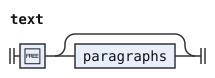</p>
<p>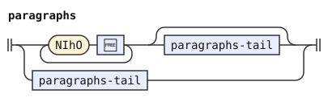</p>
<p>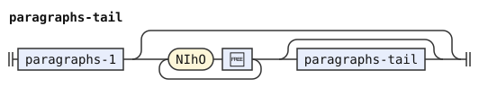</p>
<p>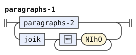</p>
<p>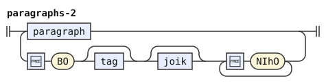</p>
<p>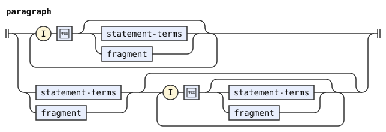</p>
</details>

## Statements and fragments

A statement can take terms after it, which `i'au` can introduce (`statement-terms`). A forethought connection of statements has any number of `gi` branches and an optional `gi'i`. `.i` with a connective, or with a connective or a tense or modal and `bo`, joins a statement to the one before it. So a text cannot begin that way.

The fragment conditions parse the following words to reserve possible terms, sumti, or selbri. A `na` fragment cannot have terms or `ku` after it. A terms fragment cannot have a following mekso.

Terms and mekso fragments use ordinary alternatives. The aligned whole query excludes a mekso when the same words and closes form an eligible terms fragment. `fragment-terms` applies the terms restrictions without adding the fragment's own VAU. This preserves connected, grouped, and recursively wrapped letters, including `my jo'u gy` and `la'e my jo'u gy`.

The terms witness must preserve every close inside the mathematical candidate. Thus `so to mi klama`, `pa to mi klama`, and `so to recap` keep their long parentheses.

A mekso fragment cannot have a `sumti-5` or selbri after it. Those words instead begin a term with that mekso as its quantifier.

In `lu by xi mo'e ke cy moi su'i dy moi li'u klama`, the quote contains a terms fragment. Its long subscript includes both MOI units. The sentence alternative competes with this fragment by ordinary ranking.

A structural pattern describes constructed nodes. Suppose every earlier branch is a whole sentence and the last branch starts with a sentence. Then the condition removes `gek-statement`, because the sentence rule already reads that structure. A prenex or TUhE blocks that final first-child path. A statement link in an earlier branch prevents the whole-sentence match. Links after the last sentence can continue outside the forethought connection.

`$BARE-NA-FRAGMENT` describes one NA clause with its own omitted KU and VAU. Written boundaries or added terms prevent that exact match. The condition excludes only this duplicate terms fragment.

```jbogenbau

%rule statement-terms
  (* statement_terms <- statement IAU_elidible terms? *)
  statement [IAU #] [terms]

%rule statement
  (* statement <- statement_1 / prenex statement *)
  statement-1 | prenex statement

%rule statement-1
  (* statement_1 <- statement_2 (I_clause joik statement_2)* *)
  {statement-2 / I # joik}

%rule statement-2
  (* statement_2 <- statement_3 (I_clause joik? tag? BO_clause statement_3)* *)
  {statement-3 / I # [joik] [tag] BO #}

%rule statement-3
  (* statement_3 <- sentence / tag? TUhE_clause paragraphs TUhU_elidible / gek_statement *)
  sentence | [tag] TUhE # paragraphs [+TUhU #] | gek-statement

%rule gek-statement
  (* gek_statement <- gek statement (gik statement)+ GIhI_elidible *)
  gek $a:gek-branches gik $l:statement [+GIhI #]
%conditions
  $a ≇ @({sentence / gik}) ∨ $l ≇ @(sentence ⋰)

%rule gek-branches
  (* statement (gik statement)*: every branch but the last. Zantufa's sentence comes first in statement_3, and it
     succeeds where each of these is a sentence and the last branch is a sentence, perhaps with the .i links of
     statement_1 and statement_2 after it, which then continue the statement outside the forethought *)
  {statement / gik}

%const $BARE-NA-FRAGMENT @(@(na-clause KU="") VAU="")

%rule fragment
  (* fragment <- prenex / !terms gek / !terms joik / ek / gihek / NA_clause !terms !KU
               / terms VAU_elidible !mex / mex / relative_clauses / links / linkargs *)
  | prenex
  | $g:gek
  | $j:joik
  | ek
  | gihek
  | $n:na-clause
  | $t:terms-vau
  | $m:mex
  | relative-clauses
  | links
  | linkargs
%conditions
  ¬$n.following-tokens.begins(terms),
  KU ⊈ $n.following-tokens.first-token.tags,
  ¬$t.following-tokens.begins(mex),
  $t ≇ $BARE-NA-FRAGMENT,
  ¬$m.following-tokens.begins(sumti-5),
  ¬$m.following-tokens.begins(selbri),
  ¬$m.without-elision.matches(fragment-terms)

%rule fragment-terms
  $t:terms
%conditions
  ¬$t.following-tokens.begins(mex),
  $t ≇ @(na-clause KU="")

%rule prenex
  (* prenex <- terms ZOhU_clause *)
  terms ZOhU #

%rule na-clause
  NA #

%rule terms-vau
  terms [+VAU #]

```

<details><summary>Railroad diagrams of the 12 rules from <code>statement-terms</code> to <code>terms-vau</code></summary>
<p>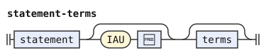</p>
<p>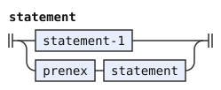</p>
<p>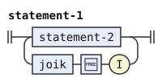</p>
<p>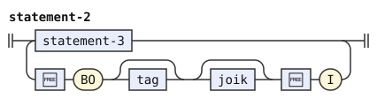</p>
<p>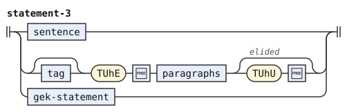</p>
<p>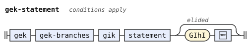</p>
<p>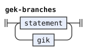</p>
<p>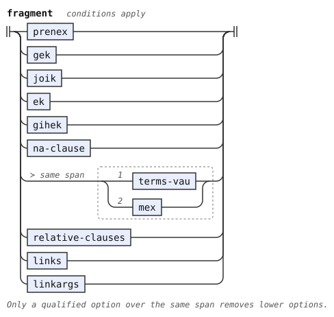</p>
<p>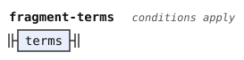</p>
<p>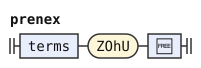</p>
<p>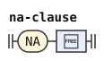</p>
<p>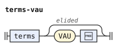</p>
</details>

## Sentences and bridi-tails

A sentence is terms, an optional `cu` and a bridi-tail, or a forethought connection of sentences. Terms stand only before the first bridi-tail. Bridi-tails connect at three levels.

A gek before bridi-tails begins a bridi-tail, not a forethought connection of sentences. So in `mi ge klama gi cadzu`, the gek is part of the bridi-tail after `mi`. There it begins a forethought tanru unit, `ge klama gi cadzu`. The condition on the second alternative of `sentence` states this. The condition prevents the forethought sentence alternative from competing with this complete bridi-tail.

The sentence pattern removes the forethought alternative only when every actual branch is a bridi-tail. Terms or CU at the start of a branch, or another sentence constructor in a branch, prevents this match. Thus `ge broda gi brode gi brodi gi cu brodo` retains its forethought sentence reading.

The outer connective level reads a tag and written CU directly. Without CU, its following bridi-tail must begin with actual KE. The inner level excludes that actual KE prefix, including KE after a tag. A written KEhE around a bare selbri selects the tanru construction. An omitted KEhE around the same body selects the grouped bridi-tail.

The tenses and modals before `ke` and a forethought bridi-tail are one tag. `[tag]` takes the whole run. With repeated tags, `pu ba ke ge broda mi gi brode do ke'e` has two readings, with one tag or two. They elide the same terminators, so they tie.

```jbogenbau

%rule sentence
  (* sentence <- terms? CU_elidible bridi_tail / terms? gek sentence (gik sentence)+ GIhI_elidible tail_terms *)
  | [terms] [CU #] bridi-tail
  | [terms] $g:gek sentence {gik sentence} [+GIhI #] tail-terms
%conditions
  $g ⟹ $ ≇ @([terms] gek bridi-tail {gik bridi-tail} GIhI [#] tail-terms)

%rule bridi-tail
  (* bridi_tail <- bridi_tail_1 (joik_gihek tag? CU_elidible bridi_tail_1)* *)
  bridi-tail-1 [{bridi-tail-link}]

%rule bridi-tail-link
  | joik-gihek tag CU # bridi-tail-1
  | joik-gihek [tag] $b:bridi-tail-1
%conditions
  $b ≅ @(KE ⋰)

%rule bridi-tail-1
  (* bridi_tail_1 <- bridi_tail_2 (joik_gihek !(tag? BO_clause) !(tag? KE_clause) CU_elidible bridi_tail_2 tail_terms)* *)
  bridi-tail-2 [{bridi-tail-1-link}]

```

<details><summary>Railroad diagrams of the 4 rules from <code>sentence</code> to <code>bridi-tail-1</code></summary>
<p>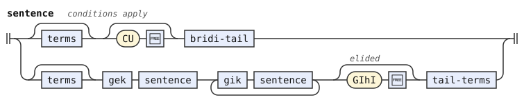</p>
<p>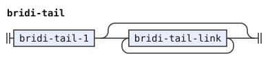</p>
<p>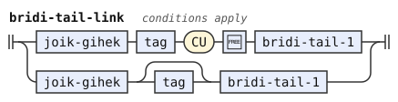</p>
<p></p>
</details>

The middle `$INITIAL-KE` arm matches a tag followed by a selbri whose first-child path reaches KE. The last arm instead requires KE directly after the tag, so both arms are necessary.

```jbogenbau
%const $INITIAL-KE
  @(KE ⋰)
  ∪ @(@(tag @(KE ⋰)) ⋰)
  ∪ @(@(tag KE ⋯) ⋰)

%rule bridi-tail-1-link
  joik-gihek [$c:CU #] $b:bridi-tail-2 tail-terms
%conditions
  $c ∨ $b ≇ $INITIAL-KE

%rule bridi-tail-2
  (* bridi_tail_2 <- bridi_tail_3 ((tag / joik_gihek tag?) BO_clause CU_elidible bridi_tail_3 tail_terms)* *)
  bridi-tail-3 [{(tag | joik-gihek [tag]) BO # [CU #] bridi-tail-3 tail-terms}]

%const $BARE-SELBRI-TAIL @(selbri-2 @(VAU=""))

%rule bridi-tail-3
  (* bridi_tail_3 <- KE_clause !(selbri_2 KEhE) bridi_tail KEhE_elidible tail_terms / selbri tail_terms / gek_bridi_tail *)
  | $k:ke-clause bridi-tail [+KEhE #] tail-terms
  | $s:selbri tail-terms
  | gek-bridi-tail
%conditions
  $k ⟹ $ ≇ @(ke-clause $BARE-SELBRI-TAIL KEhE≠"" [#] tail-terms),
  $s ≇ @(@(KE [#] selbri-2 KEhE="" [#]) ⋰)

%rule ke-clause
  KE #

%rule gek-bridi-tail
  (* gek_bridi_tail <- gek bridi_tail (gik bridi_tail)+ !(gik (term / CU)) GIhI_elidible tail_terms
                     / tag* KE_clause gek_bridi_tail KEhE_elidible / NA_clause gek_bridi_tail *)
  | gek bridi-tail $g:gik-bridi-tails [+GIhI #] tail-terms
  | [tag] KE # gek-bridi-tail [+KEhE #]
  | NA # gek-bridi-tail
%conditions
  ¬$g.following-tokens.begins(gik-term)

%rule gik-bridi-tails
  {gik bridi-tail}

%rule gik-term
  gik (term | CU)

%rule tail-terms
  (* tail_terms <- term* VAU_elidible *)
  [{term}] [+VAU #]
```

<details><summary>Railroad diagrams of the 8 rules from <code>bridi-tail-1-link</code> to <code>tail-terms</code></summary>
<p>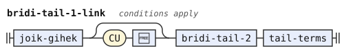</p>
<p>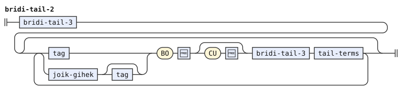</p>
<p>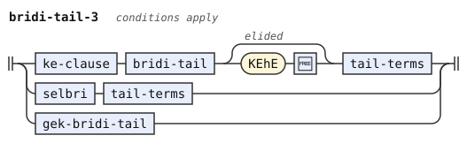</p>
<p>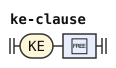</p>
<p>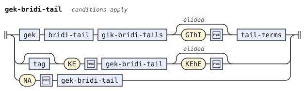</p>
<p>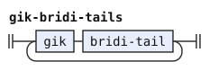</p>
<p>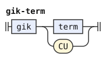</p>
<p>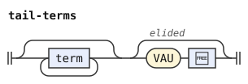</p>
</details>

## Terms

Zantufa has no termsets. A term is a `xoi` clause, a `ke` group of terms, a tense or modal with its sumti, or a sumti. It can also be a briga'i form (`noi'a` with a selbri, or a bare `na`), or a forethought connection of terms. A sumti takes priority over a forethought term over the same words.

A tag with a sumti argument has its own alternative. GI cannot follow that actual tag because the tag and GI begin a gek. The argument cannot start an aligned tag unit, so `mi klama pu my roi` keeps one tag run. Alignment retains the argument's omitted terminators, so `pu cy to roi klama` keeps its long parenthesis. The bare-tag route excludes a following free modifier, tag unit, selbri, forethought bridi-tail, or BO. Thus `mi pe pu ba broda` remains rejected, and `mi pe pu ku ba broda` retains its written boundary.

A tag unit that omits KUhE also counts. So `mi klama pu ke my .e gy ke'e roi` and `mi klama pu ke my .e gy roi` keep one tag run.

The following-input queries reserve possible tag units and predicates, including readings outside the chosen tree. GI, BO, and KU tests inspect the next token's selma'o. Free-modifier and connective tests use queries.

The condition `¬$t.following-tokens.begins(free)` excludes a tag term that leaves a following free modifier unread. So in `sei abu pensi ba ju'o rinka`, the tag is `ba ju'o`, and the selbri `rinka` follows it. The condition on a selbri then removes the term, and the statement of the `sei` ends after `pensi`, as in Zantufa.

A term-initial sumti cannot start an aligned tag. The extended prefix can read a following ROI, so `cy roi` remains a tag. This restriction applies at the term's start, rather than to every letter inside a sumti. Thus `ro my roi klama` retains the quantified sumti `ro my`. The tag can also omit KUhE inside the shared stretch. So in `ke my .e gy ke'e roi klama`, the KE group and ROI form one tag, as in Zantufa.

A term link reserves `tag [BO #] CU` only after an actual joik. That suffix belongs to a bridi-tail connection. An ek has no such restriction. The query starts after the selected connective, so it retains that connective's modifiers.

The KE patterns inspect the actual body and closer. A written `ke'e` around one sumti selects the grouped sumti. An omitted closer around that same bare group selects grouped terms. Thus `ke mi klama` keeps grouped terms before the predicate. Multiple terms or added relative clauses prevent the exact match.

```jbogenbau

%rule terms
  (* terms <- term+ *)
  {term}

%rule term
  (* term <- term_1 (!(joik tag BO_clause? CU) joik_ek term_1)* *)
  term-1 [{term-link}]

%rule(fewest) term-link
  $j:joik-ek term-1
%conditions
  $j ≇ @(joik) ∨ ¬$j.following-tokens.begins(tag-bo-cu)

%rule tag-bo-cu
  tag [BO #] CU

%rule term-1
  (* term_1 <- term_2 (joik_ek? BO_clause term_2)* *)
  {term-2 / [joik-ek] BO #}

%rule term-2
  (* term_2 <- XOI_clause statement SEhU_elidible / KE_clause !(sumti KEhE) term+ KEhE_elidible
              / tag_term / !tag sumti / brigahi / gek_term *)
  | XOI # statement [+SEhU #]
  | $k:ke-clause {term} [+KEhE #]
  | tag-term
  | $s:sumti
  | brigahi
  | $g:gek-term
%conditions
  $g ≇ @(gek sumti {gik sumti} GIhI [#]),
  $k ⟹ $ ≇ @(ke-clause sumti KEhE≠"" [#]),
  $s ≇ @(KE [#] sumti KEhE="" [#]),
  ¬$s.without-elision-except(math).onward.begins(tag)

%rule brigahi
  (* brigahi <- (POIhA_clause free* selbri / NA_clause !bridi_tail !joik_gihek) KU_elidible *)
  | POIhA # selbri [+KU #]
  | $n:na-clause [+KU #]
%conditions
  ¬$n.following-tokens.begins(bridi-tail),
  ¬$n.following-tokens.begins(joik-gihek)

%rule tag-term
  (* tag_term <- !gek (tag !(!tag selbri) !gek_bridi_tail !BO
                      / (FA_clause (joik FA_clause)* / JAI_clause tag?) !tanru_unit_1) (sumti / KU_elidible) *)
  | $a:tag $s:sumti
  | fa-jai sumti
  | $t:tag [+KU #]
  | $f:fa-jai [+KU #]
%conditions
  GI ⊈ $a.following-tokens.first-token.tags,
  ¬$s.without-elision-except(math).onward.begins(tcita-selci),
  GI ⊈ $t.following-tokens.first-token.tags,
  ¬$t.following-tokens.begins(free),
  ¬$t.following-tokens.begins(tcita-selci),
  ¬$t.following-tokens.begins(selbri),
  ¬$t.following-tokens.begins(gek-bridi-tail),
  BO ⊈ $t.following-tokens.first-token.tags,
  ¬$f.following-tokens.begins(tanru-unit-1)

%rule fa-jai
  {FA # / joik} | JAI # [tag]

%rule gek-term
  (* gek_term <- gek term+ (gik term+)+ GIhI_elidible *)
  gek {term} {gik {term}} [+GIhI #]
```

<details><summary>Railroad diagrams of the 10 rules from <code>terms</code> to <code>gek-term</code></summary>
<p>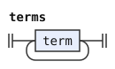</p>
<p>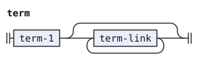</p>
<p>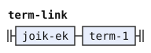</p>
<p>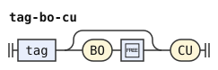</p>
<p>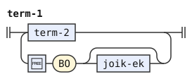</p>
<p>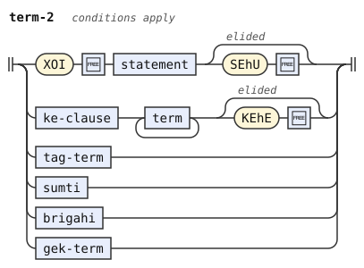</p>
<p>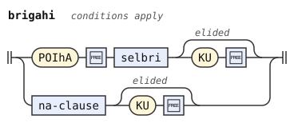</p>
<p>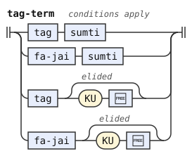</p>
<p>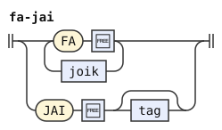</p>
<p>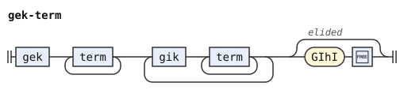</p>
</details>

## Sumti

A sumti can be a pro-sumti, a quote, letters, an abstraction, a description, a mekso, or a transformed sumti. The letter alternative reserves following operators and operand groups ending in KEhE.

A description's inner sumti cannot start an aligned quantifier. The prefix query preserves its actual closes while it tests that category. Thus `lo my jo'u gy prenu` keeps its connected inner sumti, while `le ke my ke'e broda` takes a quantifier. The quantifier can also omit KUhE inside the shared stretch, even just before an omitted KEhE. So `le ke my .e gy ke'e broda` and `le ke my .e gy broda` take a quantifier too.

A connective after a sumti joins that sumti to the next one, not the term to the next term. So `ba mi .e do klama` has one term, the tense `ba` with the sumti `mi .e do`. The term rule sees a connective only where the sumti cannot take it. A term reads its whole sumti first. The plain-link preference and the BO condition keep the sumti whole.

A connective before a sumti or relative clause remains available for sumti syntax. `sumti-or-relative` names those two followers. The `lerfu-operator` query starts after the selected operator, including its modifiers.

`$JOIK-EK-OP` covers a joik-ek and its SE-converted operator form. The operator rule lifts SE outside its connective, so the pattern needs both shapes. Thus `by se jo'u cy cu klama` keeps its connected sumti. SE applied to an arithmetic operator receives no exemption.

The plain `term-link` rule carries `fewest`, so a sumti connection wins over a term connection when both complete. `sumti-1-run` is a node of each sumti tree. The BO-level `sumti-2` condition refuses a run before another BO link. Its helper `sumti-2-link` occurs only in that query.

```jbogenbau

%rule sumti
  (* sumti <- sumti_1 (VUhO_clause relative_clauses)? *)
  sumti-1 [VUhO # relative-clauses]

%rule sumti-1
  (* sumti_1 <- sumti_2 (joik_ek sumti_2)* *)
  sumti-1-run

%rule sumti-1-run
  {sumti-2 / joik-ek}

%rule sumti-2
  (* sumti_2 <- sumti_3 (joik_ek? tag? BO_clause sumti_3)* *)
  $r:sumti-2-run
%conditions
  ¬$r.following-tokens.begins(sumti-2-link)

%rule sumti-2-run
  {sumti-3 / [joik-ek] [tag] BO #}

%rule sumti-2-link
  [joik-ek] [tag] BO # sumti-3

%rule sumti-3
  (* sumti_3 <- (KE_clause sumti KEhE_elidible / sumti_4 / gek sumti (gik sumti)+ GIhI_elidible) relative_clauses? *)
  (KE # sumti [+KEhE #] | sumti-4 | gek sumti {gik sumti} [+GIhI #]) [relative-clauses]

%rule sumti-4
  (* sumti_4 <- quantifier? sumti_5 / quantifier selbri KU_elidible *)
  [quantifier] sumti-5 | quantifier selbri [+KU #]

%rule sumti-5
  (* sumti_5 <- RAhOI_clause / ZO_clause / ZOI_clause / LOhU_clause
              / lerfu_string BOI_elidible !(BO_clause* operand* !(joik_ek (sumti / relative_clause)) operator) !(operand KEhE)
              / LU_clause text LIhU_elidible / (LAhE_clause / NAhE_clause BO_clause) relative_clauses? sumti LUhU_elidible
              / KOhA_clause / LOhOI_clause (joik LOhOI_clause)* statement KUhAU_elidible / LE_clause sumti_tail KU_elidible
              / li_clause / NAhE_clause sumti_3 *)
  | RAhOI anything #
  | ZO any-word #
  | ZOI any-word anything any-word #
  | LOhU [{any-word}] LEhU #
  | $l:lerfu-boi
  | LU text [+LIhU #]
  | (LAhE # | NAhE # BO #) [relative-clauses] sumti [+LUhU #]
  | KOhA #
  | {LOhOI # / joik} statement [+KUhAU #]
  | LE # sumti-tail [+KU #]
  | LI # mex [+LOhO #]
  | NAhE # sumti-3
%conditions
  ¬$l.following-tokens.begins(lerfu-operator),
  ¬$l.following-tokens.begins(operand-kehe)

%rule lerfu-boi
  lerfu-string [+BOI #]

%const $JOIK-EK-OP @(joik-ek) ∪ @(SE [#] @(joik-ek))

%rule lerfu-operator
  [{BO #}] [{operand}] $o:operator
%conditions
  $o ≇ $JOIK-EK-OP
  ∨ ¬$o.following-tokens.begins(sumti-or-relative)

%rule sumti-or-relative
  sumti | relative-clause

%rule operand-kehe
  operand KEhE

%rule sumti-tail
  (* sumti_tail <- relative_clauses? (!quantifier sumti)? sumti_tail_1 *)
  | [relative-clauses] sumti-tail-1
  | [relative-clauses] $s:sumti sumti-tail-1
%conditions
  ¬$s.without-elision-except(math).onward.begins(quantifier)

%rule sumti-tail-1
  (* sumti_tail_1 <- tag? quantifier? selbri / quantifier sumti *)
  | tag quantifier selbri
  | $t:tag $u:selbri
  | quantifier selbri
  | $s:selbri
  | quantifier sumti
%conditions
  $u ≇ @(tag ⋰),
  $s ≇ @(tag ⋰)
```

<details><summary>Railroad diagrams of the 15 rules from <code>sumti</code> to <code>sumti-tail-1</code></summary>
<p>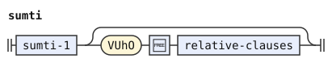</p>
<p>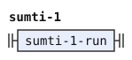</p>
<p>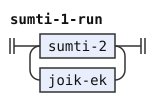</p>
<p>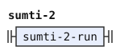</p>
<p>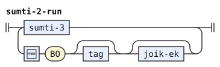</p>
<p>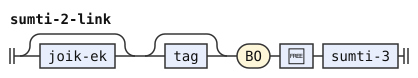</p>
<p>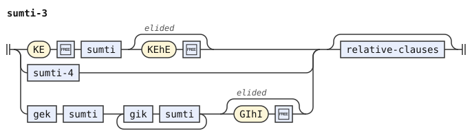</p>
<p>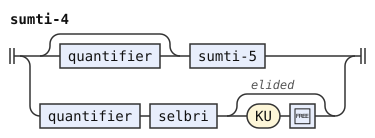</p>
<p></p>
<p></p>
<p></p>
<p></p>
<p></p>
<p></p>
<p></p>
</details>

## Relative clauses

Relative clauses can stand side by side, joined by a joik or by nothing. They follow a sumti, and they can follow a selbri too (see "Selbri and tanru").

```jbogenbau

%rule relative-clauses
  (* relative_clauses <- relative_clause (joik? relative_clause)* *)
  {relative-clause / [joik]}

%rule relative-clause
  (* relative_clause <- GOI_clause term GEhU_elidible / NOI_clause statement KUhO_elidible *)
  GOI # term [+GEhU #] | NOI # statement [+KUhO #]
```

<details><summary>Railroad diagrams of <code>relative-clauses</code> and <code>relative-clause</code></summary>
<p></p>
<p></p>
</details>

## Selbri and tanru

A selbri can take a tense, a modal or `na` before it, and relative clauses and `cei` after it. A tanru unit can be a name, because Zantufa reads a name as a selbri. It can also be a quote of GOhOI, MUhOI or LUhEI, such as a `go'oi` quote, or a mekso with `moi`. `me` makes a tanru unit of a sumti, operators, a mekso, or a tense or modal.

ME admits sumti, mekso, and tags as ordinary alternatives. A run of operators remains a separate alternative. Patterns reserve actual operator prefixes for that route. The aligned whole query excludes a mekso when the same words and closes form a sumti. Thus `mi me la'e my` takes a sumti. A shorter sumti that moves TOI cannot exclude the long mathematical argument in `me re to le rance`.

The follower conditions keep a following unit outside this operand. Thus `me su'i pa moi` forms two tanru units, `me su'i` and `pa moi`. A mekso after ME cannot precede words that make it a quantifier. The connective levels remain explicit in `selbri-4` and `selbri-5`. Their complete readings compete by late elision.

In `mi me by xi mo'e ke cy moi su'i dy moi`, the aligned whole query selects the sumti operand. Ordinary elision keeps the long subscript.

The conditions exclude duplicate SE and NAhE conversions of an actual bare gek unit. A gek can itself begin with `se`, and it can begin with a tag such as `na'e bai`. So `mi se ge klama gi cadzu` has two readings with the same elisions. In one, `se ge` is the gek. In the other, `se` converts the gek tanru unit `ge klama gi cadzu`.

The first reading, where `se` belongs to the connective, takes priority. Without that priority, the readings tie and the text is an error.

The conversion patterns inspect the actual inner gek unit. NAhE moves to the explicit outer NAhE alternative only for an exact bare gek unit. SE moves to the connective only for bare GA or a tag or plain JOI before GI. Existing SE, NA, initial GI, or leading GAhO prevents that SE transformation. FA keeps its separate conversion alternative.

`mex MOI #` precedes SE and NAhE conversion over the whole tanru unit. A qualified mekso with MOI excludes those conversions over the same span. The conditions of the SE and NAhE options reserve a gek tanru unit. FA and JAI stay outside the group because neither can start a mekso.

So `mi na'e pa moi` is the mekso `na'e pa` with `moi`. `mi se su'i pa re moi` is `se su'i pa re` with `moi`.

A run of `cei` nests to the right. The selbri after the first `cei` already reads every later `cei`. So in `broda cei brode cei brodi`, the second `cei` is inside the selbri `brode cei brodi`. Here `selbri-1` takes at most one `cei` and the selbri after it. Repeating `CEI # selbri` here gives two readings with the same elisions, and so a tie.

```jbogenbau

%rule selbri
  (* selbri <- selbri_1 / tag selbri / NA_clause selbri *)
  selbri-1 | tag $s:selbri | NA # selbri
%conditions
  $s ≇ @(tag ⋰)

%rule selbri-1
  (* selbri_1 <- (!KE selbri_2 KEhE_clause linkargs / selbri_2) relative_clauses? (CEI_clause selbri)* *)
  | $s:selbri-2 KEhE # linkargs [relative-clauses] [CEI # selbri]
  | selbri-2 [relative-clauses] [CEI # selbri]
%conditions
  ¬$s.onward.begins(ke-word)

%rule ke-word
  KE

%rule selbri-2
  (* selbri_2 <- selbri_3 (CO_clause selbri_3)* *)
  {selbri-3 / CO #}

%rule selbri-3
  (* selbri_3 <- selbri_4+ *)
  selbri-4 [{later-selbri-4}]

%rule later-selbri-4
  selbri-4

%rule selbri-4
  (* selbri_4 <- selbri_5 (joik selbri_5)* *)
  {selbri-5 / joik}

%rule selbri-5
  (* selbri_5 <- selbri_6 (joik tag? BO_clause selbri_6)* *)
  {selbri-6 / joik [tag] BO #}

%rule selbri-6
  (* selbri_6 <- tanru_unit (BO_clause tanru_unit)* *)
  {tanru-unit / BO #}

%rule tanru-unit
  (* tanru_unit <- tanru_unit_1 linkargs? *)
  tanru-unit-1 [linkargs]

%const $PLAIN-JOIK @(JOI [#] [GAhO [#]])

%const $SE-GEK
  @(GA [#] [BO [#]])
  ∪ @((tag ∪ $PLAIN-JOIK) GI [#] [BO [#]])

%const $GEK-UNIT @(gek selbri-2 gik-selbris GIhI [#])

%const $SE-GEK-UNIT @($SE-GEK selbri-2 gik-selbris GIhI [#])

%rule tanru-unit-1
  (* tanru_unit_1 <- CMEVLA_clause / BRIVLA_clause / GOhA_clause / KE_clause selbri_2 KEhE_elidible
                   / NAhE_clause? gek selbri_2 (gik selbri_2)+ !(gik? (term / CU)) GIhI_elidible
                   / MUhOI_clause / GOhOI_clause / LUhEI_clause text LIhAU_elidible
                   / ME_clause (sumti / operator+ / mex / tag) MEhU_elidible MOI_clause? / mex MOI_clause
                   / (FA_clause (joik FA_clause)* / SE_clause) tanru_unit_1 / JAI_clause tag? tanru_unit_1
                   / NAhE_clause tanru_unit_1 / NU_clause (joik NU_clause)* statement KEI_elidible *)
  | CMEVLA #
  | BRIVLA #
  | GOhA #
  | KE # selbri-2 [+KEhE #]
  | NAhE # gek selbri-2 $g:gik-selbris [+GIhI #]
  | $k:gek selbri-2 $g:gik-selbris [+GIhI #]
  | MUhOI any-word anything any-word #
  | GOhOI any-word #
  | LUhEI text [+LIhAU #]
  | ME # (sumti | $m:mex | $t:tag) [+MEhU #] [MOI #]
  | ME # {operator} [+MEhU #] [MOI #]
  | (mex MOI #
     ≻ SE # $w:tanru-unit-1
     ≻ NAhE # $v:tanru-unit-1)
  | {FA # / joik} tanru-unit-1
  | JAI # [tag] tanru-unit-1
  | {NU # / joik} statement [+KEI #]
%conditions
  ¬$g.following-tokens.begins(gik-term-or-cu),
  ¬$m.following-tokens.begins(sumti-5),
  ¬$m.following-tokens.begins(selbri),
  $m ≇ @(operator ⋰),
  $t ≇ @(operator ⋰),
  $k ≇ @(NAhE ⋰),
  ¬$m.without-elision.matches(sumti),
  $v ≇ $GEK-UNIT,
  $w ≇ $SE-GEK-UNIT

%rule gik-selbris
  {gik selbri-2}

%rule gik-term-or-cu
  [gik] (term | CU)

%rule linkargs
  (* linkargs <- BE_clause term links? BEhO_elidible *)
  BE # term [links] [+BEhO #]

%rule links
  (* links <- BEI_clause term links? *)
  BEI # term [links]
```

<details><summary>Railroad diagrams of the 15 rules from <code>selbri</code> to <code>links</code></summary>
<p></p>
<p></p>
<p></p>
<p></p>
<p></p>
<p></p>
<p></p>
<p></p>
<p></p>
<p></p>
<p></p>
<p></p>
<p></p>
<p></p>
<p></p>
</details>

## Mekso

The MAhO choice ranks mekso, selbri, then sumti. The MOhE choice ranks selbri before sumti. An earlier operand can exclude a later operand over the same span, as the notation document defines. A failed higher operand removes nothing.

Zantufa's mekso alternates operands and operator runs. BO and KE group them, and BIhE raises operator precedence. Reverse Polish places operators after operands and uses FUhA. Forethought places an operator before operands, with optional PEhO.

A quantifier excludes aligned sumti and selbri prefixes. The extended queries can complete those categories beyond the captured mekso. They preserve every close through its endpoint. The quantifier also reserves ROI at its actual boundary.

The grammar reads a run of operators whole. So in `li re su'i ni'u pa`, `su'i ni'u` is one run. It is not an operator without an operand and then a link of its own. The rule `operators` states this, with a condition that no operator follows the run. This keeps consecutive operators, such as `[pi'i pi'i]`, in one unit.

The operand after a run of operators is greedy too. The optional operand reads a mekso wherever one follows. So a run of operators ends a mekso only where no operand follows it. The first alternative of `mex-link` and of `bihe-link` has a condition that states this.

Thus `by su'i cy klama` has the quantifier `by su'i cy` before `klama`. And `mi me my su'i ny me'u` has the mekso `my su'i ny` after `me`. Both use the complete operator run and its following operand.

`mex-forethought` reads an optional PEhO, an operator, one or more `mex-2` operands, and its KUhE terminator.

`math` names forethought and reverse Polish mekso, the two constructs that KUhE closes. Category conditions at description prefixes and tags name it as a family. A competing mathematical reading there can omit KUhE inside the shared stretch. It cannot omit TOI, BOI or another terminator that the candidate lacks. So `my .e cy to roi klama` keeps its long parenthesis.

The condition removes a connective operator whose first word is SE. The alternative `SE # operator` reads that SE instead. Initial NA or GAhO prevents this exact transformation. The separate following-CU condition remains in place.

```jbogenbau

%rule roi-word
  ROI

%rule quantifier
  (* quantifier <- !sumti_5 !selbri mex relative_clauses? *)
  $m:mex [relative-clauses]
%conditions
  ¬$m.without-elision.onward.begins(sumti-5),
  ¬$m.without-elision.onward.begins(selbri),
  ¬$m.following-tokens.begins(roi-word)

%rule mex
  (* mex <- mex_1 (operator+ mex_1?)* *)
  mex-1 [{mex-link}]

%rule mex-link
  $o:operators | operators $x:mex-1
%conditions
  $x ≇ @(operator ⋰),
  ¬$o.following-tokens.begins(mex-1)

%rule mex-1
  (* mex_1 <- (KE_clause mex_2+ KEhE_elidible / mex_2 (BO_clause mex_2)* )
              (BIhE_clause operator+ (KE_clause mex_2+ KEhE_elidible / mex_2 (BO_clause mex_2)* )?)* *)
  mex-group [{bihe-link}]

%rule bihe-link
  BIhE # $o:operators | BIhE # operators $x:mex-group
%conditions
  $x ≇ @(operator ⋰),
  ¬$o.following-tokens.begins(mex-group)

%rule mex-group
  KE # {mex-2} [+KEhE #] | {mex-2 / BO #}

%rule mex-2
  (* mex_2 <- operand / mex_rp / mex_forethought *)
  operand | mex-rp | mex-forethought

%rule mex-rp
  (* mex_rp <- FUhA_clause mex_2+ operator (mex_2* operator)* KUhE_elidible *)
  FUhA # {mex-2} operator [{[{mex-2}] operator}] [+KUhE #]

%rule mex-forethought
  (* mex_forethought <- !(lerfu_string BOI_elidible) operator mex_2+ mex_forethought? KUhE_elidible
                      / PEhO_clause operator mex_2+ mex_forethought? KUhE_elidible *)
  [PEhO #] operator {mex-2} [+KUhE #]

%rule math
  (* not a rule of the reference: the constructs that KUhE closes, a family for
     without-elision-except *)
  mex-forethought | mex-rp

%rule operator
  (* operator <- SE_clause operator / NAhE_clause operator / MAhO_clause (mex / selbri / sumti) TEhU_elidible
               / VUhU_clause / joik_ek !CU *)
  | SE # operator
  | NAhE # operator
  | MAhO # (mex ≻ selbri ≻ sumti) [+TEhU #]
  | VUhU #
  | $j:joik-ek
%conditions
  ¬$j.following-tokens.begins(cu-word),
  $j ≇ @(SE ⋯)

%rule operators
  (* operator+, which reads every operator that follows *)
  $r:operator-run
%conditions
  ¬$r.following-tokens.begins(operator)

%rule operator-run
  {operator}

%rule cu-word
  CU

%rule operand
  (* operand <- number BOI_elidible / lerfu_string BOI_elidible / VEI_clause mex VEhO_elidible
              / MOhE_clause (selbri / sumti) TEhU_elidible / (LAhE_clause / NAhE_clause BO_clause) mex LUhU_elidible
              / NAhE_clause operand *)
  | number [+BOI #]
  | lerfu-string [+BOI #]
  | VEI # mex [+VEhO #]
  | MOhE # (selbri ≻ sumti) [+TEhU #]
  | (LAhE # | NAhE # BO #) mex [+LUhU #]
  | NAhE # operand

%rule number
  (* number <- PA_clause+;  PA_post <- number_post_clause *)
  {PA #}

%rule lerfu-string
  (* lerfu_string <- lerfu_word+ *)
  {lerfu-word}

%rule lerfu-word
  (* lerfu_word <- BY_clause / LAU_clause lerfu_word / TEI_clause lerfu_string FOI_clause;  BY_post <- lerfu_post_clause *)
  BY # | LAU # lerfu-word | TEI # lerfu-string FOI #
```

<details><summary>Railroad diagrams of the 19 rules from <code>roi-word</code> to <code>lerfu-word</code></summary>
<p></p>
<p></p>
<p></p>
<p></p>
<p></p>
<p></p>
<p></p>
<p></p>
<p></p>
<p></p>
<p></p>
<p></p>
<p></p>
<p></p>
<p></p>
<p></p>
<p></p>
<p></p>
<p></p>
</details>

## Connectives

`je`, `ja`, `jo` and `ju` belong to JOI and form joiks. `ga'o` or `ke'i` can stand on either side of a joik. A gek is a word of GA, or `gi` with a joik or a tense or modal on either side of it. It can take `bo`.

```jbogenbau

%rule ek
  (* ek <- NA_clause? SE_clause? A_clause *)
  [NA #] [SE #] A #

%rule gihek
  (* gihek <- NA_clause? SE_clause? GIhA_clause *)
  [NA #] [SE #] GIhA #

%rule joik
  (* joik <- GAhO_clause? NA_clause? SE_clause? JOI_clause GAhO_clause? *)
  [GAhO #] [NA #] [SE #] JOI # [GAhO #]

%rule joik-ek
  (* joik_ek <- joik / ek *)
  joik | ek

%rule joik-gihek
  (* joik_gihek <- joik / gihek *)
  joik | gihek

%rule gek
  (* gek <- (SE_clause? GA_clause / GI_clause (joik / tag) / (joik / tag) GI_clause) BO_clause? *)
  ([SE #] GA # | GI # (joik | tag) | (joik | tag) GI #) [BO #]

%rule gik
  (* gik <- GI_clause *)
  GI #
```

<details><summary>Railroad diagrams of <code>ek</code>, <code>gihek</code>, <code>joik</code>, <code>joik-ek</code>, <code>joik-gihek</code>, <code>gek</code> and <code>gik</code></summary>
<p></p>
<p></p>
<p></p>
<p></p>
<p></p>
<p></p>
<p></p>
</details>

## Tenses and modals

A tense or modal (`tag`) is a run of `tcita-selci` joined by joiks. Each unit is a modal, ROI with an optional mekso, FIhO with a selbri, or a converted unit. The grammar retains actual tag constructors and lets their complete readings compete by ordinary elision. It does not reparse a selected joik as a mathematical prefix.

The mekso prefix pattern tests an actual NAhE or SE constructor over an operand or operator. That prefix can move to the modal. NAhE BO is a different constructor because BO cannot begin the remaining modal. Its LUhU boundary remains part of that operand. An outer NAhE can still move while an inner NAhE BO stays intact.

```jbogenbau

%rule tag
  (* tag <- tcita_selci+ (joik tcita_selci+)* *)
  {tcita-selci} [{tag-link}]

%rule tag-link
  joik {tcita-selci}

%rule tcita-selci
  (* tcita_selci <- (NAhE_clause / SE_clause) tcita_selci / BAI_clause / mex? ROI_clause / FIhO_clause selbri FEhU_elidible *)
  | (NAhE # | SE #) tcita-selci
  | BAI #
  | ROI #
  | $m:mex ROI #
  | FIhO # selbri [+FEhU #]
%conditions
  $m ≇ @(((NAhE ∪ SE) [#] (operand ∪ operator)) ⋰)
```

<details><summary>Railroad diagrams of <code>tag</code>, <code>tag-link</code> and <code>tcita-selci</code></summary>
<p></p>
<p></p>
<p></p>
</details>

## Free modifiers

A free modifier is a `sei` clause over a statement, a vocative, a mekso with `mai`, or a `to` parenthesis. It can also be a subscript, a replacement quote, or an attitudinal with its own free modifiers after it. A vocative takes a selbri or a sumti.

A free modifier nests in the nearest slot that can take it. So no free modifier follows another one in the same slot. The condition on `free` states this. In `ui nai`, the `nai` is in the slot of `ui`. In `coi ui coi do`, `coi do` is in the slot of `ui`, which is in the slot of the first `coi`. In `xy boi xi by boi xi vo`, the second subscript is inside the first one.

An attitudinal slot takes the next free modifier. A vocative slot takes a free modifier that is not a vocative.

The `free` query parses the following words again. It rejects a modifier when those words can begin another free modifier. This also controls the nesting of free slots.

A vocative takes a selbri or a sumti as its address, as in Zantufa. Zantufa merges cmevla and brivla, so a name is an ordinary tanru unit. The selbri of the address reads as far as it can, as Zantufa's does. So in `doi djan klama`, the address is the selbri `djan klama`, and the text has no bridi. To address someone by name before a bridi, a speaker ends the vocative with `do'u`, as in `doi djan do'u klama`.

Nested vocatives can take separate addresses. In `pe'usai doi xod ko jmina`, the vocative `doi xod` is in the slot of `sai`, and `sai` is in the slot of `pe'u`. The address of `doi` is the selbri `xod`, which ends before `ko`. Then `pe'u` takes `ko` as its own address, a sumti. So the bridi `jmina` has no first place, and `ko` is not the one who adds.

```jbogenbau

%rule free
  (* free <- SEI_clause statement SEhU_elidible / vocative relative_clauses? selbri DOhU_elidible
           / vocative sumti? DOhU_elidible / mex_2 MAI_clause / TO_clause text TOI_elidible / xi_clause
           / LOhAI_clause / (UI_clause !BU_clause)+ *)
  | SEI # statement [+SEhU #]
  | vocative [sumti | [relative-clauses] selbri] [+DOhU #]
  | mex-2 MAI #
  | TO # parenthesis-text [+TOI #]
  | XI # mex-2
  | [LOhAI [{lohai-word}] [LOhAI [{lohai-word}]]] LEhAI #
  | UI #
%conditions
  ¬$.following-tokens.begins(free),
  $ ≇ @(PA ⋰) ∨ ¬$.preceded-by(PA),
  $ ≇ @(lerfu-string ⋰) ∨ ¬$.preceded-by(BY),
  $ ≇ @(vocative ⋰) ∨ ¬$.preceded-by(COI)

%rule parenthesis-text
  text
%conditions
  $ ≇ @(# ⋰)

%rule vocative
  (* vocative <- COI_clause+;  COI_post <- vocative_post_clause *)
  {COI #}

%rule lohai-word
  Word<¬LOhAI ¬LEhAI>

```

<details><summary>Railroad diagrams of <code>free</code>, <code>parenthesis-text</code>, <code>vocative</code> and <code>lohai-word</code></summary>
<p></p>
<p></p>
<p></p>
<p></p>
</details>

## Differences from Zantufa 1.9999

The dialect reads some texts differently from Zantufa 1.9999. The [dialect policy](../dialects/zantufa.md#differences-from-zantufa-and-cll) accounts for most of them. The first three sections group differences by cause. The last records translation choices by grammar area, including where this grammar keeps Zantufa's reading.

### Ordered choice and preferred readings

A PEG commits to the first alternative that matches, and a repetition reads as far as it can. So Zantufa rejects some texts that its rules allow, and the dialect accepts them. In `are`, Zantufa reads `a` as a whole fragment, and `re` is left over. In `le vi'ofagri`, the vocative after `le` takes `fagri`, and the description has no selbri. In `la poi ke'a barda .djan.`, the relative clause takes the name. Each of these parses here.

`ke my .e gy ku'e ke'e roi klama` parses here. Zantufa reads `ke my .e gy` as grouped terms, and then it cannot continue at `ku'e`.

A TO body that starts with a connective and a mekso also parses here, as in `le ke my .e by to .e cy boi dy toi ke'e broda`. Zantufa's fragment rule tries `ek` before `mex`. So it reads `.e` alone as the body, and it fails after it.

In `li ma'o me my su'i pa`, only the mekso ME operand completes the surrounding construction. This dialect accepts it. The literal reference rejects it because its earlier sumti choice commits before that continuation.

In `mi na'e mo'e ke by .e cy moi su'i dy moi`, the outer mekso includes NAhE. The literal PEG rejects this text after committing inside KE and MOhE. This dialect revisits those inner choices, so the outer mekso ends at the last MOI.

In `li ma'o ke by .e cy jo'u dy pa`, MAhO takes the long mekso operand. The final PA lies outside it. Shorter mekso operands close TEhU earlier and lose by late elision. The literal PEG rejects this text because its grouped mekso commits to an inner choice.

In `li mo'e ke by xi mo'e ke cy moi jo'u dy xi mo'e ke zy moi`, the outer MOhE takes a selbri. The literal reference takes a sumti after its committed selbri attempt fails. This dialect revisits the inner subscript choices, so its selbri completes. The ranked choice then takes that selbri.

Where a PEG's greed gives a reading that the ranking of this stage does not choose, the dialect keeps its own reading. The ranking is the order of preference of the stage among parses. In `mi klama pamai le zarci .e remai le zdani`, Zantufa's `.e` takes `re mai` as its own free modifier. Here the free modifier is the mekso `.e re` with `mai`, after `zarci`. In the same way, `ui .e re mai` puts the free modifier `.e re` with `mai` in the slot of `ui`. Zantufa reads `ui` and then a `.e` fragment, with `re mai` in its slot.

In `coi poi broda klama`, Zantufa's relative clause reads the tanru `broda klama`. Then the vocative has no selbri, so Zantufa reads a bare `coi` and a fragment of relative clauses. Here `coi` takes the relative clause `poi broda` and the selbri `klama`. `doi poi broda djan.` reads in the same way.

In a reverse Polish mekso, Zantufa's greedy `mex_2+` can read an operator and an operand as a forethought mekso. So in `li fu'a pa su'i re pi'i`, it reads `su'i re` as one operand of `pi'i`. Here `su'i` is an operator of the reverse Polish mekso itself, as in *The Complete Lojban Language* (CLL).

In `lo pa ke my ke'e .e gy prenu`, Zantufa reads `pa` with the connected sumti `ke my ke'e .e gy`. Then it closes the description, and `prenu` becomes the main selbri. Its `sumti_3` tries a KE sumti before `sumti_4`. So it never reads `ke my ke'e .e gy prenu` as one quantified sumti. This dialect has no condition for that order inside a quantified sumti. It reads `ke my ke'e .e gy` as a mekso quantifier of `prenu`, so `prenu` stays inside the description.

`lo ke my .e gy ke'e ke my ke'e .e gy prenu` differs in the same way after its first KE group.

### Early closure

The dialect allows an unwritten `toi` or `se'u` to close a construction before the PEG closes it. It selects a complete reading by late elision, like the other dialects. A longer parenthesis or clause usually wins when it permits a complete reading.

In `metonymy`, the words are `me to ny my`. The parenthesis is empty, and the letter string `ny my` supplies the sumti after `me`. The PEG takes both letters into the parenthesis and then rejects the incomplete `me` construction.

In `genai do gletu le do tanbo gi to prami le do tanbo`, the parenthesis after `gi` is empty. The second branch contains `prami le do tanbo`. The PEG takes those words into the parenthesis and leaves the branch without a sentence.

Consider this text:

```text
.u'i nypyry cu cusku lesedu'u le xindo cu cusku lesedu'u le kisto soi xy cu ca sarji le terpa sonci
```

Here `soi` is SEI and introduces a statement. Its statement ends after `le terpa`. The word `sonci` supplies the predicate of the innermost `du'u`. The PEG includes `sonci` in the description inside the `soi` clause and leaves that `du'u` without a predicate.

A written `toi` or `se'u` states the boundary directly. Placing it after the PEG's complete body keeps that body's words inside and preserves each failure above. Placing it at the earlier boundary states the accepted reading explicitly. The early controls are `me to toi ny my`, TOI immediately after the branch's TO, and SEhU between `terpa` and `sonci`.

Early closure does not require a short reading when a long reading works. In `so to recap` and `so to mi klama`, the parenthesis holds the rest of the text. The same holds for `pa to mi klama`. The earlier BOI or TOI omissions make the shorter competing readings lose.

### Word processing and quotation boundaries

A lookahead tests words without reading them. A lookahead here sees the words that the syntax reads, after erasure and without `ba'e`. Zantufa erases and reads `ba'e` inside its grammar, so its lookaheads see those words. So Zantufa accepts `li pa je ba'e cu broda`, `li pa je brode si cu broda` and `ba'e ke broda ke'e ke'e be mi`, and the dialect rejects them. And Zantufa reads `ke mi ba'e ke'e` as a group of terms, and the dialect as a grouped sumti.

CLL writes both `LU text` and `TO text`.[^cll-s21-1] Those rules alone do not distinguish the openers. This grammar preserves leading free modifiers as quoted content after LU and LUhEI. Zantufa instead puts them in the opener's slot. The CLL text-initial exception gives initial indicators scope over what follows.[^cll-s13-9] This grammar extends that boundary to every leading free modifier and to LUhEI.

The slot after TO takes leading free modifiers, as Zantufa's `TO_post <- post_clause` specifies. In a CLL example, `sa'a` after `to'i` marks the whole bracketed remark.[^cll-e19-67] The [indicator explanation](../indicators/cll.md#quotation-boundaries) gives the reason for LU. The indicator document's [closing comparison](../indicators/cll.md#differences-from-cll-and-camxes-std) describes the official parser, CLL's reference implementation.

The word stage reads a stray `si` or `bu` at the start of a text as the Magic Words proposal does. So `si mi` is `mi`, and `bu si` is nothing. Zantufa rejects both, because its `si` and `bu` need a word before them there.

`su` erases the whole text before it. Zantufa scans for `su` from the start of each text. The scan passes a letter word, or a `su`, together with the free modifiers after it. A parenthesis among those free modifiers, or a quote inside one, holds a text with its own start. A `su` inside that text erases only back to that start.

So Zantufa reads `mi bu to mi su do toi broda` and `su to mi su do toi broda` with the inner `su` erasing only `mi`. Here it erases back to the start of the whole text, and the `toi` is left without its `to`.

The forms stage reads the rafsi or gismu form after `ra'oi` before the word stage knows whether that `ra'oi` opens a quote. So where `ra'oi` is itself quoted or is a `zoi` delimiter, the forms stage still divides the letters after it. It divides them as the form of a `ra'oi` quote. There Zantufa reads them as ordinary words, and the dialect rejects the text: `zo ra'oi broda`, `go'oi ra'oi broda`, `lo'u ra'oi broda le'u`, `lo'ai ra'oi broda le'ai` and `zoi ra'oi x ra'oi broda`. A `zoi` body, a closing `zoi` delimiter and the text after `fa'o` take the form as it is. So `zoi gy ra'oi broda gy`, `zoi broda ra'oi broda` and `fa'o ra'oi broda` read as in Zantufa.

Here, `su` cannot erase a quote word that opens no quote. So the dialect rejects `zoi su mi` and `mi lo'ai su klama`. Zantufa's `su` passes such a word with its `any_word` fallback, and accepts both.

`ba'e` is not a magic word, as the Magic Words proposal says. The word stage first removes `fa'o` and what follows it. So `mi ba'e fa'o` leaves a `ba'e` with nothing to mark. The proposal calls this an error. Zantufa reads `ba'e` inside its grammar, and accepts the text.

The phoneme stage accepts commas and the other conventions of `phonemes/latin.md`. Zantufa reads only two of them: `h` as the apostrophe, and `?` and `!` as pauses. It rejects commas, digits, accents and other punctuation. The stage ignores a comma, so a comma is not the syllable break of CLL[^cll-s3-3] here.

### Translation choices by grammar area

#### Text, statements and terms

The reference writes `CU_elidible`, while CLL writes `[CU #]`.[^cll-s21-1] This translation uses an ordinary separator, as the [introduction](#the-zantufa-grammar) explains. Zantufa holds `na cafne` inside the parenthesis in `to na cafne`, and this grammar agrees.

The reference writes `IAU_elidible` between a statement and its following terms. Here `statement-terms` uses the ordinary optional `[IAU #]`, as the [introduction](#the-zantufa-grammar) explains.

`fragment` agrees with Zantufa on the terms fragment and long subscript in the [quoted fragment example](#statements-and-fragments). The aligned category condition also keeps terms readings for connected letters, BO and KE groups, and recursive letter wrappers.

Zantufa has no JACU, a proposal for simpler connectives, so `sentence` permits terms only before its first bridi-tail. Its three connection levels follow camxes.

`sentence` gives a gek bridi-tail priority over a forethought sentence. The reference tries the bridi-tail first. Its dated comments show the intended trees.

The sentence pattern preserves the actual branch boundaries. It removes a duplicate forethought sentence only when all branches already have the bridi-tail form.

`sumti-1` and `sumti-2` read connected sumti before terms can connect. The reference gives no comment for that priority. CLL and camxes give the same reading, though CLL has no term connections.

`term-2` distinguishes grouped terms from grouped sumti by their actual body and KEhE boundary. Written KEhE selects one bare sumti. Omitted KEhE selects the corresponding bare group of terms.

`tag-term` applies its following-selbri restriction only to the bare-tag route. Its sumti route retains the selected argument and tests GI after the actual tag. An aligned tag-unit reservation prevents the argument from splitting a tense or modal run. Thus `mi klama pu my roi` agrees with Zantufa on one tag containing `pu` and `my roi`. The following-free condition keeps the tag's selected modifiers inside it.

#### Selbri and tanru

`tanru-unit-1` excludes SE and NAhE conversions that duplicate an actual bare gek unit. SE can move into a bare GA, tag-GI, or plain JOI-GI connective. FA has no exclusion because it cannot begin a gek. This grammar keeps the reference's first reading in the [conversion example](#selbri-and-tanru).

`tanru-unit-1` also agrees with Zantufa on the long ME subscript and both MOI readings in [the rule examples](#selbri-and-tanru).

`gek-bridi-tail` uses one optional tag before KE and forethought bridi-tails. The reference writes `tag*`, but its `tag` already reads the whole tense or modal run. Repeated tags give duplicate readings with identical elisions.

`selbri-1` takes one optional CEI link because its following selbri already reads all later links. The reference repeats `(CEI_clause selbri)*`. Repeating that link here duplicates the same right-nested reading and gives equal elisions.

#### Mekso and connectives

The aligned category conditions preserve the candidate's modifiers while the surrounding mathematical expression continues. These four terms fragments agree with Zantufa. Each contains a quantified sumti whose quantifier includes the complete mathematical expression and whose described predicate is `prami`.

```text
my xi re su'i pa re prami
my xi re my su'i gy prami
my to mi toi su'i pa re prami
my to mi toi my su'i gy prami
```

In `ke my ke'e roi klama`, the term-initial condition reserves the grouped letters and ROI for a tag. Both grammars accept this sentence with that tag.

Both grammars read `ke my .e gy ke'e roi klama` with one tag. They read `le ke my .e gy ke'e broda` with a quantifier. The competing reading omits KUhE inside the KE group.

In `broda na'e my na'e me my`, an aligned sumti prefix reserves the sumti category and excludes the competing quantifier. Both grammars reject the incomplete surrounding construction.

`mex-forethought` does not translate two parts of the reference's rule. Its lookahead `!(lerfu_string BOI_elidible)` never fails before an operator, because no operator begins with a lerfu word. And its `mex_forethought?` after `mex_2+` adds nothing, because `mex_2+` already reads a forethought mekso as one of its parts.

`operators` reads an operator run whole, as the reference's greedy repetition does. The reference comment explicitly shows `[pi'i pi'i]` as one operator unit. Zantufa gives the same quantifier and ME operand in the [two operator examples](#mekso).

`joik` uses JOI words that include `je`, `ja`, `jo` and `ju`. Those words cover the connections that CLL calls jek.

#### Free modifiers

Zantufa nests a following free modifier in the nearest available slot. Its `post_clause <- free*` reads as far as it can. An attitudinal uses `post_clause`. A vocative uses `vocative_post_clause`, whose `!vocative free` repetition excludes a following vocative.

A comment of the reference, from camxes, says that UI words are eaten after a word. And in CLL, an indicator applies to the word before it, as in `ui nai`. camxes-std keeps a run of vocatives or subscripts flat, but the dialect follows Zantufa.

The condition is on `free`, not on each slot. So it removes a free modifier that another free modifier follows at the same level. But it does not make each slot read as far as it can. This keeps a departure from Zantufa, in `mi klama pamai le zarci .e remai le zdani` (see [preferred readings](#ordered-choice-and-preferred-readings)). There the slot of `.e` stays empty, and `.e re` with `mai` is one free modifier after `zarci`.

`free` agrees with Zantufa on the separate inner and outer addresses in the [nested-vocative example](#free-modifiers).

[^cll-s21-1]: [CLL 1.1, section 21.1](https://lojban.org/publications/cll/cll_v1.1_xhtml-section-chunks/chapter-grammars.html#section-EBNF).

[^cll-s13-9]: [CLL 1.1, section 13.9](https://lojban.org/publications/cll/cll_v1.1_xhtml-section-chunks/section-scope.html).

[^cll-s3-3]: [CLL 1.1, section 3.3](https://lojban.org/publications/cll/cll_v1.1_xhtml-section-chunks/section-lojban-characters.html).

[^cll-e19-67]: [CLL 1.1, section 19.12, example 19.67](https://lojban.org/publications/cll/cll_v1.1_xhtml-section-chunks/section-parentheses.html#c19e12d2).
