# BPFK working word forms

This document is the family part of the forms stage in the [BPFK](../dialects/bpfk.md), [experimental](../dialects/experimental.md) and [Zantufa](../dialects/zantufa.md) dialects. A stage is one step of a pipeline, with its own grammar ([engine §1](../../docs/engine.md#1-tokens)). A family is a set of word forms that dialects use.

A token is one unit that a stage reads or emits. A token's value is the string that exact comparisons read. Its image is the string that people see.

The loader stitches this document in after [forms.md](forms.md). The experimental dialect stitches [experimental.md](experimental.md) after it, and the Zantufa dialect stitches [zantufa.md](zantufa.md). [The notation document](../../docs/notation.md) explains jbogenbau, the notation of these grammars.

This document gives the working word-form grammar of the BPFK, the Lojban language planning committee. It translates the morphology part of `camxes.peg`, a parsing expression grammar (PEG). The executable baseline is ilmentufa commit [`778ea138f7d150121ca722db7536ce3b123943ac`](https://github.com/lojban/ilmentufa/blob/778ea138f7d150121ca722db7536ce3b123943ac/camxes.peg). [CLL 1.3.4](https://github.com/int19h/cll/blob/v1.3.4/chapters/a02.xml) (*The Complete Lojban Language*) prints that grammar in appendix A2.

The prose uses these Lojban terms for words:

- A cmavo is a particle, a short structure word.
- A selma'o is a word class of cmavo.
- A brivla is a predicate word.
- A cmevla is a name word.
- A gismu is a root word.
- A lujvo is a compound word.
- A rafsi is a shortened word form used inside compounds.

This document translates the PEG rule by rule. Each rule here has the name of the PEG rule that it translates, in lower case and with hyphens for underscores. A comment gives the PEG rule. A rule that the PEG does not have is one of two kinds. It is a part of a PEG rule that needs a name of its own here, or a rule that a condition tests. Its comment says which.

C denotes a consonant. V denotes `a`, `e`, `i`, `o`, or `u`.

## How the PEG is written here

A nucleus is the vowel or diphthong of a syllable. A glide is an `i` or `u` before a nucleus. An onset is the part of a syllable before its nucleus.

A PEG reads the text from left to right. When an alternative fails, the PEG goes back to where that alternative began and tries the next one. But once a choice or a repetition succeeds, a later failure never reopens it. A PEG differs from a jbogenbau grammar in three ways, and each has a fixed translation:

1. A choice `A / B` tries `A` first. It tries `B` only if `A` does not begin at that point. Here the choice is two alternatives, and the second has the condition that the first does not begin where the second begins: `¬$b.onward.begins(a)`.
2. A repetition `A*` reads `A` for as long as it can, and stops only where `A` does not begin. Here it is a rule of its own, such as `unstressed-syllables`. The rule has two alternatives: `A` followed by the rule, or `nothing` where `A` does not begin. An optional `A?` is a rule such as `h-opt`, with the alternatives `A`, or `nothing` where `A` does not begin.
3. A lookahead `&A` or `!A` tests whether `A` begins at a point, and reads nothing. Here it is a condition `$x.onward.begins(a)` or `$x.following-tokens.begins(a)`, which looks at the text from the start or from the end of the part `$x`. A lookahead can look past the end of the word, into the words after it, but no further than the next pause.

So each rule here derives exactly what the PEG rule reads, at exactly the points where the PEG rule begins, and in one way only. The rules that the PEG uses only in lookaheads are the one exception. The second case below explains why only their starting points matter.

The translation leaves out a condition in two cases, where the condition cannot change the result.

In the first case, no two alternatives of a choice can both begin at the same point. Each pair of them reads different letters at some position, or their own conditions exclude each other. For example, one reads a consonant where the other reads a vowel. Or a glide needs a nucleus after its `i`, and a vowel `i` allows none after it. The comment on the rule names the positions or the conditions.

A choice whose alternatives each read one letter has no such comment, because they read different letters. `other` and `consonant` are examples.

In the second case, the PEG uses the rule only in lookaheads, directly or at the end of another such rule. A lookahead asks only whether the rule begins, not where it ends. So a choice that ends such a rule needs no order, because the rule begins if any of its alternatives begins. And the translation can leave out a part at its end that can only make it longer. The third and later consonants of `cluster`, the repeats of `consonant+`, are such a part. The comment says "only a lookahead".

## Words

Phonemes supplies phoneme and pause tokens. Normalization then gives stressed vowels lowercase values and keeps their `Stressed` tags. The forms stage reads three word shapes, `cmevla-shape`, `cmavo-shape` and `brivla-shape`. It reads them in the order of the PEG's `lojban_word`: a cmevla, then a cmavo, then a brivla. The document [forms.md](forms.md) says what a word is and how words join.

The PEG's lookaheads decide where each word ends and which words can stand together without a pause. So every word here is `Continued`: the rules of the word decide whether another word can follow it without a pause. A word has `Onset` when it does not begin with a nucleus, because the PEG's `post_word` lets only such a word follow another word directly.

The PEG's `CMAVO` is a list of the selma'o, each a set of spellings, followed by `cmavo` for every other cmavo. Each selma'o rule begins with `&cmavo` and ends with `&post_word`. Every spelling except `ybu` and the `y+` of `Y` reads exactly what `cmavo` reads, and the lexicon gives each cmavo its selma'o.

`Y` reads a whole run of `y` letters as one word. `cmavo` reads an odd run of three or more as `y` and then the rest, so `.yyy.` is `y` and `yy` here. Both are hesitation, so no reading changes. This stage reads `ybu` as two words, as [the ybu exception](#the-ybu-exception) explains.

`cmavo-shape` reads `cmavo`. A cmavo made only of `y` letters is hesitation, which [forms.md](forms.md) reads as `y-run`, so this document redefines `y-run` as that cmavo.

A `y` is a nucleus exactly where no nucleus follows it. So the first `y` of a run is a nucleus exactly when the run has an odd number of letters. A run with an even number can follow a word directly: `kyyykerlo` is `ky yy kerlo`, but `bayyy` is no text. So a run of `y` has `Onset` where no nucleus begins it.

Ilmentufa's morphology-only parser accepts this division of `kyyykerlo`, but full camxes-std rejects the text. Its lexer wrapper calls `spaces` after `ky`, and that rule refuses a leading Y token. The [shared forms document](forms.md#differences-from-camxes) compares the word streams.

```jbogenbau
%rule cmevla-shape            (* CMEVLA <- cmevla *)
  $n:cmevla :: Continued ∪ (¬$n.onward.begins(nucleus) ⟹ Onset)

%rule cmavo-shape             (* CMAVO, less hesitation and ybu *)
  $c:cmavo :: Continued ∪ (¬$c.onward.begins(nucleus) ⟹ Onset)
%conditions
  ¬$c.matches(y-letters)

%rule brivla-shape            (* BRIVLA, after CMEVLA and CMAVO in lojban_word *)
  $b:brivla-word :: Continued ∪ (¬$b.onward.begins(nucleus) ⟹ Onset)
%conditions
  ¬$b.onward.begins(cmevla),
  ¬$b.onward.begins(cmavo)

%redefine-rule y-run          (* a CMAVO of y letters: cmavo_form's y+, or one y *)
  $h:cmavo :: (¬$h.onward.begins(nucleus) ⟹ Onset)
%conditions
  $h.matches(y-letters)

%rule y-letters               (* a run of y letters, which a condition tests *)
  "y" | "y" y-letters
```

<details><summary>Railroad diagrams of the 5 rules from <code>cmevla-shape</code> to <code>y-letters</code></summary>
<p></p>
<p></p>
<p></p>
<p></p>
<p></p>
</details>


The PEG's `lojban_word` is what `post_word` looks for after a word.

```jbogenbau
%rule lojban-word             (* lojban_word <- CMEVLA / CMAVO / BRIVLA *)
  | cmevla
  | $m:cmavo
  | $b:brivla-word
%conditions
  ¬$m.onward.begins(cmevla),
  ¬$b.onward.begins(cmevla),
  ¬$b.onward.begins(cmavo)

%rule brivla-word             (* BRIVLA <- gismu / lujvo / fuhivla *)
  | gismu
  | $l:lujvo
  | $f:fuhivla
%conditions
  ¬$l.onward.begins(gismu),
  ¬$f.onward.begins(gismu),
  ¬$f.onward.begins(lujvo)

%rule lujvo                   (* lujvo <- !gismu !fuhivla brivla *)
  $b:brivla
%conditions
  ¬$b.onward.begins(gismu),
  ¬$b.onward.begins(fuhivla)

%rule post-word               (* post_word <- pause / !nucleus lojban_word; only a lookahead *)
  | pause
  | $w:lojban-word
%conditions
  ¬$w.onward.begins(nucleus)

%rule pause                   (* pause <- comma* space_char+ / EOF; only a lookahead *)
  PAUSE | end-of-text

%rule end-of-text             (* EOF <- comma* !. *)
  ε
%conditions
  $.following-tokens.matches(nothing)

%rule nothing                 (* the empty text: the empty alternative of an optional or a repetition, and what EOF tests *)
  ε
```

<details><summary>Railroad diagrams of the 7 rules from <code>lojban-word</code> to <code>nothing</code></summary>
<p></p>
<p></p>
<p></p>
<p></p>
<p></p>
<p></p>
<p></p>
</details>


## Cmevla

A name is a run of letters that ends in a consonant and is followed by a pause. The PEG reads it in two ways. `zifcme` reads any run of nuclei, glides, apostrophes and consonants, and `jbocme` reads the same run as syllables, when it can. Both end at the pause, so they read the same letters.

```jbogenbau
%rule cmevla                  (* cmevla <- jbocme / zifcme *)
  | jbocme
  | $z:zifcme
%conditions
  ¬$z.onward.begins(jbocme)

%rule zifcme                  (* zifcme <- !h (nucleus / glide / h / consonant !pause / digit)* consonant &pause *)
  $s:zifcme-sounds $c:consonant
%conditions
  ¬$s.onward.begins(h),
  $c.following-tokens.begins(pause)

%rule zifcme-sounds           (* (nucleus / glide / h / consonant !pause / digit)*, less digit *)
  | $n:nothing
  | zifcme-sound zifcme-sounds
%conditions
  ¬$n.onward.begins(zifcme-sound)

%rule zifcme-sound            (* nucleus / glide / h / consonant !pause / digit, less digit. h and consonant begin with letters no other alternative begins with. A glide needs a nucleus after its i or u, and a nucleus i or u allows none after it. *)
  | nucleus
  | glide
  | h
  | $c:consonant
%conditions
  ¬$c.following-tokens.begins(pause)

%rule jbocme                  (* jbocme <- &zifcme (any_syllable / digit)+ &pause *)
  $s:any-syllables
%conditions
  $s.onward.begins(zifcme),
  $s.following-tokens.begins(pause)

%rule any-syllables           (* (any_syllable / digit)+, less digit *)
  any-syllable more-any-syllables

%rule more-any-syllables      (* the rest of (any_syllable)+ *)
  | $n:nothing
  | any-syllable more-any-syllables
%conditions
  ¬$n.onward.begins(any-syllable)
```

<details><summary>Railroad diagrams of the 7 rules from <code>cmevla</code> to <code>more-any-syllables</code></summary>
<p></p>
<p></p>
<p>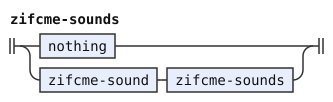</p>
<p></p>
<p>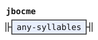</p>
<p>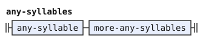</p>
<p>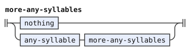</p>
</details>


## Cmavo

A cmavo is not the start of a name, and not the start of a lujvo that begins with a CVC rafsi and a y-hyphen. Its form is an onset and nuclei joined by apostrophes, or a run of `y`. A pause or another word follows it. `CVCy_lujvo` is what keeps `bajykla` one lujvo, and not `ba jy kla`.

```jbogenbau
%rule cmavo                   (* cmavo <- !cmevla !CVCy_lujvo cmavo_form &post_word *)
  $f:cmavo-form
%conditions
  ¬$f.onward.begins(cmevla),
  ¬$f.onward.begins(cvcy-lujvo),
  $f.following-tokens.begins(post-word)

%rule cvcy-lujvo              (* CVCy_lujvo <- CVC_rafsi y h? initial_rafsi* brivla_core / stressed_CVC_rafsi y short_final_rafsi; only a lookahead *)
  | cvc-rafsi y h-opt initial-rafsis brivla-core
  | stressed-cvc-rafsi y short-final-rafsi

%rule cmavo-form              (* cmavo_form <- !h !cluster onset (nucleus h)* (!stressed nucleus / nucleus !cluster) / y+ / digit *)
  | cmavo-form-with-onset
  | $y:ys
%conditions
  ¬$y.onward.begins(cmavo-form-with-onset)

%rule cmavo-form-with-onset   (* !h !cluster onset (nucleus h)* (!stressed nucleus / nucleus !cluster) *)
  $o:onset nucleus-h-pairs cmavo-last-nucleus
%conditions
  ¬$o.onward.begins(h),
  ¬$o.onward.begins(cluster)

%rule nucleus-h-pairs         (* (nucleus h)* *)
  | $n:nothing
  | nucleus-h-pair nucleus-h-pairs
%conditions
  ¬$n.onward.begins(nucleus-h-pair)

%rule nucleus-h-pair          (* nucleus h, repeated in (nucleus h)* *)
  nucleus h
```

<details><summary>Railroad diagrams of the 6 rules from <code>cmavo</code> to <code>nucleus-h-pair</code></summary>
<p></p>
<p></p>
<p></p>
<p></p>
<p>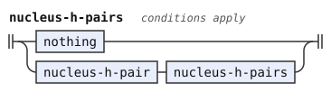</p>
<p>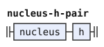</p>
</details>


The last nucleus of a cmavo is unstressed, or it is not followed by a consonant cluster. So `MIklama` is not `mI klama`. The second alternative of the PEG's choice applies where the first does not begin: where a nucleus begins, that is where it is stressed.

```jbogenbau
%rule cmavo-last-nucleus      (* !stressed nucleus / nucleus !cluster *)
  | $n:nucleus
  | $m:nucleus
%conditions
  ¬$n.onward.begins(stressed),
  $m.onward.begins(stressed),
  ¬$m.following-tokens.begins(cluster)

%rule ys                      (* y+ *)
  y more-ys

%rule more-ys                 (* the rest of y+ *)
  | $n:nothing
  | y more-ys
%conditions
  ¬$n.onward.begins(y)
```

<details><summary>Railroad diagrams of <code>cmavo-last-nucleus</code>, <code>ys</code> and <code>more-ys</code></summary>
<p></p>
<p></p>
<p>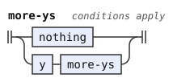</p>
</details>


## Brivla

A brivla is not a cmavo. It is any number of rafsi followed by a core. The core is a borrowing, a gismu, a CVV final rafsi, or a stressed rafsi followed by a short final rafsi.

```jbogenbau
%rule brivla                  (* brivla <- !cmavo initial_rafsi* brivla_core *)
  $r:initial-rafsis brivla-core
%conditions
  ¬$r.onward.begins(cmavo)

%rule initial-rafsis          (* initial_rafsi* *)
  | $n:nothing
  | initial-rafsi initial-rafsis
%conditions
  ¬$n.onward.begins(initial-rafsi)

%rule brivla-core             (* brivla_core <- fuhivla / gismu / CVV_final_rafsi / stressed_initial_rafsi short_final_rafsi *)
  | fuhivla
  | $g:gismu
  | $v:cvv-final-rafsi
  | $s:stressed-initial-rafsi short-final-rafsi
%conditions
  ¬$g.onward.begins(fuhivla),
  ¬$v.onward.begins(fuhivla),
  ¬$v.onward.begins(gismu),
  ¬$s.onward.begins(fuhivla),
  ¬$s.onward.begins(gismu),
  ¬$s.onward.begins(cvv-final-rafsi)

%rule stressed-initial-rafsi  (* stressed_initial_rafsi <- stressed_extended_rafsi / stressed_y_rafsi / stressed_y_less_rafsi *)
  | stressed-extended-rafsi
  | $y:stressed-y-rafsi
  | $l:stressed-y-less-rafsi
%conditions
  ¬$y.onward.begins(stressed-extended-rafsi),
  ¬$l.onward.begins(stressed-extended-rafsi),
  ¬$l.onward.begins(stressed-y-rafsi)
```

<details><summary>Railroad diagrams of the 4 rules from <code>brivla</code> to <code>stressed-initial-rafsi</code></summary>
<p></p>
<p>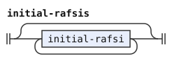</p>
<p></p>
<p></p>
</details>


A rafsi without a y-hyphen stands before the core only where neither it nor the part after it begins an extended rafsi or a borrowing. So `spageti'ybroda` begins with the extended rafsi `spageti'y`, and `selspageti` is one borrowing.

```jbogenbau
%rule initial-rafsi           (* initial_rafsi <- extended_rafsi / y_rafsi / !any_extended_rafsi y_less_rafsi !any_extended_rafsi *)
  | extended-rafsi
  | $y:y-rafsi
  | $l:y-less-rafsi
%conditions
  ¬$y.onward.begins(extended-rafsi),
  ¬$l.onward.begins(extended-rafsi),
  ¬$l.onward.begins(y-rafsi),
  ¬$l.onward.begins(any-extended-rafsi),
  ¬$l.following-tokens.begins(any-extended-rafsi)

%rule any-extended-rafsi      (* any_extended_rafsi <- fuhivla / extended_rafsi / stressed_extended_rafsi; only a lookahead *)
  fuhivla | extended-rafsi | stressed-extended-rafsi
```

<details><summary>Railroad diagrams of <code>initial-rafsi</code> and <code>any-extended-rafsi</code></summary>
<p></p>
<p></p>
</details>


## Borrowings and extended rafsi

A consonantal syllable has a consonant as its center. A borrowing is a head of unstressed syllables, a stressed syllable, any number of consonantal syllables and a final syllable. Its head does not begin with a string of rafsi, and it is not a cmavo or a consonant followed by a string of rafsi. That last test is the slinku'i test of CLL[^cll-s4-7].

An extended rafsi lets a brivla or a borrowing, whole or cut short, stand before a y-hyphen inside a compound. A `brivla_rafsi` is a head of two syllables or more, followed by `'y`, as `klama'y` in `klama'ybroda`. A `fuhivla_rafsi` is the head of a borrowing followed by an onset and `y`. The onset is a consonant, as in `aktyiismu`, or a glide, as in `spageiybroda`. Each has a stressed form, which stands before a short final rafsi.

```jbogenbau
%rule fuhivla                 (* fuhivla <- fuhivla_head stressed_syllable consonantal_syllable* final_syllable *)
  fuhivla-head stressed-syllable consonantal-syllables final-syllable

%rule stressed-extended-rafsi (* stressed_extended_rafsi <- stressed_brivla_rafsi / stressed_fuhivla_rafsi *)
  | stressed-brivla-rafsi
  | $f:stressed-fuhivla-rafsi
%conditions
  ¬$f.onward.begins(stressed-brivla-rafsi)

%rule extended-rafsi          (* extended_rafsi <- brivla_rafsi / fuhivla_rafsi *)
  | brivla-rafsi
  | $f:fuhivla-rafsi
%conditions
  ¬$f.onward.begins(brivla-rafsi)

%rule stressed-brivla-rafsi   (* stressed_brivla_rafsi <- &unstressed_syllable brivla_head stressed_syllable h y *)
  $b:brivla-head stressed-syllable h y
%conditions
  $b.onward.begins(unstressed-syllable)

%rule brivla-rafsi            (* brivla_rafsi <- &(syllable consonantal_syllable* syllable) brivla_head h y h? *)
  $b:brivla-head h y h-opt
%conditions
  $b.onward.begins(two-syllables)

%rule two-syllables           (* syllable consonantal_syllable* syllable *)
  syllable consonantal-syllables syllable

%rule stressed-fuhivla-rafsi  (* stressed_fuhivla_rafsi <- fuhivla_head stressed_syllable consonantal_syllable* !h onset y *)
  fuhivla-head stressed-syllable $c:consonantal-syllables onset y
%conditions
  ¬$c.following-tokens.begins(h)

%rule fuhivla-rafsi           (* fuhivla_rafsi <- &unstressed_syllable fuhivla_head !h onset y h? *)
  $f:fuhivla-head onset y h-opt
%conditions
  $f.onward.begins(unstressed-syllable),
  ¬$f.following-tokens.begins(h)

%rule fuhivla-head            (* fuhivla_head <- !rafsi_string brivla_head *)
  $b:brivla-head
%conditions
  ¬$b.onward.begins(rafsi-string)

%rule brivla-head             (* brivla_head <- !cmavo !slinkuhi !h &onset unstressed_syllable* *)
  $s:unstressed-syllables
%conditions
  ¬$s.onward.begins(cmavo),
  ¬$s.onward.begins(slinkuhi),
  ¬$s.onward.begins(h),
  $s.onward.begins(onset)

%rule unstressed-syllables    (* unstressed_syllable* *)
  | $n:nothing
  | unstressed-syllable unstressed-syllables
%conditions
  ¬$n.onward.begins(unstressed-syllable)

%rule slinkuhi                (* slinkuhi <- !rafsi_string consonant rafsi_string; only a lookahead *)
  $c:consonant rafsi-string
%conditions
  ¬$c.onward.begins(rafsi-string)
```

<details><summary>Railroad diagrams of the 12 rules from <code>fuhivla</code> to <code>slinkuhi</code></summary>
<p></p>
<p></p>
<p></p>
<p></p>
<p></p>
<p></p>
<p></p>
<p></p>
<p></p>
<p></p>
<p>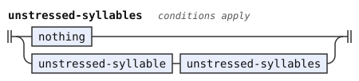</p>
<p></p>
</details>


The slinku'i test and a borrowing's head look for a string of rafsi. That is any number of rafsi without a y-hyphen, and then a part that can end a lujvo or that has a y-hyphen. The PEG uses it only in lookaheads.

```jbogenbau
%rule rafsi-string            (* rafsi_string <- y_less_rafsi* (...); only a lookahead *)
  y-less-rafsis rafsi-string-end

%rule y-less-rafsis           (* y_less_rafsi* *)
  | $n:nothing
  | y-less-rafsi y-less-rafsis
%conditions
  ¬$n.onward.begins(y-less-rafsi)

%rule rafsi-string-end        (* gismu / CVV_final_rafsi / stressed_y_less_rafsi short_final_rafsi / y_rafsi / stressed_y_rafsi / stressed_y_less_rafsi? initial_pair y / hy_rafsi / stressed_hy_rafsi; only a lookahead *)
  | gismu
  | cvv-final-rafsi
  | stressed-y-less-rafsi short-final-rafsi
  | y-rafsi
  | stressed-y-rafsi
  | stressed-y-less-rafsi-opt initial-pair y
  | hy-rafsi
  | stressed-hy-rafsi

%rule stressed-y-less-rafsi-opt  (* stressed_y_less_rafsi? *)
  | stressed-y-less-rafsi
  | $n:nothing
%conditions
  ¬$n.onward.begins(stressed-y-less-rafsi)
```

<details><summary>Railroad diagrams of the 4 rules from <code>rafsi-string</code> to <code>stressed-y-less-rafsi-opt</code></summary>
<p></p>
<p>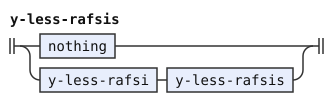</p>
<p></p>
<p>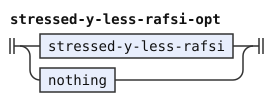</p>
</details>


## Rafsi

The core of a brivla ends it, and a pause or another word follows it. Its final syllable has a nucleus with no stress mark and is not followed by a name.

```jbogenbau
%rule gismu                   (* gismu <- (initial_pair stressed_vowel / consonant stressed_vowel consonant) &final_syllable consonant vowel &post_word *)
  gismu-start $c:consonant $v:vowel
%conditions
  $c.onward.begins(final-syllable),
  $v.following-tokens.begins(post-word)

%rule gismu-start             (* initial_pair stressed_vowel / consonant stressed_vowel consonant; the second letter is a consonant in one and a vowel in the other *)
  initial-pair stressed-vowel | consonant stressed-vowel consonant

%rule cvv-final-rafsi         (* CVV_final_rafsi <- consonant stressed_vowel h &final_syllable vowel &post_word *)
  consonant stressed-vowel h $v:vowel
%conditions
  $v.onward.begins(final-syllable),
  $v.following-tokens.begins(post-word)

%rule short-final-rafsi       (* short_final_rafsi <- &final_syllable (consonant diphthong / initial_pair vowel) &post_word *)
  $r:short-final-body
%conditions
  $r.onward.begins(final-syllable),
  $r.following-tokens.begins(post-word)

%rule short-final-body        (* consonant diphthong / initial_pair vowel; the second letter is a vowel in one and a consonant in the other *)
  consonant diphthong | initial-pair vowel

%rule stressed-y-rafsi        (* stressed_y_rafsi <- (stressed_long_rafsi / stressed_CVC_rafsi) y *)
  | stressed-long-rafsi y
  | $c:stressed-cvc-rafsi y
%conditions
  ¬$c.onward.begins(stressed-long-rafsi)

%rule stressed-y-less-rafsi   (* stressed_y_less_rafsi <- stressed_CVC_rafsi !y / stressed_CCV_rafsi / stressed_CVV_rafsi; CVC and CCV differ in the second letter, CVC and CVV in the third, CCV and CVV in the second *)
  | $c:stressed-cvc-rafsi
  | stressed-ccv-rafsi
  | stressed-cvv-rafsi
%conditions
  ¬$c.following-tokens.begins(y)

%rule stressed-long-rafsi     (* stressed_long_rafsi <- initial_pair stressed_vowel consonant / consonant stressed_vowel consonant consonant; they differ in the second letter *)
  initial-pair stressed-vowel consonant | consonant stressed-vowel consonant consonant

%rule stressed-cvc-rafsi      (* stressed_CVC_rafsi <- consonant stressed_vowel consonant *)
  consonant stressed-vowel consonant

%rule stressed-ccv-rafsi      (* stressed_CCV_rafsi <- initial_pair stressed_vowel *)
  initial-pair stressed-vowel

%rule stressed-cvv-rafsi      (* stressed_CVV_rafsi <- consonant (unstressed_vowel h stressed_vowel / stressed_diphthong) r_hyphen? *)
  consonant stressed-cvv-body r-hyphen-opt

%rule stressed-cvv-body       (* unstressed_vowel h stressed_vowel / stressed_diphthong; the second letter is an apostrophe in one and a vowel in the other *)
  unstressed-vowel h stressed-vowel | stressed-diphthong

%rule y-rafsi                 (* y_rafsi <- (long_rafsi / CVC_rafsi) y h? *)
  | long-rafsi y h-opt
  | $c:cvc-rafsi y h-opt
%conditions
  ¬$c.onward.begins(long-rafsi)

%rule y-less-rafsi            (* y_less_rafsi <- !y_rafsi !stressed_y_rafsi !hy_rafsi !stressed_hy_rafsi (CVC_rafsi / CCV_rafsi / CVV_rafsi) !h *)
  $r:y-less-rafsi-body
%conditions
  ¬$r.onward.begins(y-rafsi),
  ¬$r.onward.begins(stressed-y-rafsi),
  ¬$r.onward.begins(hy-rafsi),
  ¬$r.onward.begins(stressed-hy-rafsi),
  ¬$r.following-tokens.begins(h)

%rule y-less-rafsi-body       (* CVC_rafsi / CCV_rafsi / CVV_rafsi; CVC and CCV differ in the second letter, CVC and CVV in the third, CCV and CVV in the second *)
  cvc-rafsi | ccv-rafsi | cvv-rafsi
```

<details><summary>Railroad diagrams of the 15 rules from <code>gismu</code> to <code>y-less-rafsi-body</code></summary>
<p></p>
<p></p>
<p></p>
<p></p>
<p></p>
<p></p>
<p></p>
<p></p>
<p></p>
<p></p>
<p></p>
<p></p>
<p></p>
<p></p>
<p></p>
</details>


A rafsi followed by `'y` is a `hy_rafsi`. The PEG uses it only to end a string of rafsi, so it builds no lujvo.

```jbogenbau
%rule hy-rafsi                (* hy_rafsi <- (long_rafsi vowel / CCV_rafsi / CVV_rafsi) h y h? *)
  hy-rafsi-body h y h-opt

%rule hy-rafsi-body           (* long_rafsi vowel / CCV_rafsi / CVV_rafsi; CVV differs from each of the others in its second or third letter *)
  | long-rafsi-vowel
  | $c:ccv-rafsi
  | cvv-rafsi
%conditions
  ¬$c.onward.begins(long-rafsi-vowel)

%rule long-rafsi-vowel        (* long_rafsi vowel *)
  long-rafsi vowel

%rule stressed-hy-rafsi       (* stressed_hy_rafsi <- (long_rafsi stressed_vowel / stressed_CCV_rafsi / stressed_CVV_rafsi) h y *)
  stressed-hy-rafsi-body h y

%rule stressed-hy-rafsi-body  (* long_rafsi stressed_vowel / stressed_CCV_rafsi / stressed_CVV_rafsi; CVV differs from each of the others in its second or third letter, and long_rafsi differs from stressed_CCV_rafsi in its second letter or in the stress of its third *)
  long-rafsi-stressed-vowel | stressed-ccv-rafsi | stressed-cvv-rafsi

%rule long-rafsi-stressed-vowel  (* long_rafsi stressed_vowel *)
  long-rafsi stressed-vowel

%rule long-rafsi              (* long_rafsi <- initial_pair unstressed_vowel consonant / consonant unstressed_vowel consonant consonant; they differ in the second letter *)
  initial-pair unstressed-vowel consonant | consonant unstressed-vowel consonant consonant

%rule cvc-rafsi               (* CVC_rafsi <- consonant unstressed_vowel consonant *)
  consonant unstressed-vowel consonant

%rule ccv-rafsi               (* CCV_rafsi <- initial_pair unstressed_vowel *)
  initial-pair unstressed-vowel

%rule cvv-rafsi               (* CVV_rafsi <- consonant (unstressed_vowel h unstressed_vowel / unstressed_diphthong) r_hyphen? *)
  consonant cvv-body r-hyphen-opt

%rule cvv-body                (* unstressed_vowel h unstressed_vowel / unstressed_diphthong; the second letter is an apostrophe in one and a vowel in the other *)
  unstressed-vowel h unstressed-vowel | unstressed-diphthong

%rule r-hyphen                (* r_hyphen <- r &consonant / n &r *)
  | $r:r
  | $n:n
%conditions
  $r.following-tokens.begins(consonant),
  $n.following-tokens.begins(r)

%rule r-hyphen-opt            (* r_hyphen? *)
  | r-hyphen
  | $n:nothing
%conditions
  ¬$n.onward.begins(r-hyphen)
```

<details><summary>Railroad diagrams of the 13 rules from <code>hy-rafsi</code> to <code>r-hyphen-opt</code></summary>
<p></p>
<p></p>
<p></p>
<p></p>
<p></p>
<p></p>
<p></p>
<p></p>
<p></p>
<p></p>
<p></p>
<p></p>
<p>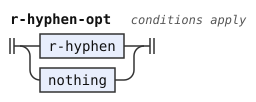</p>
</details>


## Syllables and stress

A vowel, diphthong or syllable is stressed in two cases. In one, the letter after its onset is a capital vowel (`stressed`). In the other, one more syllable follows it before a pause (`stress`). It is unstressed when it is neither. A capital glide, or a capital second letter of a diphthong, marks nothing.

So an unmarked brivla is stressed on its penultimate syllable, and a pause must follow it. Another word can directly follow a brivla whose stress is marked.

```jbogenbau
%rule final-syllable          (* final_syllable <- onset !y !stressed nucleus !cmevla &post_word *)
  $o:onset $n:nucleus
%conditions
  ¬$o.following-tokens.begins(y),
  ¬$o.following-tokens.begins(stressed),
  ¬$n.following-tokens.begins(cmevla),
  $n.following-tokens.begins(post-word)

%rule stressed-syllable       (* stressed_syllable <- &stressed syllable / syllable &stress *)
  | $s:syllable
  | $t:syllable
%conditions
  $s.onward.begins(stressed),
  ¬$t.onward.begins(stressed),
  $t.following-tokens.begins(stress)

%rule stressed-diphthong      (* stressed_diphthong <- &stressed diphthong / diphthong &stress *)
  | $s:diphthong
  | $t:diphthong
%conditions
  $s.onward.begins(stressed),
  ¬$t.onward.begins(stressed),
  $t.following-tokens.begins(stress)

%rule stressed-vowel          (* stressed_vowel <- &stressed vowel / vowel &stress *)
  | $s:vowel
  | $t:vowel
%conditions
  $s.onward.begins(stressed),
  ¬$t.onward.begins(stressed),
  $t.following-tokens.begins(stress)

%rule unstressed-syllable     (* unstressed_syllable <- !stressed syllable !stress / consonantal_syllable *)
  | unstressed-plain-syllable
  | $c:consonantal-syllable
%conditions
  ¬$c.onward.begins(unstressed-plain-syllable)

%rule unstressed-plain-syllable  (* !stressed syllable !stress *)
  $s:syllable
%conditions
  ¬$s.onward.begins(stressed),
  ¬$s.following-tokens.begins(stress)

%rule unstressed-diphthong    (* unstressed_diphthong <- !stressed diphthong !stress *)
  $d:diphthong
%conditions
  ¬$d.onward.begins(stressed),
  ¬$d.following-tokens.begins(stress)

%rule unstressed-vowel        (* unstressed_vowel <- !stressed vowel !stress *)
  $v:vowel
%conditions
  ¬$v.onward.begins(stressed),
  ¬$v.following-tokens.begins(stress)

%rule stress                  (* stress <- (consonant / glide)* h? y? syllable pause; only a lookahead *)
  stress-onsets h-opt y-opt $s:syllable
%conditions
  $s.following-tokens.begins(pause)

%rule stress-onsets           (* (consonant / glide)*; a consonant and a glide are different letters *)
  | $n:nothing
  | stress-onset stress-onsets
%conditions
  ¬$n.onward.begins(stress-onset)

%rule stress-onset            (* consonant / glide, repeated in (consonant / glide)* *)
  consonant | glide

%rule stressed                (* stressed <- onset comma* [AEIOU] *)
  onset stress-mark

%rule stress-mark             (* [AEIOU], a letter and not a vowel rule *)
  "a"<Stressed> | "e"<Stressed> | "i"<Stressed> | "o"<Stressed> | "u"<Stressed>
```

<details><summary>Railroad diagrams of the 13 rules from <code>final-syllable</code> to <code>stress-mark</code></summary>
<p></p>
<p></p>
<p></p>
<p></p>
<p></p>
<p></p>
<p></p>
<p></p>
<p></p>
<p>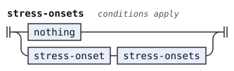</p>
<p>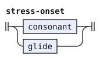</p>
<p></p>
<p></p>
</details>


A syllable is an onset, a nucleus and an optional coda. A consonantal syllable is a consonant before a syllabic consonant, and a coda. A coda is a consonant before another syllable, or at most a syllabic consonant and a consonant before a pause.

```jbogenbau
%rule any-syllable            (* any_syllable <- onset nucleus coda? / consonantal_syllable *)
  | onset-nucleus-coda
  | $c:consonantal-syllable
%conditions
  ¬$c.onward.begins(onset-nucleus-coda)

%rule onset-nucleus-coda      (* onset nucleus coda? *)
  onset nucleus coda-opt

%rule syllable                (* syllable <- onset !y nucleus coda? *)
  $o:onset nucleus coda-opt
%conditions
  ¬$o.following-tokens.begins(y)

%rule consonantal-syllable    (* consonantal_syllable <- consonant &syllabic coda *)
  $c:consonant coda
%conditions
  $c.following-tokens.begins(syllabic)

%rule consonantal-syllables   (* consonantal_syllable* *)
  | $n:nothing
  | consonantal-syllable consonantal-syllables
%conditions
  ¬$n.onward.begins(consonantal-syllable)

%rule coda                    (* coda <- !any_syllable consonant &any_syllable / syllabic? consonant? &pause *)
  | coda-before-syllable
  | $p:coda-before-pause
%conditions
  ¬$p.onward.begins(coda-before-syllable)

%rule coda-before-syllable    (* !any_syllable consonant &any_syllable *)
  $c:consonant
%conditions
  ¬$c.onward.begins(any-syllable),
  $c.following-tokens.begins(any-syllable)

%rule coda-before-pause       (* syllabic? consonant? &pause *)
  syllabic-opt $c:consonant-opt
%conditions
  $c.following-tokens.begins(pause)

%rule coda-opt                (* coda? *)
  | coda
  | $n:nothing
%conditions
  ¬$n.onward.begins(coda)

%rule onset                   (* onset <- h / glide / initial. h and glide begin with different letters. A nonempty initial begins with a consonant. An empty initial forbids a following glide, and this rule's condition excludes h. *)
  | h
  | glide
  | $i:initial
%conditions
  ¬$i.onward.begins(h)

%rule nucleus                 (* nucleus <- vowel / diphthong / y !nucleus. y begins no vowel or diphthong. A vowel allows no nucleus after it. A diphthong's second letter is a vowel that no nucleus follows, so that letter begins a nucleus and excludes the first-letter vowel. *)
  | vowel
  | diphthong
  | $y:y
%conditions
  ¬$y.following-tokens.begins(nucleus)

%rule glide                   (* glide <- (i / u) &nucleus *)
  $g:i-or-u
%conditions
  $g.following-tokens.begins(nucleus)

%rule i-or-u                  (* i / u *)
  i | u

%rule diphthong               (* diphthong <- (a i !i / a u !u / e i !i / o i !i) !nucleus *)
  $d:diphthong-letters
%conditions
  ¬$d.following-tokens.begins(nucleus)

%rule diphthong-letters       (* a i !i / a u !u / e i !i / o i !i; they differ in the first or the second letter *)
  | a $i:i
  | a $u:u
  | e $j:i
  | o $k:i
%conditions
  ¬$i.following-tokens.begins(i),
  ¬$u.following-tokens.begins(u),
  ¬$j.following-tokens.begins(i),
  ¬$k.following-tokens.begins(i)

%rule vowel                   (* vowel <- (a / e / i / o / u) !nucleus *)
  $v:vowel-letter
%conditions
  ¬$v.following-tokens.begins(nucleus)

%rule vowel-letter            (* a / e / i / o / u *)
  a | e | i | o | u
```

<details><summary>Railroad diagrams of the 17 rules from <code>any-syllable</code> to <code>vowel-letter</code></summary>
<p></p>
<p></p>
<p></p>
<p></p>
<p>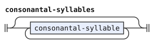</p>
<p></p>
<p></p>
<p></p>
<p>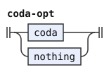</p>
<p></p>
<p></p>
<p></p>
<p></p>
<p></p>
<p></p>
<p></p>
<p></p>
</details>


## Letters

A vowel letter has a lowercase value with or without `Stressed`. The `a`, `e`, `i`, `o` and `u` rules each read one value. `stress-mark` tests `Stressed` on those five values, so it finds the written stress. A `y` is not followed by a nucleus, unless that nucleus is another `y`. An apostrophe is followed by a nucleus.

```jbogenbau
%rule a                       (* a <- comma* [aA] *)
  "a"

%rule e                       (* e <- comma* [eE] *)
  "e"

%rule i                       (* i <- comma* [iI] *)
  "i"

%rule o                       (* o <- comma* [oO] *)
  "o"

%rule u                       (* u <- comma* [uU] *)
  "u"

%rule y                       (* y <- comma* [yY] !(!y nucleus) *)
  $y:"y"
%conditions
  ¬$y.following-tokens.begins(non-y-nucleus)

%rule non-y-nucleus           (* !y nucleus *)
  $n:nucleus
%conditions
  ¬$n.onward.begins(y)

%rule h                       (* h <- comma* ['h] &nucleus *)
  $h:"'"
%conditions
  $h.following-tokens.begins(nucleus)
```

<details><summary>Railroad diagrams of <code>a</code>, <code>e</code>, <code>i</code>, <code>o</code>, <code>u</code>, <code>y</code>, <code>non-y-nucleus</code> and <code>h</code></summary>
<p></p>
<p></p>
<p></p>
<p></p>
<p></p>
<p></p>
<p></p>
<p></p>
</details>


## Consonants

An initial pair is two consonants that can begin a word. `initial` says which: an affricate, or a sibilant, another consonant and a liquid, each optional, where no consonant or glide follows. An affricate joins a stopped sound with friction. A sibilant is a hissing consonant. The liquids here are `l` and `r`.

```jbogenbau
%rule cluster                 (* cluster <- consonant consonant+; only a lookahead, so the first two consonants decide it *)
  consonant consonant

%rule initial-pair            (* initial_pair <- &initial consonant consonant !consonant *)
  $a:consonant $b:consonant
%conditions
  $a.onward.begins(initial),
  ¬$b.following-tokens.begins(consonant)

%rule initial                 (* initial <- (affricate / sibilant? other? liquid?) !consonant !glide *)
  | $a:affricate
  | $p:initial-parts
%conditions
  ¬$a.following-tokens.begins(consonant),
  ¬$a.following-tokens.begins(glide),
  ¬$p.onward.begins(affricate),
  ¬$p.following-tokens.begins(consonant),
  ¬$p.following-tokens.begins(glide)

%rule initial-parts           (* sibilant? other? liquid? *)
  sibilant-opt other-opt liquid-opt

%rule affricate               (* affricate <- t c / t s / d j / d z; they differ in the first or the second letter *)
  t c | t s | d j | d z

%rule liquid                  (* liquid <- l / r *)
  l | r

%rule other                   (* other <- p / t !l / k / f / x / b / d !l / g / v / m / n !liquid *)
  | p | $t:t | k | f | x | b | $d:d | g | v | m | $n:n
%conditions
  ¬$t.following-tokens.begins(l),
  ¬$d.following-tokens.begins(l),
  ¬$n.following-tokens.begins(liquid)

%rule sibilant                (* sibilant <- c / s !x / (j / z) !n !liquid *)
  | c
  | $s:s
  | $j:j-or-z
%conditions
  ¬$s.following-tokens.begins(x),
  ¬$j.following-tokens.begins(n),
  ¬$j.following-tokens.begins(liquid)

%rule j-or-z                  (* j / z *)
  j | z

%rule consonant               (* consonant <- voiced / unvoiced / syllabic *)
  voiced | unvoiced | syllabic

%rule syllabic                (* syllabic <- l / m / n / r *)
  l | m | n | r

%rule voiced                  (* voiced <- b / d / g / j / v / z *)
  b | d | g | j | v | z

%rule unvoiced                (* unvoiced <- c / f / k / p / s / t / x *)
  c | f | k | p | s | t | x
```

<details><summary>Railroad diagrams of the 13 rules from <code>cluster</code> to <code>unvoiced</code></summary>
<p></p>
<p></p>
<p></p>
<p></p>
<p></p>
<p></p>
<p></p>
<p></p>
<p></p>
<p></p>
<p></p>
<p></p>
<p></p>
</details>


Each consonant letter refuses a following apostrophe that begins a syllable, a glide, or the same consonant. Each voiced or unvoiced letter also refuses consonants of the other voicing, and some letters refuse other letters, as CLL[^cll-s3-6] says.

```jbogenbau
%rule l                       (* l <- comma* [lL] !h !glide !l *)
  $c:"l"
%conditions
  ¬$c.following-tokens.begins(h),
  ¬$c.following-tokens.begins(glide),
  ¬$c.following-tokens.begins(l)

%rule m                       (* m <- comma* [mM] !h !glide !m !z *)
  $c:"m"
%conditions
  ¬$c.following-tokens.begins(h),
  ¬$c.following-tokens.begins(glide),
  ¬$c.following-tokens.begins(m),
  ¬$c.following-tokens.begins(z)

%rule n                       (* n <- comma* [nN] !h !glide !n !affricate *)
  $c:"n"
%conditions
  ¬$c.following-tokens.begins(h),
  ¬$c.following-tokens.begins(glide),
  ¬$c.following-tokens.begins(n),
  ¬$c.following-tokens.begins(affricate)

%rule r                       (* r <- comma* [rR] !h !glide !r *)
  $c:"r"
%conditions
  ¬$c.following-tokens.begins(h),
  ¬$c.following-tokens.begins(glide),
  ¬$c.following-tokens.begins(r)

%rule b                       (* b <- comma* [bB] !h !glide !b !unvoiced *)
  $c:"b"
%conditions
  ¬$c.following-tokens.begins(h),
  ¬$c.following-tokens.begins(glide),
  ¬$c.following-tokens.begins(b),
  ¬$c.following-tokens.begins(unvoiced)

%rule d                       (* d <- comma* [dD] !h !glide !d !unvoiced *)
  $c:"d"
%conditions
  ¬$c.following-tokens.begins(h),
  ¬$c.following-tokens.begins(glide),
  ¬$c.following-tokens.begins(d),
  ¬$c.following-tokens.begins(unvoiced)

%rule g                       (* g <- comma* [gG] !h !glide !g !unvoiced *)
  $c:"g"
%conditions
  ¬$c.following-tokens.begins(h),
  ¬$c.following-tokens.begins(glide),
  ¬$c.following-tokens.begins(g),
  ¬$c.following-tokens.begins(unvoiced)

%rule v                       (* v <- comma* [vV] !h !glide !v !unvoiced *)
  $c:"v"
%conditions
  ¬$c.following-tokens.begins(h),
  ¬$c.following-tokens.begins(glide),
  ¬$c.following-tokens.begins(v),
  ¬$c.following-tokens.begins(unvoiced)

%rule j                       (* j <- comma* [jJ] !h !glide !j !z !unvoiced *)
  $c:"j"
%conditions
  ¬$c.following-tokens.begins(h),
  ¬$c.following-tokens.begins(glide),
  ¬$c.following-tokens.begins(j),
  ¬$c.following-tokens.begins(z),
  ¬$c.following-tokens.begins(unvoiced)

%rule z                       (* z <- comma* [zZ] !h !glide !z !j !unvoiced *)
  $c:"z"
%conditions
  ¬$c.following-tokens.begins(h),
  ¬$c.following-tokens.begins(glide),
  ¬$c.following-tokens.begins(z),
  ¬$c.following-tokens.begins(j),
  ¬$c.following-tokens.begins(unvoiced)

%rule s                       (* s <- comma* [sS] !h !glide !s !c !voiced *)
  $c:"s"
%conditions
  ¬$c.following-tokens.begins(h),
  ¬$c.following-tokens.begins(glide),
  ¬$c.following-tokens.begins(s),
  ¬$c.following-tokens.begins(c),
  ¬$c.following-tokens.begins(voiced)

%rule c                       (* c <- comma* [cC] !h !glide !c !s !x !voiced *)
  $c:"c"
%conditions
  ¬$c.following-tokens.begins(h),
  ¬$c.following-tokens.begins(glide),
  ¬$c.following-tokens.begins(c),
  ¬$c.following-tokens.begins(s),
  ¬$c.following-tokens.begins(x),
  ¬$c.following-tokens.begins(voiced)

%rule x                       (* x <- comma* [xX] !h !glide !x !c !k !voiced *)
  $c:"x"
%conditions
  ¬$c.following-tokens.begins(h),
  ¬$c.following-tokens.begins(glide),
  ¬$c.following-tokens.begins(x),
  ¬$c.following-tokens.begins(c),
  ¬$c.following-tokens.begins(k),
  ¬$c.following-tokens.begins(voiced)

%rule k                       (* k <- comma* [kK] !h !glide !k !x !voiced *)
  $c:"k"
%conditions
  ¬$c.following-tokens.begins(h),
  ¬$c.following-tokens.begins(glide),
  ¬$c.following-tokens.begins(k),
  ¬$c.following-tokens.begins(x),
  ¬$c.following-tokens.begins(voiced)

%rule f                       (* f <- comma* [fF] !h !glide !f !voiced *)
  $c:"f"
%conditions
  ¬$c.following-tokens.begins(h),
  ¬$c.following-tokens.begins(glide),
  ¬$c.following-tokens.begins(f),
  ¬$c.following-tokens.begins(voiced)

%rule p                       (* p <- comma* [pP] !h !glide !p !voiced *)
  $c:"p"
%conditions
  ¬$c.following-tokens.begins(h),
  ¬$c.following-tokens.begins(glide),
  ¬$c.following-tokens.begins(p),
  ¬$c.following-tokens.begins(voiced)

%rule t                       (* t <- comma* [tT] !h !glide !t !voiced *)
  $c:"t"
%conditions
  ¬$c.following-tokens.begins(h),
  ¬$c.following-tokens.begins(glide),
  ¬$c.following-tokens.begins(t),
  ¬$c.following-tokens.begins(voiced)
```

<details><summary>Railroad diagrams of the 17 rules from <code>l</code> to <code>t</code></summary>
<p></p>
<p></p>
<p></p>
<p></p>
<p></p>
<p></p>
<p></p>
<p></p>
<p></p>
<p></p>
<p></p>
<p></p>
<p></p>
<p></p>
<p></p>
<p></p>
<p></p>
</details>


## Greedy optionals

Each optional of the PEG is a rule that reads the optional part wherever it begins.

```jbogenbau
%rule h-opt                   (* h? *)
  | h
  | $n:nothing
%conditions
  ¬$n.onward.begins(h)

%rule y-opt                   (* y? *)
  | y
  | $n:nothing
%conditions
  ¬$n.onward.begins(y)

%rule syllabic-opt            (* syllabic? *)
  | syllabic
  | $n:nothing
%conditions
  ¬$n.onward.begins(syllabic)

%rule consonant-opt           (* consonant? *)
  | consonant
  | $n:nothing
%conditions
  ¬$n.onward.begins(consonant)

%rule sibilant-opt            (* sibilant? *)
  | sibilant
  | $n:nothing
%conditions
  ¬$n.onward.begins(sibilant)

%rule other-opt               (* other? *)
  | other
  | $n:nothing
%conditions
  ¬$n.onward.begins(other)

%rule liquid-opt              (* liquid? *)
  | liquid
  | $n:nothing
%conditions
  ¬$n.onward.begins(liquid)
```

<details><summary>Railroad diagrams of the 7 rules from <code>h-opt</code> to <code>liquid-opt</code></summary>
<p>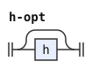</p>
<p>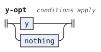</p>
<p>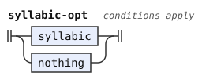</p>
<p>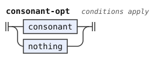</p>
<p>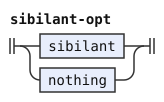</p>
<p>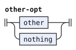</p>
<p>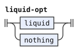</p>
</details>


## Differences from CLL and the reference PEG

The [checkpoint record](https://mw.lojban.org/index.php?title=BPFK_Checkpoints&oldid=109606) defers morphology. CLL 1.3.4[^cll-later-a3-3] records two committee votes on word forms. One bans a consonant directly before a glide. The other lifts the ban on `la`, `lai`, `la'i` and `doi` inside names. The PEG implements both. CLL 1.3.4 describes the rest of this working grammar, its extended rafsi included, as practice without a vote.

The phoneme stage reads the text before this stage does. In four ways, the text that this stage reads differs from the text that the PEG reads:

- The PEG reads a digit as a cmavo, and lets a digit stand in a name (its rule `digit`). The phoneme stage reads each digit as the letters of its number word, so `2` is `re`. So this translation has no rule `digit`. `.b1b.` is not a name, and `.dj2n.` is the name `djren`.
- The PEG ignores a comma before any letter (`comma*` in each letter rule). The phoneme stage drops every comma, so the translation leaves out `comma*`, with the same result, except in the letter word `ybu`.

  The PEG's `ybu` reads pause characters between the `y` and the `bu`, but no comma, unless the comma stands directly before the `bu`. Where `ybu` fails, the PEG reads the `y` as hesitation, which is space. So the PEG rejects `y, bu` and `y , bu`, and reads `doi y, bu` as the letter word `doi bu`. The words stage reads the one letter word `y bu` in these texts (below). Both read `y ,bu` as that letter word.
- The PEG reads a lowercase `h` as an apostrophe, and a consonant in either case. The phoneme stage reads a capital `H` as an apostrophe too, so `koHa` is `ko'a`, which the PEG rejects. It emits every apostrophe as `'` and every consonant in lower case, so the translation reads only those. A capital vowel is a stressed vowel for both. The phoneme stage also reads accents as stress and folds runs of two vowel groups or more in which every vowel is a capital. The PEG reads neither convention.
- The PEG's pauses are the space, tab, line feed and carriage return, and the characters `.`, `?` and `!` (its rule `space_char`). The phoneme stage reads every Unicode `White_Space` character and other punctuation as a pause too. So it reads a no-break space between two words as a pause, which the PEG rejects. It emits a run of pause characters as one `PAUSE`.

### The ybu exception

The PEG's first spelling of `BY`, the rule `ybu <- Y space_char* BU`, reads more than `cmavo`. It reads a run of `y`, any pause, and `bu` as one letter word: `ybu`, `y bu` and `yyybu` are each one word. That is the letter word `.y bu`, which the Magic Words proposal forms "before any other processing of any kind". This stage reads each run on its own, so it reads the `y` and the `bu` as two words. Before BU, the forms stage separates the final y from any prolonged hesitation. The shared word reader then forms the letter word ([stream.md](stream.md)).

Where the PEG's `ybu` begins, `cmavo` reads its run of `y` as one word in two cases. The run has one letter, or it has an even number of them. When it has an odd number, three or more, `cmavo` reads the first `y` alone and then the rest as one word. This is because `cmavo_form` reads first a single `y` that is a nucleus. So `yyybu` is `y`, `yy` and `bu`. `cmavo` then reads the `bu`, with the conditions of the PEG's `BU`.

So the division is that of `cmavo`, with each `ybu` split into its hesitation words and its `bu`. Before BU, this stage splits each prolonged piece into a prefix and a final y. The words stage drops the prefix and forms the letter word from the final y.

### Consonant restriction

The consonant rules retain the ban on a consonant followed by a glide and a vowel. The committee voted for this ban, and CLL 1.3.4 records the vote.[^cll-later-a3-3]

[^cll-s4-7]: [CLL 1.1, section 4.7](https://lojban.org/publications/cll/cll_v1.1_xhtml-section-chunks/section-fuhivla.html).

[^cll-s3-6]: [CLL 1.1, section 3.6](https://lojban.org/publications/cll/cll_v1.1_xhtml-section-chunks/section-clusters.html).

[^cll-later-a3-3]: [CLL 1.3.4, appendix A3.3](https://github.com/int19h/cll/blob/v1.3.4/chapters/a03.xml#L155-L243). This later approval record has no CLL 1.1 counterpart.
