# BPFK working word forms

This document is the family part of the forms stage in the [BPFK](../dialects/bpfk.md), [experimental](../dialects/experimental.md) and [Zantufa](../dialects/zantufa.md) dialects. A stage is one step of a pipeline, with its own grammar ([engine §1](../../docs/engine.md#1-tokens)). A family is a set of word forms that dialects use.

A token is one unit that a stage reads or emits. A token's value is the string that exact comparisons read. Its image is the string that people see.

The loader stitches this document in after [forms.md](forms.md). The experimental dialect stitches [experimental.md](experimental.md) after it, and the Zantufa dialect stitches [zantufa.md](zantufa.md). [The notation document](../../docs/notation.md) explains jbogenbau, the notation of these grammars.

This document gives the working word-form grammar of the BPFK, the Lojban language planning committee. It derives from the morphology part of `camxes.peg`, a parsing expression grammar (PEG). The executable baseline is ilmentufa commit [`778ea138f7d150121ca722db7536ce3b123943ac`](https://github.com/lojban/ilmentufa/blob/778ea138f7d150121ca722db7536ce3b123943ac/camxes.peg). [CLL 1.3.4](https://github.com/int19h/cll/blob/v1.3.4/chapters/a02.xml) (*The Complete Lojban Language*) prints that grammar in appendix A2.

The prose uses these Lojban terms for words:

- A cmavo is a particle, a short structure word.
- A selma'o is a word class of cmavo.
- A brivla is a predicate word.
- A cmevla is a name word.
- A gismu is a root word.
- A lujvo is a compound word.
- A rafsi is a shortened word form used inside compounds.

The rule names follow the corresponding PEG names, with lowercase letters and hyphens for underscores. Named parts support conditions or expose a word-form restriction. C denotes a consonant. V denotes `a`, `e`, `i`, `o`, or `u`.

## How the PEG is written here

A nucleus is the vowel or diphthong of a syllable. A glide is an `i` or `u` before a nucleus. An onset is the part of a syllable before its nucleus. A coda is the consonant part after a nucleus.

This grammar states the morphology's rules directly. Its alternatives have no order. It retains PEG lookaheads where they state word shapes, stress, hyphens, or word boundaries. A lookahead tests the text without consuming it. The conditions use `begins` at a constituent's start or end, including text beyond the word and before the next pause.

Different letters or incompatible conditions separate most alternatives. Other alternatives overlap as prefixes, but only one can complete the surrounding word. Their comments and the prose name the letters, stress, hyphens, or boundaries that force completion. At the end of a lookahead, alternative endpoints need no preference because the test asks only whether a form begins. Inside a lookahead, optionals and repetitions need the same exclusion or completion argument as consumed ones.

Plain optionals and repetitions express parts whose presence or count follows from their context. A shorter name body leaves a consonant before the required final consonant and pause. A shorter nucleus-apostrophe run leaves an apostrophe where the last nucleus must begin. A shorter unstressed rafsi or syllable run cannot reach the stressed core or its required hyphen. Consonantal syllables cannot consume the start of a following vowel-bearing syllable. A following rafsi cannot start with an apostrophe or the consonant pair that an r-hyphen supplies.

Where two stress tests apply to the same constituent, one alternative joins their conditions with `∨`. The grammar gives names one general shape and gives a final coda one form per nonempty length. These forms remove duplicate proofs of the same word. The closing section explains deliberate differences from camxes-std.

## Words

The phoneme stage supplies phoneme and pause tokens. Normalization gives stressed vowels lowercase values and keeps their `Stressed` tags. The forms stage reads names, particles, predicate words, and hesitation. Names end in consonants before a pause. Particles exclude names, and predicate words exclude particle starts. A predicate word's final syllable excludes a following name, so it cannot take the front of one.

The document [forms.md](forms.md) says how words join.

The word-boundary conditions decide which words can stand together without a pause. Every word carries `Continued`, so its own rules permit a following word without a pause. A word carries `Onset` when no nucleus begins it. Only such a word can follow another directly.

The PEG's `CMAVO` is a list of the selma'o, each a set of spellings, followed by `cmavo` for every other cmavo. Each selma'o rule begins with `&cmavo` and ends with `&post_word`. Every spelling except `ybu` reads exactly what `cmavo` reads, and the lexicon gives each cmavo its selma'o.

A whole run of `y` letters is one hesitation token, whatever its length. The [Magic Words proposal](https://mw.lojban.org/papri/Magic_Words) says that `y` is not a word and counts as whitespace. Thus `.yyy.` is one token here. The separate split before `bu` preserves letter words, as [the ybu exception](#the-ybu-exception) explains.

`cmavo-shape` reads `cmavo`. A cmavo made only of `y` letters is hesitation, which [forms.md](forms.md) reads as `y-run`, so this document redefines `y-run` as that cmavo.

A `y` is a nucleus exactly where no nucleus follows it. So the first `y` of a run is a nucleus exactly when the run has an odd number of letters. A run with an even number can follow a word directly: `kyyykerlo` is `ky yy kerlo`, but `bayyy` is no text. So a run of `y` has `Onset` where no nucleus begins it.

Ilmentufa's morphology-only parser accepts this division of `kyyykerlo`, but full camxes-std rejects the text. Its lexer wrapper calls `spaces` after `ky`, and that rule refuses a leading Y token. The [shared forms document](forms.md#differences-from-camxes) compares the word streams.

```jbogenbau
%rule cmevla-shape            (* CMEVLA <- cmevla *)
  $n:cmevla :: Continued ∪ (¬$n.onward.begins(nucleus) ⟹ Onset)

%rule cmavo-shape  (* Ordinary particles exclude pure y hesitation. Onset marks a word that can follow another without a pause. *)
  $c:cmavo :: Continued ∪ (¬$c.onward.begins(nucleus) ⟹ Onset)
%conditions
  ¬$c.matches(y-letters)

%rule brivla-shape  (* A predicate word carries its join and onset properties. *)
  $b:brivla-word :: Continued ∪ (¬$b.onward.begins(nucleus) ⟹ Onset)

%redefine-rule y-run  (* Pure hesitation keeps the complete particle boundary and its onset requirement. *)
  $h:cmavo :: (¬$h.onward.begins(nucleus) ⟹ Onset)
%conditions
  $h.matches(y-letters)

%rule y-letters               (* a run of y letters, which a condition tests *)
  "y" | "y" y-letters
```

<details><summary>Railroad diagrams of the 5 rules from <code>cmevla-shape</code> to <code>y-letters</code></summary>
<p>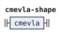</p>
<p>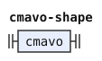</p>
<p>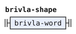</p>
<p>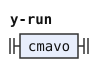</p>
<p>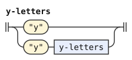</p>
</details>


The PEG's `lojban_word` is what `post_word` looks for after a word.

```jbogenbau
%rule lojban-word  (* A legal word is a name, a particle, or a predicate word. Their own conditions separate the classes. *)
  cmevla | cmavo | brivla-word

%rule brivla-word  (* Predicate words are roots, compounds, or borrowings. Lujvo exclude roots and borrowings. Borrowing heads exclude root-shaped rafsi strings. *)
  gismu | lujvo | fuhivla

%rule lujvo  (* A compound is a predicate word that is neither a root nor a borrowing. *)
  $b:brivla
%conditions
  ¬$b.onward.begins(gismu),
  ¬$b.onward.begins(fuhivla)

%rule post-word  (* A word ends before a pause or a legal next word. Without a pause, the next word cannot start with a nucleus. *)
  | pause
  | $w:lojban-word
%conditions
  ¬$w.onward.begins(nucleus)

%rule pause                   (* pause <- comma* space_char+ / EOF; only a lookahead *)
  PAUSE | end-of-text

%rule end-of-text  (* Require the end of input. *)
  ε
%conditions
  $.following-tokens.matches(nothing)

%rule nothing  (* The empty text serves the end-of-input test. *)
  ε
```

<details><summary>Railroad diagrams of the 7 rules from <code>lojban-word</code> to <code>nothing</code></summary>
<p>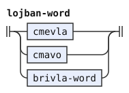</p>
<p>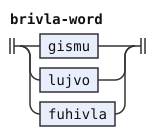</p>
<p>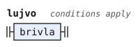</p>
<p>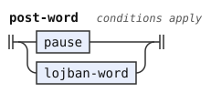</p>
<p>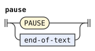</p>
<p></p>
<p>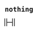</p>
</details>


## Cmevla

A name is a run of letters that ends in a consonant before a pause. The repeated sounds exclude that final consonant, so only one repetition count reaches it. The PEG also offers a syllabified name shape, which requires the same general shape and ends at the same pause. The single `zifcme` form covers both name readings without duplicate proofs.

```jbogenbau
%rule cmevla  (* A name needs the general name shape. The syllabified name shape requires that same shape and ends at the same pause. *)
  zifcme

%rule zifcme  (* A name forbids an initial apostrophe and ends in a consonant before a pause. *)
  [{zifcme-sound}] $c:consonant
%conditions
  ¬$.onward.begins(h),
  $c.following-tokens.begins(pause)

%rule zifcme-sound  (* An apostrophe and a consonant use distinct letters. A glide requires a following nucleus, which a vowel forbids. Reserve the pause-final consonant for zifcme. *)
  | nucleus
  | glide
  | h
  | $c:consonant
%conditions
  ¬$c.following-tokens.begins(pause)

```

<details><summary>Railroad diagrams of <code>cmevla</code>, <code>zifcme</code> and <code>zifcme-sound</code></summary>
<p>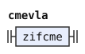</p>
<p>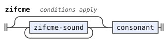</p>
<p>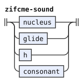</p>
</details>


## Cmavo

A cmavo is not the start of a name, and not the start of a lujvo that begins with a CVC rafsi and a y-hyphen. Its form is an onset and nuclei joined by apostrophes, or a run of `y`. A pause or another word follows it. `CVCy_lujvo` is what keeps `bajykla` one lujvo, and not `ba jy kla`.

```jbogenbau
%rule cmavo  (* A particle excludes a name start and a CVCy compound start. It ends at a complete word boundary. *)
  $f:cmavo-form
%conditions
  ¬$f.onward.begins(cmevla),
  ¬$f.onward.begins(cvcy-lujvo),
  $f.following-tokens.begins(post-word)

%rule cvcy-lujvo  (* Detect a CVC rafsi with a y-hyphen before the compound core. Stress separates the two forms. Unhyphenated initial rafsi cannot start where the core starts, because of stress and their own exclusions. Only a lookahead. *)
  | cvc-rafsi y [h] [{initial-rafsi}] brivla-core
  | stressed-cvc-rafsi y short-final-rafsi

%rule cmavo-form  (* A particle has an onset form or is a whole hesitation run. Pure y letters belong only to hesitation. *)
  | $f:cmavo-form-with-onset
  | ys
%conditions
  ¬$f.matches(y-letters)

%rule cmavo-form-with-onset  (* A particle forbids an apostrophe or cluster at its start. Each inner nucleus needs its apostrophe. The final nucleus cannot consume that apostrophe. *)
  $o:onset [{nucleus h}] cmavo-last-nucleus
%conditions
  ¬$o.onward.begins(h),
  ¬$o.onward.begins(cluster)

```

<details><summary>Railroad diagrams of the 4 rules from <code>cmavo</code> to <code>cmavo-form-with-onset</code></summary>
<p>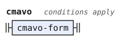</p>
<p>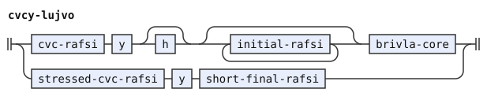</p>
<p>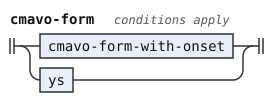</p>
<p>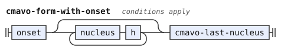</p>
</details>


The last nucleus of a cmavo is unstressed, or it is not followed by a consonant cluster. So `MIklama` is not `mI klama`. One condition covers both reasons for the same nucleus.

```jbogenbau
%rule cmavo-last-nucleus  (* A particle ends in an unstressed nucleus, or in a nucleus with no following consonant cluster. One nucleus covers both cases. *)
  $n:nucleus
%conditions
  ¬$n.onward.begins(stressed) ∨ ¬$n.following-tokens.begins(cluster)

%rule ys  (* Hesitation occupies a whole run of y letters. A shorter prefix cannot end before another y. *)
  {y}
%conditions
  ¬$.following-tokens.begins(y)

```

<details><summary>Railroad diagrams of <code>cmavo-last-nucleus</code> and <code>ys</code></summary>
<p>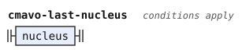</p>
<p>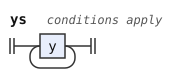</p>
</details>


## Brivla

A brivla cannot start where a cmavo begins. Unstressed initial rafsi precede its core, which contains the stressed syllable. The borrowing core excludes rafsi strings, including gismu starts and compound endings. The other cores differ in consonant positions, apostrophes, hyphens, or stress. The `lujvo` conditions exclude both gismu and borrowings, so the three word classes cannot complete together.

A borrowing cannot cross a y-hyphen or end before its nucleus y. Its head excludes the rafsi strings that describe the classical cores. A gismu has CCVCV or CVCCV shape. A CVV final has an apostrophe where neither gismu shape permits one.

A stressed initial rafsi with a short final either contains a hyphen or differs from those shapes in letters or stress. A short final's diphthong cannot split into a gismu's final vowel and another word, because that vowel forbids a following nucleus. The apostrophe form of a stressed CVV rafsi starts with an unstressed vowel, while a CVV final starts with a stressed vowel.

```jbogenbau
%rule brivla  (* A predicate word cannot start where a particle begins. Unstressed initial rafsi precede its stressed core. *)
  [{initial-rafsi}] brivla-core
%conditions
  ¬$.onward.begins(cmavo)

%rule brivla-core  (* Borrowing heads exclude rafsi strings. The other cores differ in consonant positions, apostrophes, hyphens, or stress. *)
  | fuhivla
  | gismu
  | cvv-final-rafsi
  | stressed-initial-rafsi short-final-rafsi

%rule stressed-initial-rafsi  (* Extended heads exclude ordinary rafsi strings. Hyphenated rafsi require y. Unhyphenated rafsi exclude their hyphenated forms. *)
  stressed-extended-rafsi | stressed-y-rafsi | stressed-y-less-rafsi

```

<details><summary>Railroad diagrams of <code>brivla</code>, <code>brivla-core</code> and <code>stressed-initial-rafsi</code></summary>
<p></p>
<p>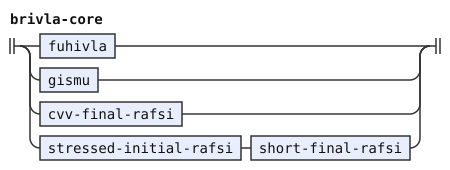</p>
<p>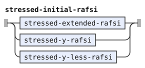</p>
</details>


A short rafsi without a y-hyphen cannot start an extended rafsi or borrowing, or stand directly before one. Thus `spageti'ybroda` begins with `spageti'y`, and `selspageti` is one borrowing. The short rafsi also excludes every hyphenated form through `y-less-rafsi`. A borrowing head excludes ordinary rafsi strings. A brivla rafsi needs apostrophe-y after its fixed head, while a borrowing rafsi forbids that apostrophe onset. These restrictions separate the initial and extended alternatives, including their stressed forms.

```jbogenbau
%rule initial-rafsi  (* A short unhyphenated rafsi cannot start or directly precede an extended rafsi or borrowing. The short form excludes every hyphenated form through y-less-rafsi, and extended forms through any-extended-rafsi. A borrowing head's rafsi-string test separates y-rafsi from the extended forms. *)
  | extended-rafsi
  | y-rafsi
  | $l:y-less-rafsi
%conditions
  ¬$l.onward.begins(any-extended-rafsi),
  ¬$l.following-tokens.begins(any-extended-rafsi)

%rule any-extended-rafsi      (* any_extended_rafsi <- fuhivla / extended_rafsi / stressed_extended_rafsi; only a lookahead *)
  fuhivla | extended-rafsi | stressed-extended-rafsi
```

<details><summary>Railroad diagrams of <code>initial-rafsi</code> and <code>any-extended-rafsi</code></summary>
<p></p>
<p>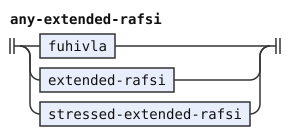</p>
</details>


## Borrowings and extended rafsi

A consonantal syllable has a consonant as its center. A borrowing is a head of unstressed syllables, a stressed syllable, any number of consonantal syllables and a final syllable. Its head does not begin with a string of rafsi, and it is not a cmavo or a consonant followed by a string of rafsi. That last test is the slinku'i test of CLL[^cll-s4-7].

An extended rafsi lets a brivla or a borrowing, whole or cut short, stand before a y-hyphen inside a compound. A `brivla_rafsi` is a head of two syllables or more, followed by `'y`, as `klama'y` in `klama'ybroda`. A `fuhivla_rafsi` is the head of a borrowing followed by an onset and `y`. The onset is a consonant, as in `aktyiismu`, or a glide, as in `spageiybroda`. Each has a stressed form, which stands before a short final rafsi.

```jbogenbau
%rule fuhivla  (* A borrowing ends with its stressed syllable and final syllable. A vowel-bearing final syllable cannot start with a consonantal syllable. *)
  fuhivla-head stressed-syllable [{consonantal-syllable}] final-syllable

%rule stressed-extended-rafsi  (* The stressed brivla form requires an apostrophe after its head. The stressed borrowing form forbids that onset at its fixed boundary. *)
  stressed-brivla-rafsi | stressed-fuhivla-rafsi

%rule extended-rafsi  (* A brivla rafsi requires an apostrophe after its head. A borrowing rafsi forbids that onset. The complete heads fix that boundary. *)
  brivla-rafsi | fuhivla-rafsi

%rule stressed-brivla-rafsi  (* A stressed extended brivla rafsi needs an unstressed first syllable before its stressed end and apostrophe-y. *)
  $b:brivla-head stressed-syllable h y
%conditions
  $b.onward.begins(unstressed-syllable)

%rule brivla-rafsi  (* A whole brivla head before apostrophe-y needs at least two syllables. A following rafsi cannot start with the optional apostrophe. *)
  brivla-head h y [h]
%conditions
  $.onward.begins(two-syllables)

%rule two-syllables  (* Require two vowel-bearing syllables. A consonantal syllable cannot consume the start of the second one. *)
  syllable [{consonantal-syllable}] syllable

%rule stressed-fuhivla-rafsi  (* A stressed borrowing rafsi ends before y. Its onset cannot be an apostrophe. *)
  fuhivla-head stressed-syllable [{consonantal-syllable}] $o:onset y
%conditions
  ¬$o.onward.begins(h)

%rule fuhivla-rafsi  (* A borrowing rafsi starts with an unstressed syllable and forbids an apostrophe onset after its head. A following rafsi cannot start with apostrophe. *)
  $f:fuhivla-head onset y [h]
%conditions
  $f.onward.begins(unstressed-syllable),
  ¬$f.following-tokens.begins(h)

%rule fuhivla-head  (* A borrowing head cannot begin with a rafsi string. *)
  $b:brivla-head
%conditions
  ¬$b.onward.begins(rafsi-string)

%rule brivla-head  (* An unstressed head requires an onset and excludes particles, slinku'i forms, and apostrophe starts. The following stress or hyphen fixes its length. *)
  [{unstressed-syllable}]
%conditions
  ¬$.onward.begins(cmavo),
  ¬$.onward.begins(slinkuhi),
  ¬$.onward.begins(h),
  $.onward.begins(onset)

%rule slinkuhi  (* A slinku'i form starts with a consonant plus a rafsi string, but the whole start is not itself a rafsi string. Only a lookahead. *)
  $c:consonant rafsi-string
%conditions
  ¬$c.onward.begins(rafsi-string)
```

<details><summary>Railroad diagrams of the 11 rules from <code>fuhivla</code> to <code>slinkuhi</code></summary>
<p>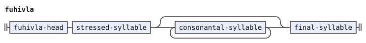</p>
<p>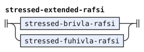</p>
<p>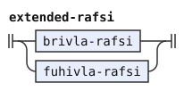</p>
<p>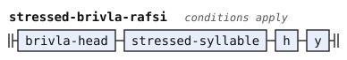</p>
<p>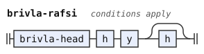</p>
<p>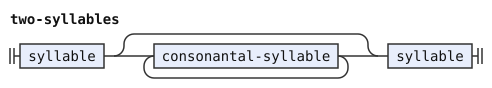</p>
<p>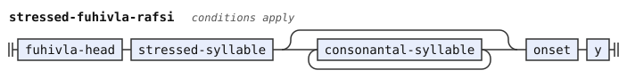</p>
<p>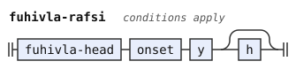</p>
<p>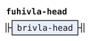</p>
<p>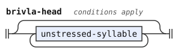</p>
<p>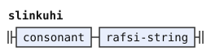</p>
</details>


The slinku'i test and a borrowing's head look for a string of rafsi. That is any number of rafsi without a y-hyphen, and then a part that can end a lujvo or that has a y-hyphen. The PEG uses it only in lookaheads.

```jbogenbau
%rule rafsi-string  (* Detect a string of rafsi. The stressed ending or y boundary fixes the unstressed prefix. Only a lookahead. *)
  [{y-less-rafsi}] rafsi-string-end

%rule rafsi-string-end        (* gismu / CVV_final_rafsi / stressed_y_less_rafsi short_final_rafsi / y_rafsi / stressed_y_rafsi / stressed_y_less_rafsi? initial_pair y / hy_rafsi / stressed_hy_rafsi; only a lookahead *)
  | gismu
  | cvv-final-rafsi
  | stressed-y-less-rafsi short-final-rafsi
  | y-rafsi
  | stressed-y-rafsi
  | [stressed-y-less-rafsi] initial-pair y  (* A stressed short rafsi has a vowel where initial-pair needs a consonant, so the optional cannot consume the required pair. *)
  | hy-rafsi
  | stressed-hy-rafsi

```

<details><summary>Railroad diagrams of <code>rafsi-string</code> and <code>rafsi-string-end</code></summary>
<p>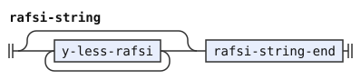</p>
<p>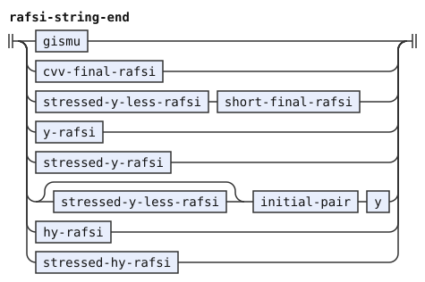</p>
</details>


## Rafsi

The core of a brivla ends it, and a pause or another word follows it. Its final syllable has a nucleus with no stress mark and is not followed by a name.

```jbogenbau
%rule gismu  (* A root ends with a valid final syllable at a complete word boundary. *)
  gismu-start $c:consonant $v:vowel
%conditions
  $c.onward.begins(final-syllable),
  $v.following-tokens.begins(post-word)

%rule gismu-start             (* initial_pair stressed_vowel / consonant stressed_vowel consonant; the second letter is a consonant in one and a vowel in the other *)
  initial-pair stressed-vowel | consonant stressed-vowel consonant

%rule cvv-final-rafsi  (* A CVV final rafsi ends with a valid final syllable at a complete word boundary. *)
  consonant stressed-vowel h $v:vowel
%conditions
  $v.onward.begins(final-syllable),
  $v.following-tokens.begins(post-word)

%rule short-final-rafsi  (* A short final rafsi forms a valid final syllable at a complete word boundary. *)
  $r:short-final-body
%conditions
  $r.onward.begins(final-syllable),
  $r.following-tokens.begins(post-word)

%rule short-final-body        (* consonant diphthong / initial_pair vowel; the second letter is a vowel in one and a consonant in the other *)
  consonant diphthong | initial-pair vowel

%rule stressed-y-rafsi  (* A stressed long rafsi or CVC rafsi ends before y. The forms differ in their second letter, or a consonant follows the CVC prefix before the long form reaches y. *)
  stressed-long-rafsi y | stressed-cvc-rafsi y

%rule stressed-y-less-rafsi  (* CVC, CCV, and CVV differ in their second or third letter. The CVC form cannot end directly before y. *)
  | $c:stressed-cvc-rafsi
  | stressed-ccv-rafsi
  | stressed-cvv-rafsi
%conditions
  ¬$c.following-tokens.begins(y)

%rule stressed-long-rafsi     (* stressed_long_rafsi <- initial_pair stressed_vowel consonant / consonant stressed_vowel consonant consonant; they differ in the second letter *)
  initial-pair stressed-vowel consonant | consonant stressed-vowel consonant consonant

%rule stressed-cvc-rafsi      (* stressed_CVC_rafsi <- consonant stressed_vowel consonant *)
  consonant stressed-vowel consonant

%rule stressed-ccv-rafsi      (* stressed_CCV_rafsi <- initial_pair stressed_vowel *)
  initial-pair stressed-vowel

%rule stressed-cvv-rafsi      (* stressed_CVV_rafsi <- consonant (unstressed_vowel h stressed_vowel / stressed_diphthong) r_hyphen? *)
  consonant stressed-cvv-body [r-hyphen]

%rule stressed-cvv-body       (* unstressed_vowel h stressed_vowel / stressed_diphthong; the second letter is an apostrophe in one and a vowel in the other *)
  unstressed-vowel h stressed-vowel | stressed-diphthong

%rule y-rafsi  (* A long rafsi or CVC rafsi ends before y. The forms differ in their second letter, or a consonant follows the CVC prefix before the long form reaches y. The following rafsi cannot start with apostrophe. *)
  (long-rafsi | cvc-rafsi) y [h]

%rule y-less-rafsi  (* An unhyphenated rafsi excludes all hyphenated forms at its start. It cannot end directly before an apostrophe. *)
  $r:y-less-rafsi-body
%conditions
  ¬$r.onward.begins(y-rafsi),
  ¬$r.onward.begins(stressed-y-rafsi),
  ¬$r.onward.begins(hy-rafsi),
  ¬$r.onward.begins(stressed-hy-rafsi),
  ¬$r.following-tokens.begins(h)

%rule y-less-rafsi-body       (* CVC_rafsi / CCV_rafsi / CVV_rafsi; CVC and CCV differ in the second letter, CVC and CVV in the third, CCV and CVV in the second *)
  cvc-rafsi | ccv-rafsi | cvv-rafsi
```

<details><summary>Railroad diagrams of the 15 rules from <code>gismu</code> to <code>y-less-rafsi-body</code></summary>
<p>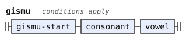</p>
<p>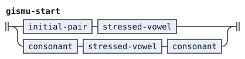</p>
<p>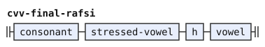</p>
<p>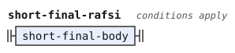</p>
<p>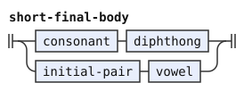</p>
<p>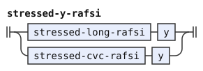</p>
<p>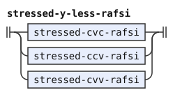</p>
<p>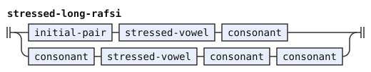</p>
<p>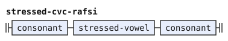</p>
<p>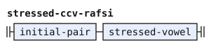</p>
<p>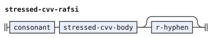</p>
<p>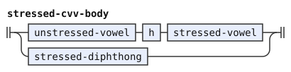</p>
<p>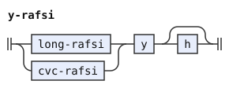</p>
<p>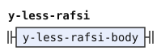</p>
<p></p>
</details>


A rafsi followed by `'y` is a `hy_rafsi`. The BPFK grammar uses it only to end a rafsi string in a lookahead. The experimental layer also uses it inside compounds. A long CCVCV form leaves a consonant after its CCV prefix, where the shorter branch requires an apostrophe. The CVV form differs in its second or third letter. Thus only one branch reaches apostrophe-y.

```jbogenbau
%rule hy-rafsi                (* hy_rafsi <- (long_rafsi vowel / CCV_rafsi / CVV_rafsi) h y h? *)
  hy-rafsi-body h y [h]

%rule hy-rafsi-body  (* A long CCVCV form leaves a consonant after CCV, so only one reaches apostrophe-y. CVV differs in its second or third letter. *)
  long-rafsi-vowel | ccv-rafsi | cvv-rafsi

%rule long-rafsi-vowel        (* long_rafsi vowel *)
  long-rafsi vowel

%rule stressed-hy-rafsi       (* stressed_hy_rafsi <- (long_rafsi stressed_vowel / stressed_CCV_rafsi / stressed_CVV_rafsi) h y *)
  stressed-hy-rafsi-body h y

%rule stressed-hy-rafsi-body  (* CVV differs in its second or third letter. The long form differs from stressed CCV in its second letter or third-letter stress. *)
  long-rafsi-stressed-vowel | stressed-ccv-rafsi | stressed-cvv-rafsi

%rule long-rafsi-stressed-vowel  (* long_rafsi stressed_vowel *)
  long-rafsi stressed-vowel

%rule long-rafsi              (* long_rafsi <- initial_pair unstressed_vowel consonant / consonant unstressed_vowel consonant consonant; they differ in the second letter *)
  initial-pair unstressed-vowel consonant | consonant unstressed-vowel consonant consonant

%rule cvc-rafsi               (* CVC_rafsi <- consonant unstressed_vowel consonant *)
  consonant unstressed-vowel consonant

%rule ccv-rafsi               (* CCV_rafsi <- initial_pair unstressed_vowel *)
  initial-pair unstressed-vowel

%rule cvv-rafsi               (* CVV_rafsi <- consonant (unstressed_vowel h unstressed_vowel / unstressed_diphthong) r_hyphen? *)
  consonant cvv-body [r-hyphen]

%rule cvv-body                (* unstressed_vowel h unstressed_vowel / unstressed_diphthong; the second letter is an apostrophe in one and a vowel in the other *)
  unstressed-vowel h unstressed-vowel | unstressed-diphthong

%rule r-hyphen  (* The hyphen is r before a consonant, or n before r. A following rafsi cannot begin with either resulting pair. *)
  | $r:r
  | $n:n
%conditions
  $r.following-tokens.begins(consonant),
  $n.following-tokens.begins(r)

```

<details><summary>Railroad diagrams of the 12 rules from <code>hy-rafsi</code> to <code>r-hyphen</code></summary>
<p></p>
<p></p>
<p></p>
<p></p>
<p></p>
<p></p>
<p></p>
<p></p>
<p></p>
<p></p>
<p></p>
<p></p>
</details>


## Syllables and stress

A vowel, diphthong or syllable is stressed in two cases. In one, the letter after its onset is a capital vowel (`stressed`). In the other, one more syllable follows it before a pause (`stress`). It is unstressed when it is neither. A capital glide, or a capital second letter of a diphthong, marks nothing.

So an unmarked brivla is stressed on its penultimate syllable, and a pause must follow it. Another word can directly follow a brivla whose stress is marked.

```jbogenbau
%rule final-syllable  (* The final counted syllable forbids y and marked stress. It excludes a following name and ends at a complete word boundary. *)
  $o:onset $n:nucleus
%conditions
  ¬$o.following-tokens.begins(y),
  ¬$o.following-tokens.begins(stressed),
  ¬$n.following-tokens.begins(cmevla),
  $n.following-tokens.begins(post-word)

%rule stressed-syllable  (* A syllable is stressed by a written mark or its position before the final syllable. One constituent covers both cases. *)
  $s:syllable
%conditions
  $s.onward.begins(stressed) ∨ $s.following-tokens.begins(stress)

%rule stressed-diphthong  (* A diphthong is stressed by a written mark or its position before the final syllable. One constituent covers both cases. *)
  $s:diphthong
%conditions
  $s.onward.begins(stressed) ∨ $s.following-tokens.begins(stress)

%rule stressed-vowel  (* A vowel is stressed by a written mark or its position before the final syllable. One constituent covers both cases. *)
  $s:vowel
%conditions
  $s.onward.begins(stressed) ∨ $s.following-tokens.begins(stress)

%rule unstressed-syllable  (* An unstressed vowel-bearing syllable has a nucleus. A consonantal syllable has none. Only one kind can complete at a syllable boundary. *)
  unstressed-plain-syllable | consonantal-syllable

%rule unstressed-plain-syllable  (* An unstressed syllable has neither a written stress mark nor positional stress. *)
  $s:syllable
%conditions
  ¬$s.onward.begins(stressed),
  ¬$s.following-tokens.begins(stress)

%rule unstressed-diphthong  (* An unstressed diphthong has neither a written stress mark nor positional stress. *)
  $d:diphthong
%conditions
  ¬$d.onward.begins(stressed),
  ¬$d.following-tokens.begins(stress)

%rule unstressed-vowel  (* An unstressed vowel has neither a written stress mark nor positional stress. *)
  $v:vowel
%conditions
  ¬$v.onward.begins(stressed),
  ¬$v.following-tokens.begins(stress)

%rule stress  (* Positional stress precedes the last counted syllable before a pause. The counted syllable cannot start with y. It permits an empty onset, so the PEG's greedy split succeeds whenever any split does. *)
  [{consonant | glide}] [h] [y] $s:syllable
%conditions
  $s.following-tokens.begins(pause)

%rule stressed                (* stressed <- onset comma* [AEIOU] *)
  onset stress-mark

%rule stress-mark             (* [AEIOU], a letter and not a vowel rule *)
  "a"<Stressed> | "e"<Stressed> | "i"<Stressed> | "o"<Stressed> | "u"<Stressed>
```

<details><summary>Railroad diagrams of the 11 rules from <code>final-syllable</code> to <code>stress-mark</code></summary>
<p></p>
<p></p>
<p></p>
<p></p>
<p></p>
<p></p>
<p></p>
<p></p>
<p></p>
<p></p>
<p></p>
</details>


A syllable has an onset, a nucleus, and an optional nonempty coda. A consonantal syllable has a consonant before a syllabic consonant and a coda. A consonantal syllable cannot consume the same complete letters as a syllable with a vowel nucleus. A coda ends before another syllable or a pause, which are incompatible boundaries. Before a pause, one consonant and two consonants have different lengths. The absent optional covers the empty coda once.

If a coda stands before another syllable, omitting it leaves consonants that cannot begin that syllable. If it stands before a pause, omitting it leaves consonants before that required pause. Thus both presence choices cannot complete the same word.

```jbogenbau
%rule any-syllable  (* A vowel-bearing syllable has a nucleus. A consonantal syllable has none, so they cannot consume the same complete syllable. *)
  onset-nucleus-coda | consonantal-syllable

%rule onset-nucleus-coda  (* A vowel-bearing syllable has an optional nonempty coda. Omitting a required coda leaves consonants that cannot start the following syllable. *)
  onset nucleus [coda]

%rule syllable  (* A counted syllable forbids a y nucleus. Its optional nonempty coda leaves no duplicate empty reading at a pause. *)
  $o:onset nucleus [coda]
%conditions
  ¬$o.following-tokens.begins(y)

%rule consonantal-syllable  (* The second consonant must be syllabic. The nonempty coda contains it. *)
  $c:consonant coda
%conditions
  $c.following-tokens.begins(syllabic)

%rule coda  (* A nonempty coda ends before a syllable or a pause. Those following boundaries cannot coincide. *)
  coda-before-syllable | coda-before-pause

%rule coda-before-syllable  (* A medial coda ends before a syllable, but cannot begin a syllable itself. *)
  $c:consonant
%conditions
  ¬$c.onward.begins(any-syllable),
  $c.following-tokens.begins(any-syllable)

%rule coda-before-pause  (* A final coda has one consonant or a syllabic consonant and another consonant. Their lengths before the pause cannot coincide. *)
  | $c:consonant
  | syllabic $d:consonant
%conditions
  $c.following-tokens.begins(pause),
  $d.following-tokens.begins(pause)

%rule onset  (* An apostrophe, glide, or consonant initial precedes a nucleus. An empty initial before apostrophe cannot reach that nucleus. Initial forbids a following glide. *)
  h | glide | initial

%rule nucleus  (* A nucleus is a vowel, diphthong, or y. A vowel forbids the following nucleus that a diphthong requires. A y nucleus forbids another nucleus. *)
  | vowel
  | diphthong
  | $y:y
%conditions
  ¬$y.following-tokens.begins(nucleus)

%rule glide  (* A glide is i or u directly before a nucleus. *)
  $g:i-or-u
%conditions
  $g.following-tokens.begins(nucleus)

%rule i-or-u                  (* i / u *)
  i | u

%rule diphthong  (* A diphthong cannot end directly before another nucleus. *)
  $d:diphthong-letters
%conditions
  ¬$d.following-tokens.begins(nucleus)

%rule diphthong-letters  (* The four diphthongs differ in their first or second letter. A repeated i or u cannot follow the matching diphthong. *)
  | a $i:i
  | a $u:u
  | e $j:i
  | o $k:i
%conditions
  ¬$i.following-tokens.begins(i),
  ¬$u.following-tokens.begins(u),
  ¬$j.following-tokens.begins(i),
  ¬$k.following-tokens.begins(i)

%rule vowel  (* A vowel cannot end directly before another nucleus. *)
  $v:vowel-letter
%conditions
  ¬$v.following-tokens.begins(nucleus)

%rule vowel-letter            (* a / e / i / o / u *)
  a | e | i | o | u
```

<details><summary>Railroad diagrams of the 15 rules from <code>any-syllable</code> to <code>vowel-letter</code></summary>
<p></p>
<p></p>
<p></p>
<p></p>
<p></p>
<p></p>
<p></p>
<p></p>
<p></p>
<p></p>
<p></p>
<p></p>
<p></p>
<p></p>
<p></p>
</details>


## Letters

A vowel letter has a lowercase value with or without `Stressed`. The `a`, `e`, `i`, `o` and `u` rules each read one value. `stress-mark` tests `Stressed` on those five values, so it finds the written stress. A `y` is not followed by a nucleus, unless that nucleus is another `y`. An apostrophe is followed by a nucleus.

```jbogenbau
%rule a                       (* a <- comma* [aA] *)
  "a"

%rule e                       (* e <- comma* [eE] *)
  "e"

%rule i                       (* i <- comma* [iI] *)
  "i"

%rule o                       (* o <- comma* [oO] *)
  "o"

%rule u                       (* u <- comma* [uU] *)
  "u"

%rule y  (* A y letter cannot precede a non-y nucleus. *)
  $y:"y"
%conditions
  ¬$y.following-tokens.begins(non-y-nucleus)

%rule non-y-nucleus  (* This nucleus test excludes y at its start. *)
  $n:nucleus
%conditions
  ¬$n.onward.begins(y)

%rule h  (* An apostrophe must precede a nucleus. *)
  $h:"'"
%conditions
  $h.following-tokens.begins(nucleus)
```

<details><summary>Railroad diagrams of <code>a</code>, <code>e</code>, <code>i</code>, <code>o</code>, <code>u</code>, <code>y</code>, <code>non-y-nucleus</code> and <code>h</code></summary>
<p></p>
<p></p>
<p></p>
<p></p>
<p></p>
<p></p>
<p></p>
<p></p>
</details>


## Consonants

An initial pair is two consonants that can begin a word. `initial` says which: an affricate, or a sibilant, another consonant and a liquid, each optional, where no consonant or glide follows. An affricate joins a stopped sound with friction. A sibilant is a hissing consonant. The liquids here are `l` and `r`.

```jbogenbau
%rule cluster                 (* cluster <- consonant consonant+; only a lookahead, so the first two consonants decide it *)
  consonant consonant

%rule initial-pair  (* An initial pair starts a legal initial and contains exactly two consonants. *)
  $a:consonant $b:consonant
%conditions
  $a.onward.begins(initial),
  ¬$b.following-tokens.begins(consonant)

%rule initial  (* An initial ends before any next consonant or glide. The parts branch leaves an affricate's second consonant, so only the affricate branch completes. *)
  | $a:affricate
  | $p:initial-parts
%conditions
  ¬$a.following-tokens.begins(consonant),
  ¬$a.following-tokens.begins(glide),
  ¬$p.following-tokens.begins(consonant),
  ¬$p.following-tokens.begins(glide)

%rule initial-parts  (* Each initial part is optional. Leaving any available consonant unread fails the final consonant exclusion of initial. *)
  [sibilant] [other] [liquid]

%rule affricate               (* affricate <- t c / t s / d j / d z; they differ in the first or the second letter *)
  t c | t s | d j | d z

%rule liquid                  (* liquid <- l / r *)
  l | r

%rule other  (* The other initial consonants forbid tl, dl, and n before a liquid. *)
  | p | $t:t | k | f | x | b | $d:d | g | v | m | $n:n
%conditions
  ¬$t.following-tokens.begins(l),
  ¬$d.following-tokens.begins(l),
  ¬$n.following-tokens.begins(liquid)

%rule sibilant  (* A sibilant forbids sx, and j or z before n or a liquid. *)
  | c
  | $s:s
  | $j:j-or-z
%conditions
  ¬$s.following-tokens.begins(x),
  ¬$j.following-tokens.begins(n),
  ¬$j.following-tokens.begins(liquid)

%rule j-or-z                  (* j / z *)
  j | z

%rule consonant               (* consonant <- voiced / unvoiced / syllabic *)
  voiced | unvoiced | syllabic

%rule syllabic                (* syllabic <- l / m / n / r *)
  l | m | n | r

%rule voiced                  (* voiced <- b / d / g / j / v / z *)
  b | d | g | j | v | z

%rule unvoiced                (* unvoiced <- c / f / k / p / s / t / x *)
  c | f | k | p | s | t | x
```

<details><summary>Railroad diagrams of the 13 rules from <code>cluster</code> to <code>unvoiced</code></summary>
<p></p>
<p></p>
<p></p>
<p></p>
<p></p>
<p></p>
<p></p>
<p></p>
<p></p>
<p></p>
<p></p>
<p></p>
<p></p>
</details>


Each consonant letter refuses a following apostrophe that begins a syllable, a glide, or the same consonant. Each voiced or unvoiced letter also refuses consonants of the other voicing, and some letters refuse other letters, as CLL[^cll-s3-6] says.

```jbogenbau
%rule l  (* This consonant forbids an apostrophe, a glide, and a repeated letter. *)
  $c:"l"
%conditions
  ¬$c.following-tokens.begins(h),
  ¬$c.following-tokens.begins(glide),
  ¬$c.following-tokens.begins(l)

%rule m  (* This consonant forbids an apostrophe, a glide, and a repeated letter. It forbids z. *)
  $c:"m"
%conditions
  ¬$c.following-tokens.begins(h),
  ¬$c.following-tokens.begins(glide),
  ¬$c.following-tokens.begins(m),
  ¬$c.following-tokens.begins(z)

%rule n  (* This consonant forbids an apostrophe, a glide, and a repeated letter. It forbids an affricate. *)
  $c:"n"
%conditions
  ¬$c.following-tokens.begins(h),
  ¬$c.following-tokens.begins(glide),
  ¬$c.following-tokens.begins(n),
  ¬$c.following-tokens.begins(affricate)

%rule r  (* This consonant forbids an apostrophe, a glide, and a repeated letter. *)
  $c:"r"
%conditions
  ¬$c.following-tokens.begins(h),
  ¬$c.following-tokens.begins(glide),
  ¬$c.following-tokens.begins(r)

%rule b  (* This consonant forbids an apostrophe, a glide, and a repeated letter. It also forbids an unvoiced consonant. *)
  $c:"b"
%conditions
  ¬$c.following-tokens.begins(h),
  ¬$c.following-tokens.begins(glide),
  ¬$c.following-tokens.begins(b),
  ¬$c.following-tokens.begins(unvoiced)

%rule d  (* This consonant forbids an apostrophe, a glide, and a repeated letter. It also forbids an unvoiced consonant. *)
  $c:"d"
%conditions
  ¬$c.following-tokens.begins(h),
  ¬$c.following-tokens.begins(glide),
  ¬$c.following-tokens.begins(d),
  ¬$c.following-tokens.begins(unvoiced)

%rule g  (* This consonant forbids an apostrophe, a glide, and a repeated letter. It also forbids an unvoiced consonant. *)
  $c:"g"
%conditions
  ¬$c.following-tokens.begins(h),
  ¬$c.following-tokens.begins(glide),
  ¬$c.following-tokens.begins(g),
  ¬$c.following-tokens.begins(unvoiced)

%rule v  (* This consonant forbids an apostrophe, a glide, and a repeated letter. It also forbids an unvoiced consonant. *)
  $c:"v"
%conditions
  ¬$c.following-tokens.begins(h),
  ¬$c.following-tokens.begins(glide),
  ¬$c.following-tokens.begins(v),
  ¬$c.following-tokens.begins(unvoiced)

%rule j  (* This consonant forbids an apostrophe, a glide, and a repeated letter. It also forbids an unvoiced consonant. It forbids z. *)
  $c:"j"
%conditions
  ¬$c.following-tokens.begins(h),
  ¬$c.following-tokens.begins(glide),
  ¬$c.following-tokens.begins(j),
  ¬$c.following-tokens.begins(z),
  ¬$c.following-tokens.begins(unvoiced)

%rule z  (* This consonant forbids an apostrophe, a glide, and a repeated letter. It also forbids an unvoiced consonant. It forbids j. *)
  $c:"z"
%conditions
  ¬$c.following-tokens.begins(h),
  ¬$c.following-tokens.begins(glide),
  ¬$c.following-tokens.begins(z),
  ¬$c.following-tokens.begins(j),
  ¬$c.following-tokens.begins(unvoiced)

%rule s  (* This consonant forbids an apostrophe, a glide, and a repeated letter. It also forbids a voiced consonant. It forbids c. *)
  $c:"s"
%conditions
  ¬$c.following-tokens.begins(h),
  ¬$c.following-tokens.begins(glide),
  ¬$c.following-tokens.begins(s),
  ¬$c.following-tokens.begins(c),
  ¬$c.following-tokens.begins(voiced)

%rule c  (* This consonant forbids an apostrophe, a glide, and a repeated letter. It also forbids a voiced consonant. It forbids s and x. *)
  $c:"c"
%conditions
  ¬$c.following-tokens.begins(h),
  ¬$c.following-tokens.begins(glide),
  ¬$c.following-tokens.begins(c),
  ¬$c.following-tokens.begins(s),
  ¬$c.following-tokens.begins(x),
  ¬$c.following-tokens.begins(voiced)

%rule x  (* This consonant forbids an apostrophe, a glide, and a repeated letter. It also forbids a voiced consonant. It forbids c and k. *)
  $c:"x"
%conditions
  ¬$c.following-tokens.begins(h),
  ¬$c.following-tokens.begins(glide),
  ¬$c.following-tokens.begins(x),
  ¬$c.following-tokens.begins(c),
  ¬$c.following-tokens.begins(k),
  ¬$c.following-tokens.begins(voiced)

%rule k  (* This consonant forbids an apostrophe, a glide, and a repeated letter. It also forbids a voiced consonant. It forbids x. *)
  $c:"k"
%conditions
  ¬$c.following-tokens.begins(h),
  ¬$c.following-tokens.begins(glide),
  ¬$c.following-tokens.begins(k),
  ¬$c.following-tokens.begins(x),
  ¬$c.following-tokens.begins(voiced)

%rule f  (* This consonant forbids an apostrophe, a glide, and a repeated letter. It also forbids a voiced consonant. *)
  $c:"f"
%conditions
  ¬$c.following-tokens.begins(h),
  ¬$c.following-tokens.begins(glide),
  ¬$c.following-tokens.begins(f),
  ¬$c.following-tokens.begins(voiced)

%rule p  (* This consonant forbids an apostrophe, a glide, and a repeated letter. It also forbids a voiced consonant. *)
  $c:"p"
%conditions
  ¬$c.following-tokens.begins(h),
  ¬$c.following-tokens.begins(glide),
  ¬$c.following-tokens.begins(p),
  ¬$c.following-tokens.begins(voiced)

%rule t  (* This consonant forbids an apostrophe, a glide, and a repeated letter. It also forbids a voiced consonant. *)
  $c:"t"
%conditions
  ¬$c.following-tokens.begins(h),
  ¬$c.following-tokens.begins(glide),
  ¬$c.following-tokens.begins(t),
  ¬$c.following-tokens.begins(voiced)
```

<details><summary>Railroad diagrams of the 17 rules from <code>l</code> to <code>t</code></summary>
<p></p>
<p></p>
<p></p>
<p></p>
<p></p>
<p></p>
<p></p>
<p></p>
<p></p>
<p></p>
<p></p>
<p></p>
<p></p>
<p></p>
<p></p>
<p></p>
<p></p>
</details>


## Differences from CLL and the reference PEG

The [checkpoint record](https://mw.lojban.org/index.php?title=BPFK_Checkpoints&oldid=109606) defers morphology. CLL 1.3.4[^cll-later-a3-3] records two committee votes on word forms. One bans a consonant directly before a glide. The other lifts the ban on `la`, `lai`, `la'i` and `doi` inside names. The PEG implements both. CLL 1.3.4 describes the rest of this working grammar, its extended rafsi included, as practice without a vote.

The phoneme stage reads the text before this stage does. In four ways, the text that this stage reads differs from the text that the PEG reads:

- The PEG reads a digit as a cmavo, and lets a digit stand in a name (its rule `digit`). The phoneme stage reads each digit as the letters of its number word, so `2` is `re`. So this translation has no rule `digit`. `.b1b.` is not a name, and `.dj2n.` is the name `djren`.
- The PEG ignores a comma before any letter (`comma*` in each letter rule). The phoneme stage drops every comma, so the translation leaves out `comma*`, with the same result, except in the letter word `ybu`.

  The PEG's `ybu` reads pause characters between the `y` and the `bu`, but no comma, unless the comma stands directly before the `bu`. Where `ybu` fails, the PEG reads the `y` as hesitation, which is space. So the PEG rejects `y, bu` and `y , bu`, and reads `doi y, bu` as the letter word `doi bu`. The words stage reads the one letter word `y bu` in these texts (below). Both read `y ,bu` as that letter word.
- The PEG reads a lowercase `h` as an apostrophe, and a consonant in either case. The phoneme stage reads a capital `H` as an apostrophe too, so `koHa` is `ko'a`, which the PEG rejects. It emits every apostrophe as `'` and every consonant in lower case, so the translation reads only those. A capital vowel is a stressed vowel for both. The phoneme stage also reads accents as stress and folds runs of two vowel groups or more in which every vowel is a capital. The PEG reads neither convention.
- The PEG's pauses are the space, tab, line feed and carriage return, and the characters `.`, `?` and `!` (its rule `space_char`). The phoneme stage reads every Unicode `White_Space` character and other punctuation as a pause too. So it reads a no-break space between two words as a pause, which the PEG rejects. It emits a run of pause characters as one `PAUSE`.

### The ybu exception

The PEG's first spelling of `BY`, the rule `ybu <- Y space_char* BU`, reads more than `cmavo`. It reads a run of `y`, any pause, and `bu` as one letter word: `ybu`, `y bu` and `yyybu` are each one word. That is the letter word `.y bu`, which the Magic Words proposal forms "before any other processing of any kind". This stage reads each run on its own, so it reads the `y` and the `bu` as two words. Before BU, the forms stage separates the final y from any prolonged hesitation. The shared word reader then forms the letter word ([stream.md](stream.md)).

A run stays one hesitation token except for the split that prepares a letter word before BU. That split separates its final y from the hesitation prefix. The words stage drops the prefix and forms `y bu` from the final y and BU. Thus `ybu`, `y bu`, `yyybu`, `.y.bu`, and `yy bu` each produce the same letter word.

### Whole hesitation runs and duplicate proofs

The PEG's onset alternative takes one y from an odd run of three or more letters. This grammar excludes pure y from that alternative and reads the whole run as hesitation. Thus `.yyy.` is one hesitation token instead of `y` and `yy`. The [Magic Words proposal](https://mw.lojban.org/papri/Magic_Words) says that `y` is not a word and counts as whitespace. The PEG's own `Y` rule also reads the whole run.

The words stage drops this hesitation in BPFK and experimental. Zantufa can retain attached hesitation, so its erasure can observe the whole-run division.

Names use the general name shape once instead of choosing between general and syllabified proofs of the same letters. Marked and positional stress share one constituent when both tests hold. Final codas have one form per nonempty length, and the absent optional supplies the empty form. These changes affect internal proofs without changing ordinary word division or word classes.

The forms stage accepts `kyyykerlo` with the division described above because its word boundaries permit it. Full camxes-std rejects it through the separate `spaces` wrapper after `ky`. The shared [forms document](forms.md#differences-from-camxes) explains that departure.

### Consonant restriction

The consonant rules retain the ban on a consonant followed by a glide and a vowel. The committee voted for this ban, and CLL 1.3.4 records the vote.[^cll-later-a3-3]

[^cll-s4-7]: [CLL 1.1, section 4.7](https://lojban.org/publications/cll/cll_v1.1_xhtml-section-chunks/section-fuhivla.html).

[^cll-s3-6]: [CLL 1.1, section 3.6](https://lojban.org/publications/cll/cll_v1.1_xhtml-section-chunks/section-clusters.html).

[^cll-later-a3-3]: [CLL 1.3.4, appendix A3.3](https://github.com/int19h/cll/blob/v1.3.4/chapters/a03.xml#L155-L243). This later approval record has no CLL 1.1 counterpart.
