# CLL word forms

This document is the family part of the forms stage in the [CLL](../dialects/cll-ebnf.md) dialect. A stage is one step of a pipeline, with its own grammar ([engine §1](../../docs/engine.md#1-tokens)). A family is a set of word forms that dialects use. This family gives the word forms of *The Complete Lojban Language* (CLL), edition 1.1.[^cll-c3][^cll-c4] The loader stitches it into the forms stage after [forms.md](forms.md) and [shapes.md](shapes.md), whose sounds it builds words from.

A token is one unit that a stage reads or emits. A token's value is the string that exact comparisons read. Its image is the string that people see.

This document defines the three shapes that the forms stage reads, `cmavo-shape`, `brivla-shape` and `cmevla-shape`. It tags each such word with what the pause rules of CLL[^cll-s4-9] need to know about the word. A tag marks a token by an identifier. The BPFK family is [bpfk.md](bpfk.md). [The notation document](../../docs/notation.md) explains the notation.

The prose uses these Lojban terms for words:

- A cmavo is a particle, a short structure word.
- A brivla is a predicate word.
- A cmevla is a name word.
- A gismu is a root word.
- A lujvo is a compound word.
- A rafsi is a shortened word form used inside compounds.

Under the rules of this document, a text divides into words in at most one way. So the lazy choice of the stage among parses ([engine §6](../../docs/engine.md#6-choosing-a-parse)) never decides where a word ends.

C denotes a consonant. V denotes one of `a e i o u`, never `y`. A diphthong combines two vowels in one syllable.

## Pause tags

The forms stage joins two words without a pause only if the numbered pause rules of CLL[^cll-s4-9] and its stress rule[^cll-s4-2] allow it. It reads these tags on the word before and the word after:

- `Onset`: The word begins with a consonant and is not a name. Only such a word can follow another word without a pause (rules 3 and 4), apart from a name after `la`, below.
- `Continued`: Another word can follow this one without a pause. Every cmavo but a `Cy` letter has it, and so does a brivla whose stress is marked.
- `Open-Stress`: The word is a brivla whose stress is not marked. CLL[^cll-s3-9] puts its stress on its penultimate syllable, so no counted syllable can follow it before the next pause. Only a word tagged `Uncounted`, one with no counted syllable, can follow it without a pause.
- `Cy`: A `Cy` letter, which rule 6 lets only another `Cy` follow directly.
- `Name-Intro` and `Name-Onset`: `Name-Intro` marks `la`, `lai`, `la'i` and `doi`, and `Name-Onset` marks a name that begins with a consonant. Rule 4 lets the name follow the cmavo without a pause.
- `Initial-Stress` and `Final-Stress`: The word's first or last syllable is stressed. Such syllables are those of the first and the last vowel nucleus of the word as written, `y` included. A pause must stand between a word with `Final-Stress` and a following word with `Initial-Stress` (CLL[^cll-s4-2]). It must also stand before a following brivla, which carries the tag `Stress-Guard` (rule 5).[^cll-s4-9]

## Cmavo

A cmavo is an optional consonant followed by vowel units joined by apostrophes. A unit is a vowel or a falling diphthong (CLL[^cll-s4-1][^cll-s4-2]). So `sei'a` is a cmavo, but `seia`, `baiu` and `miui` are not: their vowels do not form units. One or two vowels make the forms V, VV, CV and CVV. Three or more are the experimental cmavo of CLL[^cll-s4-2], such as `ku'a'e` and `bai'ai`.

The ten rising diphthongs, such as `ia` and `ui`, are cmavo as whole words. A consonant never comes before one, so `kie` and `mui` are no cmavo. A syllable-break comma cannot stand between the vowels of a cmavo. So `ma,i` is neither one cmavo nor `ma .i`, because a comma is no pause. The rules below still read `ma,i` as `mai` when they test for a cmavo, and `cmavo-shape` then refuses the comma (see "Commas").

A consonant followed by `y` is a letter cmavo.[^cll-s4-2] So is `y'y`, the letter for the apostrophe.[^cll-s17-2] The ten pairs `a'y e'y i'y o'y u'y y'a y'e y'i y'o y'u` are cmavo too.

A cmavo can also use `y` as one more unit, as `ka'y`, `ky'a`, `cy'y` and `y'y'y` do. They are always words. The grammar tags each one `Cmavo-Warning`, and the words stage reads it under the warning `y-cmavo` ([cll-stream.md](cll-stream.md)). A caller who turns the feature on gets a warning for each one that the words stage reads as a Lojban word. Such a word has at least two units. A `y` alone, or a run of `y`, is hesitation, which [forms.md](forms.md) reads.

A cmavo's stress is free (CLL[^cll-s3-9]), so any of its vowels can be a capital. Its first or last syllable is stressed if its first or last unit has a capital vowel.

```jbogenbau
%rule cmavo-shape
  | $c:plain-cmavo-body
      :: Onset ∪ Continued
       ∪ ($c.matches(first-marked-cmavo) ⟹ Initial-Stress) ∪ ($c.matches(last-marked-cmavo) ⟹ Final-Stress)
       ∪ ($c.matches(name-intro-cmavo) ⟹ Name-Intro)
  | $v:vowel-cmavo
      :: Continued
       ∪ ($v.matches(first-marked-cmavo) ⟹ Initial-Stress) ∪ ($v.matches(last-marked-cmavo) ⟹ Final-Stress)
  | $l:letter-cmavo
      :: Onset ∪ Cy ∪ Uncounted ∪ ($l.matches(stress-mark) ⟹ Initial-Stress ∪ Final-Stress)
  | $p:y-pair-cmavo
      :: Continued ∪ ($p.matches(y-letters) ⟹ Uncounted)
       ∪ ($p.matches(first-marked-cmavo) ⟹ Initial-Stress) ∪ ($p.matches(last-marked-cmavo) ⟹ Final-Stress)
  | $w:warned-cmavo
      :: Continued ∪ Cmavo-Warning ∪ ($w.first-token.matches(consonant) ⟹ Onset) ∪ ($w.matches(y-letters) ⟹ Uncounted)
       ∪ ($w.matches(first-marked-cmavo) ⟹ Initial-Stress) ∪ ($w.matches(last-marked-cmavo) ⟹ Final-Stress)
%conditions
  ¬$c.matches(has-comma),
  ¬$v.matches(has-comma),
  ¬$w.matches(has-comma)

%rule plain-cmavo-body
  consonant cmavo-units

%rule vowel-cmavo
  cmavo-units | rising-vowels

%rule cmavo-units
  cmavo-unit | cmavo-units "'" cmavo-unit

%rule cmavo-unit
  vowel | falling-vowels

%rule letter-cmavo
  consonant "y"

%rule y-pair-cmavo
  "y" "'" "y" | vowel "'" "y" | "y" "'" vowel

%rule warned-cmavo
  | $w:warned-units
  | consonant warned-units
%conditions
  ¬$w.matches(y-pair-cmavo)

%rule warned-units
  | "y" "'" any-units
  | cmavo-unit "'" warned-tail

%rule warned-tail
  | "y" | "y" "'" any-units
  | cmavo-unit "'" warned-tail

%rule any-units
  any-unit | any-units "'" any-unit

%rule any-unit
  cmavo-unit | "y"

%rule y-letters
  [consonant] y-units

%rule y-units
  "y" | y-units "'" "y"

%rule cmavo-nucleus
  cmavo-unit | "y" | rising-diphthong

%rule first-marked-cmavo
  [consonant] $u:cmavo-nucleus ["'" any-letters]
%conditions
  $u.matches(stress-mark)

%rule last-marked-cmavo
  [consonant] [any-letters "'"] $u:cmavo-nucleus
%conditions
  $u.matches(stress-mark)

%rule name-intro-cmavo
  "l" "a" | "l" "a" "i" | "l" "a" "'" "i" | "d" "o" "i"
```

<details><summary>Railroad diagrams of the 18 rules from <code>cmavo-shape</code> to <code>name-intro-cmavo</code></summary>
<p>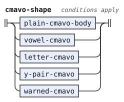</p>
<p>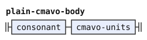</p>
<p>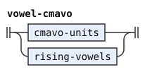</p>
<p>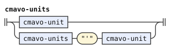</p>
<p>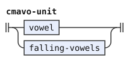</p>
<p>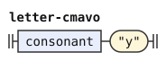</p>
<p>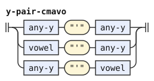</p>
<p>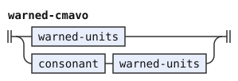</p>
<p>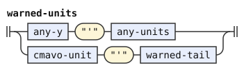</p>
<p>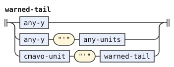</p>
<p>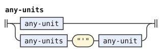</p>
<p>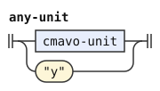</p>
<p>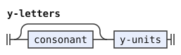</p>
<p>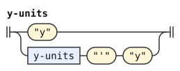</p>
<p>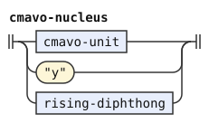</p>
<p>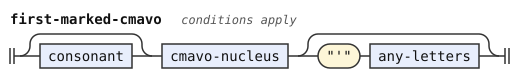</p>
<p>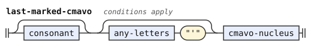</p>
<p>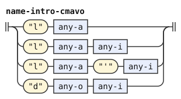</p>
</details>


These rules read lowercase vowel values with or without `Stressed`. The lexicon looks a cmavo up by its normalized value, so a stressed vowel finds the same entry as a plain vowel.

## Brivla

A brivla is a gismu, a lujvo or a borrowing (CLL[^cll-s4-3]). It ends in a vowel other than `y`, and it has a consonant pair among its first five letters, not counting `y` and the apostrophe. Gismu and lujvo always have one.

`brivla-scan` of [shapes.md](shapes.md) finds where the stress of a brivla is. A brivla whose stress is marked has every capital vowel in its penultimate counted syllable. A word can follow it with no pause. A brivla with no capital vowel is `Open-Stress`. A capital `Y` never stands in a brivla, because no rule below reads one.

```jbogenbau
%rule brivla-shape
  | $m:brivla-word
      :: $m.tags ∪ Stress-Guard ∪ Continued ∪ (First-Marked ⊆ $m.tags(brivla-scan) ⟹ Initial-Stress)
  | $u:brivla-word
      :: $u.tags ∪ Stress-Guard ∪ Open-Stress ∪ (N2 ⊆ $u.tags(brivla-scan) ⟹ Initial-Stress)
%conditions
  S2 ⊆ $m.tags(brivla-scan),
  S0 ⊆ $u.tags(brivla-scan),
  (N2 ∪ N3) ∩ $u.tags(brivla-scan) ≠ ∅

%rule brivla-word
  | gismu-form :: Gismu ∪ Onset
  | $l:lujvo-form :: Lujvo ∪ Onset
  | $f:fuhivla-word :: Fuhivla ∪ ($f.first-token.matches(consonant) ⟹ Onset)
%conditions
  ¬$l.matches(has-comma)
```

<details><summary>Railroad diagrams of <code>brivla-shape</code> and <code>brivla-word</code></summary>
<p>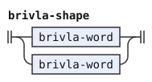</p>
<p>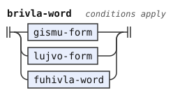</p>
</details>


A gismu is CVCCV with a permissible pair, or CCVCV with an initial pair (CLL[^cll-s4-4]).

```jbogenbau
%rule gismu-form
  | consonant vowel consonant-pair vowel
  | initial-pair vowel consonant vowel
```

<details><summary>Railroad diagram of <code>gismu-form</code></summary>
<p>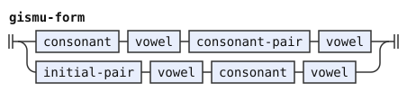</p>
</details>


## Lujvo

A lujvo is exactly what the algorithm of CLL[^cll-s4-11] makes from two rafsi or more. Every rafsi but the last is CVC, CCV, CVV, CVCC or CCVC, and the last is CVV, CCV or a gismu form. CVV is a falling diphthong, or two vowels with an apostrophe between them. The algorithm puts a hyphen at a joint only where one is required:

- A `y` goes after a four-letter rafsi, CVCC or CCVC.
- A `y` goes between two consonants that form no permissible pair. A `y` also goes between `n` and a following `tc`, `ts`, `dj` or `dz`. Without the `y`, they make a forbidden triple, as in `junydji` without its hyphen.[^cll-s3-7]
- An `r` goes after a first CVV rafsi, unless the lujvo has two rafsi and the second is CCV, as in `saicli`. The hyphen is `n` before an `r`, as in `ro'inre'o`.
- The tosmabru test below can add one more `y`.

"It is illegal to add a hyphen at a place that is not required by this algorithm", so `rokyre'o` and `basykla` are not lujvo. With its needless `r` hyphen, `saircli` is no lujvo either, and it reads as a borrowing. Without the hyphen, `saicli` is a lujvo.

The rules below build the letters of a lujvo from the left, and they place each hyphen by its cause. `lujvo-rest` is the rafsi after a vowel or after an `r` or `n` hyphen, to the end of the word. `cvc-rest` is the part of a CVC or CVCC rafsi from its third letter, with the joint after it. A joint without a hyphen must be a permissible pair and must not make one of the four triples. A `y` at a joint must be required.

A y-hyphen must be unstressed. `hyphen-y` tests its lowercase value and rejects the tag `Stressed`. Every y-hyphen read uses this rule, so a written capital `Y` cannot become a lujvo hyphen after normalization.

`pair-across-y` applies the permissible-pair restrictions to the consonants on each side of a hyphen. The shared sets in [shapes.md](shapes.md#consonants) give their voicing and sibilant groups.

```jbogenbau
%rule hyphen-y
  "y"<¬Stressed>

%rule lujvo-form
  | ccv-rafsi lujvo-rest
  | initial-pair vowel consonant hyphen-y lujvo-rest
  | consonant vowel lujvo-after-cv
  | consonant $a:vowel $t:lujvo-after-cvv
  | consonant vowel "'" vowel cvv-first-rest
%conditions
  ¬$a.matches(i-or-u),
  ¬$a.matches(e-or-o) ∨ $t.begins(falling-i)

%rule lujvo-after-cvv
  [Syllable-Break] i-or-u cvv-first-rest

%rule cvv-first-rest
  | ccv-rafsi
  | "r" $r:lujvo-rest
  | "n" $n:lujvo-rest
%conditions
  $r ≇ @(ccv-rafsi),
  ¬$r.begins(r-letter),
  $n.begins(r-letter)

%rule lujvo-rest
  | final-rafsi
  | ccv-rafsi lujvo-rest
  | cvv-rafsi lujvo-rest
  | consonant vowel cvc-rest
  | initial-pair vowel consonant hyphen-y lujvo-rest

%rule cvc-rest
  | $k:consonant lujvo-rest
  | $l:consonant hyphen-y lujvo-rest
  | consonant-pair hyphen-y lujvo-rest
%conditions
  $k.onward.begins(consonant-pair),
  ¬$k.onward.begins(n-affricate),
  $l.onward.begins(mandatory-y)

%rule final-rafsi
  cvv-rafsi | ccv-rafsi | gismu-form

%rule ccv-rafsi
  initial-pair vowel

%rule cvv-rafsi
  consonant falling-vowels | consonant vowel "'" vowel

%rule mandatory-y
  | $j:y-joint
  | "n" hyphen-y affricate
%conditions
  ¬$j.matches(pair-across-y)

%rule y-joint
  consonant hyphen-y consonant

%rule affricate
  "t" "c" | "t" "s" | "d" "j" | "d" "z"

%rule pair-across-y
  $l:consonant hyphen-y $r:consonant
%conditions
  $l.value ≠ $r.value,
  ¬($l.value ∈ $VOICED ∧ $r.value ∈ $UNVOICED),
  ¬($l.value ∈ $UNVOICED ∧ $r.value ∈ $VOICED),
  ¬($l.value ∈ $SIBILANTS ∧ $r.value ∈ $SIBILANTS),
  ¬($l.value = "x" ∧ $r.value ∈ ("c" "k")),
  ¬($l.value ∈ ("c" "k") ∧ $r.value = "x"),
  ¬($l.value = "m" ∧ $r.value = "z")
```

<details><summary>Railroad diagrams of the 13 rules from <code>hyphen-y</code> to <code>pair-across-y</code></summary>
<p>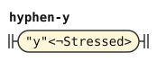</p>
<p>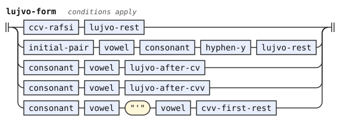</p>
<p>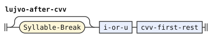</p>
<p>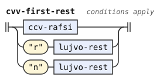</p>
<p>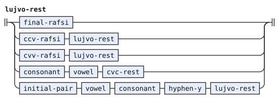</p>
<p>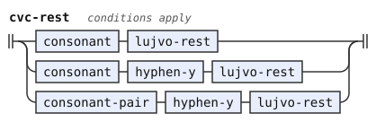</p>
<p>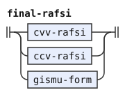</p>
<p>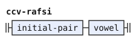</p>
<p>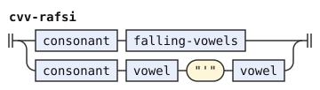</p>
<p>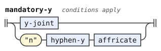</p>
<p>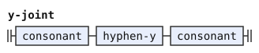</p>
<p>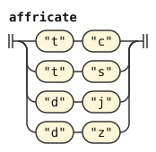</p>
<p>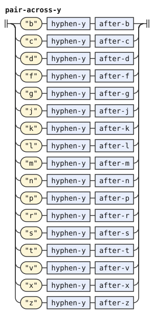</p>
</details>


The tosmabru test of CLL[^cll-s4-11] decides whether a lujvo whose first rafsi is CVC needs one more `y` after it. Without that `y`, the word can fall apart into a cmavo and a shorter lujvo: `tosmabru` is `to smabru`, and the lujvo is `tosymabru`. The test starts from the lujvo with its required hyphens. It follows the CVC rafsi from the first one, across joints with no hyphen. It stops at the first required `y` or at the first rafsi that is not CVC.

If the test stops at a required `y`, it examines the joints before that `y`. So `tospatyta'a` needs `tosypatyta'a`, but `patyta'a` examines no joint and gets no second `y`.

Otherwise, the test applies only if the next rafsi is the last one, a CVCCV gismu form whose middle pair is an initial pair. It then examines the joints of the chain, the joint before the gismu, and the gismu's middle pair. So `tosmabru` needs its `y`, but `tosmabryklama` does not, because its `y` follows the four-letter `mabr`.

If the test examines at least one pair and every examined pair is an initial pair, it adds the `y` at the first joint. `lujvo-after-cv` is the part of a lujvo from the third letter of a first CVC or CVCC rafsi. Its first joint has no hyphen only if the test asks for none. A `y` there is either required or the one the test adds. `tosmabru-positive` is the test on the letters from the first joint, and `tosmabru-y` is the same test on a word that carries the added `y`. So `tospatytosmabru` is `to spatytosmabru`, and the lujvo is `tosypatytosmabru`.

```jbogenbau
%rule lujvo-after-cv
  | $k:consonant lujvo-rest
  | $l:consonant hyphen-y lujvo-rest
  | consonant-pair hyphen-y lujvo-rest
%conditions
  $k.onward.begins(consonant-pair),
  ¬$k.onward.begins(n-affricate),
  $k ⟹ ¬$.matches(tosmabru-positive),
  $l.onward.begins(mandatory-y) ∨ $.matches(tosmabru-y)

%rule tosmabru-positive
  | initial-pair vowel tosmabru-chain
  | initial-pair vowel initial-pair vowel

%rule tosmabru-chain
  | consonant hyphen-y any-letters
  | tosmabru-positive

%rule tosmabru-y
  | initial-pair-across-y vowel tosmabru-chain
  | initial-pair-across-y vowel initial-pair vowel

%rule initial-pair-across-y
  | "b" hyphen-y "l"
  | "b" hyphen-y "r"
  | "c" hyphen-y "f"
  | "c" hyphen-y "k"
  | "c" hyphen-y "l"
  | "c" hyphen-y "m"
  | "c" hyphen-y "n"
  | "c" hyphen-y "p"
  | "c" hyphen-y "r"
  | "c" hyphen-y "t"
  | "d" hyphen-y "j"
  | "d" hyphen-y "r"
  | "d" hyphen-y "z"
  | "f" hyphen-y "l"
  | "f" hyphen-y "r"
  | "g" hyphen-y "l"
  | "g" hyphen-y "r"
  | "j" hyphen-y "b"
  | "j" hyphen-y "d"
  | "j" hyphen-y "g"
  | "j" hyphen-y "m"
  | "j" hyphen-y "v"
  | "k" hyphen-y "l"
  | "k" hyphen-y "r"
  | "m" hyphen-y "l"
  | "m" hyphen-y "r"
  | "p" hyphen-y "l"
  | "p" hyphen-y "r"
  | "s" hyphen-y "f"
  | "s" hyphen-y "k"
  | "s" hyphen-y "l"
  | "s" hyphen-y "m"
  | "s" hyphen-y "n"
  | "s" hyphen-y "p"
  | "s" hyphen-y "r"
  | "s" hyphen-y "t"
  | "t" hyphen-y "c"
  | "t" hyphen-y "r"
  | "t" hyphen-y "s"
  | "v" hyphen-y "l"
  | "v" hyphen-y "r"
  | "x" hyphen-y "l"
  | "x" hyphen-y "r"
  | "z" hyphen-y "b"
  | "z" hyphen-y "d"
  | "z" hyphen-y "g"
  | "z" hyphen-y "m"
  | "z" hyphen-y "v"
```

<details><summary>Railroad diagrams of the 5 rules from <code>lujvo-after-cv</code> to <code>initial-pair-across-y</code></summary>
<p>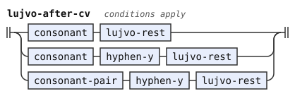</p>
<p>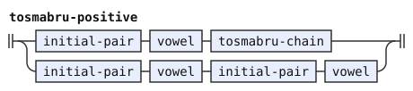</p>
<p>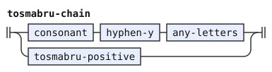</p>
<p>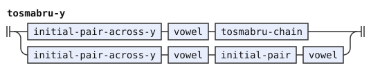</p>
<p>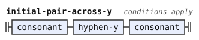</p>
</details>


No lujvo made this way breaks up, which is why the algorithm is as it is. A word's stress falls on its penultimate syllable, so a brivla inside it must reach its end. The words before that brivla must then be cmavo.

An initial CC leaves no cmavo to take. An initial CVCC or CVV rafsi leaves, after its hyphen, a rest that no word begins with. The CVV-CCV exception leaves a rest of one syllable. The tosmabru test catches an initial CVC whose rest reads as a lujvo. A rest that otherwise fits a borrowing fails the slinku'i test below, because the CV cmavo, put back in front of it, makes the lujvo.

## Borrowings

A borrowing, or fu'ivla, is a brivla that is neither a gismu nor a lujvo (CLL[^cll-s4-7]). It has no `y`, and it ends in a vowel. It has a consonant cluster among its first five letters, not counting apostrophes and commas.

A cluster at its start is an initial pair or a longer run of initial pairs. A cluster in its middle can be of any length. Each adjacent pair must be permissible, and a cluster must not hold any of the four `n` triples (the `lerndjamo` of CLL[^cll-s4-7]). Its vowels can stand in any run, with apostrophes or commas between two of them. A comma is allowed only where the letters without it, with capitals lowered, also form a borrowing (see "Commas"). A run of vowels divides into syllables as [shapes.md](shapes.md) says, so `bantua` has two syllables, `ban-tua`, and the `korea` of `bangrkorea` has three.

A borrowing is also not "any combination of cmavo, gismu, and lujvo". The `denpabu` of CLL[^cll-s17-4] shows what that means: the same spoken word, with its syllables and stress, read as those words under the pause rules. Only one such reading is possible. It is one or more cmavo followed by one brivla, because a second brivla needs a second stress. The last word must begin with a consonant, and it can be a borrowing too, as in `abaspageti`, which is `a ba spageti`.

The stress of the candidate then falls on the penultimate syllable of that brivla, which is where the brivla has it. So `buklama` is `bu klama` and `aklama` is `a klama`. But `denpabu` is a borrowing, because the reading `denpa bu` stresses `DENpa`. `klamale` and `bantua` are borrowings for the same reason. `combination` states the reading as the letters alone, because the stress then needs no test.

The slinku'i test of CLL[^cll-s4-7] says that a CV cmavo joined to the front of a borrowing must not make a lujvo. Otherwise, `pa slinku'i`, written together, reads as the lujvo `pas-lin-ku'i`. The test holds for every borrowing. A CV cmavo before a borrowing that begins with a consonant makes a first CVC rafsi, so the test asks whether the borrowing is `lujvo-after-cv`. Before a borrowing that begins with `i` or `u`, the CV makes a CVV rafsi, and the test asks whether it is `lujvo-after-cvv`. So `ikla` and `irklama` are no borrowings, because `paikla` and `pairklama` are lujvo.

```jbogenbau
%rule fuhivla-word
  $f:fuhivla-form
%conditions
  $f.matches(clustered-start),
  ¬$f.matches(gismu-form),
  ¬$f.matches(lujvo-form),
  ¬$f.matches(lujvo-after-cv),
  ¬$f.matches(lujvo-after-cvv),
  (N2 ∪ N3) ∩ $f.tags(brivla-scan) ≠ ∅,
  ¬$f.matches(one-syllable),
  ¬$f.matches(combination)

%rule fuhivla-form
  | fuhivla-body
  | consonant fuhivla-body
  | initial-cluster fuhivla-body

%rule fuhivla-body
  | vowel-group
  | vowel-group $m:permissible-run fuhivla-body
%conditions
  ¬$m.matches(has-n-affricate)

%rule vowel-group
  vowel | vowel-group vowel | vowel-group "'" vowel | vowel-group Syllable-Break vowel

%rule clustered-start
  [counted-lead] consonant consonant [any-letters]

%rule counted-lead
  counted-letter | counted-letter counted-letter | counted-letter counted-letter counted-letter

%rule counted-letter
  consonant | vowel | vowel "'" | vowel Syllable-Break

%rule combination
  (plain-cmavo-body | vowel-cmavo) combination-rest

%rule combination-rest
  | gismu-form | lujvo-form | $f:fuhivla-word
  | plain-cmavo-body combination-rest
%conditions
  $f.first-token.matches(consonant)
```

<details><summary>Railroad diagrams of the 9 rules from <code>fuhivla-word</code> to <code>combination-rest</code></summary>
<p>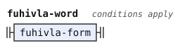</p>
<p>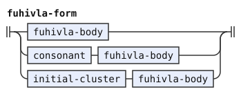</p>
<p>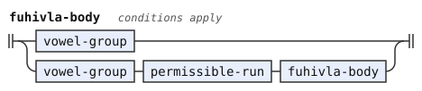</p>
<p>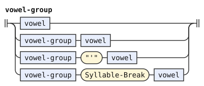</p>
<p>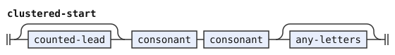</p>
<p>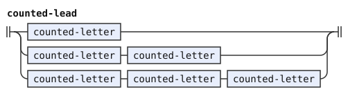</p>
<p>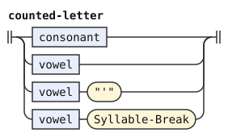</p>
<p>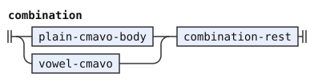</p>
<p>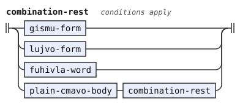</p>
</details>


## Cmevla

A name is a nonempty run of letters that ends in a consonant (CLL[^cll-s4-8]), so `.rl.` is one. Every adjacent pair of its consonants is permissible, at its start too, and it can hold the four `n` triples (CLL[^cll-s3-7]). It can have `y` as a vowel, the diphthongs `iy` and `uy`, and an apostrophe or a comma between any two of its vowels.

A name cannot contain `la`, `lai` or `doi` at its start or after a vowel or `y`. The reason is that a name after one of those words can follow it without a pause. So `.laplas.` and `.ilanas.` are not names, but `.nederlants.` is one. A comma removes no letter, so `.do,is.` is no name either.

Pauses surround a name (rules 2 and 4), so its shape carries neither `Onset` nor `Continued`. The grammar tags a name that begins with a consonant `Name-Onset`. Its first syllable is stressed if its first nucleus has a capital vowel. If no vowel is a capital, the stress falls where [shapes.md](shapes.md) says, which can be the first syllable. `.djan.` has one syllable, and it is stressed.

```jbogenbau
%rule cmevla-shape
  $n:cmevla
    :: ($n.first-token.matches(consonant) ⟹ Name-Onset)
     ∪ (First-Marked ⊆ $n.tags(name-scan)
        ∨ Any-Marked ⊈ $n.tags(name-scan) ∧ First-Counted ⊆ $n.tags(name-scan)
          ∧ (N1 ∪ N2) ∩ $n.tags(name-scan) ≠ ∅
        ⟹ Initial-Stress)
%conditions
  ¬$n.matches(la-doi-inside)

%rule cmevla
  | permissible-run
  | [permissible-run] name-body

%rule name-body
  | name-vowels permissible-run
  | name-vowels permissible-run name-body

%rule name-vowels
  name-vowel | name-vowels name-vowel | name-vowels "'" name-vowel | name-vowels Syllable-Break name-vowel

%rule la-doi-inside
  | la-or-doi [any-letters]
  | [any-letters] name-vowel la-or-doi [any-letters]

%rule la-or-doi
  "l" "a" | "d" "o" [Syllable-Break] "i"
```

<details><summary>Railroad diagrams of the 6 rules from <code>cmevla-shape</code> to <code>la-or-doi</code></summary>
<p>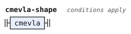</p>
<p>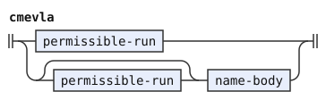</p>
<p></p>
<p></p>
<p></p>
<p></p>
</details>


## Commas

A comma between two vowels marks a syllable break (CLL[^cll-s3-3][^cll-s3-5]). Phonemes gives it value `,` and tag `Syllable-Break`, and a comma anywhere else is no phoneme. Normalization empties that value and keeps its tag and image. CLL[^cll-s3-3] says that "no two Lojban words differ solely because of the presence or placement of a comma". So a comma never makes a word, and it never changes the class of a word.

Only a borrowing, a name or hesitation can hold a comma between two vowels. A cmavo, a gismu or a lujvo cannot. A word with such a comma must also be a word of the same class when its commas are removed and its capitals lowered. So `ma,i` and `ba,irgau` are no words, because `mai` is a cmavo and `bairgau` is a lujvo. `zda,i` is no word either, because `zdai` is none.

A run with such a word divides into no words, and the forms stage hands it on as one foreign token ([forms.md](forms.md)). The words stage rejects that run unless it is inside a foreign quote or after `fa'o`.

The comma rules read `Syllable-Break`, because the normalized comma value is empty. `vowel-group`, `counted-letter` and `name-vowels` retain the written boundary. `la-or-doi`, `falling-vowels`, `rising-vowels` and `falling-i` read optional syllable boundaries. `has-comma` finds a comma through its tag.

The rules that test whether letters form a cmavo or a lujvo read a comma inside a diphthong as if it were absent. `cmavo-unit` and `cvv-rafsi` read `falling-vowels`. `vowel-cmavo` reads `rising-vowels`, and it reads `falling-vowels` through `cmavo-units`. `lujvo-form` and `lujvo-after-cvv` read a comma before the `i` or `u` that ends a first CVV rafsi. `cmavo-shape` and `brivla-word` then refuse a cmavo or a lujvo that has a comma.

The tests of "Borrowings" for a lujvo or a `combination` use these rules and treat such a comma as absent too. So `ba,iklama` is no borrowing, because `bai klama` is two words. `akru,a` is one borrowing, as `akrua` is, and not `a kru,a`. A borrowing needs two syllables without its commas, which `one-syllable` tests.

The stress marks and the pause rules read the syllables as written, with the breaks that the commas mark. `brivla-scan` and `name-scan` of [shapes.md](shapes.md) form no diphthong across a comma. So `tcE,ila` is no word, because its capital is on the first of the three syllables `tce-i-la`. The check without commas also lowers the capitals, so the borrowing `zba,A,u` passes it as `zbaau`, although `zbaAu` is none. A comma can change the division of a text with capitals, while each word keeps its class. `zba,A,uklama` is `zba,A,u klama`, and `zbaAuklama` is `zbaAukla ma`.

A name needs one more test. Its `doi` test applies at its start or after a vowel or `y`. A comma removes no letter. So `la-or-doi` finds `doi` across a comma, and `.do,is.` is no name. `.ndo,is.` is still a name, because a consonant comes before its `do,i`. Hesitation keeps its commas, as [forms.md](forms.md) says, so `y,y` is hesitation, as `yy` is.

```jbogenbau
%rule falling-vowels
  falling-diphthong | "a" Syllable-Break "i" | "e" Syllable-Break "i" | "o" Syllable-Break "i" | "a" Syllable-Break "u"

%rule rising-vowels
  rising-diphthong | i-or-u Syllable-Break vowel

%rule falling-i
  [Syllable-Break] "i"

%rule one-syllable
  [consonants] syllable-vowels

%rule syllable-vowels
  vowel | falling-vowels | rising-vowels

%rule has-comma
  [any-letters] Syllable-Break [any-letters]
```

<details><summary>Railroad diagrams of the 6 rules from <code>falling-vowels</code> to <code>has-comma</code></summary>
<p></p>
<p></p>
<p></p>
<p></p>
<p></p>
<p></p>
</details>


## Where the book leaves a choice

The [word stream](stream.md#cll-and-magic-words) lists one more departure from CLL, the omitted pause after hesitation.

In a few places CLL 1.1 is silent, or two passages disagree. This grammar reads each place as follows:

### Compound words and borrowings

- Hyphens: CLL[^cll-s4-11] says that "it is illegal to add a hyphen at a place that is not required by this algorithm". So a lujvo has a `y` only where the algorithm puts one, and `rokyre'o`, `basykla` and `lojybangri` are no lujvo. The algorithm has no rule for an `n` before `tc`, `ts`, `dj` or `dz`. These make a triple that CLL forbids,[^cll-s3-7] so this grammar inserts `y`, as in `junydji`.
- The slinku'i test holds for every borrowing, as CLL[^cll-s4-7] states it, so `ikla` and `irklama` are no borrowings. A borrowing is also not a cmavo followed by a borrowing, which is one more way the book's promise of a single division can fail.
- A "combination of cmavo, gismu, and lujvo" (CLL[^cll-s4-7]) is the same spoken word, with its syllables and stress, as `denpabu` shows.[^cll-s17-4] So `klamale` and `bantua` are borrowings.

### Stress and syllables

- Stress and pauses: CLL[^cll-s4-9] rule 5 asks for a pause after a stressed last syllable before a brivla. CLL[^cll-s4-2] asks for one between two stressed syllables, whatever the words. CLL states the stress rule as follows.

  > If the final syllable of one word is stressed, and the first syllable of the next word is stressed, you must insert a pause …

  Both rules hold here, so `mIdO` needs a pause.

- Syllables: A syllabic consonant adds no syllable. So the first and last syllables of a word are those of its first and last written vowels, `y` included.
- An unmarked brivla is stressed on the penultimate syllable, counted to the next pause (CLL[^cll-s3-9]). So `klamacy.` is `klama cy.`, and `klamabu` is one borrowing, like `denpabu`.
- Capital letters: A capital on either letter of a diphthong, or on both, marks one stressed syllable, so `bAIkla` is a lujvo. A capital `Y` can mark stress in a name or a cmavo, whose stress can fall on any syllable. It never stands in a brivla, whose `y` is not counted.

### Names and vowels

- Names: CLL forbids embedded `la`, `lai` or `doi` "unless the sequence is immediately preceded by a consonant".[^cll-s4-8] This grammar rejects them only at the start or after a vowel or `y`. Its `name-vowel` test excludes the apostrophe.
- Vowels: CLL never says whether two vowels that form no diphthong can stand side by side. In a name or a borrowing they can, each its own syllable, as in `.aab.` and `paarku`.
- Vowels in a cmavo: A cmavo's vowels are single vowels and falling diphthongs joined by apostrophes (CLL[^cll-s4-1][^cll-s4-2]). A rising diphthong is a cmavo only as a whole word. So `seia`, `miui` and `kie` are no cmavo, and `sei'a` is one. An apostrophe or a comma can stand before a rising diphthong in a name, as in `.a'uas.`.

### Commas and written boundaries

- Commas: A comma between two vowels only marks a syllable break, as CLL uses it in `.me,iin.` and `bang,r,kore,a`.[^cll-s3-5][^cll-s4-7] It can stand only in a borrowing, a name or hesitation, and a word keeps its class with its commas removed and its capitals lowered. CLL[^cll-s3-3] says that "no two Lojban words differ solely because of the presence or placement of a comma". CLL also writes `kulnrsu,omi`.[^cll-e7-78] The stress marks read the syllables as written, so stress-marked text can divide differently, as in `zba,A,uklama`. Anywhere else a comma is not a letter.
- Written boundaries: CLL[^cll-s3-3] lets a missing period be inferred, but not a missing word boundary. So a space or a period ends a word and counts as a pause, and no boundary is inferred where none is written. `miui` is no text, and `mi .ui` and `mi ui` are two words.
- `y` in a cmavo: The ten pairs `a'y`, `e'y`, `i'y`, `o'y`, `u'y`, `y'a`, `y'e`, `y'i`, `y'o` and `y'u` are cmavo. The words stage reads a longer cmavo with a `y` unit, such as `ka'y`, under the warning `y-cmavo`.

[^cll-s4-9]: [CLL 1.1, section 4.9](https://lojban.org/publications/cll/cll_v1.1_xhtml-section-chunks/section-pauses.html).

[^cll-s4-2]: [CLL 1.1, section 4.2](https://lojban.org/publications/cll/cll_v1.1_xhtml-section-chunks/section-cmavo.html).

[^cll-s3-9]: [CLL 1.1, section 3.9](https://lojban.org/publications/cll/cll_v1.1_xhtml-section-chunks/section-stress.html).

[^cll-s4-1]: [CLL 1.1, section 4.1](https://lojban.org/publications/cll/cll_v1.1_xhtml-section-chunks/chapter-morphology.html#section-morphology-introduction).

[^cll-s4-3]: [CLL 1.1, section 4.3](https://lojban.org/publications/cll/cll_v1.1_xhtml-section-chunks/section-morphology-brivla.html).

[^cll-s4-4]: [CLL 1.1, section 4.4](https://lojban.org/publications/cll/cll_v1.1_xhtml-section-chunks/section-gismu.html).

[^cll-s4-11]: [CLL 1.1, section 4.11](https://lojban.org/publications/cll/cll_v1.1_xhtml-section-chunks/section-lujvo-making.html).

[^cll-s4-7]: [CLL 1.1, section 4.7](https://lojban.org/publications/cll/cll_v1.1_xhtml-section-chunks/section-fuhivla.html).

[^cll-s17-2]: [CLL 1.1, section 17.2](https://lojban.org/publications/cll/cll_v1.1_xhtml-section-chunks/section-lerfu-liste.html).

[^cll-s17-4]: [CLL 1.1, section 17.4](https://lojban.org/publications/cll/cll_v1.1_xhtml-section-chunks/section-bu.html).

[^cll-s4-8]: [CLL 1.1, section 4.8](https://lojban.org/publications/cll/cll_v1.1_xhtml-section-chunks/section-cmene.html).

[^cll-s3-7]: [CLL 1.1, section 3.7](https://lojban.org/publications/cll/cll_v1.1_xhtml-section-chunks/section-initial-pairs.html).

[^cll-s3-3]: [CLL 1.1, section 3.3](https://lojban.org/publications/cll/cll_v1.1_xhtml-section-chunks/section-lojban-characters.html).

[^cll-s3-5]: [CLL 1.1, section 3.5](https://lojban.org/publications/cll/cll_v1.1_xhtml-section-chunks/section-vowel-pairs.html).

[^cll-e7-78]: [CLL 1.1, section 7.15, example 7.78](https://lojban.org/publications/cll/cll_v1.1_xhtml-section-chunks/section-anaphoric-rafsi.html#c7e15d3).

[^cll-c3]: [CLL 1.1, chapter 3](https://lojban.org/publications/cll/cll_v1.1_xhtml-section-chunks/chapter-phonology.html).

[^cll-c4]: [CLL 1.1, chapter 4](https://lojban.org/publications/cll/cll_v1.1_xhtml-section-chunks/chapter-morphology.html).
