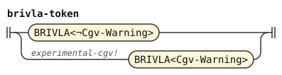
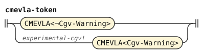

# Experimental word warnings

This document is part of the words stage in the [experimental](../dialects/experimental.md) dialect, after [stream.md](stream.md). A stage is one step of the pipeline. A token is one unit that a stage reads or emits. A tag marks a token by an identifier.

[The word forms](experimental.md) tag CgV names and predicate words with `Cgv-Warning`. A nucleus is a syllable's vowel or diphthong. A glide is `i` or `u` before a nucleus. CgV combines a consonant, glide and nucleus. This stage enables the warning `experimental-cgv` by default. Disabling it changes no reading.

The warning covers each marked word that the chosen derivation reads as Lojban. ZO targets, grammatical quotes, and ungrammatical quotes retain it. Replacement quotes still read Lojban words, so their marked words warn too. Erasure keeps warnings from the words that it reads. An opening delimiter also reads as a word and can warn.

An opaque foreign body contains no such word reads. Thus ZOI, LAhO and raw one-word bodies cannot warn about their contents. Text after active FAhO cannot warn either. A raw closing delimiter also supplies no predicate or name read. `zoi gy. atkuila .gy.` needs no CgV word form in its body.

`brivla-token` and `cmevla-token` read the marked and unmarked cases separately. They remove the marker tag after the test. Each warning retains the whole word's source range.

```jbogenbau
%features experimental-cgv

%redefine-rule brivla-token :: $b.tags ∖ Cgv-Warning
  | $b:BRIVLA<¬Cgv-Warning>
  | experimental-cgv! $b:BRIVLA<Cgv-Warning>

%redefine-rule cmevla-token :: $n.tags ∖ Cgv-Warning
  | $n:CMEVLA<¬Cgv-Warning>
  | experimental-cgv! $n:CMEVLA<Cgv-Warning>
```

<details><summary>Railroad diagrams of <code>brivla-token</code> and <code>cmevla-token</code></summary>
<p></p>
<p></p>
</details>

## Differences from camxes-exp

camxes-exp rejects CgV in names and borrowings. This dialect admits those word forms, as [experimental.md](experimental.md) explains. The default warning reports only word reads that rely on this extension. Opaque bodies and post-FAhO text do not rely on it.
