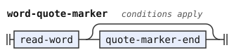
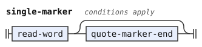
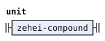
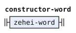
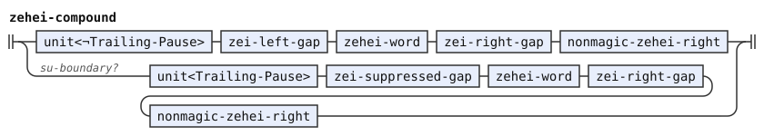
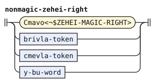
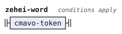
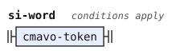
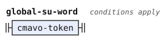
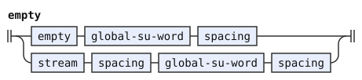

# The experimental word stream

This document is part of the words stage in the [experimental](../dialects/experimental.md) dialect, after [stream.md](stream.md). A stage is one step of the pipeline. A token is one unit that a stage reads or emits. A tag marks a token by an identifier.

[The word forms](experimental.md) tag CgV names and predicate words with `Cgv-Warning`. A nucleus is a syllable's vowel or diphthong. A glide is `i` or `u` before a nucleus. CgV combines a consonant, glide and nucleus. This stage enables the warning `experimental-cgv` by default. Disabling it changes no reading.

The warning covers each marked word that the chosen derivation reads as Lojban. ZO targets, grammatical quotes, and ungrammatical quotes retain it. Replacement quotes still read Lojban words, so their marked words warn too. Erasure keeps warnings from the words that it reads. An opening delimiter also reads as a word and can warn.

An opaque foreign body contains no such word reads. Thus ZOI bodies, including `la'o`, and raw one-word bodies cannot warn about their contents. Text after active FAhO cannot warn either. A raw closing delimiter also supplies no predicate or name read. `zoi gy. atkuila .gy.` needs no CgV word form in its body.

`brivla-token` and `cmevla-token` read the marked and unmarked cases separately. They remove the marker tag after the test. Each warning retains the whole word's source range.

```jbogenbau
%features experimental-cgv

%redefine-rule brivla-token :: $b.tags ∖ Cgv-Warning
  | $b:BRIVLA<¬Cgv-Warning>
  | experimental-cgv! $b:BRIVLA<Cgv-Warning>

%redefine-rule cmevla-token :: $n.tags ∖ Cgv-Warning
  | $n:CMEVLA<¬Cgv-Warning>
  | experimental-cgv! $n:CMEVLA<Cgv-Warning>
```

<details><summary>Railroad diagrams of <code>brivla-token</code> and <code>cmevla-token</code></summary>
<p></p>
<p></p>
</details>

## Word quotations

GOhOI quotes the same targets as ZO and makes a predicate unit. `ta'ai` describes word shape, `go'oi` repeats a bridi, and `ze'oi` describes meaning.

The marker rule shares ZO's word reader and standalone material targets. MUhOI shares ZOI's delimiters and raw body, including an empty body.

DOhOI quotes one raw run as a listener's name. Its body follows the same boundaries as ZOhOI and MEhOI.

Each completed quotation is one opaque unit. Later erasers and joiners act on the whole quotation, and indicators mark it as a whole.

The constant excludes these openers and the global eraser from ordinary words. A missing quote target rejects instead of becoming a plain word.

```jbogenbau
%redefine-const $MAGIC-WORDS
  $MAGIC-WORDS ∪ GOhOI ∪ MUhOI ∪ DOhOI ∪ SUhUhUhUhUhUhUhU

%redefine-rule word-quote-marker
  $q:read-word [quote-marker-end] :: $q.classes ∪ Word ∪ Cmavo
%conditions
  $q.classes ∩ (ZO ∪ GOhOI) ≠ ∅,
  ¬$.following-tokens.begins(quote-marker-end)

%redefine-rule zoi-marker
  $q:read-word [quote-marker-end] :: $q.classes ∪ Word ∪ Cmavo
%conditions
  $q.classes ∩ (ZOI ∪ MUhOI) ≠ ∅,
  ¬$.following-tokens.begins(quote-marker-end)

%redefine-rule single-marker
  $q:read-word [quote-marker-end] :: $q.classes ∪ Word ∪ Cmavo
%conditions
  $q.classes ∩ (ZOhOI ∪ MEhOI ∪ DOhOI) ≠ ∅,
  ¬$.following-tokens.begins(quote-marker-end)
```

<details><summary>Railroad diagrams of <code>word-quote-marker</code>, <code>zoi-marker</code> and <code>single-marker</code></summary>
<p></p>
<p></p>
<p></p>
</details>

## Nonce words

A nonce word is a word coined for one use. The joiner `ze'ei` takes its meaning from the left word and its grammar from the right word.

The result keeps the right word's classes and normalized value. Its image retains the complete source expression, and its words tree retains both operands.

The value matters for syntax tests such as `LE="la"`. Keeping the joiner's source spelling as the value breaks that inherited grammar.

The left operand is the preceding live unit. The right operand is one raw word, so its contents execute no operation.

The joiner uses ZEI's clean gaps and groups repeated operations from the left. BU, ZEI, and SI then act on the complete result.

SA matches an existing nonce word by its inherited class, as in `broda ze'ei ko'a sa ko'a`. Before constructing a nonce word, SA instead takes its next raw word as the key. Thus `ko'e brodi sa broda ze'ei ko'a` keeps `ko'e` and the nonce word.

Inherited BAhE, UI, CAI, NAI, DAhO, FUhE, and FUhO classes act in the indicator stage like their template words. In `mi broda ze'ei ba'e klama`, the nonce word emphasizes `klama`. In `mi broda ze'ei fu'e ui klama`, it opens the indicator run.

A magic right word rejects because this construction does not dispatch new word operations. The named right-word rule supplies a diagnostic with its forbidden classes.

The right reader keeps the shared y-letter exception and predicate-word warnings. Its particle alternative tests `Cmavo` directly, not through `cmavo-token`, so the diagnostic names the forbidden classes. It also forbids LOhAI and LEhAI, whose raw quote markers have special plain-word fallbacks.

The spelling guard also covers `ze'ei`, so punctuation cannot escape into an earlier spacing region. SI excludes that spelling despite its dictionary class. The constructor hook also lets `ze'ei` take an unfinished replacement opener as its base.

```jbogenbau
%extend-rule unit
  zehei-compound

%extend-rule constructor-word
  zehei-word

%rule zehei-compound :: Word ∪ $r.classes ∪ ($r.tags ∩ (Cmavo ∪ Indicator ∪ Y-Letter)) ∪ (Fault ∩ $l.tags)
  | $l:unit<¬Trailing-Pause> zei-left-gap zehei-word zei-right-gap $r:nonmagic-zehei-right
  | su-boundary? $l:unit<Trailing-Pause> zei-suppressed-gap zehei-word zei-right-gap $r:nonmagic-zehei-right
%emits
  $ := $r.emitted.value :- $.source-text

%const $ZEHEI-MAGIC-RIGHT
  $MAGIC-WORDS ∪ LOhAI ∪ LEhAI

%rule nonmagic-zehei-right
  Cmavo<¬$ZEHEI-MAGIC-RIGHT> | brivla-token | cmevla-token | y-bu-word

%rule zehei-word
  $q:cmavo-token
%conditions
  $q.value = "ze'ei"

%redefine-rule si-word
  $q:cmavo-token
%conditions
  SI ⊆ $q.classes,
  $q.value ≠ "ze'ei",
  $q.value ≠ "zei" ∨ ¬$q.following-tokens.begins(punctuation-word-gap)

%redefine-rule zei-spelling
  Cmavo
%conditions
  $.value = "zei" ∨ $.value = "ze'ei"
```

<details><summary>Railroad diagrams of the 7 rules from <code>unit</code> to <code>zei-spelling</code></summary>
<p></p>
<p></p>
<p></p>
<p></p>
<p></p>
<p></p>
<p></p>
</details>

## Erasure and grammatical quotations

LUhEI opens grammatical quoted text, as LU does. SU therefore stops at its last surviving opener, including after a written LIhAU.

The global eraser `su'u'u'u'u'u'u'u` removes the readable prefix without an SU boundary. It also removes a surviving LU or LUhEI opener.

The erased prefix emits no token. A later SI, SA, or SU cannot restore it or find an erased boundary.

Opaque quotations keep an internal eraser literal. A grammatical quotation does not hide its words from word operations.

An active FAhO ends the text before a later eraser can act. Arbitrary malformed foreign prefixes gain no recovery rule.

The empty-prefix alternatives handle both an empty stream and a nonempty stream. This eraser operates independently of `sa-su` and `su-boundary`.

```jbogenbau
%redefine-const $SU-STOPS
  $SU-STOPS ∪ LUhEI

%rule global-su-word
  $q:cmavo-token
%conditions
  SUhUhUhUhUhUhUhU ⊆ $q.classes

%extend-rule empty
  | empty global-su-word spacing
  | stream spacing global-su-word spacing
%erased
```

<details><summary>Railroad diagrams of <code>global-su-word</code> and <code>empty</code></summary>
<p></p>
<p></p>
</details>

## Differences from camxes-exp

camxes-exp rejects CgV in names and borrowings. This dialect admits those word forms, as [experimental.md](experimental.md) explains. The default warning reports only word reads that rely on this extension. Opaque bodies and post-FAhO text do not rely on it.

GOhOI, MUhOI, DOhOI, `ze'ei`, and the global eraser add word operations that camxes-exp lacks. Their quotations retain the shared Magic Words opacity rules.

GOhOI shares ZO's marker to keep one target reader for both quote kinds. Upstream Zantufa reads only a Lojban word after GOhOI, through `any_word`. This dialect also admits ZO's standalone material targets. [The Zantufa word stream](zantufa-stream.md) shares that wider reader. MUhOI uses ZOI's empty and nonempty bodies.

Experimental rejects a bare MUhOI before SI or BU, as it rejects a bare ZOI. Zantufa permits that fallback, so this dialect deliberately differs.

Zantufa puts `ze'ei` in SI and erases its left word. Experimental instead follows its dictionary definition's right-word grammar, while rejecting magic right operands.

An unfinished `lo'ai` can also serve as its base and then carries no fault. camxes-exp lacks `ze'ei`. Zantufa has no such reading because `ze'ei` erases there.

The LUhEI boundary extends experimental SU's stopping classes by analogy with LU. The global eraser ignores every such boundary and has no Zantufa counterpart.
