# Experimental word forms

This document is part of the forms stage in the [experimental](../dialects/experimental.md) dialect. The forms stage follows normalization. It divides the phonemes of the text into words. The loader stitches this document into the stage after [bpfk.md](bpfk.md).

A layer is a document that changes earlier rules. This layer changes the word forms in [bpfk.md](bpfk.md). A lookahead tests input without reading it.

The baseline is camxes-exp, the experimental grammar of the camxes parser, written as a parsing expression grammar (PEG). The rule names follow camxes-exp, while their comments state the morphology constraints, as in bpfk.md. The section on glide letters adds a test of gencmu's own to three inherited rules. The [Zantufa](../dialects/zantufa.md) dialect makes only the first change, in [zantufa.md](zantufa.md). [The notation document](../../docs/notation.md) explains the notation.

The prose uses these Lojban terms for words:

- A brivla is a predicate word.
- A gismu is a root word.
- A lujvo is a compound word.
- A rafsi is a shortened word form used inside compounds.

## The pair mz

A diphthong combines two vowels in one syllable. A nucleus is a syllable's vowel or diphthong. A glide is an `i` or `u` before a nucleus.

The rule for `m` rejects a following apostrophe or `m`, but permits `z` and a glide. Thus `kamzi`, `bamzda` and `.djeimz.` have permissible consonant pairs.

```jbogenbau
%redefine-rule m              (* The consonant m forbids an apostrophe and another m. It permits z and a glide. *)
  $c:"m"
%conditions
  ¬$c.following-tokens.begins(h | m)
```

<details><summary>Railroad diagram of <code>m</code></summary>
<p></p>
</details>

## Consonants before glides

Experimental accepts a consonant before a glide in names and borrowings, as CLL 1.1 section 3.4 permits.[^cll-s3-4] BPFK and Zantufa keep their source ban. The CLL family already accepts these forms. A CgV sequence is a consonant, a glide and its nucleus.

The consonant rules retain every restriction except the glide ban. A borrowing syllable onset can add a glide after a nonempty legal initial. Particles and rafsi slots keep the ordinary onset. Classical rafsi still require their original vowel positions, so CgV creates no new classical compound shape.

A coda is a syllable's ending consonant group. `brivla-onset` serves borrowing syllables, their stress tests and their head test. The coda lookahead uses it too. Thus a preceding syllable cannot take the consonant before `iy` or `uy` as its coda. The rafsi slot still uses ordinary `onset`.

A borrowing retains its head, stress, final syllable and slinku'i restrictions. It must contain a consonant cluster. The cluster can occur beyond the first five letters. Only a complete borrowing with CgV can bypass the head's rafsi-string exclusion. A short classical rafsi cannot directly precede CgV whose consonant differs from `r`.

CLL 1.3.4 appendix A3.3 records that the working morphology drops the five-letter limit for borrowings.[^cll-a3-3] The word must resolve as one brivla. Thus `puamamakla` is legal despite its late cluster.

Thus `atkuila` and `zgiaca'a` are borrowings, while `language` remains foreign. Its initial `lan` is a CVC rafsi directly before `gua`. The guard follows the separate treatment of `r` in jbotci, so `lanruage` and `blaruage` remain borrowings. Borrowing rafsi retain their separate head exclusion. Their final onset before `y` remains ordinary, so `spagetiybroda` and `spagekuykla` stay foreign.

The forms stage marks each CgV name or predicate word with `Cgv-Warning`. The span test reads only that word, so it cannot mark CgV in a later word. [The experimental word stream](experimental-stream.md) reads this tag and supplies the warning. Disabling the warning changes no reading.

```jbogenbau
%redefine-rule cmevla-shape
  $n:cmevla :: Continued ∪ (¬$n.onward.begins(nucleus) ⟹ Onset) ∪ ($n.matches(cgv-form) ⟹ Cgv-Warning)

%redefine-rule brivla-shape
  $b:brivla-word :: Continued ∪ (¬$b.onward.begins(nucleus) ⟹ Onset) ∪ ($b.matches(cgv-form) ⟹ Cgv-Warning)

%rule cgv-form
  [{nonpause-phoneme}] consonant glide [{nonpause-phoneme}]

%rule brivla-onset
  onset | cgv-onset

%redefine-rule onset-nucleus-coda
  brivla-onset nucleus [coda]

%redefine-rule syllable
  $o:brivla-onset nucleus [coda]
%conditions
  ¬$o.following-tokens.begins(y)

%redefine-rule final-syllable
  $o:brivla-onset $n:nucleus
%conditions
  ¬$o.following-tokens.begins(y | stressed),
  ¬$n.following-tokens.begins(cmevla),
  $n.following-tokens.begins(post-word)

%redefine-rule stressed
  brivla-onset stress-mark

%redefine-rule brivla-head
  [{unstressed-syllable}]
%conditions
  ¬$.onward.begins(cmavo | slinkuhi | h),
  $.onward.begins(brivla-onset)

%rule cgv-onset
  cgv-initial glide

%rule cgv-initial
  | $a:affricate
  | $p:initial-parts
%conditions
  ¬$a.following-tokens.begins(consonant),
  ¬$p.following-tokens.begins(consonant),
  $p.value ≠ ""

%redefine-rule fuhivla
  $b:brivla-head stressed-syllable [{consonantal-syllable}] final-syllable
%conditions
  ¬$b.onward.begins(rafsi-string) ∨ $.matches(cgv-form),
  ¬$.onward.begins(cgv-rafsi-continuation),
  $.matches(cgv-cluster-form)

%rule cgv-cluster-form
  [{nonpause-phoneme}] consonant consonant [{nonpause-phoneme}]

%rule cgv-rafsi-continuation
  (cvc-rafsi | ccv-rafsi | stressed-cvc-rafsi | stressed-ccv-rafsi) $c:consonant glide
%conditions
  $c.value ≠ "r"

%redefine-rule l  (* This consonant forbids an apostrophe and a repeated letter. *)
  $c:"l"
%conditions
  ¬$c.following-tokens.begins(h | l)

%redefine-rule n  (* This consonant forbids an apostrophe and a repeated letter. It forbids an affricate. *)
  $c:"n"
%conditions
  ¬$c.following-tokens.begins(h | n | affricate)

%redefine-rule r  (* This consonant forbids an apostrophe and a repeated letter. *)
  $c:"r"
%conditions
  ¬$c.following-tokens.begins(h | r)

%redefine-rule b  (* This consonant forbids an apostrophe and a repeated letter. It also forbids an unvoiced consonant. *)
  $c:"b"
%conditions
  ¬$c.following-tokens.begins(h | b | unvoiced)

%redefine-rule d  (* This consonant forbids an apostrophe and a repeated letter. It also forbids an unvoiced consonant. *)
  $c:"d"
%conditions
  ¬$c.following-tokens.begins(h | d | unvoiced)

%redefine-rule g  (* This consonant forbids an apostrophe and a repeated letter. It also forbids an unvoiced consonant. *)
  $c:"g"
%conditions
  ¬$c.following-tokens.begins(h | g | unvoiced)

%redefine-rule v  (* This consonant forbids an apostrophe and a repeated letter. It also forbids an unvoiced consonant. *)
  $c:"v"
%conditions
  ¬$c.following-tokens.begins(h | v | unvoiced)

%redefine-rule j  (* This consonant forbids an apostrophe and a repeated letter. It also forbids an unvoiced consonant. It forbids z. *)
  $c:"j"
%conditions
  ¬$c.following-tokens.begins(h | j | z | unvoiced)

%redefine-rule z  (* This consonant forbids an apostrophe and a repeated letter. It also forbids an unvoiced consonant. It forbids j. *)
  $c:"z"
%conditions
  ¬$c.following-tokens.begins(h | z | j | unvoiced)

%redefine-rule s  (* This consonant forbids an apostrophe and a repeated letter. It also forbids a voiced consonant. It forbids c. *)
  $c:"s"
%conditions
  ¬$c.following-tokens.begins(h | s | c | voiced)

%redefine-rule c  (* This consonant forbids an apostrophe and a repeated letter. It also forbids a voiced consonant. It forbids s and x. *)
  $c:"c"
%conditions
  ¬$c.following-tokens.begins(h | c | s | x | voiced)

%redefine-rule x  (* This consonant forbids an apostrophe and a repeated letter. It also forbids a voiced consonant. It forbids c and k. *)
  $c:"x"
%conditions
  ¬$c.following-tokens.begins(h | x | c | k | voiced)

%redefine-rule k  (* This consonant forbids an apostrophe and a repeated letter. It also forbids a voiced consonant. It forbids x. *)
  $c:"k"
%conditions
  ¬$c.following-tokens.begins(h | k | x | voiced)

%redefine-rule f  (* This consonant forbids an apostrophe and a repeated letter. It also forbids a voiced consonant. *)
  $c:"f"
%conditions
  ¬$c.following-tokens.begins(h | f | voiced)

%redefine-rule p  (* This consonant forbids an apostrophe and a repeated letter. It also forbids a voiced consonant. *)
  $c:"p"
%conditions
  ¬$c.following-tokens.begins(h | p | voiced)

%redefine-rule t  (* This consonant forbids an apostrophe and a repeated letter. It also forbids a voiced consonant. *)
  $c:"t"
%conditions
  ¬$c.following-tokens.begins(h | t | voiced)
```

<details><summary>Railroad diagrams of the 30 rules from <code>cmevla-shape</code> to <code>t</code></summary>
<p>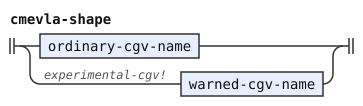</p>
<p>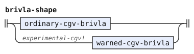</p>
<p>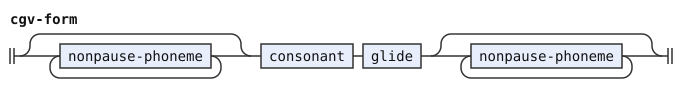</p>
<p>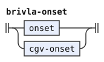</p>
<p>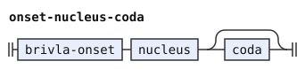</p>
<p>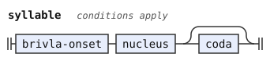</p>
<p>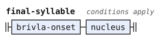</p>
<p>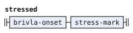</p>
<p></p>
<p>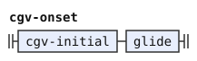</p>
<p>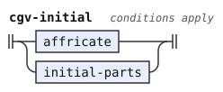</p>
<p>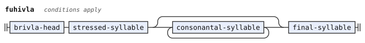</p>
<p>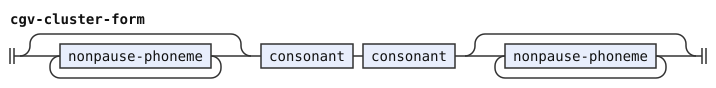</p>
<p>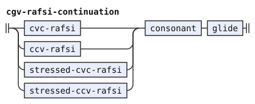</p>
<p>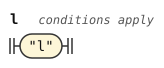</p>
<p></p>
<p>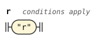</p>
<p>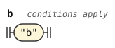</p>
<p>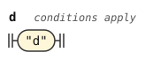</p>
<p>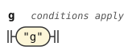</p>
<p></p>
<p>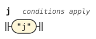</p>
<p>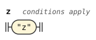</p>
<p>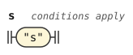</p>
<p>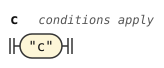</p>
<p>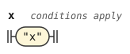</p>
<p></p>
<p>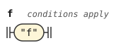</p>
<p>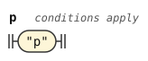</p>
<p></p>
</details>

## Extended rafsi

An extended rafsi is a whole or shortened word before a y-hyphen. It has a classical apostrophe-y form or a borrowing head. A borrowing head excludes rafsi strings, whose endings include `hy-rafsi` and `stressed-hy-rafsi`. Thus the two alternatives cannot complete from the same start, even with an apostrophe onset in the borrowing form.

`hy-rafsi` takes a long rafsi with an unstressed vowel, a CCV rafsi, or a CVV rafsi before `'y`. The long form leaves a consonant after a CCV prefix, so the shorter form cannot reach the apostrophe there. CVV differs in its second or third letter. The stressed forms have the same separation. After these redefinitions, nothing reads the rules `brivla-rafsi`, `stressed-brivla-rafsi` and `two-syllables` of bpfk.md.

```jbogenbau
%redefine-rule extended-rafsi  (* An extended rafsi has a classical apostrophe-y form or a borrowing head. Borrowing heads exclude rafsi strings, which include hy-rafsi. *)
  hy-rafsi | fuhivla-rafsi

%redefine-rule stressed-extended-rafsi  (* The stressed borrowing head excludes rafsi strings, including stressed-hy-rafsi. Only one extended form can complete at this start. *)
  stressed-hy-rafsi | stressed-fuhivla-rafsi

%redefine-rule long-rafsi-vowel (* The long classical form appends an unstressed vowel to a long rafsi. *)
  long-rafsi unstressed-vowel
```

<details><summary>Railroad diagrams of the 3 rules from <code>extended-rafsi</code> to <code>long-rafsi-vowel</code></summary>
<p>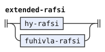</p>
<p>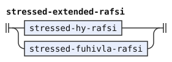</p>
<p>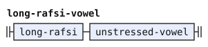</p>
</details>

A CCV `hy-rafsi` can otherwise begin a brivla, as in `bla'ykla`. `brivla` rejects that start with a CCV rafsi, `'y` and the next onset, which `slihykru` tests. Thus `kerlybla'ykla` is one word, but `bla'ykla` is not. The plain and stressed CCV choices need no order because their vowel stress differs. Only `brivla` reads `slihykru`.

```jbogenbau
%redefine-rule brivla  (* A predicate word excludes a particle start and the CCV-apostrophe-y start that slihykru detects. Its unstressed rafsi precede the stressed core. *)
  [{initial-rafsi}] brivla-core
%conditions
  ¬$.onward.begins(cmavo | slihykru)

%rule slihykru                (* `slihykru <- (CCV_rafsi / stressed_CCV_rafsi) h y onset`. The forbidden start is a CCV rafsi, apostrophe-y, and an onset. Vowel stress separates the CCV forms. *)
  (ccv-rafsi | stressed-ccv-rafsi) h y onset
```

<details><summary>Railroad diagrams of <code>brivla</code> and <code>slihykru</code></summary>
<p>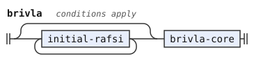</p>
<p>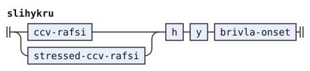</p>
</details>

The onset after a borrowing rafsi head can be an apostrophe. `spageti'ybroda` uses `fuhivla-rafsi` before `broda`. `spageti'ykla` uses `stressed-fuhivla-rafsi` before `kla`. Each example needs the apostrophe onset in its own rule.

```jbogenbau
%redefine-rule fuhivla-rafsi  (* A borrowing rafsi starts with an unstressed syllable. Its onset can be an apostrophe. A following rafsi cannot start with the optional apostrophe. *)
  $f:fuhivla-head onset y [h]
%conditions
  $f.onward.begins(unstressed-syllable)

%redefine-rule stressed-fuhivla-rafsi  (* A stressed borrowing rafsi permits an apostrophe onset. A consonantal syllable cannot consume the start of the following onset and y. *)
  fuhivla-head stressed-syllable [{consonantal-syllable}] onset y

```

<details><summary>Railroad diagrams of <code>fuhivla-rafsi</code> and <code>stressed-fuhivla-rafsi</code></summary>
<p></p>
<p>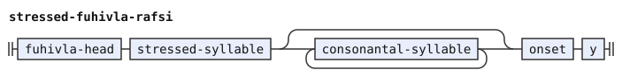</p>
</details>

An initial rafsi is an extended form, an ordinary y-rafsi, or a short unhyphenated form. Extended forms also carry a hyphen. The short form cannot start a borrowing or borrowing rafsi, or stand directly before one. It excludes y-rafsi and apostrophe-y forms through `y-less-rafsi`.

A y-rafsi requires y where a classical extended form needs a vowel or apostrophe. A borrowing head excludes that y-rafsi through its rafsi-string test. Thus only one kind can complete at the same start. No rule reads `any-extended-rafsi` after this replacement.

```jbogenbau
%redefine-rule initial-rafsi  (* A short unhyphenated rafsi cannot start or directly precede a borrowing or borrowing rafsi. It excludes y-rafsi and hy-rafsi through y-less-rafsi, and borrowing forms through any-fuhivla-rafsi. Initial borrowing rafsi need an unstressed first syllable. Classical extended forms require apostrophe-y. The stressed counterparts also need a short final that cannot start with consonant-y or apostrophe. *)
  | extended-rafsi
  | y-rafsi
  | $l:y-less-rafsi
%conditions
  ¬$l.onward.begins(any-fuhivla-rafsi),
  ¬$l.following-tokens.begins(any-fuhivla-rafsi)

%rule any-fuhivla-rafsi       (* `any_fuhivla_rafsi <- fuhivla / fuhivla_rafsi / stressed_fuhivla_rafsi`. The test detects a borrowing or either borrowing rafsi form. *)
  fuhivla | fuhivla-rafsi | stressed-fuhivla-rafsi
```

<details><summary>Railroad diagrams of <code>initial-rafsi</code> and <code>any-fuhivla-rafsi</code></summary>
<p>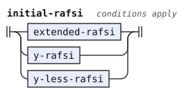</p>
<p>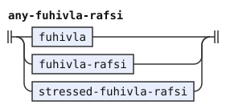</p>
</details>

## A bare nai

The implication marks every NAI word `Indicator`, as [the experimental lexicon](lexicon-experimental.md) marks the attitudinals. The mark comes from an implication, which the forms stage applies to each word that it emits. The indicator stage then attaches a bare `nai` to the word before it ([the experimental indicators](../indicators/experimental.md)).

```jbogenbau
%implies NAI ⟹ Indicator
```

## Glide letters

The experimental phoneme stage reads `ɩ`, `q`, `w`, `ĭ` and `ŭ` as the glides `i` and `u`, with the tag `Glide` ([latin-experimental.md](../phonemes/latin-experimental.md)). `ɩ`, `q` and `w` also carry `Onglide`, because they write only a glide before its vowel. Such a letter is a glide wherever it stands. So no rule reads it as a vowel. `vowel-letter` refuses every glide letter. `diphthong-letters` refuses an onglide letter, so `ĭ` and `ŭ` can end a diphthong, as in `maĭ`.

These tests of glide letters are gencmu's own.

When a diphthong ends in a glide letter, its second letter is no vowel. So the `a` of `maĭ` passes the `!nucleus` test of `vowel`, and without a change it reads as a vowel alone. `vowel` therefore also refuses a letter where a diphthong begins. Without a glide letter the extra test changes nothing, because a diphthong's second letter is then a nucleus, and the camxes test already fails.

A run with a glide letter where no glide can stand then divides into no words. The forms stage emits it as a foreign run ([forms.md](forms.md)), and the words stage rejects it outside a quote. So `mɩ`, `mĭ`, `kaw` and `www` are errors, while `maĭ`, `coĭ` and `kaŭ` read as `mai`, `coi` and `kau`.

The lookaheads still read the letter as `i` or `u`. A glide letter is no vowel, so it is a nucleus only as the end of a diphthong. So `aɩa` and `aĭa` are `a` and `ia`, as `aia` is. The `!i` after a diphthong still sees a glide letter, so `aiɩa` divides into no words, as `aiia` does.

```jbogenbau
%redefine-rule vowel          (* A vowel forbids a following nucleus. It also excludes a diphthong start, so a marked glide cannot leave a competing single vowel. *)
  $v:vowel-letter
%conditions
  ¬$v.following-tokens.begins(nucleus),
  ¬$v.onward.begins(diphthong)

%redefine-rule vowel-letter   (* A marked glide letter cannot serve as a vowel. *)
  a | e | i<¬Glide> | o | u<¬Glide>

%redefine-rule diphthong-letters (* An onglide letter cannot end a diphthong. A diphthong also forbids another matching i or u directly after it. *)
  | a $i:i<¬Onglide>
  | a $u:u<¬Onglide>
  | e $j:i<¬Onglide>
  | o $k:i<¬Onglide>
%conditions
  ¬$i.following-tokens.begins(i),
  ¬$u.following-tokens.begins(u),
  ¬$j.following-tokens.begins(i),
  ¬$k.following-tokens.begins(i)
```

<details><summary>Railroad diagrams of <code>vowel</code>, <code>vowel-letter</code> and <code>diphthong-letters</code></summary>
<p></p>
<p>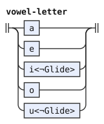</p>
<p>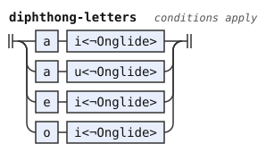</p>
</details>

## Differences from CLL, BPFK and camxes-exp

camxes-exp extends the working word forms of the BPFK, the Lojban language planning committee. This layer retains its changes except the redundant glide lookahead described in [the dialect departures](../dialects/experimental.md#where-it-reads-texts-differently-from-camxes-exp).

*The Complete Lojban Language* (CLL) forbids the consonant pair `mz`.[^cll-s3-6] The BPFK working morphology also forbids it. Its letter rule for `m` refuses a following `z`. The letter rule for `m` in camxes-exp refuses only another `m` among the consonants. So camxes-exp accepts `mz` wherever a permissible pair can stand. Examples are the gismu `kamzi`, the lujvo `bamzda` and the name `.djeimz.`.

The working morphology has two kinds of extended rafsi, which let a word, whole or cut short, stand before a y-hyphen inside a compound. A `brivla_rafsi` is the head of a brivla of two syllables or more, followed by `'y`, as in `klama'ybroda`. A `fuhivla_rafsi` is the head of a borrowing, followed by an onset and `y`, as in `spageiybroda`.

camxes-exp replaces the first kind with `hy_rafsi`, which the working morphology uses only in lookaheads. A `hy_rafsi` is a long rafsi and an unstressed vowel, a CCV rafsi, or a CVV rafsi, followed by `'y`. So `klama'ybroda` is one word in both grammars, but only camxes-exp reads `kerlybai'ybroda` as one word.

A `hy_rafsi` can also begin a brivla with a CCV rafsi, `'y` and the next rafsi. camxes-exp refuses that start, which it calls `slihykru`. So camxes-exp reads `kerlybla'ykla` as one word, but not `bla'ykla`, which the working morphology rejects too.

The working morphology rejects `kerlyfa'u'yiismu` because its borrowing rafsi onset cannot be an apostrophe. This layer follows camxes-exp and permits that onset.

In the working morphology, a short rafsi without a y-hyphen cannot stand where an extended rafsi or a borrowing begins, or directly before one. In camxes-exp, it cannot stand where a borrowing or the rafsi of a borrowing begins, or directly before one.

camxes-exp's `indicator` rule accepts a bare NAI like an attitudinal. This layer marks NAI as an indicator so that the indicator stage can attach it.

This layer inherits whole hesitation runs from [bpfk.md](bpfk.md#whole-hesitation-runs). A pure run of y is one hesitation token, and the split before BU preserves its letter word. The words stage drops the hesitation, so its division changes no final reading here.

The alternatives and repetitions state morphology constraints without PEG order. Merged stress tests and name forms remove duplicate proofs without changing the word classes.

This layer accepts CgV in names and borrowings, unlike camxes-exp. CLL 1.1 permits these diphthongs in those classes.[^cll-s3-4] The words stage identifies this extension by default when it reads a marked word. Opaque raw bodies and text after active FAhO contain no such word reads. The full borrowing shape still rejects invalid compound-like forms. Only borrowing syllables receive the added onset, so a rafsi slot cannot use it.

camxes-exp reads no glide letters. This layer refuses a glide letter as a vowel, and an onglide letter as the second letter of a diphthong. So a glide letter reads only as a glide.

[^cll-s3-6]: [CLL 1.1, section 3.6](https://lojban.org/publications/cll/cll_v1.1_xhtml-section-chunks/section-clusters.html).

[^cll-s3-4]: [CLL 1.1, section 3.4](https://lojban.org/publications/cll/cll_v1.1_xhtml-section-chunks/section-diphthongs.html).

[^cll-a3-3]: [CLL 1.3.4, appendix A3.3](https://github.com/int19h/cll/blob/v1.3.4/chapters/a03.xml#L155-L208).
