# The word stream

This document defines the words stage of cll-ebnf, bpfk, experimental, and Zantufa. A stage reads the tokens from the previous stage and emits tokens for the next stage.

A token is one unit that a stage reads or emits. A token's value is the string that exact comparisons read. Its image is the string that people see.

The [forms stage](forms.md) supplies source words. This stage applies quotes, compounds, erasers, hesitation, and FAhO. The [notation document](../../docs/notation.md) explains the notation of the rules below.

A unit is one item on which an operation acts. An opaque unit hides its internal words from later operations. Every finished quote and compound emits one token.

A letteral is a letter word of class BY. The y letteral sounds like ybu.

The shared grammar processes operations from left to right. Zantufa adds two local exceptions ([zantufa-stream.md](zantufa-stream.md)). Later operations act on whole quote and compound units.

## The stream of elements

The stream contains live units and erased regions. A live unit is a unit that no eraser removes.

Each operator acts on the units that survive when the stage reaches it. No operator reaches inside a unit.

A shared word reader supplies every requested word. It joins hesitation with a following `bu` before any operation takes that word. This exception applies inside ZO quotes, LOhU and LOhAI bodies, delimiters, and ZEI operands.

An erased region emits nothing. Later operators skip that region and use the surviving units beside it. Erasure never restores an earlier erased word.

A dangling `bu` creates a unit with a missing-base fault. A dangling `le'u` creates a unit with an unopened-quote fault. Constructors preserve these faults, and erasers remove the whole units.

A second `bu` wraps a fault unit like any other unit. Thus `bu bu si` leaves nothing. If a fault survives to the text end or an active `fa'o`, the words stage rejects the text.

An active `fa'o` ends the text. The stage reads no words after it. A quoted `fa'o` or a right operand of `zei` does not end the text.

BAhE marks the next word in the indicator stage. It remains a separate unit during word operations. The dialects keep `mi ba'e fa'o` rejected because the surviving BAhE has no target.

The rule `empty` reads a prefix that leaves no units. Its alternatives use `text-start`, `si-word`, `erasure`, `su-word`, `su-cleared`, `sa-wiped`, and `sa-tail`. The `su-word` routes clear an empty prefix or the whole prefix. The `su-cleared` route clears a prefix without an SU boundary and keeps its boundary test beside the stream. The `sa-wiped` route reads unmatched SA. The `sa-tail` routes read trailing SA after an empty or nonempty prefix.

```jbogenbau
%ambiguity-resolution lazy

%rule text
  | empty [faho-group]
  | $s:stream spacing [faho-group]
%conditions
  Fault ⊈ $s.tags

%rule text-start
  ε
%conditions
  $.starts-input

%rule empty
  | text-start spacing
  | empty si-word spacing
  | empty erasure spacing
  | sa-su? empty su-word spacing
  | sa-su? ¬su-boundary? stream spacing su-word spacing
  | su-cleared
  | sa-su? sa-wiped spacing
  | sa-su? empty sa-tail
  | sa-su? stream spacing sa-tail
%erased

%rule su-cleared
  sa-su? su-boundary? $s:stream spacing su-word spacing
%conditions
  $s.classes ∩ $SU-STOPS = ∅

%rule stream
  | empty $u:unit :: $u.tags
  | $s:stream spacing $u:unit :: $s.tags ∪ $u.tags
  | $s:stream spacing erasure :: $s.tags

%rule unit
  word | quote | lerfu-word | zei-compound | fault-unit | su-survivor

%rule erasure
  si-erasure | sa-su? sa-erasure

%rule fault-unit
  | empty bu-word :: Word ∪ BY ∪ Fault
  | lehu-marker :: Word ∪ LEhU ∪ Fault
%emits
  $

%rule faho-group
  faho-word [raw-tokens]
%erased

%rule faho-word
  read-word<FAhO>

%rule sa-tail
  sa-su? sa-run spacing
%conditions
  ¬$.following-tokens.begins(read-word)
```

<details><summary>Railroad diagrams of the 11 rules from <code>text</code> to <code>sa-tail</code></summary>
<p>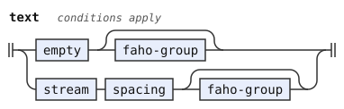</p>
<p>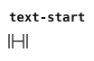</p>
<p>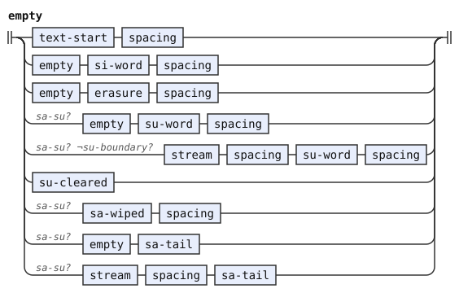</p>
<p>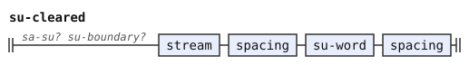</p>
<p>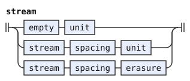</p>
<p>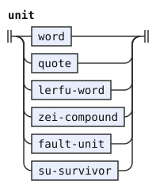</p>
<p>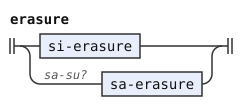</p>
<p>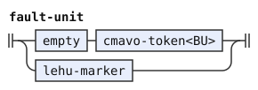</p>
<p>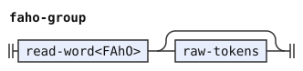</p>
<p>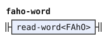</p>
<p>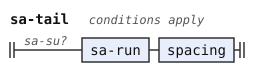</p>
</details>

### Spacing and hesitation

Hesitation emits nothing unless the word reader joins it with `bu`. The reader treats `yybu` as hesitation followed by the y letteral. The reader also forms the y letteral from `.yy. bu` and `.yyy. bu`.

`pause-run` reads consecutive pause tokens as one pause. It also accepts a supplied `Silent` token between pauses. A raw quote body keeps punctuation and ignored characters.

`spacing` reads pauses and ordinary hesitation. `skipped` also reads erased regions. These rules retain surviving pauses without emitting a token of their own.

`Quote-Material` also marks a gap with surviving punctuation or ignored material. Erased quote contents supply no such mark. `Punctuation-Material` distinguishes visible punctuation from ignored characters in these gaps.

Spacing and skipped regions reject surviving punctuation before the word `zei`, whatever class its lexicon assigns. Quoted contents execute no such operation.

`Gap-Pause` marks a gap with a surviving pause. `spacing` and `hesitations` introduce it. `skipped` and `erasures` carry it across erased children.

A quiet pause token has value `" "`, and `$PAUSE` names that string. Material pause tokens retain raw punctuation values. Gap recipes still contribute one space for surviving pauses.

```jbogenbau
%const $PAUSE " "

%rule pause-run
  | $p:PAUSE :: $p.tags ∩ (Quote-Material ∪ Punctuation-Material) := " " :- " "
  | $r:pause-run $q:PAUSE :: ($r.tags ∪ $q.tags) ∩ (Quote-Material ∪ Punctuation-Material) := " " :- " "
  | $s:pause-run Silent PAUSE :: $s.tags ∩ (Quote-Material ∪ Punctuation-Material) := " " :- " "

%rule spacing
  [$p:pause-run] [$h:hesitations [$q:pause-run]]
    :: ($p ⟹ Gap-Pause) ∪ ($q ⟹ Gap-Pause) ∪ ($h ⟹ $h.tags ∩ (Gap-Pause ∪ Quote-Material ∪ Punctuation-Material))
     ∪ ($p ⟹ $p.tags ∩ (Quote-Material ∪ Punctuation-Material)) ∪ ($q ⟹ $q.tags ∩ (Quote-Material ∪ Punctuation-Material))
%conditions
  Punctuation-Material ⊈ $.tags ∨ ¬$.following-tokens.begins(zei-spelling)

%rule skipped
  $s:spacing [$e:erasures $t:spacing]
    :: ($s.tags ∪ ($e ⟹ $e.tags) ∪ ($t ⟹ $t.tags)) ∩ (Gap-Pause ∪ Quote-Material ∪ Punctuation-Material)
%conditions
  Punctuation-Material ⊈ $.tags ∨ ¬$.following-tokens.begins(zei-spelling)

%rule erasures
  | erasure :: ∅
  | $e:erasures $s:spacing erasure :: ($e.tags ∪ $s.tags) ∩ (Gap-Pause ∪ Quote-Material ∪ Punctuation-Material)

%rule hesitation
  $h:y-run :: ∅
%conditions
  ¬$h.onward.begins(y-bu-word)
%erased

%rule y-run
  Hesitation

%rule hesitations
  | hesitation :: ∅
  | $h:hesitations $p:pause-run hesitation :: Gap-Pause ∪ (($h.tags ∪ $p.tags) ∩ (Quote-Material ∪ Punctuation-Material))
  | $h:hesitations hesitation :: $h.tags ∩ (Gap-Pause ∪ Quote-Material ∪ Punctuation-Material)
```

<details><summary>Railroad diagrams of the 7 rules from <code>pause-run</code> to <code>hesitations</code></summary>
<p>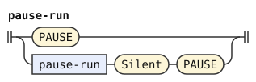</p>
<p>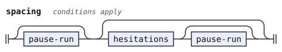</p>
<p>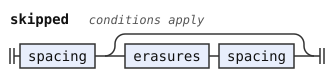</p>
<p>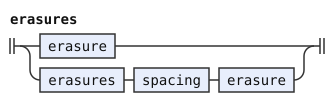</p>
<p>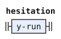</p>
<p>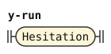</p>
<p>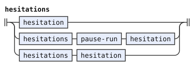</p>
</details>

## Words

The forms stage supplies source words, their lexical classes, and their run boundaries. A run is a stretch without a pause. This stage does not divide ordinary runs again.

The shared reader reads a cmavo, brivla, cmevla, or the y letteral. A cmavo is a particle. A brivla is a predicate word. A cmevla is a name word.

Every cmavo read uses `cmavo-token`. CLL is *The Complete Lojban Language*. The CLL family adds optional word-form warnings there. A word read in the chosen derivation keeps its warning even if an eraser later removes the word.

A failed words stage publishes no warnings from that stage. A successful stage keeps warnings from its chosen derivation. Raw quote bodies and the suffix after active `fa'o` supply no word reads.

The lexicon gives each cmavo its classes. Operators use these classes rather than spelling, except the punctuation restriction on `zei`. The experimental syntax can treat names as predicates without changing their lexical class.

The feature `sa-su` enables the two long-range erasers. The stage enables it when any input token has class SA or SU. If the condition holds and the caller disables `sa-su`, the parse gives a `feature-conflict` result ([engine §13](../../docs/engine.md#13-the-pipeline)).

```jbogenbau
%features sa-su
%conditions
  $.classes ∩ (SA SU) ≠ ∅
```

Without SA or SU input, both feature states admit the same plain words. The rule `word` therefore excludes every magic-word class in either state.

`$MAGIC-WORDS` lists the operation classes that an ordinary word cannot carry.

```jbogenbau
%const $MAGIC-WORDS
  ZO ∪ ZOI ∪ LOhU ∪ LEhU ∪ ZOhOI ∪ MEhOI ∪ FAhO ∪ BU ∪ ZEI ∪ SI ∪ SA ∪ SU

%rule read-word
  | $c:cmavo-token :: $c.tags
  | $b:BRIVLA :: $b.tags
  | $n:CMEVLA :: $n.tags
  | $y:y-bu-word :: $y.tags

%rule y-bu-word
  $b:y-key [pause-run] $u:bu-word
    :: Word ∪ BY ∪ Y-Letter ∪ $b.tags
     ∪ Run-Initial ∩ $b.first-token.tags ∪ Run-Final ∩ $u.last-token.tags
%emits
  $

%rule word
  $c:read-word :: $c.tags
%conditions
  $c.classes ∩ $MAGIC-WORDS = ∅,
  ¬$c.onward.begins(quote)
%emits
  $

%rule cmavo-token
  $c:Cmavo :: $c.tags
```

<details><summary>Railroad diagrams of <code>read-word</code>, <code>y-bu-word</code>, <code>word</code> and <code>cmavo-token</code></summary>
<p>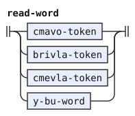</p>
<p>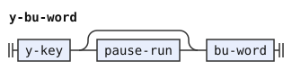</p>
<p></p>
<p>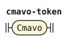</p>
</details>

## Quotes

Every complete quote is one opaque unit and emits one token. Later operations see its opening class and no class from its contents or closing marker. Indicators after it and BAhE before it mark the whole quote.

The token keeps the opening marker's class and the tags `Word` and `Cmavo`. Its image keeps the original spelling of the quoted material. An undelimited payload also keeps adjacent characters that no input token covers. The opening marker uses only its source text, so it takes no punctuation from the preceding word. Its value joins input token values, including FOREIGN decomposed source text, and the gap recipes below. The tree of the words stage retains the marker, contents, and closing delimiter.

Quoted Lojban keeps its written case instead of each word's normalized image. For example, `SINdarin` has image `sIndarin` alone, but `zo SINdarin` keeps its capitals.

The [Magic Words proposal](https://mw.lojban.org/papri/Magic_Words) says that `y` is not a word and counts as whitespace. Ordinary hesitation contributes no word or normalized value. The quote image keeps its written form, including `.y.` in `zo .y. coi` and `lo'u .y. coi le'u`.

The completed LOhU unit exposes LOhU alone to SA. LEhU closes the quote but supplies no later search target inside it. Replacement quotes and dialect quote kinds follow the same opacity rule.

```jbogenbau
%rule quote
  quoted-word | zoi-y-quote | zoi-quote | lohu-quote | single-word-quote
```

<details><summary>Railroad diagram of <code>quote</code></summary>
<p>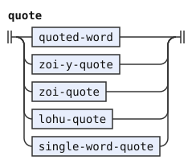</p>
</details>

### Shared word gaps

`word-gap` partitions a gap of ordinary hesitation and pauses. A quiet gap contributes no string. A gap with a surviving pause contributes `$PAUSE`, one space.

Quotes and the right operand of ZEI share this rule. It executes no erasure. Quotes use its empty route at their edges.

```jbogenbau
%rule quiet-gap
  | hesitation
  | quiet-gap hesitation

%rule pause-gap
  [quiet-gap] $p:pause-run [$h:hesitations [$q:pause-run]]
    :: ($p.tags ∪ ($h ⟹ $h.tags) ∪ ($q ⟹ $q.tags)) ∩ (Quote-Material ∪ Punctuation-Material) := $PAUSE

%rule word-gap
  ε | quiet-gap | pause-gap
```

<details><summary>Railroad diagrams of <code>quiet-gap</code>, <code>pause-gap</code> and <code>word-gap</code></summary>
<p>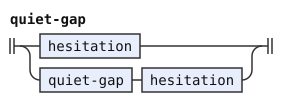</p>
<p>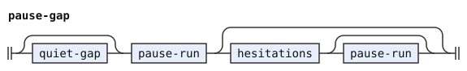</p>
<p>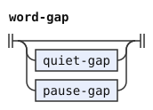</p>
</details>

### One-word quotes

ZO quotes one word from the shared reader or one literal punctuation stretch. Inside that quote, an eraser, compounder, or quote marker executes no operation. The reader still forms the y letteral.

`quoted-word` reads `word-gap` before its word. The gap cannot skip punctuation or ignored material. The gap supplies one space for surviving pauses, even when hesitation separates them.

```jbogenbau
%rule quoted-word
  | $m:word-quote-marker $g:word-gap $w:read-word
      :: $m.tags :- $m.source-text $g.source-text $w.verbatim-text
  | $m:word-quote-marker $g:word-gap $w:zo-punctuation
      :: $m.tags :- $m.source-text $g.source-text $w.verbatim-text
%conditions
  Quote-Material ⊈ $g.tags
%emits
  $

%rule zo-punctuation
  PAUSE<Quote-Material> := $.decomposed-source-text :- $.source-text

%rule word-quote-marker
  $q:read-word :: $q.classes ∪ Word ∪ Cmavo
%conditions
  ZO ⊆ $q.classes
```

<details><summary>Railroad diagrams of <code>quoted-word</code>, <code>zo-punctuation</code> and <code>word-quote-marker</code></summary>
<p>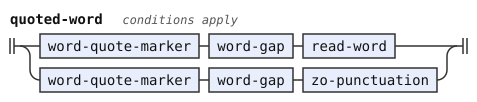</p>
<p>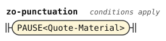</p>
<p></p>
</details>

### Single-run quotes

ZOhOI and MEhOI quote one raw stretch between whitespace or periods in the experimental dialect. A decimal point between digits stays inside its run. `zo'oi` and `la'oi` use ZOhOI, and `me'oi` uses MEhOI. Punctuation, ignored characters and attached brackets belong to the stretch. The body must end before a quiet pause or the input end.

`zohoi-gap` starts with a quiet pause and skips hesitation through `zohoi-hesitation`. It contributes one space, including pauses around erased hesitation.

The hesitation rule refuses a raw y letteral. In `zo'oi .y. bu`, the quote therefore takes the y run as its payload. BU then forms a letteral from the whole quote. The same rule keeps the prolonged run in `zo'oi .yyy. bu`.

```jbogenbau
%rule single-word-quote
  | $m:single-marker $r:zohoi-payload :: $m.tags :- $m.source-text $r.emitted.image
  | $m:single-marker $g:zohoi-gap $s:zohoi-payload
      :: $m.tags :- $m.source-text $g.source-text $s.emitted.image
%conditions
  ¬$r.following-tokens.begins(quote-run-token),
  ¬$s.following-tokens.begins(quote-run-token),
  Hesitation ⊈ $s.first-token.tags ∨ $s.first-token.onward.begins(raw-y-letter)
%emits
  $

%rule single-marker
  $q:read-word :: $q.classes ∪ Word ∪ Cmavo
%conditions
  $q.classes ∩ (ZOhOI ∪ MEhOI) ≠ ∅

%rule raw-y-letter
  raw-y-base [pause-run] bu-word

%rule zohoi-hesitation
  $h:y-run
%conditions
  ¬$h.onward.begins(raw-y-letter)
%erased

%rule zohoi-hesitations
  zohoi-hesitation | zohoi-hesitations [quote-gap-pauses] zohoi-hesitation

%rule zohoi-gap
  quote-gap-pauses [zohoi-hesitations [quote-gap-pauses]] := $PAUSE

%rule quote-gap-pauses
  {PAUSE<¬Quote-Material>} := $PAUSE
```

<details><summary>Railroad diagrams of the 7 rules from <code>single-word-quote</code> to <code>quote-gap-pauses</code></summary>
<p>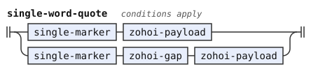</p>
<p></p>
<p>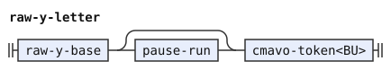</p>
<p>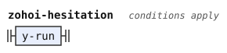</p>
<p>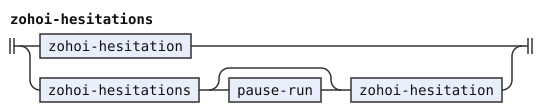</p>
<p>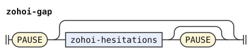</p>
<p>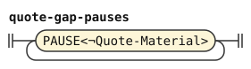</p>
</details>

### Delimited quotes

The ZOI words, `zoi` and `la'o`, skip hesitation and read the next real word as their opening delimiter. Hesitation never serves as a delimiter.

`delimiter-gap` partitions quiet and paused gaps. The quiet route contributes no string. The paused route contributes one space for the whole gap.

Both routes use `delimiter-hesitation`, which refuses the opening y letteral. This rule stays separate because Zantufa's ordinary hesitation also requires a spacing boundary.

The quotes close at the first matching whole raw run by exact value. Whitespace and periods bound these runs, except decimal points between digits. ZOI compares foreign runs by their exact values too.

The rule `zoi-y-quote` reads letteral delimiters formed from hesitation. Zantufa also forms such a delimiter from `ie'o`, as [zantufa.md](zantufa.md) describes. The rule `zoi-quote` reads other delimiters. Each rule includes empty and nonempty bodies.

Ordinary compounds cannot become delimiters because the marker reads the delimiter before a later compounder acts. An empty body contributes empty strings to the quote token. Punctuation tokens form a nonempty body and retain their source text. Quiet pauses delimit the body and the closing run.

```jbogenbau
%const $Y-PROPERTIES
  Word ∪ BY ∪ Y-Letter ∪ Run-Initial ∪ Run-Final

%rule zoi-y-quote :: $m.tags :- $.source-text
  | $m:zoi-marker delimiter-gap $open:delimiter PAUSE<¬Quote-Material> $content:zoi-body PAUSE<¬Quote-Material> $close:raw-close
  | $m:zoi-marker delimiter-gap $open:delimiter PAUSE<¬Quote-Material> $content:empty-zoi-body $close:raw-close
  | $m:zoi-marker delimiter-gap $open:delimiter PAUSE<¬Quote-Material> $content:silent-body quiet-pause $close:raw-close
%conditions
  Y-Letter ⊆ $open.tags,
  $open.tags ∖ $Y-PROPERTIES = $close.tags,
  $open.tags ∖ $Y-PROPERTIES ⊈ $content.tags(body-with-y-close)
%emits
  $

%rule zoi-quote :: $m.tags :- $.source-text
  | $m:zoi-marker delimiter-gap $open:delimiter PAUSE<¬Quote-Material> $content:zoi-body PAUSE<¬Quote-Material> $close:raw-close
  | $m:zoi-marker delimiter-gap $open:delimiter PAUSE<¬Quote-Material> $content:empty-zoi-body $close:raw-close
  | $m:zoi-marker delimiter-gap $open:delimiter PAUSE<¬Quote-Material> $content:silent-body quiet-pause $close:raw-close
%conditions
  Y-Letter ⊈ $open.tags,
  $open.value = $close.value,
  $open.value ∉ $content.value.split($PAUSE)
%emits
  $

%rule zoi-marker
  $q:read-word :: $q.classes ∪ Word ∪ Cmavo
%conditions
  ZOI ⊆ $q.classes

%rule delimiter
  $w:read-word
%conditions
  Y ⊈ $w.classes

%rule delimiter-gap
  | [delimiter-quiet-gap]
  | [delimiter-quiet-gap] pause-run [delimiter-hesitations [pause-run]] := $PAUSE

%rule delimiter-quiet-gap
  delimiter-hesitation | delimiter-quiet-gap delimiter-hesitation

%rule delimiter-hesitations
  delimiter-hesitation | delimiter-hesitations [pause-run] delimiter-hesitation

%rule delimiter-hesitation
  $h:y-run
%conditions
  ¬$h.onward.begins(y-bu-word)
%erased

%rule empty-zoi-body
  ε

%rule zoi-body
  | [silent-before] raw-tokens [silent-after]

%rule silent-before
  | Silent quiet-pause
  | silent-before Silent quiet-pause

%rule silent-after
  | quiet-pause Silent
  | silent-after quiet-pause Silent

%rule silent-body := ""
  | Silent
  | silent-body PAUSE Silent

%rule quiet-pause
  PAUSE := ""
```

<details><summary>Railroad diagrams of the 14 rules from <code>zoi-y-quote</code> to <code>quiet-pause</code></summary>
<p>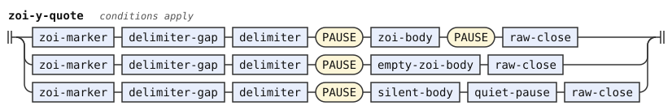</p>
<p>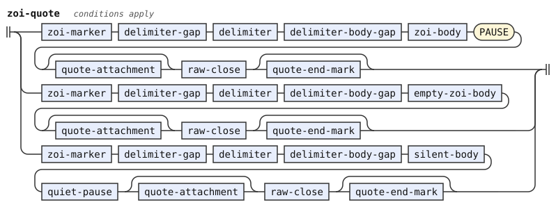</p>
<p>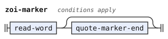</p>
<p>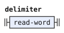</p>
<p>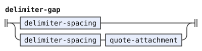</p>
<p>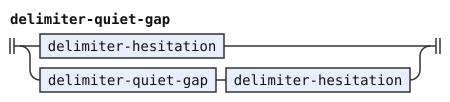</p>
<p>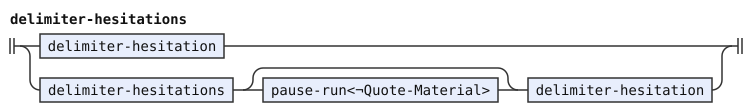</p>
<p>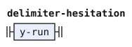</p>
<p>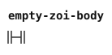</p>
<p>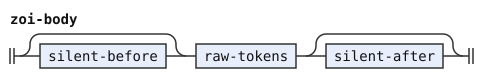</p>
<p>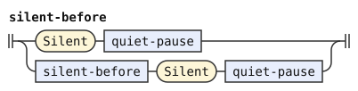</p>
<p>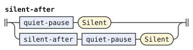</p>
<p>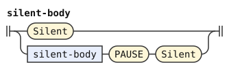</p>
<p>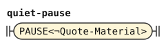</p>
</details>

### Closing delimiter runs

The y letteral can close on one `ybu` run or adjacent `y` and `bu` runs. The opening reader accepts both spellings. The closing test preserves adjacency and never joins the body into words.

Extra y sounds before the opening BU remain hesitation, even across a pause. The delimiter then sounds like ybu. A raw yybu or yyybu run cannot close it. Neither can a raw prolonged y run followed by BU.

Thus `zoi .yy. bu. foo .yy. bu.` fails, and `zoi .yy. bu. foo .y. bu.` succeeds. The opening reader drops extra y sounds, and the raw closing comparison keeps them.

The body remains raw and opaque. In `zoi bu. foo .y. bu.`, the final `bu` closes the quote. The preceding y remains body text.

The opening `y-key` uses `Y-Key` for value `y` and `Ieho` for value `ie'o`. The forms stage separates the last opening y from preceding hesitation. `raw-y-key` applies the same tests but keeps every raw y value. A longer run gets neither key tag, so it cannot close the delimiter.

The raw rule rejoins every piece of one y run. Its internal gap keeps ignored comma-like characters as spacing but excludes visible punctuation. Zantufa's [`ie'o` exception](zantufa.md) keeps each `ie'o` separate from adjacent hesitation. `$Y-PROPERTIES` lists the word marks that the closing-key comparison excludes.

```jbogenbau
%rule y-key
  $y:y-run :: ($y.value = "ie'o" ⟹ Ieho) ∪ ($y.value = "y" ⟹ Y-Key)

%rule raw-close
  raw-run | raw-y-close

%rule raw-run
  $r:raw-run-parts
%conditions
  ¬$r.following-tokens.begins(quote-run-token)

%rule raw-run-parts
  matched-close-token | raw-run-parts matched-close-token

%rule matched-close-token
  cmavo-token | payload-token<¬Cmavo>

%rule raw-y-close
  $y:raw-y-key [raw-y-gap] $b:matched-close-token :: $y.tags
%conditions
  $b.value = "bu",
  Run-Initial ⊆ $y.first-token.tags,
  ¬$b.following-tokens.begins(quote-run-token)

%rule raw-y-gap
  {PAUSE<¬Punctuation-Material>} := $PAUSE

%rule raw-y-base
  | y-run
  | $b:raw-y-base $h:y-run
%conditions
  $b.value ≠ "ie'o",
  $h.value ≠ "ie'o"

%rule raw-y-key
  $y:raw-y-base :: ($y.value = "ie'o" ⟹ Ieho) ∪ ($y.value = "y" ⟹ Y-Key)

%rule body-with-y-close :: $c.tags
  | $c:raw-y-close [raw-tokens]
  | [raw-tokens] PAUSE<¬Quote-Material> $c:raw-y-close [raw-tokens]
```

<details><summary>Railroad diagrams of the 10 rules from <code>y-key</code> to <code>body-with-y-close</code></summary>
<p>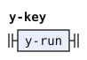</p>
<p>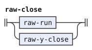</p>
<p>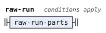</p>
<p></p>
<p></p>
<p></p>
<p></p>
<p></p>
<p></p>
<p></p>
</details>

### Ungrammatical quotes

A LOhU quote ends at the first LEhU. Its body reads Lojban words through the shared reader without executing operations. No magic word acts there, including BU, ZEI, and FAhO. A foreign run makes the quote fail.

`lohu-stream` separates paused, quiet, and absent gaps, so each gap has one reading. The shared gap rules execute no eraser inside the quote.

```jbogenbau
%rule lohu-quote :: $m.tags :- $.source-text
  | $m:lohu-marker word-gap lohu-stream word-gap lehu-marker
  | $m:lohu-marker word-gap lehu-marker
%emits
  $

%rule lohu-marker
  $q:read-word :: $q.classes ∪ Word ∪ Cmavo
%conditions
  LOhU ⊆ $q.classes
%emits
  $

%rule lehu-marker
  $q:read-word :: $q.classes ∪ Word ∪ Cmavo
%conditions
  LEhU ⊆ $q.classes
%emits
  $ :: LEhU

%rule lohu-stream
  | lohu-word
  | lohu-stream pause-gap lohu-word
  | lohu-stream quiet-gap lohu-word
  | lohu-stream lohu-word

%rule lohu-word
  $w:read-word
%conditions
  LEhU ⊈ $w.classes
%emits
  $ :: Word
```

<details><summary>Railroad diagrams of the 5 rules from <code>lohu-quote</code> to <code>lohu-word</code></summary>
<p></p>
<p></p>
<p></p>
<p></p>
<p></p>
</details>

### Raw payloads

`raw-tokens` and `zohoi-payload` concatenate input token values, including FOREIGN values from decomposed source text. Delimited quotes take their images from their whole source intervals.

Only `zohoi-payload` defines a body image recipe. Its `.verbatim-text` preserves raw spelling and adjacent uncovered characters. The single-run quote reads that recipe through `.emitted.image`. Queries and erased post-FAhO bodies run no body recipes.

```jbogenbau
%rule raw-tokens
  | any-token
  | raw-tokens any-token

%rule zohoi-payload :- $.verbatim-text
  | quote-run-token
  | zohoi-payload quote-run-token

%rule quote-run-token
  payload-token | Silent

%rule any-token
  payload-token | PAUSE<¬Quote-Material> | Silent

%rule payload-token
  | Word | Hesitation | FOREIGN
  | PAUSE<Quote-Material> := $.decomposed-source-text :- $.source-text
```

<details><summary>Railroad diagrams of the 5 rules from <code>raw-tokens</code> to <code>payload-token</code></summary>
<p></p>
<p></p>
<p></p>
<p></p>
<p></p>
</details>

## Compounds

BU takes the preceding live unit and forms one letteral. ZEI takes that unit and the next word as read, then forms one BRIVLA unit.

The right word of ZEI executes no operation. Thus `.abu zei bu` has a literal BU operand. In `da zei de bu`, the final BU takes the completed compound.

The constructors can repeat and combine without exposing their operands. Each result keeps any fault of its base. SI erases the complete result as one unit.

Erased regions and ordinary hesitation can separate an operand from its operator. The compound's value and image omit these regions. Its text retains the original source span, including erased words. Their warnings still belong to the chosen derivation.

`compound-gap` reads erased regions through `skipped`. Complementary `Gap-Pause` tests contribute one space or no string. `zei-right-gap` supplies the gap before ZEI's right word without executing erasure. ZEI rejects `Punctuation-Material` in both gaps. Ignored comma-like characters remain spacing.

`Trailing-Pause` marks a surviving SU boundary whose strings already end with a space. BU and ZEI then use `suppressed-gap` to avoid a second contribution. [Erasure by `sa` and `su`](#erasure-by-sa-and-su) explains that boundary and its recipes.

cll-ebnf requires pauses around a direct name base of BU. It tests the source run boundary. A name inside a compound does not make that compound a direct name.

```jbogenbau
%rule compound-gap
  | skipped<¬Gap-Pause>
  | skipped<Gap-Pause> := $PAUSE

%rule suppressed-gap
  skipped := ""

%rule lerfu-word :: Word ∪ BY ∪ Fault ∩ $u.tags
  | $u:unit<¬Trailing-Pause> compound-gap bu-word
  | su-boundary? $u:unit<Trailing-Pause> suppressed-gap bu-word
%emits
  $

%rule bu-word
  $q:cmavo-token
%conditions
  BU ⊆ $q.classes

%rule zei-compound :: Word ∪ BRIVLA ∪ Fault ∩ $l.tags
  | $l:unit<¬Trailing-Pause> zei-left-gap zei-word zei-right-gap $r:read-word
  | su-boundary? $l:unit<Trailing-Pause> zei-suppressed-gap zei-word zei-right-gap $r:read-word
%emits
  $

%rule zei-right-gap
  $g:word-gap
%conditions
  Punctuation-Material ⊈ $g.tags

%rule zei-left-gap
  $g:compound-gap
%conditions
  Punctuation-Material ⊈ $g.tags

%rule zei-suppressed-gap
  $g:suppressed-gap
%conditions
  Punctuation-Material ⊈ $g.tags

%rule zei-word
  $q:cmavo-token
%conditions
  ZEI ⊆ $q.classes
```

<details><summary>Railroad diagrams of the 9 rules from <code>compound-gap</code> to <code>zei-word</code></summary>
<p></p>
<p></p>
<p></p>
<p></p>
<p></p>
<p></p>
<p></p>
<p></p>
<p></p>
</details>


## Erasure by `si`

SI erases the preceding live unit. Quotes and compounds each count as one unit. A run of SI removes that many units and then does nothing on an empty stream.

SI skips hesitation and erased regions. It never erases an already executed SA or SU as a word. A fault unit is an ordinary operand for erasure.

When the word `zei` has class SI, it also refuses punctuation in its following gap. Other SI words keep their ordinary spacing.

```jbogenbau
%rule si-erasure
  unit skipped si-word
%erased

%rule si-word
  $q:cmavo-token
%conditions
  SI ⊆ $q.classes,
  $q.value ≠ "zei" ∨ ¬$q.following-tokens.begins(punctuation-word-gap)

%rule zei-spelling
  Cmavo
%conditions
  $.value = "zei"

%rule punctuation-word-gap
  word-gap<Punctuation-Material>
```

<details><summary>Railroad diagrams of the 4 rules from <code>si-erasure</code> to <code>punctuation-word-gap</code></summary>
<p></p>
<p></p>
<p></p>
<p></p>
</details>


## Erasure by `sa` and `su`

SA reads its key from the next word before that word executes. It erases through the nearest preceding unit whose class matches that key. The next word stays and then executes normally.

The key of `sa .ebu` is the class of `.e`. BU has not yet formed that letteral. A letteral has class BY, so `sa bu` finds no BU inside it.

A cmavo missing from the lexicon has no class and matches no unit, even the same spelling. SA with such a key erases everything before it.

With no matching unit, SA erases everything before it. Thus `mi bu sa bu` removes the letteral and leaves a dangling BU fault. A later eraser can remove that fault.

Counted SA selects the second-nearest match for two markers, the third-nearest for three, and so on. The grammar nests one reach per marker. Too few matches erase the whole prefix.

SA at normal end has no key and erases back to the start of the text. SA before active FAhO uses FAhO as its key, erases the prefix, and then ends the text.

A reach is the stretch from a candidate unit to SA. Its tags keep classes of its first unit that no later live unit shares. Thus a surviving class identifies the nearest candidate for that key. Each nested SA intersects the possible target classes from its reaches. The rule `sa-wipe-core` handles too few matching units. No reach searches inside a quote or compound.

In cll-ebnf, bpfk, and experimental, SU erases back to the last surviving word of NIhO, LU, TUhE, or TO. That word survives. Later LIhU, TOI, and TUhU do not cancel an earlier boundary. In Zantufa, SU erases everything before it.

The feature `su-boundary` makes SU keep its stopping boundary. A boundary inside an opaque unit cannot stop SU. With no boundary, SU erases the whole prefix. When a boundary survives SU, the grammar groups both into one unit. Thus `unit` includes `su-survivor`.

`su-survivor` keeps its base's emitted strings when a compound covers the survivor. If its skipped tail has a surviving pause, it adds one space and introduces `Trailing-Pause`. `unit` forwards that mark. BU and ZEI suppress their next gap contribution when their left unit carries it, then end the mark. The suppressed gap keeps its structure and erasure ownership.

The survivor has no emission clause, so a standalone survivor forwards only its base token. Its trailing recipe acts inside a covering compound. In cll-ebnf, bpfk, and experimental, `ni'o su bu` has one space, and `ni'o subu` retains the earlier surviving space.

These examples show the target choice. `le broda le brode sa le` leaves `le broda le`. `le broda le brode sa sa le` leaves `le`. `mi bu sa bu` fails. `broda sa` leaves nothing.

The rule `sa-key` refuses an SA key because a run of SA forms one counted erasure. The rule `next-word-class` tests the whole remaining span through `$.following-tokens.tags(next-word-class)`. Its optional `raw-tokens` reads everything after the key, including material after FAhO ([notation, Conditions](../../docs/notation.md#conditions)). The rule reads those tokens without word operations, as quote bodies and the active FAhO suffix do.

```jbogenbau
%rule sa-erasure
  $s:sa-nest spacing $k:sa-key
%conditions
  $s.classes ∩ $k.tags ≠ ∅
%erased

%rule sa-nest
  | $u:sa-open spacing sa-word :: $u.classes
  | $u:sa-open spacing $n:sa-nest spacing sa-word :: $u.classes ∩ $n.classes
%conditions
  $u.classes ≠ ∅,
  $u.classes ∩ $n.classes ≠ ∅

%rule sa-open
  | $u:unit :: $u.classes
  | $s:sa-open spacing $u:unit :: $s.classes ∖ $u.classes
  | $s:sa-open spacing erasure :: $s.classes
%conditions
  $.classes ≠ ∅

%rule sa-key
  ε :: $.following-tokens.tags(next-word-class)
%conditions
  SA ⊈ $.tags

%rule next-word-class
  spacing $w:read-word [raw-tokens] :: $w.classes ∪ Has-Word

%rule sa-word
  $q:cmavo-token
%conditions
  SA ⊆ $q.classes

%rule sa-run
  sa-word | sa-run spacing sa-word

%rule sa-run-twice
  sa-word spacing sa-run

%rule sa-wiped
  | empty sa-run spacing $k:sa-key
  | $s:stream spacing sa-run spacing $k:sa-key
  | empty $n:sa-wipe-core spacing $k:sa-key
  | $s:stream spacing $n:sa-wipe-core spacing $k:sa-key
%conditions
  Has-Word ⊆ $k.tags,
  $s.classes ∩ $k.tags = ∅,
  $n.classes ∩ $k.tags ≠ ∅
%erased

%rule sa-wipe-core
  | $u:sa-open spacing sa-run-twice :: $u.classes
  | $u:sa-open spacing $n:sa-wipe-core spacing sa-word :: $u.classes ∩ $n.classes
%conditions
  $u.classes ∩ $n.classes ≠ ∅

%const $SU-STOPS
  NIhO ∪ LU ∪ TUhE ∪ TO

%rule su-survivor := $b.emitted.value :- $b.emitted.image
  | sa-su? su-boundary? $b:unit<Trailing-Pause> skipped su-suffix :: $b.tags
  | sa-su? su-boundary? $b:unit<¬Trailing-Pause> skipped<Gap-Pause> su-suffix
      :: $b.tags ∪ Trailing-Pause := $b.emitted.value $PAUSE :- $b.emitted.image $PAUSE
  | sa-su? su-boundary? $b:unit<¬Trailing-Pause> skipped<¬Gap-Pause> su-suffix :: $b.tags
%conditions
  $b.classes ∩ $SU-STOPS ≠ ∅

%rule su-suffix
  | su-word
  | su-reach spacing su-word
%erased

%rule su-reach
  | unit<¬$SU-STOPS>
  | su-reach spacing unit<¬$SU-STOPS>
  | su-reach spacing erasure

%rule su-word
  $q:cmavo-token
%conditions
  SU ⊆ $q.classes
```

<details><summary>Railroad diagrams of the 14 rules from <code>sa-erasure</code> to <code>su-word</code></summary>
<p></p>
<p></p>
<p></p>
<p></p>
<p></p>
<p></p>
<p></p>
<p></p>
<p></p>
<p></p>
<p></p>
<p></p>
<p></p>
<p></p>
</details>


## Choosing among parses

The stage uses lazy ambiguity resolution. It compares the first structural difference and favors closing a constituent over another token. The rules exclude readings that violate left-to-right operations.

The forms stage fixes ordinary word boundaries before this stage. The shared reader forms the y letteral when an operation requests a word. The stage adds no normalization step.

## Departures from CLL, Magic Words, and the reference parsers

### CLL and Magic Words

The dialects follow the [Magic Words proposal](https://mw.lojban.org/papri/Magic_Words) with the departures below. The dialects keep units opaque where that proposal exposes internal markers.

CLL describes erasure,[^cll-s19-13] hesitation,[^cll-s19-14] FAhO,[^cll-s19-15] and their interactions.[^cll-s19-16] These sections do not specify one complete processing order.

The dialects use eight departures from CLL.[^cll-c19] Items 2, 4, and 8 differ in Zantufa. There ZEI erases, and hesitation attached to a word has class Y ([zantufa-stream.md](zantufa-stream.md)).

1. SI, BU, and ZEI each take a whole quote or compound as one unit. The CLL examples[^cll-e19-77][^cll-e19-79] count quotation markers and contents separately. CLL[^cll-s19-16] defines BU and ZEI by the preceding word, and CLL[^cll-s17-4] limits BU to one word.
2. ZEI takes any next word as its right operand. CLL[^cll-s19-16] excludes several magic words from that interaction.
3. BU forms a letteral over BAhE. CLL[^cll-s17-4][^cll-s19-16] exclude BAhE as a BU base.
4. Ordinary hesitation counts as space, not a word. CLL[^cll-s19-14] gives y the class Y and requires pauses before and after `.y.`. These dialects drop the following pause because they treat `y` as whitespace, as the Magic Words proposal does. That proposal states no pause rule. Only the shared reader forms the y letteral.
5. LOhU closes at the first LEhU. CLL[^cll-s19-16] excludes a LEhU after ZO, and CLL permits a ZOI quote inside LOhU.[^cll-s19-10]
6. ZOI compares whole raw runs by exact stored values, including FOREIGN values from decomposed source text. The CLL examples[^cll-e19-50][^cll-e19-51] instead forbid the delimiter's spelling or sound inside a longer run.
7. Every finished quote emits one token, with indicators after it and BAhE before it marking the whole quote. The Magic Words proposal names whole quotes as attitudinal targets. In camxes-std, the quote clauses take `pre_clause` before the quote and `post_clause` after it. This policy also applies to the newer quote kinds. CLL[^cll-s19-16] says that UI marks the previous word and BAhE the following word. In `zo coi ui` and `ba'e zo coi`, those words are `coi` and `zo`.

8. Except in Zantufa, SU erases back to the last surviving word of NIhO, LU, TUhE, or TO. That word survives. Later LIhU, TOI, and TUhU do not cancel an earlier boundary. Magic Words and camxes-std name these boundaries. The dialects keep the boundary word, as camxes-std does. Its [`su_word`](https://github.com/lojban/ilmentufa/blob/778ea138f7d150121ca722db7536ce3b123943ac/camxes.peg#L402) excludes `NIhO_clause`, `LU_clause`, `TUhE_clause`, and `TO_clause`.

   CLL[^cll-s19-13] says that SU "erases the entire text". A stop at an open LU or TO agrees with CLL's `LU text` and `TO text`[^cll-c21]. CLL[^cll-s19-15] names these subordinate texts. A closed LU or TO is one that a later LIhU or TOI closed. A stop at a closed LU or TO follows Magic Words and camxes-std alone.

   So does every NIhO and TUhE stop. The stops at a closed LU or TO and the NIhO and TUhE stops depart from CLL[^cll-s19-13] under any reading.

In cll-ebnf, bpfk, and experimental, `mi klama lu mi su do li'u` gives `(mi [klama {lu do li'u}])`. SU erases `mi` after `lu` and keeps the quote opener and the outer text.

In cll-ebnf, bpfk, and experimental, `mi klama lu do cadzu li'u su broda` gives `(mi [klama {lu broda}])`. SU erases `li'u` and the other words after `lu`.

The [proposal's BU page](https://mw.lojban.org/papri/bu) lets SA BU reach inside a letteral. Its main page marks this interpretation controversial. These dialects instead keep the letteral opaque. SA ZEI likewise finds no ZEI inside a compound.

The [Tiki copy of Magic Words](https://www.lojban.org/tiki/Magic+Words) strikes out "ZEI+BU grabs back to the last ZEI". Its ZEI paragraph instead lets SA before a brivla consume a whole ZEI clause. This grammar permits no search inside a compound.

The proposal also exposes a completed LOhU quote's LEhU ending to SA. These dialects expose only the opening class. A constructor keeps the unopened-quote fault. `le'u bu` still fails, and `le'u bu si` is empty.

A dangling BU is also a fault unit that BU or ZEI can wrap. An eraser can remove the result, so `bu zei klama si` leaves nothing. The proposal's BU page instead forbids ZEI to bind a dangling BU on its left.

### Erasure in camxes and the dialects

camxes-std, the standard grammar of the camxes parser, follows the grammatical reading of CLL[^cll-s19-13], without a class key. SA erases back to the start of a construct that the following words continue. Such a construct can be a term or sentence. camxes-std applies this rule unevenly. It accepts `broda sa broda` but rejects `lo broda sa broda`.

A run of letterals forms one camxes sumti, an argument of a predicate. Thus `by cy sa .ebu` erases both letters. In `by boi cy sa .ebu`, BOI ends the first sumti, so SA keeps `by`. `mi do sa ti` keeps `mi`, and `mi broda le brode sa ti` gives `mi broda ti`.

camxes-std reads `sa sa` as one SA. It rejects a trailing SA and an SA with no construct before it. Thus it rejects `mi do sa brodi`, `sa broda`, and `broda sa`. It also rejects `bu si` and `.abu sa bu`.

It rejects `mi ni'o do su si`, which cll-ebnf, bpfk, and experimental reduce to `mi`.

These dialects instead use the next word's class and select the nearest matching unit. Counted SA selects successively earlier matches. A trailing SA clears the text, as the `bu sa` row of the proposal's BU page specifies. The opaque-unit rule keeps `.abu sa bu` rejected in cll-ebnf, bpfk, and experimental.

Zantufa gives SA class UI, so it performs no SA erasure.

In cll-ebnf, bpfk, and experimental, SU erases back to the last surviving word of NIhO, LU, TUhE, or TO. The boundaries come from Magic Words and camxes-std. The boundary word survives as in camxes-std. Later LIhU, TOI, and TUhU do not cancel an earlier boundary. [Departure 8](#cll-and-magic-words) says which stops agree with CLL and which depart from it. Zantufa erases the whole preceding text, as its reference grammar specifies.

### Final markers and Zantufa exceptions

The dialects keep `mi ba'e fa'o` rejected. The stranded BAhE cannot mark a word after FAhO ends the text. Both camxes-std and camxes-exp, the standard and experimental camxes grammars, accept it. Their `FAhO_clause` absorbs BAhE through `pre_clause` ([standard](https://github.com/lojban/ilmentufa/blob/778ea138f7d150121ca722db7536ce3b123943ac/camxes.peg#L620), [experimental](https://github.com/lojban/ilmentufa/blob/778ea138f7d150121ca722db7536ce3b123943ac/camxes-exp.peg)).

Zantufa retains its reference parser's quote-first fallback and SU-before-BU letter-base exception. [The dialect document](../dialects/zantufa.md) defines both exceptions.

The raw one-word quotes retain punctuation and ignored characters instead of skipping them as spacing. This follows camxes-exp for `:)`, `#` and attached brackets.

Unlike camxes-exp's `non_space`, raw quotes here also keep `?` and `!` inside a raw stretch. Both are punctuation material under the shared Latin conventions.

A decimal point between digits stays inside a raw run, as [latin.md](../phonemes/latin.md) specifies. This keeps numeric spellings intact.

ZO can quote literal punctuation instead of moving to a later word. This extends the shared reader because punctuation has no ordinary word class.

The word `zei` rejects surviving punctuation on either side, even when its class is SI. Other SI words retain their punctuation spacing. Ignored comma-like characters remain spacing for ZEI. This preserves the punctuation restriction across dialect lexicons.

[^cll-s19-16]: [CLL 1.1, section 19.16](https://lojban.org/publications/cll/cll_v1.1_xhtml-section-chunks/section-cmavo-interactions.html).

[^cll-s17-4]: [CLL 1.1, section 17.4](https://lojban.org/publications/cll/cll_v1.1_xhtml-section-chunks/section-bu.html).

[^cll-s19-14]: [CLL 1.1, section 19.14](https://lojban.org/publications/cll/cll_v1.1_xhtml-section-chunks/section-hesitation.html).

[^cll-s19-13]: [CLL 1.1, section 19.13](https://lojban.org/publications/cll/cll_v1.1_xhtml-section-chunks/section-erasure.html).

[^cll-e19-77]: [CLL 1.1, section 19.13, example 19.77](https://lojban.org/publications/cll/cll_v1.1_xhtml-section-chunks/section-erasure.html#c19e13d3).

[^cll-e19-79]: [CLL 1.1, section 19.13, example 19.79](https://lojban.org/publications/cll/cll_v1.1_xhtml-section-chunks/section-erasure.html#c19e13d5).

[^cll-e19-50]: [CLL 1.1, section 19.10, example 19.50](https://lojban.org/publications/cll/cll_v1.1_xhtml-section-chunks/section-more-quotations.html#c19e10d3).

[^cll-e19-51]: [CLL 1.1, section 19.10, example 19.51](https://lojban.org/publications/cll/cll_v1.1_xhtml-section-chunks/section-more-quotations.html#c19e10d4).

[^cll-s19-15]: [CLL 1.1, section 19.15](https://lojban.org/publications/cll/cll_v1.1_xhtml-section-chunks/section-faho.html).

[^cll-s19-10]: [CLL 1.1, section 19.10](https://lojban.org/publications/cll/cll_v1.1_xhtml-section-chunks/section-more-quotations.html).

[^cll-c21]: [CLL 1.1, chapter 21](https://lojban.org/publications/cll/cll_v1.1_xhtml-section-chunks/chapter-grammars.html).

[^cll-c19]: [CLL 1.1, chapter 19](https://lojban.org/publications/cll/cll_v1.1_xhtml-section-chunks/chapter-structure.html).
