# Zantufa word forms

This document is part of the forms stage in the [Zantufa](../dialects/zantufa.md) dialect. The forms stage follows normalization. It divides the phonemes of the text into words. The loader stitches this document into the stage after [bpfk.md](bpfk.md).

The prose uses these Lojban terms for words:

- A cmavo is a particle, a short structure word.
- A gismu is a root word.
- A lujvo is a compound word.
- A rafsi is a shortened word form used inside compounds.

Zantufa 1.9999 reads the working word forms of the BPFK, the Lojban language planning committee, with three changes. This document makes them:

- It permits the consonant pair `mz`.
- It reads `ie'o` as hesitation, as it reads `y`.
- It divides the letters after `ra'oi` into the rafsi or gismu form that `ra'oi` quotes.

The rule `m` has the name of the Zantufa rule that it translates, and its comment gives that rule, as in bpfk.md. Where another rule states a Zantufa rule, its comment gives that rule. The rest are rules of [forms.md](forms.md) that this document changes, or rules that support them. [The notation document](../../docs/notation.md) explains the notation.

## The pair mz

A diphthong combines two vowels in one syllable. A nucleus is a syllable's vowel or diphthong. A glide is an `i` or `u` before a nucleus. The rule for `m` rejects a following apostrophe, glide or `m`, but permits `z`. Thus `kamzi`, `bamzda` and `.djeimz.` have permissible consonant pairs.

```jbogenbau
%redefine-rule m              (* m <- [mM] !h !glide !m *)
  $c:"m"
%conditions
  ¬$c.following-tokens.begins(h),
  ¬$c.following-tokens.begins(glide),
  ¬$c.following-tokens.begins(m)
```

<details><summary>Railroad diagram of <code>m</code></summary>
<p>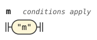</p>
</details>

## Hesitation and space

Zantufa's Y is `y` and `ie'o`, and its `spaces` read both as space. So `ie'o` is hesitation here, as `y` is. The word stage is the stage after the forms stage. It drops the hesitation where it is space, and reads it as the base of a letter word before `bu`. A Y word attached to a word before it is not space ([zantufa-stream.md](zantufa-stream.md)). It keeps the form of a cmavo, so the pause rules hold for it as for any cmavo.

```jbogenbau
%redefine-rule source-word
  (* spaces <- !Y initial_spaces;  initial_spaces <- (space_char / !ybu Y)+ EOF? / EOF;  Y <- &cmavo ( y+ / i e h o ) &post_word *)
  | $c:cmavo-shape :: Word ∪ Cmavo ∪ $c.tags ∪ $c.value.classify(lexicon)
  | $y:cmavo-shape :: Hesitation ∪ $y.tags
  | $b:brivla-shape :: Word ∪ BRIVLA ∪ $b.tags
  | $n:cmevla-shape :: Word ∪ CMEVLA ∪ $n.tags
  | $h:hesitation-shape :: Hesitation ∪ Y-Letters ∪ $h.tags
%conditions
  Y ⊈ $c.value.classify(lexicon),
  Y ⊆ $y.value.classify(lexicon)
```

<details><summary>Railroad diagram of <code>source-word</code></summary>
<p>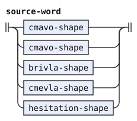</p>
</details>

## The ra'oi quote

`ra'oi` quotes a rafsi or gismu form from the letters after it, and the stage reads the rest of the run as words. The stage tries the forms in the order of Zantufa: `y_rafsi / long_rafsi / y_less_rafsi / gismu`. The forms decide with their stress. So `ra'oi broda` quotes the gismu `broda`, because its `o` is stressed before the pause, but `ra'oi brodami` quotes the rafsi `brod` and leaves `a` and `mi`. The form can follow `ra'oi` directly, as in `ra'oibroda`, or after a pause and any hesitation, as in `ra'oi .y. broda`. A run can hold several such quotes, as `ra'oi brodyra'oibroda` does.

The stage hands the form on as one token, tagged `Rafsi-Form`, and the word stage makes the quote. A token is one unit that a stage reads or emits. A tag marks a token by an identifier. Where no such form follows, `ra'oi` is an ordinary word, as in Zantufa's `si_word`, so `ra'oi bu` is a letter word. The word stage rejects `ra'oi do`.

A word of LU, TO or LUhEI opens a text of its own. The hesitation after such a word can be space, which the stage tags `Opener-Space` below. The constant `$TEXT-OPENERS` lists these classes. The word stage defines the same constant, because a constant belongs to its stage ([zantufa-stream.md](zantufa-stream.md)).

```jbogenbau
%const $TEXT-OPENERS
  LU ∪ TO ∪ LUhEI
```

This document extends the rule `word-run` of forms.md to read a run in which a form follows `ra'oi`, as in `mira'oibroda`. So `unsegmentable-run` of forms.md never takes such a run.

The redefined `run-words` keeps the conditions of [forms.md](forms.md) on a join. The first of them follows from the second, but it lets the parser drop a join early, as forms.md explains.

```jbogenbau
%redefine-rule runs
  | $r:run :: $r.tags
  | $p:runs pause-token $r:run :: $r.tags ∪ (RAhOI ⊆ $p.tags ∧ $r.matches(only-hesitation) ⟹ RAhOI)
  | $q:runs pause-token $s:rahoi-rest :: $s.tags
%conditions
  RAhOI ⊈ $p.tags ∨ ¬$r.matches(rahoi-rest),
  RAhOI ⊆ $q.tags

%extend-rule word-run
  run-words<RAhOI> $s:rahoi-rest :: $s.tags

%redefine-rule run-words
  | $f:first-word :: $f.tags ∪ (Hesitation ⊆ $f.tags ⟹ Spacing)
  | $r:run-words $v:later-word
      :: $v.tags ∪ (Uncounted ⊆ $v.tags ⟹ Open-Stress ∩ $r.tags)
  | $s:run-words $y:joined-hesitation :: $y.tags
  | $t:run-words $u:space-hesitation :: $u.tags ∪ Spacing
  | $q:run-words $x:space-piece :: $x.tags ∪ Spacing ∪ After-Hesitation
  | $o:run-words $n:opener-space :: $n.tags ∪ Opener-Space
%conditions
  Y-Letters ⊆ $s.tags,
  (Spacing ∪ Opener-Space) ∩ $s.tags = ∅,
  Spacing ⊆ $q.tags,
  Y-Letters ⊆ $q.tags,
  Spacing ⊆ $t.tags,
  Opener-Space ⊆ $o.tags ∨ $o.classes ∩ $TEXT-OPENERS ≠ ∅,
  Y-Letters ⊈ $t.tags ∨ Y-Letters ⊈ $u.tags,
  Y-Letters ⊈ $r.tags ∨ Y-Letters ⊈ $v.tags,
  Hesitation ⊈ $v.tags ∨ (Spacing ∪ Opener-Space) ∩ $r.tags = ∅ ∧ $r.classes ∩ $TEXT-OPENERS = ∅,
  RAhOI ⊈ $r.tags ∨ ¬$v.onward.begins(rahoi-form),
  (Continued ∪ Cy ∪ Name-Intro ∪ Open-Stress) ∩ $r.tags ≠ ∅,
  Cy ⊆ $r.tags ∧ Cy ⊆ $v.tags
    ∨ Continued ⊆ $r.tags ∧ Onset ⊆ $v.tags
    ∨ Name-Intro ⊆ $r.tags ∧ Name-Onset ⊆ $v.tags
    ∨ Open-Stress ⊆ $r.tags ∧ Cy ⊈ $r.tags ∧ Onset ⊆ $v.tags,
  Final-Stress ⊈ $r.tags ∨ (Stress-Guard ∪ Initial-Stress) ∩ $v.tags = ∅,
  Open-Stress ⊈ $r.tags ∨ Uncounted ⊆ $v.tags

%rule rahoi-rest
  | $p:rahoi-form :: ∅
  | rahoi-form $w:rahoi-tail :: $w.tags
  | rahoi-form $v:rahoi-tail $s:rahoi-rest :: $s.tags
  | $h:run-words $t:rahoi-rest :: $t.tags
%conditions
  RAhOI ⊆ $v.tags,
  $h.matches(only-hesitation)

%rule rahoi-tail
  (* the words after a ra'oi form in its run: the first of them does not begin the run *)
  | $v:later-word :: $v.tags
  | $r:rahoi-tail $v:later-word :: $v.tags
  | $s:rahoi-tail $y:joined-hesitation :: $y.tags
  | $o:rahoi-tail $n:opener-space :: $n.tags ∪ Opener-Space
%conditions
  RAhOI ⊈ $r.tags ∨ ¬$v.onward.begins(rahoi-form),
  Y-Letters ⊈ $r.tags ∨ Y-Letters ⊈ $v.tags,
  Hesitation ⊈ $v.tags ∨ Opener-Space ⊈ $r.tags ∧ $r.classes ∩ $TEXT-OPENERS = ∅,
  Y-Letters ⊆ $s.tags,
  Opener-Space ⊈ $s.tags,
  Opener-Space ⊆ $o.tags ∨ $o.classes ∩ $TEXT-OPENERS ≠ ∅

%rule space-hesitation
  (* initial_spaces <- (space_char / !ybu Y)+ EOF? / EOF: after space, every Y word is space *)
  $w:source-word<Hesitation>
%emits
  $ :: $w.tags ∪ Spacing ∪ (¬$w.following-tokens.begins(nonpause-phoneme) ⟹ Run-Final)

%rule opener-space
  (* a hesitation after a text opener, or after such a hesitation: space if that word opens a text *)
  $w:source-word<Hesitation>
%emits
  $ :: $w.tags ∪ Opener-Space ∪ (¬$w.following-tokens.begins(nonpause-phoneme) ⟹ Run-Final)

%rule space-piece
  ordinary-space-piece | split-later-y

%rule ordinary-space-piece
  (* the next piece of one run of y letters inside space *)
  $w:source-word<Y-Letters>
%conditions
  ¬$w.onward.begins(split-later-y)
%emits
  $ :: $w.tags ∪ Spacing ∪ After-Hesitation ∪ (¬$w.following-tokens.begins(nonpause-phoneme) ⟹ Run-Final)

%rule only-hesitation
  (* spaces? after RAhOI: a run that is only hesitation, which passes RAhOI on to the run after it *)
  first-word<Hesitation> | only-hesitation later-word<Hesitation> | only-hesitation joined-hesitation

%rule rahoi-form
  (* RAhOI_pre <- pre_clause RAhOI spaces? (y_rafsi / long_rafsi / y_less_rafsi / gismu) spaces? *)
  | y-rafsi
  | $l:long-rafsi
  | $s:y-less-rafsi
  | $g:gismu
%conditions
  ¬$l.onward.begins(y-rafsi),
  ¬$s.onward.begins(long-rafsi),
  ¬$g.onward.begins(y-rafsi),
  ¬$g.onward.begins(long-rafsi),
  ¬$g.onward.begins(y-less-rafsi)
%emits
  $ :: Rafsi-Form ∪ (¬$.following-tokens.begins(nonpause-phoneme) ⟹ Run-Final)
```

<details><summary>Railroad diagrams of the 11 rules from <code>runs</code> to <code>rahoi-form</code></summary>
<p>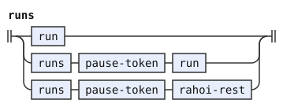</p>
<p>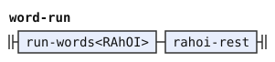</p>
<p>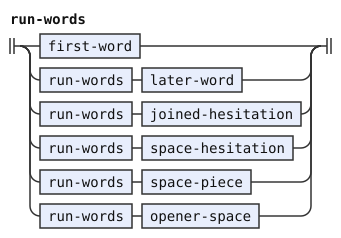</p>
<p>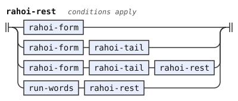</p>
<p>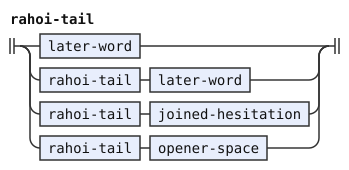</p>
<p>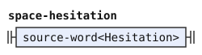</p>
<p>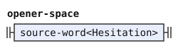</p>
<p>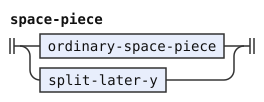</p>
<p>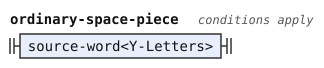</p>
<p>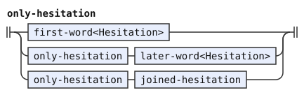</p>
<p>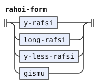</p>
</details>

## Divided hesitation

The BPFK word forms divide an odd run of three or more `y` into `y` and the remainder.

The stage tags `After-Hesitation` a run of `y` that directly follows another run of `y`. The word stage derives space behavior from `Spacing` and its `Y-Letters` test.

Before BU, the forms stage separates the final y from the hesitation prefix. The shared word reader joins that final y with BU. Elsewhere, two such runs attached to a word are two Y words, as Zantufa's `cmavo_form` reads them. An `ie'o` is a Y word of its own, and it never joins one.

A hesitation that begins a run is space. Each hesitation that directly follows a space continues it, up to the next other word, as `initial_spaces` reads it. The stage tags these `Spacing` ([zantufa-stream.md](zantufa-stream.md)).

The stage gives `Opener-Space` to a hesitation directly after a text opener, and each one after it. A text opener is a word of LU, TO or LUhEI, such as `lu`. Such a hesitation is space where the opener opens a text of its own, whose `intro_null` reads space. It is not space where the opener is itself quoted. Only the word stage knows which.

```jbogenbau
%rule joined-hesitation
  ordinary-joined-hesitation | split-later-y

%rule ordinary-joined-hesitation
  (* Y <- &cmavo ( y+ / ie'o ) &post_word *)
  $w:source-word<Y-Letters>
%conditions
  ¬$w.onward.begins(split-later-y)
%emits
  $ :: $w.tags ∪ After-Hesitation ∪ (¬$w.following-tokens.begins(nonpause-phoneme) ⟹ Run-Final)
```

<details><summary>Railroad diagrams of <code>joined-hesitation</code> and <code>ordinary-joined-hesitation</code></summary>
<p>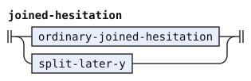</p>
<p>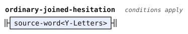</p>
</details>

## Differences from CLL and BPFK

*The Complete Lojban Language* (CLL) forbids the consonant pair `mz`.[^cll-s3-6] The working morphology, the word-form grammar that bpfk.md translates, forbids it too: its letter rule for `m` refuses a following `z`. Zantufa's letter rule for `m` refuses only another `m` among the consonants. camxes-exp, the experimental grammar of the camxes parser, does the same. So Zantufa accepts `mz` wherever a permissible pair can stand. Examples are the gismu `kamzi`, the lujvo `bamzda` and the name `.djeimz.`.

The other changes that camxes-exp makes to the word forms, in [experimental.md](experimental.md), are not Zantufa's.

Zantufa's `Y` reads a whole run of `y` as one token (`y+`), so its `spaces` treats the whole run as space. This translation inherits divided y-runs. The word stage uses `Spacing` and `Y-Letters` to preserve that space behavior. The forms stage records `After-Hesitation`, but no condition reads that tag.

[^cll-s3-6]: [CLL 1.1, section 3.6](https://lojban.org/publications/cll/cll_v1.1_xhtml-section-chunks/section-clusters.html).
