# Word forms

This document opens the forms stage of the [Eberban pipeline](pipeline.md). A stage is one step of a pipeline, with its own grammar. A token is one unit that a stage reads or emits. A token's value is the string that exact comparisons read. Its image is the string that people see.

The stage reads the letter tokens of the [letters stage](letters.md). It is the one stage that reads words and quotes from letters. It divides the letters into words and quotes. It tags each word with its kind, and each particle also with its family. A compound is one word, and a spelling quote and a foreign quote are each one quote unit. A tag is a capitalized key of a token's bag. The stage hands the words to the words stage, [stream.md](stream.md), with a space token for each gap between them.

The reference grammar's [morphology chapter](https://eberban.github.io/eberban/books/refgram/book/morphonology/morphology.html) states the word shapes. Eberban has a self-segregating morphology. A stream of letters divides into words in one way only. The chapter gives the reasoning.

Outside borrowings and freeform variables, a non-sonorant consonant begins a word, except as the first letter of a medial pair or a triplet. A word that begins with a vowel or a sonorant needs a space before it. So the rules below never look past a word to decide where it ends. The next word begins where a non-sonorant consonant stands outside a cluster, or after a space. After a closing foreign quote, both this grammar and the PEG accept a word that begins with a vowel or a sonorant with no space, as in `a co[ba]an mo`. The book does not say whether the closing bracket counts as that space.

The prose uses these Eberban terms:

- A particle is a word with a grammatical function. Its family is the set of particles with one grammar, such as `VI`.
- A root is a predicate word that is not a particle.
- A borrowing is a foreign word written after the prefix `u`.
- A freeform variable is a speaker-defined predicate written after the prefix `i`.
- A compound is a word made from other words after the prefix `e`, `en` or `er`.
- A foreign quote is `co` and foreign text between brackets.
- Vhowels are a string of vowels, with `h` between some of them.
- A sonorant is `n`, `r` or `l`. The other consonants are non-sonorant.

[The notation document](../../../docs/notation.md) explains jbogenbau, the notation of these grammars.

## The text

The text is a sequence of items. An item is a space, a digit, a hesitation or an eraser. It can also be a borrowing, a freeform variable, a run of words, or a run that no rule reads. A compound is an item too, and it can stretch over several runs and the gaps between them.

A run is a maximal stretch of letters and hyphens between two items that are not letters. Each rule that reads a run makes it maximal with a condition on the tokens after it. A foreign quote is the last part of its run, so a new run can start right after the quote. Otherwise two runs never stand side by side, and one run has one division.

The ranked choice in `item` keeps the word and junk readings together. The engine prefers the reading with less blame. At an equal measure and span, the earlier word option excludes junk. The ranked group passes no tags to `item`, and no rule reads the bag of `item`.

Five forms can hold a space inside one token: a borrowing, a freeform variable, a compound, a spelling quote and a foreign quote. An unfinished compound also reaches over spaces, but it emits several tokens. The step `leftmost-longest #(·borrowing ∪ ·freeform-variable ∪ ·spelling-quote ∪ ·foreign-quote ∪ ·compound ∪ ·open-compound)` names the five rules and `open-compound`, the unfinished compound. At each free position, the stage takes the longest such form that starts there. The step chooses between forms by their start, then by their length.

It never chooses where a foreign quote ends, because the quote rule fixes its end. The one exception is a trailing hyphen after a digit closer ("Delimiters" below). So a spelling quote at `ce` wins over an inner `co` by its earlier start, and `a ce co [ba] cei` is one spelling quote. In the same way, an unfinished compound wins over a quote in one of its slots. A complete compound wins over an unfinished one ("Unfinished compounds" below).

The constant `$DEFAULTS` gives each rule node of the stage two strings. Its value joins the values of its children, and its image joins their images. So a node that is not erased and has no primary, no sole symbol and no written value joins the values of its parts. An erased node, such as `hesitation`, has the empty string as its value. A primary or a sole symbol gives its own value first, so the slot of `mo` in `a e mi mo` has the value `mo`, without its gap. A hyphen adds the empty string, a gap adds one space and a digit adds its `TI` word. Each spelled particle word, root word, borrowing, freeform variable and eraser takes both its strings from the defaults. A digit word takes its strings from its digit token. A stray prefix and the closing `e` of an empty `er e` take their value from what they read and write their image. A compound and a quote write their own strings.

The stage publishes the keys in `$OUTPUTS`. These are the kinds of word, the particle families of `$FAMILIES`, and the marks that the later stages read. The prefix marks of a compound stay in this stage. No letter class passes on, because each token writes its own tags.

The book allows a hyphen only at a syllable boundary inside a word. Each digit is a word of its own, so a hyphen beside a digit stands at a word boundary. So a run reads every hyphen, and `run-char` reads a hyphen as it reads a letter.

```jbogenbau
%ambiguity-resolution
  leftmost-longest #(·borrowing ∪ ·freeform-variable ∪ ·spelling-quote ∪ ·foreign-quote ∪
    ·compound ∪ ·open-compound), lazy
%const $DEFAULTS $n ↦ {value: $n.children!'value.join(), image: $n.children!'image.join()}
%const $OUTPUTS {
  Word,
  Particle,
  Root,
  Borrowing,
  Freeform,
  Compound,
  Quote,
  RA,
  RI,
  Space,
  Stray-Prefix,
  Junk,
  *$FAMILIES
}
%const $FAMILIES {
  MI,
  FI,
  VI,
  VEI,
  TI,
  SI,
  ZI,
  KI,
  GI,
  PI,
  PE,
  PEI,
  PA,
  PO,
  PU,
  BI,
  BE,
  BA,
  BO,
  BU,
  DI,
  DE,
  DA,
  DAI,
  DO,
  DU,
  CI,
  CE,
  CEI,
  CA,
  CAI,
  CO,
  COI,
  CU,
  JI,
  JE,
  JA,
  JO,
  JU,
  NI,
  A,
  O
}

%rule text
  [{item}]

%rule item
  | space | ci-space | digit-word | borrowing | freeform-variable
  | ((ci-hesitation | plain-hesitation | eraser-run | word-run | compound-run | stray-compound)
      ≻ junk-run)

%rule run-char
  Letter | Hyphen

%rule run-end
  ε
%conditions
  ¬$.following-tokens.parse(run-char …)
```

<details><summary>Railroad diagrams of <code>text</code>, <code>item</code>, <code>run-char</code> and <code>run-end</code></summary>
<p>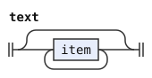</p>
<p>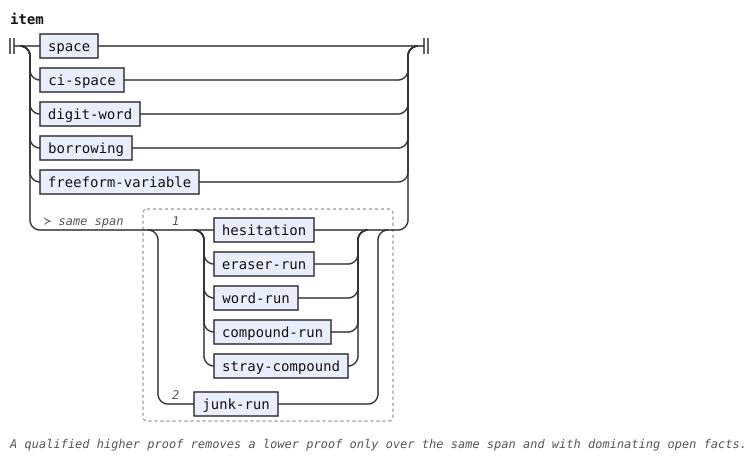</p>
<p>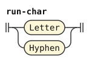</p>
<p>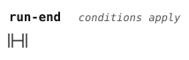</p>
</details>

`run-end` matches where a run ends. A rule that reads a run ends with it, or with a foreign quote.

### Gaps

The morphology chapter says that a bracket is a space outside the syntax of foreign quotes. So a bracket that no quote reads is a space here, and so is a foreign letter. A gap is a run of such spaces. Between two items, `space` reads the whole gap and emits one `Space` token with the value of one space. So the words stage sees no bracket, and a gap of brackets alone still stands between two words.

The book says that `q`, `w`, `x` and `y` are spaces. The PEG warns about each of them where no foreign quote holds it. So `space-unit` reads one space token, and it carries the warning `non-eberban-letter` for a foreign letter. Every gap reads its spaces through `space-unit`, so each foreign letter in a gap warns once. A foreign quote reads its text as quoted characters, so a foreign letter in the text warns nothing.

A borrowing, a freeform variable, a compound and a spelling quote can hold a gap inside one token. Such a gap can also hold hesitation. The rule `gap` reads it. Each such token builds its value from its parts, so the gap adds nothing to the value.

An unfinished compound holds gaps between its tokens. There `gap` emits one `Space` token, as `space` does between items. Inside a token, the emission of the token replaces it.

The rules `space-before` and `space-after` hold beside a space, a bracket of a gap or an edge of the text. Hesitation, erasers and the end of a borrowing need them. They test the neighboring node of the parse, so a bracket that a foreign quote reads is no space. So `co [x]ra` holds no eraser, and an `n` right before the `[` of a quote is no hesitation.

```jbogenbau
%rule space
  space-run → {Space, image: value: " "}
%conditions
  ¬$.following-tokens.parse((Space | Open | Close) …),
  ¬$.preceded-by(ci-word | ci-hesitation)
%emit

%rule ci-space
  space-run → {Space, image: value: " "}
%conditions
  ¬$.following-tokens.parse((Space | Open | Close) …),
  $.preceded-by(ci-word | ci-hesitation)
%emit

%rule space-run
  {space-unit | space-open | space-close}

%rule space-unit
  Space<¬Foreign-Letter>
  | *non-eberban-letter

%rule non-eberban-letter
  Space<Foreign-Letter>
%warning "this letter is outside the Eberban alphabet"

%rule space-open
  Open

%rule space-close
  Close

%rule gap
  {space-unit | space-open | space-close | hesitation} → {Space, image: value: " "}
%emit

%rule space-before
  ε
%conditions
  $.starts-input ∨ $.preceded-by(space-unit | space-open | space-close)

%rule space-after
  ε
%conditions
  $.ends-input ∨ $.followed-by(space-unit | space-open | space-close)
```

<details><summary>Railroad diagrams of the 10 rules from <code>space</code> to <code>space-after</code></summary>
<p>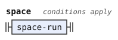</p>
<p>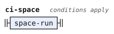</p>
<p>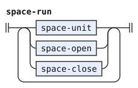</p>
<p>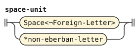</p>
<p>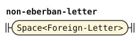</p>
<p>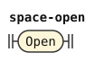</p>
<p>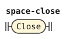</p>
<p>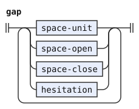</p>
<p>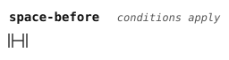</p>
<p>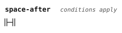</p>
</details>

## Letters, vowels and hyphens

The rules below name the letter classes that the letters stage tags. `ns-consonant` is a non-sonorant consonant, the kind that can begin a word.

The morphology chapter says that a hyphen can stand at a syllable boundary inside a word. The chapter does not say where a syllable starts, so this grammar takes the places where the PEG reads a hyphen in silence. A syllable starts at a vowel after a different vowel, at `h`, and at a single consonant between vowels. Inside a borrowing, a syllable also starts at an initial pair. A medial pair splits between its two consonants, and a triplet `XYZ` splits between `X` and `YZ`. In a borrowing, a sonorant or `m` before a consonant splits the same way. A hyphen at one of these places is silent.

Anywhere else, the grammar accepts a hyphen with the warning `hyphen-misplaced`. That includes the start and the end of a word. The rule `hyphen-misplaced` reads such a hyphen, and the pipeline turns the warning on. The PEG warns at most of these places, and the closing section lists the others.

A delimiter of a foreign quote is an Eberban word, and the quote reads such a word in two ways. It reads its delimiters with warnings, and the words inside its text in silence ("Foreign quotes" below). The strict rules that a delimiter reaches, such as `vhowels` or `root-form`, read a stray hyphen with `hyphen-misplaced`, which warns. The delimiter reader `native-delimiter` and the spelling units use these rules as they are. The silent reader `delimiter-shape` splices `native-delimiter` and suppresses its warnings. Ordinary words do not use these strict readers. They use the recovering readers of the section on malformed words, which also admit a faulty piece.

```jbogenbau
%rule vowel
  Letter<Vowel>

%rule consonant
  Letter<Consonant>

%rule sonorant
  Letter<Sonorant>

%rule ns-consonant
  Letter<Consonant ¬Sonorant>

%rule hyphen-misplaced
  Hyphen
%warning "this hyphen stands outside a recommended position"
```

<details><summary>Railroad diagrams of the 5 rules from <code>vowel</code> to <code>hyphen-misplaced</code></summary>
<p>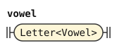</p>
<p>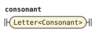</p>
<p>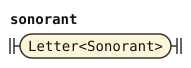</p>
<p>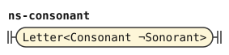</p>
<p>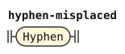</p>
</details>

Two vowels written in a row are two letters, because the letters stage merges a repeated letter into one. A hyphen between two copies of the same vowel splits one vowel in two. The book does not mention this case. The PEG makes it an error, and this grammar follows the PEG. The condition on the hyphenated alternative states that. Each alternative of `vowels` records its last vowel in the key `last`, and the condition compares it with the vowel after the hyphen. The value of `vowels` cannot serve there, because it holds every vowel of the run. In `ai-i`, the value before the hyphen is `ai`, and its last vowel `i` equals the vowel after it.

```jbogenbau
%rule vowels
  | $v:vowel → {last: $v'value}
  | vowels $v:vowel → {last: $v'value}
  | $a:vowels Hyphen $b:vowel → {last: $b'value}
%conditions
  $a'last ≠ $b'value

%rule vhowels
  vowels [{[Hyphen] Letter<H> [hyphen-misplaced] vowels}]

```

<details><summary>Railroad diagrams of <code>vowels</code> and <code>vhowels</code></summary>
<p>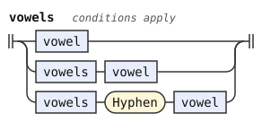</p>
<p>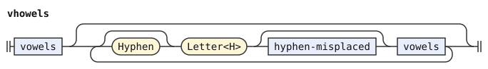</p>
</details>

## Pairs and triplets

The morphology chapter lists the consonant pairs. An initial pair can begin a word. A medial pair stands only between vowels inside a word. Every other pair of consonants is invalid, and a sonorant before a non-sonorant consonant breaks the stream into two words. The two constants copy the chapter's lists, so the chart of the chapter is the grammar's table. The chapter contradicts itself on `m`. Its constraint 5 bars `m` before a non-sonorant "other than a sibilant", which would allow `ms`, `mz`, `mc` and `mj`. But its lists and its chart leave these four pairs out. This grammar follows the lists, as the PEG does, so `a timsa mo` is rejected. The constant `$PAIRS` holds both lists.

```jbogenbau
%const $INITIAL-PAIRS [
  "bj", "bz", "dj", "dz", "gj", "gz", "vj", "vz", "fc", "fs", "kc", "ks", "pc", "ps", "tc", "ts",
  "jb", "jd", "jg", "jv", "jm", "zb", "zd", "zg", "zv", "zm",
  "cf", "ck", "cp", "ct", "cm", "sf", "sk", "sp", "st", "sm"
]

%const $MEDIAL-PAIRS [
  "bd", "bg", "bv", "db", "dg", "dv", "gb", "gd", "gv", "vb", "vd", "vg", "bm", "dm", "gm", "vm",
  "fk", "fp", "ft", "kf", "kp", "kt", "pf", "pk", "pt", "tf", "tk", "tp", "fm", "km", "pm", "tm",
  "bl", "br", "bn", "cl", "cr", "cn", "dl", "dr", "dn", "fl", "fr", "fn", "gl", "gr", "gn",
  "jl", "jr", "jn", "kl", "kr", "kn", "ml", "mr", "mn", "pl", "pr", "pn", "sl", "sr", "sn",
  "tl", "tr", "tn", "vl", "vr", "vn", "zl", "zr", "zn", "nl", "nr", "ln", "rn"
]

%const $PAIRS [*$MEDIAL-PAIRS, *$INITIAL-PAIRS]

%const $LIQUIDS ["r", "l"]

%const $NOT-BEFORE-LIQUID ["m", "n", "r", "l"]

%rule initial-pair
  $x:consonant [hyphen-misplaced] $y:consonant
%conditions
  $x'value ++ $y'value ∈ $INITIAL-PAIRS


%rule medial-pair
  $x:consonant [Hyphen] $y:consonant
%conditions
  $x'value ++ $y'value ∈ $MEDIAL-PAIRS
```

<details><summary>Railroad diagrams of <code>initial-pair</code> and <code>medial-pair</code></summary>
<p>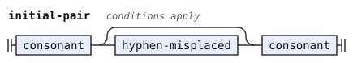</p>
<p>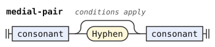</p>
</details>

A triplet is three consonants `XYZ` between vowels. In a root it has one of two shapes. Either `XY` is a medial pair and `YZ` an initial pair, as in `pks`. Or `XY` is a medial or initial pair, `Y` is neither `m` nor a sonorant, and `Z` is a liquid, as in `str`.

A freeform variable or borrowing has a third shape: `X` is a sonorant and `YZ` is an initial pair or a consonant-sonorant medial pair. A consonant-sonorant medial pair starts with a non-sonorant consonant, so `nrn` is no triplet. Four consonants in a row form no word.

```jbogenbau
%rule root-triplet
  $x:consonant [Hyphen] $y:consonant [hyphen-misplaced] $z:consonant
%conditions
  $x'value ++ $y'value ∈ $MEDIAL-PAIRS ∧ $y'value ++ $z'value ∈ $INITIAL-PAIRS ∨
    ($x'value ++ $y'value ∈ $MEDIAL-PAIRS ∨ $x'value ++ $y'value ∈ $INITIAL-PAIRS) ∧
      $y'value ∉ $NOT-BEFORE-LIQUID ∧ $z'value ∈ $LIQUIDS


%rule freeform-triplet
  root-triplet | sonorant-triplet

%rule sonorant-triplet
  sonorant [Hyphen] $y:ns-consonant [hyphen-misplaced] $z:consonant
%conditions
  $y'value ++ $z'value ∈ $INITIAL-PAIRS ∨ $y'value ++ $z'value ∈ $MEDIAL-PAIRS ∧ $z'Sonorant
```

<details><summary>Railroad diagrams of <code>root-triplet</code>, <code>freeform-triplet</code> and <code>sonorant-triplet</code></summary>
<p>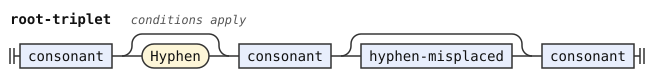</p>
<p>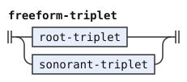</p>
<p>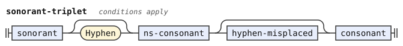</p>
</details>

## Particles

A particle starts with a non-sonorant consonant followed only by vhowels, as `zi` or `tiho`. Or it starts with `n`, `a` or `o` and continues with vhowels and sonorants, as `a`, `on`, `ahu` or `nu`. The closing section explains why only these three letters start the second kind.

The shape of a particle gives its family. The first consonant gives the family, as in the PEG. For `p`, `b`, `d`, `c`, and `j`, the first vowel refines it. The book makes six particles families of their own: `pei`, `vei`, `dai`, `cei`, `cai` and `coi`. The templates below read the kinds of family. Each instance passes its family as a key set, and the term of the template splats it. Each instance also passes its letters as strings. The body tests the first consonant against its letter, as `ns-consonant=@Consonant`. The conditions of the other templates compare the value of the vowels with a string, or test their first vowel with the query `$v.parse(vowel=@Vowel …)`. Their recovering vowels retain a family through a malformed vowel join. The strict delimiter rules use separate vowels.

```jbogenbau
%rule particle-cv(@Consonant, @Family)
  ns-consonant=@Consonant recovering-gap(hyphen-misplaced) recovering-vhowels → {*@Family}

%rule particle-cv-except(@Consonant, @Except, @Family)
  ns-consonant=@Consonant recovering-gap(hyphen-misplaced) $v:recovering-vhowels → {*@Family}
%conditions
  $v'value ≠ @Except

%rule particle-cvv(@Consonant, @Vowel, @Family)
  ns-consonant=@Consonant recovering-gap(hyphen-misplaced) $v:recovering-vhowels → {*@Family}
%conditions
  $v.parse(vowel=@Vowel …)

%rule particle-cvv-except(@Consonant, @Vowel, @Except, @Family)
  ns-consonant=@Consonant recovering-gap(hyphen-misplaced) $v:recovering-vhowels → {*@Family}
%conditions
  $v.parse(vowel=@Vowel …),
  $v'value ≠ @Except

%rule particle-exact(@Consonant, @Vowels, @Family)
  ns-consonant=@Consonant recovering-gap(hyphen-misplaced) $v:recovering-vhowels → {*@Family}
%conditions
  $v'value = @Vowels
```

<details><summary>Railroad diagrams of the 5 rules from <code>particle-cv</code> to <code>particle-exact</code></summary>
<p>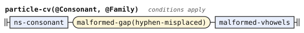</p>
<p>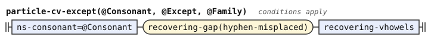</p>
<p>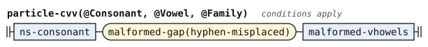</p>
<p>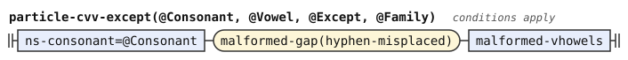</p>
<p>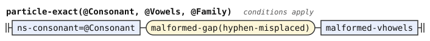</p>
</details>


```jbogenbau
%rule mi-particle = particle-cv(= "m", = {MI})
%rule fi-particle = particle-cv(= "f", = {FI})
%rule vi-particle = particle-cv-except(= "v", = "ei", = {VI})
%rule vei-particle = particle-exact(= "v", = "ei", = {VEI})
%rule ti-particle = particle-cv(= "t", = {TI})
%rule si-particle = particle-cv(= "s", = {SI})
%rule zi-particle = particle-cv(= "z", = {ZI})
%rule ki-particle = particle-cv(= "k", = {KI})
%rule gi-particle = particle-cv(= "g", = {GI})
%rule pi-particle = particle-cvv(= "p", = "i", = {PI})
%rule pe-particle = particle-cvv-except(= "p", = "e", = "ei", = {PE})
%rule pei-particle = particle-exact(= "p", = "ei", = {PEI})
%rule pa-particle = particle-cvv(= "p", = "a", = {PA})
%rule po-particle = particle-cvv(= "p", = "o", = {PO})
%rule pu-particle = particle-cvv(= "p", = "u", = {PU})
%rule bi-particle = particle-cvv(= "b", = "i", = {BI})
%rule be-particle = particle-cvv(= "b", = "e", = {BE})
%rule ba-particle = particle-cvv(= "b", = "a", = {BA})
%rule bo-particle = particle-cvv(= "b", = "o", = {BO})
%rule bu-particle = particle-cvv(= "b", = "u", = {BU})
%rule di-particle = particle-cvv(= "d", = "i", = {DI})
%rule de-particle = particle-cvv(= "d", = "e", = {DE})
%rule da-particle = particle-cvv-except(= "d", = "a", = "ai", = {DA})
%rule dai-particle = particle-exact(= "d", = "ai", = {DAI})
%rule do-particle = particle-cvv(= "d", = "o", = {DO})
%rule du-particle = particle-cvv(= "d", = "u", = {DU})
%rule ci-particle = particle-cvv(= "c", = "i", = {CI})
%rule ce-particle = particle-cvv-except(= "c", = "e", = "ei", = {CE})
%rule cei-particle = particle-exact(= "c", = "ei", = {CEI})
%rule ca-particle = particle-cvv-except(= "c", = "a", = "ai", = {CA})
%rule cai-particle = particle-exact(= "c", = "ai", = {CAI})
%rule co-particle = particle-cvv-except(= "c", = "o", = "oi", = {CO})
%rule coi-particle = particle-exact(= "c", = "oi", = {COI})
%rule cu-particle = particle-cvv(= "c", = "u", = {CU})
%rule ji-particle = particle-cvv(= "j", = "i", = {JI})
%rule je-particle = particle-cvv(= "j", = "e", = {JE})
%rule ja-particle = particle-cvv(= "j", = "a", = {JA})
%rule jo-particle = particle-cvv(= "j", = "o", = {JO})
%rule ju-particle = particle-cvv(= "j", = "u", = {JU})
```

<details><summary>Railroad diagrams of the 39 rules from <code>mi-particle</code> to <code>ju-particle</code></summary>
<p>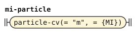</p>
<p></p>
<p>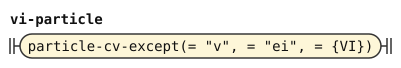</p>
<p></p>
<p>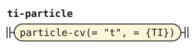</p>
<p>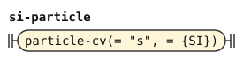</p>
<p></p>
<p>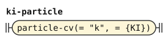</p>
<p>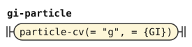</p>
<p>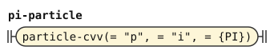</p>
<p>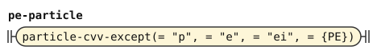</p>
<p>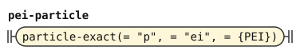</p>
<p>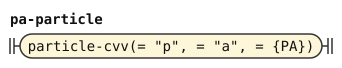</p>
<p></p>
<p>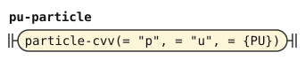</p>
<p>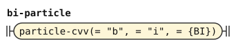</p>
<p></p>
<p></p>
<p></p>
<p>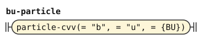</p>
<p></p>
<p></p>
<p>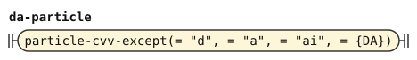</p>
<p></p>
<p></p>
<p></p>
<p>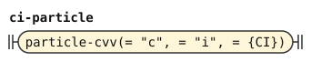</p>
<p>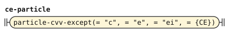</p>
<p></p>
<p></p>
<p>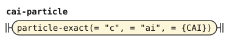</p>
<p></p>
<p></p>
<p></p>
<p>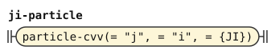</p>
<p></p>
<p></p>
<p>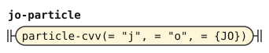</p>
<p></p>
</details>


The particle families of `n`, `a` and `o` are `NI`, `A` and `O`. The `n` can take a hyphen after it, with a warning. A sonorant inside the particle stands between vowels, and one can end it.

```jbogenbau
%rule ni-particle
  Letter="n" recovering-gap(hyphen-misplaced) recovering-vhowels recovering-particle-tail → {NI}

%rule a-particle
  $v:recovering-vhowels recovering-particle-tail → {A}
%conditions
  $v.parse(vowel="a" …)

%rule o-particle
  $v:recovering-vhowels recovering-particle-tail → {O}
%conditions
  $v.parse(vowel="o" …)

%rule particle-tail
  [{[Hyphen] sonorant [hyphen-misplaced] vhowels}] [[hyphen-misplaced] sonorant]


%rule consonant-particle
  | mi-particle | fi-particle | vi-particle | vei-particle | ti-particle | si-particle | zi-particle
  | ki-particle | gi-particle | pi-particle | pe-particle | pei-particle | pa-particle | po-particle
  | pu-particle | bi-particle | be-particle | ba-particle | bo-particle | bu-particle | di-particle
  | de-particle | da-particle | dai-particle | do-particle | du-particle | ci-particle | ce-particle
  | cei-particle | ca-particle | cai-particle | co-particle | coi-particle | cu-particle
  | ji-particle | je-particle | ja-particle | jo-particle | ju-particle

%rule vowel-particle
  a-particle | o-particle
```

<details><summary>Railroad diagrams of the 6 rules from <code>ni-particle</code> to <code>vowel-particle</code></summary>
<p></p>
<p></p>
<p></p>
<p></p>
<p></p>
<p></p>
</details>

## Roots

A root starts with a non-sonorant consonant or an initial pair. After its first vhowels come any number of middles, each a sonorant, a medial pair or a triplet before more vhowels. A sonorant can end it. A root that starts with one consonant needs at least one middle or a final sonorant, because a consonant and vhowels alone form a particle.

```jbogenbau
%rule root-form
  | ns-consonant [hyphen-misplaced] vhowels {root-middle}
    [final-sonorant]
  | ns-consonant [hyphen-misplaced] vhowels final-sonorant
  | initial-pair [hyphen-misplaced] vhowels [{root-middle}]
    [final-sonorant]

%rule root-middle
  | [Hyphen] sonorant [hyphen-misplaced] vhowels
  | [hyphen-misplaced] medial-pair [hyphen-misplaced] vhowels
  | [hyphen-misplaced] root-triplet [hyphen-misplaced] vhowels

%rule final-sonorant
  [hyphen-misplaced] sonorant

```

<details><summary>Railroad diagrams of <code>root-form</code>, <code>root-middle</code> and <code>final-sonorant</code></summary>
<p></p>
<p></p>
<p></p>
</details>

## Runs of words

A run of words starts with any word and continues with words that begin with a non-sonorant consonant. A word that begins with a vowel or `n` can only begin a run. A spelling quote starts with `ce`, so it can stand anywhere a word that starts with `c` can. A foreign quote is the last part that a run can have, because the end of the quote ends the run. A run can also be a foreign quote alone.

A run that starts with compound prefixes starts a compound ("Compounds" below). Where the compound is not complete, its prefixes carry their errors and its components stay words. A vowel-initial particle or a borrowing can follow the prefixes directly, as the [compounds chapter](https://eberban.github.io/eberban/books/refgram/book/grammar/compounds.html) allows. A hyphen at the start of a run, after the prefixes or at the end of a word is a warning.

Each word emits one token tagged `Word` and its kind. A particle also carries `Particle` and its family. The value of a spelled particle word and of a root word joins the values of its letters, so a hyphen adds nothing to it. Its image joins the images of its letters and of the hyphens that the word rule reads. So such a hyphen stays visible, as in `bja-n`. A hyphen that a run reads before the word stays outside the token, so `a -bjan` gives the image `bjan`. The book lets a hyphen mark a syllable that the writer wants to stand out, so the image keeps that mark. The value is the word that exact comparisons read, and the hyphen never changes it. A digit keeps the digit as its image, as the letters stage gives it.

The morphology chapter says: "Spaces are only mandatory before words starting with a vowel or a sonorant." A digit is a word, so that rule holds after a digit too. So a word that starts with a vowel or `n` never stands right after a digit, with or without a hyphen between them. The rule `after-digit` names that place.

The conditions on `ni-word`, `vowel-particle-word`, `first-prefix` and `prefix-content-word` refuse it. So `a mi 1an mo` and `a mi 1-an mo` are rejected, while `a mi 1 an mo` and `a mi 1mo` are texts. The erasers and hesitation already need a space before them.

A `co` that a complete opener follows starts a foreign quote, so it is never a plain word. A complete opener is `co`, its optional gap and delimiter, and an opening bracket, and `quote-opener` reads it. `consonant-particle-word` marks `component-particle` as its primary, so it has the bag and the strings of that word. Its condition adds the bar. It tests only a particle of the `CO` family, so no other particle before a bracket is tested.

The word wrappers retain an erroneous edge `h`, as in `hmi` or `mih`. Roots use the recovering root skeleton below. No word begins with `h`, and a run goes on only with a word that begins with a non-sonorant consonant. So an `h` that stands before such a word in the same run ends the word before it. Only the first word of a run takes a leading `h`. The later words of a run read through `later-word`, whose condition states that. So `mihco` is `mih` and `co`, as `mih co` is.

The quotes chapter says that `ci` quotes one word "ignoring its grammar". So `ci-word` reads a `ci`, and `ci-space` reads a gap right after it. The word after either one is a plain word: `ce` starts no spelling quote there, and `co` starts no foreign quote. The neighbor tests on the quote rules state that. So `a ci ce ci cei` quotes the particles `ce` and `cei`, as the PEG reads it.

A quoted word has no grammar, so a quoted `ci` quotes nothing. `ci-word` reads only a `ci` that no `ci` quotes, and a quoted `ci` is a plain particle. So in `a ci ci ce bu cei` the second `ci` is quoted, and `ce` opens a spelling quote. In `a ci ci ci ce` the third `ci` quotes `ce` again. Two more things can stand between `ci` and its word. A hyphen at the start of a run belongs to the run of the next word, and `ci-hyphen` reads it after `ci`. Hesitation is no word, and `ci-hesitation` reads it after the gap of a `ci`. The gap after that hesitation is a `ci-space` too. So `a ci -ce ci cei` and `a ci n ce` quote `ce`, as the PEG reads them.

The quote reads its own `co` through the particle rule, so the bar never meets the quote. A compound reads its components without the bar ("Compounds" below). The test reads the opener alone, not the whole quote. So an unclosed quote is rejected, as in `a mico [x`.

```jbogenbau
%rule word-run
  | [run-hyphen | ci-hyphen] first-word [{later-word}] run-close
  | [run-hyphen | ci-hyphen] foreign-quote

%rule run-hyphen
  hyphen-misplaced
%conditions
  ¬$.preceded-by(ci-word | ci-space)

%rule ci-hyphen
  hyphen-misplaced
%conditions
  $.preceded-by(ci-word | ci-space)

%rule run-close
  run-end | foreign-quote

%rule first-word
  consonant-word | vowel-particle-word | ni-word

%rule consonant-word
  | consonant-particle-word | ci-word | root-word
  | spelling-quote | empty-spelling-quote | faulty-spelling-quote | unclosed-spelling-quote

%rule later-word
  $w:consonant-word
%conditions
  ¬$w.first-token.flags'H

%rule consonant-particle-word
  ^$w:component-particle
%conditions
  ¬$w'CI ∨ $.preceded-by(ci-word | ci-space | ci-hyphen),
  $w'CO ∧ ¬$.preceded-by(ci-word | ci-space | ci-hyphen) ⟹ ¬$.onward.parse(quote-opener …),
  $w.parse(strict-ce [hyphen-misplaced]) ⟹ $.preceded-by(ci-word | ci-space | ci-hyphen)
%emit

%rule ci-word
  ^$w:component-particle
%conditions
  $w'CI,
  ¬$.preceded-by(ci-word | ci-space | ci-hyphen)
%emit

%rule ni-word
  *h-before-word $p:ni-particle *h-after-word [hyphen-misplaced]
      → {Word, Particle, *$p.flags}
%conditions
  ¬$.preceding-tokens.parse(… after-digit)
%emit

%rule vowel-particle-word
  *h-before-word $p:vowel-particle *h-after-word [hyphen-misplaced]
      → {Word, Particle, *$p.flags}
%conditions
  ¬$.preceding-tokens.parse(… after-digit)
%emit

%rule root-word
  recovering-root [hyphen-misplaced] → {Word, Root}
%emit

%rule quote-opener
  quote-co [opening-gap] [delimiter-shape] Open

%rule after-digit
  Digit [Hyphen]
```

<details><summary>Railroad diagrams of the 14 rules from <code>word-run</code> to <code>after-digit</code></summary>
<p></p>
<p></p>
<p></p>
<p></p>
<p></p>
<p></p>
<p></p>
<p></p>
<p></p>
<p></p>
<p></p>
<p></p>
<p></p>
<p></p>
</details>

## Borrowings and freeform variables

A borrowing is `u`, then its content. The book says that spaces must follow a borrowing. So `space-after` ends it, and a bracket of a gap or the end of the text also counts. A freeform variable is the same with `i`. The template `prefix-content-word` reads both. Its recovering content retains the prefix class through local faults, as in `ubd`. The strict content remains available to prefix guards.

The content has looser rules than a root. An initial pair can stand in the middle, and a medial pair at the start. A sonorant or `m` before a consonant counts as a pair. A sonorant before an initial pair or a consonant-sonorant medial pair counts as a triplet. The content can start with a vowel, a consonant, a pair, a triplet or `h`. It ends with a vowel or with one consonant.

The PEG lets a gap stand between the prefix and the content. The book writes content that starts with `u` after `u'`, and the apostrophe is a space. Two copies of the prefix letter merge into one letter, so a gap must stand there. `prefix-gap-of` owns that boundary. Where the content starts with the prefix letter, it gives the boundary the value and the image `'`, as the book writes it. So `u'ulis`, `u ulis` and `u-ulis` all have the value `u'ulis`. A compound that holds the borrowing then spells it as `u'ulis`, which reads back as the same word. Without the mark, `e uulis ban` reads `uu` as one letter, and so another borrowing.

A cluster before more vowels has its syllable boundary before it or inside it. A single consonant and an initial pair start a syllable, so a hyphen before them is silent. A medial pair, a sonorant or `m` before a consonant, and a triplet split inside, as the section on hyphens says. The rule `sonorant-pair` reads a sonorant or `m` before a consonant that forms no medial pair. A pair of the same letter twice is no pair, as the morphology chapter says.

The PEG warns about a hyphen before or after the prefix, and about content that starts with the prefix letter after a hyphen. A hyphen after a cluster at the start of the content also warns. Each carries `hyphen-misplaced` here. The token takes its strings from the defaults, as a spelled word does. `freeform-gap` gives any other gap the empty string as its value and its image. So the value is the prefix letter and the content, without the gap. The image also keeps each hyphen that the rule reads, as in `u-bla`.

```jbogenbau
%rule prefix-content-word(@Prefix, @Kind)
  [hyphen-misplaced] $p:Letter=@Prefix prefix-gap-of(@Prefix) recovering-content [hyphen-misplaced]
    space-after
      → {Word, *@Kind}
%conditions
  ¬$p.preceding-tokens.parse(… after-digit)
%emit

%rule borrowing = prefix-content-word(= "u", = {Borrowing})
%rule freeform-variable = prefix-content-word(= "i", = {Freeform})

%rule prefix-gap-of(@Prefix)
  [freeform-gap] [$h:hyphen-misplaced]
      → {
          $.following-tokens.parse(Letter=@Prefix …)? value: "'",
          $.following-tokens.parse(Letter=@Prefix …)? image: "'" ++ $h!'image.join()
        }

%rule freeform-gap
  gap → {image: value: ""}

%rule content
  [content-onset] vhowels [{content-middle vhowels}] [[hyphen-misplaced] consonant]

%rule content-onset
  (onset-cluster | split-cluster | Letter<H>) [hyphen-misplaced]

%rule content-middle
  | [Hyphen] onset-cluster [hyphen-misplaced]
  | [hyphen-misplaced] split-cluster [hyphen-misplaced]

%rule onset-cluster
  initial-pair | consonant

%rule split-cluster
  freeform-triplet | medial-pair | sonorant-pair

%rule sonorant-pair
  $x:pair-opener [Hyphen] $y:consonant
%conditions
  $x'value ++ $y'value ∉ $MEDIAL-PAIRS,
  $x'value ≠ $y'value

%rule pair-opener
  sonorant
  | Letter="m"
```

<details><summary>Railroad diagrams of the 12 rules from <code>prefix-content-word</code> to <code>pair-opener</code></summary>
<p></p>
<p></p>
<p></p>
<p></p>
<p></p>
<p></p>
<p></p>
<p></p>
<p></p>
<p></p>
<p></p>
<p></p>
</details>

## Digits, hesitation and erasers

A digit is a number word of family `TI`. The numbers chapter says that a `-` before or after a digit is a hyphen, which is not allowed there. A digit is a word of its own, so such a hyphen stands at a word boundary, and it carries `hyphen-misplaced`.

The node that holds the hyphen does not matter, only its warning. A word boundary holds at most one misplaced hyphen, as the PEG's `W_HyphenPostWord` reads exactly one. So the first two conditions of `digit-word` refuse a hyphen next to another hyphen. Each hyphen is optional, so its capture is a list, and each condition tests every item. The token stands at the place of the digit alone, and it takes the value and the image of the digit. A row of two hyphens beside a digit then stays junk ("Runs that form no word" below).

The numbers chapter also says that `+`, `*` and `/` are spaces, and that verbs express mathematical operations. The PEG warns about such a symbol after a digit, and `math-symbol` carries that warning here. The rule `digit-math` reads that warning wherever a digit word ends, so a digit that closes a quote warns too.

```jbogenbau
%rule digit-word
  [$l:hyphen-misplaced] $d:Digit [$t:hyphen-misplaced] digit-math
%conditions
  $l.all(¬.preceding-tokens.parse(… Hyphen)),
  $t.all(¬.following-tokens.parse(Hyphen …))
%emit
  $d{Word, Particle, TI}

%rule digit-math
  [$m:math-symbol]
%conditions
  $m ∨ ¬$.following-tokens.parse(math-space …)

%rule math-symbol
  ε
%conditions
  $.following-tokens.parse(math-space …)
%warning "a mathematical symbol follows this digit"

%rule math-space
  Space<Math-Symbol>
```

<details><summary>Railroad diagrams of <code>digit-word</code>, <code>digit-math</code>, <code>math-symbol</code> and <code>math-space</code></summary>
<p></p>
<p></p>
<p></p>
<p></p>
</details>


The [phonology chapter](https://eberban.github.io/eberban/books/refgram/book/morphonology/phonology.html) says that where spaces are allowed, a speaker can hesitate with one or more `n` surrounded by spaces. So the letter `n` alone is hesitation where a space, a bracket of a gap or an edge of the text stands on each side. The stage drops it. A gap can hold hesitation too. As an item, `plain-hesitation` reads it, or `ci-hesitation` after the gap of a `ci` ("Runs of words" above).

The words `ra` and `ri` are the erasers of the [sentences chapter](https://eberban.github.io/eberban/books/refgram/book/logic/sentences.html). They start with `r`, so no particle or root has their shape. The chapter says that `ra` must stand between spaces or pauses. The PEG reads `ri` the same way.

A run of `ra` is one eraser per `ra`. The syntax stage applies them. A hyphen after the `r` carries `hyphen-misplaced`, as after the first consonant of any particle.

```jbogenbau
%rule hesitation
  space-before Letter="n" space-after
%erased

%rule plain-hesitation
  *hesitation
%conditions
  ¬$.preceded-by(ci-space)

%rule ci-hesitation
  *hesitation
%conditions
  $.preceded-by(ci-space)

%rule eraser-run
  | space-before {ra-word} space-after
  | space-before ri-word space-after

%rule ra-word
  Letter="r" [hyphen-misplaced] Letter="a" → {Word, RA}
%emit

%rule ri-word
  Letter="r" [hyphen-misplaced] Letter="i" → {Word, RI}
%emit
```

<details><summary>Railroad diagrams of the 6 rules from <code>hesitation</code> to <code>ri-word</code></summary>
<p></p>
<p></p>
<p></p>
<p></p>
<p></p>
<p></p>
</details>

## Compounds

The [compounds chapter](https://eberban.github.io/eberban/books/refgram/book/grammar/compounds.html) makes one word from several. The prefix `e` takes two components, `en` three, and `er` any number up to a standalone `e`. A component is a particle, a root, a borrowing or a nested compound. A digit is a `TI` particle, so it can be a component.

Words and quotes are read before the syntax stage parses them, as [the pipeline](pipeline.md#differences-from-the-reference-grammar-and-the-peg) says. A compound is a word unit made of actual words, and its components lose their usual special meaning. A quote is one unit, but it is no word unit. So this stage reads each compound from its letters, and no quote starts in a component slot of an open compound. So `a en ce bu cei` is a compound of the three particles `ce`, `bu` and `cei`, and `a e cei co` is a compound too. A quote can start after a complete compound, as in `a e ber ban ce bu cei`.

An eraser keeps its meaning inside a compound. It is no component, so it ends a compound that is not complete. The sentences chapter lets `ra` erase ungrammatical text, and such a compound is ungrammatical. So `a e mi ra a mo` is a text, and its `ra` erases the first sentence with the unfinished compound. Hesitation is dropped as part of a gap, so `a e mi n bjan` is the compound of `mi` and `bjan`.

### Prefixes

A compound starts with `e`, `en` or `er`, for two, three or more components. A nested compound that is the first component of another can attach its prefix to the outer prefix. The compounds chapter spells the attached prefix `i` after `e`, because `ee` collapses to `e`. It spells it `e` after `n`, `r` or an attached `i`. So `ein` is `e` and `en`, `ene` is `en` and `e`, and `eie` is `e`, `e` and `e`. An attached `i` after `n`, `r` or an attached `i` is accepted with the warning `prefix-i-not-after-e`.

A hyphen inside a prefix, between two prefixes or after the last prefix carries `hyphen-misplaced`, as in the PEG. Such a hyphen has an empty value. So the rules `after-e`, `after-i` and `after-arity` look past it to the letter before an attached prefix.

The rule `first-prefix` reads a prefix that starts a run, and `attached-prefix` reads one that follows another prefix in the same run. Their conditions keep each to its place, so `compound-prefix` reads each prefix in one way only. Each prefix carries `E-PREFIX`, `EN-PREFIX` or `ER-PREFIX` by its length. A prefix of `e` alone carries `E-PREFIX`. The rule `prefix-arity` reads the `n` or `r` that makes a prefix `en` or `er`, and it carries `EN-PREFIX` or `ER-PREFIX`. A prefix with an arity letter copies its class. An attached `i` spells the vowel `e`, so it takes the same classes as `e`. A first prefix that is a run of its own also carries `Standalone`, even with a hyphen after it.

```jbogenbau
%rule compound-prefix
  first-prefix | attached-prefix

%rule first-prefix → {¬$.following-tokens.parse([Hyphen] Letter …)? Standalone}
  | Letter="e" → {E-PREFIX}
  | Letter="e" [hyphen-misplaced] $a:prefix-arity → {*$a.flags}
%conditions
  ¬$.preceding-tokens.parse(… after-digit),
  ¬$.preceding-tokens.parse(… Letter [Hyphen])

%rule attached-prefix
  | $e:Letter="e" → {E-PREFIX}
  | $e:Letter="e" [hyphen-misplaced] $a:prefix-arity → {*$a.flags}
  | $i:Letter="i" → {E-PREFIX}
  | $i:Letter="i" [hyphen-misplaced] $a:prefix-arity → {*$a.flags}
%conditions
  $e.preceding-tokens.parse(… (after-e | after-i | after-arity)),
  $i.preceding-tokens.parse(… after-e)

%rule after-e
  Letter="e" [Hyphen]

%rule after-i
  Letter="i" [Hyphen]

%rule prefix-arity
  | Letter="n" → {EN-PREFIX}
  | Letter="r" → {ER-PREFIX}
```

<details><summary>Railroad diagrams of the 6 rules from <code>compound-prefix</code> to <code>prefix-arity</code></summary>
<p></p>
<p></p>
<p></p>
<p></p>
<p></p>
<p></p>
</details>

```jbogenbau
%extend-rule attached-prefix
  *prefix-i-not-after-e

%rule prefix-i-not-after-e
  | $i:Letter="i" → {E-PREFIX}
  | $i:Letter="i" [hyphen-misplaced] $a:prefix-arity → {*$a.flags}
%conditions
  $i.preceding-tokens.parse(… (after-arity | after-i))
%warning "an attached i follows a prefix other than e"

%rule after-arity
  prefix-arity [Hyphen]
```

<details><summary>Railroad diagrams of the 3 rules from <code>attached-prefix</code> to <code>after-arity</code></summary>
<p></p>
<p></p>
<p></p>
</details>

The rule `prefixes` reads the prefixes at the start of a run as one form. The junk rules use it ("Runs that form no word" below).

```jbogenbau
%rule prefixes
  first-prefix [{[hyphen-misplaced] attached-prefix}]
```

<details><summary>Railroad diagram of <code>prefixes</code></summary>
<p></p>
</details>

### Components

The rule `compound-run` reads a compound at the start of a run. The run can go on after the compound with more words, as in `eberbanmi`. The rules `first-slot` and `later-slot` read a component with what joins it to the part before it. `first-slot` follows a prefix, and `later-slot` follows a component. Each slot marks its component as its primary. So the slot gets the value of the component, without the gap, and any `Spaced-E` mark of it. Both read the gap between two parts, which holds spaces, brackets and hesitation. A gap holds no eraser, so an eraser ends the compound.

Without a gap, a component must be able to stand where it stands in a run of words. After a prefix, it can start with a vowel, as in `ea mi`, or it can be a borrowing. After another component, it starts with a non-sonorant consonant or it is a digit. An `NI` particle and a nested compound later in the compound need a gap before them. A word that starts with a vowel needs a space after a digit, as the conditions of the word rules say.

A hyphen after a prefix or at the start of a run carries `hyphen-misplaced`, as in a run of words. A word component reads the hyphen after it, as a word of a run does. A digit and a borrowing read their own hyphens, so `first-slot` reads no hyphen before them. After a word component, a hyphen before a digit can belong to either word. There the lazy step of the stage gives it to the digit, with the same warning.

`component-particle` reads a particle that starts with a consonant without the bar of `consonant-particle-word`. So `co` and `ce` start no quote in a component slot. In a component slot it emits a word token, as `root-word` does, which an unfinished compound hands on. Inside a complete compound, the token of the compound replaces it.

```jbogenbau
%rule compound-run
  [hyphen-misplaced] compound [{later-word}] run-close

%rule first-slot
  | [hyphen-misplaced] ^attached-first
  | ^digit-word
  | ^borrowing
  | [hyphen-misplaced] gap ^spaced-component

%rule later-slot
  | ^attached-later
  | gap ^spaced-later

%rule prefix-join
  [hyphen-misplaced] [gap [hyphen-misplaced]]

%rule attached-first
  vowel-particle-word | component-particle | root-word

%rule attached-later
  component-particle | root-word | digit-word

%rule spaced-component
  | [hyphen-misplaced] (component-particle | root-word | vowel-particle-word | ni-word)
  | digit-word | borrowing

%rule spaced-later
  | spaced-component
  | [hyphen-misplaced] ^compound

%rule component-particle
  *h-before-word $p:consonant-particle *h-after-word [hyphen-misplaced]
      → {Word, Particle, *$p.flags}
%emit
```

<details><summary>Railroad diagrams of the 9 rules from <code>compound-run</code> to <code>component-particle</code></summary>
<p></p>
<p></p>
<p></p>
<p></p>
<p></p>
<p></p>
<p></p>
<p></p>
<p></p>
</details>

### Compound values

A compound emits one token tagged `Word` and `Compound`. Its value is the compound in the shortest canonical form of the compounds chapter, which the dictionary uses. When a nested compound is the first component of another, their prefixes join into one unit. The joined prefix spells its vowel `i` after `e` and `e` after `n` or `r`. So `e e ber ban ban` and `ei ber ban ban` both have the value `ei ber ban ban`. Single spaces separate the other parts.

A component keeps its word value, so a digit stands as its `TI` word. The image of the compound is its value, the canonical form that the dictionary uses. A compound joins several words, and the canonical form puts one space between its parts. It spells the prefixes of the first group in their shortest form, as `ei ber ban ban` for `e e ber ban ban`. A join of the images of its parts cannot show the gaps, because each slot takes the image of its component. So `e ber ban` and `eber ban` both show as `e ber ban`, and a hyphen inside a component does not show. Each rule below with several parts writes the value of its node from the values of those parts. `compound-tail` and `joined-tail` take the value of `fixed-tail`, and the defaults join the values of the components of an `er` list.

The rule `compound-tail` reads a compound and gives its value without the vowel of its own prefix. A compound puts `e` in front of its tail. A compound whose first component is a nested compound reads that component as a tail after `prefix-join`. It joins the tail with the vowel that the chapter gives.

That vowel depends on the letter before it, so a tail comes in two kinds. `compound-tail` follows a vowel written `e`, and `joined-tail` follows one written `i`. The rule `fixed-tail` holds the alternatives that are the same in both kinds. `first-slot` holds no compound, so each first component has one reading. Each `er-component` adds a space and its value to the value of the list. A later component of an `er` list cannot start with a standalone `e`. The compounds chapter makes a single `e` the closer of the list. So `fixed-tail` also gives a compound with the prefix `e` its attached form in the key `attached`, and `er-component` reads that form. So `a er mi eberban ban ke e` has the value `er mi eber ban ban ke e`. The spaced form `er mi e ber ban ban ke e` reads back as the list `er mi e`, which another reading then rejects.

```jbogenbau
%rule compound
  $t:compound-tail
      → {
          Word,
          Compound,
          $t'Spaced-E,
          image: value: "e" ++ $t'value,
          $t.has-value(attached)? attached: "e" ++ $t'attached
        }
%emit

%rule compound-tail
  | fixed-tail
  | $p:compound-prefix<E-PREFIX> prefix-join $n:joined-tail $b:later-slot
      → {$p'Standalone? Spaced-E, value: "i" ++ $n'value ++ " " ++ $b'value}

%rule joined-tail
  | fixed-tail
  | $p:compound-prefix<E-PREFIX> prefix-join $n:compound-tail $b:later-slot
      → {$p'Standalone? Spaced-E, value: "e" ++ $n'value ++ " " ++ $b'value}

%rule fixed-tail
  | $p:compound-prefix<E-PREFIX> $a:first-slot $b:later-slot
      → {
          $p'Standalone? Spaced-E,
          value: " " ++ $a'value ++ " " ++ $b'value,
          attached: $a'value ++ " " ++ $b'value
        }
  | compound-prefix<EN-PREFIX> $a:first-slot $b:later-slot $c:later-slot
      → {value: "n " ++ $a'value ++ " " ++ $b'value ++ " " ++ $c'value}
  | compound-prefix<EN-PREFIX> prefix-join $n:compound-tail $b:later-slot $c:later-slot
      → {value: "ne" ++ $n'value ++ " " ++ $b'value ++ " " ++ $c'value}
  | compound-prefix<ER-PREFIX> $r:er-components er-closer → {value: "r" ++ $r'value ++ " e"}
  | *compound-size
%conditions
  $r'size = 4

%rule compound-size
  compound-prefix<ER-PREFIX> $l:er-components er-closer → {value: "r" ++ $l'value ++ " e"}
%conditions
  $l'size < 4
%warning "this er compound has three components or fewer"
```

<details><summary>Railroad diagrams of the 5 rules from <code>compound</code> to <code>compound-size</code></summary>
<p></p>
<p></p>
<p></p>
<p></p>
<p></p>
</details>

### The end of an `er` compound

The compounds chapter says that an `er` compound stops at a single `e` with a space before it. `er-closer` reads such an `e` as a run of its own, after a gap. A nested compound whose own prefix is a standalone `e` carries `Spaced-E`, and no `er` component can carry it. Each wrapper of a nested compound marks it as its primary, so the mark reaches the filters through `spaced-later`, `first-component`, `open-first` and `open-later`. So the first standalone `e` that is no component's own prefix ends the compound. A nested compound with an attached prefix, as in `eberban`, can stand there.

The rules test only the direct components of the `er` compound, as the PEG does. A standalone `e` deeper inside a nested compound does not end it, so `a er mi en e ber ban ban ban e` is a text. Issue [#273](https://github.com/int19h/gencmu/issues/273) asks the designer whether the end reaches every depth.

The PEG warns about an `er` compound of one, two or three components. A single word needs no compound, and `e` and `en` spell two and three. The warning `compound-size` marks such a compound here. The rule `er-components` reads the components as a list, and its key `size` counts them up to four. The conditions of `fixed-tail` and `compound-size` test that count.

The closer emits its gap and `e` where no whole compound covers them. An empty `er e` needs those tokens for recovery. A complete compound replaces this list with its own word token.

```jbogenbau
%rule er-first
  | $c:first-slot → {value: " " ++ $c'value}
  | prefix-join $n:compound-tail<¬Spaced-E> → {value: "e" ++ $n'value}

%rule er-component
  $c:later-slot<¬Spaced-E> → {value: " " ++ ($c.has-value(attached) ? $c'attached | $c'value)}

%rule er-components
  | er-first → {size: 1}
  | $l:er-components er-component → {size: ($l'size + 1).at-most(4)}

-- In a complete compound, the compound token replaces these emissions.
-- In an empty er e, they reach the words stage.
%rule er-closer
  $g:gap [hyphen-misplaced] $e:Letter="e" [hyphen-misplaced] run-end
%emit
  $g,
  $e{Stray-Prefix, image: $e.source-text}
```

<details><summary>Railroad diagrams of <code>er-first</code>, <code>er-component</code>, <code>er-components</code> and <code>er-closer</code></summary>
<p></p>
<p></p>
<p></p>
<p></p>
</details>

### Unfinished compounds

An unfinished level of a compound lacks a required component, holds an unfinished component, or lacks its required closer. A compound with an unfinished level is unfinished. Its prefixes emit separate `Stray-Prefix` tokens with their errors. Its components are actual words, so they stay words. The sentences chapter lets `ra` erase ungrammatical text, and an unfinished compound is ungrammatical. So `ra` erases the first sentence of `a e mi ra a mo`.

As in a complete compound, no quote starts in a component slot of an unfinished one. An eraser is no component, so it ends the compound. So in `a e co [ra a mo`, `co` is a plain particle and the bracket is a gap. Then `ra` erases the unfinished compound, and the text keeps `a mo`.

An unfinished level ends only where its next component cannot start. The empty rules `no-first`, `no-later` and `no-er-later` mark each place where a level stops short, and their conditions test that no slot of that level starts there. Without them, the reader could stop before a component that it can read, and a quote could start in that slot. The book says that a compound "ignores the grammatical rules of the individual words", so its components are read as words. So in `a e co[pban ra] a mo`, the compound reads `co` and then `pban` after the bracket, which is a gap. That compound is complete with a faulty component, and `ra` erases it, as in the PEG. The same holds in a later slot, as in `a e mi co[pban ra] a mo`.

The rule `open-compound` reads an unfinished compound. It follows `compound` level by level, with the same slot rules. Each level that it reads is unfinished, as defined above. An `e` level needs two components, and an `en` level needs three.

An `er` level normally lacks its closing `e`. The exception is an empty `er e`, which lacks a component instead of a closer. So the rule counts the open slots of every prefix at every depth.

So in `a ei mi co [ra a mo`, the inner `i` has its two components `mi` and `co`. The outer `e` still lacks its second component, so `co` starts no quote. In the same way, `a ene mi mo co [ra a ke` reads `e mi mo` and `co` as the first two components of `en`. The third is missing.

At an `er` level, no component carries `Spaced-E`, as in a complete compound ("The end of an `er` compound" above). So a standalone `e` ends the level, and an unfinished reading never reaches past the end of a complete `er` compound.

`stray-compound` reads an unfinished compound as an item of the text. `stray-prefix` emits one `Stray-Prefix` token for each prefix of an unfinished level. Prefix marks stay internal to the compound reader. Each simple component emits its word token, and a complete nested compound emits its compound token. A gap between them emits a `Space` token, and a foreign letter in it warns, as in any gap. So `a eco [x] ra a mo` reads the stray prefix `e`, the particle `co` and a gap that warns about `x`.

The step `leftmost-longest` names `open-compound`. An unfinished compound starts at its prefixes, so it wins over a quote that starts in one of its slots. A complete compound on the same start is always longer, because the unfinished one stops at a slot that it lacks. So the complete compound wins, and a quote after it still starts, as in `a e ber ban ce bu ra cei`.

The step names `open-compound` and not `stray-compound`, because a hyphen before the prefixes belongs to the item. A complete compound starts after that hyphen too, so both readings start at the same letter, as in `a -e 2 mi`. The ranked choice of `item` prefers the unfinished compound to junk over the same run.

A reader can expect each quote rule to test the letters before it for an unfinished compound instead. Such a backward test needs the same counts as `open-compound`. Both quote rules and the bar on `co` then read it. The test also has to find where the compound starts. Otherwise the `en` at the end of `ben` in `a ben ce bu cei` counts as a prefix. The forward rule needs none of this, because `first-prefix` starts a compound only at the start of a run.

The prefix errors stand on their prefix tokens. Each alternative of `stray-prefix` takes the bag of its call, so the arity marks of the prefix stay inside the reader. Its token takes only `Stray-Prefix` and its two strings. Its value is the prefix that the reader recognized, as `en` for `EE-N`. A later stage reads a stray prefix as a word and compares its value. Its image is the source text, which shows the prefix as the text writes it. Syntax accepts only their emitted `Stray-Prefix` class.

An empty `er e` retains its closing `e` as `Stray-Prefix`, without a second error. The token has the value `e` of its letter, and the source text as its image, as `EEE`. The shared closer reader emits that token and keeps its word boundary. The emitted `e` preserves the word sequence inside a later erasure. Its warnings also survive until an actual erasure removes them.

`empty-er-closer` names the closing token of that empty recovery. Its name distinguishes this role from the closer of a complete compound. It calls the shared `er-closer`, which emits the gap and closing `e`, without another diagnostic.

```jbogenbau
%rule stray-compound
  [hyphen-misplaced] open-compound run-end

%rule open-compound
  | $p:stray-prefix<E-PREFIX> (no-first | open-first | first-component (no-later | open-later))
      → {$p'Standalone? Spaced-E}
  | stray-prefix<EN-PREFIX>
      (no-first | open-first
        | first-component (no-later | open-later | later-slot (no-later | open-later)))
  | stray-prefix<ER-PREFIX>
      (no-first | open-first<¬Spaced-E>
        | first-component<¬Spaced-E> [{er-component}] (no-er-later | open-later<¬Spaced-E>))

-- An unfinished level ends only where its next component cannot start.
%rule no-first
  ε
%conditions
  ¬$.following-tokens.parse((first-component | open-first) …)

%rule no-later
  ε
%conditions
  ¬$.following-tokens.parse((later-slot | open-later) …)

%rule no-er-later
  ε
%conditions
  ¬$.following-tokens.parse((er-component | open-later<¬Spaced-E>) …)

%rule stray-prefix
  | *spaced-i-prefix
  | *compound-empty
  | *incomplete-compound
%emit
  ${Stray-Prefix, image: $.source-text}

-- The tail of a spaced i compound is a gap, an i letter and the content after it.
%rule spaced-i-tail
  gap [Hyphen] Letter="i" prefix-gap-of(= "i") content

%rule spaced-i-prefix
  $p:compound-prefix
%conditions
  $p.following-tokens.parse(spaced-i-tail …)
%error "attach the nested prefix as ei, or write e e instead of e i"

-- An empty compound tail closes a spaced er compound before the run ends.
%rule empty-compound-tail
  gap [Hyphen] Letter="e" [Hyphen] run-end

%rule compound-empty
  $p:compound-prefix
%conditions
  ¬$p.following-tokens.parse(spaced-i-tail …),
  $p'ER-PREFIX,
  $p.following-tokens.parse(empty-compound-tail …)
%error "the er compound needs at least one component"

%rule incomplete-compound
  $p:compound-prefix
%conditions
  ¬$p.following-tokens.parse(spaced-i-tail …),
  ¬$p'ER-PREFIX ∨ ¬$p.following-tokens.parse(empty-compound-tail …)
%error "the compound is unfinished, or its prefix does not fit its components"

%extend-rule open-compound
  stray-prefix<ER-PREFIX> empty-er-closer

%rule empty-er-closer
  er-closer

%rule first-component
  | first-slot
  | prefix-join ^compound

%rule open-first
  prefix-join ^open-compound

%rule open-later
  gap [hyphen-misplaced] ^open-compound
```

<details><summary>Railroad diagrams of the 15 rules from <code>stray-compound</code> to <code>open-later</code></summary>
<p></p>
<p></p>
<p></p>
<p></p>
<p></p>
<p></p>
<p></p>
<p></p>
<p></p>
<p></p>
<p></p>
<p></p>
<p></p>
<p></p>
<p></p>
<p></p>
</details>

A stray prefix carries its own error. A spaced `i` takes precedence over an empty `er` compound and an incomplete compound. The following-token tests inspect the gap without extending the prefix's span.


## Spelling quotes

The [quotes chapter](https://eberban.github.io/eberban/books/refgram/book/grammar/quotes.html) spells a text with units between `ce` and `cei`. A unit is a consonant or an initial pair, or nothing, followed by vhowels. The chapter says that spaces between units are optional, except before a unit that starts with a vowel. Here a gap stands between two units, so a bracket or a hesitation can stand there too. The units are letters, not words, so this stage reads the whole quote as one token.

The token carries `CE`, `Quote`, `Word` and `Particle`. Its image is the written text. Its value is the opening particle, the units and `cei`, with one space between each two, whatever spaces the text writes. So `ce bu nu cei` and `ce bunu cei` have one value, and a `pa` resumption can repeat either spelling. A different division into units gives another value, as `ce ti i a nu cei` and `ce ti ia nu cei` show. The rules `first-unit` and `later-unit` give each unit its place in the value. `first-unit` marks its unit as its primary, so it has the value of the unit. `later-unit` puts one space before that value.

The quote is one unit that starts with `c`, so a run of words can hold it, as in `mice bu cei`. The `ce` is a complete particle, so a word must be able to end after it. After a gap, the first unit can start with any consonant, as the book spells `nu`, `ri` and `lu`. Without a gap, the first unit starts with a non-sonorant consonant, which can begin a word. So `a cenu cei` reads the root `cenu`, and `a ce nu cei` reads a quote of `nu`.

A unit that starts with a vowel needs a gap before it. The quote ends at the first complete `cei` particle, which `complete-cei` reads with a word boundary after it, as the PEG's `CEI` does. So a unit can be `cei` where no word boundary follows it, as in `a ce bu ceinu cei`. The quotes chapter says that `ce` and `cei` "allow, respectively, starting and ending a spelling quote", and it lets no `cei` be left out. The PEG's `SpellingQuote` requires its `CEI` too. So a `ce` that a first unit follows always starts a quote, as a `co` before an opener does. A `ra` inside a quote is a unit and erases nothing, closed or not.

Four readers cover every correct `ce` that no `ci` quotes. The plain word and the junk run are barred there, so the four must leave no case out. They split on two questions: does a first unit follow, and does a complete `cei` close the quote?

- No first unit follows: `empty-spelling-quote` reads `ce` alone, with the error `spelling-empty`.
- A first unit follows, and well-formed units reach the first complete `cei`: `spelling-quote` reads the quote.
- A first unit follows, a complete `cei` comes later, and the text before it is not all units: `faulty-spelling-quote` reads `ce` to that `cei`, with the error `spelling-faulty`.
- A first unit follows, and no complete `cei` comes: `unclosed-spelling-quote` reads the quote to the end of the text, with an error.

So `a ce bu ra a mo` is rejected, and `a e ber ban ce bu ra cei` quotes `bu ra`. In `a ce bun cei ra a mo`, the final `n` is no unit, so the quote is faulty. It is still one closed quote, and the `ra` after it erases the first sentence. The same holds for a digit or a faulty `chei` inside, as in `a ce bu 1 cei ra a mo`. "A first unit follows" tests only the start of the text after `ce`. So `a ce pban cei` reads an empty quote, then two words, because `pb` is no initial pair.

Only a correct marker opens or closes a quote. `strict-ce`, `strict-cei` and `strict-co` read `c` and their vowels with the strict vowel reader. `strict-ce` and `strict-co` read a whole family, as `ce-particle` and `co-particle` do, so `cea` and `coho` are markers too. `strict-cei` reads only `cei`, as `cei-particle` does. So a faulty `che`, `chei`, `ce-e`, `cho` or `co-o` is no marker. The book allows `h` only between vowels, so `chei` is no word. A faulty marker stays an ordinary word with its error, which `ra` can erase. So `a che bu ra a mo a cei ra a ke` keeps `a mo`, as in the PEG, and `a cho [ra a mo] a ke` is a text. If no first unit follows a `ce`, the quote is empty, as in `a ce` or `a ce cei`. The quotes chapter gives a quote at least one unit, so `empty-spelling-quote` reads such a quote with the error `spelling-empty`. After `ci`, a `ce` is a quoted word, so it reports nothing.

The morphology chapter allows a hyphen at a syllable boundary. A consonant unit starts a syllable, so a hyphen right before it is silent, as in `a ce bu-nu cei`. Inside a unit, the hyphen rules of the words apply, so `a ce b-u cei` carries `hyphen-misplaced`. A hyphen beside a gap, after `ce` or before `cei` stands at the edge of a word, so it carries the warning too.

```jbogenbau
%rule spelling-quote
  $s:strict-ce $u:units unit-join $e:strict-cei [hyphen-misplaced]
      → {
          Word,
          Particle,
          CE,
          Quote,
          value: $s'value ++ " " ++ $u'value ++ " " ++ $e'value,
          image: $.source-text
        }
%conditions
  ¬$.preceded-by(ci-word | ci-space | ci-hyphen)
%emit

%rule empty-spelling-quote
  *spelling-empty → {Word, Particle, CE, Quote, image: $.source-text}
%emit

%rule faulty-spelling-quote
  *spelling-faulty → {Word, Particle, CE, Quote, image: value: $.source-text}
%emit

%rule spelling-faulty
  $s:strict-ce spelling-stretch $e:strict-cei [hyphen-misplaced]
%conditions
  $s.following-tokens.parse(first-unit …),
  $e.onward.parse(complete-cei …),
  ¬$.parse(spelling-quote),
  ¬$.preceded-by(ci-word | ci-space | ci-hyphen)
%error "the spelling quote holds text that is no unit"

%rule spelling-stretch
  {_}
%conditions
  ¬$.parse(… complete-cei …)

%rule spelling-empty
  $s:strict-ce [hyphen-misplaced] [unit-join complete-cei]
%conditions
  ¬$s.following-tokens.parse(first-unit …),
  ¬$.preceded-by(ci-word | ci-space | ci-hyphen)
%error "a spelling quote needs at least one unit"

%rule units
  first-unit [{later-unit}]

%rule first-unit
  | [hyphen-misplaced] ^attached-unit
  | spelling-gap ^unit

%rule later-unit → {value: " " ++ $u'value}
  | [Hyphen] $u:consonant-unit
  | spelling-gap $u:unit

%rule unit-join
  [hyphen-misplaced]
  | spelling-gap

%rule spelling-gap
  [hyphen-misplaced] gap [hyphen-misplaced]

%rule unit
  consonant-unit | vowel-unit

%rule attached-unit
  $u:consonant-unit
%conditions
  ¬$u.first-token.flags'Sonorant

%rule consonant-unit
  $u:unit-letters
%conditions
  ¬$u.onward.parse(complete-cei …)

%rule vowel-unit
  vhowels

%rule unit-letters
  (initial-pair | consonant) [hyphen-misplaced] vhowels

%rule complete-cei
  strict-cei particle-end [Hyphen] word-boundary

%rule strict-family(@Vowel, @Except)
  ns-consonant="c" [hyphen-misplaced] $v:vhowels
%conditions
  $v.parse(vowel=@Vowel …),
  $v'value ≠ @Except

%rule strict-marker(@Vowels)
  ns-consonant="c" [hyphen-misplaced] $v:vhowels
%conditions
  $v'value = @Vowels

%rule strict-ce = strict-family(= "e", = "ei")
%rule strict-cei = strict-marker(= "ei")
%rule strict-co = strict-family(= "o", = "oi")

%rule unclosed-spelling-quote
  $s:strict-ce {_} → {Word, Particle, CE, Quote, image: value: $.source-text}
%conditions
  $.ends-input,
  $s.following-tokens.parse(first-unit …),
  ¬$.parse(… complete-cei …),
  ¬$.preceded-by(ci-word | ci-space | ci-hyphen)
%error "the spelling quote needs its closing cei"
%emit
```

<details><summary>Railroad diagrams of the 23 rules from <code>spelling-quote</code> to <code>unclosed-spelling-quote</code></summary>
<p></p>
<p></p>
<p></p>
<p></p>
<p></p>
<p></p>
<p></p>
<p></p>
<p></p>
<p></p>
<p></p>
<p></p>
<p></p>
<p></p>
<p></p>
<p></p>
<p></p>
<p></p>
<p></p>
<p></p>
<p></p>
<p></p>
<p></p>
</details>

## Foreign quotes

The [quotes chapter](https://eberban.github.io/eberban/books/refgram/book/grammar/quotes.html) gives `co` two forms. If a `[` follows `co`, the quote holds everything up to the next `]`. Otherwise a delimiter and then a `[` follow `co`. That quote holds everything up to the first `]` that the delimiter follows. The delimiter is any particle or root form. The book says that the delimiter appears again prefixed by `]`, so the closing delimiter follows the closing bracket.

A quote is one quote unit, so this stage reads it whole, and no later rule sees its text. The rule `foreign-quote` reads `co`, an optional opening gap, then the quoted text. Every particle of the `CO` family opens a quote, so `coa` and `coho` open quotes too. In a component slot of a compound, `co` is a plain particle ("Compounds" above). `coi` stands in place of a quote. It reads no bracket and passes as a plain word, so `a coi [x]` reads `coi`, then a gap with one warning for `x`.

The chapter lets spaces stand before the `[` of the first form. The [phonology chapter](https://eberban.github.io/eberban/books/refgram/book/morphonology/phonology.html) allows hesitation wherever spaces are allowed. The morphology chapter makes a bracket a space outside the syntax of foreign quotes.

So `opening-gap` reads spaces, closing brackets and hesitation after `co`, in both forms. It reads its spaces through `space-unit`, so a foreign letter there warns. It holds no `[`, because the first `[` after `co` opens the quote. The quotes chapter puts no space between the delimiter and its `[`, so `co bu [x]bu` is no quote.

The `co` of a quote is a complete particle, so a word boundary follows it, as it follows a delimiter (below). A hyphen between `co` and its delimiter is a misplaced hyphen at that boundary, as in `co-zao[x]`. So a delimiter with no gap before it starts with a non-sonorant consonant or a digit. A delimiter that starts with a vowel or `n` needs a gap.

The text of the first form is every letter token up to the first `]`. So a digit, a hyphen and a `[` are text, and `a co [1-]` warns nothing. The text of either form can be empty.

In the second form, `$d` is the opening delimiter and `$e` the closing one. A `]` inside the text ends the quote only where the delimiter follows it as a complete word. So `shaped-close` reads a `]` and the complete word after it, which `delimiter-shape` reads. The value of `shaped-close` is its written text, which the value of the quote needs. So it records the value of its word in the key `delimiter`. The condition on `$c` requires another delimiter than `$d` for each such `]`. The written text cannot serve there, because a hyphen or a capital changes it, as in `]Za-o` against the delimiter `zao`. A `]` with no complete word after it is `$k`, and its condition makes sure that no word follows. Each of the two captures stands in a repetition, so it is a list, and each condition tests every item. So the quote ends at the first `]` that the delimiter follows.

The quote emits one token tagged `Word`, `Particle`, `CO` and `Quote`. Its image is the written text from `co` to the end of the quote. Quoted text has no canonical word, so the value keeps it exactly as written, with its case, spacing and any `n`.

The value is the `co` word, a space and the text from `[` to `]`. In the second form, the delimiter stands before and after the text. A delimiter is an Eberban word, so it takes its word value. So `co [Mi Nu]` and `co n  [Mi Nu]` both have the value `co [Mi Nu]`, and `co Zao[x]ZAO` has the value `co zao[x]zao`. The rules `quote-char` and `shaped-close` give the value the written text of each quoted token. The defaults join these values with the brackets and the delimiters.

```jbogenbau
%rule foreign-quote
  $q:quote-co [opening-gap] $t:quoted-text
      → {Word, Particle, CO, Quote, value: $q'value ++ " " ++ $t'value, image: $.source-text}
%conditions
  ¬$.preceded-by(ci-word | ci-space | ci-hyphen)
%emit

%rule quote-co
  strict-co particle-end [hyphen-misplaced] word-boundary

%rule opening-gap
  {space-unit | space-close | hesitation}

%rule quoted-text
  simple-text | delimited-text

%rule simple-text
  Open [{quote-char}] Close

%rule delimited-text
  $d:native-delimiter Open [{quote-char | $c:shaped-close | $k:Close}] Close $e:native-delimiter
%conditions
  $c.all('delimiter ≠ $d'value),
  $k.all(¬.following-tokens.parse(delimiter-shape …)),
  $e'value = $d'value

%rule quote-char
  _<¬Close> → {value: $.source-text}

%rule shaped-close
  Close $w:delimiter-shape → {value: $.source-text, delimiter: $w'value}
```

<details><summary>Railroad diagrams of the 8 rules from <code>foreign-quote</code> to <code>shaped-close</code></summary>
<p></p>
<p></p>
<p></p>
<p></p>
<p></p>
<p></p>
<p></p>
<p></p>
</details>

An unclosed foreign quote reports on its whole span, from `co` through the input end. Its delimiter checks still refuse an earlier matching closer. A diagnostic on `co` alone cannot determine whether its closing delimiter is missing.

The recovery keeps the quote's class, value, and emission. It leaves no later eraser token because its body reads through the input end.

```jbogenbau
%extend-rule foreign-quote
  *unclosed-foreign-quote

%rule unclosed-foreign-quote
  $q:quote-co [opening-gap] $t:unclosed-quoted-text
      → {Word, Particle, CO, Quote, value: $q'value ++ " " ++ $t'value, image: $.source-text}
%conditions
  $.ends-input,
  ¬$.preceded-by(ci-word | ci-space | ci-hyphen)
%error "the foreign quote needs ] followed by its opening delimiter, if any"
%emit

%rule unclosed-quoted-text
  | Open [{quote-char}]
  | $d:native-delimiter Open [{quote-char | $c:shaped-close | $k:Close}]
%conditions
  $c.all('delimiter ≠ $d'value),
  $k.all(¬.following-tokens.parse(delimiter-shape …))
```

<details><summary>Railroad diagrams of the 3 rules from <code>foreign-quote</code> to <code>unclosed-quoted-text</code></summary>
<p></p>
<p></p>
<p></p>
</details>

### Delimiters

The quote reads a delimiter word in two ways. The opening and closing delimiters are Eberban words outside the quoted text, so `native-delimiter` reads them with the ordinary warnings. Inside the text, `delimiter-shape` reads the word after each `]` in silence, because quoted text runs no word rule. The two readers must accept the same spans as a complete first word, end at a word boundary and give the same value. Otherwise one reader can find a delimiter that the other misses, and the quote then has two ends.

So `delimiter-shape` is a splice of `native-delimiter`, and it suppresses the warnings `hyphen-misplaced` and `math-symbol`. Suppression changes only the warnings that a stage reports. It never changes what a rule reads, so the two readers accept the same words with the same values.

A delimiter follows the PEG's `NativeWord`. It is the longest root or particle form that reads from its start, with a root before a particle, and a word boundary after it. The rule `word-boundary` holds at the end of the text, and before a non-sonorant consonant, a digit, a space or a bracket. It does not hold before a hyphen, so a second hyphen never ends a word. A trailing hyphen stays in the word where a word boundary follows it.

The root branch reads its longest form and then tests the boundary. A root that ends in a vowel goes on through a root middle only. So the condition on `$r` refuses such a root where a middle follows it. A root that ends in a sonorant goes on through nothing. If the boundary fails, the form is not shortened, and the root branch fails. So `bjaptah` reads no word, because the root `bjapta` fails before `h`.

The particle branch reads only where no root word reads from the same start. A particle also refuses a medial pair right after its whole form, before any trailing hyphen, as `particle-end` says. So `nan` is no word before `pta`, and `zaostrah` reads the particle `zao`. The rule `particle-shape` reads the particle forms without their families, because a delimiter needs only its form and value.

A digit is one `TI` particle, and a digit can be a delimiter. It needs no word boundary after it, as in the PEG's `TI` rule. A word that starts with a vowel or `n` still needs a space after it, as after any digit ("Runs of words" above). It takes the same optional hyphens as a letter word, with one hyphen at most at each boundary. With no word boundary after it, a digit closer can take a trailing hyphen or leave it. There the step of the stage takes the longer quote, so `a co te[x]1-an mo` holds the hyphen in its quote.

```jbogenbau
%rule native-delimiter
  | [hyphen-misplaced] native-root
  | [hyphen-misplaced] native-particle
  | digit-form digit-math

%rule delimiter-shape
  *native-delimiter
%suppress-warnings hyphen-misplaced, math-symbol

%rule native-root
  $r:root-form [hyphen-misplaced] word-boundary
%conditions
  $r.last-token.flags'Sonorant ∨ ¬$r.following-tokens.parse(root-middle …)

%rule native-particle
  particle-shape particle-end [hyphen-misplaced] word-boundary
%conditions
  ¬$.onward.parse(native-root …)

%rule particle-shape
  | ns-consonant [hyphen-misplaced] vhowels
  | Letter="n" [hyphen-misplaced] vhowels particle-tail
  | $v:vhowels particle-tail
%conditions
  $v.parse((vowel="a" | vowel="o") …)

%rule digit-form
  [$l:hyphen-misplaced] Digit [$t:hyphen-misplaced]
%conditions
  $l.all(¬.preceding-tokens.parse(… Hyphen)),
  $t.all(¬.following-tokens.parse(Hyphen …))

%rule particle-end
  ε
%conditions
  ¬$.following-tokens.parse(medial-pair …)

%rule word-boundary
  ε
%conditions
  $.ends-input ∨ $.following-tokens.parse((ns-consonant | Digit | Space | Open | Close) …)
```

<details><summary>Railroad diagrams of the 8 rules from <code>native-delimiter</code> to <code>word-boundary</code></summary>
<p></p>
<p></p>
<p></p>
<p></p>
<p></p>
<p></p>
<p></p>
<p></p>
</details>

## Runs that form no word

A run that this grammar reads as no word is one `Junk` token. Its value is its source text. The syntax stage admits it in text that `ra` erases. The run carries a forms error that quotes its source. Syntax admits junk only where erasure removes it. Otherwise the rejection retains that error and its competitor evidence. Where a compound begins at a run, complete or not, the stage prefers it to junk ("Unfinished compounds" above).

Junk is the total fallback of this stage, so a bar on junk is safe only where another reader takes over. Each bar below asks a query, and the query reads what that reader reads. A query witness holds no error of its own outside an erased subtree, but the readers that take over read faulty words. So each bar reads its words through a rule with `%erased`, which seals their errors. Nothing is erased there. The two sealing rules stand only inside queries, so they never enter a tree.

Three conditions keep junk from standing where a word reads. First, a run whose words end with the `co` of a complete opener is no junk. The rule `run-reaches-opener` reads the words of a run and then the opener. Its words are the forms without the word wrappers, with their edge `h` letters. A wrapper carries the plain-word bar, which asks the same opener query again. The query reads each word through `erased-word-form`, so a word with a fault does not hide the opener, such as the `pban` of `a pbanco[x ra a mo`. A test that only checks that the run ends with `co` does not need the seal. But it drops the word reading of the letters before the `co`, which the junk `ntco` needs. So the query keeps the words, and the seal. The same bar holds for a spelling quote, through `spelling-opener`. So `a pbanco[x ra a mo`, `a mhico[x ra a mo` and `a hmico[x ra a mo` are unclosed quotes and are rejected, as `a mhi co[x ra a mo` is. A run such as `ntco` before a bracket stays junk, because no word reading reaches its `co`. A quote never ends inside a junk run, so `a ntco [x] ra a mo` reads the junk `ntco`, then a gap.

The query reads its words from the start of the run and cannot see what stands before the run. So the bar does not apply where a digit stands before a run that starts with a vowel or a sonorant, as `space-required-start` reads it. No word reading of that run exists, because such a word needs a space before it. So `a 1anco[x ra a mo` is junk that `ra` erases, while `a 1 anco[x ra a mo` is rejected.

Second, a run where a compound starts is no junk, because `compound-run` or `stray-compound` reads it. The query reads them through `erased-compound-item`, so a faulty component does not hide the compound. A compound never starts right after a digit, as the condition of `first-prefix` says, but the query cannot see the digit. So this bar does not apply there, as in `a 1eco[x ra a mo`. Without that bar, the prefix `e` of `a e co[pban ra] a mo` reads as junk, and the `co` after it opens a quote. A junk `e` has less blame than the compound with its faulty `pban`, so the quote reading wins over the rule that no quote starts in a component slot.

Third, a single hyphen beside a digit belongs to the digit word, so it is no junk. A row of hyphens beside a digit stays junk, so the syntax stage accepts it only where `ra` erases it. So `a mi 1--2 ra a mo` is a text, and `mi 1--2 bjan` is not. A hyphen with no digit beside it stays junk, so `a mi - bjan mo` is rejected.

Before a longer junk run, a hyphen beside a digit belongs to the digit, with its warning. Thus `a mi 1-an mo` warns about the hyphen, and the junk `an` stops the text. The smaller junk span has less blame than a run that includes the hyphen.

```jbogenbau
%rule junk-run
  {run-char} run-end → {Junk, value: $.decomposed-source-text, image: $.source-text}
%conditions
  ¬$.onward.parse(run-reaches-opener …) ∨
    $.preceding-tokens.parse(… after-digit) ∧ $.onward.parse(space-required-start …),
  ¬$.onward.parse(erased-compound-item …) ∨ $.preceding-tokens.parse(… after-digit),
  ¬$.parse(Hyphen) ∨ ¬$.preceding-tokens.parse(… Digit) ∧ ¬$.following-tokens.parse(Digit …)
%error "the run " ++ $.source-text ++ " has no word reading"
%emit

%rule erased-compound-item
  compound-run | stray-compound
%erased

%rule run-reaches-opener
  [hyphen-misplaced] [{erased-word-form}] (quote-opener | spelling-opener)

%rule erased-word-form
  word-form
%erased

%rule word-form
  | (prefixes | recovering-root | spelling-quote) [hyphen-misplaced]
  | *h-before-word (consonant-particle | vowel-particle | ni-particle) *h-after-word
      [hyphen-misplaced]

%rule spelling-opener
  strict-ce particle-end [hyphen-misplaced] word-boundary

%rule space-required-start
  [Hyphen] (vowel | sonorant)
```

<details><summary>Railroad diagrams of the 7 rules from <code>junk-run</code> to <code>space-required-start</code></summary>
<p></p>
<p></p>
<p></p>
<p></p>
<p></p>
<p></p>
<p></p>
</details>

### Recovering word readers

A malformed word retains its word class. These readers admit a faulty piece where a strict word restriction fails. They attach its error to the containing word token. Several pieces can report in one word, as in `hpbanh`.

The strict delimiter rules never call these readers. A malformed root can therefore stand after `ci`, but cannot delimit a foreign quote. Spelling units also keep their strict readers.

Recovering gaps retain a misplaced `h` between the letters of a word shape. Thus `mhi` keeps its particle family, and `bhjan` keeps its root onset. Their consonant captures still compare the actual consonants. The strict rules never call these gaps. The ordinary cluster shapes retain their strict tables but use recovering joins. The final sonorant uses the same join.

Fault productions retain their literal restrictions, so a pair fault never spans an intervening `h`.

The edge readers collect faulty `h` letters and their hyphens before or after a word. Their splices keep those letters in the word's own child sequence. A bare root tests its end after the suffix, so that boundary includes every faulty edge letter.

```jbogenbau
%rule h-before-word
  [{h-not-between-vowels [hyphen-misplaced]}]

%rule h-after-word
  [{[hyphen-misplaced] h-not-between-vowels}]

%rule recovering-gap(@Hyphen)
  [@Hyphen] [{h-not-between-vowels [hyphen-misplaced]}]

%rule recovering-initial-pair
  $x:consonant recovering-gap(hyphen-misplaced) $y:consonant
%conditions
  $x'value ++ $y'value ∈ $INITIAL-PAIRS

%rule recovering-medial-pair
  $x:consonant recovering-gap(Hyphen) $y:consonant
%conditions
  $x'value ++ $y'value ∈ $MEDIAL-PAIRS

%rule recovering-sonorant-pair
  $x:pair-opener recovering-gap(Hyphen) $y:consonant
%conditions
  $x'value ++ $y'value ∉ $MEDIAL-PAIRS,
  $x'value ≠ $y'value

%rule recovering-root-triplet
  $x:consonant recovering-gap(Hyphen) $y:consonant
    recovering-gap(hyphen-misplaced) $z:consonant
%conditions
  $x'value ++ $y'value ∈ $MEDIAL-PAIRS ∧ $y'value ++ $z'value ∈ $INITIAL-PAIRS ∨
    ($x'value ++ $y'value ∈ $MEDIAL-PAIRS ∨ $x'value ++ $y'value ∈ $INITIAL-PAIRS) ∧
      $y'value ∉ $NOT-BEFORE-LIQUID ∧ $z'value ∈ $LIQUIDS

%rule recovering-freeform-triplet
  | recovering-root-triplet
  | sonorant recovering-gap(Hyphen) $y:ns-consonant
      recovering-gap(hyphen-misplaced) $z:consonant
%conditions
  $y'value ++ $z'value ∈ $INITIAL-PAIRS ∨ $y'value ++ $z'value ∈ $MEDIAL-PAIRS ∧ $z'Sonorant

%rule recovering-final-sonorant
  recovering-gap(hyphen-misplaced) sonorant
```

<details><summary>Railroad diagrams of the 9 rules from <code>h-before-word</code> to <code>recovering-final-sonorant</code></summary>
<p></p>
<p></p>
<p></p>
<p></p>
<p></p>
<p></p>
<p></p>
<p></p>
<p></p>
</details>

The root skeleton retains the ordinary distinction between a particle and a root. In its ordinary shape, a single onset needs a middle or a final sonorant. An onset pair needs neither. A faulty onset can retain one further consonant, so `tkco` reaches its faulty initial `tk`. A faulty onset cannot begin with a sonorant or detach after a vowel. Thus `pinrna` stays junk, and `tapmla` retains its faulty middle rather than becoming `ta pmla`.

A bare medial pair or quadruplet can retain its root error without a vowel frame. The vowel-free root ends before any further letter. A bare medial pair can follow a vowel, so `mipt` reads `mi` and the faulty `pt`. The bare quadruplet keeps its preceding-vowel bar, so `mibcdf` stays one root. This prevents splitting `bcdfga` into a bare faulty word and another word. A root with preceding vowels can also retain a final quadruplet, as in `mikstr`.

```jbogenbau
%rule recovering-root
  | *h-before-word ns-consonant
      recovering-gap(hyphen-misplaced) recovering-vhowels {recovering-root-middle}
      [recovering-final-sonorant] *h-after-word
  | *h-before-word ns-consonant
      recovering-gap(hyphen-misplaced) recovering-vhowels recovering-final-sonorant *h-after-word
  | *h-before-word recovering-root-onset
      recovering-gap(hyphen-misplaced) recovering-vhowels [{recovering-root-middle}]
      [recovering-final-sonorant] *h-after-word
  | *h-before-word bare-root-piece
      *h-after-word bare-root-end

%extend-rule recovering-root
  | *h-before-word ns-consonant
      recovering-gap(hyphen-misplaced) recovering-vhowels [{recovering-root-middle}]
      faulty-long-cluster *h-after-word bare-root-end
  | *h-before-word recovering-root-onset
      recovering-gap(hyphen-misplaced) recovering-vhowels [{recovering-root-middle}]
      faulty-long-cluster *h-after-word bare-root-end

%rule bare-root-piece
  root-starts-with-medial-pair
%conditions
  ¬$.first-token.flags'Sonorant

%extend-rule bare-root-piece
  quadruplet
%conditions
  ¬$.first-token.flags'Sonorant,
  ¬$.preceding-tokens.parse(… vowel [Hyphen])

%rule bare-root-end
  ε
%conditions
  ¬$.following-tokens.parse([Hyphen] Letter …)

%rule recovering-root-onset
  recovering-initial-pair | faulty-root-onset

%rule faulty-root-onset
  | faulty-pair
  | root-starts-with-medial-pair [recovering-gap(Hyphen) consonant]
  | faulty-long-cluster
%conditions
  ¬$.first-token.flags'Sonorant,
  ¬$.preceding-tokens.parse(… vowel [Hyphen])

%rule recovering-root-middle
  | recovering-gap(Hyphen) sonorant recovering-gap(hyphen-misplaced) recovering-vhowels
  | recovering-gap(hyphen-misplaced) (recovering-medial-pair | (faulty-pair ≻ invalid-medial-pair)
      | recovering-root-triplet | faulty-root-triplet | faulty-long-cluster)
      recovering-gap(hyphen-misplaced) recovering-vhowels

%rule faulty-root-triplet
  triplet-middle-m ≻ triplet-root-first-pair ≻ triplet-root-shape
```

<details><summary>Railroad diagrams of the 7 rules from <code>recovering-root</code> to <code>faulty-root-triplet</code></summary>
<p></p>
<p></p>
<p></p>
<p></p>
<p></p>
<p></p>
<p></p>
<p></p>
<p></p>
</details>

A borrowing or freeform retains its prefix and its complete content. Its cluster slots accept the freeform triplet shapes. A sonorant before an initial-shaped pair retains a fault on that pair, as in `unsba`.

A final consonant cluster reports as one ending. A shared pair fault takes precedence at the same span, so `ubobs` reports its voicing mismatch. The no-vowel branch reaches `ubd` without pretending that `bd` contains a vowel. It tries a long cluster before the generic ending, so `ubcdf` reports its quadruplet.

A bare quadruplet similarly retains one root token. A framed cluster retains consonants after its first four, so `pabcdfga` reports on `bcdf`. Longer consonant-only runs retain junk where no skeleton reads them.

```jbogenbau
%rule recovering-content
  | *h-before-word [recovering-content-onset] recovering-vhowels
      [{recovering-content-middle recovering-vhowels}]
      [[hyphen-misplaced] (consonant | faulty-ending)]
      *h-after-word
  | *h-before-word (faulty-long-cluster ≻ faulty-ending)
      *h-after-word

%rule recovering-content-onset
  (recovering-initial-pair | consonant | recovering-split-cluster | faulty-pair
    | faulty-long-cluster | Letter<H>) recovering-gap(hyphen-misplaced)

%rule recovering-content-middle
  | recovering-gap(Hyphen) (recovering-initial-pair | consonant) recovering-gap(hyphen-misplaced)
  | recovering-gap(hyphen-misplaced)
      (recovering-split-cluster | faulty-pair | faulty-long-cluster)
      recovering-gap(hyphen-misplaced)

%rule recovering-split-cluster
  | recovering-freeform-triplet | recovering-medial-pair | recovering-sonorant-pair
  | sonorant recovering-gap(Hyphen) faulty-pair
  | faulty-freeform-triplet

%rule faulty-freeform-triplet
  triplet-middle-m ≻ triplet-yz-sonorant-x ≻ triplet-freeform-first-pair ≻ triplet-freeform-shape

-- The ending boundary skips faulty h letters and the last hyphen before the run ends.
%rule freeform-ending-boundary
  [{[Hyphen] Letter<H>}] [Hyphen] run-end

%rule faulty-ending
  (faulty-pair ≻ freeform-multi-consonant-ending)
%conditions
  $.following-tokens.parse(freeform-ending-boundary …)

%rule freeform-multi-consonant-ending
  consonant [Hyphen] consonant [{[Hyphen] consonant}]
%error "the ending " ++ $.source-text ++ " has more than one consonant"
```

<details><summary>Railroad diagrams of the 8 rules from <code>recovering-content</code> to <code>freeform-multi-consonant-ending</code></summary>
<p></p>
<p></p>
<p></p>
<p></p>
<p></p>
<p></p>
<p></p>
<p></p>
</details>

The ending query passes a possible faulty `h` suffix and the last hyphen. It reads literal `h` tokens because a query excludes live error productions. The actual suffix still uses its error rule. This keeps that suffix outside the ending diagnostic.


A sequence of faulty `h` letters between vowels requires at least two letters. Each intervening hyphen belongs to the later letter and warns, so `bah-ha` has one division. A single `h` between vowels is legal and uses `recovering-vhowels`.

Recovering vowels report the hyphen alone between two equal vowels. Their `last` key gives the vowel before the hyphen, as in `vowels`. This permits separate errors in `a-a-a` without overlapping vowel spans. A freeform prefix is outside its content, so `u-u` keeps the ordinary prefix warning.

The particle tail retains its family even with two adjacent sonorants. An erroneous `h` at a word edge also retains that family, so `mih` remains a `MI` word. A freeform onset `h` remains legal.

```jbogenbau
%rule recovering-vowels
  | $v:vowel → {last: $v'value}
  | recovering-vowels $v:vowel → {last: $v'value}
  | $a:recovering-vowels Hyphen $b:vowel → {last: $b'value}
  | $c:recovering-vowels hyphen-same-vowels $d:vowel → {last: $d'value}
  | recovering-vowels [Hyphen] h-not-between-vowels
    {[hyphen-misplaced] h-not-between-vowels} [hyphen-misplaced] $v:vowel
      → {last: $v'value}
%conditions
  $a'last ≠ $b'value,
  $c'last = $d'value

%rule recovering-vhowels
  recovering-vowels [{[Hyphen] Letter<H> [hyphen-misplaced] recovering-vowels}]

%rule recovering-particle-tail
  [{recovering-gap(Hyphen) (sonorant | particle-sonorant-pair)
    recovering-gap(hyphen-misplaced) recovering-vhowels}]
    [recovering-gap(hyphen-misplaced) (sonorant | particle-sonorant-pair)]

%rule particle-sonorant-pair
  sonorant [Hyphen] sonorant
%error "the particle pair " ++ $.source-text ++ " contains two sonorants"

%rule h-not-between-vowels
  Letter<H>
%conditions
  ¬$.preceding-tokens.parse(… vowel [Hyphen]) ∨ ¬$.following-tokens.parse([Hyphen] vowel …)
%error "the h " ++ $.source-text ++ " needs vowels on both sides, except at a freeform onset"

%rule hyphen-same-vowels
  Hyphen
%error "the hyphen " ++ $.source-text ++ " separates two copies of the same vowel"
```

<details><summary>Railroad diagrams of the 6 rules from <code>recovering-vowels</code> to <code>hyphen-same-vowels</code></summary>
<p></p>
<p></p>
<p></p>
<p></p>
<p></p>
<p></p>
</details>

Pair faults share one ordered group. Its order distinguishes overlapping faults, such as voicing and sibilants in `zs`. Strict pairs stand outside the group. The onset and medial root slots add their own failed restriction after these common faults. `faulty-long-cluster` retains extra consonants after the four-letter fault without enlarging its diagnostic.

```jbogenbau
%rule faulty-pair
  (doubled-pair ≻ pair-voicing ≻ sibilant-pair)

%rule doubled-pair
  $x:consonant Hyphen $y:consonant
%conditions
  $x'value = $y'value
%error "the pair " ++ $.source-text ++ " repeats a consonant across a hyphen"

%rule pair-voicing
  $x:consonant [Hyphen] $y:consonant
%conditions
  $x'Voiced ∧ $y'Unvoiced ∨ $x'Unvoiced ∧ $y'Voiced
%error "the pair " ++ $.source-text ++ " mixes voiced and unvoiced consonants"

%rule sibilant-pair
  Letter<Sibilant> [Hyphen] Letter<Sibilant>
%error "the pair " ++ $.source-text ++ " contains two sibilants"

%rule root-starts-with-medial-pair
  $x:consonant [Hyphen] $y:consonant
%conditions
  $x'value ++ $y'value ∈ $MEDIAL-PAIRS
%error "a root cannot start with the medial pair " ++ $.source-text

%rule invalid-medial-pair
  $x:ns-consonant [Hyphen] $y:consonant
%conditions
  $x'value ++ $y'value ∉ $PAIRS
%error "the pair " ++ $.source-text ++ " is neither medial nor a new word's initial pair"

%rule faulty-long-cluster
  quadruplet [{recovering-gap(Hyphen) consonant}]

%rule quadruplet
  consonant [Hyphen] consonant [Hyphen] consonant [Hyphen] consonant
%error "the cluster " ++ $.source-text ++ " contains four consecutive consonants"
```

<details><summary>Railroad diagrams of the 8 rules from <code>faulty-pair</code> to <code>quadruplet</code></summary>
<p></p>
<p></p>
<p></p>
<p></p>
<p></p>
<p></p>
<p></p>
<p></p>
</details>

Root and freeform triplet wrappers share the failed pair and shape restrictions. Their messages identify the containing word kind without rescanning a prefix. A sonorant-first freeform has its additional permitted shapes, so its fault uses a separate restriction.

```jbogenbau
%rule triplet-middle-m
  $x:consonant [Hyphen] $y:Letter="m" [Hyphen] consonant
%conditions
  $x'value ++ $y'value ∈ $PAIRS
%error "the triplet " ++ $.source-text ++ " cannot have m in its middle"

%rule triplet-root-first-pair
  faulty-triplet-first-pair
%error "the root triplet " ++ $.source-text ++ " needs a medial or initial first pair"

%rule triplet-freeform-first-pair
  faulty-triplet-first-pair
%error "the freeform triplet " ++ $.source-text ++ " needs a medial or initial first pair"

%rule faulty-triplet-first-pair
  $x:ns-consonant [Hyphen] $y:consonant [Hyphen] consonant
%conditions
  $x'value ++ $y'value ∉ $PAIRS

%rule triplet-root-shape
  faulty-triplet-shape
%error "the root triplet " ++ $.source-text ++
       " needs a medial-initial shape or a permitted liquid ending"

%rule triplet-freeform-shape
  faulty-triplet-shape
%error "the freeform triplet " ++ $.source-text ++ " fits no permitted shape"

%rule faulty-triplet-shape
  $x:ns-consonant [Hyphen] $y:consonant [Hyphen] $z:consonant
%conditions
  $x'value ++ $y'value ∈ $PAIRS,
  $y'value ≠ "m",
  ¬($x'value ++ $y'value ∈ $MEDIAL-PAIRS ∧ $y'value ++ $z'value ∈ $INITIAL-PAIRS ∨
    $y'value ∉ $NOT-BEFORE-LIQUID ∧ $z'value ∈ $LIQUIDS)

%rule triplet-yz-sonorant-x
  sonorant [Hyphen] $y:consonant [Hyphen] $z:consonant
%conditions
  ¬$y.onward.parse(initial-pair-shape …),
  $y'Sonorant ∨ ¬$z'Sonorant
%error "the freeform triplet " ++ $.source-text ++
       " needs an initial or consonant-sonorant final pair"

-- The shape of an initial pair.

%rule initial-pair-shape
  | (Letter<Plosive> | Letter="f" | Letter="v") [Hyphen] Letter<Sibilant>
  | Letter<Sibilant> [Hyphen] Letter<Other>

```

<details><summary>Railroad diagrams of the 9 rules from <code>triplet-middle-m</code> to <code>initial-pair-shape</code></summary>
<p></p>
<p></p>
<p></p>
<p></p>
<p></p>
<p></p>
<p></p>
<p></p>
<p></p>
</details>

## Differences from the reference grammar and the PEG

The book says that a particle can start with a sonorant or a vowel. The PEG reads only `n`, `a` and `o`, and this grammar does the same. The morphology chapter says that a word that starts with `n`, `a` or `o` is always a particle. Two sonorants never follow each other in such a word, so `a mi anra` is rejected. The sentences chapter names A, O and NI as the particles that start with `a`, `o` and `n`.

The vowels `e`, `i` and `u` open compounds, freeform variables and borrowings. The book gives no other family that starts with `r` or `l`. So `ra` and `ri` are the only words that start with `r`, and no word starts with `l`.

The annotations chapter says that the families DA and DAI have the single members `da` and `dai`. The sentences chapter gives PI the single member `pi` and PO the members `po` and `poi`. The enumeration chapter makes `bu` the only member of BU. The PEG gives every word of the shape of these families its family, and this grammar does the same. The shapes of the morphology chapter make such a word a particle, and the book gives it no other family. This is the interim choice of issue [#274](https://github.com/int19h/gencmu/issues/274), which asks the designer whether these lists are closed.

The PEG reads hesitation only after a space character, so a text that starts with `n` fails there. The PEG accepts hesitation at the end of the text. This grammar also accepts it at the start, which is the symmetric choice.

The sentences chapter says that a `ra` inside a foreign quote erases a sentence that was already ungrammatical. It describes the PEG, which reads a foreign quote only where the syntax expects a verb. When a sentence is ungrammatical, the PEG reads its characters again as erasable text and ignores quotes. mia, who designed Eberban, considers this a limitation of the PEG.

Her intent is that words and quotes are read first and parsed after. This stage does that. A closed quote is one unit wherever it stands, so a `ra` inside it is quoted text. A `co` and opener that no closer follows is an unclosed quote, and the text is rejected. The PEG reads such text again as erasable characters. So `a sune co [mi ra a sunu` and `a co [x ra a mo` are texts there.

The quotes chapter starts a spelling quote with `ce` and ends it with `cei`, and no source lets `cei` be left out. The PEG's `SpellingQuote` needs its `CEI` too, but where that rule fails, the PEG reads `ce` as a plain word. So the PEG erases `a ce bu` in `a ce bu ra a mo` and keeps `a mo`. Here the `ce` opens a quote that `cei` must close, so the text is rejected with `unclosed-spelling-quote`, and the `ra` inside it erases nothing. The same holds for `a ce bun ra a mo` and for `a ce bu ra a mo a chei ra a ke`, where `chei` is no closer.

A closed spelling quote with text that is no unit, as in `a ce bun cei ra a mo`, is one quote token here, with the error `spelling-faulty`. A `ra` after its `cei` erases it, so both parsers keep `a mo`. A `ra` before the `cei` is quoted text here, so `a ce bun ra cei` is rejected with `spelling-faulty`. The PEG reads a plain `ce` there, erases it, and rejects the text because no starter follows the `ra`.

The words before a quote opener can hold a fault, as in `a pbanco[x ra a mo`, `a mhico[x ra a mo`, `a hmico[x ra a mo` and `a mihco[x ra a mo`. Here a faulty word does not hide the opener after it, so each `co` opens an unclosed quote, and each text is rejected. The PEG reads each run as ungrammatical text that `ra` erases.

Both parsers read `u ra` as a borrowing, so its `ra` is content and no eraser. So `a e u ra` is rejected here, because nothing erases the unfinished compound. The PEG reads the characters of an ungrammatical sentence again, finds the `ra` there and erases `a e u`. The same holds inside a nested compound, as in `a e e-nu ra a mo`, whose nested `en` holds the borrowing `ura`. Both parsers accept `a u ra` and `a e u ra a mo`.

The PEG ends an `er` compound only at an `e` with spaces before it and spaces or the end of the text after it. So `a er mi bjan sa ta e1` fails there. The compounds chapter asks only for a space before the `e`. This stage ends the compound at any `e` that is a run of its own, so a digit can follow it.

The PEG also rejects two adjacent closers, as in `a er er mi e e`. Its inner `CompoundNEnd` takes the space before the outer `e`, so the outer compound finds no closer. The compounds chapter asks for a space before each closing `e`, and the text has one for each. So this stage reads one compound with `compound-size`, while `a er er mi e mo e` is a text in both parsers.

The PEG reads no digit as a compound component, so `a e 1 mi` fails there. The book calls each digit a `TI` particle, and the compounds chapter lets a particle be a component. So this stage reads that compound.

The PEG reads an `NI` particle right after a compound prefix as a component, as in `a enun mi` and `a en-nu ban ban`. The compounds chapter says that an `NI` particle needs a pause or a space before it. Otherwise it can be confused with the start of `en`. A hyphen is no space, so this stage reads such a run as junk, and both texts are rejected.

The PEG records each prefix as the text writes it. So `ei ber ban ban` has the inner prefix `i`, and `e e ber ban ban` has `e`. Two spellings of one compound then differ, and a `pa` resumption that repeats the verb in the other spelling fails there. The compounds chapter calls the joined prefix a shorthand for the spaced one. This stage gives both spellings one value, in the shortest canonical form that the chapter says the dictionary uses.

The PEG reads only space characters between `co` and the `[` of the first form. So `a co n [x]` fails there. The quotes chapter lets spaces stand there, and the phonology chapter allows hesitation wherever spaces are allowed. This stage accepts it, because the grammar keeps one opening gap for both forms.

The PEG reads no word boundary after a digit, so `a mi 1an mo` and `a mi 1-an mo` are texts there. The morphology chapter makes a space mandatory before a word that starts with a vowel or a sonorant, and a digit is a word. So this grammar rejects them, and a quote that a digit closes, as in `a co te[x]1an mo`, too.

The PEG reads no digit as a delimiter. The book calls each digit a `TI` particle, and the quotes chapter lets any particle be a delimiter. So `a co 1[x]1 mo]1` closes at the first `]1` here, and the PEG rejects it.

A strict delimiter reader accepts no invalid cluster. The PEG reads a pair with mismatched voicing or an invalid triplet as part of a longer word, and it queues an error. The book makes no such cluster part of a root. So a delimiter reader can end before such a cluster where the PEG reads on. In `a co bja[x]bjapsta]bja mo`, the PEG reads `bjapsta` and the text is a quote of `x]bjapsta` there. Here the root `bja` closes the quote at the first `]bja`, and `psta` is junk.

In a borrowing, the PEG tests a sonorant triplet with the pair shapes, without their voicing. So it accepts `a unsba`, where the voicing of `s` and `b` does not match. The morphology chapter makes voicing agree in every pair, so this grammar rejects the text.

The PEG warns about each misplaced hyphen with its own message. This grammar carries one warning, `hyphen-misplaced`, at the position of each such hyphen. The places below differ from the PEG.

- Inside a borrowing, a hyphen before a cluster that splits inside carries the warning, as in `ua-msa`. So does a hyphen after such a cluster in the middle of a borrowing, as in `uapts-a`. The PEG rejects these, because its content rule then reads a final consonant and reports two consonants at the end. Such a hyphen is misplaced like any other, so this grammar warns.
- Inside a spelling quote, a hyphen before a consonant unit is silent, as in `a ce bu-nu cei`. A hyphen inside a unit carries the warning, as in `a ce b-u cei`. The PEG reads no hyphen between two units, and none between a consonant and a vowel of a unit, so it rejects both texts. It does read a hyphen between two different vowels and around `h`, as in `a ce be-i cei` and `a ce te-he cei`. It reads `cei` as a particle, so `a ce bu-cei` warns in both parsers. Each unit has its syllables, and the morphology chapter allows a hyphen at a syllable boundary.
- A hyphen before the prefix of a nested compound after a gap carries the warning. Examples are `a e mi -e ber ban` and `a e -e mi bjan mo`. The PEG reads such a hyphen before a compound of its own, but its rule for a nested component reads none. So it rejects both texts. Such a hyphen stands at the edge of a word, as any misplaced hyphen does, so this grammar warns.
- A hyphen in the quoted text of a delimited quote, after an inner `]`, carries no warning, as in `a co zao[a]-b]zao`. The PEG warns there. It tries to read a closing delimiter after each inner `]`, and a failed try keeps its warnings. A failed reading leaves no warning here.
- A hyphen and a line break inside an initial pair carry the warning, as in `a b-\njan` and in the borrowing `a ub-\nja`. The PEG reads the pair across the line break in silence, but it warns about such a hyphen elsewhere. The morphology chapter puts a hyphen only at a syllable boundary, and an initial pair holds none.
- A hyphen inside `ra` or `ri`, as in `r-a`, carries the warning. The PEG reads no hyphen there and rejects the text. This grammar treats the hyphen as it does after the first consonant of any particle.
- An attached `i` after `n-` or `r-`, as in `en-iber`, carries `prefix-i-not-after-e` as well as `hyphen-misplaced`. The PEG tests the letter right before the `i`, so the hyphen hides the `n` there. The hyphen has an empty value, so the letter before the `i` is still `n`. The compounds chapter spells the vowel `e` after it.
- An attached `i` after `i-`, as in `a ei-i ber ban ban ban`, carries `prefix-i-not-after-e` as well as `hyphen-misplaced`. The compounds chapter puts the vowel `i` only after `e`. The PEG reads the word with the hyphen warning alone. The format 49 copy rejected it as junk.

The PEG itself departs from the book at adjacent hyphens. Its digit has no word boundary after it, and its trailing hyphen rule reads a hyphen before a digit or word. So the PEG accepts a row of two hyphens between a digit and a following digit or word. Examples are `1--bjan` and `mi 1--2 bjan`, each with three warnings.

A word boundary holds one hyphen at most, so this grammar rejects them. The same limit rejects `a i--ia`, which the PEG accepts with two warnings at the freeform prefix. The PEG rejects such a row before a space, as in `a mi 1-- mo`.

### Diagnostic codes and PEG sources

The forms stage reports local faults inside words. Each word keeps its ordinary class and carries every diagnostic from its faulty pieces. A complete compound owns the diagnostics of its components. A malformed native delimiter still fails its strict reader.

Pair faults use doubled consonants, voicing, then sibilants as their fixed order. Root and freeform triplet wrappers share their failed restrictions. This order applies only within overlapping fault choices, not across a whole run. Separate faults survive together, as in `hpbanh`.

An unclassified run carries `junk-run` on its whole span. Smaller local blame wins before any grammar step. At an equal measure and span, the ranked choice in `item` prefers the word option. Thus bare `bcdf` reports its quadruplet without a separate junk-count step. Syntax accepts unclassified junk only inside erasure.

A stray prefix carries its own error and emits only `Stray-Prefix`. Syntax admits that class only as a base verb. It is not a root, quoted word, delimiter, number part, or namespace component. Each prefix takes its `n` or `r` before it ends, as in the strict compound reader.

The prefix errors stand on the prefix. The PEG's `E_SpacedIPrefix` names the separate `i`, and its incomplete-compound error names the open component slot. Both positions depart from the PEG. A prefix says that the compound is unfinished or that its arity does not fit its components.

| Code | Forms reader or bearer | PEG source |
| --- | --- | --- |
| `spelling-empty` | The `ce`, and the `cei` if one follows, of an empty spelling quote | [`E_SpellingEmpty`](https://github.com/eberban/eberban/blob/f10f86a05f0d95d60e9cb7ffc7b7d7505c13ba99/web/src/grammar/eberban.peggy#L524) |
| `spaced-i-prefix` | The `spaced-i-prefix` alternative of `stray-prefix` | [`E_SpacedIPrefix`](https://github.com/eberban/eberban/blob/f10f86a05f0d95d60e9cb7ffc7b7d7505c13ba99/web/src/grammar/eberban.peggy#L807) |
| `compound-empty` | The `compound-empty` alternative of `stray-prefix` | [`CompoundN`](https://github.com/eberban/eberban/blob/f10f86a05f0d95d60e9cb7ffc7b7d7505c13ba99/web/src/grammar/eberban.peggy#L785) |
| `incomplete-compound` | The `incomplete-compound` alternative of `stray-prefix` | [`E_IncompleteCompound`](https://github.com/eberban/eberban/blob/f10f86a05f0d95d60e9cb7ffc7b7d7505c13ba99/web/src/grammar/eberban.peggy#L810) |
| `quadruplet` | The local `quadruplet` constituent inside its word | [`E_Quadruplet`](https://github.com/eberban/eberban/blob/f10f86a05f0d95d60e9cb7ffc7b7d7505c13ba99/web/src/grammar/eberban.peggy#L1025) |
| `triplet-middle-m` | The local `triplet-middle-m` constituent inside its word | [`E_TripletInvalid_Root`](https://github.com/eberban/eberban/blob/f10f86a05f0d95d60e9cb7ffc7b7d7505c13ba99/web/src/grammar/eberban.peggy#L1031) / [`E_TripletInvalid_Freeform`](https://github.com/eberban/eberban/blob/f10f86a05f0d95d60e9cb7ffc7b7d7505c13ba99/web/src/grammar/eberban.peggy#L1041) |
| `triplet-yz-sonorant-x` | The local `triplet-yz-sonorant-x` constituent inside its word | [`E_TripletYZ_SonorantX`](https://github.com/eberban/eberban/blob/f10f86a05f0d95d60e9cb7ffc7b7d7505c13ba99/web/src/grammar/eberban.peggy#L1028) |
| `triplet-root-first-pair` | The local `triplet-root-first-pair` constituent inside its word | [`E_TripletInvalid_Root`](https://github.com/eberban/eberban/blob/f10f86a05f0d95d60e9cb7ffc7b7d7505c13ba99/web/src/grammar/eberban.peggy#L1031) |
| `triplet-freeform-first-pair` | The local `triplet-freeform-first-pair` constituent inside its word | [`E_TripletInvalid_Freeform`](https://github.com/eberban/eberban/blob/f10f86a05f0d95d60e9cb7ffc7b7d7505c13ba99/web/src/grammar/eberban.peggy#L1041) |
| `triplet-root-shape` | The local `triplet-root-shape` constituent inside its word | [`E_TripletInvalid_Root`](https://github.com/eberban/eberban/blob/f10f86a05f0d95d60e9cb7ffc7b7d7505c13ba99/web/src/grammar/eberban.peggy#L1031) |
| `triplet-freeform-shape` | The local `triplet-freeform-shape` constituent inside its word | [`E_TripletInvalid_Freeform`](https://github.com/eberban/eberban/blob/f10f86a05f0d95d60e9cb7ffc7b7d7505c13ba99/web/src/grammar/eberban.peggy#L1041) |
| `doubled-pair` | The local `doubled-pair` constituent inside its word | [`E_DoubledPair`](https://github.com/eberban/eberban/blob/f10f86a05f0d95d60e9cb7ffc7b7d7505c13ba99/web/src/grammar/eberban.peggy#L1073) |
| `pair-voicing` | The local `pair-voicing` constituent inside its word | [`E_PairVoiceness1`](https://github.com/eberban/eberban/blob/f10f86a05f0d95d60e9cb7ffc7b7d7505c13ba99/web/src/grammar/eberban.peggy#L1075) / [`E_PairVoiceness2`](https://github.com/eberban/eberban/blob/f10f86a05f0d95d60e9cb7ffc7b7d7505c13ba99/web/src/grammar/eberban.peggy#L1077) |
| `sibilant-pair` | The local `sibilant-pair` constituent inside its word | [`E_SibilantPair`](https://github.com/eberban/eberban/blob/f10f86a05f0d95d60e9cb7ffc7b7d7505c13ba99/web/src/grammar/eberban.peggy#L1079) |
| `root-starts-with-medial-pair` | The local `root-starts-with-medial-pair` constituent inside its word | [`E_RootStartsWithMedialPair`](https://github.com/eberban/eberban/blob/f10f86a05f0d95d60e9cb7ffc7b7d7505c13ba99/web/src/grammar/eberban.peggy#L919) |
| `particle-sonorant-pair` | The local `particle-sonorant-pair` constituent inside its word | [`E_ParticleSonorantPair`](https://github.com/eberban/eberban/blob/f10f86a05f0d95d60e9cb7ffc7b7d7505c13ba99/web/src/grammar/eberban.peggy#L910) |
| `h-not-between-vowels` | The local `h-not-between-vowels` constituent inside its word | [`E_NoVowelBeforeH`](https://github.com/eberban/eberban/blob/f10f86a05f0d95d60e9cb7ffc7b7d7505c13ba99/web/src/grammar/eberban.peggy#L999) / [`E_NoVowelAfterH`](https://github.com/eberban/eberban/blob/f10f86a05f0d95d60e9cb7ffc7b7d7505c13ba99/web/src/grammar/eberban.peggy#L1000) |
| `hyphen-same-vowels` | The local `hyphen-same-vowels` constituent inside its word | [`Vowels`](https://github.com/eberban/eberban/blob/f10f86a05f0d95d60e9cb7ffc7b7d7505c13ba99/web/src/grammar/eberban.peggy#L974) |
| `invalid-medial-pair` | The local `invalid-medial-pair` constituent inside its word | [`E_InvalidMedialPair`](https://github.com/eberban/eberban/blob/f10f86a05f0d95d60e9cb7ffc7b7d7505c13ba99/web/src/grammar/eberban.peggy#L939) |
| `freeform-multi-consonant-ending` | The local `freeform-multi-consonant-ending` constituent inside its word | [`E_FreeformMultiConsonentsEnding`](https://github.com/eberban/eberban/blob/f10f86a05f0d95d60e9cb7ffc7b7d7505c13ba99/web/src/grammar/eberban.peggy#L881) |
| `junk-run` | The whole unclassified run | The default failure of [`Word` and `NativeWord`](https://github.com/eberban/eberban/blob/f10f86a05f0d95d60e9cb7ffc7b7d7505c13ba99/web/src/grammar/eberban.peggy) |
| `unclosed-foreign-quote` | The whole unclosed foreign quote, from `co` through input end | [`E_UnclosedForeignQuote`](https://github.com/eberban/eberban/blob/f10f86a05f0d95d60e9cb7ffc7b7d7505c13ba99/web/src/grammar/eberban.peggy#L520) |

A faulty root emits `Word` and `Root`. A faulty borrowing or freeform keeps `Word` with `Borrowing` or `Freeform`. A faulty particle keeps `Word`, `Particle` and its family. Its `CE` mark for a missing spelling unit also remains where applicable. A complete compound keeps `Word` and `Compound` despite a component fault.

These classes make morphology diagnostics available in every matching syntax position. Roots and compounds can be namespace components, definable targets, ordinary verbs, and words after `ci`. Freeforms reach definable targets and namespace components, but `ci` does not accept them. Borrowings reach borrowing groups and `ci`. Particles reach their family positions, including numbers for `TI`, and `ci` outside quote units.

The faulty piece alone supplies the diagnostic span. For example, `pban` reports on `pb`, and `mi-i` reports on its hyphen. This differs from the PEG's message position without changing whether the text reports a fault.

An unclosed foreign quote reports in this stage because syntax cannot erase it. A bracket closes a simple quote. A delimited quote also needs the matching delimiter after its bracket.

The PEG's `E_SpacedQuoteMarkStart` has no named counterpart. `co` is a valid word, so its letters do not establish an attempted quote. Both parsers accept `a en co bu [x]bu` as a compound and `a co bu [x]bu ra a mo` by erasure. Both parsers reject `a co bu [x]bu mo`, for different reasons. The PEG takes `co bu` as the start of a quote, and then reports the space before the bracket. Here `co` is a plain particle, and syntax has no place for it there.

An empty spelling quote reports in this stage, as an unclosed foreign quote does. It is still a quote token, so syntax reads it as a quote, and `ra` can erase it.

The `spaced-i-prefix` mark requires content after the spaced `i`. A bare `i` remains unfinished, so `a e i` retains the default rejection.

An empty `er` recovery consumes its closing `e` outside the named diagnostic. Only its `er` token reports `compound-empty`. Other positions, including an unsupported `ci` operand, retain the default rejection.

### Warning codes and PEG sources

Each warning reports only from the chosen reading. The messages are this grammar's own text. Every PEG warning below maps to an existing code.

| Code | PEG source |
| --- | --- |
| `hyphen-misplaced` | [`W_TIMinusSymbol`](https://github.com/eberban/eberban/blob/f10f86a05f0d95d60e9cb7ffc7b7d7505c13ba99/web/src/grammar/eberban.peggy#L768) |
| `math-symbol` | [`W_TIMathSymbols`](https://github.com/eberban/eberban/blob/f10f86a05f0d95d60e9cb7ffc7b7d7505c13ba99/web/src/grammar/eberban.peggy#L772) |
| `hyphen-misplaced` | [`W_CompoundPrefixPostHyphen`](https://github.com/eberban/eberban/blob/f10f86a05f0d95d60e9cb7ffc7b7d7505c13ba99/web/src/grammar/eberban.peggy#L813) |
| `hyphen-misplaced` | [`W_CompoundHyphenInPrefix`](https://github.com/eberban/eberban/blob/f10f86a05f0d95d60e9cb7ffc7b7d7505c13ba99/web/src/grammar/eberban.peggy#L816) |
| `prefix-i-not-after-e` | [`W_CompoundIAfterSonorant`](https://github.com/eberban/eberban/blob/f10f86a05f0d95d60e9cb7ffc7b7d7505c13ba99/web/src/grammar/eberban.peggy#L819) |
| `hyphen-misplaced` | [`W_FreeformVariablePreHyphen`](https://github.com/eberban/eberban/blob/f10f86a05f0d95d60e9cb7ffc7b7d7505c13ba99/web/src/grammar/eberban.peggy#L848) |
| `hyphen-misplaced` | [`W_BorrowingVariablePreHyphen`](https://github.com/eberban/eberban/blob/f10f86a05f0d95d60e9cb7ffc7b7d7505c13ba99/web/src/grammar/eberban.peggy#L851) |
| `hyphen-misplaced` | [`W_FreeformVariablePrefixHyphen`](https://github.com/eberban/eberban/blob/f10f86a05f0d95d60e9cb7ffc7b7d7505c13ba99/web/src/grammar/eberban.peggy#L855) |
| `hyphen-misplaced` | [`W_BorrowingPrefixHyphen`](https://github.com/eberban/eberban/blob/f10f86a05f0d95d60e9cb7ffc7b7d7505c13ba99/web/src/grammar/eberban.peggy#L858) |
| `hyphen-misplaced` | [`W_IInitialFreeformVariable`](https://github.com/eberban/eberban/blob/f10f86a05f0d95d60e9cb7ffc7b7d7505c13ba99/web/src/grammar/eberban.peggy#L862) |
| `hyphen-misplaced` | [`W_UInitialBorrowing`](https://github.com/eberban/eberban/blob/f10f86a05f0d95d60e9cb7ffc7b7d7505c13ba99/web/src/grammar/eberban.peggy#L865) |
| `hyphen-misplaced` | [`W_FreeformHyphenAfterH`](https://github.com/eberban/eberban/blob/f10f86a05f0d95d60e9cb7ffc7b7d7505c13ba99/web/src/grammar/eberban.peggy#L869) |
| `hyphen-misplaced` | [`W_FreeformHyphenAfterInitial`](https://github.com/eberban/eberban/blob/f10f86a05f0d95d60e9cb7ffc7b7d7505c13ba99/web/src/grammar/eberban.peggy#L873) |
| `hyphen-misplaced` | [`W_HyphenBeforeFinalConsonant`](https://github.com/eberban/eberban/blob/f10f86a05f0d95d60e9cb7ffc7b7d7505c13ba99/web/src/grammar/eberban.peggy#L877) |
| `hyphen-misplaced` | [`W_HyphenAfterInitial`](https://github.com/eberban/eberban/blob/f10f86a05f0d95d60e9cb7ffc7b7d7505c13ba99/web/src/grammar/eberban.peggy#L944) |
| `hyphen-misplaced` | [`W_HyphenBeforeMedialOrTriplet`](https://github.com/eberban/eberban/blob/f10f86a05f0d95d60e9cb7ffc7b7d7505c13ba99/web/src/grammar/eberban.peggy#L949) |
| `hyphen-misplaced` | [`W_HyphenAfterMedialOrTriplet`](https://github.com/eberban/eberban/blob/f10f86a05f0d95d60e9cb7ffc7b7d7505c13ba99/web/src/grammar/eberban.peggy#L953) |
| `hyphen-misplaced` | [`W_HyphenAfterMedialSonorant`](https://github.com/eberban/eberban/blob/f10f86a05f0d95d60e9cb7ffc7b7d7505c13ba99/web/src/grammar/eberban.peggy#L957) |
| `hyphen-misplaced` | [`W_HyphenBeforeFinalSonorant`](https://github.com/eberban/eberban/blob/f10f86a05f0d95d60e9cb7ffc7b7d7505c13ba99/web/src/grammar/eberban.peggy#L961) |
| `hyphen-misplaced` | [`W_HyphenPreWord`](https://github.com/eberban/eberban/blob/f10f86a05f0d95d60e9cb7ffc7b7d7505c13ba99/web/src/grammar/eberban.peggy#L966) |
| `hyphen-misplaced` | [`W_HyphenPostWord`](https://github.com/eberban/eberban/blob/f10f86a05f0d95d60e9cb7ffc7b7d7505c13ba99/web/src/grammar/eberban.peggy#L967) |
| `hyphen-misplaced` | [`W_HyphenAfterH`](https://github.com/eberban/eberban/blob/f10f86a05f0d95d60e9cb7ffc7b7d7505c13ba99/web/src/grammar/eberban.peggy#L998) |
| `hyphen-misplaced` | [`W_HyphenInInitialPairOfTriplet`](https://github.com/eberban/eberban/blob/f10f86a05f0d95d60e9cb7ffc7b7d7505c13ba99/web/src/grammar/eberban.peggy#L1024) |
| `hyphen-misplaced` | [`W_HyphenInInitialPair`](https://github.com/eberban/eberban/blob/f10f86a05f0d95d60e9cb7ffc7b7d7505c13ba99/web/src/grammar/eberban.peggy#L1060) |
| `non-eberban-letter` | [`W_NonEberbanLetter`](https://github.com/eberban/eberban/blob/f10f86a05f0d95d60e9cb7ffc7b7d7505c13ba99/web/src/grammar/eberban.peggy#L1136) |
| `compound-size` | The three size-warning calls in [`CompoundN`](https://github.com/eberban/eberban/blob/f10f86a05f0d95d60e9cb7ffc7b7d7505c13ba99/web/src/grammar/eberban.peggy#L785) |

Erased adjacent hyphens remain junk and emit no hyphen warning. So `a mi 1--2 ra a mo` warns only in the PEG. A vowel-initial run touching a digit also remains junk. In `a 1anco[x] ra a mo`, its bracket starts no quote. The gap with `x` belongs to the junk before it, so its warning `non-eberban-letter` goes with the erased junk ([stream.md](stream.md)).

## Differences from the format 49 grammar

The format 49 copy of this document is `grammars/eberban/refgram/morphology.md`. This copy follows the book's rules in several places where the format 49 copy did not. Each changes an outcome.

- The quotes chapter says that `ci` quotes one word ignoring its grammar. So the word after `ci` is a plain word, and `a ci ce ci cei` is a text, as in the PEG. The format 49 copy read `ce ci cei` as a spelling quote and rejected the text.
- The quotes chapter gives a spelling quote at least one unit. An empty one reports `spelling-empty` in this stage, on a quote token. The format 49 copy marked the `ce` with `Missing-spelling-unit`, and syntax reported the error. So a `ce` inside a compound drew a false spelling error, as in `a e ce`.
- An unclosed spelling quote is an error, and a `ra` inside it erases nothing, so `a ce bu ra a mo` is rejected. The format 49 copy read a plain `ce` there, as the PEG does (see the PEG section above).
- Only a correct marker opens or closes a quote, because the book allows `h` only between vowels. So `a che bu ra a mo a cei ra a ke` keeps `a mo`, and `a cho [ra a mo] a ke` and `a co-o [ra a mo] a ke` are texts. The format 49 copy opened a quote at the faulty marker.
- A faulty word before a quote opener does not hide it, so `a pbanco[x ra a mo`, `a mhico[x ra a mo`, `a hmico[x ra a mo` and `a mihco[x ra a mo` are rejected. The format 49 copy read them as junk or words that `ra` erases (see the PEG section above).
- A compound reads every component that can start in its next slot, so no quote starts there. So `a e co[pban ra] a mo` is a text, as in the PEG. The format 49 copy stopped the compound before `co` and rejected the text.
- A quoted `ci` quotes nothing, and `ci` quotes its word past a leading hyphen or hesitation. So `a ci -ce ci cei` is a text, as in the PEG. The format 49 copy rejected it.
- The compounds chapter puts an attached `i` only after `e`. An `i` after `i-` is read with the warning `prefix-i-not-after-e`, so `a ei-i ber ban ban ban` is a text. The format 49 copy rejected it as junk.

Three diagnostic codes have other names here. The format 49 code `prefix-i-after-sonorant` is `prefix-i-not-after-e`, because it also covers an `i` after `i-`. `pair-voiceness` is `pair-voicing`, and `freeform-multi-consonents-ending` is `freeform-multi-consonant-ending`. The table above keeps the PEG's names.

It emits the same tokens at the same places otherwise. One tag, some images and three kinds of value differ.

A borrowing or a freeform variable whose content starts with its prefix letter has the separator `'` in its value and image, as `u'ulis`. The format 49 value `uulis` reads back as another word, and the book writes the separator. A later component of an `er` list writes a nested compound in its attached form, as `eber ban`. The book makes a standalone `e` the closer of the list. A stray prefix has the value of the prefix that it reads, as `en` for `EE-N`. The closing `e` of an empty `er e` has the value of its letter. The format 49 value was the source text. Each image keeps the source text.

The image of a spelled particle word, a root word or an eraser keeps each hyphen that the word rule reads. So does the image of a borrowing or a freeform variable. A compound keeps its canonical image, as in the format 49 copy. So `bja-n` has the image `bja-n` and the value `bjan`. The format 49 image joined the values of the letters, so it dropped the hyphen. The image is what a person sees, and the book lets a hyphen mark a syllable that the writer wants to stand out.

A compound token of this copy carries no `Spaced-E`. The mark says that the prefix of a compound is a standalone `e`, and only the compound reader reads it. So it stays in this stage, as the other prefix marks do. `$OUTPUTS` names only the kinds of word, the particle families and the marks that the later stages read. So `a e mi mo` hands on a compound with `Word` and `Compound` alone.

A `Junk` token takes no tags of the run that it reads. The format 49 rule added the tags of the run node, but such a node had none, so no token changes.

The rules write the same reads in the forms of the new notation. A test of a letter reads its value, as `$x'value`, or tests it in the body, as `ns-consonant=@Consonant`. A test of a run of letters reads the value of its node. A test of the first vowel of a run queries the run for `vowel` with its value. A test of the last vowel before a hyphen reads the key `last`. A test of the delimiter after a `]` reads the key `delimiter`. No rule joins the values of its input tokens. A compound, a spelling quote and a foreign quote read the values that their parts compute, as `$t'value`. The particle and freeform templates take their family or kind as a key set and their letters as strings. An optional or repeated capture in a condition is a list, so the condition tests each item with `.all`.
