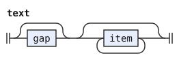
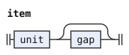
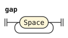
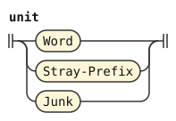

# The word stream

This document opens the words stage of the [Eberban pipeline](pipeline.md). A stage is one step of a pipeline, with its own grammar. A token is one unit that a stage reads or emits. A tag is a capitalized key of a token's bag.

The stage reads the words and spaces of the [forms stage](morphology.md). It keeps the words and drops the spaces, and it hands the syntax stage a stream of words. The forms stage reads each complete compound as one word token, and each spelling quote and foreign quote as one token. [The notation document](../../../docs/notation.md) explains jbogenbau, the notation of these grammars.

## The stream

The stream is a sequence of units with gaps between them. A gap is one or more space tokens, and it emits nothing. It is not erased, because foreign-letter warnings must survive the loss of spacing. Each `item` reads a unit and the gap after it, and emits only the unit. So the warnings of a gap travel on the unit before it. An erasure of that unit drops them, as [the pipeline](pipeline.md) says of an erased stretch. A gap at the start of the text has no unit before it, so its warnings travel on the first unit. Two units can also stand side by side, as `mi` and `bjan` do in `mibjan`. Each unit reads one token, so the text has one parse, and the `lazy` policy of the stage decides nothing.

A unit is a word, a stray prefix, or junk. Each retains its forms diagnostics. A stray prefix belongs to an unfinished compound. The closing `e` of an empty `er e` uses that class without another error. Junk is a run that no word reader accepts. Syntax erases junk or rejects it with its carried error.

Each unit is a token whose primary is the token that it reads. So the unit has the bag of that token. A reader of the result follows the primary to the token of the forms stage, and from there to its core. The stage passes the keys of its input on with `%const $OUTPUTS $INPUTS`. It defines no `$DEFAULTS`, because each token takes its strings from its primary.

```jbogenbau
%ambiguity-resolution lazy
%const $OUTPUTS $INPUTS

%rule text
  [gap] [{item}]

%rule item
  $u:unit [gap]
%emit
  $u

%rule gap
  {Space}

%rule unit
  | ^Word
  | ^Stray-Prefix
  | ^Junk
%emit
```

<details><summary>Railroad diagrams of <code>text</code>, <code>item</code>, <code>gap</code> and <code>unit</code></summary>
<p></p>
<p></p>
<p></p>
<p></p>
</details>

## Differences from the reference grammar and the PEG

This stage preserves every diagnostic and adds none. The [word forms](morphology.md#diagnostic-codes-and-peg-sources) report local faults. The [syntax](syntax.md#diagnostic-codes-and-peg-sources) removes them only inside erased constituents.

## Differences from the format 49 grammar

This document reads the same texts as its format 49 copy, `grammars/eberban/refgram/stream.md`. The format 49 copy put the warnings of a gap on the unit after it. So a warning of erased text could survive, as in `a mi mo x ra a ke`, and a warning of kept text could go, as in `a ke x a mo ra a mi`. Here the gap belongs to the unit before it. Given the same input tokens, both copies emit the same tokens, because each forwards the tokens of the forms stage. Where the forms stage gives other values or images, as for `a e u'ulis ban`, this stage forwards them. The primary of each unit is new. Each unit now shows the face of its forms token, whose core is the rule that built it. That rule stands in the forms stage, or in the letters stage for a digit or the closing `e` of an empty `er e`.
