# The grammar

This document opens the syntax stage of the [Eberban pipeline](pipeline.md). A stage is one step of a pipeline, with its own grammar. A token is one unit that a stage reads or emits. A tag is a capitalized key of a token's bag.

The stage reads the words of the [words stage](stream.md). Each word carries its kind or its family as a tag, and the terminals of this grammar are those tags. The stage is the last one, so it ends with its tree and hands on no tokens. The chapters of the reference grammar give the constructs. The PEG `eberban.peggy` is the executable baseline, and the closing section lists the departures from it.

The prose uses these Eberban terms:

- A verb is a predicate word or construct in a chain. Roots, compounds, borrowings and many particles are predicates. Some particle families cannot stand as a verb, such as `FI` or `PA`, and `base-verb` lists those that can.
- A chain is a sequence of verbs. The chapter on [chaining](https://eberban.github.io/eberban/books/refgram/book/logic/chaining.html) groups it from the right.
- A bind is an explicit binding of a place of a verb, opened by `VI` or `FI` and closed by `vei`.
- An annotation is a free prefix or suffix with no logical effect.

[The notation document](../../../docs/notation.md) explains jbogenbau, the notation of these grammars. An elided terminator is a closing word left unwritten. The engine first compares source blame, unlocated errors, and then local error count. The pipeline then counts unmatched errors and words-erasure routes. It next prefers the latest erasure start. The step `late #(·_<_Elided> ∖ ·A)` then puts an elided terminator other than a starter as late as the text allows. The last step, `leftmost-longest #·step`, attaches each resumption as deep as the matching verb allows.

## Texts and paragraphs

A text is language flags, then paragraphs, and an empty text is valid. The book does not document the flags `DO`. The dictionary lists `do`, which disables the automatic import of the standard dictionary, and the PEG places the flags at the start of a text. So this grammar keeps `DO` on those two sources. Both parsers give the family to every particle that starts with `do`. No source states the scope of a flag inside a nested text. The [sentences chapter](https://eberban.github.io/eberban/books/refgram/book/logic/sentences.html) marks a new paragraph with `PO`. The first paragraph can lack it. A paragraph is a sentence and any number of further sentences. A further sentence starts with a sentence starter, a particle of family `A`, `O` or `NI`. Or it is ungrammatical text that `ra` erases.

The chapter says that where several prefixes stand in a row, `PO` "must be the first" of them. So `po-head` reads no free prefix before `PO`, and `di po a mi` is invalid text. In `a mo di po ra a ke`, the `ra` erases `a mo di po`. A free prefix can follow it, as in `po di a mi`.

The text rules are templates. Their parameter names what blocks an erasure at the start of a paragraph, as "Sentences and erasure" explains. `text` and its rules serve the whole text. A parenthetical reads `text-of(paren-open-sentence)`, and a quote with a written `cai` reads `text-of(quote-open-sentence)`. `elided-cai-text` and its rules serve a quote whose `cai` is left out.

The sentences chapter starts every sentence with a starter, and lets the first sentence of a paragraph leave it out. So a further sentence without a starter is always ungrammatical. `invalid-tail` reads it as erased text, even where the same words form a sentence at the start of a paragraph.

A further sentence cannot start with a paragraph mark or the end of a parenthesis, because those end the paragraph. If no `ra` comes right before it, erased text after a complete sentence cannot start with a sentence closer, with or without free prefixes. Such a closer belongs to the sentence before it, which is then ungrammatical, so the erasure starts at that sentence. The closers are those of `sentence-closer`.

Erased text after a complete sentence cannot start with a sentence starter either. A malformed starter is the one exception, and only right after a `ra`. There the malformed word starts no sentence, so that `ra` cannot erase it, and a later `ra` erases it as words. A malformed paragraph mark or closer is not such an exception. It would otherwise leave the sentence before it standing, although the book erases back to the last grammatical sentence.

```jbogenbau
%rule text-of(@Open)
  [{DO}] [paragraphs-of(@Open)]

%rule paragraphs-of(@Open)
  [po-head] sentences-of(@Open) [{po-head sentences-of(@Open)}]

%rule po-head
  PO [{free-suffix}]

%rule sentences-of(@Open)
  sentence-or-erasure-of(@Open) [{tail-sentence-of(@Open)}]

%rule tail-sentence-of(@Open)
  starter-sentence-of(@Open)
  | invalid-tail

%const $ERASED-TAIL-SENTENCE
  #·sentence-or-erasure-of⁅ (sentence-erasure | words-erasure) [unmatched-tail] ⁆

%rule starter-sentence-of(@Open)
  $s:sentence-or-erasure-of(@Open)
%conditions
  $s.onward.parse(starter-head …),
  $s ≅ $ERASED-TAIL-SENTENCE ⟹ $s.onward.parse(starter-head …).error-free

%rule invalid-tail
  $s:words-erasure
%conditions
  ¬$s.onward.parse(starter-head …) ∨
    (¬$s.onward.parse(starter-head …).error-free ∧ $s.preceding-tokens.parse(… RA)),
  ¬$s.onward.parse((PO | DAI) …).error-free,
  ¬$s.onward.parse((PO | sentence-closer) …) ∨ $s.preceding-tokens.parse(… RA)

%rule starter-head
  [{free-prefix}] (A | O | NI)

%rule text = text-of(open-sentence)
%rule paragraphs = paragraphs-of(open-sentence)
%rule sentences = sentences-of(open-sentence)
%rule tail-sentence = tail-sentence-of(open-sentence)
%rule starter-sentence = starter-sentence-of(open-sentence)
%rule sentence = sentence-or-erasure-of(open-sentence)

%rule elided-cai-text = text-of(quote-sentence-witness)
%rule elided-cai-paragraphs = paragraphs-of(quote-sentence-witness)
%rule elided-cai-sentences = sentences-of(quote-sentence-witness)
%rule elided-cai-tail-sentence = tail-sentence-of(quote-sentence-witness)
%rule elided-cai-starter-sentence = starter-sentence-of(quote-sentence-witness)
%rule elided-cai-sentence = sentence-or-erasure-of(quote-sentence-witness)
```

<details><summary>Railroad diagrams of the 20 rules from <code>text-of</code> to <code>elided-cai-sentence</code></summary>
<p>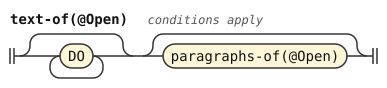</p>
<p>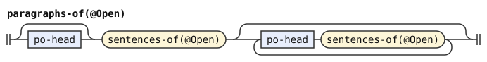</p>
<p>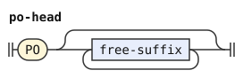</p>
<p>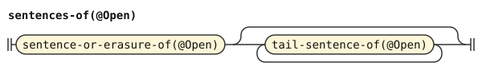</p>
<p>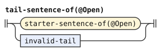</p>
<p>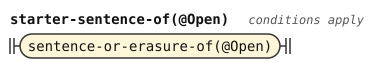</p>
<p>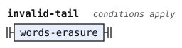</p>
<p>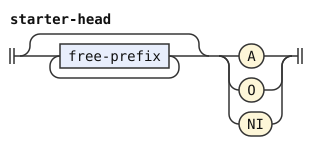</p>
<p>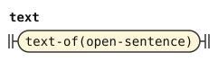</p>
<p>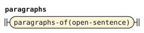</p>
<p>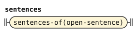</p>
<p>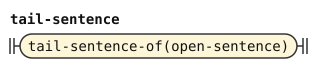</p>
<p>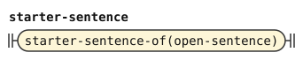</p>
<p>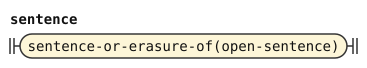</p>
<p>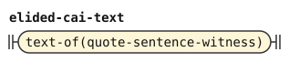</p>
<p>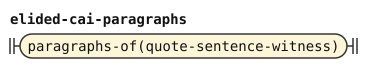</p>
<p>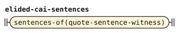</p>
<p>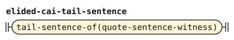</p>
<p>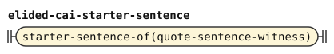</p>
<p>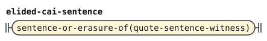</p>
</details>

## Sentences and erasure

A sentence starts with `A`, `O` or `NI`. An `A` sentence is an inner predicate, which is a chain with an optional arguments list. An `O` sentence names a definable word, then an inner predicate. An `NI` sentence names a definable word alone.

The first sentence of a paragraph can leave its `a` out. An elidable optional starts with its terminator, so no free prefix can stand before an elided `a`. So the second alternative of `a-sentence` reads one or more prefixes before a written `a`.

A sentence ends where the next sentence, paragraph, quote end, parenthesis end or eraser begins, or at the end of the text. A particle that closes an outer construct ends the sentence too: `FI`, `VEI`, `PEI`, `BU` or `PA`. Such a particle ends a quote whose `cai` is left out, together with its last sentence, and `quote-ender` names these particles. The rule `sentence-end` names these ends, and `sentence-with-end` requires one after the sentence. `sentence-closer` names the closing particles, which are those of `quote-ender`, `cai` and `dai`.

A free prefix can stand before `cai`, `fi` or `bu`, as in `ca mo di cai`, because the rules that read those particles allow one. An open sentence is one that ends at the next sentence, paragraph or eraser, or at the end of the text. No enclosing construct has to claim what follows it, so it is grammatical wherever it stands. `open-sentence` and `open-end` name it. Its end must be free of errors, so a malformed starter or paragraph mark does not end it.

The rule `sentence` also reads erasures. The chapter on sentences gives two erasers. `ra` erases everything since the start of the current sentence. It also erases ungrammatical text back to the start of the last grammatical sentence. `ri` erases the current chain, which must be grammatical.

The chapter erases back to the start of the last sentence that was still grammatical. The words route cannot replace an error-free sentence at the start of a paragraph. The first condition of `sentence-or-erasure-of` states that rule. Its parameter selects the required sentence witness. A sentence ending only before a closer or `dai` needs an enclosing construct to claim that word.

In the whole text, the parameter is `open-sentence`. A parenthetical uses `paren-open-sentence`, and a quote with a written `cai` uses `quote-open-sentence`. Such a sentence then does not block the erasure. In a quote whose `cai` is left out, a closer can end the quote. There, any error-free sentence with an error-free end blocks the words route. The parameter there is `quote-sentence-witness`. Each witness is a query only: the sentences themselves still use the ordinary sentence reader.

A written paragraph mark at the start of a paragraph is always the paragraph's mark. So the second condition keeps it out of the erased text. A malformed `PO` is no such mark, so that condition tests an error-free `PO`. A `ra` can also stand where a sentence starts, with nothing to erase. That is `empty-erasure`.

```jbogenbau
%rule sentence-or-erasure-of(@Open)
  | sentence-erasure | sentence-with-end
  | $i:words-erasure
  | empty-erasure
%conditions
  ¬$i.onward.parse(@Open …).error-free,
  ¬$i.onward.parse(PO …).error-free

%rule sentence-with-end
  $s:sentence-body
%conditions
  $s.following-tokens.parse(sentence-end …)

%rule quote-sentence-witness
  $s:sentence-body
%conditions
  $s.following-tokens.parse(sentence-end …).error-free

%rule sentence-body
  o-sentence | ni-sentence | a-sentence

%rule sentence-end
  open-end | sentence-closer

%rule quote-ender
  | [{free-prefix}] (FI | BU)
  | VEI | PEI | PA

%rule sentence-closer
  | quote-ender
  | [{free-prefix}] CAI
  | DAI

%rule open-sentence
  $s:sentence-body
%conditions
  $s.following-tokens.parse(open-end …).error-free

%rule open-end
  starter-head | PO | RA | end-of-text

%rule end-of-text
  ε
%conditions
  $.ends-input

%rule a-sentence
  | [+A [{free-suffix}]] inner-predicate
  | {free-prefix} A [{free-suffix}] inner-predicate

%rule o-sentence
  [{free-prefix}] O [{free-suffix}] definable inner-predicate

%rule ni-sentence
  [{free-prefix}] NI definable
```

<details><summary>Railroad diagrams of the 13 rules from <code>sentence-or-erasure-of</code> to <code>ni-sentence</code></summary>
<p>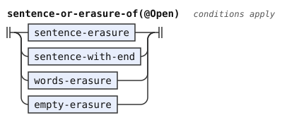</p>
<p>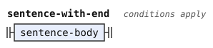</p>
<p>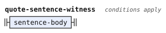</p>
<p>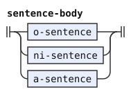</p>
<p>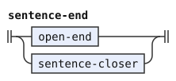</p>
<p>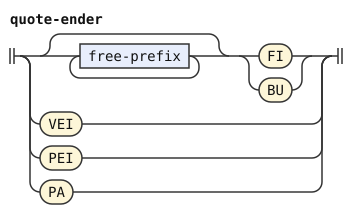</p>
<p>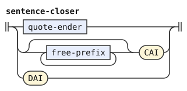</p>
<p>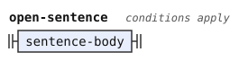</p>
<p>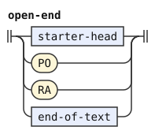</p>
<p>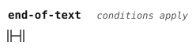</p>
<p>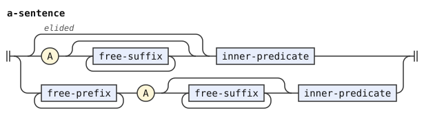</p>
<p>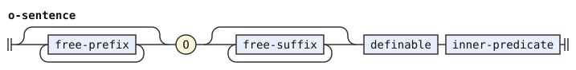</p>
<p>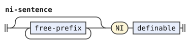</p>
</details>

Sentence erasure reads a sentence and then its `ra` run. Words erasure reads one or more words before that run. Either route can contain malformed words or syntax recovery. Its inner constituent is erased, so its errors, warnings, and measure disappear. The `ra` run stays outside and keeps its own diagnostics.

`erased-sentence` holds the erased sentence, which must be free of errors. The chapter erases back to the start of the last sentence that was still grammatical. So a sentence with an error falls to the words route. `erased-words` holds the arbitrary words, with their first word named by `invalid-head`. The outer rules retain the erasure's following-token guards. An empty erasure reads `ra` alone and erases nothing.

At equal measures, the pipeline first prefers fewer words-erasure routes. Then it prefers the latest start of an erased constituent, which erases the shortest stretch. Thus `a sune mo ra a ke` retains its sentence route rather than a shorter words route. Key steps cannot count the words hidden by the erased seal.

The `@Open` bar rejects a words route only for an error-free sentence witness. Ordinary starter and reach queries still recognize faulty tokens. Thus `a pban a mo ra a ke` retains its words route, while `a pban ra a mo` takes sentence erasure.

`invalid-head` needs a later `ra`, which `erasure-reach` tests. This query reads every token before that `ra`, including malformed words and unclassified junk. Without it, every failed text keeps a speculative erasure reading and reports only a missing `ra` at input end.

When its first word is an error-free `quote-ender`, the term of `erased-words` gives it the tag `Closer-Head`. When its first word is an error-free `cai`, with or without free prefixes, the term gives it `Cai-Head`, which the quote rules read. An erased node keeps its tags, so a pattern can still read it. A quote guard reads this tag because the seal hides the real head. Its pattern follows only that quote's own paragraphs and sentences. It does not enter nested text.

The chapter erases back to the start of the last sentence that was still grammatical. A sentence inside a parenthetical that is still open is such a start, so an erasure cannot reach back past it. The condition of `erased-words` states that. Its words hold no `da` that opens a sentence, unless the `dai` that closes that `da` stands inside them. `open-note-start` names such a `da`. It is a clean `da` after which the note has started a sentence, with flags or a paragraph mark first. The annotations chapter says that `da` starts a note and `dai` ends it, and it is silent on a note with an error. This grammar decides that a note ends at the clean `dai` that balances its clean `da`, for consistency with quotes. An error inside a closed quote stays inside that quote, and an error inside a note stays inside the note in the same way. So the condition finds that `dai` by tokens, through `closed-note`, which skips each nested pair of `da` and `dai`. It also skips a closed grammatical quote, through `closed-quote`, so a `dai` inside that quote closes no note. A clean `dai` ends a quote whose `cai` is left out, so the scan closes a quote only where no such `dai` stands inside it, as in `a mi da a ca mo dai ke cai ra a ke`. The test reads tokens and not a parse of the note, because a closed note can hold an error. `note-tokens` and `note-start` seal the tokens of the note, so their errors do not hide the `dai` from the query. A faulty `da` or `dai`, as in `dah` or `daih`, opens or closes nothing, as a faulty `caih` closes no quote. A `dai` that a clean `ci` quotes closes nothing either, and a faulty `cih` quotes nothing. `clean-da`, `clean-dai` and `clean-ci` define the clean markers once, and every rule that tests a marker reads them. So in `a mi da a pban dai ra a mo`, `a mi da a vi dai ra a mo` and `a mi da a zi dai ra a ke`, the note is closed, and `ra` erases the whole first sentence. In `a mi da a mo daih ra a ke`, the note stays open, and the text is rejected with `unclosed-parenthetical`. So `ra` in `a mi da a ke ra a mo` erases `a ke` inside the open parenthetical, and the text ends with that parenthetical still open. An unclosed foreign quote gets the same treatment in the [word forms](morphology.md).

The chapter says that `ra` "must be surrounded by spaces or pauses". The start of a text counts as a pause, as it does for hesitation in the [word forms](morphology.md). So a text can start with `ra`.

The PEG requires a written starter after an erasure, and states this rule in an error message. The book supports it only by inference. It lets only the first sentence of a paragraph leave its starter out, and the sentence after an erasure is not the first.

Erased text can follow an erasure too, because the later `ra` erases it. So `after-erasure` accepts a starter, a paragraph mark or more erased text. It also accepts the end of the text, or a particle that ends an enclosing quote or parenthesis. The particles of `quote-ender` end a quote whose `cai` is left out.

```jbogenbau
%rule sentence-erasure
  $s:erased-sentence ra-run
%conditions
  $.following-tokens.parse(after-erasure …)

%rule words-erasure
  $i:erased-words ra-run
%conditions
  $.following-tokens.parse(after-erasure …)

%const $CLOSER-HEAD-ERASURE
  #elided-cai-text⁅ ⋯ elided-cai-paragraphs⁅ ⋯ elided-cai-sentences⁅ ⋯
    words-erasure⁅ erased-words<Closer-Head> ⋯ ⁆ ⋯ ⁆ ⋯ ⁆ ⁆

%rule erased-sentence
  $s:sentence-with-end
%conditions
  $s.parse(sentence-body).error-free
%erased

%rule erased-words
  $h:invalid-head [{erasure-word}]
      → {$h.onward.parse(quote-ender …).error-free? Closer-Head,
         $h.onward.parse([{free-prefix}] CAI …).error-free? Cai-Head}
%conditions
  ¬$.parse(… open-note-start …)
%erased

%rule empty-erasure
  ra-run
%conditions
  $.following-tokens.parse(after-erasure …)

%rule invalid-head
  _<¬RA>
%conditions
  $.onward.parse(erasure-reach …)

%rule erasure-reach
  {_<¬RA>} RA

%rule open-note-start
  clean-da note-start
%conditions
  ¬$.onward.parse(closed-note …)

-- The note has started a sentence. Its errors are sealed, as in the text of the note.
%rule note-start
  [{DO}] [po-head] (starter-head | sentence-body)
%erased

-- A note closes at the clean DAI that balances its clean DA, by tokens.
%rule closed-note
  clean-da note-tokens clean-dai

%rule note-tokens
  [{note-token}]
%erased

%rule note-token
  | _<¬DA ¬DAI ¬CI ¬CA ¬CAI>
  | clean-ci _
  | faulty-da
  | faulty-dai
  | faulty-ci
  | lone-ca
  | lone-cai
  | closed-note
  | closed-quote

-- A closed grammatical quote is one unit of the scan. A clean dai ends a quote whose cai is left out,
-- so a closed quote holds a dai only inside a closed note.
%rule closed-quote
  clean-ca quote-tokens clean-cai

%rule quote-tokens
  [{quote-token}]
%erased

%rule quote-token
  | _<¬CA ¬CAI ¬CI ¬DA ¬DAI>
  | clean-ci _
  | faulty-ci
  | faulty-da
  | faulty-dai
  | lone-ca
  | faulty-cai
  | closed-note
  | closed-quote

-- A ca that no clean cai closes, as where its cai is left out, is one token of the scan.
%rule lone-ca
  $c:CA
%conditions
  ¬$c.onward.parse(closed-quote …)

%rule lone-cai
  $c:CAI

-- The clean markers that a condition tests. A faulty marker carries an error of the word forms.
%rule clean-da
  $d:DA
%conditions
  $d.parse(DA).error-free

%rule clean-dai
  $d:DAI
%conditions
  $d.parse(DAI).error-free

%rule clean-ci
  $c:CI
%conditions
  $c.parse(CI).error-free

%rule faulty-da
  $d:DA
%conditions
  ¬$d.parse(clean-da)

%rule faulty-dai
  $d:DAI
%conditions
  ¬$d.parse(clean-dai)

%rule faulty-ci
  $c:CI
%conditions
  ¬$c.parse(clean-ci)

%rule clean-ca
  $c:CA
%conditions
  $c.parse(CA).error-free

%rule clean-cai
  $c:CAI
%conditions
  $c.parse(CAI).error-free

%rule faulty-cai
  $c:CAI
%conditions
  ¬$c.parse(clean-cai)

%rule erasure-word
  _<¬RA>

%rule ra-run
  {RA} [*erasure-needs-starter]

%rule after-erasure
  starter-head | PO | words-erasure | sentence-closer | end-of-text
```

<details><summary>Railroad diagrams of the 29 rules from <code>sentence-erasure</code> to <code>after-erasure</code></summary>
<p>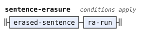</p>
<p>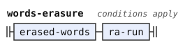</p>
<p>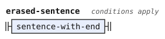</p>
<p>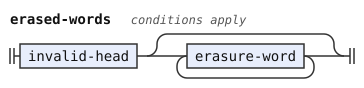</p>
<p>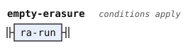</p>
<p>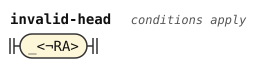</p>
<p>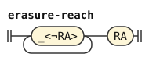</p>
<p>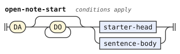</p>
<p>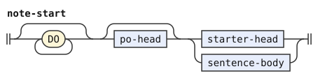</p>
<p>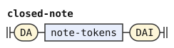</p>
<p>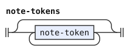</p>
<p>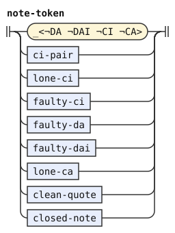</p>
<p>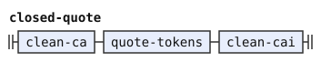</p>
<p>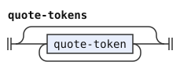</p>
<p>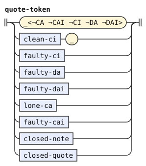</p>
<p>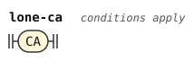</p>
<p>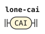</p>
<p></p>
<p></p>
<p></p>
<p></p>
<p></p>
<p></p>
<p></p>
<p></p>
<p></p>
<p></p>
<p></p>
<p></p>
</details>

## Definable words and inner predicates

A definable word is a root, a compound, a freeform variable or a `GI` variable, each with optional annotations before it. The chapter on sentences lets a namespace precede it: a definable word or `MI` particle, then `pi`. A definable word for `O` and `NI` cannot start with an `MI` particle.

An inner predicate is a chain, with an optional arguments list before it. The arguments list is zero or more `KI`, `GI` or `BA` variables ended by `be`. A `BA` variable can take free prefixes, as the PEG's `BA_Free` reads them. The [explicit binding chapter](https://eberban.github.io/eberban/books/refgram/book/logic/explicit_binding.html) does not mention prefixes there, and the PEG gives none to `KI` or `GI`.

```jbogenbau
%rule definable
  $d:definable-usage
%conditions
  ¬$d.onward.parse(prefixed-mi …)

%rule definable-usage
  [{namespace-step}] definable-part

%rule namespace-step
  (definable-part | prefixed-mi) PI

%rule definable-part
  [{free-prefix}] (GI | Freeform | Compound | Root)

%rule prefixed-mi
  [{free-prefix}] MI

%rule inner-predicate
  | [arguments-list] chain
  | *arguments-without-chain

%rule arguments-list
  [{KI | GI | prefixed-ba}] BE
```

<details><summary>Railroad diagrams of the 7 rules from <code>definable</code> to <code>arguments-list</code></summary>
<p></p>
<p></p>
<p></p>
<p></p>
<p></p>
<p></p>
<p></p>
</details>

## Chains

A chain is one or more steps, grouped from the right. `ri` erases the chain read so far, and the chain starts again after it. `bi` before a chain negates the whole of it, as the chapter on [transformations](https://eberban.github.io/eberban/books/refgram/book/logic/transformations.html) says. The chapter also says that "both `zi` and `bi` can be repeated. Each occurrence negates the scope of the next one". So a `BI` can repeat in every place where one `BI` stands: before a chain, before a bind and before an enumeration item. So `a mi bi bi va mo` and `a pe bu bi bi mi pei` are texts.

After `bi`, `ri` replaces the chain that the `bi` negates, and the `bi` stays. So `a mi bi mo ri ke` negates `ke`, as in the PEG. The chain after `bi` can read the `ri` itself, so `restart-chain` refuses a replaced chain that ends in a `bi` chain. Without that condition, each such text has two readings. This strict chain is not erased, so its errors still report.

A step is a verb with its free suffixes and binds, then the rest of the chain. The verb can take an `SI` particle before it, which selects its places. An `SI` can also follow each `ZI` modifier of the verb. The rule `annotated-verb` reads the verb with its free suffixes, as the PEG's `ChainVerb` does.

```jbogenbau
%rule chain
  [{restart-chain RI}] chain-inner

%rule restart-chain
  chain-inner
%conditions
  $ ≇ #(⋱ chain-inner⁅ annotated-bi chain ⁆)

%rule chain-inner
  | annotated-bi chain
  | step

%rule annotated-bi
  [{free-prefix}] BI [{free-suffix}]

%rule prefixed-si
  [{free-prefix}] SI

%rule verb
  [{prefixed-zi [prefixed-si]}] base-verb

%rule annotated-verb
  verb [{free-suffix}]

%rule prefixed-zi
  [{free-prefix}] ZI
```

<details><summary>Railroad diagrams of the 8 rules from <code>chain</code> to <code>prefixed-zi</code></summary>
<p></p>
<p></p>
<p></p>
<p></p>
<p></p>
<p></p>
<p></p>
<p></p>
</details>

### Resuming a verb

`PA` resumes the bindings of a verb earlier in the chain. The book does not describe `pa`, so the dictionary and the PEG are the sources. The dictionary says that `pa` "resumes bindings to a matching verb higher in the chain". The speaker repeats the verb after `pa`, then adds binds or continues the chain. The PEG resumes the latest matching verb, the deepest one in the right-grouped chain.

The pipeline's last step, `leftmost-longest #·step`, states that preference. Among the parses that remain, it takes the one whose steps start earliest and reach farthest. So an outer step holds the inner steps, and a resumption attaches as deep as the matching verb allows. A step has one rule name, whether a resumption follows it or not. So two equal verbs give equal trees, also where one of them stands right before a `pa`.

A step takes any number of resumptions in a row. The repeated verb can carry its own binds and continue the chain. The condition compares each repeated verb with the verb of the step.

A resumption matches the words of the two verbs, as the PEG does. The condition `$e.all(' ≅ $v)` compares each repeated verb with the verb of the step, as trees. Two trees are equal where they have the same rules and the same words in the same order. So the free prefixes and suffixes of the verb count, and so do its `ZI` modifiers and the `SI` after each modifier. The `SI` before the verb stands outside it, so that `SI` can differ, as in the PEG.

A written terminator never equals an elided one, so `to jie` and `to` are two verbs. A word compares by its value, which is its canonical word. So the two spellings of a compound or a spelling quote, and a digit and its `TI` word, resume each other. `$e` stands in a repetition, so it is a list, and the condition tests each item of it.

```jbogenbau
%rule step
  | [prefixed-si] annotated-verb step-tail
  | resumed-step

%rule resumed-step
  [prefixed-si] $v:annotated-verb step-tail {resume-head $e:annotated-verb step-tail}
%conditions
  $e.all(' ≅ $v)

%rule step-tail
  [{bind-group}] [chain-inner]

%rule resume-head
  PA [prefixed-si]
```

<details><summary>Railroad diagrams of <code>step</code>, <code>resumed-step</code>, <code>step-tail</code> and <code>resume-head</code></summary>
<p></p>
<p></p>
<p></p>
<p></p>
</details>

The comparison uses identity demand, which selects occurrences that need tree identities. [Engine §4.1](../../../docs/engine.md#41-shared-candidate-observations) defines its scope and modes.

The comparison in `resumed-step` runs at the advance over each `$e`, before `step-tail`. It demands nothing of `step-tail` or `resume-head`. Its two `annotated-verb` occurrences demand tree identities. The recognizer predicts `resumed-step` at every step start, before it sees any `pa`.

Every verb at the start of a step therefore carries identities. Inside that operand, demand reaches every observable descendant up to a seal, which hides a ranked or erased interior. This includes chains, steps, `step-tail` and bind groups inside an enumeration, quote or parenthetical in the verb. The enclosing step's `step-tail`, binds and top-level `text` stand outside the operand and carry none.

The cost is the tree of each verb at the start of a step. A quote, enumeration or parenthetical inside that verb splits its items by its inner tree, including its inner binds. The binds of the enclosing step do not split its items. The recognizer also reads the same verb in ordinary mode, from the first alternative of `step`.

The recognizer therefore reads the verb subtrees of a step twice. Ordinary mode keeps the items of a grammar without the comparison. Observed mode retains tree identities and keeps a second set of items. No factor bounds that set against the first. One ordinary item can stand for many trees, while observed mode gives each distinct tree its own item. The total is the sum of the two modes.

The grammar passes the comparison-cycle check of [engine §9.3](../../../docs/engine.md#comparison-cycles). That check rejects cycles of marked edges, which connect observed constituents without reducing their span. Every path from `verb` back to `verb` reads a token first, such as `CA`, `PE`, `DA`, `DE` or `BU`. The inner span is therefore smaller. `annotated-verb` adds one marked edge to `verb`, because every postfix can be absent. That edge stands in no cycle.

In `resumed-step`, each distinct tree of the outer verb supplies one comparison frame. The `sentence-or-erasure-of` query reaches this comparison and builds identities too.

## Binds

`VI` opens a bind on a place of the preceding verb, and `FI` binds another place of the same verb. `vei` closes the group, and the speaker can leave it out at the end of a sentence. A bind holds an inner predicate. `bi` before `VI` or `FI` negates the bind.

The empty-bind alternatives test the boundary after the postfixes that they read. A postfix can contain a recovered error, which a query witness cannot read. The captured splice records that boundary without adding a node to the tree.

```jbogenbau
%rule bind-group
  bind-first [{bind-next}] [+VEI]

%rule bind-first
  | [{annotated-bi}] annotated-vi inner-predicate
  | [{annotated-bi}] [{free-prefix}] *bind-empty-vi $p:*recovery-suffixes
%conditions
  $p.following-tokens.parse(missing-operand-boundary …)

%rule bind-next
  | [{annotated-bi}] annotated-fi inner-predicate
  | [{annotated-bi}] [{free-prefix}] *bind-empty-fi $p:*recovery-suffixes
%conditions
  $p.following-tokens.parse(missing-operand-boundary …)

%rule annotated-vi
  [{free-prefix}] VI [{free-suffix}]

%rule annotated-fi
  [{free-prefix}] FI [{free-suffix}]
```

<details><summary>Railroad diagrams of the 5 rules from <code>bind-group</code> to <code>annotated-fi</code></summary>
<p></p>
<p></p>
<p></p>
<p></p>
<p></p>
</details>

## Verbs

A verb is a definable word with its namespace, or an inline assignment with `bo`. The book describes `bo` before a `KI` or `GI` variable, so `bo-variable` reads a `GI` variable, with its free prefixes. The variable can have a namespace whose parents are definable words, as in `a mi bo gi pi ga`. A `mi` parent is not definable, as in the PEG's `VerbDefinable` and as for `o` and `ni`. So `a mi bo mi pi gi` is rejected, as are `a mi bo mian`, `a mi bo eberban` and `a mi bo ibar`. It can also be a `KI`, `BA` or `MI` particle, a quote, an enumeration, a borrowing group or a number. A `KI`, a number and a borrowing group take no free prefix of their own, as in the PEG. So `a di 1` and `a di ualis` are rejected. The others can take free prefixes. Any verb of a chain can take free suffixes, as in `a ke de mi`, because `annotated-verb` reads them.

```jbogenbau
%rule base-verb
  | definable-usage | inline-assignment | KI | prefixed-ba | prefixed-mi
  | grammatical-quote | word-quote | spelling-quote | foreign-quote
  | enumeration | borrowing-group | number

%rule inline-assignment
  [{free-prefix}] BO (KI | bo-variable)

%rule bo-variable
  [{definable-part PI}] [{free-prefix}] GI

%rule prefixed-ba
  [{free-prefix}] BA
```

<details><summary>Railroad diagrams of the 4 rules from <code>base-verb</code> to <code>prefixed-ba</code></summary>
<p></p>
<p></p>
<p></p>
<p></p>
</details>

### Quotes

The [quotes chapter](https://eberban.github.io/eberban/books/refgram/book/grammar/quotes.html) gives four quotes. `ca` quotes a grammatical text up to `cai`. The text can be empty. `ci` quotes one actual word, "ignoring its grammar": a particle, a root, a compound or a borrowing. So the word after `ci` is a plain word even where it could start a quote. Only a clean `ci` quotes, so `word-quote` reads `clean-ci`, and a faulty `cih` quotes nothing. The [word forms](morphology.md) read it so, and `ci ce` and `ci co` quote the particles `ce` and `co`. A digit is a particle, so `ci` quotes it.

`ce` spells a text up to `cei`, which the forms stage reads as one unit. `co` quotes foreign text, which the forms stage also reads as one unit, and `coi` stands for a quote whose content the speaker cannot read.

The chapter does not say that `cai` can be left out. The PEG lets the speaker leave it out where the quoted text can end, and this grammar follows the PEG.

The quotes chapter says that `cai` matches its opening `ca`. So the first `cai` that can close a quote closes it. A `cai` can close the quote where the quoted text before it is grammatical. A quote with a written `cai` reads its text with the witness `quote-open-sentence`, which lets a sentence end before that `cai`. Then the words route cannot erase the sentence together with its `cai`. Two conditions of `grammatical-quote` cover the other places. The quoted text cannot start with a `cai`, as in `a mi ca cai ra a ke cai`. And a later sentence of the quoted text cannot be a words erasure that starts with a clean `cai`, as in `a mi ca a mo ra cai ra a ke cai`. `$CAI-HEAD-ERASURE` finds such an erasure in the quote's own paragraphs, through the tag `Cai-Head`. A quote whose `cai` is left out has the same two conditions, because a written `cai` would close it. A `cai` after faulty text, after a paragraph mark, or quoted by `ci` closes nothing, so `ra` can erase it.

A quote with a written `cai` reads its text like the whole text in other respects, because no closer inside it can end it. In a quote whose `cai` is left out, a particle that closes an outer construct ends the quoted text instead of starting erasable text. The second and third alternatives read such a quote. Their terminator `[+CAI<_Elided>]` allows only the omitted `cai`, because the test `<_Elided>` on its head accepts only an omitted leaf. Their first conditions exclude a closer-headed words erasure only in that quote's own sentence list. A nested quote with written `cai` or a closed parenthetical keeps its own closers.

Where a quote of several sentences leaves out its `cai` before the end of the text, the PEG warns. The end of the quote is then hard to see. The third alternative splices the warning rule `multi-sentence-cai-elided`.

A quote holds several sentences in two cases: it has several paragraphs, or its first paragraph has more than one sentence that is not erased. `$SEVERAL-SENTENCES` states that. An erased sentence exports a sealed root. The pattern cannot reach its inner `sentence-with-end`, so that sentence does not count. The outer erasure still holds its `ra` separately. The last three conditions send each such quote to exactly one of the two alternatives.

```jbogenbau
%const $SEVERAL-SENTENCES
  #⁅ ⋯ elided-cai-paragraphs⁅ ⋯ elided-cai-sentences po-head ⋯ ⁆ ⁆ ∪
  #⁅ ⋯ elided-cai-paragraphs⁅ [po-head] elided-cai-sentences⁅ ⋯ sentence-with-end ⋯
    sentence-with-end ⋯ ⁆ ⋯ ⁆ ⁆

%rule quote-open-sentence
  $s:sentence-body
%conditions
  $s.following-tokens.parse((open-end | [{free-prefix}] CAI) …).error-free

%const $CAI-HEAD-ERASURE
  #text-of⁅ ⋯ paragraphs-of⁅ ⋯ sentences-of⁅ ⋯
    tail-sentence-of⁅ invalid-tail⁅ words-erasure⁅ erased-words<Cai-Head> ⋯ ⁆ ⁆ ⁆ ⋯ ⁆ ⋯ ⁆ ⁆

%rule grammatical-quote
  | [{free-prefix}] CA $t:text-of(quote-open-sentence) [{free-prefix}] CAI
  | [{free-prefix}] CA $q:elided-cai-text [+CAI<_Elided>]
  | *multi-sentence-cai-elided
%conditions
  ¬$t.parse([{DO}] [{free-prefix}] CAI …).error-free,
  $t ≇ $CAI-HEAD-ERASURE,
  ¬$q.parse([{DO}] [{free-prefix}] CAI …).error-free,
  $q ≇ $TEXT-RECOVERY,
  $q ≇ $CAI-HEAD-ERASURE,
  $q ≇ $CLOSER-HEAD-ERASURE,
  $q ≅ $SEVERAL-SENTENCES ⟹ $.following-tokens.parse(end-of-text …)

%rule multi-sentence-cai-elided
  [{free-prefix}] CA $l:elided-cai-text [+CAI<_Elided>]
%conditions
  ¬$l.parse([{DO}] [{free-prefix}] CAI …).error-free,
  $l ≇ $TEXT-RECOVERY,
  $l ≇ $CAI-HEAD-ERASURE,
  $l ≇ $CLOSER-HEAD-ERASURE,
  $l ≅ $SEVERAL-SENTENCES,
  ¬$.following-tokens.parse(end-of-text …)
%warning "a quote of several sentences omits cai before more text"

%rule word-quote
  [{free-prefix}] clean-ci (Word<Particle ¬Quote> | Root | Compound | Borrowing)

%rule spelling-quote
  [{free-prefix}] CE<Quote>

%rule foreign-quote
  [{free-prefix}] (CO<Quote> | COI)
```

<details><summary>Railroad diagrams of the 6 rules from <code>quote-open-sentence</code> to <code>foreign-quote</code></summary>
<p></p>
<p></p>
<p></p>
<p></p>
<p></p>
<p></p>
</details>

### Enumerations

The [enumeration chapter](https://eberban.github.io/eberban/books/refgram/book/grammar/enum.html) gives two forms. In the separator form, `PE` takes chains separated by `bu`. In the prefix form, `bu` follows `PE` directly, and each item is one verb with its binds. `pei` closes the enumeration, and the speaker can leave it out at the end of a sentence.

```jbogenbau
%rule enumeration
  [{free-prefix}] PE [{free-suffix}] (prefix-form | separator-form) [+PEI]

%rule prefix-form
  prefixed-bu [{[{annotated-bi}] enumerated-verb}]

%rule enumerated-verb
  [prefixed-si] annotated-verb [{bind-group}]

%rule separator-form
  [arguments-list] {chain / prefixed-bu}

%rule prefixed-bu
  [{free-prefix}] BU
```

<details><summary>Railroad diagrams of the 5 rules from <code>enumeration</code> to <code>prefixed-bu</code></summary>
<p></p>
<p></p>
<p></p>
<p></p>
<p></p>
</details>

### Borrowing groups and numbers

Consecutive borrowings form one group, which `be` can close. The [borrowings chapter](https://eberban.github.io/eberban/books/refgram/book/grammar/borrowings.html) needs the `be` only between two groups, because consecutive borrowings always fuse. So a group whose `be` is left out ends only where no borrowing follows, as the condition on `borrowing-group` says. Then a run of borrowings has one division.

A number is digits with separators, as the [numbers chapter](https://eberban.github.io/eberban/books/refgram/book/grammar/numbers.html) lays them out. Its parts are a base and `ju`, an integer part, and `jo` and a fractional part. Then come `ja` and a repeated part, and `je` and a magnitude. A `JI` particle ends it, and the speaker can leave that out. The repeated part needs the fractional separator before it. The number needs a digit in one of its parts, or a magnitude.

The alternatives of `number-body` list the parts that can come first. Any `JI` can end any number, as in the PEG. The chapter says that `jie` is mandatory between consecutive numbers to tell them apart. That means only that the ending cannot be left out there, so any written `JI` separates two numbers. A number with its `JI` left out cannot stand directly before another number, while `a te ji ta` is two numbers.

The condition on `number` tests its closing `JI` through the capture `$j`. An elidable optional binds only its written terminator, so `$j` is empty where the `JI` is left out. So either a written `JI` ends the number, or no number part follows. `borrowing-group` tests its `be` in the same way.

The chapter says that a `JI` other than `jie` "must follow positive integer (no fractional part)". That rule concerns the value of the number, and the closing section explains why the grammar imposes no condition on that value.

```jbogenbau
%rule borrowing-group
  {Borrowing} [$b:+BE]
%conditions
  $b ∨ ¬$.following-tokens.parse(Borrowing …)

%rule number
  [TI JU] number-body [$j:+JI]
%conditions
  $j ∨ ¬$.following-tokens.parse(number-continuation …)

%rule number-continuation
  TI | JU | JO | JA | JE

%rule number-body
  | digits [JE digits]
  | digits JO [digits] [JA digits] [JE digits]
  | JO digits [JA digits] [JE digits]
  | JO JA digits [JE digits]
  | JO JE digits
  | JE digits

%rule digits
  {TI}
```

<details><summary>Railroad diagrams of the 5 rules from <code>borrowing-group</code> to <code>digits</code></summary>
<p></p>
<p></p>
<p></p>
<p></p>
<p></p>
</details>

## Annotations

The [annotations chapter](https://eberban.github.io/eberban/books/refgram/book/grammar/annotations.html) gives free prefixes and suffixes. A prefix is a `DI` particle, with an optional `DU` scope before it. A suffix is `DE` with one verb, or a parenthetical text between `da` and `dai`. The chapter allows any valid text in a parenthetical. It states an empty text only for a quote. The PEG treats a parenthetical with no words as an error, and this grammar follows that intent. So `a mi da dai` reports `empty-parenthetical`. Language flags are words, so `a mi da do dai` is a text.

The chapter says that prefixing an annotation with `DU` changes its scope. So `free-suffix` reads an optional `DU` too, as in `a mi du de gali` and `a mi duo da a mo dai`. The families `DU`, `PE` and `JI` stay open by shape. The book names `du` and `duo`, six `PE` words and six `JI` words, and both parsers read every word of the right shape.

The book's summary comments out its `from_scratch` chapters, so this grammar leaves them out. They give `PA` context functions, `PO` definitions, `PU` axioms and `BU` lists without `PE`. No rule reads `PU` or `CU` outside quotes, compounds and delimiters, so `a pu mi` is rejected.

The book says that free prefixes stand before many elements, and it does not list them. This grammar takes the places of the PEG, with `PO` first among prefixes. Free prefixes stand before these words:

- the sentence starters `A`, `O` and `NI`, and the closers `CAI`, `FI` and `BU`
- the binders `VI`, `FI` and `BI`, the modifiers `ZI` and `SI`, and the separator `BU`
- the quote openers `CA`, `CI`, `CE`, `CO` and `COI`, and `PE`
- the verbs `MI`, `BA` and `BO`, a `GI` variable, and a definable root, compound or freeform

No free prefix stands before `PO`, `DAI`, `VEI`, `PEI`, `PA`, `PI`, `BE`, `JI`, `KI`, `DA`, `DE`, a number word or a borrowing.

The chapter ends a parenthetical with `dai`. This grammar closes it at the clean `dai` that balances its `da`, as "Sentences and erasure" explains. So erasure inside the parenthetical cannot swallow that `dai`. The condition `¬$t.parse(note-tokens clean-dai …)` of `parenthetical` and `unclosed-parenthetical` states that, with the scan of `closed-note`. So `a mi da a zi dai ra a ke dai` is rejected, because the first `dai` closes the note. The witness `paren-open-sentence` lets a sentence of the parenthetical end before `dai`. The same condition bars a text that starts with an erased `dai`, as in `a mi da dai ra a ke dai`.

```jbogenbau
%rule free-prefix
  [DU] DI

%rule free-suffix
  [DU] (interjection | parenthetical)

%rule interjection
  DE [prefixed-si] verb

%const $TEXT-RECOVERY
  #text-of⁅ ⋯ paragraphs-of⁅ ⋯ sentences-of⁅ ⋯ sentence-or-erasure-of⁅ ⋯ unmatched-tail ⁆ ⋯ ⁆ ⋯ ⁆ ⁆

%const $OWNED-DAI-RECOVERY
  #text-of⁅ ⋯ paragraphs-of⁅ ⋯ sentences-of⁅ ⋯
    sentence-or-erasure-of⁅ ⋯ unmatched-tail<DAI> ⁆ ⋯ ⁆ ⋯ ⁆ ⁆

%rule paren-open-sentence
  $s:sentence-body
%conditions
  $s.following-tokens.parse((open-end | DAI) …).error-free

%rule parenthetical
  DA $t:text-of(paren-open-sentence) DAI
%conditions
  $t ≇ $OWNED-DAI-RECOVERY,
  ¬$t.parse(ε),
  ¬$t.parse(note-tokens clean-dai …)
```

<details><summary>Railroad diagrams of the 5 rules from <code>free-prefix</code> to <code>parenthetical</code></summary>
<p></p>
<p></p>
<p></p>
<p></p>
<p></p>
</details>

## Diagnostic recovery

At equal engine measures, a specific construct failure precedes an unmatched closer or resumption. The pipeline counts these named error nodes with `$UNMATCHED-ERRORS`. Every reading without counted errors has the same zero count.

```jbogenbau
%const $UNMATCHED-ERRORS
  #(·unmatched-fi ∪ ·unmatched-vei ∪ ·unmatched-be ∪ ·unmatched-pei ∪
    ·unmatched-bu ∪ ·unmatched-dai ∪ ·unmatched-resume)
```

Named errors preserve a complete reading of faulty text. A reading without counted errors takes precedence, including erasure. Ordinary queries admit tokens with carried errors. Their witnesses exclude their own unerased error productions. The explicit `.error-free` bar also requires zero measure.

The forms stage reports an empty `er` on its prefix token. It consumes the closing `e` without another prefix error, including before components of another apparent compound.

Malformed words carry their forms diagnostics and retain their word classes. Syntax reads them in every position that accepts their classes, including `ci` and namespace steps. Only `base-verb` also admits a `Stray-Prefix` token. This leaves `a e` one reading without making a prefix a definable target.

Unmatched closing particles have no open construct to claim them. Text recovery reads them after a sentence body or at a sentence start. This keeps closers out of verb positions inside chains.

A stray resumption reads its attempted verb and explains that its structure does not match. The empty resumption instead names the missing verb. Its following binds remain readable, so a bind opener does not hide that error. Recovery also spans a closer after erasure.

Each recovery tail has the tag `DAI` where its own unmatched closer is `dai`. Its statement term also copies the tags of the later tail, and `DAI` is the only tag that a tail can have. It does not forward marks from nested definitions. `$OWNED-DAI-RECOVERY` finds those tails only in the parenthetical's own text skeleton. The parenthetical rejects that recovery, so its first available `dai` closes it.

A quote with written `cai` retains its own recovery scope. Without `cai`, a quote leaves unmatched closers to the enclosing text. The two quote rules whose `cai` is left out test `$TEXT-RECOVERY` on their own text. It finds a recovery tail in that text's own sentences, without crossing into nested text scopes.

```jbogenbau
%extend-rule sentence-or-erasure-of(@Open)
  | sentence-body unmatched-tail
  | sentence-erasure unmatched-tail
  | $i:words-erasure unmatched-tail
  | empty-erasure unmatched-tail
  | unmatched-tail
%conditions
  ¬$i.onward.parse(@Open …).error-free,
  ¬$i.onward.parse(PO …).error-free

%extend-rule base-verb
  | *select-empty | *modified-empty
  | Stray-Prefix

%rule unmatched-tail → {*$t!.flags.union}
  | (unmatched-resume | *resume-chain-empty) step-tail [ri-continuation] [$t:unmatched-tail]
  | $c:unmatched-closer [ri-continuation | inner-predicate] [$t:unmatched-tail]
      → {$c'DAI}

%rule unmatched-closer
  unmatched-fi | unmatched-vei | unmatched-be | unmatched-pei | unmatched-bu | unmatched-dai

%rule ri-continuation
  {RI} inner-predicate
  | [{RI}] *chain-empty<RI>

%rule unmatched-fi
  annotated-fi
%error "fi has no open vi binding group"

%rule unmatched-vei
  VEI
%error "vei has no open vi binding group"

%rule unmatched-be
  BE
%error "be needs an arguments list or a borrowing group"

%rule unmatched-pei
  PEI
%error "pei has no open pe enumeration"

%rule unmatched-bu
  prefixed-bu
%error "bu needs an open pe enumeration"

%rule unmatched-dai
  DAI
%error "dai has no open da parenthetical"

%rule unmatched-resume
  resume-head annotated-verb
%error "pa needs an earlier verb with matching structure"

%rule resume-chain-empty
  resume-head
%conditions
  $.following-tokens.parse(missing-operand-boundary …)
%error "pa needs the verb whose bindings it resumes"

%rule select-empty
  prefixed-si
%conditions
  $.following-tokens.parse(missing-operand-boundary …)
%error "si needs a following verb"

%rule modified-empty
  prefixed-zi
%conditions
  $.following-tokens.parse(missing-operand-boundary …)
%error "zi needs a verb to modify"

```

<details><summary>Railroad diagrams of the 15 rules from <code>sentence-or-erasure-of</code> to <code>modified-empty</code></summary>
<p></p>
<p></p>
<p></p>
<p></p>
<p></p>
<p></p>
<p></p>
<p></p>
<p></p>
<p></p>
<p></p>
<p></p>
<p></p>
<p></p>
<p></p>
</details>

An empty-chain recovery reads only its owner's opening token: `a`, `o`, `bi`, `be`, `ri`, `bu`, or `pe`. The chapter says that `ri` erases the content of the current chain, which must be grammatical. So a `ri` with no chain before it is an empty chain, and the second `RI` alternative of `chain-empty` reports it on the `ri`. `chain` reads that recovery before the rest of its chain, so a written `pei` or `vei` after it still closes its construct, as in `a pe ri mo pei`. A missing operand of any other owner therefore ends at no `ri`, so `a bi ri mo` has one recovery and not two. Its guard examines the following tokens after any postfixes. The `o` guard also passes its required target before it tests that boundary. Prefixes, postfixes, and argument markers remain outside the diagnostic.

Where the suffixes end the recovery, its node ends at the boundary that the guard needs, so the guard reads `$.following-tokens`. Elsewhere the captured `recovery-suffixes` splice marks that boundary. It reads the actual suffixes, including their recovered errors, which a query witness cannot read. A capture labels one symbol, so it cannot bind the optional group itself, and the splice stands in for it. In `bind-first` and `bind-next` the capture also confines the condition to the recovery alternative.

When its following chain is missing, a separator still belongs to its open enumeration. Recovery retains later separators and items, so an interior empty item does not abandon its enumeration. Each repeated segment contains a written `bu`, so it reads at least one token.

The boundary query recognizes annotated `vi` and `fi`, with optional `bi`, without reading the bind operand. At equal measures, the diagnostic preference chooses this recovery over an unmatched `be` reading. The shared message constant gives every opening token the same diagnostic code and message.

```jbogenbau
%extend-rule a-sentence
  [{free-prefix}] *chain-empty<A> [{free-suffix}]
%conditions
  $.following-tokens.parse(missing-operand-boundary …)

%extend-rule chain
  | [{restart-chain RI}] restart-chain *chain-empty<RI>
  | [{restart-chain RI}] *chain-empty<RI> [chain-inner]

%extend-rule o-sentence
  [{free-prefix}] *chain-empty<O> [{free-suffix}] definable
%conditions
  $.following-tokens.parse(missing-operand-boundary …)

%extend-rule enumeration
  [{free-prefix}] *chain-empty<PE> $p:*recovery-suffixes
    [{prefixed-bu chain | *empty-enumeration-item}] [+PEI]
%conditions
  $p.following-tokens.parse(missing-operand-boundary …)

%extend-rule separator-form
  | *arguments-without-chain [{prefixed-bu chain | *empty-enumeration-item}]
  | [arguments-list] {chain / prefixed-bu} *empty-enumeration-item
      [{prefixed-bu chain | *empty-enumeration-item}]

%extend-rule chain-inner
  [{free-prefix}] *chain-empty<BI> [{free-suffix}]
%conditions
  $.following-tokens.parse(missing-operand-boundary …)

%rule arguments-without-chain
  [{KI | GI | prefixed-ba}] *chain-empty<BE>

%rule empty-enumeration-item
  [{free-prefix}] *chain-empty<BU>

%rule recovery-suffixes
  [{free-suffix}]

-- What can stand where an operand is missing after a binder.

%rule missing-operand-boundary
  starter-head | PO | RA | bind-start | sentence-closer | end-of-text

%rule bind-start
  [{annotated-bi}] [{free-prefix}] (VI | FI)

%const $CHAIN-EMPTY-MESSAGE "a chain needs at least one non-erased verb"

%rule chain-empty
  A | BI | PE | O
%error $CHAIN-EMPTY-MESSAGE

%extend-rule chain-empty
  BE | RI | BU
%conditions
  $.following-tokens.parse(missing-operand-boundary …)
%error $CHAIN-EMPTY-MESSAGE

%extend-rule chain-empty
  RI
%conditions
  ¬$.preceded-by(chain-inner),
  ¬$.following-tokens.parse(missing-operand-boundary …)
%error $CHAIN-EMPTY-MESSAGE

%rule bind-empty-vi
  VI
%error "vi needs a following chain"

%rule bind-empty-fi
  FI
%error "fi needs a following chain"
```

<details><summary>Railroad diagrams of the 14 rules from <code>a-sentence</code> to <code>bind-empty-fi</code></summary>
<p></p>
<p></p>
<p></p>
<p></p>
<p></p>
<p></p>
<p></p>
<p></p>
<p></p>
<p></p>
<p></p>
<p></p>
<p></p>
<p></p>
<p></p>
<p></p>
</details>

An `o` or `ni` sentence needs a definable target before any definition. Its recovery reads the opening `o` or `ni` token alone. The `o` guard looks past any postfixes to its target.

An unclosed parenthetical reports on its whole span, from `da` through the input end or to the `cai` after it. A diagnostic on `da` alone permits a shorter recovery that loses the body. A written `dai` closes its parenthetical instead of becoming an unmatched closer there.

```jbogenbau
%extend-rule o-sentence
  [{free-prefix}] *not-definable-o $p:*recovery-suffixes [inner-predicate]
%conditions
  ¬$p.following-tokens.parse(definable …)

%extend-rule ni-sentence
  [{free-prefix}] *not-definable-ni [inner-predicate]

%rule not-definable-o
  O
%error "o needs a root, compound, freeform, or gi variable as its target"

%rule not-definable-ni
  NI
%conditions
  ¬$.following-tokens.parse(definable …)
%error "ni needs a root, compound, freeform, or gi variable as its target"

%extend-rule parenthetical
  | *unclosed-parenthetical
  | *empty-parenthetical

%rule unclosed-parenthetical
  DA $t:text-of(paren-open-sentence)
%conditions
  $t ≇ $OWNED-DAI-RECOVERY,
  ¬$t.parse(note-tokens clean-dai …),
  $.ends-input ∨ $.following-tokens.parse([{free-prefix}] CAI …)
%error "the parenthetical needs its closing dai"

%rule empty-parenthetical
  DA DAI
%error "a parenthetical cannot be empty"
```

<details><summary>Railroad diagrams of the 7 rules from <code>o-sentence</code> to <code>empty-parenthetical</code></summary>
<p></p>
<p></p>
<p></p>
<p></p>
<p></p>
<p></p>
<p></p>
</details>

A sentence after `ra` needs a written starter. A sentence without that starter is an `a-sentence` with an omitted `A`. The recovery follows the erased constituent and retains its own error. That sentence stands inside `ra-run`, but it is not erased: it keeps its own diagnostics, and both errors report.

```jbogenbau
%rule erasure-needs-starter
  $s:a-sentence
%conditions
  ¬$s.onward.parse((starter-head | PO | sentence-closer) …)
%error "after ra, write a sentence starter: a, o, or ni"
```

<details><summary>Railroad diagram of <code>erasure-needs-starter</code></summary>
<p></p>
</details>

A written `JI` cannot detach from a number that omits its own `JI`. A digitless recovery also keeps its written `JI`, so it does not create a false standalone-terminator report. This prevents splitting a written terminator from its number to disguise a failed resumption. Empty base recovery retains its written `JI`. Empty repeat and magnitude recovery retain only a grammatical prefix and report on the trailing `ja` or `je`.

The recovery prefix admits ordered parts, including a complete repeated part or magnitude. A repeated part still needs `jo`. An erroneous prefix stays outside the empty-part wrapper and keeps its own error.

Number recovery distinguishes missing parts from parts in the wrong order. The loose reader retains each part. Digit runs take every following digit except the start of a base. This prevents alternate divisions of one faulty number. The ordered counterpart distinguishes order errors from missing digits or a missing fraction marker.

Number recovery normally ends at written `JI`, before a token outside `number-continuation`, or before an empty marker. Some fragment readings also compete with a whole-number order error, and ranking chooses the report. The digitless rule bars detachment before `TI`, `JI`, `JO`, `JA`, or `JE` without its own written `JI`. A bare `JU` after either digitless form starts no part, because no `TI` precedes it.

```jbogenbau
%extend-rule base-verb
  | *number-end-alone | *empty-base-number | *empty-repeat-number | *empty-magnitude-number
  | *number-repeat-without-fraction | *number-without-digits | *number-part-order

%rule number-part
  loose-base | loose-digits | loose-fraction | JA loose-digits | JE loose-digits

%rule loose-base
  TI JU

%rule loose-digits
  {TI}
%conditions
  ¬$.following-tokens.parse(TI …) ∨ $.following-tokens.parse(loose-base …)

%rule loose-fraction
  JO [$d:loose-digits]
%conditions
  $d ∨ ¬$.following-tokens.parse(TI …) ∨ $.following-tokens.parse(loose-base …)

%rule number-end-alone
  JI
%conditions
  $.preceding-tokens.parse(… JI) ∨ ¬$.preceded-by(number)
%error "ji needs a preceding number part"

%rule empty-base-number
  *number-empty-base [JI]

%rule number-empty-base
  JU
%error "ju needs a preceding ti digit for its base"

%rule number-recovery-prefix
  [loose-base] [loose-digits] [loose-fraction [JA loose-digits]] [JE loose-digits]

%rule empty-repeat-number
  *number-recovery-prefix *number-empty-repeat [JI]

%rule empty-magnitude-number
  *number-recovery-prefix *number-empty-magnitude [JI]

%rule number-empty-repeat
  JA
%conditions
  ¬$.following-tokens.parse(TI …)
%error "ja starts a repeated part and needs at least one ti digit"

%rule number-empty-magnitude
  JE
%conditions
  ¬$.following-tokens.parse(TI …)
%error "je starts a magnitude and needs at least one ti digit"

%rule number-repeat-without-fraction
  [TI JU] [digits] JA digits [JE digits] [JI]
%error "repeating digits need a fractional part introduced by jo"

%rule number-without-digits
  | JO [JI]
  | TI JU [JO] [JI]
%conditions
  $.last-token.flags'JI ∨ ¬$.following-tokens.parse((TI | JI | JO | JA | JE) …)
%error "a number needs integer digits, fractional digits, or a magnitude"

%rule number-part-order
  {number-part} [JI]
%conditions
  ¬$.parse([TI JU] [digits] [JO [digits]] [JA digits] [JE digits] [JI])
%error "number parts need base, integer, fraction, repeat, then magnitude, without duplicates"

```

<details><summary>Railroad diagrams of the 16 rules from <code>base-verb</code> to <code>number-part-order</code></summary>
<p></p>
<p></p>
<p></p>
<p></p>
<p></p>
<p></p>
<p></p>
<p></p>
<p></p>
<p></p>
<p></p>
<p></p>
<p></p>
<p></p>
<p></p>
<p></p>
</details>

## Differences from the reference grammar and the PEG

The dictionary says that `pa` resumes the bindings of "a matching verb", and the book does not describe `pa`. Only the PEG defines the match. Its `same_structure` compares the trees of the two verbs, with their free prefixes and suffixes. This grammar follows that model with the tree comparison of `resumed-step`. So `a mi di duna meon pa duna vo mo` and `a mi to jie meon pa to vo mo` are no texts, as in the PEG.

The match departs from the PEG in four places. In the first three, a word or an erased stretch compares by its canonical value. In the fourth, the PEG drops a part of the verb from its tree.

- A nested compound matches its other spelling, as `pa e e ber ban ban` after `ei ber ban ban`. Both spellings have one value here, and the PEG fails to resume. [The word forms](morphology.md#differences-from-the-reference-grammar-and-the-peg) explain the choice.
- A digit matches its spelled `TI` word, so `a mi 3 meon pa to vo mo` is a text here. The PEG's digit node holds a `symbol` field where a spelled particle holds a `word`, so the two spellings differ there. The numbers chapter makes each digit the same particle as its word.
- Erased text inside a compared verb compares by the values of its tokens here. The PEG keeps erased ungrammatical text as one raw string, so case and spacing count there. So `a ca a bi ra a mo cai meon pa ca a BI ra a mo cai vo mo` resumes the quote here, and the PEG reads another tree.
- A free prefix before an `NI` starter stays in the tree here. So `a ca di nu ga cai meon pa ca nu ga cai vo mo` is rejected here. The control with `di` in both quotes is a text in both parsers. The PEG's `NI_Free` reads the free prefixes and then drops them from its tree, so the two verbs match there. This grammar keeps the annotation, so the verbs differ.

The book names the bind family `VI`, and so does this grammar. The PEG's rule for that family returns the name `VE`, the one family rule that does not return its own name. So the PEG tree of `a mi vi mo vei` names the family `VE`. Resumption compares two verbs of one parser, so it is not affected.

The PEG rejects `a mi va mo bi fo ke`. Its chain negation reads `bi`, finds no verb, and queues a message before it fails. Its bind reader then reads `bi fo ke`, but the queued message rejects the text. This grammar reads `bi` as the negation of the bind, so the text is accepted, as [the pipeline](pipeline.md) says of a failed reading.

The numbers chapter says that a `JI` other than `jie` must follow a positive integer, with no fractional part. Whether a number is a positive integer depends on its value, as `to jei ti` shows. The grammar tests no values, so it accepts any `JI` after any number, as the PEG does. So `a to jo te ji mian` is a text here. This departs from the book's usage rule, not from the PEG.

The PEG's `ci` reads a native word, a compound or a borrowing, so it reads no digit. A digit is a particle here, so `a ci 1 mian` is a text here and not in the PEG. The PEG's `ci` and this grammar both read `co` after `ci` as a particle and its brackets as spaces. So `a ci co [x] mian` is a text in both.

If no starter, paragraph mark or end of the whole text follows an erasure, the PEG queues its message about the starter. It applies that rule inside a quote or a parenthesis too. A later `ra` that erases ungrammatical text discards the message. So erased text can follow an erasure in the PEG, as it can here. This grammar also accepts the end of an enclosing quote or parenthesis after an erasure. So `a mi da a mo ra dai` is a text here and not in the PEG.

Outside a quote, the PEG ends a sentence before `FI`, `VEI`, `PEI`, `BU` or `PA`, so that particle starts erased text. So in `a mo vei ra a ke`, its `ra` erases only `vei`, and `a mo` stays. The sentences chapter says that `ra` erases back to the start of the last sentence that was still grammatical. This grammar follows the chapter and erases `a mo vei`. The same holds for a stray `cai` or `dai`. The PEG reads a stray `dai` as an error.

Inside a quote with a written `cai`, the PEG ends the quoted text before a closer and then fails, as in `a mi ca a mo vei ra a ke cai`. This grammar reads that quote like the whole text, so the erasure stays inside it. For the same reason, erased text can follow an erasure there, as in `a mi ca a mo ra vei ra a ke cai`. The PEG requires a starter after the erasure.

The quotes chapter does not say that `cai` can be left out. The PEG lets the speaker leave `cai` out, and this grammar follows the PEG.

The annotations chapter allows any valid text in a parenthetical, and it does not say what an empty one is. The PEG rejects a parenthetical with no words, and this grammar follows that intent. A parenthetical that holds only language flags, as `a mi da do dai`, is a text in both parsers.

The sentences chapter says that where several prefixes stand in a row, `PO` is the first of them. The PEG reads free prefixes before `PO`, so `di po a mi` is a text there. This grammar follows the book, and the text is rejected here.

The PEG reads no `bu` after a prefix-form enumeration whose `pei` is left out. So `a pe pe bu mi bu mo` fails there, while `a pe pe bu mi pei bu mo` is a text in both. The enumeration chapter puts no limit on an elided `pei` before `bu`. The PEG's guard `!BU_Free` only turns texts into rejections. So this grammar closes the inner enumeration before the second `bu`, and `a pe pe bu mi bu mo` has the nested reading here.

The PEG reads `ra` only after a space character, so a text that starts with `ra` fails there. This grammar counts the start of a text as a pause, so `ra a mo` is a text here.

The PEG warns about a `cai` left out after a quote of several sentences. Its paragraph rule stores an erased ungrammatical sentence in a sequence, and the warning reads the field `eraser` on that sequence. An erased grammatical sentence has no such sequence, so the PEG does not count it. The sentence inside the sequence has that field, but the sequence has none. So the PEG counts the erased sentence. This grammar counts only sentences that are not erased. So the PEG warns about `a mi pe ca a mo ra ke ra a ke bu ke` and this grammar does not.

The omitted-`cai` guard ends the quote before a closer-headed words erasure in its own text skeleton. It does not enter a nested written quote or a closed parenthetical. Thus `a mi vi ca a ca vei ra a mo cai a ke` keeps its inner quote and following sentence together.

The PEG bars closer-headed erasure at every quote depth, including inside written quotes. This grammar already permits that erasure inside a written quote, so the depth-blind bar cannot govern an outer quote. Its own sentence list determines whether the outer quote ends.

A sentence contains another text only through a quote or parenthetical. An omitted quote applies its own guard. An unclosed parenthetical ends at input end or before the `cai` of an enclosing quote, as in `a ca a mi da a ke cai ra a mo`. There the quote with its written `cai` is a closed construct, and `erased-sentence` needs an error-free sentence. Thus no closer-headed erasure can require forwarding through an erased sentence without crossing a closed construct. The sealed sentence needs no forwarding tag.

The quotes chapter says that `cai` matches its opening `ca`, so the first `cai` that can close a quote closes it. The PEG's paragraph tail has no guard against `cai`, so its erasure can swallow a `cai` inside the quote. So the PEG accepts `a mi ca a mo cai ra a ke cai` and `a mi ca a mo ra cai ra a ke cai`. Here the last `cai` has no owner, and both texts are rejected.

This grammar closes a parenthetical at the clean `dai` that balances its `da`. The PEG's first sentence of a note has no guard against `dai`, so it reads `dai ra` as erased text. So the PEG accepts `a mi da dai ra a ke dai`, and this grammar rejects it with `unmatched-dai`. The PEG also rejects `a mi da a mo dai ra a ke dai`, for another reason. It accepts `a mi da a zi dai ra a ke dai` and `a mi da po dai ra a ke dai`, where its erasure swallows the balancing `dai`, and this grammar rejects both.

The sentences chapter erases back to the start of the last grammatical sentence. A sentence inside a parenthetical that is still open is such a start. So `a mi da a ke ra a mo` and `a ca a mi da a ke cai ra a mo` are rejected here with `unclosed-parenthetical`. The PEG erases back past the `da` in the first text, and it erases inside the quote in the second. It also erases back past the `da` of `a mi da po a ke ra a mo` and `a mi da pban ra a mo`, which this grammar rejects in the same way. A faulty `dai` closes nothing here, as a faulty `caih` closes no quote. So `a mi da a mo daih ra a ke` is rejected with `unclosed-parenthetical`, and the PEG keeps `a ke`.

The book describes `bo` before a `KI` or `GI` variable. The PEG reads `bo` before any definable word, so `a mi bo mian` is a text there and not here.

The transformations chapter lets `bi` repeat, and each occurrence negates the scope of the next. The PEG reads one `BI` before a bind and in an enumeration item, so it rejects `a mi bi bi va mo` and `a pe bu bi bi mi pei`. Both are texts here.

The annotations chapter lets `DU` prefix an annotation. The PEG reads `DU` only before `DI`, so it rejects `a mi du de gali` and `a mi duo da a mo dai`. Both are texts here.

`pa` resumes the latest matching verb. In `a ca mi pa ca mi ra a ke`, the PEG's second quote reads on past the `ra`, so the two quotes do not match. It keeps `a ca mi` and erases only `pa ca mi`. Here the quotes match, and `ra` erases the whole first sentence.

### Diagnostic codes and PEG sources

Each named error adds the failed relation or states the default rejection's information more briefly. The engine's blame measure precedes every grammar step. At equal measures, the steps prefer specific errors, sentence erasure, shorter erasure, later omitted terminators, and deeper resumption, in that order.

An erased constituent removes its inner errors and warnings. Thus `a tkco ra a mo` reports no error. The strict chain before `ri` is not erased, so `a mi duna vo ri ke` and `a mi fa ri bjan` still report.

Morphology faults originate in the [forms stage](morphology.md#diagnostic-codes-and-peg-sources), whose table gives their codes and PEG sources. Syntax reads their ordinary word classes. It does not need separate fault alternatives in verb or definable positions.

| Code and rule | Grammar position | PEG source |
| --- | --- | --- |
| `unmatched-fi` | `unmatched-tail` in text recovery | [`E_UnmatchedFI`](https://github.com/eberban/eberban/blob/f10f86a05f0d95d60e9cb7ffc7b7d7505c13ba99/web/src/grammar/eberban.peggy#L211) |
| `unmatched-vei` | `unmatched-tail` in text recovery | [`E_UnmatchedVEI`](https://github.com/eberban/eberban/blob/f10f86a05f0d95d60e9cb7ffc7b7d7505c13ba99/web/src/grammar/eberban.peggy#L212) |
| `unmatched-be` | `unmatched-tail` in text recovery | [`E_UnmatchedBE`](https://github.com/eberban/eberban/blob/f10f86a05f0d95d60e9cb7ffc7b7d7505c13ba99/web/src/grammar/eberban.peggy#L213) |
| `unmatched-pei` | `unmatched-tail` in text recovery | [`E_UnmatchedPEI`](https://github.com/eberban/eberban/blob/f10f86a05f0d95d60e9cb7ffc7b7d7505c13ba99/web/src/grammar/eberban.peggy#L214) |
| `unmatched-bu` | `unmatched-tail` in text recovery | [`E_UnmatchedBU`](https://github.com/eberban/eberban/blob/f10f86a05f0d95d60e9cb7ffc7b7d7505c13ba99/web/src/grammar/eberban.peggy#L215) |
| `unmatched-dai` | `unmatched-tail` in text recovery | [`E_UnmatchedDAI`](https://github.com/eberban/eberban/blob/f10f86a05f0d95d60e9cb7ffc7b7d7505c13ba99/web/src/grammar/eberban.peggy#L216) |
| `unmatched-resume` | `unmatched-tail` in text recovery | [`E_UnmatchedResume`](https://github.com/eberban/eberban/blob/f10f86a05f0d95d60e9cb7ffc7b7d7505c13ba99/web/src/grammar/eberban.peggy#L217) |
| `resume-chain-empty` | `unmatched-tail` in text recovery | [`E_ResumeChainEmpty`](https://github.com/eberban/eberban/blob/f10f86a05f0d95d60e9cb7ffc7b7d7505c13ba99/web/src/grammar/eberban.peggy#L323) |
| `select-empty` | `base-verb` | [`E_SelectEmpty`](https://github.com/eberban/eberban/blob/f10f86a05f0d95d60e9cb7ffc7b7d7505c13ba99/web/src/grammar/eberban.peggy#L420) |
| `modified-empty` | `base-verb` | [`E_ModifiedEmpty`](https://github.com/eberban/eberban/blob/f10f86a05f0d95d60e9cb7ffc7b7d7505c13ba99/web/src/grammar/eberban.peggy#L421) |
| `chain-empty` | The opening `A`, `O`, `BI`, `BE`, `RI`, `BU`, or `PE` of its missing chain | [`E_ChainEmpty`](https://github.com/eberban/eberban/blob/f10f86a05f0d95d60e9cb7ffc7b7d7505c13ba99/web/src/grammar/eberban.peggy#L322) |
| `bind-empty-vi` | The `VI` token in `bind-first` | [`E_BindEmptyVI`](https://github.com/eberban/eberban/blob/f10f86a05f0d95d60e9cb7ffc7b7d7505c13ba99/web/src/grammar/eberban.peggy#L391) |
| `bind-empty-fi` | The `FI` token in `bind-next` | [`E_BindEmptyFI`](https://github.com/eberban/eberban/blob/f10f86a05f0d95d60e9cb7ffc7b7d7505c13ba99/web/src/grammar/eberban.peggy#L392) |
| `not-definable-o` | The opening `O` token in `o-sentence` | [`E_NotDefinableO`](https://github.com/eberban/eberban/blob/f10f86a05f0d95d60e9cb7ffc7b7d7505c13ba99/web/src/grammar/eberban.peggy#L297) |
| `not-definable-ni` | The opening `NI` token in `ni-sentence` | [`E_NotDefinableNI`](https://github.com/eberban/eberban/blob/f10f86a05f0d95d60e9cb7ffc7b7d7505c13ba99/web/src/grammar/eberban.peggy#L298) |
| `unclosed-parenthetical` | The whole unclosed `parenthetical`, from `DA` through input end or to a following `cai` | [`E_UnclosedParenthetical`](https://github.com/eberban/eberban/blob/f10f86a05f0d95d60e9cb7ffc7b7d7505c13ba99/web/src/grammar/eberban.peggy#L631) |
| `empty-parenthetical` | The `DA` and `DAI` of an empty parenthetical | [`E_EmptyParenthetical`](https://github.com/eberban/eberban/blob/f10f86a05f0d95d60e9cb7ffc7b7d7505c13ba99/web/src/grammar/eberban.peggy#L630) |
| `erasure-needs-starter` | The optional final child inside `ra-run` | [`E_ErasedMustBeFollowedBySentenceStarter`](https://github.com/eberban/eberban/blob/f10f86a05f0d95d60e9cb7ffc7b7d7505c13ba99/web/src/grammar/eberban.peggy#L287) |
| `number-end-alone` | `base-verb` | [`E_NumberEndAlone`](https://github.com/eberban/eberban/blob/f10f86a05f0d95d60e9cb7ffc7b7d7505c13ba99/web/src/grammar/eberban.peggy#L611) |
| `number-empty-base` | `empty-base-number`, on its `JU` | [`E_NumberEmptyBase`](https://github.com/eberban/eberban/blob/f10f86a05f0d95d60e9cb7ffc7b7d7505c13ba99/web/src/grammar/eberban.peggy#L612) |
| `number-empty-repeat` | `empty-repeat-number`, on its `JA` | [`E_NumberEmptyRepeat`](https://github.com/eberban/eberban/blob/f10f86a05f0d95d60e9cb7ffc7b7d7505c13ba99/web/src/grammar/eberban.peggy#L613) |
| `number-empty-magnitude` | `empty-magnitude-number`, on its `JE` | [`E_NumberEmptyMagnitude`](https://github.com/eberban/eberban/blob/f10f86a05f0d95d60e9cb7ffc7b7d7505c13ba99/web/src/grammar/eberban.peggy#L614) |
| `number-repeat-without-fraction` | `base-verb` | [`Number`](https://github.com/eberban/eberban/blob/f10f86a05f0d95d60e9cb7ffc7b7d7505c13ba99/web/src/grammar/eberban.peggy#L558) |
| `number-without-digits` | `base-verb` | [`Number`](https://github.com/eberban/eberban/blob/f10f86a05f0d95d60e9cb7ffc7b7d7505c13ba99/web/src/grammar/eberban.peggy#L558) |
| `number-part-order` | `base-verb` | [`NumberFormat`](https://github.com/eberban/eberban/blob/f10f86a05f0d95d60e9cb7ffc7b7d7505c13ba99/web/src/grammar/eberban.peggy#L578) |

The book-allowed `E_ErasedMustBeFollowedBySentenceStarter` cases also remain departures. An enclosing quote or parenthesis can end after erasure, and a later `ra` can erase the following invalid stretch.

A numeric word quoted by `ci` is not a number constituent. It does not block `number-end-alone`. A second written `JI` can also report after a number that already has its terminator.

A grammatical complete body can precede one empty `ja` or `je` in number recovery. Other misplaced parts have no general segmentation preference. An empty `ju` after a complete body retains ordinary rejection, as in `a to je te ju`. Digits before `ju` form a base. If recovery retains the complete body before `ju`, its final digits also form a base with that marker. That base competes with `number-without-digits` on the same faulty `ju`.

The `ci` position accepts malformed roots, compounds, borrowings, and ordinary particles with their forms diagnostics. A freeform remains unsupported there. Unclassified junk and missing word boundaries retain ordinary rejection, with any carried forms error. A free prefix before `po` also retains ordinary rejection. A `JI` value restriction also remains outside this grammar, as the preceding numbers discussion explains.

An unclaimed `cai` keeps the default rejection, including `a mo ra cai`. This map has no named error for an unmatched `cai`.

A parenthetical needs a preceding head. So `a ca da mi cai` retains plain rejection: its quoted text has no verb for `da` to annotate. A headed parenthetical before a written `cai` reports `unclosed-parenthetical`, as in `a ca a mi da mo cai`. The PEG can retain its parenthetical message from a failed reading of the first input.

Missing-operand recovery stops at structural boundaries, including a bind opener. A dangling free prefix lies inside an unfinished operand and retains the default rejection. Examples are `a mi pa di` and `a mi dona va di`. The prefix supplies no complete operand for an independent resumption or binding diagnosis. A bare `be` also lies outside this boundary, so `a zi be` retains plain rejection. It supplies neither a modification operand nor a bind head.

A missing parenthetical end reports at input end, and before a `cai` with or without free prefixes. That `cai` closes the enclosing quote, so the parenthetical before it stays open. A text with an error is never erased as a sentence, so this report cannot hide a grammatical reading of the quote.

Enclosing bind and enumeration closers lie outside that boundary. Examples are `a mi va ke da mo fi ke vei` and `a pe ke da mo pei`. Their chosen readings report the unclosed parenthetical before its swallowed closer errors. Its diagnostic spans from `da` through input end.

The PEG can queue a message from a reading that later fails. This grammar reports only errors in its chosen derivation, so its message need not match that queued message.

| Warning code | PEG source |
| --- | --- |
| `multi-sentence-cai-elided` | The warning call in [`GrammaticalQuote`](https://github.com/eberban/eberban/blob/f10f86a05f0d95d60e9cb7ffc7b7d7505c13ba99/web/src/grammar/eberban.peggy#L450) |

The warning counts only sentences that are not erased. The PEG's erased-sentence counting departure remains as described above.

Warnings inside a syntax-erased stretch disappear, including warnings raised in forms. The PEG retains some of these warnings, as in `a co zao[x]zao-pt ra a mo`. This grammar follows the erasure rule. A gap belongs to the unit before it ([stream.md](stream.md)). So the warning of a foreign letter in a gap goes with an erased unit before it, as in `a ntco [x] ra a mo`. Warnings on a gap after a unit that stays survive.

## Differences from the format 49 grammar

The format 49 copy of this document is `grammars/eberban/refgram/syntax.md`. This copy follows the book's rules in some places where the format 49 copy did not. The changes of outcome come first, each with its rule. Its brackets show the images of the word tokens, so they show each change of image of the forms stage.

- The sentences chapter erases back to the start of the last sentence that was still grammatical. So a sentence that `ra` erases as a whole must be free of errors, and a sentence with an error falls to the words route. A malformed starter, paragraph mark or closer does not end a sentence. So `a mo anra ra a ke` erases `a mo anra` together, and `poh ra a mo` is a text. The format 49 copy kept `a mo` and rejected `poh ra a mo`.
- A closer with free prefixes belongs to the sentence before it, as a bare closer does. So `a mo di fi ra a ke` erases `a mo di fi`, where the format 49 copy kept `a mo`.
- A sentence inside a parenthetical that is still open is the last grammatical start. So `a mi da a ke ra a mo` and `a ca a mi da a ke cai ra a mo` are rejected with `unclosed-parenthetical`. The format 49 copy erased back to the outer sentence. With a closing `dai`, as in `a mi da a ke ra a mo dai`, both copies accept. A note has started a sentence also after a paragraph mark or with a faulty first word, so `a mi da po a ke ra a mo` and `a mi da pban ra a mo` are rejected too, where the format 49 copy erased back to the outer sentence.
- The clean `dai` that balances a clean `da` closes the parenthetical, by tokens. This is the grammar's decision, for consistency with quotes. A closed parenthetical with an error inside does not block erasure, so `a mi da a pban dai ra a mo` and `a mi da a zi dai ra a ke` keep their second sentence, as in the format 49 copy. A faulty `daih` closes nothing, so `a mi da a mo daih ra a ke` is rejected, where the format 49 copy kept `a ke`.
- The quotes chapter says that `cai` matches its opening `ca`. So the first `cai` that can close a quote closes it. `a mi ca a mo cai ra a ke cai` and `a mi ca a mo ra cai ra a ke cai` are rejected, because the last `cai` has no owner. The format 49 copy erased the first `cai` inside the quote.
- A parenthetical closes at the clean `dai` that balances its `da`. `a mi da a mo dai ra a ke dai`, `a mi da a zi dai ra a ke dai` and `a mi da po dai ra a ke dai` are rejected, where the format 49 copy erased the first `dai` inside the parenthetical. A parenthetical with no words is an error, so `a mi da dai` is rejected.
- A missing `dai` before a written `cai` reports `unclosed-parenthetical`, as in `a ca a mi da mo cai`. The format 49 copy gave the default rejection.
- The sentences chapter says that `ri` erases a chain that must be grammatical. A `ri` with no chain before it reports one `chain-empty` on that `ri`, and a written `pei` or `vei` after it closes its construct. So `a pe ri mo pei` reports one error, where the format 49 copy reported two.
- `pa` resumes the latest matching verb. One step rule reads every step, so two equal verbs compare equal also where a `pa` follows one of them. So `a pe mi pa pe mi` is a text, and `a ca mi pa ca mi` keeps `mi` inside each quote, as the PEG does. The format 49 copy rejected the first and emptied the quotes of the second.
- The quotes chapter says that `ci` quotes one word ignoring its grammar. So `a ci ce ci cei` and `a ci ce mi ci cei` are texts, as in the PEG. The empty spelling quote reports in the [word forms](morphology.md), so a `ce` inside a compound draws no spelling error.
- The book describes `bo` before a `KI` or `GI` variable. So `bo` reads only those, and `a mi bo mian` is rejected, where the format 49 copy accepted any definable word. `a mi bo gi pi ga`, with a definable namespace, is a text, and `a mi bo mi pi gi` is rejected.
- The transformations chapter lets `bi` repeat, and each occurrence negates the scope of the next. So `a mi bi bi va mo` and `a pe bu bi bi mi pei` are texts. The format 49 copy repeated `BI` only before a chain.
- The annotations chapter lets `DU` prefix an annotation. So `a mi du de gali` and `a mi duo da a mo dai` are texts. The format 49 copy read `DU` only before `DI`.

The changes below are changes of form.

- The two quotes whose `cai` is left out test the origin of the terminator with `[+CAI<_Elided>]`. The format 49 copy compared the value with the empty string, and only an omitted `cai` has that value.
- `ra-run` has no term. The format 49 copy gave it the tags of its `RA` words, and no rule read them.
- `unmatched-tail` copies the tags of its later tail with `*$t!.flags.union`, because `$t` is an optional capture and so a list.
- `resumed-step` compares each repeated verb in its own test, `$e.all(' ≅ $v)`. A capture in a repetition is a list, so a comparison of the list itself is not legal.
