# jbogenbau: from characters to tokens

The lexical stage opens the [notation pipeline](pipeline.md). A stage is one step of a pipeline. A token is one unit that a stage reads or selects.

This stage reads the decomposed character tokens of stage zero. A token's value is the string that exact comparisons read. Its image is the string that people see. Each input token carries its decomposed scalar as both strings and the stored engine tags.

A property is a key with an optional value in a token's bag. The rules read characters by string terminals, ranges, or engine tags such as `_White_Space`.

The stage passes these token kinds to [syntax.md](syntax.md):

- Identifiers
- Call names
- Parameters
- Emoji names
- Strings
- Integers
- Engine tags
- Wildcards
- Captures
- Constants
- Keywords
- Resource paths
- Punctuation

It discards whitespace and comments. Each emitted token covers the exact source characters that form it.

[The notation guide](../../../docs/notation.md) explains these forms. This document defines their lexical recognition under [engine §9.1](../../../docs/engine.md#91-lexical-forms).

## Lexical configuration

The greedy reading favors the longest complete piece. It reads `...` as one punctuation token rather than three periods.

The default function joins the values and images of a rule's children. The output mask lists the keys that syntax reads.

If a line comment begins or no name character follows, the name ends. This prevents a token from ending inside a longer name.

```jbogenbau
%ambiguity-resolution greedy
%const $DEFAULTS $node ↦
  {value: $node.children!'value.join(),
   image: $node.children!'image.join()}
%const $OUTPUTS
  {Identifier,
   Lowercase-Name,
   Uppercase-Name,
   Call-Name,
   Parameter,
   Emoji-Name,
   Capture,
   Constant,
   Constant-Call,
   String,
   Resource-Path,
   Integer,
   Engine-Tag,
   Keyword,
   *$KEYWORDS.keys}
```

## The text

A text contains any number of pieces. Each piece is a token or layout.

The left-recursive rule lets greedy ranking compare the length of each piece.

```jbogenbau
%rule text
  ε | text piece

%rule piece
  | call-name | parameter-token | emoji-name | identifier | string
  | engine-tag | wildcard | capture-token
  | constant-token | constant-call-token | include-directive | names-directive | keyword
  | integer | punctuation | layout
```

<details><summary>Railroad diagrams of <code>text</code> and <code>piece</code></summary>
<p>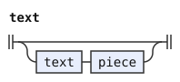</p>
<p>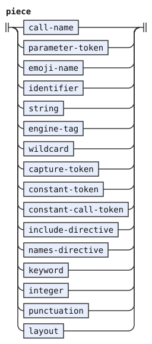</p>
</details>

## Names and engine keys

A name starts with an ASCII letter. Letters, digits, hyphens and underscores can follow it. A name ends before a comment.

An emoji name is one scalar with `Emoji_Presentation` and without `Emoji_Component`. Adjacent emoji names stay separate.

A scalar can meet the rules for both an ASCII name and an emoji name. The ASCII token keeps its spelling and category.

An engine key starts with an underscore. A dot between digits belongs to the key. A lone underscore is a wildcard.

```jbogenbau
%rule emoji-name
  _Emoji_Presentation<¬_Emoji_Component>≠"#"
%conditions
  ¬$.parse(letter),
  ¬$.following-tokens.parse(call-open …)
%emit
  ${Emoji-Name}

%rule identifier → {Identifier}
  | ^$lower:lower-initial-name → {Lowercase-Name}
  | ^upper-initial-name → {Uppercase-Name}
%conditions
  ¬$.following-tokens.parse(name-character …),
  ($lower ∨ $.parse(_Emoji_Presentation<¬_Emoji_Component>)) ⟹
    ¬$.following-tokens.parse(call-open …)
%emit

%rule whole-name
  name
%conditions
  ¬$.following-tokens.parse(name-character …)

%rule name
  letter | name name-character

%rule name-character
  letter | digit | name-hyphen | "_"

%rule name-hyphen
  "-"
%conditions
  $.following-tokens.first-token.tokens!'value.join() ≠ "-"

%rule letter
  "a".."z"
  | "A".."Z"

%rule digit
  "0".."9"

%rule integer
  digit | integer digit
%emit
  ${Integer}

%rule lower-initial-name
  "a".."z"
  | lower-initial-name name-character

%rule upper-initial-name
  "A".."Z"
  | upper-initial-name name-character

%rule wildcard
  "_"
%conditions
  ¬$.following-tokens.parse(engine-name-part …)
%emit

%rule engine-tag
  "_" engine-name
%conditions
  ¬$.following-tokens.parse(engine-name-part …)
%emit
  ${Engine-Tag}

%rule engine-name
  engine-name-part | engine-name engine-name-part

%rule engine-name-part
  letter | digit | "_" | engine-digit-dot

%rule engine-digit-dot
  digit "."
%conditions
  $.following-tokens.parse(digit …)
```

<details><summary>Railroad diagrams of the 16 rules from <code>emoji-name</code> to <code>engine-digit-dot</code></summary>
<p>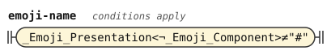</p>
<p>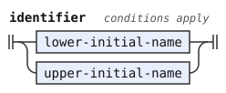</p>
<p>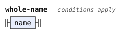</p>
<p>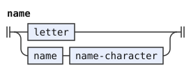</p>
<p>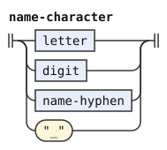</p>
<p>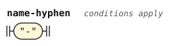</p>
<p>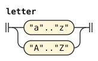</p>
<p>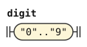</p>
<p>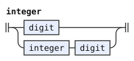</p>
<p>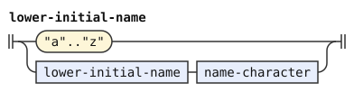</p>
<p>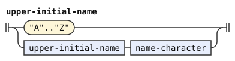</p>
<p>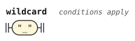</p>
<p>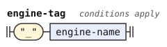</p>
<p>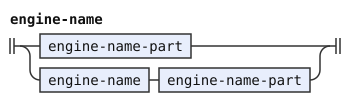</p>
<p>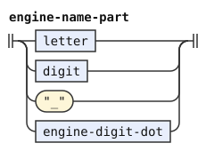</p>
<p>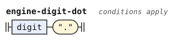</p>
</details>

## Calls and parameters

A call name touches its opening parenthesis. The next token holds the parenthesis. A parameter starts with an at sign followed by a name.

```jbogenbau
%rule call-name
  lower-initial-name
  | $emoji:_Emoji_Presentation<¬_Emoji_Component>≠"#"
%conditions
  $emoji ⟹ ¬$emoji.parse("a".."z"),
  $.following-tokens.parse(call-open …)
%emit
  ${Call-Name}

%rule call-open
  "("

%rule parameter-token
  "@" whole-name
%emit
  ${Parameter}
```

<details><summary>Railroad diagrams of <code>call-name</code>, <code>call-open</code> and <code>parameter-token</code></summary>
<p>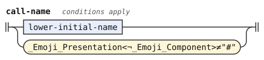</p>
<p>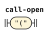</p>
<p>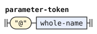</p>
</details>

## Captures and constants

A dollar sign names the whole rule or starts a prefixed name. A lowercase name gives a capture. An uppercase name gives a constant.

A constant that touches an opening parenthesis receives its own token kind. The syntax stage uses it for a function call.

```jbogenbau
%rule capture-token
  "$" [lower-initial-name]
%conditions
  ¬$.following-tokens.parse(name-character …)
%emit
  ${Capture}

%rule constant-token
  "$" upper-initial-name
%conditions
  ¬$.following-tokens.parse(name-character | call-open …)
%emit
  ${Constant}

%rule constant-call-token
  "$" upper-initial-name
%conditions
  $.following-tokens.parse(call-open …)
%emit
  ${Constant-Call}
```

<details><summary>Railroad diagrams of the 3 rules from <code>capture-token</code> to <code>constant-call-token</code></summary>
<p>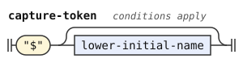</p>
<p>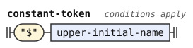</p>
<p>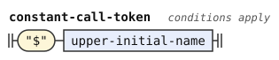</p>
</details>

## Strings

Straight double quotes enclose strings. The lexical stage keeps escapes as written. The reader inspects escapes before the syntax stage.

```jbogenbau
%rule string
  quoted-string
%emit
  ${String}

%rule quoted-string
  "‹U+0022›" [{string-character}] "‹U+0022›"

%rule string-character
  "‹U+0000›".."‹U+0021›"
  | "‹U+0023›".."‹U+10FFFF›"
```

<details><summary>Railroad diagrams of <code>string</code>, <code>quoted-string</code> and <code>string-character</code></summary>
<p>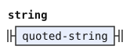</p>
<p>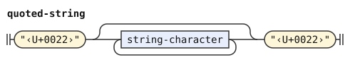</p>
<p>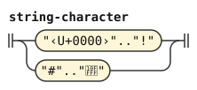</p>
</details>

## Resource paths

An include or names directive reads a path with its keyword. It emits the keyword and path separately. The path keeps its original spelling.

```jbogenbau
%rule include-directive
  $keyword:include-keyword [layout-run] $path:resource-path
%emit
  $keyword{KW-INCLUDE}, $path{Resource-Path}

%rule names-directive
  $keyword:names-keyword [layout-run] $path:resource-path
%emit
  $keyword{KW-NAMES}, $path{Resource-Path}

%rule resource-path-tail
  [layout-run] resource-path

%rule include-keyword
  "%" whole-name="include"

%rule names-keyword
  "%" whole-name="names"

%rule resource-path
  quoted-string
```

<details><summary>Railroad diagrams of the 6 rules from <code>include-directive</code> to <code>resource-path</code></summary>
<p>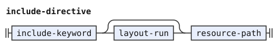</p>
<p>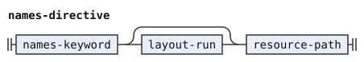</p>
<p>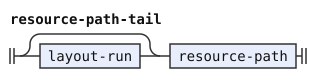</p>
<p>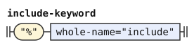</p>
<p>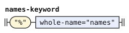</p>
<p>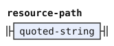</p>
</details>

## Layout

Whitespace and comments separate tokens. A comment starts with two hyphens and ends at a line break or at the end of input.

```jbogenbau
%rule layout-run
  layout | layout-run layout

%rule layout
  _White_Space | comment

%rule comment
  "-" "-" [{comment-character}]
%conditions
  $.following-tokens.first-token.tokens!'value.join() ∈ ["", "‹U+000A›", "‹U+000D›"]

%rule comment-character
  _
%conditions
  $.span.tokens!'value.join() ∉ ["‹U+000A›", "‹U+000D›"]
```

<details><summary>Railroad diagrams of <code>layout-run</code>, <code>layout</code>, <code>comment</code> and <code>comment-character</code></summary>
<p>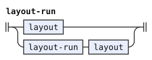</p>
<p>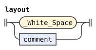</p>
<p>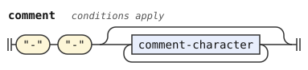</p>
<p>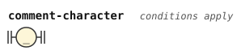</p>
</details>

## Keywords

The keyword table assigns a distinct key to each known keyword. An unknown keyword receives `Keyword`. No syntax rule reads that key.

```jbogenbau
%const $KEYWORDS
  {KW-RULE: "rule",
   KW-REDEFINE-RULE: "redefine-rule",
   KW-EXTEND-RULE: "extend-rule",
   KW-CONDITIONS: "conditions",
   KW-ERROR: "error",
   KW-WARNING: "warning",
   KW-SUPPRESS-WARNINGS: "suppress-warnings",
   KW-EMIT: "emit",
   KW-ERASED: "erased",
   KW-AMBIGUITY-RESOLUTION: "ambiguity-resolution",
   KW-ELISION-ONLY: "elision-only",
   KW-STAGE: "stage",
   KW-EXTEND-STAGE: "extend-stage",
   KW-REDEFINE-STAGE: "redefine-stage",
   KW-INCLUDE: "include",
   KW-NAMES: "names",
   KW-FEATURES: "features",
   KW-CONST: "const",
   KW-REDEFINE-CONST: "redefine-const"}

%rule keyword
  | "%" $name:whole-name → {*$KEYWORDS.classify($name'value)}
  | "%" $other:whole-name → {Keyword}
%conditions
  $KEYWORDS.classify($name'value),
  ¬$KEYWORDS.classify($other'value),
  $name'value = "include" ⟹ ¬$.following-tokens.parse(resource-path-tail …),
  $name'value = "names" ⟹ ¬$.following-tokens.parse(resource-path-tail …)
%emit
```

<details><summary>Railroad diagram of <code>keyword</code></summary>
<p>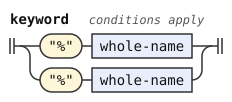</p>
</details>

## Punctuation

Compound punctuation takes priority over shorter pieces. The lexical stage leaves negation and question marks separate. The syntax stage joins them into gates where allowed.

The emoji-name rule emits an eligible punctuation scalar. Syntax rules can still match its value. The number sign keeps its role as a pattern marker.

```jbogenbau
%rule punctuation
  | "⁅" | "⁆" | "·" | "…" | "*" | "|" | "&" | "(" | ")" | "[" | "]" | "{" | "}"
  | "/" | "+" | "<" | ">" | "#" | "ε" | "," | "∧" | "∨" | "⟹" | "=" | "∈" | "⊆"
  | "∪" | "∩" | "∖" | "∅" | "≅" | "≤" | "≥" | "≝" | "⋯" | "⋮" | "⋰" | "⋱" | "≻" | ":" | "."
  | "+" "+" | "." "." "." | "." "."
  | "→" | "^" | "?" | "¬" | "↦" | "!" | "↓" | "'"
  | ("=" | "∈" | "⊆" | "≅") "‹U+0338›"
%conditions
  ¬$.parse(_Emoji_Presentation<¬_Emoji_Component>≠"#")
%emit
```

<details><summary>Railroad diagram of <code>punctuation</code></summary>
<p>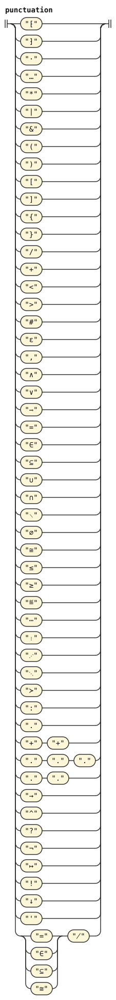</p>
</details>
