# jbogenbau: from tokens to a document tree

The syntax stage reads the [lexical tokens](lexical.md). The document reader converts its tree to the records in [Engine §9](../../../docs/engine.md#9-from-notation-tree-to-dom).

## Declarations

The declarations contain the rule bodies and the clauses that belong to them. The tree keeps both in source order.

```jbogenbau
%ambiguity-resolution greedy

%rule text
  [{statement}]

%rule statement
  rule | ranking-directive | directive | constant-definition

%rule rule
  rule-keyword rule-name "=" call
  | rule-keyword (rule-name | call) [$header:statement-term] body
    [conditions-clause] [diagnostic-clause] [suppress-warnings-clause] [output-clause]
%conditions
  $header ⟹ $header.following-tokens.first-token.tokens!'value.join() = "|"

%rule rule-keyword
  KW-RULE | KW-EXTEND-RULE | KW-REDEFINE-RULE

%rule rule-name
  Identifier | Emoji-Name

%rule statement-term
  "→" bag

%rule body
  | ["|"] ordinary-body
  | ["|"] ranked-body

%rule ordinary-body
  {alternative / "|"}

%rule ranked-body
  [{feature-gate}] ranked-choice [alternative-term]

%rule ranked-choice
  some-of "≻" {some-of / "≻"}

%rule alternative
  [{feature-gate}] some-of [alternative-term]

%rule alternative-term
  "→" bag
```

<details><summary>Railroad diagrams of the 12 rules from <code>text</code> to <code>alternative-term</code></summary>
<p>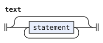</p>
<p>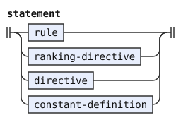</p>
<p>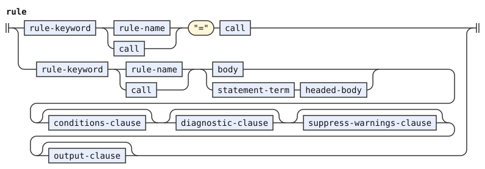</p>
<p>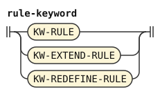</p>
<p>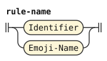</p>
<p>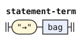</p>
<p>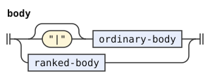</p>
<p>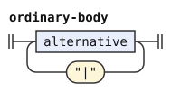</p>
<p>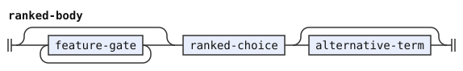</p>
<p>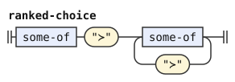</p>
<p>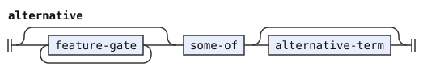</p>
<p>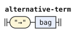</p>
</details>

## Rule bodies

Factors are symbols, groups and the operators that apply to them. A capture or primary mark wraps one factor.

```jbogenbau
%rule choice
  | ["|"] {some-of / "|"}
  | ranked-choice

%rule some-of
  ["&"] {sequence / "&"}

%rule sequence
  {factor}

%rule factor
  marked-factor | capture | tested-factor | untested-factor

%rule marked-factor
  "^" (capture | tested-factor | untested-factor)

%rule capture
  binding-token ":" factor

%rule binding-token
  Capture | Constant

%rule untested-factor
  | rule-reference | call | splice | parameter | tag | string-terminal
  | range | wildcard | group | optional | repetition | empty

%rule rule-reference
  Lowercase-Name | Emoji-Name

%rule tag
  Uppercase-Name | Engine-Tag

%rule string-terminal
  string | constant-reference

%rule string-operand
  string | constant-reference | parameter

%rule range
  string-operand ".." string-operand

%rule wildcard
  "_"

%rule group
  "(" choice ")"

%rule optional
  | "[" ["+"] choice "]"
  | "[" captured-terminator "]"

%rule captured-terminator
  binding-token ":" "+" factor

%rule repetition
  "{" ["..."] choice ["/" choice] "}"
  | "{" choice "..." ["/" choice] "}"

%rule empty
  "ε"

%rule splice
  $mark:"*" $target:splice-target
%conditions
  $.source-text = $mark.source-text ++ $target.source-text

%rule splice-target
  rule-reference | call

%rule feature-gate
  ["¬"] Identifier "?"
%conditions
  $.source-text = $.span.tokens!'value.join()

%rule tested-factor
  untested-factor {symbol-test}

%rule symbol-test
  tag-test | value-test | default-value

%rule tag-test
  "<" [{tag-requirement}] ">"

%rule tag-requirement
  ["¬"] test-operand

%rule value-test
  ("=" | "≠") test-operand

%rule default-value
  "≝" test-operand

%rule test-operand
  range | rule-reference | call | tag | post
```

<details><summary>Railroad diagrams of the 29 rules from <code>choice</code> to <code>test-operand</code></summary>
<p>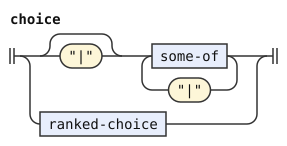</p>
<p>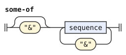</p>
<p>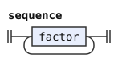</p>
<p>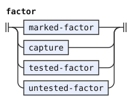</p>
<p>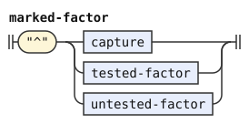</p>
<p>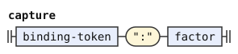</p>
<p>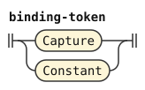</p>
<p>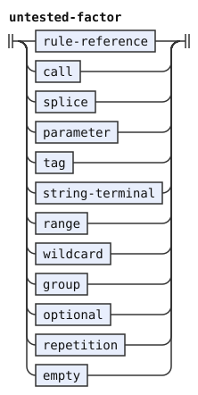</p>
<p>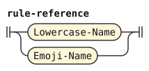</p>
<p>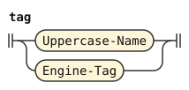</p>
<p>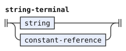</p>
<p>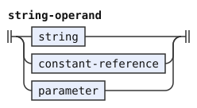</p>
<p>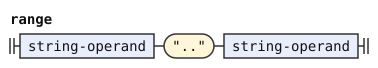</p>
<p>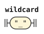</p>
<p>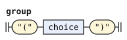</p>
<p>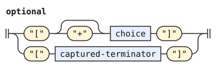</p>
<p>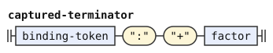</p>
<p>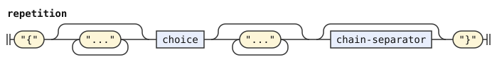</p>
<p>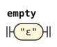</p>
<p>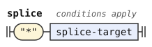</p>
<p>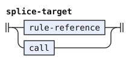</p>
<p>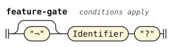</p>
<p>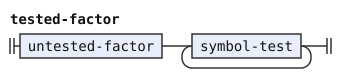</p>
<p>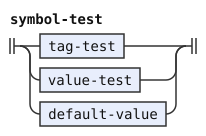</p>
<p>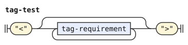</p>
<p>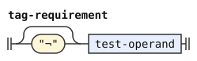</p>
<p>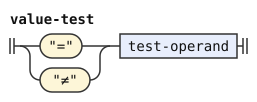</p>
<p>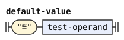</p>
<p>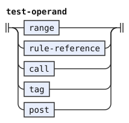</p>
</details>

## Calls and arguments

An equals sign before a call argument selects the expression grammar.

```jbogenbau
%rule call
  Call-Name "(" {call-argument / ","} ")"

%rule call-argument
  "=" expr | requirement-argument | target-argument | body-argument | symbol-argument

%rule requirement-argument
  "<" [{tag-requirement}] ">"

%rule target-argument
  target-option "|" {target-option / "|"}

%rule target-option
  rule-reference | tag | call | parameter

%rule body-argument
  group | optional | repetition | empty

%rule symbol-argument
  | tested-factor | range | wildcard | splice
  | rule-reference | call | parameter | tag | string-terminal

%rule parameter
  Parameter

%rule constant-reference
  Constant

%rule string
  String
```

<details><summary>Railroad diagrams of the 10 rules from <code>call</code> to <code>string</code></summary>
<p>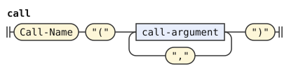</p>
<p>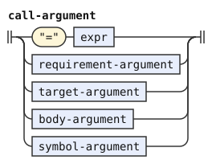</p>
<p>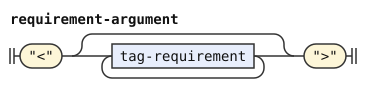</p>
<p>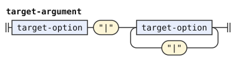</p>
<p>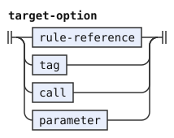</p>
<p>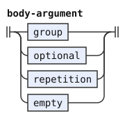</p>
<p>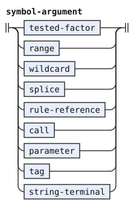</p>
<p>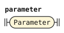</p>
<p>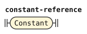</p>
<p></p>
</details>

## Clauses and directives

Clause keywords end the body. A resolution step can name a pattern.

```jbogenbau
%rule conditions-clause
  KW-CONDITIONS [","] {expr / ","}

%rule diagnostic-clause
  error-clause | warning-clause

%rule error-clause
  KW-ERROR expr

%rule warning-clause
  KW-WARNING expr

%rule suppress-warnings-clause
  KW-SUPPRESS-WARNINGS ("_" | {suppression-code / ","})

%rule suppression-code
  Identifier

%rule output-clause
  erased-clause | emit-clause

%rule erased-clause
  KW-ERASED

%rule emit-clause
  KW-EMIT [{output / ","}]

%rule output
  prefix (Capture [bag] | "ε" bag)

%rule directive
  directive-keyword [{directive-argument}] [conditions-clause]

%rule directive-keyword
  | KW-STAGE | KW-EXTEND-STAGE | KW-REDEFINE-STAGE
  | KW-INCLUDE | KW-NAMES | KW-FEATURES | KW-ELISION-ONLY

%rule directive-argument
  directive-identifier | directive-string | directive-terminal | directive-expression

%rule directive-identifier
  Identifier

%rule directive-string
  String | Resource-Path

%rule directive-terminal
  Engine-Tag | range

%rule directive-expression
  expr | Emoji-Name | "_"
%conditions
  ¬($.onward.parse(String …) ∧
    $.first-token.tokens!'value.join() = $.span.tokens!'value.join())

%rule ranking-directive
  KW-AMBIGUITY-RESOLUTION {ranking-step / ","}

%rule ranking-step
  Identifier [pattern-literal | constant-reference]

%rule constant-definition
  constant-keyword constant-name expr

%rule constant-keyword
  KW-CONST | KW-REDEFINE-CONST

%rule constant-name
  Constant
```

<details><summary>Railroad diagrams of the 22 rules from <code>conditions-clause</code> to <code>constant-name</code></summary>
<p></p>
<p></p>
<p></p>
<p></p>
<p></p>
<p></p>
<p></p>
<p></p>
<p></p>
<p></p>
<p></p>
<p></p>
<p></p>
<p></p>
<p></p>
<p></p>
<p></p>
<p></p>
<p></p>
<p></p>
<p></p>
<p></p>
</details>

## Expressions

Expression rules group operators by precedence. Method names select the syntax of their arguments.

```jbogenbau
%rule expr
  | function
  | disj ["⟹" expr]

%rule function
  Capture "↦" expr

%rule disj
  ["∨"] {conj / "∨"}

%rule conj
  ["∧"] {neg / "∧"}

%rule neg
  "¬" neg | comparison

%rule comparison
  union [comparator union]

%rule comparator
  | "=" | "≤" | "≥" | "<" | ">" | "∈" | "⊆" | "≅"
  | "≠" | "∉" | "⊈" | "≇"

%rule union
  {inter / ("∪" | "∖")}

%rule inter
  {sum / "∩"}

%rule sum
  {post / ("++" | "+")}

%rule post
  atom [{prop | method | map | flatten}]

%rule prop
  "'" key

%rule method
  "." selector

%rule selector
  | named-selector
  | parse-selector
  | neighbor-selector
  | family-selector
  | key-selector
  | width-selector
  | predicate-selector

%rule named-selector
  method-name ["(" [{expr / ","}] ")"]
%conditions
  $.first-token.tokens!'value.join() ∉
    ["parse", "followed-by", "preceded-by", "without-elision-except",
     "has", "has-value", "ngrams", "at-most", "any", "all"]

%rule method-name
  Identifier | Call-Name

%rule parse-selector
  "parse" "(" query-body ")"

%rule query-body
  ["…"] choice ["…"]

%rule neighbor-selector
  ("followed-by" | "preceded-by") "(" {neighbor-target / "|"} ")"

%rule neighbor-target
  target-option | "(" target-option ")"

%rule family-selector
  "without-elision-except" "(" (rule-reference | call | parameter) ")"

%rule key-selector
  ("has" | "has-value") "(" key ")"

%rule width-selector
  ("ngrams" | "at-most") "(" integer ")"

%rule predicate-selector
  ("all" | "any") ["(" [predicate] ")"]

%rule predicate
  expr

%rule map
  "!" (prop | method | "(" predicate ")")

%rule flatten
  "↓"

%rule atom
  | Capture | constant-reference | application | parameter | string | integer
  | pattern-literal | "∅" | bag | list | item-reference | method | grouped-expr

%rule grouped-expr
  "(" expr ["?" expr "|" expr] ")"

%rule application
  Constant-Call "(" expr ")"

%rule item-reference
  "'" [$name:key]
%conditions
  $name ∨ ¬$.following-tokens.parse(key | "'" …)

%rule integer
  Integer

%rule key
  Identifier | Engine-Tag
```

<details><summary>Railroad diagrams of the 33 rules from <code>expr</code> to <code>key</code></summary>
<p></p>
<p></p>
<p></p>
<p></p>
<p></p>
<p></p>
<p></p>
<p></p>
<p></p>
<p></p>
<p></p>
<p></p>
<p></p>
<p></p>
<p></p>
<p></p>
<p></p>
<p></p>
<p></p>
<p></p>
<p></p>
<p></p>
<p></p>
<p></p>
<p></p>
<p></p>
<p></p>
<p></p>
<p></p>
<p></p>
<p></p>
<p></p>
<p></p>
</details>

## Constructors

A prefix gates or guards one entry. Commas separate entries at their own nesting level.

```jbogenbau
%rule bag
  "{" [{entry / ","}] "}"

%rule entry
  prefix (write-entry | delete-entry | splat-entry | copy-entry | bare-entry)

%rule bare-entry
  key

%rule write-entry
  {key ":"} expr

%rule delete-entry
  "¬" key

%rule splat-entry
  "*" expr

%rule copy-entry
  post
%conditions
  $.last-token.tokens!'value.join() ≠ "'"

%rule prefix
  [{feature-gate}] [guard]

%rule guard
  expr "?"

%rule list
  "[" [{item / ","}] "]"

%rule item
  prefix ["*"] expr
```

<details><summary>Railroad diagrams of the 11 rules from <code>bag</code> to <code>item</code></summary>
<p></p>
<p></p>
<p></p>
<p></p>
<p></p>
<p></p>
<p></p>
<p></p>
<p></p>
<p></p>
<p></p>
</details>

## Tree patterns

A pattern starts with `#` and one node test, bare child list, or grouped predicate. An exact prefix suppresses the node test's single-child search.

A pattern atom names a rule, terminal, constant, or wildcard. A tag test follows the atom, as in `#_<Tense>`. The reader converts it as [engine §9.3](../../../docs/engine.md#93-conversion-and-validation) says.

The brackets `⁅` and `⁆` enclose child items. A child list attaches to the preceding atom. Only a rule name, emoji rule, template family, exact call, or compatible parameter accepts an attached list.

A bare list or an exact prefix needs whitespace or a comment after a node test, `⁆`, `]`, `}`, or a group's `)`. Thus `⁅ a ⁅b⁆ ⁆` has two items, while `⁅ a⁅b⁆ ⁆` attaches the list to `a`. `⁅ (a)⁅b⁆ ⁆` is an error. After `⋯` or `⋰`, no space is necessary.

The syntax stage does not see layout, which consists of whitespace and comments. The helper rules test adjacency through source text. `adjacent-item-opening` matches two tokens whose joined source text equals the source text of their span. That equality holds only when nothing lies between them.

`pattern-exact-start` keeps `·` adjacent to its node test. `pattern-attached-start` detects a list directly after the complete atom. `pattern-node` tests this condition in both directions, so an adjacent list always attaches and a separated list never does. Its third condition rejects an unattached reading of `a⁅b⁆`, which keeps the attachment routes disjoint.

`pattern-item-opening` reads `⁅` or `·`. `child-item` rejects such an adjacent opening after its last token, except after `⋯` or `⋰`.

A child set has at least one operator. A lone child path is therefore a one-item sequence, and never also a set.

Child lists contain sequences, choices, optional sequences, repeats, and sibling gaps. Paths and set operations combine whole predicates.

Recognition admits repeated or reversed tests on node atoms. Each node atom accepts one tag test, then one value test. A pattern-valued constant atom accepts neither test.

```jbogenbau
%rule pattern-literal
  "#" pattern-primary

%rule pattern-union
  {pattern-intersection / ("∪" | "∖")}

%rule pattern-intersection
  {pattern-path / "∩"}

%rule pattern-path
  ("⋮" | "⋱") pattern-primary
  | pattern-primary ["⋰"]

%rule pattern-primary
  pattern-node | bare-child-list | "(" pattern-union ")"

%rule pattern-node
  [$exact:"·"] $atom:pattern-atom [$list:child-list]
%conditions
  $exact ⟹ $exact.onward.parse(pattern-exact-start …),
  $list ⟹ $atom.onward.parse(pattern-attached-start …),
  ¬$list ⟹ ¬$atom.onward.parse(pattern-attached-start …)

%rule bare-child-list
  [$exact:"·"] child-list
%conditions
  $exact ⟹ $exact.onward.parse(pattern-exact-start …)

%rule pattern-atom
  (pattern-rule | tag | string | range | wildcard | constant-reference) [{symbol-test}]

%rule pattern-rule
  Lowercase-Name | Emoji-Name | call | parameter

%rule child-list
  "⁅" [child-choice] "⁆"

%rule child-choice
  {child-alternative / "|"}

%rule child-alternative
  child-sequence | child-set-operation

%rule child-sequence
  {child-item}

%rule child-set-operation
  child-intersection ("∪" | "∖") {child-intersection / ("∪" | "∖")}
  | child-path "∩" {child-path / "∩"}

%rule child-intersection
  {child-path / "∩"}

%rule child-item
  child-path | child-optional | child-repetition | "⋯"
%conditions
  ¬$.last-token.onward.parse(adjacent-item-opening …)

%rule child-path
  ("⋮" | "⋱") child-primary
  | child-primary ["⋰"]

%rule child-primary
  pattern-node | bare-child-list | "(" child-choice ")"

%rule child-optional
  "[" child-choice "]"

%rule child-repetition
  "{" child-choice ["/" child-choice] "}"

%rule pattern-exact-start
  $mark:"·" $next:_
%conditions
  $.source-text = $mark.source-text ++ $next.source-text

%rule pattern-attached-start
  $atom:pattern-atom $open:"⁅"
%conditions
  $.source-text = $atom.source-text ++ $open.source-text

%rule pattern-item-opening
  "⁅" | "·"

%rule adjacent-item-opening
  $left:_ $right:pattern-item-opening
%conditions
  $left.value ≠ "⋯",
  $left.value ≠ "⋰",
  $.source-text = $left.source-text ++ $right.source-text
```

<details><summary>Railroad diagrams of the 24 rules from <code>pattern-literal</code> to <code>adjacent-item-opening</code></summary>
<p></p>
<p></p>
<p></p>
<p></p>
<p></p>
<p></p>
<p></p>
<p></p>
<p></p>
<p></p>
<p></p>
<p></p>
<p></p>
<p></p>
<p></p>
<p></p>
<p></p>
<p></p>
<p></p>
<p></p>
<p></p>
<p></p>
<p></p>
<p></p>
</details>
