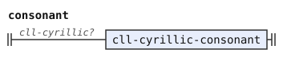
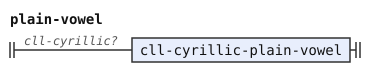
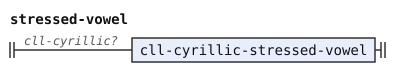
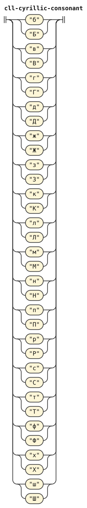
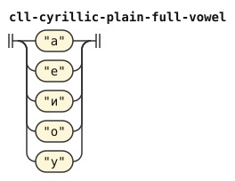
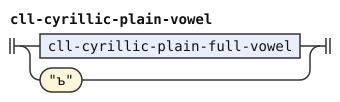
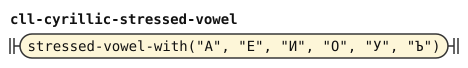

# The Cyrillic orthography of CLL

This document adds the Cyrillic orthography of *The Complete Lojban Language* (CLL)[^cll-s3-12] to the phoneme stage, the first stage of the pipeline. The [CLL](pipeline.md) pipeline reads it as its Cyrillic.

The `lojban/bpfk`, `lojban/experimental` and `lojban/zantufa` pipelines read gencmu's own Cyrillic, [common/cyrillic.md](../common/cyrillic.md). BPFK is the Lojban language planning committee. A caller can instead select CLL's Cyrillic with `cll-cyrillic`. A feature is a named switch that the grammars test.

The two read the same letters differently, so a pipeline or a caller chooses one of them. The letters of this document apply only while `cll-cyrillic` is on. The document has no frame of its own, that is, no rules for the text, its pauses and its runs. It adds its letters to the rules of [latin.md](latin.md), so a text can mix scripts. An added alternative takes neither the term nor the `%emit` of the rule that it extends. So each letter rule here states its own tag and emits its own token. [The notation document](../../../docs/notation.md) explains the notation.

The rules map 23 letters to phonemes. Five are the vowel letters `а`, `е`, `и`, `о` and `у`. Seventeen are the consonants `б`, `в`, `г`, `д`, `ж`, `з`, `к`, `л`, `м`, `н`, `п`, `р`, `с`, `т`, `ф`, `х` and `ш`. The Bulgarian hard sign `ъ` maps to `y`. Their images use these Latin phoneme letters. So `ж` is `j`, `х` is `x` and `ш` is `c`.

The `Vowel` tag marks the five full vowels and not `y`, so `cll-cyrillic-plain-full-vowel` holds them and carries `Vowel` in its statement term. The hard sign stays in `cll-cyrillic-plain-vowel`. The full-vowel alternative there has no term, so it takes the whole bag of its one symbol.

The apostrophe and period are those of the Latin orthography. In `lojban/cll`, a comma run marks a syllable break only between vowel groups and otherwise emits nothing on its own. The other pipelines discard it through [common/latin.md](../common/latin.md). The orthography writes a diphthong as a vowel pair, as in the Latin orthography, so `маи` is `mai`. A capital vowel marks stress, and a capital consonant preserves its phoneme. The all-capital runs of [common/latin.md](../common/latin.md) do not apply to these letters, so in every Lojban pipeline a capital vowel here marks stress.

A capital `Ъ` writes stressed `y`, with value `y` and image `Y`. The [Latin stress rules](latin.md#letters) apply: names can stress any syllable,[^cll-s3-9][^cll-s4-8] and particles can stress any syllable or none.[^cll-s3-9] So `Ъ` can stand in names and particles. In lojban/cll, a compound hyphen stays unstressed. The other pipelines ignore a stress mark on `y`, so they read `bajЪkla` as a brivla.

```jbogenbau
%extend-rule consonant
  cll-cyrillic? cll-cyrillic-consonant

%extend-rule plain-vowel
  cll-cyrillic? cll-cyrillic-plain-vowel

%extend-rule stressed-vowel
  cll-cyrillic? cll-cyrillic-stressed-vowel

%rule cll-cyrillic-consonant → {Consonant}
  | ("б" | "Б") → {image: value: "b"}
  | ("в" | "В") → {image: value: "v"}
  | ("г" | "Г") → {image: value: "g"}
  | ("д" | "Д") → {image: value: "d"}
  | ("ж" | "Ж") → {image: value: "j"}
  | ("з" | "З") → {image: value: "z"}
  | ("к" | "К") → {image: value: "k"}
  | ("л" | "Л") → {image: value: "l"}
  | ("м" | "М") → {image: value: "m"}
  | ("н" | "Н") → {image: value: "n"}
  | ("п" | "П") → {image: value: "p"}
  | ("р" | "Р") → {image: value: "r"}
  | ("с" | "С") → {image: value: "s"}
  | ("т" | "Т") → {image: value: "t"}
  | ("ф" | "Ф") → {image: value: "f"}
  | ("х" | "Х") → {image: value: "x"}
  | ("ш" | "Ш") → {image: value: "c"}
%emit

%rule cll-cyrillic-plain-full-vowel → {Vowel}
  | "а" → {image: value: "a"}
  | "е" → {image: value: "e"}
  | "и" → {image: value: "i"}
  | "о" → {image: value: "o"}
  | "у" → {image: value: "u"}

%rule cll-cyrillic-plain-vowel
  | cll-cyrillic-plain-full-vowel
  | "ъ" → {image: value: "y"}
%emit

%rule cll-cyrillic-stressed-vowel = stressed-vowel-with("А", "Е", "И", "О", "У", "Ъ")
```

<details><summary>Railroad diagrams of the 7 rules from <code>consonant</code> to <code>cll-cyrillic-stressed-vowel</code></summary>
<p></p>
<p></p>
<p></p>
<p></p>
<p></p>
<p></p>
<p></p>
</details>


## Choices beyond CLL

CLL first lists 22 letters, which it maps "in the obvious ways". It then assigns the Bulgarian hard sign to `y`.[^cll-s3-12] This grammar maps all 23 letters. CLL says nothing about capitals. This document extends the Latin treatment of capitals to Cyrillic. Its capital vowels always mark stress, including in pipelines with capital folding for other scripts.

The [Latin choices](latin.md#choices-beyond-cll) explain consonant folding.

## Differences from the format 49 grammar

This document reads the same letters as its format 49 copy, `grammars/lojban/cll/cyrillic.md`, and emits the same tokens with the same values, images and tags.

[^cll-s3-9]: [CLL 1.1, section 3.9](https://lojban.org/publications/cll/cll_v1.1_xhtml-section-chunks/section-stress.html).

[^cll-s4-8]: [CLL 1.1, section 4.8](https://lojban.org/publications/cll/cll_v1.1_xhtml-section-chunks/section-cmene.html).

[^cll-s3-12]: [CLL 1.1, section 3.12](https://lojban.org/publications/cll/cll_v1.1_xhtml-section-chunks/section-oddball-orthographies.html).
