# Indicators and `ba'e`

This document defines the indicator processing rules before syntax. A stage is one step of a pipeline, with its own grammar. A pipeline document defines an ordered sequence of stages.

A token is one unit that a stage reads or emits. A token's value is the string that exact comparisons read. Its image is the string that people see.

The [CLL](pipeline.md) pipeline includes these rules as its fourth stage. The [BPFK pipeline](../bpfk/pipeline.md) includes this document too. The experimental and Zantufa pipelines, which are not yet in this notation, include its format 49 copy. BPFK is the Lojban language planning committee.

This stage reads the words that the words stage emits and attaches emphasis markers and indicators before syntax. It implements the non-formal rule `word = [BAhE] any-word [indicators]` of *The Complete Lojban Language* (CLL). That rule applies before syntax and orders emphasis, a word, then indicators.[^cll-s21-1] The emphasis and indicator parts here each permit a run.

A cmavo is a particle, a short structure word. An attitudinal expresses an attitude. A discursive comments on the discourse.

The indicators are the attitudinals and discursives of UI and CAI with an optional `nai` after each. They are also the cancel `da'o` and the scope marker `fu'o`. A `fu'e` opens a group of them. The words stage drops hesitation, so `y` never reaches this stage.

A run of indicators attaches to the word before it, and a `ba'e` attaches to the word after it. The stage hands on the word with them as one token. The word is the token's primary, and the indicators and `ba'e` are its satellites. A satellite is a unit beside the primary that the renderings show ([decorated nodes](../../../docs/notation.md#decorated-nodes)). The token has the bag and strings of the word, so the syntax reads the word alone. So `mi ui klama` is `([mi ui] klama)` in brackets, and the syntax reads `mi klama`.

The forms lexicon supplies word classes and the `Indicator` tag for indicators and `fu'e`. This stage gives no key of its own, and it hands on every public key of the words stage. The words stage emits each complete quote, compound, and letteral as one token. Its contents supply no indicator class. Indicators after that token and BAhE before it mark the whole unit.

A run of indicators at the start of the text, before any word, stays in the stream. This is because the `text` rule of the syntax grammar reads it there. A `ba'e` with no word after it stays in the stream too. In a run that stays in the stream, the stage attaches `ba'e`, and `nai` to its attitudinal, as the section "Leading runs" says. [The notation document](../../../docs/notation.md) explains the notation.

The stage reads an indicator run as far as it goes, so the stage is greedy. Where two parses differ, it takes the one that reads the next word over the one that closes a constituent.

```jbogenbau
%ambiguity-resolution greedy
%const $OUTPUTS $INPUTS
```

The closing section compares this stage with other indicator rules.

## Quotation boundaries

The [BPFK Magic Words proposal](https://mw.lojban.org/papri/Magic_Words) treats a quoted word, LOhU quote, and ZOI phrase as whole targets for attitudinals. Its left-to-right model governs word operations in every Lojban pipeline. In camxes-std, `ZO_pre`, `LOhU_pre`, and `ZOI_pre` take `pre_clause`, and their matching `_post` rules take `post_clause`. Those clauses put BAhE before the whole quote and indicators after it.

The same rule applies to the newer quote kinds. The syntax reads each quote through one terminal of its opening class. The tree of the words stage retains its internal structure.

`$INDICATOR-BOUNDARIES` identifies LU as a boundary where indicators remain syntax tokens. Indicators after `to`, `to'i` and `tu'e` instead attach to those openers. An indicator after `to` marks the whole parenthetical remark, so it attaches to the opener.[^cll-e19-67]

A quotation must hold any text, including one that begins with an indicator. Attaching that indicator to `lu` prevents the speaker from quoting such a text. An attachment to `lu` also duplicates an indicator on `li'u`.

The stage preserves the initial indicators of the quoted text. So `lu ui mi klama li'u` quotes `ui mi klama`, and `lu ui li'u` quotes `ui`.

The words stage supplies one token for each finished quote, including `zo`, `lo'u ... le'u`, and `zoi`. This stage cannot read inside that token. Zantufa's `lu'ei` also introduces quoted content, but its syntax handles that boundary. No word of the Zantufa lexicon carries the indicator tag, so this stage attaches only BAhE there.

Closing words, such as `li'u` and `toi`, take ordinary indicator attachments.

```jbogenbau
%const $INDICATOR-BOUNDARIES {LU}
```

The name `$INDICATOR-BOUNDARIES` lets a pipeline layer add boundaries that open no quotation.

## The stream

`text` reads an optional leading indicator run, then ordinary items, then any unattached final `ba'e` run. `words-with-attachments` permits a new leading run only after an indicator boundary.

```jbogenbau
%rule text
  [leading] [words-with-attachments] [bahe-run]

%rule words-with-attachments
  | word-with-attachments
  | words-with-attachments word-with-attachments
  | $p:words-with-attachments leading
%conditions
  $p.last-token.classes.overlaps($INDICATOR-BOUNDARIES)
```

<details><summary>Railroad diagrams of <code>text</code> and <code>words-with-attachments</code></summary>
<p>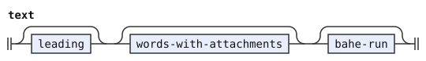</p>
<p>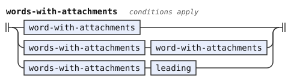</p>
</details>

`word-with-attachments` hands on a word with its preceding `ba'e` run and following indicator run attached. A boundary token takes no following indicators, as above.

The rules `host-word` and `bahe` mark their one word as the primary. So the core of a token is the unit of the words stage, such as a whole quote, and not a wrapper of this stage. Inside a token, each `bahe` and each indicator node hands on nothing of its own.

```jbogenbau
%rule word-with-attachments
  [bahe-run] ^$w:host-word [$a:indicator-run]
%conditions
  $a ⟹ ¬$w.classes.overlaps($INDICATOR-BOUNDARIES)
%emit

%rule host-word
  ^Word<¬Indicator ¬BAhE>

%rule bahe-run
  {bahe}

%rule bahe
  ^Word<BAhE>
%emit
```

<details><summary>Railroad diagrams of <code>word-with-attachments</code>, <code>host-word</code>, <code>bahe-run</code> and <code>bahe</code></summary>
<p>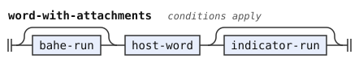</p>
<p>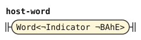</p>
<p>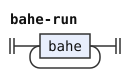</p>
<p>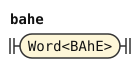</p>
</details>

A `bahe-run` is one or more `ba'e`, so `mi ba'e ba'e klama` is a text. A `ba'e` is a word of BAhE, which the CLL lexicon gives only to `ba'e` and `za'e`.

## Indicator runs

An indicator run after a word attaches each of its indicators, `fu'e` included, to the word, each as a satellite of its own. Each of them has its word as its primary and the `ba'e` run before it as a satellite. A `nai` after an attitudinal is a satellite of the attitudinal. So `mi ui nai ia klama` hands on `mi` with `ui` and `ia` after it, and `ui` carries `nai` after it. The pipeline prints `([mi {ui nai} ia] klama)` in brackets.

The spliced `indicator-step` shares the optional `fuhe` prefix and adds no named tree node.

The rule `attitudinal-nai` reads the pair. Its primary is the attitudinal word, with the `ba'e` run before it and the `nai` after it as satellites. The `nai` has its own `ba'e` run before it as a satellite. So `mi ba'e ui nai klama` gives `ui` with `ba'e` before it and `nai` after it. And `mi ui ba'e nai klama` gives `nai` with `ba'e` before it. The image of `ui` is `ui` in both.

```jbogenbau
%rule indicator-run
  | *indicator-step
  | indicator-run *indicator-step

%rule indicator-step
  [fuhe] (indicator | attitudinal-nai)

%rule indicator
  [bahe-run] ^$i:Word
%conditions
  $i'Indicator,
  ¬$i'FUhE
%emit

%rule fuhe
  [bahe-run] ^$i:Word
%conditions
  $i'FUhE
%emit

%rule attitudinal-nai
  [bahe-run] ^attitudinal nai
%emit

%rule attitudinal
  ^$i:Word
%conditions
  $i.classes.overlaps({UI, CAI})

%rule nai
  [bahe-run] ^Word<NAI>
%emit
```

<details><summary>Railroad diagrams of the 7 rules from <code>indicator-run</code> to <code>nai</code></summary>
<p>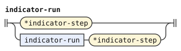</p>
<p>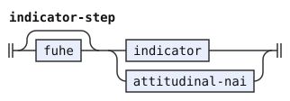</p>
<p>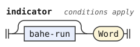</p>
<p>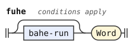</p>
<p>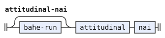</p>
<p>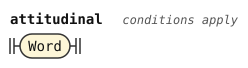</p>
<p>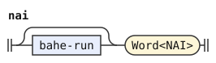</p>
</details>

`indicator`, `fuhe` and `attitudinal` test their classes in conditions, not in a tag test on `Word`. These alternatives contribute plain `Word` to the expected terminals. The optional emphasis run can also contribute `Word<BAhE>`. The tests of `indicator` and `fuhe` read a bare tag of the word, such as `$i'Indicator`. The test of `attitudinal` asks whether the classes of the word overlap `{UI, CAI}`.

A `ba'e` before an indicator marks the indicator and goes with it. So does a `ba'e` before the `nai` of an attitudinal. Emphasis leaves the word's meaning intact. Each UI or CAI permits one NAI. So `mi .e .ui ba'e nai do` negates the `.ui` and leaves the `.e` as it is.

The CLL lexicon marks `fu'e` `Indicator`, so `host-word` never reads it as a word. Under these rules, `mi fu'e ui klama`, `mi fu'e ui nai klama` and `mi ui fu'e ia klama` are texts. The text `mi viska le fu'e .ia blanu zdani fu'o ponse` is one too. The stage rejects `mi fu'e klama`, `mi ui fu'e klama` and `mi fu'e fu'e ui klama`. In each of them, a `fu'e` has no indicator directly after it.

A `ba'e` can stand before the word or before the `fu'e`, as in `ba'e mi fu'e ui klama` and `mi ba'e fu'e ui klama`. In the second, the `ba'e` goes with the `fu'e`.

The stage also rejects `mi fu'e y klama`. The words stage drops hesitation, so no indicator remains after `fu'e`. A run at the start of the text follows the same rule. So `fu'e ui mi klama` and `ui fu'e ia mi klama` are texts, and the stage rejects `fu'e mi klama`.

## Leading runs

A leading run is a run of indicators that the syntax reads itself: at the start of the text, or directly after a quotation opener. Its indicators stay in the stream, each as a token of its own. A `ba'e` before one of them is a satellite of it, because the syntax does not read `ba'e`. A `nai` after an attitudinal is a satellite of the attitudinal, as after a word. So `ba'e ui nai mi klama` hands on one token for `ba'e ui nai`, then `mi` and `klama`. The syntax reads the first token as `UI`.

The run reads a `nai` after its last attitudinal before it starts the next word. So `iu nai` is one run. The same holds when a `ba'e` stands before the `nai`, as in `iu ba'e nai`.

A leading step has the body of an indicator step. Each step of a leading run is one token, because `indicator` and `attitudinal-nai` each hand on their node. The two rules keep separate names, so that a layer can change one without the other.

Each attitudinal takes one `nai`. So in `pau nai nai mi klama`, the run reads `pau nai`, and the second `nai` starts the stream after it. The syntax reads it as `NAI` after an indicator and rejects the text there.

```jbogenbau
%rule leading
  | *leading-step
  | leading *leading-step

%rule leading-step
  [fuhe] (indicator | attitudinal-nai)
```

<details><summary>Railroad diagrams of <code>leading</code> and <code>leading-step</code></summary>
<p>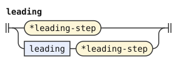</p>
<p>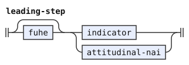</p>
</details>

## Differences from CLL and camxes-std

### Quotation and parenthesis boundaries

CLL's sources differ on indicators after `lu`. CLL[^cll-s13-9] states a text-initial exception before the general attachment rule. Its first rule says: "At the beginning of a text, indicators modify everything following them indefinitely". Its second covers "every other place in an utterance", where the indicator "attaches to the word immediately to its left".

CLL[^cll-s21-1] writes `LU text`, and its `text` rule permits initial indicators. This stage reads "text" in CLL[^cll-s13-9] as that grammar rule. So indicators after `lu` begin the quoted text and stay in the stream.

CLL[^cll-s19-8] says that an attitudinal "Normally" applies to the preceding word. CLL[^cll-s19-16] gives the general rule that UI and CAI mark the previous word. That general statement does not override the text-initial exception of CLL[^cll-s13-9].

CLL[^cll-s13-9] states: "If the word that an indicator (or group) attaches to is itself a cmavo which governs a grammatical structure". It then says: "then the indicator construct pertains to the referent of the entire structure". That sentence describes meaning, and a quotation refers to its quoted text. It does not require attachment to `lu`.

A quoted text starts as a whole text does. CLL[^cll-s21-1] lets `text` start with names or indicators, but not both. The `lojban/cll` and `lojban/bpfk` pipelines reject `ui .djan. mi klama` and `lu ui .djan. mi klama li'u` for that reason.

The `lojban/experimental` pipeline with `cbm` and the `lojban/zantufa` pipeline reject those texts under their own name-as-predicate rules.

CLL[^cll-s21-1] also writes `TO text`, so that rule alone does not separate TO from LU. The example[^cll-e19-67] in CLL[^cll-s19-12] uses `to'isa'a` and says that `sa'a` marks the whole bracketed remark. The ["Digressives" section, revision 111784](https://mw.lojban.org/index.php?title=BPFK_Section:_Digressives&oldid=111784) of the BPFK defines `to'i` as "Equivalent to {to sa'a}". These sources support the choice that indicators after `to` and `to'i` attach to the opener. Indicators after `tu'e` also attach to that opener under CLL[^cll-s19-8][^cll-s13-9].

The official parser, CLL's reference implementation, differs after `lu` because its preprocessor absorbs following indicators into the preceding token. John Cowan, the author of CLL, calls that reading a parser error:[^cowan-lu]

> Yes; the parser is in error here, and you are correct.

### Attitude scopes

CLL's sources do not agree on `fu'e`. CLL[^cll-s21-1] prints the EBNF (Extended Backus-Naur Form) rule `indicators = [FUhE] indicator ...`. An indicator must therefore follow a `fu'e`. The magic-word list of CLL[^cll-s19-16] and the [Magic Words proposal](https://mw.lojban.org/papri/Magic_Words) call `fu'e` "the same as UI".

The YACC preamble is the official parser's steps before its grammar. Step 4e of that preamble, printed in CLL 1.0, absorbs every `fu'e` after a word, and so does the official parser.

This stage follows CLL[^cll-s19-8], which gives the meaning of `fu'e`: "Placing fu'e in front of an attitudinal disconnects it from what precedes it". So a `fu'e` stands directly in front of an indicator, and the stage rejects a `fu'e` that has no indicator after it.

CLL[^cll-s19-8] says that FUhO "cancels all in-force attitudinals". This stage infers that several FUhE groups can remain active together. Its `indicator-run` therefore permits each indicator to carry its own `fu'e`. The passage about local attitudinals describes unmarked attitudes, rather than several marked groups.

This choice departs from the printed EBNF of CLL,[^cll-s21-1] which permits one indicator group after a word. The official preprocessor absorbs indicators before its grammar reads them.

In [camxes-std](https://github.com/lojban/ilmentufa/blob/778ea138f7d150121ca722db7536ce3b123943ac/camxes.peg#L343-L1100), the standard grammar of the camxes parser, `post_clause` repeats `indicators <- FUhE_clause? indicator+`. This stage and camxes-std require an indicator after FUhE. Both permit further FUhE groups.

camxes-std nests further FUhE groups inside every clause whose post is [`post_clause`](https://github.com/lojban/ilmentufa/blob/778ea138f7d150121ca722db7536ce3b123943ac/camxes.peg#L376). [`UI_post`](https://github.com/lojban/ilmentufa/blob/778ea138f7d150121ca722db7536ce3b123943ac/camxes.peg#L1100), [`CAI_post`](https://github.com/lojban/ilmentufa/blob/778ea138f7d150121ca722db7536ce3b123943ac/camxes.peg#L536), [`NAI_post`](https://github.com/lojban/ilmentufa/blob/778ea138f7d150121ca722db7536ce3b123943ac/camxes.peg#L918), [`DAhO_post`](https://github.com/lojban/ilmentufa/blob/778ea138f7d150121ca722db7536ce3b123943ac/camxes.peg#L588), and [`FUhO_post`](https://github.com/lojban/ilmentufa/blob/778ea138f7d150121ca722db7536ce3b123943ac/camxes.peg#L661) use that rule. [`FUhE_post`](https://github.com/lojban/ilmentufa/blob/778ea138f7d150121ca722db7536ce3b123943ac/camxes.peg#L655) does not use it. This stage keeps those groups flat.

### NAI and emphasis

camxes-std also lets UI and CAI clauses take further indicators before their following optional NAI. This stage instead keeps the run flat. Within a run, it attaches `nai` only to the UI or CAI directly before it. BAhE can intervene. Leading runs use the same boundary and the same pair.

A NAI after DAhO or FUhO stays available to the syntax. The [Magic Words proposal](https://mw.lojban.org/papri/Magic_Words) says that DAhO, FUhE and FUhO do not absorb `nai`, and CLL[^cll-s19-16] agrees. The syntax reads it under its own rules.

In `lojban/cll` and `lojban/bpfk`, `mi .e ui da'o nai do` negates `.e`. camxes-std instead negates `ui`.

In `lojban/cll` and `lojban/bpfk`, `mi pu ui da'o nai klama` negates `pu`. camxes-std instead negates `ui`.

In `lojban/cll` and `lojban/bpfk`, `mi ui ia nai nai klama` and `mi cai sai nai nai klama` fail. camxes-std accepts both and pairs each NAI with a different attitudinal.

In `lojban/cll` and `lojban/bpfk`, `ui ia nai nai mi klama` and `cai sai nai nai mi klama` fail. camxes-std accepts both leading runs too.

Rule 1100, one of four non-formal rules, prints `word = [BAhE] any-word [indicators]`, with at most one BAhE.[^cll-s21-1] This stage follows the prose of CLL:[^cll-s19-16]

> Multiple BAhE cmavo may be used in succession

CLL counts Y as an indicator.[^cll-s21-1] The words stage drops hesitation because the [Magic Words proposal](https://mw.lojban.org/papri/Magic_Words), which specifies word processing before syntax, treats `.y.` as whitespace, not as a word. A FUhE followed only by hesitation therefore has no indicator and fails.

The Magic Words proposal says that `ba'e` "marks the following word but does not change its meaning". It also states: "One NAI can follow any UI or CAI cmavo". The attachment rules retain both properties, even with BAhE before NAI.

## Differences from the format 49 grammar

The format 49 copy of this document is `grammars/lojban/cll/indicators.md`. Two changes are deliberate.

A leading `ui nai` is one token here, as it is after a word. The format 49 copy hands on `ui` and `nai` as two tokens, and its syntax reads `UI NAI`. The two words have one meaning, so they form one unit wherever they stand. For a leading pair, this stage is the first stage that differs: it hands on one token where the format 49 copy hands on two. The syntax rule `indicator` therefore reads no `NAI` ([the CLL grammar](syntax.md)).

A token covers its word with its satellites. Its place therefore runs from its first `ba'e` to its last indicator. In `mi cusku zo SINdarin ui`, the quote token covers the quote and `ui`, and its core is the quote alone. The format 49 token covers only its word, and lists its attachments beside it.

One bracket form changes with this. `ba'e ui ba'e nai mi klama` shows as `([ba'e ui {ba'e nai}] [mi klama])`. The format 49 copy shows `([{ba'e ui} {ba'e nai}] [mi klama])`.

The wider place also reaches a rejection. In `mi ba'e nai klama`, the stage hands on `ba'e nai` as one token, with `nai` as its core and `ba'e` as a satellite. The syntax rejects that token, because a `nai` cannot follow `mi` there. The rejected token starts at `ba'e`, and its core starts at `nai`. In the format 49 copy, the rejected token is `nai` alone. The place that the error reports follows from the error record of the engine, and this grammar does not choose it.

[^cll-s13-9]: [CLL 1.1, section 13.9](https://lojban.org/publications/cll/cll_v1.1_xhtml-section-chunks/section-scope.html).

[^cll-s21-1]: [CLL 1.1, section 21.1](https://lojban.org/publications/cll/cll_v1.1_xhtml-section-chunks/chapter-grammars.html#section-EBNF).

[^cll-s19-8]: [CLL 1.1, section 19.8](https://lojban.org/publications/cll/cll_v1.1_xhtml-section-chunks/section-attitudinal-scope.html).

[^cll-s19-16]: [CLL 1.1, section 19.16](https://lojban.org/publications/cll/cll_v1.1_xhtml-section-chunks/section-cmavo-interactions.html).

[^cll-s19-12]: [CLL 1.1, section 19.12](https://lojban.org/publications/cll/cll_v1.1_xhtml-section-chunks/section-parentheses.html).

[^cll-e19-67]: [CLL 1.1, section 19.12, example 19.67](https://lojban.org/publications/cll/cll_v1.1_xhtml-section-chunks/section-parentheses.html#c19e12d2).

[^cowan-lu]: [John Cowan, "Re: Parser bug - or my?", lojban-list](https://github.com/int19h/jbocirvei/blob/8c1579254e73c72d20d202557e42d4d92346f6bc/mail/lojban-list/threads/1995/860176d1d576-parser_bug_-_or_my%253F.txt#L54-L73).
