# The Latin orthography of CLL

This document opens the phoneme stage for the Latin orthography of *The Complete Lojban Language* (CLL). A stage is one step of a pipeline, with its own grammar. Each stage reads what the stage before it emits.

A token is one unit that a stage reads or emits. A token's value is the string that exact comparisons read. Its image is the string that people see.

The phoneme stage is the first stage of every Lojban pipeline. The main Lojban pipelines are [CLL](pipeline.md), `lojban/bpfk`, `lojban/experimental` and `lojban/zantufa`. BPFK is the Lojban language planning committee. The stage reads the characters of a text and hands the forms stage the phoneme tokens they stand for.

This document reads the Latin orthography of CLL[^cll-c3], with the [choices below](#choices-beyond-cll). The CLL pipeline adds only the Cyrillic of CLL[^cll-s3-12], in [cyrillic.md](cyrillic.md). A feature is a named switch that the grammars test. The CLL pipeline turns the `cll-cyrillic` feature on by default. The other pipelines include that document but turn its feature off by default.

Those pipelines also add the conventions of `grammars/lojban/common/latin.md`, such as digits and accents, and the scripts of `grammars/lojban/common/cyrillic.md` and `grammars/lojban/common/zbalermorna.md`. [The notation document](../../../docs/notation.md) explains the notation.

The terminals of the stage are exact strings, such as `"a"`, scalar ranges, such as `"0".."9"`, and stored Unicode tags, such as `_White_Space`. A string terminal tests its value. An engine-tag terminal tests a tag stored at stage zero. The wildcard `_` reads any token.

The stage emits phoneme values and images for every script. A tag is a capitalized key of a token's bag. Consonant and vowel values are lowercase. A stressed vowel carries `Stressed`, and its image shows the stress as a capital vowel. The forms stage receives these values, images, and tags directly.

Each consonant token carries the tag `Consonant`. Each vowel token with value `a`, `e`, `i`, `o` or `u` carries the tag `Vowel`. The letter `y` carries neither tag.

The phoneme values are the letters of CLL[^cll-c3]:

- The consonants `"b"`, `"c"`, `"d"` and so on through `"z"`
- The vowels `"a"`, `"e"`, `"i"`, `"o"`, `"u"`, `"y"`, with `Stressed` when stressed
- The apostrophe `"'"`
- The syllable comma, with empty value, image `,`, and tag `Syllable-Break`

In `lojban/cll`, a comma run emits one token only between vowel groups. Elsewhere, commas emit nothing on their own. Forms tests syllable boundaries through `Syllable-Break`. The other Lojban pipelines discard commas through `grammars/lojban/common/latin.md`. Every Lojban pipeline retains stress tags for forms.

In this strict reading, `PAUSE` marks a pause of any length, with value and image `" "`. The Latin conventions of `grammars/lojban/common/latin.md` replace this pause representation. `FOREIGN` marks a run that the pipeline cannot read as words. Here, that run contains a character outside the orthography. The forms stage passes it on, and the words stage admits it only inside a foreign quote or after `fa'o`.

## The text and its runs

The text is pauses and runs. A period or whitespace marks a pause, and a space always ends a word.

A run is what stands between two pauses. It is an ordinary run of letters, or a foreign run. The stage is greedy. Where two parses differ, the stage takes the one that reads the next character over the one that closes a constituent. A constituent is a part of the text that one rule matched. So the stage never cuts a run short where a rule lets it continue.

The constant `$DEFAULTS` gives each rule node of the stage two strings. Its value joins the values of its children, and its image joins their images. A rule that maps a letter to a phoneme replaces both strings in its term.

The stage publishes the keys in `$OUTPUTS`. These are the pause and foreign marks, `Consonant`, `Vowel`, `Stressed`, `Syllabic` and `Syllable-Break`. The Unicode properties of the characters stay in this stage, so no phoneme token carries one.

```jbogenbau
%ambiguity-resolution greedy
%const $DEFAULTS $n ↦ {value: $n.children!'value.join(), image: $n.children!'image.join()}
%const $OUTPUTS {
  PAUSE,
  Period-Initial,
  Period-Only,
  FOREIGN,
  Consonant,
  Vowel,
  Stressed,
  Syllabic,
  Syllable-Break
}
```

```jbogenbau
%rule text
  | ε | pause | commas
  | [text-edge] items [text-edge]

%rule text-edge
  quiet-pause | pause-edge

%rule items
  run | items pause run

%rule run
  ordinary-run | non-lojban-char-run
```

<details><summary>Railroad diagrams of <code>text</code>, <code>text-edge</code>, <code>items</code> and <code>run</code></summary>
<p>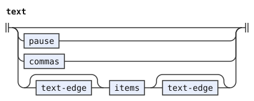</p>
<p>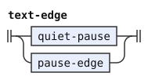</p>
<p>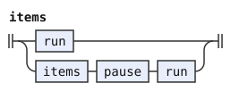</p>
<p>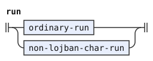</p>
</details>


In this strict reading, a pause is one token. Its core is a run of whitespace characters and periods, with any commas inside it. A whitespace character is one with the Unicode property White_Space. A comma between core characters belongs to the pause token, as in `mi , klama`. A comma that only touches the core belongs to no token. A quote image keeps such commas from the source text.

`period-char` reads a core character that is not whitespace. Script extensions of `core-char` therefore supply their own periods. `Period-Initial` marks a core that starts with a period. `Period-Only` marks a core of periods without whitespace or ignored characters. Later stages preserve these tags for quote boundaries. The pause token covers the core alone, so its item `$c{…}` stands at the place of the core. It replaces both strings with a space.

CLL[^cll-s3-3] says that a comma "cannot be pronounced as a pause", so a comma alone between two words is no pause. A comma at the start or the end of the text belongs to no token. A text of nothing but commas is an empty text.

```jbogenbau
%rule pause
  quiet-pause

%rule quiet-pause
  [pause-edge] $c:pause-core [pause-edge]
%emit
  $c{PAUSE,
     $c.span.first-token.parse(period-char)? Period-Initial,
     $c.span.parse(period-core)? Period-Only,
     image: value: " "}

%rule pause-core
  core-char | pause-core core-char | pause-core pause-edge core-char

%rule pause-edge
  commas

%rule core-char
  space-char | "."

%rule period-char
  $c:core-char
%conditions
  ¬$c.span.parse(space-char)

%rule period-core
  {period-char}

%rule space-char
  _White_Space

%rule commas
  comma | commas comma
```

<details><summary>Railroad diagrams of the 9 rules from <code>pause</code> to <code>commas</code></summary>
<p>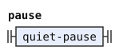</p>
<p>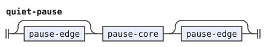</p>
<p>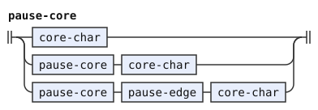</p>
<p>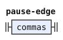</p>
<p>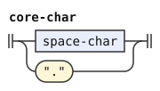</p>
<p>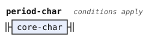</p>
<p>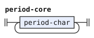</p>
<p>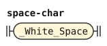</p>
<p>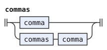</p>
</details>


An ordinary run is letters. A run of adjacent vowel letters is one vowel group, and a group carries the tags of its last vowel. Its term copies those tags as `*$v.flags`, and its strings stay the joins of its children. In the Latin orthography, a group is its vowels, one phoneme each.

A script can tag its full vowel letters `Syllabic` to separate adjacent vowels without a written apostrophe. Two adjacent syllabic vowels form two syllables. `joined-vowel` inserts an apostrophe between them, with value `'` and no text of its own. Its emission list inserts the apostrophe with `ε{…}` and then hands on the vowel. `grammars/lojban/common/cyrillic.md` uses this rule. Each vowel of a group is its own token, so a group of three vowels keeps all three. Each vowel pair matches exactly one of the three cases, so a run has one parse.

In `lojban/cll`, a comma between two vowels marks the syllable break of CLL[^cll-s3-3]. So `kore,a` is `e` and `a` in two syllables. CLL[^cll-s4-7] writes it so "because ea is not a valid diphthong". Anywhere else it is nothing, so `ban,gu` is `bangu`.

```jbogenbau
%rule ordinary-run
  letters

%rule letters
  letters-after-consonant | letters-after-vowel

%rule letters-after-vowel
  | vowel-group
  | letters-after-consonant [commas] vowel-group
  | letters-after-vowel syllable-break vowel-group

%rule letters-after-consonant
  | non-vowels
  | letters-after-vowel [commas] non-vowels

%rule non-vowels
  non-vowel | non-vowels non-vowel | non-vowels commas non-vowel

%rule non-vowel
  consonant | apostrophe

%rule syllable-break
  commas → {Syllable-Break, value: "", image: ","}
%emit

%rule vowel
  plain-vowel | stressed-vowel

%rule vowel-group-with(@V)
  @V
  | vowel-group-plain-with(@V)
  | vowel-group-joined-with(@V)

%rule vowel-group-plain-with(@V) → {*$v.flags}
  | vowel-group-with(@V)<¬Syllabic> $v:@V
  | vowel-group-with(@V)<Syllabic> $v:@V<¬Syllabic>

%rule vowel-group-joined-with(@V)
  vowel-group-with(@V)<Syllabic> $v:joined-vowel-with(@V)<Syllabic> → {*$v.flags}

%rule joined-vowel-with(@V)
  ^$v:@V
%emit
  ε{image: value: "'"}, $v

%rule vowel-group = vowel-group-with(vowel)
%rule vowel-group-plain = vowel-group-plain-with(vowel)
%rule vowel-group-joined = vowel-group-joined-with(vowel)
%rule joined-vowel = joined-vowel-with(vowel)

%rule any-lojban-char
  consonant | plain-vowel | stressed-vowel | apostrophe | comma
```

<details><summary>Railroad diagrams of the 17 rules from <code>ordinary-run</code> to <code>any-lojban-char</code></summary>
<p>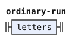</p>
<p>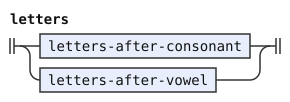</p>
<p>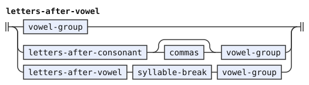</p>
<p>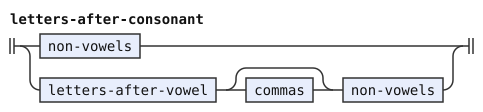</p>
<p>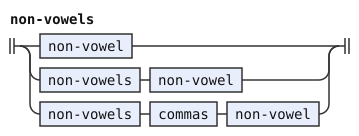</p>
<p>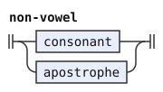</p>
<p>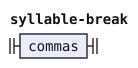</p>
<p>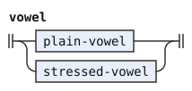</p>
<p>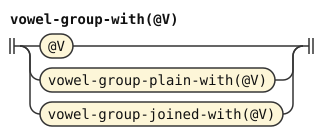</p>
<p>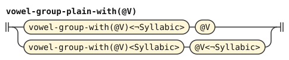</p>
<p>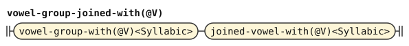</p>
<p>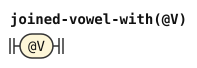</p>
<p>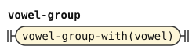</p>
<p>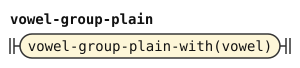</p>
<p>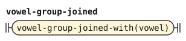</p>
<p>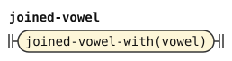</p>
<p>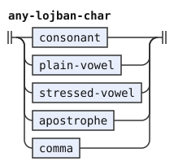</p>
</details>


A run that is not an ordinary run is foreign. It contains a character that this orthography does not read, as `mi klama?` does. The stage emits it as one `FOREIGN` token. Its value is the default join of its characters as stage zero decomposed them, without the phoneme mappings. Its image is the run's source text, the original spelling. So two foreign runs are equal only when their decomposed characters are equal: `ko’a?` and `ko'a?` differ.

A foreign run has at least one character that no rule of `any-lojban-char` reads by itself. The rule `letters` always reads a run without one. So the stage tests only a run with one, and a long run of letters costs nothing more. A run never starts or ends with a comma, which emits nothing on its own at that edge. A run character is any character but whitespace and the period. `run-char` reads it with `_`, then excludes those pause characters through conditions.

```jbogenbau
%rule non-lojban-char-run
  $r:chars-with-non-lojban-char → {FOREIGN, image: $.span.source-text}
%conditions
  ¬$r.span.parse(letters),
  ¬$r.span.first-token.parse(commas),
  ¬$r.span.last-token.parse(commas)
%emit

%rule chars-with-non-lojban-char
  | non-lojban-char
  | lojban-chars non-lojban-char
  | chars-with-non-lojban-char run-char

%rule lojban-chars
  lojban-char | lojban-chars lojban-char

%rule lojban-char
  $c:run-char
%conditions
  $c.span.parse(any-lojban-char)

%rule non-lojban-char
  $c:run-char
%conditions
  ¬$c.span.parse(any-lojban-char)

%rule run-char
  $c:_
%conditions
  ¬$c.span.parse(core-char)
```

<details><summary>Railroad diagrams of the 6 rules from <code>non-lojban-char-run</code> to <code>run-char</code></summary>
<p>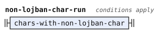</p>
<p>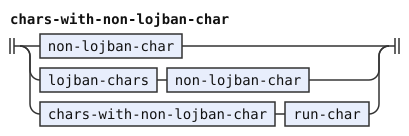</p>
<p>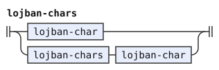</p>
<p>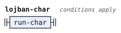</p>
<p>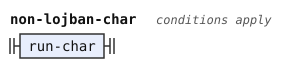</p>
<p>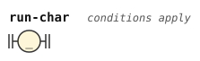</p>
</details>


## Letters

The stage emits each consonant as its lowercase Latin letter. Each consonant mapping sets its value and image to the same Latin phoneme letter. CLL[^cll-s3-9] writes a stressed syllable of a name in capitals, but only the capital vowel marks the stress. A capital vowel carries `Stressed`, a lowercase value, and an uppercase image. Each mapping writes the two strings in its term, as `image: value: "b"` writes one string under both keys. The apostrophe has value `'`. The stage reads each apostrophe character that the rule `apostrophe` lists as that same phoneme.

A brivla is a predicate word. CLL[^cll-s3-9] requires weak stress on every `y`, but also permits free stress in names and cmavo. This grammar applies the weak-stress rule only in brivla, as the [morphology choice](morphology.md#stress-and-syllables) explains. So in lojban/cll, a capital `Y` cannot stand in a brivla. The other pipelines ignore a stress mark on `y`, so they read `bajYkla` as a brivla.

Names can stress any syllable.[^cll-s3-9][^cll-s4-8] A cmavo is a particle. Cmavo can stress any syllable or none.[^cll-s3-9] So a stressed `y` can stand in names and cmavo.

`stressed-vowel-with` takes six patterns, one for each vowel in a script. Named instances keep each script's vowel rule in the phoneme tree.

The `Vowel` tag marks the five full vowels and not `y`. So `stressed-full-vowel-with` holds the five full vowels and carries `Vowel` in its statement term. The outer rule's statement term supplies `Stressed`, and the `y` pattern stays in `stressed-vowel-with`. Its first alternative marks the full vowel as its primary, so that the node keeps the vowel's strings and `Vowel`.

CLL[^cll-s3-1] omits `h` from the alphabet. CLL[^cll-s3-3] says that `h` does not write the apostrophe. This stage treats `h` as foreign text. `grammars/lojban/common/latin.md` reads `h` as the apostrophe.

```jbogenbau
%rule consonant → {Consonant}
  | ("b" | "B") → {image: value: "b"}
  | ("c" | "C") → {image: value: "c"}
  | ("d" | "D") → {image: value: "d"}
  | ("f" | "F") → {image: value: "f"}
  | ("g" | "G") → {image: value: "g"}
  | ("j" | "J") → {image: value: "j"}
  | ("k" | "K") → {image: value: "k"}
  | ("l" | "L") → {image: value: "l"}
  | ("m" | "M") → {image: value: "m"}
  | ("n" | "N") → {image: value: "n"}
  | ("p" | "P") → {image: value: "p"}
  | ("r" | "R") → {image: value: "r"}
  | ("s" | "S") → {image: value: "s"}
  | ("t" | "T") → {image: value: "t"}
  | ("v" | "V") → {image: value: "v"}
  | ("x" | "X") → {image: value: "x"}
  | ("z" | "Z") → {image: value: "z"}
%emit

%rule plain-vowel
  | ("a" | "e" | "i" | "o" | "u") → {Vowel}
  | "y" → {}
%emit

%rule stressed-full-vowel-with(@A, @E, @I, @O, @U) → {Vowel}
  | @A → {value: "a", image: "A"}
  | @E → {value: "e", image: "E"}
  | @I → {value: "i", image: "I"}
  | @O → {value: "o", image: "O"}
  | @U → {value: "u", image: "U"}

%rule stressed-vowel-with(@A, @E, @I, @O, @U, @Y) → {Stressed}
  | ^stressed-full-vowel-with(@A, @E, @I, @O, @U)
  | @Y → {value: "y", image: "Y"}
%emit

%rule stressed-vowel = stressed-vowel-with("A", "E", "I", "O", "U", "Y")

%rule apostrophe
  ("'" | "’" | "‘" | "ʼ") → {image: value: "'"}
%emit

%rule comma
  ","
```

<details><summary>Railroad diagrams of the 7 rules from <code>consonant</code> to <code>comma</code></summary>
<p>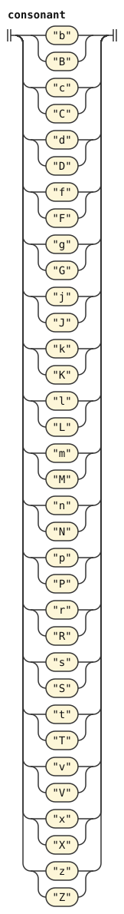</p>
<p>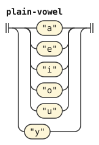</p>
<p>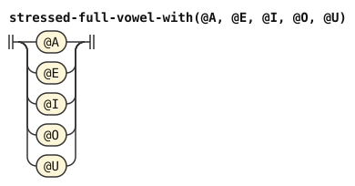</p>
<p>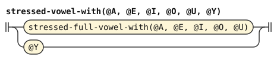</p>
<p>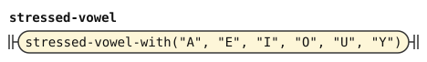</p>
<p>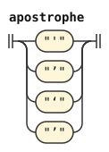</p>
<p>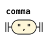</p>
</details>


## Choices beyond CLL

CLL writes a pause as a period.[^cll-s3-3] It does not define spaces. This grammar treats whitespace as a pause because texts separate words with spaces. No CLL word contains a space.

This grammar also accepts U+2019 (`’`), U+2018 (`‘`), and U+02BC (`ʼ`) as apostrophes. They are typographic forms of the same character. They change the reading of no CLL text.

CLL[^cll-s3-1] uses capitals only for nonstandard stress in names. Capital consonants fold even when the word has no capital vowel. Thus `Klama` reads as `klama`. This choice lets a writer capitalize a name or a sentence start.

CLL[^cll-s3-12] describes Loglan-compatible and Tengwar orthographies. This grammar reads neither. CLL calls the Loglan-compatible orthography nonstandard and unused.

### Differences from the format 49 grammar

This document reads the same texts as its format 49 copy, `grammars/lojban/cll/latin.md`. It emits the same tokens with the same values, images, places and tags. `$OUTPUTS` names only the stage's own tags, so a phoneme token carries no Unicode property of its characters, as before.

[^cll-s3-12]: [CLL 1.1, section 3.12](https://lojban.org/publications/cll/cll_v1.1_xhtml-section-chunks/section-oddball-orthographies.html).

[^cll-s3-3]: [CLL 1.1, section 3.3](https://lojban.org/publications/cll/cll_v1.1_xhtml-section-chunks/section-lojban-characters.html).

[^cll-s4-7]: [CLL 1.1, section 4.7](https://lojban.org/publications/cll/cll_v1.1_xhtml-section-chunks/section-fuhivla.html).

[^cll-s3-9]: [CLL 1.1, section 3.9](https://lojban.org/publications/cll/cll_v1.1_xhtml-section-chunks/section-stress.html).

[^cll-s4-8]: [CLL 1.1, section 4.8](https://lojban.org/publications/cll/cll_v1.1_xhtml-section-chunks/section-cmene.html).

[^cll-s3-1]: [CLL 1.1, section 3.1](https://lojban.org/publications/cll/cll_v1.1_xhtml-section-chunks/chapter-phonology.html#section-orthography).

[^cll-c3]: [CLL 1.1, chapter 3](https://lojban.org/publications/cll/cll_v1.1_xhtml-section-chunks/chapter-phonology.html).
